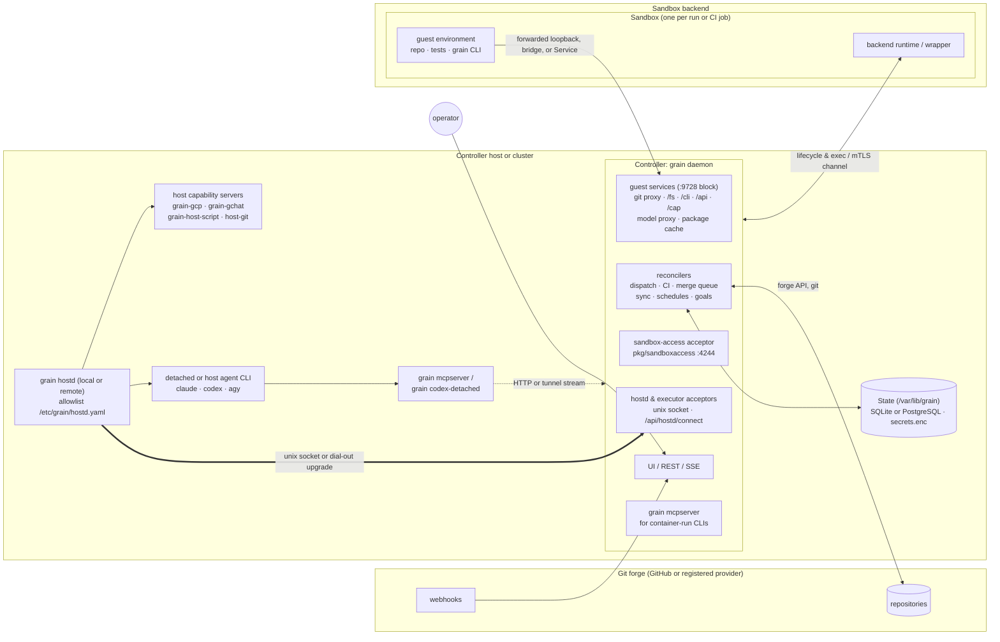
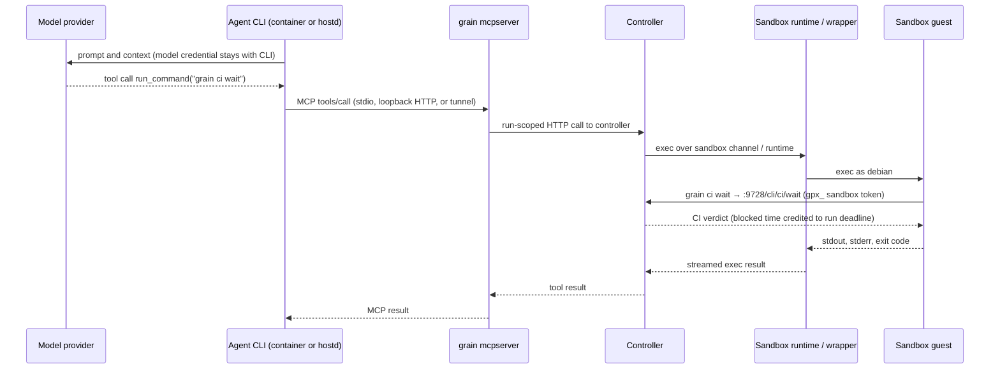
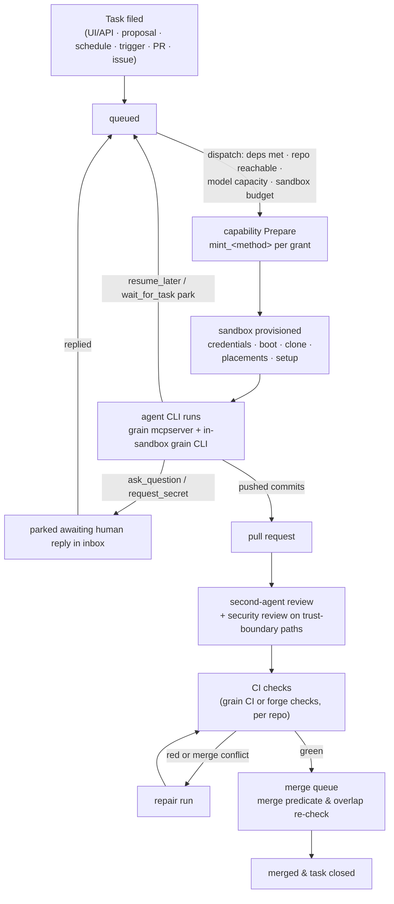

# Grain architecture

**Owner:** @bwsalmon

Grain is a single-tenant control plane that drives coding agents against git repositories, verifies their changes with built-in or forge CI, and lands approved pull requests through a merge queue that merges each change on its own, re-checking it against the current branch tip when it overlaps changes that landed after it forked. This document describes the architecture of the system: the runtime planes, how a task moves from filing to a merged commit, how each plane upgrades without interrupting active work, and where the security boundaries sit.

Each section links to the specifications and reference documents that define individual subsystems in detail:

- **Settings and configuration:** [`settings.design.md`](settings.design.md) and [`design/spec/settings/`](../spec/settings/)
- **Authentication and operator attribution:** [`authentication.design.md`](authentication.design.md), [`operator-attribution.design.md`](operator-attribution.design.md), and [`design/spec/operator-attribution/`](../spec/operator-attribution/)
- **Contributions and contributor attribution:** [`contributions.design.md`](contributions.design.md) and [`attribution.design.md`](attribution.design.md)
- **Standing director sessions and external CLIs:** [`director.design.md`](director.design.md), [`design/spec/director/`](../spec/director/), and [`external-cli.design.md`](external-cli.design.md)
- **Task priorities:** [`task-priorities.design.md`](task-priorities.design.md)
- **Capabilities, sandboxes, and agent API contracts:** [`design/spec/capabilities/capabilities.spec.md`](../spec/capabilities/capabilities.spec.md), [`docs/sandbox-image-contract.md`](../../docs/sandbox-image-contract.md), [`docs/agent-api.md`](../../docs/agent-api.md), and [`design/design/non-disruptive-upgrade.design.md`](non-disruptive-upgrade.design.md)

**The core rule:** the controller is the only component that holds authority, the sandbox is the only place untrusted repository code runs, and nothing that grants authority enters the sandbox. Model keys, forge credentials, deployment secrets, and a host user's own logins stay in the controller or in `grain hostd`. A sandbox receives per-attempt tokens scoped strictly to what its run was granted, and actions that end a run, file auto-approved work, or mutate deployment policy are reachable only through model control tools outside the sandbox, never from a process inside it.

## The four runtime planes

A deployment has four runtime planes:

1. **The controller** (`grain daemon`). Holds operational state, runs the level-triggered reconcilers and the in-process CI engine, serves the UI and HTTP APIs, and terminates every connection from the other planes.
2. **Sandboxes.** Disposable Linux environments—one per agent run or CI job—where repository checkouts, builds, and tests execute.
3. **`grain hostd`.** One or more host daemons running outside the controller container—on the same machine over `/run/grain-hostd/hostd.sock` or on remote workstations dialling in over HTTPS. Each runs allowlisted programs under its host user's identity: detached agent CLIs, host-pinned capability servers, and operator host scripts.
4. **Agent CLIs and the agent surface.** `claude`, `codex`, `antigravity` (`agy`), and custom agent commands run in the controller container, in detached run pods, or under `hostd`. Their tool surface splits between `grain mcpserver` outside the sandbox and the `grain` CLI inside it.



Nothing opens an unsolicited inbound network connection to a sandbox guest or to a remote `hostd`. Remote `hostd` instances dial out to the controller, and sandboxes reach only the controller's explicitly exposed guest-service ports.

### 1. The controller

Grain runs as one controller process (`grain daemon`). On a machine install (`scripts/setup.sh`), it runs inside the release container (`grain-daemon.service`) with `grain hostd` beside it on the host (`pkg/whererun`). Standalone Kubernetes manifests (`deploy/kubernetes/`) run `grain daemon` in a cluster Deployment for self-contained cluster installs. Running `grain daemon` directly on the bare machine is used for `grain demo`, local development, and end-to-end test harnesses.

**Extension seams for wrapper distributions.** The open-source core (`github.com/ai-on-gke/grain`) has no dependency on private infrastructure. A wrapper distribution imports core packages and registers extensions at init time: custom change providers (`pkg/change.Register`), capability servers (`pkg/capability/intree.Register`), host families (`pkg/ui.RegisterHostFamily`), default `hostd` CLI run locations and caveats (`daemon.RegisterHostdDefault`, `daemon.RegisterDetachedCaveat`), and signed-header proxy verifiers (`IdentityVerifier` in [`authentication.design.md`](authentication.design.md)).

**Reconcilers.** All orchestration is level-triggered (`pkg/orchestrator`). On each cycle, reconcilers read the store and forge state and advance each record one step:

- **Dispatch** (`reconcileDispatch`, `pkg/dispatch`). Admits queued tasks in priority order ([`task-priorities.design.md`](task-priorities.design.md)) once dependencies close, the target repository is reachable, a model connection has capacity, the shared CPU, memory, and disk budget fits, and every grant can be prepared.
- **CI** (`reconcileCI`, `pkg/ci`, `pkg/daemon/ci.go`). Plans `.grain/workflows` DAGs and runs jobs in sandboxes, caching verdicts by content fingerprint. Each repository has one CI mode (`model.CIMode`): `grain` gates on grain's built-in CI and ignores forge check runs, `github` gates on external forge checks such as GitHub Actions, and `none` skips CI verification. Forge checks are recorded beside grain CI runs from webhooks and the pull request sync (`pkg/orchestrator/githubci.go`, `reconcileGitHubCITails`, [`docs/github-ci.md`](../../docs/github-ci.md)).
- **Merge queue** (`reconcileSync` → `SyncPullRequestsGuarding` in `pkg/orchestrator/sync.go`, `pkg/forge`, `pkg/orchestrator/mergepredicate.go`, `mergerecheck.go`). Merges each pull request on its own once it satisfies the merge predicate, re-checks a change on the merge-queue ref when it overlaps what has landed since it forked, and schedules repair runs on conflicts or failures. There is no batching ([`docs/merge-queue-behind.md`](../../docs/merge-queue-behind.md)).
- **Base-branch CI and repair** (`reconcileBaseBranchCI`, `reconcileBaseBranchDispatch`, `pkg/dispatch/repair.go`). Runs CI on each new base-branch tip after merges. A red base branch earns a repair task (`FixesBaseBranch`), which dispatch admits from a reserved slice of the sandbox budget, pre-empting lower-priority work if it must. A red base does not hold the merge queue.
- **Schedules, triggers, wakes, and goals** (`reconcileSchedule`, `reconcileSystemSchedules`, `reconcileScheduledWorkflows`, `reconcilePathTriggers`, `reconcileWake`, `reconcileTaskGoals`, `reconcileConsoleSessions`). Fires recurring templates, suites, scheduled workflows, path triggers, and standing sessions, wakes suspended tasks whose condition has fired, and runs goal checks.
- **Reviews, holds, and upgrades** (`reconcileReviews`, `reconcileSecurityHolds`, `reconcilePipelinePause`, `reconcileAutoUpgrade`, `reconcileScheduledUpgrade`, `reconcileUpgradeCheck`, `reconcileSandboxes`). Drives second-agent and security reviews, honours pipeline pauses (including the upgrade hold), starts and checks controller upgrades, and reaps sandboxes no live run claims. The full ordered list is `orchestrator.Reconcilers` in `pkg/orchestrator/cycle.go`.
- **State repo sync** (`pkg/staterepo`, driven by `daemon.StateManager` in `pkg/daemon/statemanager.go` beside the reconcile loop). Exports configuration tables and YAML projections to `grain/config` (or an external config repository) and applies merged configuration pull requests back into the live database ([`settings.design.md`](settings.design.md)).
- **Liveness** (`pkg/orchestrator/liveness.go`). Classifies every non-terminal task state as driven by a named reconciler, awaiting a person's action, or awaiting an external answer under a deadline, escalating driven states that exceed their patience threshold.

**State.** Operational data, reviewable configuration, secrets, and workspace artifacts live in four stores ([`settings.design.md`](settings.design.md)):

| Store | Holds | Where |
| --- | --- | --- |
| Database | Tasks, observations, runs, comments, links, CI runs, merge-queue re-check rows (`merge_batch`), sandbox claims, spool cursors, notifications | SQLite at `<data-dir>/store/grain.db` by default, or PostgreSQL via `<data-dir>/db-config.json` or `-postgres-url` |
| `grain/config` state repo | Exported settings tables (scrubbed of secrets), `settings/*.yml` projections, memory docs, release notes, repo setup scripts, workflows | Local git repo under `<data-dir>/state-repo` or an external git remote (`pkg/staterepo`) |
| Secrets | Model API keys, GitHub App keys, capability server credentials, values supplied via `request_secret` | `<data-dir>/secrets/secrets.enc` (`pkg/secrets`, X25519 + HKDF-SHA256 + AES-256-GCM hiding names and values), sealed to `0600` `<data-dir>/secrets/secrets.key`, optionally mirrored as ciphertext via `pkg/secretsrepo` |
| Data volume | Bare repo caches, agent `HOME` directories and session stores, transcripts, run spools, CI cache and artifacts, package cache objects | `/var/lib/grain` on the controller host, or the `grain-data` ReadWriteOnce PVC on Kubernetes installs |

The relational database is the live source of truth read on every reconcile tick. `grain/config` is the diffable, PR-reviewed projection of standing configuration; `secrets.enc` is gitignored there, and configuration rows hold only `$secret:<name>` or `<secret>/<key>` references.

**Control plane and API.** The UI, REST and SSE endpoints, webhooks, and the agent API share one HTTP server (`pkg/ui`). Operators reach it over loopback, through an SSH tunnel or reverse proxy, or behind Google Cloud Identity-Aware Proxy (IAP) or a registered `IdentityVerifier` ([`authentication.design.md`](authentication.design.md)). Without verified proxy sign-in, `singleTenantGate` requires the deployment access code (`local-api-token`, [`docs/access-code.md`](../../docs/access-code.md)). Every route declares a scope in `pkg/ui/route_scopes.go`, and credentials are domain-separated: a UI session or bearer access code, an agent API token, an external-agent `gma_` token, a sandbox proxy `gpx_` token, and a `hostd` or executor token are distinct credential kinds, none accepted on another's routes (`pkg/ui/accesscode_internal_test.go`).

**Services the controller terminates for other planes:**

- **Sandbox-access acceptor** (`pkg/sandboxaccess`, listening on `-sandbox-access-addr`, conventionally `:4244`), accepting outbound mTLS connections from `kubernetes-granule` pod wrappers when `-k8s-granule-access=dialout`. The default, `kubectl`, runs guest commands over `kubectl exec` instead.
- **Guest-facing services** on the `-sandbox-port-base` port block (`9728` by default, `pkg/ports`): the git and sandbox HTTP proxy (`9728`), model inference proxies (`pkg/modelproxy`), the `host-script` data plane (`9733`), the GitHub Actions cache service (`pkg/actionscache`), and the package cache's DNS (`53`) and HTTP/TLS (`80`/`443`) interception listeners (`pkg/pkgcache`).
- **`hostd` and remote executor acceptors**: `/run/grain-hostd/hostd.sock` on the local host, `/api/hostd/connect` for a remote `grain hostd` dialling out (`pkg/hostd`), and `/api/executors/connect` for remote model executors (`pkg/modelexec`).
- **Capability broker** (`pkg/capability`, `pkg/daemon/capabilities.go`), attaching to in-process, container, and `hostd`-pinned capability servers to mint and release per-attempt passes and proxy MCP tool calls ([`design/spec/capabilities/capabilities.spec.md`](../spec/capabilities/capabilities.spec.md) §4–§5).

**Package boundaries.** Inside the controller binary, packages follow strict downward dependencies: orchestration and task state (`pkg/orchestrator`, `pkg/model`) sit above forge integration (`pkg/forge`, `pkg/github`, `pkg/change`) and sandbox runtimes (`pkg/granule`, `pkg/sandboxaccess`, `pkg/k8s`). `pkg/granule` and `pkg/sandboxaccess` import nothing from `pkg/model`. The CI workflow engine under `pkg/grit/...` (and `cmd/grit`) links only an allowlist of neutral packages (`pkg/workflows`, `pkg/granule`, `pkg/sandboxaccess`, `pkg/gritapi`, leaf utilities), never grain-core packages (`pkg/grit/independence_test.go`). CI therefore stays a package boundary inside the controller process, with no separate CI service. A remote `grit serve` backend (`-grit-url`) exists only as experimental plumbing. The daemon refuses it without `-grit-experimental` because it runs no repository's workflows yet (`daemon.CheckGritURL`, [`grit-split.design.md`](grit-split.design.md)).

### 2. Sandboxes

A sandbox is a disposable Linux workspace where the target repository is checked out at `/home/debian/work` and every agent command or CI step executes as user `debian` (`uid 1000`).

**Shared contract and backends.** Agent runs and CI jobs share one sandbox budget, one `orchestrator.Sandboxes` interface (`ci.Sandboxes` adapts it for CI jobs), and one guest image contract ([`docs/sandbox-image-contract.md`](../../docs/sandbox-image-contract.md)). A deployment selects its backend with `-sandbox-backend` (`sandboxBackend` in Settings):

| Backend | Runtime | Isolation and connectivity |
| --- | --- | --- |
| `granule` | Local KVM microVM via `granule` in a container on the controller host | Hardware VM boundary (`/dev/kvm`), dedicated guest kernel, host nftables firewall per address block (`pkg/sandboxaddr`); reaches guest services over the VM bridge (`192.168.9.1:9728`) or loopback forwards |
| `kubernetes-granule` | `granule` KVM microVM inside a pod on a Kubernetes node pool (such as GKE nodes with `/dev/kvm`) | Hardware VM boundary plus pod `NetworkPolicy` and an in-pod packet filter between guest and wrapper; wrapper dials `sandboxaccess` (`:4244`) over mTLS or is reached off-cluster via `kubectl exec` and `granule forward` |
| `container` | Local Docker or Podman container | Linux container namespaces and cgroups without a separate guest kernel; reaches guest services via the container bridge host or forwarded ports |
| `kubernetes` | Plain Kubernetes pod (`Dockerfile.k8s-sandbox`) | Pod container and `NetworkPolicy` isolation on clusters without `/dev/kvm`; commands run via `kubectl exec` and services are reached via the sandbox `Service` |
| `host` | Temporary directory on the controller machine | No VM or container isolation; restricted to loopback single-user workstations (`CheckHostSandboxes`) where `network: none` is refused |
| `none` | Disabled | Admits only runs that require no sandbox |

A sandbox lives for the duration of its agent attempt or CI job unless created as a standing or persistent session sandbox (`pkg/orchestrator/persistent_sandboxes.go`, `standing_sandboxes.go`). Only pushed git commits, transcripts, uploaded CI artifacts, and task comments outlive a reaped sandbox.

**Guest image contract.** Sandbox images come in two tiers: minimal bases (`guest-base` for microVMs, `k8s-sandbox-base` for plain pods) and full defaults layered on top. Every image carries an integer `dev.grain.sandbox.contract` label declaring its boundary properties: user `debian` at `uid 1000`, `git`, `curl`, CA certificates, the port-forwarding helper, and—on microVM images—`sudo`, `systemd`, and `grain-connect` ([`docs/sandbox-image-contract.md`](../../docs/sandbox-image-contract.md)). Default full images also carry `/usr/local/bin/grain`. Custom images built `FROM` a base require rebuilding only when the contract integer changes.

**Provisioning lifecycle.**

1. **Admission and grant preparation.** Dispatch acquires a sandbox permit and calls capability `Prepare` for every grant before booting the sandbox, so unmintable grants fail admission cleanly.
2. **Credentials and boot.** The controller mints a per-attempt sandbox proxy token (`gpx_…`, `pkg/gitproxy/tokens.go`). On `kubernetes-granule` with the acceptor enabled, it also mints a sandbox client certificate from the deployment CA (naming the sandbox in `CN` and URI SAN) and a 256-bit channel token (storing only its hash on the sandbox row), placing both in a pod-owned Kubernetes `Secret` mounted solely into the wrapper container. The backend then boots the VM, pod, or container.
3. **Workspace setup.** Over the backend's exec and file channel, the controller places batched credential and capability files (`~/.git-credentials`, capability placements), clones the repository on the task's branch, runs `setup_root` and `setup` hooks, and opens port forwards.
4. **Execution and teardown.** Agent tool calls or CI steps execute inside the guest. When the attempt or job ends, capability leases are released, tokens are revoked, and the VM, pod, or container is destroyed.

**Inside a `kubernetes-granule` sandbox pod.**

```
sandbox pod
┌────────────────────────────────────────────────────────────────┐
│ wrapper container (granule runtime, trusted for this sandbox)  │
│   wrapper ──mTLS dial-out──▶ grain-access:4244                 │
│     │  holds /var/run/granule/access/{cert,key,token}          │
│     │  in-pod drop filter blocks guest packets to :4244        │
│     │                                                          │
│     │ vsock exec, virtio                                       │
│     ▼                                                          │
│   ┌────────────────────────────────────────────────────────┐   │
│   │ guest VM (untrusted)                                   │   │
│   │   /home/debian/work       repository checkout          │   │
│   │   ~/.git-credentials      per-attempt gpx_ token       │   │
│   │   grain CLI ──▶ :9728 ──▶ git proxy, /fs, /cli, /cap   │   │
│   │   resolv.conf, CA ──────▶ caching package proxy        │   │
│   └────────────────────────────────────────────────────────┘   │
└────────────────────────────────────────────────────────────────┘
```

**The sandbox-access channel** (`pkg/sandboxaccess`). In dial-out mode, each wrapper holds one multiplexed mTLS connection to the acceptor carrying streaming `exec` (stdio, exit code, signals), cursor-based `exec` reattach, batched file writes, and bidirectional TCP port forwards. The acceptor admits a connection only if the certificate chains to the deployment CA, the token matches the stored hash for that sandbox, and the sandbox row is live. Sandbox A's wrapper cannot open sandbox B's channel, and deleting a sandbox row invalidates its credential immediately. Kubernetes `pods/exec` stays out of the steady-state data path and is used only for readiness probes, single-shot startup diagnostics when a channel fails to connect, off-cluster `kubectl` pools without an acceptor route, and operator debugging.

If a dial-out channel drops, the wrapper reconnects and reattaches active commands from their byte cursors within the reattach timeout (2 minutes by default) transparently. If it does not return in time, active commands end with `ErrChannelLost`: a CI job records an `infra` verdict and re-runs uncached, while an agent tool call returns an error so the run can recover or rebuild.

**The sandbox HTTP proxy (`:9728`).** Inside the guest, `git` and the `grain` CLI reach the controller's sandbox proxy (at `127.0.0.1:9728` over a loopback forward, `192.168.9.1:9728` on a granule bridge, or the sandbox `Service` address, discovered from `GRAIN_SANDBOX_PROXY` or `~/.git-credentials`). Every request carries the attempt's `gpx_` bearer token. The proxy resolves the token to its live `(sandbox, task, run)`, checks grants, records telemetry, and routes by prefix:

| Prefix | Serves | Authorization |
| --- | --- | --- |
| `/` (git smart HTTP) | Clone/fetch of the target, `reads:`, and `writes:` repositories; push only to the task's branch (`grain/<id>/task-<n>`) and declared `writes:` ref patterns | Ref and repository policy in `pkg/gitproxy/authorize.go` |
| `/fs/<scheme>/<path>` | Read-only virtual namespace (`pkg/namespace`): `ci://`, `src://`, `task://`, `config://`, `memory://`, and `deploy://`, with `?list`, `?glob=`, `?grep=`, and no size cap | Own-task `task://` and `memory://` are open to the run; `ci://` requires `grain-ci` on the task's repo, `api:ci:read`, or `self-debug`; `src://`, `config://` (`staterepo.BrowsablePath` only), `deploy://`, and other tasks' `task://` require `self-debug` or matching `api:` grants |
| `/cli/...` | `grain` CLI actions (`pkg/sandboxcli`): `ci wait`, `ci run-job`, `ci retrigger`, `ci log`, `pr status`, `pr base-status`, `pr open`, `pr reply`, `pr resolve`, `pr review-comment`, `status`, `handover write`, `notify`, `task message`, blocking `task wait`, unapproved `task propose`, `git revert` | Scoped to the task's own run, branch, and repository (or parent/child tasks for `task message`) |
| `/api/...` | Granted non-dangerous REST agent API routes (`grain api`) | `agentAPIGate` (`pkg/ui/agent_api_gate.go`) checks `api:*` grants and refuses `Dangerous` and model-only operations on `X-Grain-Channel: sandbox-cli` |
| `/cap/<server>/mcp` | Attempt-scoped MCP capability tools marked `model_only: false` (`grain cap`) | `gitproxy.CapRegistry` (`pkg/gitproxy/capserver.go`) admits only tools registered for the attempt with `model_only: false` |

Alongside `:9728`, the **package cache** (`pkg/pkgcache`, [`docs/package-cache.md`](../../docs/package-cache.md)) answers guest DNS for supported registries and caches apt, PyPI, npm, Go, Cargo, and OCI downloads behind a TLS proxy trusted by the guest CA bundle. **Model proxies** (`pkg/modelproxy`) serve proxied inference with per-attempt tokens for runs granted the `model-proxy` capability. A `network: none` sandbox has no external route (and no NIC on microVMs), reaching guest services solely over forwarded loopback ports.

Long-polling waits are bounded by the controller. `grain ci wait` and `grain ci run-job` hold an HTTP request for at most 9 minutes—inside `run_command`'s 10-minute ceiling—crediting blocked time back to the attempt's deadline (up to 45 minutes per attempt, `pkg/orchestrator/waitcredit.go`) and marking the run in a declared wait. If CI is still running when a slice ends, the proxy returns a resume token.

### 3. `grain hostd`

`grain hostd` (`pkg/hostd`) is the same `grain` binary run as a systemd unit outside the controller container under a host user's account. It serves two roles:

1. **Detached execution** so agent CLIs survive controller container restarts and upgrades.
2. **Controlled access to a host user's ambient identity**—such as a CLI's own user login, `gcloud` user credentials, SSH commit-signing keys, or a source-control workspace capability—without exposing that host environment to the controller container or any sandbox.

**Local socket and remote dial-out.** On the controller machine, `grain daemon` connects to `/run/grain-hostd/hostd.sock`. On a remote workstation (`grain hostd -server <url>`), `hostd` dials out to `/api/hostd/connect` (`pkg/hostd/dialout.go`, `pkg/hostd/remote.go`), upgrading HTTPS with WebSocket handshake headers (`pkg/tunnel/wsupgrade`) so reverse proxies and IAP pass the stream with no inbound ports on the host. Behind IAP, `hostd` sends an OIDC ID token in `Authorization: Bearer` and its `hostd` token in `X-Grain-Hostd-Token`, then runs a multiplexed `pkg/tunnel/mux` session.

In the target multi-`hostd` design (see *Where each piece stands* for what is implemented versus in progress), each `hostd` is registered in Settings with a name, an owner, labels, and a unique token; work routes by an explicit pin (such as `hostd: build-box-1`) or label selector, and model connection concurrency leases key by `(connection, hostd)` so a rate-limit pause on one user's login pauses only that host. Alongside `hostd`, `pkg/modelexec` (`/api/executors/connect`) supports named remote model executors with per-executor tokens (`executor_token`), remote workspace staging, and multiplexed MCP, git-proxy, and capability MCP tunnel streams (`pkg/modelexec/protocol.go`).

**What runs on `hostd`.**

| Workload | Allowlist entry | Credentials used |
| --- | --- | --- |
| Detached `claude` | `cli claude-detached`: release image binary extracted to `/usr/local/lib/grain/hostd/<image-id>/` | Deployment OAuth token or API key passed to the run; no host user files read |
| Detached `codex` | `cli codex-detached`: `grain codex-detached` wrapping extracted `codex.bin` | Deployment `codex` login in `CODEX_HOME` |
| Host-run CLI (`claude`, `codex`, `agy`) | `cli <name>` | Host user's own logins or a configured connection key |
| Host-pinned capability servers | `capabilities:` entries (`grain-gcp`, `grain-gchat`, `grain-host-script`, or wrapper-registered capability servers) | Host user's ambient credentials (`gcloud`, kubeconfig, chat credentials, or a source-control workspace) |
| `host-git` | `capabilities: host-git` | Host user's forge login and SSH signing key; signs commit payloads without the key leaving the host |
| Host scripts | Run by `grain-host-script` | Operator-written bash run as the host user; sandboxes call `grain host-script <name> [args]` over a forwarded capability port ([`docs/host-scripts.md`](../../docs/host-scripts.md)) |

**Allowlist enforcement.** Every request names an entry in root-owned `/etc/grain/hostd.yaml` (`pkg/hostd/allowlist.go`). `hostd` re-reads the file on each request and checks the binary, fixed arguments, permitted environment variable names, working directory, and `max_duration`. Built-in capability entries (`intree.HostdBuiltins`) are added via `grain-hostd-allowlist.service` without overwriting operator edits. A compromised controller can start only what the root-owned allowlist admits, and `max_duration` prevents runaway orphans.

**Detached runs and spool cursors (`pkg/hostd` protocol 3).** `hostd` speaks a framed binary protocol (`ProtocolVersion = 3`, `MinCompatible = 1` in `pkg/hostd/protocol.go`). Detached starts (`Request.Detach`) spool child stdout and stderr to append-only host files and write `exit.json` once on exit. When the controller disconnects, only stdin closes and the child runs to its deadline. The controller persists its byte offset per run in `task_run_spool_cursor` (`hostd:<run-id>`). On reconnect or restart, the controller sends `OpHello`, lists processes via `OpProcesses`, and reconciles each with `runhost.DecideHostd`:

- processes matched to a live run are adopted from their byte cursor (`OpAttach`), with the gap credited as wait time;
- unmatched processes are cancelled (`OpCancel`);
- processes past their deadline are finalized.

### 4. Agent CLIs and the agent surface

**Frameworks and hosts.** `pkg/agent` implements `agent.Framework` for `claude`, `codex`, `antigravity` (`agy`), and `custom` commands over an `agent.Host` substrate: `LocalHost` (subprocess in the controller container or bare-machine daemon), `HostdHost` (via `grain hostd`, `pkg/runhost/hostdhost.go`), `RemoteHost` (via `pkg/modelexec`), or Kubernetes detached run pods (`pkg/daemon/runhost.go`).

**Run locations.** Each CLI's run location resolves per attempt from live configuration (`Settings → Models`, then `-<cli>-run` flags, then built-in defaults in `pkg/daemon/clirun.go`):

| Location | Where the CLI runs | Survives controller restart |
| --- | --- | --- |
| `container` | Subprocess in the controller container (or detached run pod when `runhost` is enabled on Kubernetes) | No in-container (re-queued without a strike); yes on detached run pods |
| `detached` (`claude`, `codex`) | Under `grain hostd` from the release image's extracted binary with deployment credentials (`<cli>-detached`) | Yes, adopted from `hostd`'s spool cursor |
| `host` | Under `grain hostd` from the operator's allowlist entry (`<cli>`) using the host user's environment (or as a child of a bare-machine development daemon) | Yes when started detached under `hostd` |

If `hostd` is unreachable or lacks the detached entry, `detached` falls back to `container` with a warning in Settings. A `host` setting fails explicitly rather than silently dropping the host user's identity, except when a deployment has no host executor (`HostExecutorNone`, such as standalone Kubernetes without a remote `hostd`), where stored `host` settings resolve to `container` with a warning (`pkg/daemon/hostexec.go`).

**Where `grain mcpserver` runs.** Agent CLIs get their model tools from `grain mcpserver`, a stateless process that calls the controller's HTTP API:

- **`claude` in the container:** served over the controller's HTTP MCP endpoint (`claude.WithHostMCP`).
- **`claude` detached or on host:** forked on the host from the extracted or installed `grain` binary, so nothing in the run is a child of the controller container.
- **`codex`:** served by a per-run stateless Streamable HTTP loopback adapter with a 256-bit bearer token, rejecting unexpected `Host` headers, browser `Origin` headers, and other runs' tokens, with tools snapshotted at startup. When detached, `grain codex-detached` hosts that adapter beside `codex.bin` on the host ([`docs/codex-isolation.md`](../../docs/codex-isolation.md)).
- **`agy`:** forks `grain mcpserver` and its `PreToolUse` confinement hook from `/usr/local/bin/grain` on the host.

Over a remote executor connection, `mcpserver` calls travel on an MCP tunnel stream admitted only for `argv` grants issued to active runs on that connection (`pkg/modelexec/mcpgrants.go`). `mcpserver` retries controller restarts for up to two minutes.

**Splitting the agent surface.** Runs with a sandbox default to `-mcp-surface=control`, dividing tools by what may safely be called from inside the untrusted guest ([`docs/agent-api.md`](../../docs/agent-api.md)):

- **Model-only MCP control set (`grain mcpserver`, outside the sandbox):** the four sandbox tools (`run_command`, `read_file`, `write_file`, `edit_file`); every run-ending or parking tool (`chat`, `ask_question`, `request_secret`, `comment_on_issue`, `nothing_needed`, `resume_later`, `wait_for_task` with `park`); `propose_task` (with inherited approval, `auto_merge`, `supersedes`, and sub-grants within `model.GrantsSubsetOf`); `recreate_sandbox`; local scripts; model-only dangerous `api:*` and capability tools (`model_only: true`, the default for external capability servers); and forge CI/PR tools when a repository uses external CI checks (`ci_mode: github`) or a non-git change provider. `orchestrator.ProcessResult` reads only these model calls and pushed git refs to decide how an attempt ended.
- **In-sandbox `grain` CLI (`:9728`, inside the sandbox):** uncapped `/fs/` reads, grain CI and PR commands, `status`, `handover write`, `notify`, `task message`, blocking `task wait`, non-dangerous `api:*` routes (`grain api`), and capability tools marked `model_only: false` (`grain cap`). `grain task propose` from the CLI is always held for approval, never `auto_merge`, never `supersedes`, and capped at 10 per attempt.

Keeping bulk reads and routine commands on the `grain` CLI avoids tens of thousands of tokens of turn-one MCP tool schemas and lets agents pipe outputs through standard Unix tools.

**End-to-end tool call flow.**



## End-to-end lifecycles

### A task's lifecycle

Tasks enter from several sources: the UI and REST API, `propose_task` proposals from running agents, schedules and path triggers, adopted external pull requests, or forge issues. For how design-driven work enters a repository and how contributors are credited, see [`contributions.design.md`](contributions.design.md) and [`attribution.design.md`](attribution.design.md).



1. **Filing and queueing.** A task is recorded with its target repository, base branch, priority, `depends_on` edges, and requested grants. Proposals filed via `propose_task` inherit auto-approval only when their grants stay within the parent's (`model.GrantsSubsetOf`) and include no person-only capabilities.
2. **Admission and `Prepare`.** Dispatch admits the task and mints every grant before booting the sandbox. In-process providers (`api`, `git`, `config-map`, `model-proxy`, `skill`), container capability servers, and `hostd`-pinned servers each return an attempt-scoped `Pass` with `placements`, `ports`, `setup_root` and `setup` hooks, optional `mcp_endpoint`, and prompt text ([`design/spec/capabilities/capabilities.spec.md`](../spec/capabilities/capabilities.spec.md) §4–§5). `gcp#gcp-key` mints a short-lived service-account key for its permission set and revokes it on release; `config-map` places configured files and `0600` secrets.
3. **Sandbox and execution.** The sandbox is provisioned, the repository is cloned, placements and setup hooks run, the prompt is assembled (task, conversation or handover, memory, `grain` CLI guide, and capability prompt sections), and the CLI starts in its run location.
4. **Run completion (`orchestrator.ProcessResult`).** When the CLI exits, the controller inspects its control calls and pushed refs:
   - Pushed commits open or update a pull request.
   - `comment_on_issue` posts a closing report; `ask_question` and `request_secret` park the task in the inbox until answered.
   - `nothing_needed` closes the task without opening a pull request.
   - `resume_later` and `wait_for_task` (`park: true`) record a requested suspension (`model.SuspensionKind`) and re-queue the task until its wake condition fires, without spending dispatch standing or counting a strike.
   - Rate limits, capacity shortages, expired host credentials, and controller restarts are likewise recorded as suspensions rather than strikes (`pkg/model/suspension.go`).
5. **Agent and security review.** Every code change is reviewed by a second agent before landing. Changes touching trust-boundary paths (`pkg/trustboundary`: `scripts/setup.sh`, `pkg/runhost/*`, `pkg/staterepo/*`, `pkg/mcp/managed_http.go`, `.github/workflows/*`, `.grain/*`, and related paths) are held for `system:security-review` (and human sign-off on release-promotion or `grain/config` privilege paths). If reviewer fixes touch trust-boundary paths, the new head is reviewed again. Unresolved findings become review comments or wait for human approval.
6. **CI and the merge queue.** The repository's configured checks (`.grain/workflows` in grain CI or forge checks such as GitHub Actions, by `ci_mode`) run on the pull request head. Failures matching the same job across multiple active branches are classified as shared faults (`pkg/cifault`) rather than blamed on the branch. Branch-specific failures or merge conflicts queue a repair run. The merge queue lands a change once it satisfies `pkg/orchestrator/mergepredicate.go`. The change must merge cleanly and be green on its own head, or carry an operator's force merge pinned to the reviewed head commit. A change whose files, Go packages, or global build inputs overlap what has landed since it forked is first re-checked on the merge-queue ref (`mergerecheck.go`). A red re-check takes the normal repair path: one automatic repair (sometimes a second), then `merge_failed` to the inbox. After each merge, base-branch CI judges the new tip, and a red tip files a base-branch repair.
7. **Durable tasks, goals, and notifications.** Standing tasks—such as the pipeline steward and interactive director sessions ([`director.design.md`](director.design.md))—use idle watchdogs and `resume_later` suspensions instead of fixed one-shot deadlines. Tasks with a `TaskGoal` (`pkg/orchestrator/taskgoals.go`) stay open across runs until the controller observes the goal met. Issues needing attention without parking a run raise structured `Notification` records (`grain notify`, `pkg/orchestrator/notifications.go`).

### Non-disruptive upgrades

Each plane upgrades on its own schedule across at least one protocol generation of version skew ([`design/design/non-disruptive-upgrade.design.md`](non-disruptive-upgrade.design.md)).

**Controller upgrade:**

1. Take the upgrade hold (`orchestrator.UpgradeHold`, a pipeline pause passed in as `upgrade.Config.Hold`) so dispatch starts no new runs. No hold is taken if someone else has already paused the pipeline.
2. Stage the new build (`pkg/upgrade`: check out and build, or pull an image), health-check it, and write the schema step for the incoming build (`pkg/daemon/schemaupgrade.go`).
3. Flush (`upgrade.Config.Flush`, `pkg/daemon/runhostupgrade.go`): stop tailing every run in a run pod or `hostd` and persist each spool cursor (`task_run_spool_cursor`). Rows stay live, leases stay held, and sandboxes keep running for the next build to adopt.
4. Restart only `grain-daemon.service` (or roll the controller pod). Running sandboxes, `hostd`, and detached CLIs are untouched.
5. On startup, the new controller adopts detached `hostd` processes and run pods from their spool cursors (`RecoverRunHosts`, `ResumeAdoptedRun` in `pkg/orchestrator/adopt.go`). It reclaims those runs' sandboxes before the startup reap removes the rest (`ReadoptSandbox`). It reattaches CI step execs from persisted `ci_step_attachment` rows `(run, job, step, sandbox, exec_id, cursor)` as wrappers redial. The restart gap is credited as wait time. Runs whose substrate vanished during the gap finish as interrupted with an explicit reason, which the post-upgrade check reports (`InterruptedRunsSince` in `pkg/model/upgrade_losses_store.go`).
6. Release the upgrade hold (`orchestrator.ReleaseUpgradeHold`, before the first cycle dispatches) and record the adoption summary (`orchestrator.AdoptionReport`).

Authentication survives the restart because no active run credential lives only in controller memory: sandbox `gpx_` tokens are stored encrypted, model-proxy and sandbox-access tokens are stored by ID and hash, wrapper mTLS keys live in pod-owned Secrets, and `grain mcpserver` and the `grain` CLI retry disconnects for up to two minutes.

**`grain hostd` upgrade:**

1. The installer extracts each release's binaries into `/usr/local/lib/grain/hostd/<image-id>/` and updates the `current` symlink atomically without overwriting running binaries.
2. `grain-hostd-upgrade.path` sees the link change and triggers a cutover (`Server.Cutover` in `pkg/hostd/server_linux.go`). `hostd` keeps taking new starts and exits at the first moment no run's process is running. If no such moment comes within `drain_cap` (`1h` by default, `pkg/hostd/allowlist.go`), the cutover becomes a drain (`Server.Drain`). A drain refuses new CLI starts with `ErrHostdDraining`, which dispatch treats as a hold rather than a failure (`pkg/daemon/hostd_drain_hold.go`). Running children get up to `drain_cap` again, and any still running at the cap are cancelled.
3. Once runs finish, `hostd` stops child capability servers and exits; systemd starts the new binary and the controller reattaches capability servers within a minute. Adopted runs finish on the CLI binary version they started with.
4. On connect, peers exchange `{protocol_version, min_compatible, build}` in `OpHello` (`pkg/hostd/protocol.go`). Compatible peers reattach; incompatible peers start nothing new and finish matched runs with a clear mismatch reason.

**Sandboxes:** New images, wrapper builds, and contract versions apply only to newly created sandboxes; active sandboxes finish on the image they booted with.

## Security and trust boundaries

### Trust zones

| Zone | Trusted with | Bounded by |
| --- | --- | --- |
| Controller | Operational store, `secrets.enc` and `secrets.key`, forge credentials, deployment CA | Single-tenant gate and scoped routes (`pkg/ui`); least-privilege cluster credentials scoped to the sandbox namespace |
| Capability servers | Server-specific root credentials and minting logic | Operator-configured commands/URLs only; per-server secret bindings; control plane unreachable from sandboxes ([`design/spec/capabilities/capabilities.spec.md`](../spec/capabilities/capabilities.spec.md) §3.2) |
| `grain hostd` | Host user's ambient logins and tools | Root-owned `/etc/grain/hostd.yaml` allowlist, exact env/arg checks, per-entry `max_duration`, dedicated `hostd` token |
| Sandbox wrapper (`granule`) | Its single sandbox's mTLS certificate and channel token | Per-sandbox credentials checked against live sandbox rows; can drive only its own guest VM |
| Sandbox guest | Nothing | Treated as hostile: untrusted repository code, tests, build scripts, and package hooks run here as `debian` |
| Model and agent CLI | Tools granted to the current attempt | Native shell/file/timer escape hatches disabled or blocked (`codex` isolation config, `agy` `PreToolUse` hook); authoritative transitions require `grain mcpserver` |

**Repository-declared configuration.** When declarations are enabled on a repository (`pkg/repodecl`), `.grain/*.yml` files are read only from the repository's default branch—never from an unmerged pull request head—and cannot self-grant capabilities, cross-repository `reads:`/`writes:`, or target overrides ([`settings.design.md`](settings.design.md) §3).

### Credential isolation

Any file or environment variable placed in the guest is readable by every process running as `debian` in that VM or container, including test binaries, dependency install hooks, or background processes left by a preceding command. Every credential carrying standing authority stays outside the guest:

| Credential | Lives in | Why the sandbox guest cannot read it |
| --- | --- | --- |
| Model API keys and OAuth tokens | `secrets.enc`, passed to the CLI in the controller container or `hostd`, or held by `pkg/modelproxy` | The CLI runs outside the sandbox; its MCP tools reach in, never the reverse |
| GitHub App key and forge tokens | `secrets.enc` on the controller | `pkg/gitproxy` acts for the guest; the guest gets only a per-attempt `gpx_` token restricted to granted repos and its own task branch |
| Deployment secrets and sealing key | `<data-dir>/secrets/secrets.enc` and `0600` `secrets.key` on the controller | Mounted only into the controller; `request_secret` writes directly to `secrets.enc` without showing values to agents, and `config://` refuses `secrets.enc` and `.git` |
| Host user ambient credentials (`gcloud`, SSH signing keys, kubeconfigs, CLI logins) | The `hostd` machine | Used only by allowlisted `hostd` entries; `host-git` returns signatures and `host-script` returns output without exposing keys |
| Sandbox-access mTLS key and token | Pod-owned Kubernetes Secret mounted only in the wrapper container | Absent from guest disk, kernel cmdline, and env; in-pod filtering drops guest packets to `:4244`, and the guest lacks the private key for mTLS |
| Leased capability credentials (`gcp#gcp-key`, `config-map` secrets) | Placed in the guest intentionally per grant | Deliberate exception: minted per attempt with narrow scope and short TTL, person-approved when production-sensitive, and revoked when the attempt ends |

### Privilege separation between the sandbox token and the control set

The per-attempt `gpx_` token in `~/.git-credentials` is the only grain credential inside the sandbox. Bound to `(task, attempt)`, revoked at teardown, and audited on every call (`recordAgentCall` and `task_run_api_call`), its ceiling is reads and bounded own-task operations:

- It cannot finish, park, or suspend a run.
- It cannot recreate or destroy a sandbox.
- It cannot file pre-approved or `auto_merge` tasks, or set `supersedes`.
- It cannot approve tasks, force-merge pull requests, or mutate settings, connections, secrets, or capability policy (`Dangerous` scopes).
- It cannot alter a task's own approval, `auto_merge`, capabilities, or dependencies (`selfMutableTaskRoutes` in `pkg/ui/agent_api_gate.go`).
- It cannot attach capabilities the acting task does not hold (`agentFilingEscalation`).
- It cannot invoke `model_only` capability tools (`pkg/gitproxy/capserver.go`).

Each of those requires a tool call from the model to `grain mcpserver` outside the sandbox and is refused on the sandbox proxy with `403`. The `X-Grain-Channel: sandbox-cli` header that separates the two channels is stamped by `pkg/gitproxy` after authenticating the `gpx_` token, never trusted from client headers.

### Network invariants

- **No inbound connections to sandboxes.** Sandbox pods and VMs expose no ingress. On Kubernetes, `NetworkPolicy` (`deploy/kubernetes/networkpolicy.yaml`) restricts egress to the controller's guest services, the `sandboxaccess` acceptor (from the wrapper only), DNS, and—for open-network runs—public internet destinations, while blocking cloud metadata servers (`169.254.169.254`), cluster control-plane endpoints, and peer pod/node CIDRs. On local `granule`, host nftables chains enforce the same per-block rules (`pkg/orchestrator/granule_firewall.go`).
- **No direct path between sandboxes and `hostd`.** Traffic between a sandbox and a host-pinned capability server or `hostd` traverses the controller, keeping policy and auditing centralized.
- **Capability control planes are unreachable from sandboxes.** A sandbox backend that cannot isolate capability control-plane endpoints from guest processes may not run attempts holding capability grants ([`design/spec/capabilities/capabilities.spec.md`](../spec/capabilities/capabilities.spec.md) §3.2).
- **Cluster API server stays out of the steady-state exec data path.** When the `sandboxaccess` acceptor is active on `kubernetes-granule`, `pods/exec` is used only for bootstrap probes and diagnostics, making unexpected `pods/exec` volume visible in audit logs.

## Where each piece stands

As of this writing, implementation status on `main` is:

| Piece | Status | Detail |
| --- | --- | --- |
| Declarative settings, `grain/config` sync, and sealed `secrets.enc` | Implemented | [`settings.design.md`](settings.design.md), [`design/spec/settings/`](../spec/settings/) |
| Sandbox-access mTLS channel, acceptor, and CI step cursor reattach | Implemented (in-cluster `kubernetes-granule` wrappers dial out with `-k8s-granule-access=dialout`; the default and off-cluster pools use `kubectl exec` and `granule forward`) | [§2 Sandboxes](#2-sandboxes), [`docs/sandbox-image-contract.md`](../../docs/sandbox-image-contract.md) |
| `hostd` allowlist, protocol 3 detached runs, spool cursors, drain, and versioned upgrade | Implemented | [§3 `grain hostd`](#3-grain-hostd), [`design/design/non-disruptive-upgrade.design.md`](non-disruptive-upgrade.design.md) |
| `hostd` remote dial-in, multi-`hostd` registry, and placement selectors | In progress — single remote `hostd` dial-in (`pkg/hostd/dialout.go`, `pkg/hostd/remote.go`) and multi-node model executors (`pkg/modelexec`) are implemented; unifying them into one multi-`hostd` registry with label/pin placement and disconnect holds remains | [§3 `grain hostd`](#3-grain-hostd) |
| `/fs/` virtual namespace (`ci://`, `src://`, `task://`, `config://`, `memory://`, `deploy://`) | Implemented | [§2 Sandboxes](#2-sandboxes) (`pkg/namespace`) |
| In-sandbox `grain` CLI (`/cli/`, `/cap/`) and shrunken MCP control set | Implemented | [`docs/agent-api.md`](../../docs/agent-api.md), [`design/spec/capabilities/capabilities.spec.md`](../spec/capabilities/capabilities.spec.md) |
| Durable tasks, suspensions (`resume_later`), goals, and operator notifications | Implemented | [§A task's lifecycle](#a-tasks-lifecycle) (`pkg/model`, `pkg/orchestrator`) |
| Standing director sessions and external interactive CLIs | Implemented | [`director.design.md`](director.design.md), [`design/spec/director/`](../spec/director/), [`external-cli.design.md`](external-cli.design.md) |
| Unified grants | In progress — unified Grants UI picker is implemented; canonical backend grant storage, migrating legacy in-process capability flags, and unifying repository read/write grants remain | [`design/spec/capabilities/capabilities.spec.md`](../spec/capabilities/capabilities.spec.md) |
| Verified proxy authentication (`IdentityVerifier` and direct IAP sign-in) | Design — IAP JWT refusal checks and programmatic OIDC dialing exist; authenticating callers directly via `IdentityVerifier` and per-principal attribution remain | [`authentication.design.md`](authentication.design.md), [`operator-attribution.design.md`](operator-attribution.design.md), [`design/spec/operator-attribution/`](../spec/operator-attribution/) |
| Merge queue: per-change merge predicate, overlap re-check, base-branch CI and repair | Implemented. Merge batching (gather window, batch lock, bisection) has been removed | [§A task's lifecycle](#a-tasks-lifecycle), [`docs/merge-queue-behind.md`](../../docs/merge-queue-behind.md) (`pkg/orchestrator/mergepredicate.go`, `mergerecheck.go`, `basebranchci.go`) |
| CI as an in-process package boundary (`pkg/grit` import lint) | Implemented | [§1 The controller](#1-the-controller) (`pkg/grit/independence_test.go`) |
| grit as a separate CI service (`grit serve`, `-grit-url`) | In progress: `grit act`, `grit verify`, and experimental `serve`/`client` plumbing exist. The daemon refuses `-grit-url` without `-grit-experimental` because a remote grit runs no repository's workflows yet | [`grit-split.design.md`](grit-split.design.md) |
