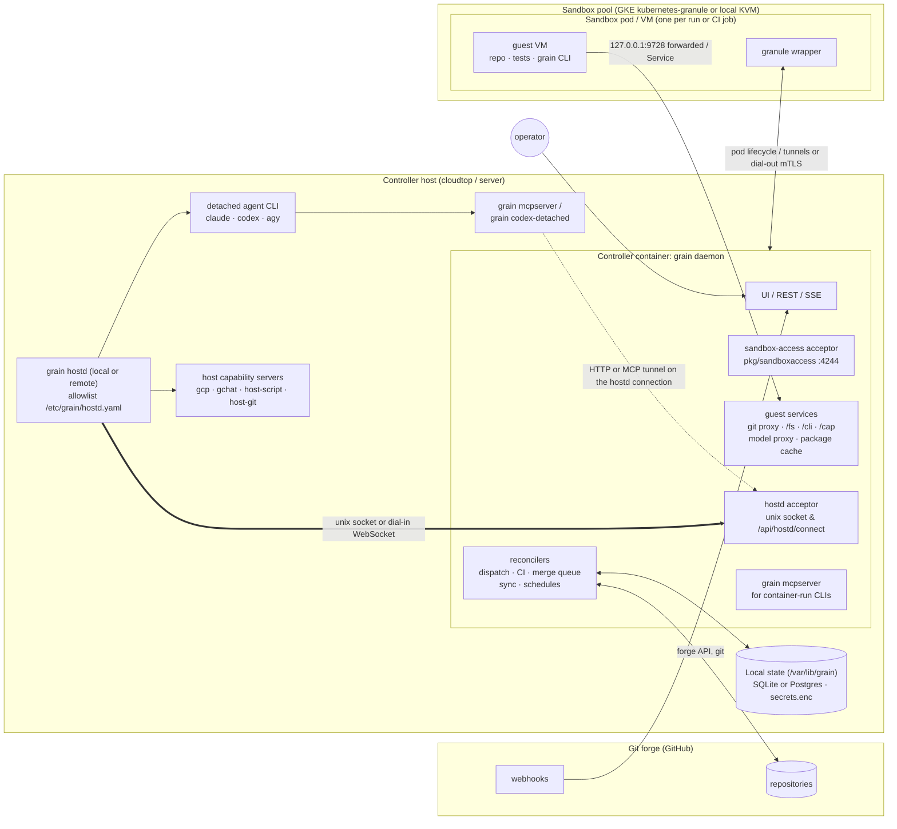
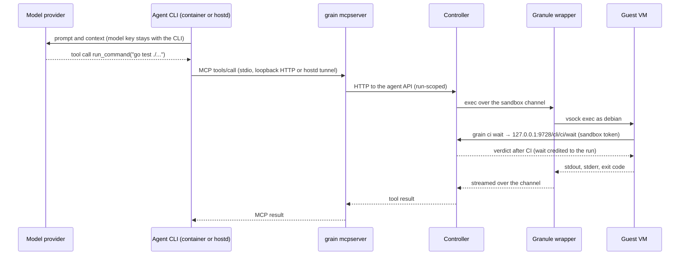
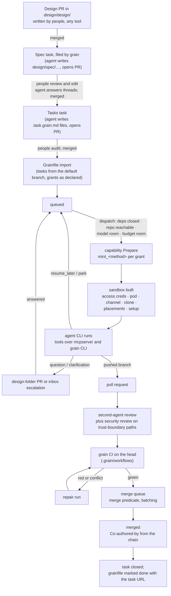

# Grain architecture

Grain is a single-tenant control plane. It drives coding agents against git repositories, checks their changes with its own CI, and lands approved pull requests through a batching merge queue. This doc describes the whole system: the running pieces, how work moves through them from a design doc to a merged commit, how each piece is upgraded without stopping the work, and where the trust boundaries are.

It is the end-to-end design that the more detailed docs fit into. It does not replace them. Each section names the doc that holds the detail and the decisions behind it, and those docs stay authoritative for their own area. `docs/architecture.md` remains the operator's guide to running a deployment. This doc is for reviewing the shape of the system.

**The core rule:** the controller is the only thing that holds authority, the sandbox is the only place untrusted code runs, and nothing that grants authority ever enters the sandbox. Model keys, forge credentials, deployment secrets and a host user's own logins stay in the controller or in `grain hostd`. The sandbox gets per-attempt tokens that can do only what its run was granted, and the actions that end a run, file auto-approved work or change the deployment are reachable only through tool calls the model makes, never from a process inside the VM.

## The four runtime planes

A deployment has four planes:

1. **The controller** (`grain daemon`). It runs on the host, holds the state, runs the reconcilers and the CI engine, serves the UI and API, and terminates every connection the other planes make.
2. **Sandboxes.** These are disposable granule microVMs, one per agent run or CI job, either locally over `/dev/kvm` or in pods on a GKE sandbox cluster (`kubernetes-granule`). They are where repository code, tests and builds run.
3. **`grain hostd`.** One or more processes running outside the controller container — on the same host (over `/run/grain-hostd/hostd.sock`) or on remote workstations dialling in. Each runs allowlisted programs under its host user's identity: detached agent CLIs, host-pinned capability servers, host scripts, and anything else that needs that user's ambient credentials.
4. **Agent CLIs and the agent surface.** `claude`, `codex` and `antigravity` (`agy`) run in the controller's container or detached under hostd. Their tools are grain's MCP control server (`grain mcpserver`) and, inside the sandbox, the `grain` CLI.

`docs/architecture.md` and `docs/three-pieces.md` describe an earlier four-component split: grain, a separate grit CI controller, a model-server for agent CLIs, and hostd. Two decisions in `docs/design/grain-on-gke.md` change that. CI stays inside grain, with grit's package boundary kept but no separate service (decisions 2 and 4). Remote executors and hostd become one concept, hostd (decision 5). (Cutting over the `grain` controller itself to a GKE pod was retired on 2026-10-31; `grain daemon` continues to run on the host.) The four planes here are the result: grit is a package boundary inside the controller, and model-server is a hostd.



Nothing opens an unsolicited inbound connection to a guest VM or to a remote hostd: hostd connects to the controller (over the local unix socket on the same host, or an outbound WebSocket from a remote machine), and sandboxes reach only the controller's explicitly exposed proxy ports.

### 1. The controller

The controller is one `grain` process (`grain daemon`), running on the host inside the release container (`grain-daemon.service`), with `grain hostd` beside it on the bare machine (`docs/design/cli-run-location.md`, "Trust levels"). Standalone Kubernetes manifests (`deploy/kubernetes/`) also exist for self-contained cluster installs, though cutting over the host deployment's controller to GKE was retired (`docs/design/grain-on-gke.md`). A bare-machine daemon still exists for `grain demo`, development and the e2e harness. No installer creates one.

**Reconcilers.** All behaviour is level-triggered. Each reconciler reads the store and the forge, then moves things one step toward where they should be. The main ones:

- **Dispatch** (`reconcileDispatch`, `pkg/dispatch`). This admits queued tasks once their dependencies are closed, their repository is reachable, a model connection has room, the shared CPU, memory and disk budget has room, and their grants can be minted.
- **CI** (`reconcileCI`, `pkg/ci`). This plans `.grain/workflows` DAGs and drives every step in a sandbox. Verdicts are cached by content fingerprint.
- **Merge queue** (`reconcileSync`, `reconcileMergeBatches`, `pkg/forge`). This enforces the merge predicate, batches ready pull requests, and files repairs.
- **Schedules and system jobs** (`reconcileSchedules`, `reconcileSystemSchedules`). These fire templates, suites and standing jobs.
- **State repo sync** (`pkg/staterepo`). This exports config tables to `grain/config` and hot-reloads merged config PRs.
- **Liveness** (`pkg/orchestrator/liveness.go`). Every state is driven by a named reconciler, awaits a named person's action, or awaits an external answer with a clock on it (`docs/design/task-liveness.md`). A driven state that outlives its patience is escalated.

**State.** There are four stores, each holding a different kind of thing:

| Store | Holds | Where |
| --- | --- | --- |
| Database | Tasks, observations, runs, comments, links, CI runs, merge batches, sandbox rows, cursors | SQLite under `/var/lib/grain/store/grain.db` by default (or PostgreSQL configured via `db-config.json`) |
| `grain/config` state repo | Config tables (scrubbed of secrets), memory, release notes, operator scripts | A git repository. Settings changes are committed to it, and merged PRs are applied back |
| Secrets | Model keys, GitHub App key, capability server credentials, values set through `request_secret` | `secrets.enc` under `/var/lib/grain/secrets/`, sealed to a `0600` private key (`secrets.key`) on the host |
| Data volume | Checkouts, agent HOMEs and session stores, transcripts, run spools, CI cache and artifacts, package cache objects | `/var/lib/grain` on the controller host (or the `grain-data` ReadWriteOnce PVC on standalone Kubernetes installs) |

The database is the operational source of truth. `grain/config` is the reviewable copy of the configuration, and the way to change it from git. Secrets never appear in either one.

**Control plane and API.** The UI, the REST and SSE API, webhooks and the agent API share one HTTP server (`pkg/ui`). Operators reach it on loopback, over an SSH or reverse proxy, or behind IAP when configured. Every route has a scope (`pkg/ui/route_scopes.go`), and a credential is accepted only on the routes its kind is for. A UI session, an agent API token, a sandbox token and a hostd token are four different kinds, and none of them works where another is expected (`accesscode_internal_test.go`).

**Services the controller runs for other planes.** The controller also terminates:

- the **sandbox-access acceptor** (`pkg/sandboxaccess`, port 4244, used when in-cluster `k8s-granule` sandboxes dial out; off-cluster `gke-sandboxes` hosts reach pods via `kubectl exec` and `granule forward`);
- the **guest-facing services**: the git proxy and the namespace, CLI, API and capability routes behind it, the model proxies, and the package cache's DNS and HTTP(S) listeners;
- the **hostd acceptor** (`/run/grain-hostd/hostd.sock` on the same machine, and `/api/hostd/connect` over WebSocket for remote hostds, aliasing the older `/api/executors/connect`);
- the **capability broker**, which attaches to every configured capability server, mints and releases passes, and proxies attempt-scoped MCP endpoints (`docs/capabilities-spec.md` §4 and §5).

**Package boundaries.** Inside the process, the code keeps the rule in `docs/three-pieces.md`: tasks, then the forge, then sandboxes, and nothing points up. `pkg/granule` and `pkg/sandboxaccess` import nothing from `pkg/model`. `pkg/grit/...` takes no grain-core imports (`pkg/grit/independence_test.go`). That is what keeps a later split of CI into its own service a matter of new interface implementations rather than extraction.

### 2. Sandboxes

A sandbox is a disposable Linux environment where the repository is cloned at `/home/debian/work` and every agent tool command or CI step runs. This deployment uses the `kubernetes-granule` backend: a granule KVM microVM inside a pod on the GKE node pool. The other backends (local granule on a KVM host, Docker containers, plain Kubernetes pods) have the same contract with fewer isolation properties (`docs/sandbox-image-contract.md` §4).

**Two kinds, one mechanism.** An agent run gets a sandbox when dispatch admits it. A CI job gets one per job. Both are charged against the same budget, are built by the same backend (`orchestrator.Sandboxes`; CI reaches it through the `ci.Sandboxes` adapter), and run their commands through the same runner. A sandbox lives only as long as its run or job, unless it was asked to be persistent. Only pushed commits, transcripts, artifacts and comments outlive it.

**How one is provisioned.**

1. Dispatch acquires a sandbox permit and mints every grant the run holds (capability `Prepare`, below). This happens before the VM boots, so a grant that cannot be minted fails admission instead of failing a booted VM.
2. The controller mints the sandbox's access credentials: a client certificate from the deployment CA, with `CN` and a URI SAN naming the sandbox, and a 256-bit token whose hash is stored on the sandbox row. Both go into a Kubernetes Secret owned by the pod, mounted only into the wrapper container.
3. It creates the pod. The wrapper boots the guest from the sandbox image and dials the acceptor.
4. Over the channel, the controller places files in batches (git credentials, capability placements), clones the repository on the task's branch, runs `setup_root` and `setup`, and opens forwards.
5. The run or job starts. When it ends, grants are released, tokens are revoked, and the pod and its Secret are deleted.

**The guest image contract.** Images come in two tiers: minimal bases (`guest-base`, `k8s-sandbox-base`) and full defaults layered on them. Every image carries an integer contract version (`dev.grain.sandbox.contract`) that says which boundary properties it provides: the `debian` user at uid 1000, `git`, `curl`, CA certificates, the forwarding helper, and on microVMs, `sudo`, `systemd` and `grain-connect`. A custom image built `FROM` a base needs rebuilding only when that version changes (`docs/sandbox-image-contract.md`). The default full image also carries the `grain` CLI at `/usr/local/bin/grain`.

**Inside a sandbox pod.**

```
sandbox pod
┌───────────────────────────────────────────────────────────────┐
│ sandbox container (granule's code, trusted)                   │
│   wrapper ──mTLS dial-out──▶ grain-access:4244                │
│     │  holds /var/run/granule/access/{cert,key,token}         │
│     │  in-pod drop filter: guest packets to the acceptor die  │
│     │                                                         │
│     │ vsock exec, virtio                                      │
│     ▼                                                         │
│   ┌───────────────────────────────────────────────────────┐   │
│   │ guest VM (untrusted)                                  │   │
│   │   /home/debian/work       the repository              │   │
│   │   ~/.git-credentials      per-attempt sandbox token   │   │
│   │   grain CLI ─▶ 127.0.0.1:9728 ─▶ git proxy, /fs, /cli │   │
│   │   resolv.conf, CA ───────▶ package cache              │   │
│   └───────────────────────────────────────────────────────┘   │
└───────────────────────────────────────────────────────────────┘
```

**The sandbox-access channel** (`pkg/sandboxaccess`, granule's dial-out mode). Each wrapper holds one multiplexed mTLS connection to the acceptor. It carries exec, with streaming stdio, a real exit code and signals; attach to an exec from a byte cursor; batched file put; and forwards in both directions. The acceptor admits a connection only if the certificate chains to the deployment CA, the token matches the stored hash for that sandbox, and the sandbox is live in the controller's own view. A credential for sandbox A cannot open B's channel, and a reaped sandbox's credential is dead as soon as its row is.

This replaces `kubectl exec` through the API server, whose intermittent `dial timeout, backstop` failures were failing CI steps and dropping forwards. The API server now only creates, watches and deletes pods. `kubectl exec` is kept for the readiness probe, one diagnostic read when a channel never comes up, and an operator's own debugging. There is no silent fallback to it (`docs/design/grain-on-gke.md`, "Sandbox access").

A dropped channel is reattached from the cursor if the wrapper comes back within the reattach timeout (2 minutes by default), and the step never notices. If it does not come back, every exec on that sandbox ends with `ErrChannelLost`. A CI job ending that way is an `infra` verdict and re-runs uncached. An agent tool call returns an error, and the sandbox is rebuilt.

**The loopback proxy at `127.0.0.1:9728`.** The guest reaches grain on one loopback address. Every request carries the run's per-attempt sandbox token (`gpx_…`, minted in `pkg/gitproxy/tokens.go` and written to `~/.git-credentials`). The proxy resolves the token to its live `(sandbox, task, run)`, applies that run's grants, records the call, and routes it:

| Prefix | Serves | Scope |
| --- | --- | --- |
| `/` (git smart HTTP) | Clone and fetch of the task's target, `reads:` and `writes:` repositories. Push of the task's own branch (`grain/<deployment>/task-<id>`) and declared `writes:` branches only | Ref policy in `pkg/gitproxy/authorize.go` |
| `/fs/<scheme>/<path>` | The read-only namespace: `ci://`, `src://`, `task://`, and later `config://`, `memory://`, `deploy://`, with `?list`, `?glob=` and `?grep=` and no result cap (`docs/design/grain-namespace.md`) | `ci://` needs `grain-ci` for the task's own repositories, or `api:ci-read` or `self-debug`. `src://` and other tasks' `task://` need `self-debug` |
| `/cli/...` | The `grain` CLI's own-task actions: `grain ci wait`, `ci run-job`, `ci log`, `pr status`, `status`, `handover write`, `notify`, `task message`, blocking `task wait` | Own task, own branch, own repository |
| `/api/...` | The agent API, for non-dangerous `api:*` scopes the task holds | `agentAPIGate` refuses dangerous and model-only scopes on this channel |
| `/cap/<server>/mcp` | Capability tools explicitly marked `model_only: false` | The attempt's own grants |

Two more guest-facing services sit beside the proxy. They are not loopback routes; the guest reaches them at the controller's Service address. The **package cache** (`pkg/pkgcache`) answers the guest's DNS for package registries and serves apt, PyPI, npm, Go, Docker and other downloads through a caching TLS proxy that the guest's CA bundle trusts (`docs/package-cache.md`). The **model proxies** serve agents that run inside the VM with their own per-run tokens. A `network: none` guest has no NIC at all. It gets all of these as guest-loopback forwards carried over the sandbox channel.

Long waits are run by the controller. `grain ci wait` holds its HTTP request for at most 9 minutes, so it always returns inside `run_command`'s 10-minute ceiling. While the request is open, the controller credits the blocked time back to the run's deadline (up to 45 minutes per attempt) and marks the run as in a declared wait. If CI is still running, it returns a resume token (`docs/design/sandbox-first-agent-surface.md` §2).

### 3. `grain hostd`

hostd is the same `grain` binary, run as `grain hostd` by a systemd unit, as the installing user, outside the controller container's lifecycle. It exists because some work needs a host user's own identity (which the isolated controller container or a remote machine cannot hold) or runs detached so agent CLIs survive controller restarts. Examples of ambient host identity are `agy`'s corp login, `gcloud`'s user credentials, the user's SSH signing key, or a CitC workspace.

**Dial-in.** A hostd connects out to the controller over a WebSocket-framed stream (`pkg/hostd/dialout.go`, `/api/hostd/connect`). The framing lets it pass Google's front end and IAP, so the host needs no inbound route from anything. The connection is the old executor connection (`pkg/modelexec`): token auth in the hello frame, remote staging under a hostd-owned root (`/var/lib/grain-hostd/runs/<run>/`), exec, MCP tunnel streams and capability streams, all multiplexed. A daemon on the same machine can still use the unix socket (`/run/grain-hostd/hostd.sock`). In the registry it is simply a hostd named `local`.

**Many hostds.** A hostd is registered in Settings before it connects: a name, an owner (whose identity it carries), labels, and a token shown once. The hostd's name comes from its token, not from what its hello says. A connection can replace only a connection with the same name. The hello reports what the hostd offers, recomputed from its allowlist on every connect: CLI entries, capability entries, capacity, labels, and the ambient logins it can read. The identity it reports is shown in the UI and never used for authorisation.

Work is routed to a hostd by an explicit pin (`hostd: bsalmon-cloudtop`) or by a label selector, which picks the least-loaded match. Model connection leases are keyed by `(connection, hostd)`, so a usage-limit pause on one user's ambient login pauses only that hostd. Nothing moves to another hostd, or into the container, unless the operator wrote a fallback list (`docs/design/grain-on-gke.md`, "hostd").

**What runs on hostd.**

| What | Allowlist entry | Credentials it uses |
| --- | --- | --- |
| Detached claude | `cli claude-detached`: the image's own claude, extracted to `/usr/local/lib/grain/hostd/<image-id>/` | The deployment's OAuth token, sent as it would be to a container run. Nothing else crosses |
| Detached codex | `cli codex-detached`: `grain codex-detached` wrapping `codex.bin` | The deployment's codex login in the shared `CODEX_HOME` |
| agy | `cli agy` | The host user's ambient corp login (or a key, for a key connection) |
| Host-pinned capability servers | `capabilities:` entries: `gcp`, `gchat`, `host-script`, the Google layer's `workspace` (CitC) | The host user's ambient `gcloud`, chat and kube credentials, and CitC access |
| `host-git` | `capability host-git` | The host account's `gh` login and SSH signing key. It signs commit payloads the controller sends, and the key never leaves the host |
| Host scripts | Run by the `host-script` server | Operator-written bash, run as the host user. A sandbox calls it with `grain host-script <name> [args]`, which reaches the server through a capability port forwarded into the guest (`/runs/<attempt>/exec`; `docs/host-scripts.md`) |

**Allowlist enforcement.** Every exec names an entry in the root-owned `/etc/grain/hostd.yaml`, and hostd checks the binary, argv, environment variables (by exact name), working directory and paths against it. It re-reads the file on every request. hostd also enforces each entry's `max_duration`, so a controller that has gone away cannot leave a process running forever. A compromised controller can therefore start only what the host's root-owned allowlist admits. A CLI's own config and hooks running arbitrary code is an accepted non-goal (`docs/design/cli-run-location.md`, "Security").

**Detached runs survive the controller (hostd protocol 2).** A detached start spools stdout and stderr to append-only files under hostd's state directory, and writes `exit.json` once when the process ends. When the controller disconnects, only stdin is closed, and the process runs on to its own deadline. The controller persists a byte cursor for each run (`task_run_spool_cursor`, `hostd:` key). A restarted controller sends hello, lists hostd's processes, and decides each one with `runhost.DecideHostd`:

- a process matched to a live run is adopted, its spool is read from the cursor, and the gap is credited as wait time;
- an unmatched process is cancelled;
- a process past its deadline is finished.

The same rules apply when a hostd's connection drops: a running CLI keeps going, the run is held as `hostd-disconnected` for 15 minutes by default, and it reattaches from the cursor if the hostd returns. If it does not, the run fails as infrastructure, with no strike. Runs that need a disconnected hostd park with a reason naming it, and a `hostd-disconnected:<name>` notification is raised after 5 minutes.

### 4. Agent CLIs and the agent surface

**Frameworks.** `pkg/agent` has one framework per CLI (`claude`, `codex`, `antigravity`, plus `custom` commands) behind `agent.Framework` and `agent.Host`. A host is where the process starts. `LocalHost` is a subprocess in the controller's container. `HostdHost` and `RemoteHost` start through a hostd. `runhost` is a detached run pod on Kubernetes container deployments.

**Run location.** Each CLI has a run location, resolved from the live config for every run (Settings → Models, then `-<cli>-run` flags, then the built-in default):

| Location | Where the CLI runs | Survives a controller restart |
| --- | --- | --- |
| `container` | A subprocess in the controller's container | No. The run is re-queued with no strike |
| `detached` (claude, codex) | Under hostd, from the image's own binary, with the deployment's login | Yes, adopted from the cursor |
| `host` | Under hostd, from the operator's own allowlist entry (agy defaults here on the Google build) | Yes, for detached starts |

A hostd that is down, incompatible or missing the entry sends `detached` runs to the container, with a warning in Settings. A `host` run fails with the reason instead. Kubernetes with no registered hostd offers only `container` (`docs/design/cli-run-location.md`).

**Where `grain mcpserver` runs.** The model's grain tools come from `grain mcpserver`, a separate process that talks to the controller's API over HTTP. It holds no state of its own. Where it runs follows the CLI:

- **claude in the container:** the mcpserver runs in the controller's container behind grain's HTTP endpoint (`claude.WithHostMCP`).
- **claude detached:** claude forks its mcpserver on the host from the extracted grain, so nothing in the run is a child of the controller.
- **codex:** a grain-owned adapter serves the mcpserver child over stateless Streamable HTTP on a random loopback port, with a per-run 256-bit bearer token. It rejects unexpected Host headers, browser Origins, and other runs' tokens. Only the tools snapshotted at startup are enabled. When detached, `grain codex-detached` hosts that adapter beside `codex.bin` on the host for the life of the process (`docs/codex-isolation.md`).
- **agy:** agy forks `grain mcpserver` and its PreToolUse hook from `/usr/local/bin/grain` on the host. The installer puts a `grain` of the controller's version there.

When a CLI runs under a remote hostd, its mcpserver's calls are carried on the hostd connection as an MCP tunnel stream. That stream is admitted only for argvs the controller issued to runs on that same connection (`mcpGrants`). The mcpserver's client retries through a controller restart for up to two minutes, so an adopted run's tools keep working across an upgrade.

**Dividing the surface.** The model sees two surfaces, split by what can safely be reached from inside the VM (`docs/design/sandbox-first-agent-surface.md` §1):

- **The model-only MCP control set** (`grain mcpserver`). This has the four sandbox tools (`run_command`, `read_file`, `write_file`, `edit_file`), and every tool that ends or parks the run (`chat`, `ask_question`, `request_secret`, `comment_on_issue`, `nothing_needed`, `resume_later`, `wait_for_task` with `park`). It also has `propose_task` with its inherited auto-approval and auto-merge, `recreate_sandbox`, dangerous `api:*` scopes, queue and host control, and external capability tools that are `model_only` (the default). `orchestrator.ProcessResult` decides how a run ended by reading these calls, so only the model can make them.
- **The in-sandbox `grain` CLI** (`127.0.0.1:9728`). This has namespace reads, own-task CI and PR actions, status, handover, notifications, notes to related tasks, blocking waits, non-dangerous granted scopes, and capability tools marked `model_only: false`. Its output is uncapped and can be piped through `grep`, `jq` and files. A `grain task propose` from the CLI is always filed held for approval, never auto-merging, never superseding, and capped at 10 per attempt.

The control set is meant to shrink to the roughly ten tools above as each read and action moves to the CLI. That cuts the 14,000 to 35,000 tokens of tool schemas an ordinary run pays for on turn one. Prompts point at `grain --help` instead (`docs/design/sandbox-first-agent-surface.md` §8 has the migration stages).

**A tool call, end to end.**



The model's credentials are used only between the CLI and its provider, or between the CLI and a model proxy. The sandbox sees neither. The sandbox sees its own per-attempt token, which reaches only the proxy routes above.

## End-to-end lifecycles

### From a design to a merged commit

`design/design/contributions.design.md` sets out how work enters a repository through its design folder. `design/design/attribution.design.md` covers how the people behind it are credited. Mapped onto the planes:



The steps, and which plane does each one:

1. **Design.** People write and merge a design doc. Grain is not needed.
2. **Specification and tasks.** On merge, the controller files a task to write the specification, and then one to write the task grainfiles. Each runs as an ordinary agent run and opens a design-folder PR with a `Derived from:` link to the PR before it. The agent stays on that PR and answers review comments by pushing changes. These are the `pull_request` triggers in the grainfile spec (`design/spec/grainfiles/`).
3. **Import.** The controller imports `.task.grain.md` files from the default branch only, never from an unmerged head. Each task's identity is `(repo_url, file_path)`, its grants are what the file declares, and its `depends_on` edges form a DAG with a depth limit (`design/design/grainfiles.design.md` §6). Decomposed sub-tasks (`propose_task`) stay within their parent's grants (`GrantsSubsetOf`) and inherit its attribution chain.
4. **Admission and `Prepare`.** Dispatch admits the task (above). Before the VM boots, each grant is resolved and minted. In-process servers (`…/api`, `…/repo`, `config-map`, `secret`) answer from the controller. Container capability servers run as children of the controller, and host-pinned servers (`run: hostd`) run on the hostd they are pinned to. Each returns a `Pass` with `placements`, `ports`, `setup_root` and `setup`, an `mcp_endpoint`, and a `prompt_section` (`docs/capabilities-spec.md` §4 and §5). A `gcp#gcp-key` grant mints a short-lived, attempt-scoped key for its permission set and revokes it on release. A `config-map` grant places operator-configured files, and a `secret` grant places secret values as `0600` files. Grants a person must approve are listed in `docs/design/unified-grants.md` §2.
5. **Sandbox and run.** The sandbox is built (above), the prompt is assembled (task, conversation or handover, memory, and capability prompt sections), and the CLI starts in its run location.
6. **Ending.** `ProcessResult` reads the run's control calls and the remote branch:
   - A pushed branch opens or updates a pull request.
   - A comment, a question or a secret request goes to the conversation and the inbox.
   - `nothing_needed` closes the task.
   - `resume_later` and parking re-queue the task without a strike.
   - A usage limit, an overload, an expired host credential or a controller shutdown is never counted against the task.
7. **Review.** Every change is reviewed by a second agent before it merges. A change that touches the trust boundary (`pkg/trustboundary`: `scripts/setup.sh`, `pkg/runhost`, `pkg/mcp/managed_http.go` and the rest) is held for a `system:security-review`. The review works on the change's own branch. If the reviewer's fixes touch the trust boundary themselves, the new head is reviewed again. Findings the reviewer cannot settle become review comments, and the change waits for a person's Submit.
8. **CI and the merge queue.** Grain CI runs on the head. Merging follows one predicate: the change merges cleanly, and either it has its own green run while no batch is in flight, or it is the head of a green batch's frontier (`pkg/orchestrator/mergepredicate.go`). A red run or a conflict re-queues the task as a repair run. A failure that matches the same job on two or more branches is a shared fault, not the branch's fault.
9. **Merge and close.** As `attribution.design.md` proposes, the controller composes the merge message, including one `Co-authored-by:` per contributor in the design → spec → tasks chain. It closes the task and marks the grainfile done with the task's URL.

Problems that are not questions about the design go to the inbox, which the team's grain on-call watches: flakes, missing permissions, a hostd that is down. Durable tasks, such as the steward and console sessions, use the same machinery with no deadline and an idle watchdog instead. Their short stops are recorded as suspensions that never spend dispatch standing. A task with a goal is closed by the controller when the goal is met, not when a run ends (`docs/design/durable-tasks.md`).

### Non-disruptive upgrades

Each plane upgrades on its own schedule. A mixed fleet is the normal state during an upgrade, never an error.

**The controller** (`docs/non-disruptive-upgrade.md` §6):

1. Stage and health-check the new build, and decide the schema step. Schema changes are additive within an adoption window, so a rollback meets a store it can read.
2. Hold dispatch (`UpgradeHold`), so no new run starts.
3. Flush every spool cursor and stop writing to the store.
4. Restart only the controller (`grain-daemon.service`). Sandboxes, hostd and their processes are not signalled.
5. Adopt. The new controller readopts sandbox pods by claim, reattaches CI step execs from persisted `(run, job, step, sandbox, exec id, cursor)` rows once wrappers redial, adopts run pods and hostd processes from their cursors, and credits the gap as wait time. Any live run with nothing left to adopt is finished with the reason the listing gave.
6. Release the hold. The post-upgrade check reports how many runs were adopted, how many were lost, and why.

Authentication survives the gap because nothing a live run holds exists only in the old process's memory. Sandbox git tokens are persisted encrypted. Model-proxy tokens are persisted as an id and a hash. Sandbox access credentials are in Secrets owned by their pods, with hashes on the sandbox rows. `mcpserver` and the `grain` CLI retry for up to two minutes.

**hostd** (`docs/design/cli-run-location.md`, "hostd's own upgrade"):

1. The extractor installs each image's binaries in a versioned directory and moves the `current` link by rename. It never overwrites a running binary.
2. A `.path` unit sees the link change and drains hostd. New starts are refused with a distinct draining refusal, which dispatch treats as a hold rather than a failure. Running children continue, up to `drain_cap` (1 hour by default).
3. Capability servers are ended once the runs are done. The controller's registry reattaches them through the new hostd within a minute.
4. hostd exits, and systemd starts the new binary. A run adopted across the upgrade keeps the CLI binary it started with.

Peers exchange `{protocol_version, min_compatible, build}` in the hello. Skew of one version in either direction must still reattach. An incompatible peer starts nothing new and finishes its matched runs with a legible reason.

**Sandboxes.** New images, new wrapper builds and new contract versions apply only to new sandboxes. A sandbox built under the old version runs to the end of its run or job. The controller adopts what it can talk to and finishes what it cannot, legibly, and never leaves a sandbox running unwatched.

## Security and trust boundaries

### Trust zones

| Zone | Trusted with | Bounded by |
| --- | --- | --- |
| Controller | Everything: the store, secrets, forge credentials, the CA | Single host-local controller container. Least-privilege `/var/lib/grain/kubeconfig` scoped to sandbox pods in one namespace (`gke-sandboxes`) |
| Capability servers | The credentials configured for them, and the sandboxes they serve | Only operator-configured commands and URLs. Root credentials scoped per server. Control plane unreachable from any sandbox (`docs/capabilities-spec.md` §3.2) |
| hostd | Its host user's ambient identity | The root-owned allowlist, per-entry deadlines, a token that is good only for hostd routes, and revocation from Settings |
| Granule wrapper | Its own sandbox's access credential | One certificate and token per sandbox. The most it can do is drive its own VM |
| Guest VM | Nothing | Assumed hostile: repository tests, package hooks, prompt-injected scripts and background processes all run here as `debian` |
| Model and CLI | The tools the run was given | Native shell, file and patch tools disabled or blocked (codex's `environments.toml`, agy's PreToolUse hook). Every action goes through grain's tools |

### Credential isolation

A credential placed in the guest can be read by any process running as `debian`. That includes a test binary, an `npm postinstall` script, or a process left over from an earlier command. The design therefore assumes that anything in the VM is known to the code in the VM.

| Credential | Lives in | Never in the VM because |
| --- | --- | --- |
| Model API keys and OAuth tokens | Secrets, then the CLI's environment in the container or on hostd, or the model proxy | The CLI runs outside the VM. Its tools reach the VM. The VM never reaches it |
| GitHub App key and forge tokens | `secrets.enc` on the controller host | The git proxy acts for the sandbox. The guest gets a per-attempt `gpx_` token that can only fetch granted repositories and push its own branch |
| Deployment secrets and the sealing key | `/var/lib/grain/secrets/` (`secrets.enc` and `0600` `secrets.key`), mounted only into the controller | Read only by the controller. Values set through `request_secret` go straight into the store and are never shown to an agent |
| Host ambient credentials (corp login, `gcloud`, SSH signing key, kube credentials) | The hostd host | Only allowlisted entries use them. `host-git` signs payloads and returns signatures. A host script returns its output |
| Sandbox access certificate and token | A Secret mounted only into the wrapper container | Not on the guest's disk, kernel command line or environment. The guest has no route to the acceptor (in-pod drop filter), and could not complete the mTLS handshake without the key |
| Leased capability credentials (`gcp-key` and similar) | Placed in the VM on purpose, attempt-scoped and short-lived | These are the exception. They are granted to the run, expire at its deadline, and are released when the attempt ends |

The last row is the deliberate exception. A grant that places a credential gives that credential to the sandbox. That is why grants that reach production are person-approved, and why leased credentials are minted per attempt rather than shared.

### Privilege separation between the CLI token and the control set

The per-attempt sandbox token on `127.0.0.1:9728` is the only credential in the VM that talks to grain. It is bound to `(task, attempt)`, revoked when the attempt ends, and audited on every call (`agent_api_call`, `recordAgentCall`). Its ceiling is reads and non-dangerous own-task actions:

- It cannot end, park or suspend a run.
- It cannot destroy the sandbox.
- It cannot file approved or auto-merging work, or supersede tasks.
- It cannot approve, force-merge, or change settings, connections, secrets or capability policy.
- It cannot change a task's own approval, auto-merge, capabilities or dependencies (`selfMutableTaskRoutes`).
- It cannot attach capabilities the acting task does not hold (`agentFilingEscalation`).
- It cannot call `model_only` capability tools.

Each of those is a tool call the model makes to `grain mcpserver`, outside the VM, and is refused on the sandbox channel with `403 this operation requires a model control tool`. The `X-Grain-Channel: sandbox-cli` marker that tells the two channels apart is set by the proxy after it authenticates the token, never taken from a client header.

`docs/design/sandbox-first-agent-surface.md` §1 also considered a per-turn token handed only to the model, and rejected it. Any credential that enters the guest is visible through `/proc`, inherited by child processes, or catchable from a modified shell profile. A tool that runs outside the VM so the token stays hidden is an MCP control tool under another name. The boundary between the in-sandbox CLI and the model-only control set is the one that holds against hostile processes in the sandbox.

### Network invariants

- **Nothing dials a sandbox.** Sandbox pods have empty ingress. Their egress allows the guest-facing Service, the acceptor port, DNS, and the internet for open-network tasks. It denies the metadata server, other node and pod CIDRs, and the GKE control plane.
- **Nothing dials a hostd.** No traffic goes directly between a sandbox and a hostd. Everything is multiplexed through the controller, which stays the policy point.
- **The capability control plane is unreachable from sandboxes.** A backend that cannot guarantee this may not run attempts that hold capability grants.
- **The API server is out of the data path.** `pods/exec` is still granted for bootstrap and fallback. Because it is now rare, a spike in its use in the audit log is a signal.

## Where each piece stands

This doc describes the target. As of this writing:

| Piece | Status | Detail |
| --- | --- | --- |
| Controller on GKE with Cloud SQL and Secret Manager | Retired (2026-10-31); `grain daemon` continues to run on the host | `docs/design/grain-on-gke.md` |
| Sandbox-access channel, acceptor and CI step reattach | Implemented (`GKE-2`–`GKE-4`). Off-cluster `gke-sandboxes` keeps `kubectl` | `docs/design/grain-on-gke.md`, "Sandbox access" |
| hostd allowlist, protocol 2, detached runs, drain and versioned upgrade | Implemented | `docs/design/cli-run-location.md` |
| hostd dial-in, many hostds, placement settings | Dial-out client exists (`pkg/hostd/dialout.go`). Unified registry and placement deferred to [Task #2164](/tasks/2164) and [Task #2165](/tasks/2165) (`GKE-5`–`GKE-6`) | `docs/design/grain-on-gke.md`, "hostd" |
| `/fs/` namespace (`ci://`, `src://`) | Implemented. `task://`, `config://`, `memory://` and `deploy://` follow | `docs/design/grain-namespace.md` |
| `grain` CLI on `/cli/`, and the shrunken control set | In progress, by stage | `docs/design/sandbox-first-agent-surface.md` §8 |
| Unified grants | Design. Slice 1 (UI) has landed | `docs/design/unified-grants.md` |
| Durable tasks, suspensions, goals, notifications | Design | `docs/design/durable-tasks.md` |
| Design-folder flow and attribution | Design | `design/design/contributions.design.md`, `design/design/attribution.design.md` |

## Open questions for reviewers

1. **High availability.** With the GKE controller cutover retired, `grain daemon` runs as a single controller process on the host, while every other plane (`hostd`, sandboxes, CI step cursors) survives its restarts. Is single-host controller operation sufficient, or should multi-replica leader election over Postgres ever be revisited? The recommendation is to stay at one host-local controller process.
2. **Agent CLIs inside the VM.** Running the CLI inside the VM (`docs/design/cli-run-location.md`, "Parked alternatives", B) would put it next to its tools, but it would put the model credential in the VM. This design keeps the CLI outside the VM. Should the parked alternative stay parked? The recommendation is yes, unless a model credential can be issued that is scoped to one run and worthless outside it.
3. **Where the design folder lives.** `contributions.design.md` allows a per-repo `design/` folder or a separate design repository. This doc is written for the per-repo layout. Should the architecture doc move if a team picks the separate repository?
