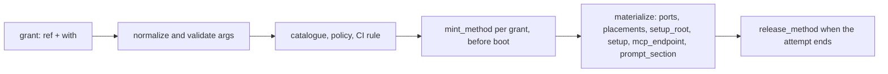

# Capabilities

**Owner:** @bwsalmon

**The core rule:** a run gets nothing it was not granted, and what it is granted reaches it only for one attempt. A capability server holds the root credential and mints a short-lived, attempt-scoped thing from it; grain checks the grant against policy, places what the server returned in the sandbox, and releases it when the attempt ends. Root credentials never enter a sandbox, and a grant's `with:` arguments never carry one.

**Status:** describes `main` as of 2026-11-07. The normative protocol is [`capabilities.spec.md`](../spec/capabilities/capabilities.spec.md); this page is the overview it specifies. Where they disagree, the spec wins.

## What a capability is

A **capability** is something a task, standing session, process or CI job is given for the length of one attempt: a GCP credential (short-lived impersonated access tokens or a per-attempt service-account key; [`gcp-access.design.md`](gcp-access.design.md)), a checkout of another repository, a model-proxy token, an extra MCP toolset, a host script it may call, grain's own API under a scope. It is granted as a **reference**, `<capability_id>#<method>`, with a `with:` object validated against the method's schema (spec §2). `capability_id` is an `https://` URL used only as a name; grain never fetches it. Everything grain itself provides lives under `https://grain.dev/capabilities/`.

**Trust model** (spec §1.3). The operator trusts each capability server with the credentials bound to it, and the server is fully trusted inside every sandbox it serves: its files, setup commands, prompt text and tools act with the run's authority. The sandbox is trusted by neither. It cannot reach a server's control plane (stdio pipe or `serverUrl`), only grain's per-attempt proxies. `with:` arguments are untrusted input, because they come from repositories, templates and agents. Grain refuses grants from external servers on a sandbox backend that cannot keep the control plane out of reach (the unisolated `host` backend, an unfenced `container` backend: `mintCapabilityPass` in `pkg/orchestrator/capability_pass.go`).

## Capability servers and where they run

A capability server is an MCP server that advertises `mint_<method>` (and, for stateful methods, `release_<method>`) in `tools/list`. It may also advertise `configure` for operator settings (spec §4.5). There are three kinds:

| Kind | How grain reaches it | Where it runs | Examples |
|---|---|---|---|
| **stdio** (`command`, `args`, `env`) | spawned by grain and spoken to over stdin/stdout | beside the daemon (`run: container`, the default), or on the bare machine through `grain hostd` (`run: host`, naming an allowlist `capabilities:` entry in `/etc/grain/hostd.yaml`; a `hostd:` selector picks a named hostd) | the built-ins `grain capability gcp`, `git`, `gchat`, `host-script`, `config-map` and `figma` (`pkg/capability/intree`), and `grain/config` plugins |
| **HTTP** (`serverUrl`, `headers`) | Streamable HTTP, authenticated with the entry's headers | wherever the operator runs it | an organisation's own servers |
| **in-process** | a Go method table called directly (`protocol.InProcessCaller`) | inside the daemon; no listener, no `mcpServers` entry | `…/grain` (`#journal`, `#health`, `#sql`, `#host-exec`, `#ci`, `#source`) and `…/repo` (`#read`, `#write`) in `pkg/capability/grainserver`; `…/release` and `…/model-proxy`, and an edition's own (such as `…/corp#research`), contributed through `capability.Register` |

Servers are configured in `grain_config.mcp_servers` (exported to `grain/config`), keyed by `capability_id`, with secrets as `$secret:<name>` references into the encrypted store (spec §3.1). The daemon registers every built-in under its canonical ID on start (`intree.EnsureBuiltins`). It attaches each enabled entry, re-reads `tools/list` hourly and on change, and alerts when one drops (`pkg/daemon/capability_servers.go`). Settings → Capabilities → Capability servers edits them ([`docs/capability-servers-ui.md`](../../docs/capability-servers-ui.md)). `grain hostd -ensure-builtins` keeps the host entries for grain's own servers on the allowlist (`intree.HostdBuiltins`).

## From grant to sandbox

1. **Record.** A grant is stored as `<ref>` or `<ref>=<normalized json>` (`model.EncodeCapabilityGrant`, `pkg/model/capability_ref.go`), normalized against the server's schema when it is written and again at admission.
2. **Admit and mint.** After the sandbox permit and before any VM boots, admission mints every grant once, with `attempt_id` `<deployment>-<task>-<attempt>-<index>` and a `deadline` (`pkg/orchestrator/capability_pass.go`; for CI, `pkg/daemon/ci_capability_pass.go`). Any refusal rolls the whole pass back. `resource_exhausted` leaves the run queued until `retry_after` (spec §4.2.3). A long run renews by minting again with a later deadline.
3. **Materialize** (spec §5, `capability_materialize.go`, `capability_endpoints.go`, `capability_ci.go`), in this order:
   - **ports** are forwarded into sandbox loopback over the capability port relay;
   - **placements** are written as files, with reserved paths refused;
   - the one **`setup_root`** runs, then each **`setup`**;
   - each **`mcp_endpoint`** (`/runs/<attempt_id>/mcp`) is proxied and wired into the agent CLI's own MCP config, or into a CI job's `~/.grain/mcp.json`. Tools opted into sandbox delivery are also reachable as `grain cap <server> <tool>` (spec §5.2.6);
   - each **`prompt_section`** is appended as an attributed block.

   `recreate_sandbox` re-applies the cached pass without minting.
4. **Release.** When the attempt ends, however it ends, grain calls `release_<method>` for each stateful grant. A server may return an audit, which grain stores on the run (spec §4.4). The server also expires everything itself at `deadline`.

## Who may hold what

Three layers decide, all in grain rather than in the server (spec §4.2.2):

- **The catalogue**, `settings/capabilities.yml` in `grain/config` (`model.CapabilityCatalogue`, kept in `CapabilityPolicy.Catalogue`), lists capabilities with their defaults and restrictions: repositories, templates, run kinds (task, session, director, ci, process, review) and `requires_person`. It judges only what it lists.
- **The capability policy**, `grain_config.capability_policy` (`model.CapabilityPolicy.Permits`), is a list of allow and deny rules over reference patterns, repositories, run kinds and CI events. An untrusted CI run (a fork, or an author without write access) holds no reference unless an allow rule opts it in. Settings previews what a change would newly refuse.
- **Approval rules** (`unified-grants.design.md` §2). An agent can pass on only grants its own task holds (`GrantsSubsetOf`). A proposal asking for more is filed for a person. Some grants are **person-only**, which an agent can never grant or pass on: dangerous `api:` scopes (`IsDangerousGrant`), raising a task's `admission` setting above `standard` (§4.1, whose old grant names `priority-dispatch` and `durable` stay person-only input aliases, `IsPersonOnlyGrant`), methods a linked server marks `protocol.RequirePersonGrant` (`…/grain#host-exec`), and arguments a server marks person-granted (`x-grain-person-granted`, such as a gcp set over an existing service account). `…/grain#sql` with `write: true` is dangerous.

Grain's own API is granted through the in-process `https://grain.dev/capabilities/api` server as `https://grain.dev/capabilities/api#<scope-or-preset>`, optionally repository-limited with `with: {repo: "<owner/name>"}` ([`docs/agent-api.md`](../../docs/agent-api.md)). Writers record canonical `…/api#<scope-or-preset>` and `…/repo#read` / `#write` references (unified-grants slice 3, [Task #3317](/tasks/3317)), and schema migration 131 (slice 4, [Task #3321](/tasks/3321)) rewrote every stored grant still in a legacy spelling to its reference. `model.CanonicalGrant` keeps reading legacy `api:<scope>[@repo]` and `repo-read:` / `repo-write:` strings from `.grain/` declarations, which live in other people's repositories and are never migrated, and from a grain/config written by an older binary, which the import rewrites as it arrives.

## CI capabilities

A `.grain/workflows` job names what it needs under `capabilities:` and `optional-capabilities:` ([`docs/ci-capabilities.md`](../../docs/ci-capabilities.md)):

- **Capability references, repository access and `api:` grants are granted by being declared.** The policy decides each, as run kind `ci` with the run's event. A reference is minted at the job's grant admission, before its sandbox exists. A job that does not declare one never gets it.
- **Repository-granted grants** come from the operator's per-repository CI capabilities list (`repo_config.ci_capabilities`): `…/github#sandbox-repo` and the `…/release` methods. A job narrows that list by declaring; it can never widen it.
- **CI grant rules** are declared in code by the in-process server that answers a method (`capability.Method.CI`, `model.CIGrantRule`), and grain enforces them before the policy is read, so a policy can only narrow them. A method with a rule is CI-only unless its rule sets `TaskGrantable: true` (`…/github#sandbox-repo`). `…/release#image-signing` goes to `release` only. `#registry-push` goes to `release` and `workflow_dispatch`, and `#package-publish` also to grain's own trusted scheduled run. `…/repo#write {repo}` has the same kind of gate (`model.RepoAccessAdmitsCIEvent`).
- A run whose pinned commit is not on its branch is withheld every capability.

## Retiring the legacy in-process capabilities

Before capability servers, grain had a registry of in-process providers, each granted by a bare name (`pkg/capability/<name>`, `model.CapabilityProvider`). They are being converted one at a time into server methods or `api:` presets. Each conversion follows the same steps: add the method, migrate stored grants in a schema migration, keep the bare name as a one-release alias (`model.CanonicalLegacyGrant`), and delete the provider. [`unified-grants.design.md` §4](unified-grants.design.md#4-retiring-the-in-process-capabilities) is the per-capability table. Every credential-minting provider is now converted (`gcp-key`, `gemini-key`, the model proxies, `github-credential:<name>`, `github-sandbox` (onto `…/github#sandbox-repo`, schema migration 124), `local-scripts`, the CI publishing grants, `repo-read`/`repo-write`, `bootstrap-playbooks`, the `…/grain` and `…/github` methods, the api presets, `priority-dispatch` and `durable`, which became the task setting `admission` (§4.1, schema migration 122), and `console`, which became the task setting `hosting` (§4.1, schema migration 124)). The last of the `…/grain` conversions was `self-debug`, which became the `api:self-debug` preset plus `…/grain#source` (schema migration 115): its bare name is a one-release alias for both, and nothing registers a provider for it.

`daemon.CapabilityProviders` still registers only:

- the CI alias `release-gate-read`, which minted no credential of its own (it handed a CI job the daemon's own release-gate callback), was retired by unified-grants slice 4: its bare name in `.grain/workflows` resolves as the `…/api#release-gate-read` preset through `ciapi.DynamicProvider`, and `daemon.CapabilityProviders` registers nothing.

The seam an edition used to contribute a bare provider (`capability.RegisterProvider`) is removed, and so is the Settings → **Legacy capabilities** tab that listed them (task 2876): its GitHub host, GCP settings and secrets are the **Deployment credentials** card on Settings → Capabilities. The bare names stay readable as aliases for one release; every migration that rewrites them stays, so an old database or config-repo export still upgrades.

## Where the detail is

- Protocol, grant syntax, configuration, minting, materialization: [`capabilities.spec.md`](../spec/capabilities/capabilities.spec.md).
- Keyless GCP capability access (`credential: token` vs. `credential: key`): [`gcp-access.design.md`](gcp-access.design.md) and [`docs/gcp-key-permission-sets.md`](../../docs/gcp-key-permission-sets.md).
- Writing a server, built-ins, granting from the UI: [`docs/capabilities.md`](../../docs/capabilities.md).
- The Settings pages: [`docs/capability-servers-ui.md`](../../docs/capability-servers-ui.md).
- CI: [`docs/ci-capabilities.md`](../../docs/ci-capabilities.md).
- One grant shape, and the retirement table: [`unified-grants.design.md`](unified-grants.design.md).
- The director's grants: [`director-capabilities.spec.md`](../spec/director/director-capabilities.spec.md).
