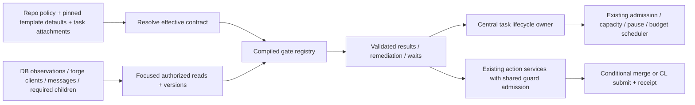

# Configurable built-in gates

**Owner:** @ai-on-gke/ai-factory-root-owners

**Status:** proposed architecture, documentation/specification only. No runtime, live permission, configuration, deployment or automatic task filing is authorized.

**The core rule:** Grain owns task lifecycle and protected actions. Configured, versioned Go evaluators explain whether an obligation or action prerequisite is met. A gate result never grants permission or performs a mutation.

The [gate specification](../spec/gates/gates.spec.md), [internal registry/evaluator API](../spec/gates/internal-api.spec.md), [HTTP/tool contracts](../spec/gates/http-api.spec.md), [catalogue](../spec/gates/catalogue.md), [schemas and examples](../spec/gates/examples/README.md), and [action bindings](../spec/gates/action-bindings.spec.md) are authoritative for the initial design. The [API audit/readiness matrix](../spec/gates/api-readiness.md) separates specified contracts from remaining implementation and enforcement prerequisites. They supersede the remote evaluator, shared capability broker and snapshot paging recommendations in Tasks #39/#47/#56 and the first Task #57 draft. Those protocols are deferred history, not implementation dependencies. Existing capability mint/release/configure, resource providers and triggers retain their own contracts.

## Architecture

A small in-process registry maps `(gate type, version)` to a compiled Go evaluator, a closed configuration schema, supported subjects/purposes and an action allowlist. Authors add types through a Grain release. There is no runtime plugin installation, MCP call, callback, reverse-read broker, universal data-access registry or universal immutable task snapshot. Future external adapters may share the conceptual result interface only after a separately reviewed design.

An evaluator receives a controller-derived task/resource context and narrow internal read helpers. It reads existing observations and forge clients, records evidence dependencies, and returns `met`, `unmet`, `pending`, `unknown` or `error`, evidence versions, useful work, waits and optional display text/actions. The evaluator cannot edit tasks, launch runs, issue approvals, mint access or execute a button. The controller validates dependencies and policies before accepting results; it rechecks them immediately before protected effects and closure.

Task completion, action prerequisites, optional monitoring and standing intent are separate. A PR's current checks/reviews/approval guard merging; authenticated integration is a later completion outcome. An attached child or resource is advisory unless a required outcome is explicitly configured. A review may be successfully delivered with findings while merge remains blocked. A report may be delivered while acknowledgment is still needed. Standing sessions rest without auto-closing.

## Configuration and policy

Versioned gate defaults live on templates; repository policy adds required completion rules and resource action guards; task attachments can add specific obligations. Grain materializes template defaults at filing and stores immutable provenance plus the resolved contract revision. Required inherited guards are a union across applicable repository/resource/task policies, including other tasks protecting the same resource. Task-local edits cannot select a weaker guard set. Missing coverage is unknown; an empty guard set requires an explicit authorized unguarded policy.

People with the appropriate policy/contract authority approve requirement weakening and evidence-scoped waivers with a reason. Agents may propose changes and perform ordinary authorized remediation. Attachment does not create read permission. Template changes affect new tasks; applying them to an existing task is an explicit migration. Live repository guard changes invalidate pending decisions immediately. Exact source revisions and the evaluator version are retained for audit and rollback.

## Delivery and waiting

The central owner aggregates accepted requirements, questions, permissions, acknowledgments, settled operations and message processing fences. Activity distinguishes running, waiting, needs answer, needs permission and needs acknowledgment, alongside ready/admission/capacity holds and terminal outcomes. One gate waiting does not block useful independent work. A whole-task hold needs a reason and scope. Existing schedulers still enforce approval, fit, pauses, budgets and standing-work ownership.

Collectors/reconcilers own wakes: CI and forge synchronization, review/approval records, messages, child outcomes and health observations mark affected gates dirty. Evaluators return bounded event interests and deadlines; they do not install arbitrary subscriptions. One dirty marker per task/resource, level reconciliation and persisted retry times recover missed wakes. Result text, reevaluation itself and a timer alone are not useful progress or trigger occurrences.

## Correctness and action boundaries

Focused reads capture current subject/head, record and collection versions, completeness, actual collection time and authorization/policy revisions. Complete empty sets are negative evidence; missing/truncated/unreadable collections are unknown. Validate the union at decisions and closure. External reads do not create global atomicity: expected-head writes, forge rules or proven exclusion must protect each promised condition, otherwise enforced execution is unavailable.

All admitted merge/submit paths—agent, UI/API/CLI, queue and automation—use the same resource policy and guard check in the domain action service. Keep existing typed actions and adapters, with idempotent intent/receipt/reconciliation, rather than building a general execution platform. Direct forge/SSH/base-write credentials must be excluded or constrained for an enforced cohort. Out-of-band people/apps may still integrate unless separately constrained; record their integration as external. A hidden button or a prompt is not enforcement.

## Source evidence and migration

The [compatibility inventory](../spec/gates/compatibility.md) uses Task #51's mapping at `f764e02e0`, verified against base `e253df886`. `finish.go`, `taskgoals.go`, PR/CL sync, review settlement and UI operations currently have several completion writers; Go and both SQL projections independently compute state. Preserve collectors but switch every lifecycle writer for each migrated task to proposals to one owner, transactionally at an authority epoch. Shadow evaluators cannot write lifecycle. No legacy-met shortcut or dual authority is allowed.

The first catalogue specifies delivery/ack, checks, ordinary/security/path/takeover reviews, human approval, PR/CL integration, required children, base/nightly/publishing/pipeline health and QA stage evidence. It names exact legacy imports and stronger new defaults. Existing concrete goals (`pr-merged`, `cl-submitted`, `tasks-closed`, `base-green`, `nightly-green`, `pipeline-healthy`, `person-closes`) keep their API names and meanings until explicit migration. Autonomous agent goal mode remains a separate run policy.

The first implementation/display increment may implement only two selected gates
as read-only observations, leaving legacy lifecycle, scheduling, approvals and
actions authoritative. The [observation-only API/display contract](../spec/gates/http-api.spec.md#initial-observation-only-apidisplay-subset)
does not require all future mutation/enforcement endpoints. Observe comparisons
for a day or two, then make a separate operator cutover decision; no elapsed-time
or successful-result trigger may enable authority automatically. This is a staged
implementation boundary, not live configuration authorization by this PR.

Implementation sequencing, without filing tasks:

1. Implement the selected observation-only gates and read-only Angular/API/agent display with existing legacy state authoritative; capture current-behavior fixtures and comparisons. Full mutation/configuration/admission APIs and lifecycle/action enforcement are not prerequisites for that increment.
2. Centralize lifecycle with Go/SQLite/Postgres projection parity, durable event/timer recovery, questions/message/child fences and explicit task authority handoff.
3. Converge existing protected merge/submit entry points, current-head guard evaluation, conditional effects, intent/receipt recovery and credential boundary admission. Resource guard enforcement can cover legacy-completion tasks independently.
4. Extend the initial read-only Angular/API/agent views with authorized registered actions when their services are implemented and qualified; opt in templates/tasks/resources with explicit migration and rollback tests.

Remaining enablement work is concrete: central lifecycle storage/writer fencing; complete versioned collections and exact-head review provenance; inherited policy/coverage persistence; uniform action-service checks and durable uncertain-effect handling; deployment-specific credential exclusion; CL exact-snapshot execution proof; legacy import qualification and UI/SQL parity. No remote provider, resource/trigger rollout or Task 1 dependency is required. Recommended v1 choices are fixed compiled schemas, no evaluator-private state, additive inherited requirements, explicit compatibility profiles and read-only shadow rollout first. The specification makes these choices; live admission still requires implementation and verification.

Resource evidence integration reuses [TDS-14's observation/dirty transaction](../spec/tracked-resources/implementation.spec.md#TDS-14): capture its committed generations and grant epochs in BG-4 dependencies. The resource-specific transaction and lock order remain applicable when that optional provider is used; they introduce no initial remote gate prerequisite.
