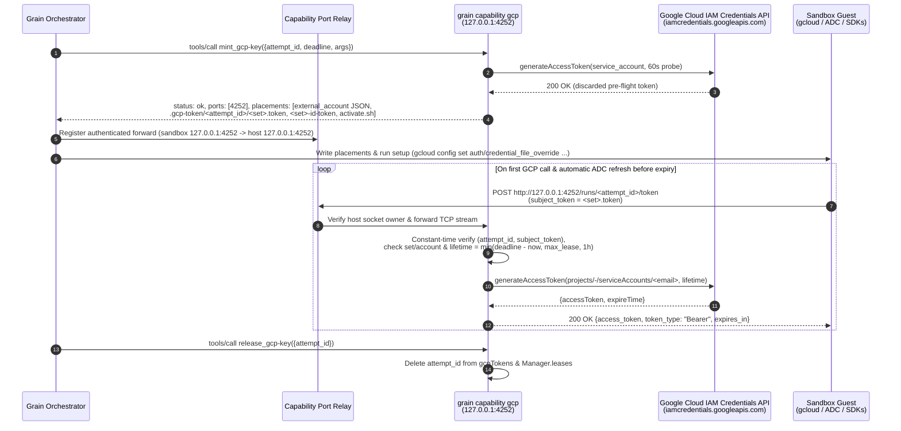

# Keyless GCP Capability Access

**Owner:** @bwsalmon

**The core rule:** in `credential: token` mode, no GCP service account private key is ever created or placed in a sandbox. The `gcp` capability server holds or inherits the admin identity outside the sandbox, places an `external_account` Application Default Credentials (ADC) configuration plus a random per-attempt bearer secret inside the sandbox, and exchanges that secret over a forwarded loopback port (`127.0.0.1:4252`) for short-lived OAuth 2.0 access tokens and OIDC ID tokens minted on demand via the Google Cloud IAM Credentials API (`generateAccessToken` / `generateIdToken`), bounded to the attempt's `attempt_id`, target service account, and lease deadline.

**Status:** describes `main` as of 2026-11-10 (`pkg/capability/gcpsets` and `pkg/capability/intree/gcp_token.go`). [`capabilities.design.md`](capabilities.design.md) is the capability architecture overview; the normative capability and wire contract is [`capabilities.spec.md` §6.1](../spec/capabilities/capabilities.spec.md#61-leased-cloud-credential-gcp-key--mint_gcp-key--release_gcp-key), and the operator setup guide is [`docs/gcp-key-permission-sets.md`](../../docs/gcp-key-permission-sets.md). Where this document and the spec disagree, the spec wins.

## Context and Motivation

Enterprise Google Cloud Platform (GCP) organizations commonly enforce the organization policy `constraints/iam.disableServiceAccountKeyCreation`, which blocks `iam.serviceAccountKeys.create` across projects to eliminate exportable, long-lived JSON private keys. Even in environments where key creation is permitted, physical service account keys carry operational and security drawbacks:

1. **Org-policy incompatibility:** Key-minting permission sets fail immediately with `403 PERMISSION_DENIED` whenever `constraints/iam.disableServiceAccountKeyCreation` is active.
2. **Hard per-account concurrency ceiling:** GCP limits each service account to 10 user-managed keys (`gcpsets.KeysPerAccount = 10`). On a pre-existing service account that Grain is not allowed to clone into a multi-account pool, key mode caps concurrency at 10 simultaneous task attempts across the entire deployment (fewer if external automation also holds keys on that account).
3. **Orphaned-key hazard on shared accounts:** For service accounts Grain creates itself, a periodic reaper (`ReapInterval = 10m`) deletes keys past `max_lease + 5m` if a server crash loses an attempt's `release_gcp-key` call. On a pre-existing service account (`service_account: <email>`), Grain cannot distinguish keys it minted from keys belonging to other systems, so the reaper never touches the account; an unreleased key lingers until an operator deletes it manually.
4. **Exportable credential material in the guest:** Although a leased key is deleted on `release_gcp-key`, raw RSA private key material sits in the sandbox filesystem for the duration of the attempt.

Grain's built-in `gcp` capability server (`https://grain.dev/capabilities/gcp#gcp-key`) solves this across **both** managed and pre-existing service accounts via **`credential: token`** (offered as `"token (recommended, no keys)"` by default for new sets in Settings):

- **Managed token sets (`credential: "token"`, `service_account` omitted):** Grain creates (or adopts) one service account `<prefix>-<deployment>-<set>@<project>.iam.gserviceaccount.com` marked as grain-managed (`OwnerDescriptionWithScope`), reconciles `roles` on `project` or `resource_scope` (`buckets/<name>` or `repositories/<location>/<repo>` for Artifact Registry) bounded by `admin.role_ceiling`, and grants the admin principal `roles/iam.serviceAccountTokenCreator` **on that service account only** — all idempotently on `configure` (`Reconcile`) and `mint_gcp-key`, with orphan unbind + account deletion via `delete_orphans`.
- **Existing-account token sets (`service_account: <email>`, `credential` defaulting to `"token"`):** Grain impersonates the pre-existing account directly without creating, modifying, or binding anything (`person_granted` defaults to `true`).

Instead of creating keys, Grain configures `gcloud`, ADC, and Google Cloud client libraries inside the sandbox with a standard Workload Identity Federation (`external_account`) credential file pointing at a local RFC 8693 token broker forwarded from the `gcp` capability server (`127.0.0.1:4252`). When an existing pool/key-mode set fails `CreateKey` under `constraints/iam.disableServiceAccountKeyCreation`, Grain refuses the mint without switching automatically and prints the exact `credential: "token"` JSON snippet to switch the set to.

---

## 1. Keyless Architecture and End-to-End Token Flow {#GCP-1}



The end-to-end flow spans four stages:

1. **Admission and pre-flight verification (`mint_gcp-key`):**
   - Before booting the sandbox, Grain's orchestrator invokes `mint_gcp-key` with `{attempt_id, deadline, args: {permission_set, primary}}`.
   - The `gcp` server validates that `attempt_id` is path-safe and `deadline` does not exceed `now + max_lease` (default `24h`).
   - Using the permission set's configured `admin` identity, `Manager.mintToken` calls `projects/-/serviceAccounts/<email>:generateAccessToken` with a 1-minute lifetime (`https://www.googleapis.com/auth/cloud-platform`) and **discards** the returned token. This proves at admission time—before spending VM boot time—that the admin's credentials are valid and hold `iam.serviceAccounts.getAccessToken` on the target account.
   - `gcpTokens.grant` generates a 32-byte cryptographically random hex secret, records `attempt_id -> {set, account, secret, deadline}` in memory, ensures the loopback HTTP listener is bound on `127.0.0.1:4252` (`intree.DefaultGCPTokenPort`, overridable via `-listen`), and returns the placements and port mapping.

2. **Sandbox materialization and port relay:**
   - Grain registers port `4252` on its capability port relay (`pkg/capability/portforward`), placing a lightweight guest forwarder bound to `127.0.0.1:4252` inside the sandbox that tunnels over Grain's sandbox fabric using a per-forward upgrade token. Because the relay runs on the sandbox fabric alongside the git proxy, token exchange works even when the task runs with `network_access: "none"` (provided the task's workload itself only reaches allowed endpoints or uses tokens passed to a permitted service).
   - Grain atomically writes the `external_account` JSON configuration to `/home/debian/.gcp-service-account.json` (`0600`, or `/home/debian/.gcp-keys/<set>.json` when `primary: false`), the per-attempt secret to `/home/debian/.gcp-token/<attempt_id>/<set>.token` (`0600`), an OIDC ID-token helper script to `/home/debian/.gcp-token/<attempt_id>/<set>-id-token` (`0700`), and non-secret metadata to `/home/debian/.gcp-service-account.about` (`0644`).
   - For a primary grant (`primary: true`), Grain runs `/home/debian/.gcp-token/<attempt_id>/activate.sh` (`0700`) before the agent starts, executing `gcloud config set auth/credential_file_override /home/debian/.gcp-service-account.json --quiet` and `gcloud config set project <project> --quiet`. It does not use `gcloud auth login --cred-file`: login introspects the access token against `sts.googleapis.com/v1/introspect`, and STS answers `{"active": false}` for the iamcredentials-minted service-account token the token endpoint returns, so login exits 1. The script discards only stdout, so a failing command's stderr reaches the task's setup-failure comment.

3. **Local RFC 8693 token exchange (`127.0.0.1:4252`):**
   - Standard Google Cloud SDKs (Go, Python, Node.js, Java, Rust), Terraform's `google` provider, and `gcloud` natively support `"type": "external_account"` credential files with `"credential_source": {"file": "..."}`.
   - Whenever a client in the sandbox needs an access token, it reads the per-attempt secret from `/home/debian/.gcp-token/<attempt_id>/<set>.token` and sends an RFC 8693 OAuth 2.0 Token Exchange `POST` (`application/x-www-form-urlencoded`) to `http://127.0.0.1:4252/runs/<attempt_id>/token` with `subject_token=<secret>`.
   - Workloads needing an OpenID Connect (OIDC) ID token (for example, calling Cloud Run, Cloud Functions, or Identity-Aware Proxy services) invoke `/home/debian/.gcp-token/<attempt_id>/<set>-id-token <AUDIENCE>`, which sends `GET http://127.0.0.1:4252/runs/<attempt_id>/id-token?audience=<url-encoded-aud>` with `Authorization: Bearer <secret>`.

4. **Host listener validation and IAM Credentials API call:**
   - On `127.0.0.1:4252`, `gcpTokens.ServeHTTP` parses `attempt_id` from `/runs/<attempt_id>/...` and compares the presented secret against `attempts[attempt_id].secret` using `subtle.ConstantTimeCompare`.
   - `Manager.AccessToken` (or `Manager.IDToken`) verifies that the permission set still exists, is still in `token` mode, still targets the exact `service_account` recorded at mint time, and has remaining lease time (`deadline > now`).
   - Using the admin's `iamcredentials/v1` client, the server calls `projects/-/serviceAccounts/<email>:generateAccessToken` (or `:generateIdToken` with `includeEmail: true`) and returns the short-lived token with `Cache-Control: no-store`.

---

## 2. Host and Admin Identity Resolution {#GCP-2}

The `gcp` capability server authenticates to Google Cloud as a named **admin** (`gcpsets.Admin`), which needs only `roles/iam.serviceAccountTokenCreator` (`iam.serviceAccounts.getAccessToken` and `iam.serviceAccounts.getOpenIdToken`) on the target service account—and **no project-level IAM admin permissions**—when serving `credential: token` sets.

Every admin declares `credential_source: "ambient" | "configured"` ([`capabilities.spec.md` §4.5.8](../spec/capabilities/capabilities.spec.md#45-server-configuration-configure)). `gcpsets.GoogleConnector` resolves credentials and reports the resolved principal in **Settings → Capabilities → Test** across all supported host runtimes:

| Runtime Environment | `run` Location & `credential_source` | How Admin Credentials Authenticate | How `Identity()` Resolves the Principal for `Test` |
| :--- | :--- | :--- | :--- |
| **Developer workstation** (Linux / macOS) | `run: "host"` via `grain host` (`grain-gcp` allowlist entry), `credential_source: "ambient"` | `google.FindDefaultCredentials` loads the operator's ambient user ADC (`~/.config/gcloud/application_default_credentials.json` from `gcloud auth application-default login`, `type: "authorized_user"`, e.g. `user:operator@example.com`). | Fetches an access token and queries `https://oauth2.googleapis.com/tokeninfo` to report the operator's email (`operator@example.com`) without reading or logging the refresh token. |
| **Compute Engine (GCE) VM** | `run: "container"` or `run: "host"`, `credential_source: "ambient"` | With no ADC file present, `google.FindDefaultCredentials` uses the GCE instance metadata server (`169.254.169.254`), authenticating as the VM's attached service account (e.g. `grain-host@my-project.iam.gserviceaccount.com`). | Calls `metadata.EmailWithContext(ctx, "default")` against the GCE metadata server (`len(creds.JSON) == 0`). |
| **GKE / Kubernetes** | `run: "container"`, `credential_source: "ambient"` | Uses GKE Workload Identity Federation (Pod Kubernetes Service Account mapped to a Google Service Account via the GKE metadata server) or a projected KSA token paired with a mounted `GOOGLE_APPLICATION_CREDENTIALS` `external_account` JSON file. | Queries `metadata.EmailWithContext` when backed by the GKE metadata server, or extracts the target GSA email from `service_account_impersonation_url` in the `external_account` JSON (reporting a clear note when a federated principal acts directly without impersonating a GSA). |
| **Configured secret** (any runtime) | `run: "container"` or `run: "host"`, `credential_source: "configured"` | Operator supplies a Workload Identity Federation `external_account` JSON config or `service_account` key JSON in `admin_credentials` (`writeOnly: true`), stored in Grain's encrypted secrets store (`$secret:...`) and passed in memory via `configure`. | Reads `client_email` (for `service_account`) or `service_account_impersonation_url` (for `external_account`) directly from the JSON header without echoing secret fields. |

### Long-Lived Admin Token Source Lifecycle

In Go's `golang.org/x/oauth2`, `authorized_user` and `service_account` token sources retain the `context.Context` they were constructed with for all future token refreshes. Because `Manager` caches `Cloud` clients across mints well after the `configure` RPC returns, `gcpsets.tokenContext` detaches cancellation (`context.WithoutCancel`) and attaches a dedicated `*http.Client` bounded by `gcpsets.TokenTimeout` (`20s`).

- **Bounded retry:** `adminTokenSource` retries a cancelled or timed-out admin token fetch once before surfacing `CredentialTimeout` as a transient error.
- **Automatic recovery after credential expiry or rotation:** When Google's OAuth endpoint rejects an admin credential with `invalid_grant`, `invalid_rapt`, `unauthorized_client`, or `invalid_client` (`CredentialExpired`, such as an expired workstation `gcloud` session or a revoked key), `Manager` immediately evicts the cached `Cloud` client (`m.forget(admin)`). Once the operator runs `gcloud auth application-default login` on the host (or updates `admin_credentials` in Settings), the next mint or refresh reconnects cleanly without restarting `grain capability gcp` or the daemon.

---

## 3. Security Model and Privilege Isolation Boundary {#GCP-3}

```
┌─────────────────────────────────────────┐       ┌────────────────────────────────────────────────────────┐
│ Sandbox Guest (Untrusted)               │       │ Host / Controller Boundary (Trusted)                   │
│                                         │       │                                                        │
│  ~/.gcp-service-account.json            │       │  Capability Port Relay (portforward.Relay)             │
│    (type: external_account, no key)     │       │    • Authenticates sandbox upgrade token               │
│  ~/.gcp-token/<attempt_id>/<set>.token  │  TCP  │    • Verifies socket PID/cgroup belongs to gcp server  │
│    (256-bit random local secret)        │ 4252  │                         │                              │
│  gcloud / ADC / Cloud SDKs ─────────────┼──────►│                         ▼                              │
│                                         │       │  grain capability gcp (127.0.0.1:4252)                 │
│  NEVER PRESENT IN SANDBOX:              │       │    • Constant-time verify (attempt_id, secret)         │
│    ✗ Host ADC / authorized_user tokens  │       │    • Pinned (set, target service_account, deadline)    │
│    ✗ Operator gcloud profile            │       │    • Admin credentials (ambient ADC / metadata / WIF)  │
│    ✗ GCE / GKE metadata server          │       │                         │                              │
│    ✗ Service account private keys       │       └─────────────────────────┼──────────────────────────────┘
└─────────────────────────────────────────┘                                 │ HTTPS
                                                                            ▼
                                                           iamcredentials.googleapis.com
                                                     (generateAccessToken for deployer@my-project...)
```

1. **Complete isolation from host credentials and user profiles:**
   - The sandboxed agent never receives, mounts, or observes the host's `~/.config/gcloud` directory, `authorized_user` refresh tokens, configured `admin_credentials` secrets, GCE/GKE metadata server endpoints, or admin OAuth access tokens.
   - Even on a developer workstation where the admin is `user:operator@example.com` with broad interactive permissions, the sandbox never acts as `operator@example.com`. It receives only short-lived tokens for the specific `service_account` configured on the granted permission set (for example, `deployer@my-project.iam.gserviceaccount.com`).

2. **Control-plane fencing and verified port forwarding:**
   - The `gcp` server's MCP control plane (`stdio` pipe or `configure` / `mint_gcp-key` / `release_gcp-key` tools) is never exposed to the sandbox.
   - The data-plane listener binds strictly to loopback (`127.0.0.1:4252`; non-loopback addresses are rejected by `Server.listen`).
   - On every forwarded TCP connection from a sandbox, `portforward.Relay` verifies on the **established** socket (`/proc/net/tcp` inode matched against `/proc/<pid>/fd/*`, or `hostd.SocketOwner` for `run: host`) that the listening process belongs to the `gcp` capability server's own process tree or cgroup ([`capabilities.spec.md` §5.3.2](../spec/capabilities/capabilities.spec.md#53-ports-sandbox-port-mappings)), preventing port-reuse confused-deputy attacks.

3. **Strict `(attempt_id, secret, set, service_account)` binding:**
   - Each attempt receives an independent 32-byte random token valid only at `/runs/<attempt_id>/token` and `/runs/<attempt_id>/id-token` on that listener. Presenting the token against another `attempt_id` path fails constant-time lookup with HTTP `401 Unauthorized` (`invalid_grant`).
   - Google Cloud never sees the per-attempt token; it stays strictly between the sandbox guest and the local `gcp` capability server.
   - At mint time, the grant pins `a.account = set.ServiceAccount`. On every subsequent refresh, `Manager.tokenSet(setName, account)` checks that `setName` still exists, is still in `token` mode, and still has `set.ServiceAccount == account`. If an operator edits the permission set while a task is running to point at a different service account, the running task is refused (`401 invalid_grant`) rather than silently escalated onto the newly configured account.

4. **Zero IAM mutation and `person_granted` escalation guard:**
   - For any permission set with `service_account` set (`set.Existing() == true`), Grain never creates or deletes service accounts and never reads-modifies-writes IAM policies (`CreateServiceAccount`, `DeleteServiceAccount`, and `SetPolicy` are never called). Any `roles` listed on the set are checked read-only by **Test** for operator visibility and are not subject to `role_ceiling` because Grain grants nothing.
   - Because an existing service account may carry organization-, folder-, or cross-project bindings outside Grain's visibility, `person_granted` defaults to **`true`** whenever `service_account` is set. The `gcp-key` schema advertises those set names under `x-grain-person-granted` (`protocol.PersonGrantedArgKey`), marking the grant `GrantByPerson`: only a human operator may attach or approve it, and an agent running with the grant cannot pass it on to sub-tasks or `propose_task` follow-ups (`GrantsSubsetOf` / `protocol.Covers` returns `false`). Operators may set `person_granted: false` explicitly for narrowly scoped accounts.

5. **Structured audit logging without secret leakage:**
   - Every grant (`granted access tokens`), every access-token refresh (`minted an access token ... expiring <RFC3339>`), every ID-token mint (`minted an ID token ... audience <aud>`), and every refusal or upstream failure is logged with `attempt_id`, `permission_set`, and target `service_account` (`gcp: audit: ...`), never logging secret configurations, per-attempt tokens, or minted bearer tokens.

---

## 4. Token Lifecycle, Renewal, and Revocation {#GCP-4}

### Access Token and ID Token Lifetimes

- **1-hour Google IAM ceiling:** Without an organization-policy extension, Google Cloud's `generateAccessToken` enforces a maximum token lifetime of 1 hour (`gcpsets.MaxTokenLifetime = time.Hour`).
- **Lease-bounded issuance:** Each permission set enforces `max_lease` (default `24h`) on `mint_gcp-key`: a mint whose `deadline` exceeds `now + max_lease` is refused at admission. On every `/runs/<attempt_id>/token` call, `Manager.remaining` computes:
  ```
  left = min(deadline - now, set.MaxLease)
  lifetime = min(roundToSecond(left) + 1s, 1h)
  ```
  During the middle of a multi-hour run, each exchanged access token lives for 1 hour (`expires_in: 3600`). When only 8 minutes remain before the attempt's `deadline`, a refreshed access token is minted with an ~8-minute `lifetime`, ensuring no access token outlives the attempt's deadline. Once `now >= deadline`, `Manager.remaining` returns a `*gcpsets.Refusal` (`401 invalid_grant`).
- **OIDC ID tokens:** Google Cloud's `generateIdToken` issues signed JWTs with a fixed 1-hour `exp` claim and accepts no custom `lifetime` parameter. Grain gates `IDToken` with `Manager.remaining` so no ID token can be minted once `deadline` has passed.

### Automatic Refresh, Live Reconfiguration, and Renewal

- **Transparent client refresh:** Standard Google Cloud client libraries and `gcloud` inspect `expires_in` in the RFC 8693 JSON response and re-post `subject_token` to `http://127.0.0.1:4252/runs/<attempt_id>/token` automatically a few minutes before expiry, requiring no custom refresh loop or background daemon inside the sandbox.
- **Surviving server reconfiguration and probes:** Active `gcpTokens` grants live above individual `Manager` instances, so editing unrelated permission sets in Settings (`configure`) does not drop in-flight sandbox sessions. When Settings runs a probe process (`GRAIN_CAPABILITY_PROBE=1`), `listenAddr` binds `127.0.0.1:0` so the probe never collides with the attached `gcp` server's port `4252`.
- **Idempotent lease renewal and `recreate_sandbox`:** When Grain extends a running attempt's budget (calling `mint_gcp-key` again with the same `attempt_id` and `args` and a new `deadline`), `gcpTokens.grant` preserves the existing per-attempt `secret` while updating `deadline` in place, because placements inside a running sandbox are not rewritten on renewal. Across `recreate_sandbox`, Grain re-materializes the cached placements and port forward and re-runs `activate.sh` against the still-active per-attempt secret without minting anew.

### Revocation Semantics on Release

- **Instant broker revocation:** When an attempt completes, fails, or is cancelled, Grain calls `release_gcp-key({attempt_id})`. `tokens.release(attemptID)` and `Manager.Release(ctx, attemptID)` immediately delete the attempt's entry in memory. Any subsequent `/token` or `/id-token` request returns `401 Unauthorized` (`{"error": "invalid_grant", "error_description": "this grant's token is unknown or released"}`).
- **Already-issued bearer tokens:** Unlike service account keys (which `iam.serviceAccountKeys.delete` revokes in IAM within seconds), OAuth 2.0 access tokens and OIDC ID tokens minted via `iamcredentials.googleapis.com` are bearer tokens that Google Cloud provides no per-token revocation API for (short of disabling the service account itself, which would break all concurrent attempts and external workloads sharing it). Consequently, an access token minted shortly before an early `release_gcp-key` remains usable until its own expiry—at most `1h` and never past the grant's `deadline` (and at most `1h` for an ID token).

### Mode Comparison

| Property | Managed Token Set (`credential: token`, no `service_account`) | Existing SA: `credential: token` (Default with `service_account`) | Existing SA: `credential: key` | Managed Pool Set (`credential: key`, or omitted without `service_account`) |
| :--- | :--- | :--- | :--- | :--- |
| **Works with `iam.disableServiceAccountKeyCreation`** | **Yes** (no key ever created; Settings default for new sets) | **Yes** (no key ever created) | No (`iam.serviceAccountKeys.create` blocked) | No (`iam.serviceAccountKeys.create` blocked; error prints `credential: token` config snippet) |
| **Admin IAM permissions required** | `iam.serviceAccounts.{create,delete,get,list,getIamPolicy,setIamPolicy}` on project + project IAM or bucket/AR repo IAM | `roles/iam.serviceAccountTokenCreator` on the target SA only | `iam.serviceAccountKeys.create` & `.delete` on the target SA | `grainGcpKeyAdmin` custom role on the project (+ bucket or AR repo IAM if scoped) |
| **GCP account / IAM mutations by Grain** | Creates `<prefix>-<deploy>-<set>` SA, binds `roles` (`role_ceiling` enforced), grants admin `tokenCreator` on that SA only | None (`set.fixed()`) | Keys created/deleted only; SA & bindings untouched | Creates `<prefix>-<deploy>-<set>-<n>` SAs & reconciles role bindings |
| **`resource_scope` support** | `buckets/<name>` or `repositories/<location>/<repo>` | None (exclusive with `service_account`) | None (exclusive with `service_account`) | `buckets/<name>` or `repositories/<location>/<repo>` |
| **Sandbox file at `~/.gcp-service-account.json`** | `type: "external_account"` config (no secret key material) | `type: "external_account"` config (no secret key material) | `type: "service_account"` RSA private key JSON | `type: "service_account"` RSA private key JSON |
| **Port forward into sandbox** | `127.0.0.1:4252` (`DefaultGCPTokenPort`) | `127.0.0.1:4252` (`DefaultGCPTokenPort`) | None | None |
| **Concurrent attempts limit** | **Unlimited** (no per-account key cap) | **Unlimited** (no per-account key cap) | **10** (`KeysPerAccount = 10`) | `10 × pool_max` (default `30`) |
| **`person_granted` default** | `false` (`GrantCovered`; bounded by `role_ceiling`) | **`true`** (`GrantByPerson`) | **`true`** (`GrantByPerson`) | `false` (`GrantCovered`) |
| **Set removal / crash cleanup** | Per-attempt broker state vanishes on restart; removed set unbound & SA deleted when named in `delete_orphans` | Per-attempt broker state vanishes on restart; minted tokens expire in ≤ 1h | **Manual** (reaper skips existing SAs to avoid deleting non-Grain keys) | Automatic key reaper (`max_lease + 5m`); removed set unbound & SAs deleted via `delete_orphans` |

---

## Where the Detail Is

- Normative `#gcp-key` wire schemas, placement paths, data-plane endpoints, and error codes: [`capabilities.spec.md` §6.1](../spec/capabilities/capabilities.spec.md#61-leased-cloud-credential-gcp-key--mint_gcp-key--release_gcp-key).
- Capability server architecture, policy, and lifecycle overview: [`capabilities.design.md`](capabilities.design.md).
- Operator setup walkthrough for permission sets, admin roles, and existing service accounts: [`docs/gcp-key-permission-sets.md`](../../docs/gcp-key-permission-sets.md).
- Author and operator reference for built-in capability servers: [`docs/capabilities.md` → GCP (`gcp-key`)](../../docs/capabilities.md#gcp-gcp-key).
- Fixed loopback port allocation (`4252`): [`docs/ports.md`](../../docs/ports.md).
