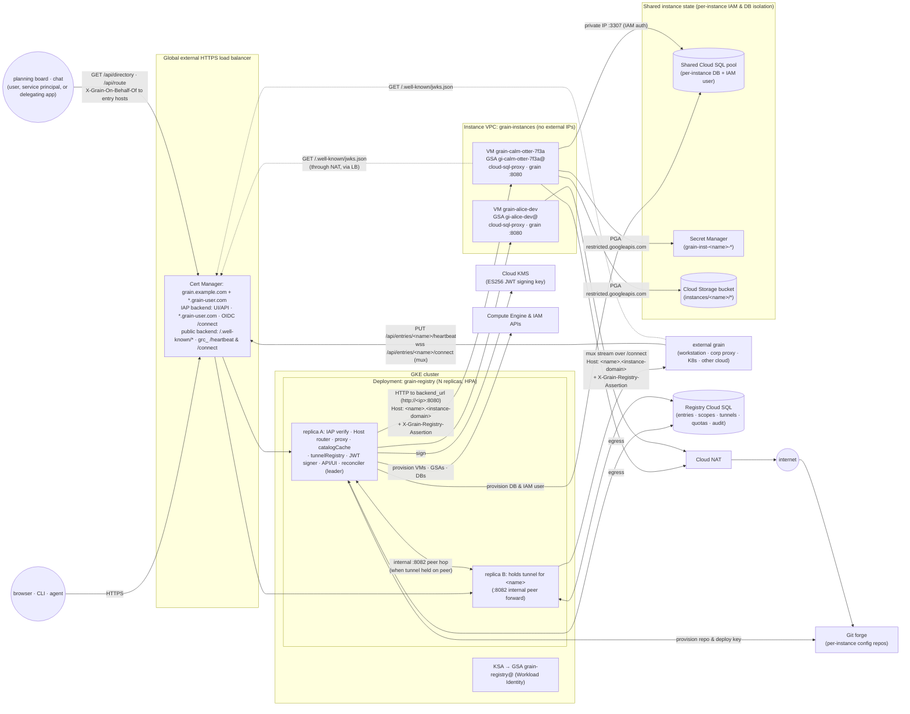
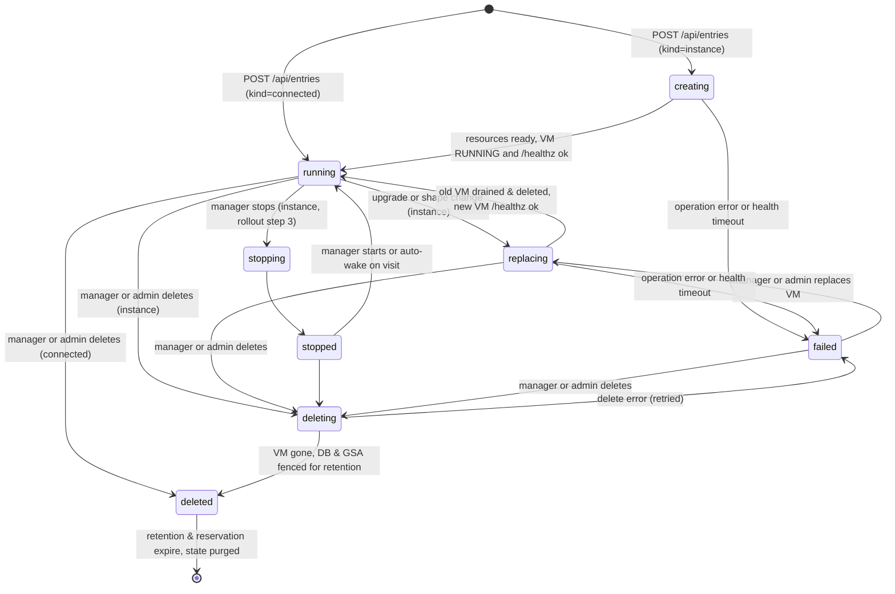
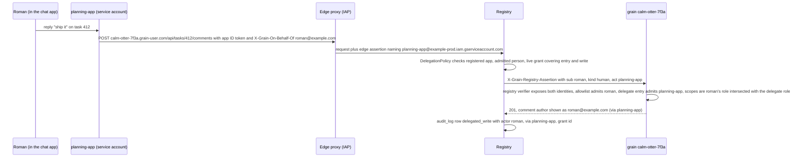

# Grain Hub: catalog, work routing, and self-service grain instances

**Owner:** @bwsalmon

**Status:** Decided by bsalmon, 2026-11-05 — all open questions decided; the production installation is a separate next step (no code yet). The *Delegated identity* revision (task 3130, 2026-11-05) is proposed: its open questions 14–17 carry recommendations awaiting a decision.

A grain deployment today is one controller with one owner ([`architecture.design.md`](architecture.design.md)). That creates two problems across an organisation. First, people who want their own grain have to stand one up: a machine, a domain, IAP or an access code, a database, and a release to keep current. Second, a product-lifecycle layer that sits above grain—planning boards, chat commands, issue triagers, and cross-team handoffs—cannot tell *which* grain owns a repository or subdirectory, whether that grain is alive, or which person and team are accountable for it.

The **grain hub** solves both in one small service. It runs on Kubernetes behind one IAP-protected load balancer. Its own UI and API live at `https://<registry-host>/`, and each **entry** gets its own host `https://<name>.<instance-domain>/` under a wildcard certificate and the same IAP backend:

- **As a host and reverse proxy**, the registry routes in two ways only: **hosted VMs** (`kind = instance`) directly over the VPC to each instance's scheme-qualified backend URL (`backend_url`, `http://<internal-ip>:8080` in v1), and **everything else as `connected` entries over an outbound tunnel** (`wss://<registry-host>/api/entries/<name>/connect`, modelled on `/api/hostd/connect`). Hosted VMs are stateless, **replaceable** single-tenant grain VMs whose persistent state lives in a shared Cloud SQL for PostgreSQL pool, Secret Manager, a per-instance Git config repository, and Cloud Storage—each isolated per instance by IAM and database permissions, so deleting an instance's VM and creating a new one from the current image or a new shape loses nothing. Outbound-tunnelled `connected` entries cover grains running on cloud workstations behind interactive corporate proxies, in inbound-blocked dev capsules, on hosts that are re-addressed every few days, on GKE / Kubernetes clusters, or in another cloud, since each can dial out to the registry's IAP/public front. Across both direct VPC instances and outbound-connected tunnels, the registry reverse-proxies `https://<name>.<instance-domain>/` with the signed-in caller in the exact same short-lived, single-audience JWT, so the grain's own allowlist, RBAC roles, and attribution decide what that caller may do.
- **As a catalog that routes work to grains**, every entry—whether a hosted VM (`instance`) or an outbound-tunnelled external grain (`connected`)—carries accountable ownership (`owner` plus an optional `owner_group`), human-readable purpose and host metadata, opt-in catalog visibility (`listed`, default `false`), and repository + path-prefix **scopes** (`primary` or `secondary`, preferring scopes the grain reports from its own configured repositories and work-ownership settings). Both hosted instances (via reconciler polling) and connected grains (via ~15 s heartbeats and active tunnel state) expose unified liveness (`online` / `degraded` / `offline`), load counts, and build stamps, and `GET /api/directory` and `GET /api/route` let admitted users and service principals discover listed grains and rank the best grain for `(repo, path)` in milliseconds.

This document is written for the open-source core. It uses public GCP products (GKE, Cloud SQL for PostgreSQL, Secret Manager, Cloud Storage, Cloud KMS, IAP, Certificate Manager, Compute Engine, Cloud NAT) and keeps each cloud-, identity-, or forge-specific piece behind a small interface, so another cloud or an internal edition can swap one out. A company-wide deployment, with its own Terraform, belongs in a wrapper distribution and is not described here.

Read with: [`authentication.design.md`](authentication.design.md) and [`authentication.spec.md`](../spec/authentication/authentication.spec.md) (`ui.IdentityVerifier`, `ui.AccessCodePrecedence`, `allowed_principal` `{#AU-6}`, `-ui-require-iap`, `checkVerifiedIdentityCSRF`, `GroupMemberChecker`), [`operator-attribution.design.md`](operator-attribution.design.md), [`rbac.design.md`](rbac.design.md) and [`rbac.spec.md`](../spec/rbac/rbac.spec.md), [`unified-grants.design.md`](unified-grants.design.md), [`architecture.design.md`](architecture.design.md), [`settings.design.md`](settings.design.md), [`simple-config.design.md`](simple-config.design.md), [`non-disruptive-upgrade.design.md`](non-disruptive-upgrade.design.md), [`grain-on-gke.design.md`](grain-on-gke.design.md) (Gateway, IAP backend policy, Cloud SQL), [`docs/cloudsql-postgres.md`](../../docs/cloudsql-postgres.md), [`docs/external-config-repo.md`](../../docs/external-config-repo.md), `pkg/hostd/dialout.go` and `pkg/hostd/remote.go` (`/api/hostd/connect`), `pkg/tunnel/wsupgrade` and `pkg/tunnel/mux`, `pkg/model/work_ownership.go` (`WorkOwnership`), and the reference Terraform in `deploy/terraform/gcp/`.

**The core rule:** Every registry-managed grain instance remains a single-tenant controller on replaceable compute whose persistent state lives in isolated Cloud SQL, Secret Manager, Git config-repo, and Cloud Storage resources, and every proxied grain—whether a hosted VM reached over the VPC or an outbound-connected grain reached over its `/api/entries/<name>/connect` tunnel—receives caller identity solely as a short-lived, single-audience JWT verified by the grain's `registry` `IdentityVerifier`. Catalog discovery exposes only entries explicitly marked `listed`, never leaks unlisted entries or internal infrastructure state, never grants access to a grain, and never lets one owner claim another listed entry's primary repository scope.

## Goals

- Each entry gets its own host, `https://<name>.<instance-domain>/`, fronted by one global external HTTPS load balancer with a wildcard certificate and a single IAP backend. The registry's own UI and API live on a separate host, `https://<registry-host>/`, not a sibling of the instances.
- Every instance VM is **replaceable**: deleting VM `<prefix><name>` and creating a new one from the current release image or a new shape loses no tasks, configuration, secrets, transcripts, or CI artifacts.
- Every entry has exactly one accountable `owner` (verified email, to whom quota is charged) and an optional `owner_group` (`group:<email>`) whose members may manage the entry alongside the owner.
- IAP authenticates every user at the edge, limited to one or more configured domains, and verified service principals may query the read-only catalog and routing endpoints.
- The registry passes the verified user to any proxied grain—hosted VM or outbound-tunnelled `connected` entry—in a signed, short-lived JWT whose audience is `https://<name>.<instance-domain>`. The grain decides, with its own access rules (`allowed_principal` and `rbac.design.md`), whether to admit that user.
- Any admitted user (or member of an optional `creators` allowlist) can create a hosted `instance` (with a randomly generated name by default, or a chosen free name), picking from configured VM shapes within a per-user quota, change its shape, upgrade it, or delete it. Every user has a page and an API listing what they own or co-manage via `owner_group`.
- Grains running anywhere outside the registry fleet (a workstation, behind an interactive corporate proxy, in an inbound-blocked dev capsule, on dynamically re-addressed hosts, a Kubernetes/GKE cluster, or another cloud) can register as **`connected`** entries under a reserved name, report version, commit, health, active/awaiting task counts, and repository scopes via ~15 s heartbeats, and dial an outbound multiplexed tunnel (`wss://<registry-host>/api/entries/<name>/connect`, `-hub-connect`) so the registry reverse-proxies `https://<name>.<instance-domain>/` (including streaming SSE and WebSocket/`hostd` upgrades) without inbound ports or a separate pull-queue API.
- Every entry carries catalog metadata (`display_name`, `purpose`, `host_kind`, `tags`, `listed` defaulting to `false`) and `(repo, path_prefix, role)` **scopes** preferring instance-reported scopes over manual overrides, with non-overlapping `primary` prefixes across listed entries and low-latency discovery (`GET /api/directory`) and longest-prefix routing (`GET /api/route`).
- Instance VMs reach only the public internet, plus Cloud SQL (private IP, through the connector) and Secret Manager / Cloud Storage (through Private Google Access, restricted to their own resources by IAM). They never reach each other, the registry's cluster, or anything else in the project.
- A registered **delegating app**, such as a planning board or a chat app, can act through the registry *on behalf of* a signed-in person who has granted it consent. The grain then admits, authorizes and records the real person, via the app (`sub` = the person, `act` = the app), instead of the app or the operator (see *Delegated identity*).
- Subdomain routing is the primary design; path routing (`https://<registry-host>/<name>/…`) is documented only as an optional secondary mode for small single-team setups and is outside the MVP.

## Non-goals

- Multi-tenancy inside one grain. Each instance is still a single-tenant grain, as [`docs/access-code.md`](../../docs/access-code.md) describes. The registry gives each person or team their own grain and routes work to the right grain; it does not divide one grain between tenants.
- Running anything except grain on the VMs.
- Multi-project or multi-region placement in v1. All VMs run in one dedicated instance project and one region, across several zones.
- Billing or chargeback. Quotas limit spending; the registry does not record cost.
- Live migration of in-flight sandbox runs across a VM replacement. Replacing a VM drains it and interrupts active local runs so they re-queue cleanly on the new VM, matching a daemon restart today.
- **Static `redirect` entries** (and unrouted "link only" directory entries) in the first version. Deferred in favour of routing only hosted VMs (`instance`) and outbound-tunnelled grains (`connected`), while keeping `entries.kind`, per-kind backend routing, and kind-independent naming, reservation, ownership, and quotas so new entry kinds remain cheap to add later (see *Deferred: redirect entries*).
- **Grains as delegating apps, and multi-hop delegation.** A grain, or an agent inside one, acting through the registry on another grain on behalf of the person who asked is out of scope. Delegation is exactly one hop: a person, via one registered app (see *Delegated identity*). A grain that needs to call another grain uses that grain's own external-agent token, attributed to the calling agent.

## Terms

- **Registry**: the Kubernetes service this document describes (`cmd/grain-hub`).
- **Registry host**: the hostname serving the registry's own UI, API, tunnel ingress, and JWKS (`grain.example.com`).
- **Instance domain**: the wildcard parent domain under which entries live (`grain-user.com`, giving `<name>.grain-user.com`). Recommended to be a separate registrable domain from the registry host.
- **Entry**: a catalog and routing row at `<name>`. Its **kind** is `instance` or `connected` today (`kind` remains an explicit field so future kinds such as `redirect` stay cheap to add).
- **Instance**: an entry of kind `instance`, which is one replaceable grain VM backed by externalised state and polled by the reconciler.
- **Connected entry**: an entry of kind `connected`, representing a grain running outside the registry (workstation, inbound-blocked dev environment, Kubernetes/GKE, another cloud) that authenticates to the registry, pushes ~15 s heartbeats, and dials an outbound multiplexed tunnel (`wss://<registry-host>/api/entries/<name>/connect`) over which the registry reverse-proxies `https://<name>.<instance-domain>/`.
- **Name**: a DNS label matching `[a-z][a-z0-9-]{1,30}[a-z0-9]`, generated at random by default or chosen by the owner.
- **VM name**: `<prefix><name>`, for example `grain-calm-otter-7f3a` or `grain-alice-dev`. The prefix is fixed by configuration.
- **Owner**: the single verified human email accountable for an entry and charged its quota.
- **Owner group**: an optional group principal (`group:<email>`) on an entry whose verified members may manage the entry like the owner while quota remains charged to `owner`.
- **Entry manager**: the entry's `owner` or any verified member of its `owner_group`.
- **Listed entry**: an entry with `listed = true`, making its catalog metadata, scopes, and liveness status visible in `/api/directory` and `/api/route` (entries default to `listed = false`).
- **Scope**: a `(repo, path_prefix, role)` claim (`role` in `primary` | `secondary`) declaring that an entry handles work in `<owner>/<name>` under `<path_prefix>`.
- **Status**: derived runtime health of an entry (`online`, `degraded`, or `offline`), distinct from its provisioning lifecycle `state` (`creating`, `running`, `replacing`, `deleting`, `deleted`, `failed`).
- **Admin**: a principal listed in the registry's `admins` configuration.
- **Delegating app**: a service principal that a registry admin has registered in `delegating_apps`, so that it may ask to act on behalf of people who consent (for example `planning-app`).
- **Delegation grant**: a person's recorded consent (`dlg_…`) letting one delegating app act for them on named entries (or `*`), with `read` or `write` access, until an expiry.
- **Delegated request**: a request from a delegating app to an entry host naming a person in `X-Grain-On-Behalf-Of`. The registry forwards it with a JWT whose `sub` is the person and whose `act` is the app.

## Components and data flow



1. **Load balancer, wildcard certificate, and IAP.** One global external HTTPS load balancer (a GKE Gateway, `gke-l7-global-external-managed`, as [`grain-on-gke.design.md`](grain-on-gke.design.md) uses) fronts both `<registry-host>` and `*.<instance-domain>` on one anycast IP. Google Cloud Certificate Manager attaches a certificate covering `<registry-host>` and `*.<instance-domain>` via **DNS authorization** (`_acme-challenge.<instance-domain>`), paired with a wildcard DNS `A`/`AAAA` record for `*.<instance-domain>`. IAP is enabled on the single `grain-registry` backend service, with `roles/iap.httpsResourceAccessor` granted to `domain:<d>` for each configured domain (plus configured service-principal catalog readers), so creating or deleting an entry changes no load-balancer, certificate, DNS, or IAP resource. The registry verifies the IAP assertion again in process. Long-lived routes (`/api/entries/*/connect`, `/api/hostd/connect`, streaming endpoints) carry a `GCPBackendPolicy` with `timeoutSec: 86400`. Using a Gateway API Core exact-header rule (`X-Grain-Auth: token`), the dedicated `grain-registry-public` backend exposes only `/.well-known/jwks.json` plus `grc_`-authenticated `PUT /api/entries/<name>/heartbeat` and `GET /api/entries/<name>/connect` outside IAP, while OIDC / proxy-authenticated `/heartbeat` and `/connect` calls without `X-Grain-Auth: token` traverse `grain-registry` behind IAP as usual.
2. **The registry Deployment.** Stateless replicas, at least two across zones, behind a ClusterIP Service with a HorizontalPodAutoscaler on CPU and in-flight requests. Every replica serves `<registry-host>` (UI, CRUD API, heartbeats, outbound `/api/entries/<name>/connect` tunnels, and in-memory `catalogCache` for `/api/directory` and `/api/route`) and every `<name>.<instance-domain>` (from `hostCache` and `tunnelCache`). When a request for a tunnelled `connected` entry lands on a replica other than the one holding that entry's live tunnel, the edge replica forwards the sanitized request over a cluster-internal peer port (`:8082`) to the holding replica (see *Scale and HA*). One replica at a time holds the database lease and runs the reconciler.
3. **Registry Cloud SQL and shared instance Cloud SQL.** The registry's own tables (`registry` schema) sit in a regional HA Cloud SQL for PostgreSQL instance, separate from the shared Cloud SQL pool that holds grain instances' databases so a busy grain instance cannot starve routing or reconciliation (small deployments can place both in one Cloud SQL instance). All connections use IAM database authentication with no stored passwords.
4. **Externalised instance state.** Each hosted `instance` gets its own per-instance GCP service account (`gi-<slug>@<project>.iam.gserviceaccount.com`), its own database and IAM user on a shared Cloud SQL instance, its own Secret Manager prefix (`grain-inst-<name>-*`), its own Cloud Storage Managed Folder (`instances/<name>/`), and its own private Git config repository with a repository-scoped SSH deploy key.
5. **The VM fleet and external connected grains.** Hosted `instance` entries run one Compute Engine VM per running instance, in one dedicated project, on VPC `grain-instances` with no external IPs and only an ephemeral disk, booted from the baked `grain-release` machine image (`scripts/setup.sh`: the release container, local `grain hostd`, local sandboxes, and `cloud-sql-proxy`). External `connected` grains run anywhere their owner operates them (developer workstations, behind corporate proxies, inbound-blocked dev environments, dynamically re-addressed hosts, Kubernetes/GKE clusters, or other clouds), push periodic heartbeats to `<registry-host>`, and maintain an outbound multiplexed tunnel to `<registry-host>` (`-hub-connect`).
6. **The reverse-proxy path.** Routing chooses a backend per `entry.kind` (`instance` and `connected` in v1). Both entry kinds share one CSRF, header-stripping, `Set-Cookie`-hardening, and `X-Grain-Registry-Assertion` JWT pipeline, differing only in transport:
   - **Hosted `instance` entries (direct VPC HTTP via `backend_url`):** each instance stores its backend as a **URL with a scheme** (`backend_url`, `http://<internal-ip>:8080` in v1 rather than a bare `internal_ip:8080`), reached directly from any replica over the VPC. Only the GKE cluster's nodes (or pod CIDR when peered) may open `tcp:8080` on instance VMs—either in the **same VPC, separate subnet** (`registry` and `instances` subnets of `grain-instances`, matched by secure tags and service accounts) or across **separate peered VPCs** (VPC peering without custom route export). Traffic between the registry and a VM is plain HTTP inside the VPC in v1: Google Cloud encrypts VPC traffic on the wire, and caller authentication lives on the signed registry JWT independent of transport. Storing `backend_url` with a scheme and keeping auth on the JWT means per-instance TLS can be added later with zero data-model or auth change (see *TLS between the registry and hosted VMs* under *Network isolation*).
   - **Connected entries (`kind = 'connected'`, outbound multiplexed tunnel):** already encrypted end to end (`wss://` through IAP / the load balancer); the registry opens a stream back over the grain's outbound `wss://<registry-host>/api/entries/<name>/connect` `pkg/tunnel/mux` session (directly on the holding replica, or via one cluster-internal replica-to-replica hop). Hosted VMs keep direct VPC proxying rather than dialing this tunnel (see *Hosted VMs vs outbound tunnels*).

### Why one IAP backend and a registry JWT, not IAP on every VM

Per-VM IAP would put every VM behind its own backend service, NEG, OAuth client, and IAM policy—minutes of load-balancer propagation on every create, hard project quotas on backend services, and a direct internet ingress path to each VM. Fronting `<registry-host>` and `*.<instance-domain>` with a single wildcard certificate and one IAP backend means creating an instance touches no edge infrastructure, VMs remain reachable only inside the VPC, programmatic callers (`grain` CLI, remote `hostd`, planning boards) mint ID tokens against a single IAP audience, and each instance verifies one registry issuer's JWKS while enforcing its own audience (`https://<name>.<instance-domain>`).

### Cloud- and identity-specific seams

The registry core (routing, catalog & scope resolution, data model, quotas, state machine, JWT minting, UI, and API) has no GCP or GitHub dependency. Cloud-, identity-, and forge-specific operations sit behind interfaces:

```go
// Compute manages replaceable instance VMs. Every method refuses a VM name
// outside the configured project, zones and prefix (see Reconciliation).
type Compute interface {
	Create(ctx context.Context, spec VMSpec) (op OperationRef, err error)
	Stop(ctx context.Context, zone, vmName string) (op OperationRef, err error)
	Get(ctx context.Context, zone, vmName string) (VMStatus, error)
	Delete(ctx context.Context, zone, vmName string) (op OperationRef, err error)
	List(ctx context.Context) ([]VMStatus, error) // only VMs with prefix and label
	Operation(ctx context.Context, op OperationRef) (OperationStatus, error)
}

// InstanceResources provisions and tears down the externalised identity,
// database, secret scope, and object-storage prefix that outlive a VM replace.
type InstanceResources interface {
	EnsureIdentity(ctx context.Context, entry Entry) (serviceAccount string, err error)
	EnsureDatabase(ctx context.Context, entry Entry, serviceAccount string) (sqlInstance, dbName string, err error)
	EnsureStorageAndSecrets(ctx context.Context, entry Entry, serviceAccount string) error
	FenceOnDelete(ctx context.Context, entry Entry) error
	Purge(ctx context.Context, entry Entry) error
}

// ConfigRepos manages per-instance configuration repositories on the Git forge.
// A no-op implementation backs config_repo.provider = "none".
type ConfigRepos interface {
	Ensure(ctx context.Context, entry Entry, pubKey []byte) (repoURL string, err error)
	Delete(ctx context.Context, entry Entry) error
}

// FrontIdentity verifies the human or service principal attached by the edge
// proxy (IAP on GCP, via pkg/webauth).
type FrontIdentity interface {
	Verify(r *http.Request) (webauth.VerifiedIdentity, error)
}

// GroupResolver checks membership in "group:<email>" principals for owner_group,
// admins, and creators. Implementations cache lookups with bounded timeouts.
type GroupResolver interface {
	IsMember(ctx context.Context, groupEmail, memberEmail string) (bool, error)
}

// DelegationPolicy decides which verified service principals may read the
// catalog (/api/directory, /api/route) and whether a delegating app may act
// on a person's behalf on one entry (see Delegated identity). Core ships
// "consent" (registered apps plus per-person consent grants, the default) and
// "static" (catalog readers only; every delegated request refused).
type DelegationPolicy interface {
	MayReadCatalog(ctx context.Context, caller webauth.VerifiedIdentity) bool
	// AuthorizeOnBehalfOf is called only for requests to an entry host that
	// carry X-Grain-On-Behalf-Of. It returns the actor to sign into the JWT,
	// or a *DelegationRefusal naming the reason.
	AuthorizeOnBehalfOf(ctx context.Context, caller webauth.VerifiedIdentity, entry EntryRef, r *http.Request) (*DelegatedActor, error)
}

// DelegatedActor is what the registry signs into a delegated JWT.
type DelegatedActor struct {
	Subject webauth.VerifiedIdentity // the person (sub); Kind is always human
	App     string                   // delegating_apps.name (act.app)
	Grant   string                   // delegation_grants.id (act.grant)
	Access  string                   // "read" or "write" (act.access)
}

// Signer signs registry JWTs with the current key and publishes the JWKS.
type Signer interface {
	Sign(ctx context.Context, claims jwt.Claims) (string, error)
	PublicKeys(ctx context.Context) (jose.JSONWebKeySet, error)
}

// ConnectTransport upgrades an authenticated /api/entries/<name>/connect
// request into a multiplexed stream session over which the registry opens
// outbound-connected proxy streams (and rejects streams initiated by the peer).
// Core ships "ws-mux" built on pkg/tunnel/wsupgrade and pkg/tunnel/mux.
type ConnectTransport interface {
	Accept(w http.ResponseWriter, r *http.Request, meta ConnectHandshake) (ConnectSession, error)
}

type ConnectSession interface {
	OpenStream(ctx context.Context) (net.Conn, error)
	Done() <-chan struct{}
	Close() error
}
```

`FrontIdentity` and the Cloud Identity `GroupResolver` reuse `pkg/jwks` and `pkg/webauth`; wrapper distributions register alternative edge proxies, group directories, delegation policies, and tunnel transports the same way they register an `IdentityVerifier` in grain. `Signer` has Cloud KMS and local Kubernetes Secret implementations.

## Repository layout and boundaries

The registry ships from this repository as its own binary and container image, alongside `cmd/github-webhook` and `cmd/grit`, with strict compile-time boundaries keeping daemon/sandbox machinery out of the registry and registry internals out of the daemon.

### Packages

| Path | Responsibility |
|---|---|
| `cmd/grain-hub/` | Thin `package main` calling `registry.Main()` (after blank-importing core GCP/GitHub provider registrations, mirroring `cmd/grain/main.go` → `cli.Main()`). |
| `pkg/hub` | `Main()`, configuration loading/validation, and `Register*` extension hooks for wrapper distributions. |
| `pkg/hub/api` | Wire structs (`Entry`, `DirectoryEntry`, `RouteCandidate`, `Scope`, `HeartbeatRequest`, `HeartbeatResponse`, …), typed HTTP `Client`, outbound tunnel `ConnectDialer` + `MuxListener` (`wss://<registry-host>/api/entries/<name>/connect` using `pkg/tunnel/wsupgrade` and `pkg/tunnel/mux`), and `RegisterConnectDialer` hook. **The only `pkg/hub/...` package that the grain daemon and CLI may import** (used for connected self-registration, heartbeats, outbound tunnel sessions, and `grain hub …`). Depends only on the standard library and stdlib-only leaf packages (`pkg/tunnel/...`, `pkg/apierror`). |
| `pkg/hub/server` | `Host` routing (`<name>.<instance-domain>` vs `<registry-host>`), shared reverse-proxy pipeline, `/api/entries/<name>/connect` acceptor, `tunnelRegistry` and internal `:8082` replica-to-replica tunnel forwarder, `hostCache` / `tunnelCache` / `catalogCache`, JWT minting, JSON API, embedded `pkg/hub/server/static` SPA assets, server-rendered subdomain state pages, and quotas/rate limits. |
| `pkg/hub/reconcile` | Database leader lease, `creating` / `replacing` / `deleting` / `purge_after` state machine, hosted-instance status/scope polling, stale replica/tunnel cleanup, and orphan VM reporting. |
| `pkg/hub/store` | PostgreSQL `registry` schema, versioned migrations, optimistic-locking transitions, scope combination/conflict evaluation, `replicas` and fenced `tunnel_sessions` tracking, `LISTEN`/`NOTIFY` channels, and `audit_log`. |
| `pkg/hub/providers/<cloud>` | Provider implementations behind the seams above (`pkg/hub/providers/gcp` for GCE `Compute`, Cloud SQL / Secret Manager / GCS `InstanceResources`, Cloud KMS `Signer`, and Cloud Identity `GroupResolver`; `pkg/hub/providers/github` for `ConfigRepos`; `pkg/hub/providers/local` for local secrets, static groups, and in-process test fakes). |
| `deploy/kubernetes/registry/` | Kubernetes Deployment, Services (`grain-registry` and `grain-registry-public`), HPA, PDB, Gateway / `GCPBackendPolicy`, and NetworkPolicy manifests (including internal `:8082` replica-to-replica peer isolation). |
| `deploy/terraform/gcp/registry/` | Reference Terraform for the dedicated instance project, `grain-instances` VPC, Private Google Access DNS/firewall, Cloud NAT, shared Cloud SQL pool, GCS bucket, Cloud KMS key, GKE cluster, and wildcard Certificate Manager + IAP Gateway. |
| `design/spec/hub/` | Normative RFC 2119 specification (`hub.spec.md`) and requirement IDs (`{#RG-*}`). |

### Shared auth without the daemon's web server (`pkg/webauth`)

Today, the Google IAP JWT verifier (`IAPAssertionHeader`, `GoogleIAPCertURL`, `NewIAPVerifier`, `normalizeIdentityEmail` in `pkg/ui/principal.go` and `pkg/ui/verifier.go`), the Cloud Identity `GroupMemberChecker` (`pkg/ui/allowlist.go`), and the browser CSRF / Fetch-Metadata checks (`checkCrossOrigin`, `verifySameOriginForProxyAuth`, `originMatchesRequestHost` in `pkg/ui/csrf.go`) live inside `pkg/ui`. Importing `pkg/ui` from `cmd/grain-hub` would link the embedded daemon SPA (`pkg/ui/static`) and pull in `pkg/model`, `pkg/orchestrator`, `pkg/capability`, `pkg/mcp`, and `pkg/ci`.

Before the registry service skeleton lands, those self-contained HTTP authentication primitives move into **`pkg/webauth`** (alongside already-standalone `pkg/jwks`), with zero dependency on `pkg/model` or `pkg/ui` (`PrincipalKind` represented by a minimal neutral enum mapped trivially to `model.PrincipalKind` inside `pkg/ui`). `pkg/ui` delegates to `pkg/webauth` so every invariant in [`authentication.spec.md`](../spec/authentication/authentication.spec.md) (`{#AU-1}`–`{#AU-20}`) holds unchanged, while `pkg/hub/server` imports `pkg/webauth` and `pkg/jwks` directly.

### Import-boundary test

`pkg/hub/independence_test.go` (modelled on `pkg/grit/independence_test.go`, running `go list -deps` in `go test`) enforces three hard boundaries on every CI run:

1. **Registry isolation from daemon/sandbox packages:** `cmd/grain-hub` and `pkg/hub/...` MUST NOT import—directly or transitively—`pkg/orchestrator`, `pkg/agent/...`, `pkg/dispatch`, `pkg/sandbox...` (`pkg/sandboxaccess`, `pkg/sandboxaddr`, `pkg/sandboxcli`, `pkg/sandboximage`), `pkg/granule/...`, `pkg/hostd`, `pkg/modelproxy`, `pkg/ui`, `pkg/daemon`, `pkg/ci/...`, `pkg/mcp`, `pkg/capability/...`, or `pkg/model`. An explicit allowlist of shared leaf packages (`pkg/webauth`, `pkg/jwks`, `pkg/tunnel/...`, `pkg/version`, `pkg/redact`, `pkg/apierror`) ensures newly added daemon packages are off-limits to `pkg/hub/...` by default.
2. **Daemon and CLI isolation from registry internals:** every package outside `cmd/grain-hub` and `pkg/hub/...` (including `cmd/grain`, `pkg/daemon/...`, `pkg/ui/...`, `pkg/cli/...`, and `pkg/orchestrator/...`) MAY import **`pkg/hub/api` only**, and MUST NOT import `pkg/hub`, `pkg/hub/server`, `pkg/hub/reconcile`, `pkg/hub/store`, or `pkg/hub/providers/...`. The one exception is `tests/security`, which is test-only (its sole non-test file is `doc.go`) and stands up a real registry `Server` over `pkg/hub/store` to hold the consent surface's trust boundaries.
3. **Pure wire and tunnel client (`pkg/hub/api`):** `pkg/hub/api` MUST NOT import any sibling `pkg/hub/...` package or external cloud SDK (only stdlib plus stdlib-only leaf packages `pkg/tunnel/wsupgrade`, `pkg/tunnel/mux`, and `pkg/apierror`).

### Extension points for wrapper distributions

`pkg/hub` exposes `registry.Main()` plus package-level `Register*` hooks, following grain's `cli.Main()` (`cmd/grain/main.go`) and `Register*` pattern (`ui.RegisterIdentityVerifier`, `change.Register`, `capability.Register`). A downstream wrapper distribution builds its own `cmd/grain-hub/main.go` that blank-imports its internal registrations and calls `registry.Main()`:

- **`RegisterFrontIdentity(name, factory)`:** edge identity verification (`"iap"` built in; downstream proxies registered by name and selected via `identity.front`).
- **`RegisterGroupResolver(name, factory)`:** resolves `group:<email>` membership for `owner_group`, `admins`, and `creators` (`"cloud-identity"` and `"static"` built in; corporate directory resolvers registered by wrapper editions).
- **`RegisterDelegationPolicy(name, factory)`:** governs which verified service principals may query `/api/directory` and `/api/route`, and whether a delegating app may act for a person (`AuthorizeOnBehalfOf`, see *Delegated identity*). The default is `"consent"`: registered `delegating_apps` plus per-person `delegation_grants`. `"static"` admits configured `identity.service_principals` for read-only catalog and route calls and refuses every delegated request. A wrapper distribution can register a policy backed by an existing organisational consent or app-trust service, selected via `identity.delegation.policy`.
- **`RegisterComputeProvider`, `RegisterInstanceResourcesProvider`, `RegisterConfigReposProvider`, `RegisterSignerProvider`:** cloud and forge provider seams (`"gce"`, `"gcp"`, `"github"`, `"none"`, `"kms"`, `"local"`).
- **`RegisterConnectTransport(name, factory)`:** server-side outbound-tunnel transport seam (`"ws-mux"` built in, selected via `tunnel.transport`; paired with `api.RegisterConnectDialer` on the grain side so wrapper distributions behind non-HTTP corporate tunnel edges can supply a matching dialer/acceptor without modifying routing, HA forwarding, or JWT verification).

### One Go module for now

`cmd/grain-hub` and `pkg/hub/...` stay in the root `github.com/ai-on-gke/grain` Go module. Because Go links only packages reachable from a binary's `main`—and `cmd/grain` reaches only stdlib-backed `pkg/hub/api`—keeping one `go.mod` adds zero binary size or cloud-client initialization to `grain`, `grit`, or `grain-sandbox`. `pkg/hub/providers/gcp` will move into a nested `pkg/hub/providers/gcp/go.mod` only if its GCP Admin SDK dependencies (`compute`, `sqladmin`, `kms`, `iam`) ever introduce dependency conflicts, vulnerability-scanner noise, or `go mod` churn that burdens contributors who only build or use `grain`. Confining all cloud SDK imports to `pkg/hub/providers/gcp` keeps that future split mechanical.

### Image and release

The registry ships as a minimal distroless/slim container image (`grain-registry`, built from `Dockerfile.hub`) containing only `/usr/local/bin/grain-registry` (with embedded `ui-hub` static assets) and CA certificates—**no** agent CLIs, **no** `granule`, KVM, Docker, or sandbox guests, and **no** Node, Python, or Git binaries at runtime.

- **Image repository (decided):** the core `grain-registry` image is published as **`docker.io/grainai/registry`**, beside `docker.io/grainai/grain`, `docker.io/grainai/sandbox`, and `docker.io/grainai/sandbox-k8s`, authenticated with the same Docker Hub credentials (`DOCKER_PAT`). `scripts/release-images.sh` and the release workflows build, version-stamp (`scripts/build-version.sh`), sign, and publish `docker.io/grainai/registry` alongside the `grain` daemon and sandbox images **once the registry code exists (implementation plan #9), not before**.
- **Production installation (deferred as a separate next step, not an open question):** standing up the live production installation—choosing and provisioning the `instance_domain` and `host`, GCP projects and GKE cluster, IAP OAuth client, Cloud KMS signing key, shared Cloud SQL pool, and DNS-authorized wildcard certificates—is planned as its own separate next step after the registry implementation and reference deployment assets land. The design's cloud-, identity-, and forge-agnostic seams and the reference Kubernetes and Terraform modules (`deploy/kubernetes/registry/`, `deploy/terraform/gcp/registry/`) remain deployment-neutral so each installation supplies its concrete environment values there.

### Separate React UI (`ui-hub/`)

Instead of server-rendered Go templates on `<registry-host>`, the registry UI is a dedicated React single-page application in **`ui-hub/`**:

- **Isolated bundle, aligned toolchain:** `ui-hub/` has its own `package.json`, `package-lock.json`, `index.html`, `vite.config.js`, and `vitest.config.js`, pinned to the exact same React and Vite versions as `ui/`, so the registry bundle stays small and never ships daemon UI code (`App.jsx`, chat widgets, diff viewers, or task/CI panels).
- **Shared tokens and generic primitives without copying:** design tokens (light/dark CSS custom properties, typography, spacing, `ThemeMode` persistence) and generic UI primitives (status pills, sortable tables, filter bars, form controls, confirmation dialogs, page header chrome) live in a shared folder **`ui-shared/`** imported by both `ui/` and `ui-hub/` via npm workspaces / Vite path alias (`@grain/ui-shared`), never duplicated across the two apps.
- **Static embed at image-build time:** `vite build` in `ui-hub/` writes into `pkg/hub/server/static` (`emptyOutDir: false`, preserving tracked `.gitignore`, `.gitkeep`, and `placeholder.html` so `go build` and `go test` succeed on a fresh checkout before `npm run build`, matching `pkg/ui/static` in `Makefile`'s `frontend` target). `pkg/hub/server` embeds `static` with `//go:embed`, requiring Node at image-build and CI time only.
- **JSON API only + strict CSP:** `ui-hub/` talks exclusively to same-origin `https://<registry-host>/api/*`. Responses on `<registry-host>` carry `Content-Security-Policy: default-src 'none'; script-src 'self'; style-src 'self'; img-src 'self' data:; connect-src 'self'; font-src 'self'; base-uri 'none'; frame-ancestors 'none'; form-action 'self'`.
- **Tests and visual verification:** `Makefile` (`frontend`, `fmt-frontend`) and `.github/workflows/tests.yml` (`frontend` job) run `vitest run`, `prettier --check`, Playwright E2E specs, and `screenshot.mjs` (desktop and phone widths, light and dark) against a registry demo/fake server, matching `ui/`'s workflow ([`docs/ui-screenshots.md`](../../docs/ui-screenshots.md)).
- **Exception — subdomain state pages stay server-rendered:** the `503` (starting / updating / offline `connected`), `410` (deleting), `502` (failed), and `404` (missing / deleted) pages served on **entry hosts (`https://<name>.<instance-domain>`)** remain small, self-contained, server-rendered Go HTML pages with inline CSS and zero external scripts, fonts, or cross-origin asset loads from `<registry-host>`. They must render reliably when nothing else does and keep origins strictly self-contained.

## Data model

All registry tables live in one PostgreSQL schema, `registry`, with versioned migrations like grain's own (`pkg/model/migrations.go`).

```sql
-- Who has ever signed in. Created on first verified human request.
CREATE TABLE owners (
  email          TEXT PRIMARY KEY,          -- verified, lower-cased
  first_seen_at  TIMESTAMPTZ NOT NULL,
  last_seen_at   TIMESTAMPTZ NOT NULL,
  disabled       BOOLEAN NOT NULL DEFAULT false   -- admin can block an owner
);

-- VM shapes users may pick. Seeded from configuration on start (config wins).
CREATE TABLE shapes (
  id              TEXT PRIMARY KEY,         -- "small", "standard", "large"
  machine_type    TEXT NOT NULL,            -- "n2-standard-4" (must support nested virtualization; never e2-*)
  boot_disk_gb    INT  NOT NULL,
  scratch_disk_gb INT  NOT NULL,            -- ephemeral local disk for sandboxes and caches
  disk_type       TEXT NOT NULL,            -- "pd-balanced"
  description     TEXT NOT NULL,
  weight          INT  NOT NULL DEFAULT 1,  -- quota units this shape costs
  enabled         BOOLEAN NOT NULL DEFAULT true
);

-- Shared Cloud SQL instances available for grain instance databases.
-- Seeded from configuration; max_databases caps placement on each host.
CREATE TABLE sql_instances (
  id             TEXT PRIMARY KEY,          -- "project:region:grain-inst-sql-0"
  private_ip     INET NOT NULL,
  max_databases  INT  NOT NULL DEFAULT 200,
  enabled        BOOLEAN NOT NULL DEFAULT true
);

-- Per-owner quota overrides. Absent row means the configured default.
-- Quota is always charged to entries.owner, never split across owner_group.
CREATE TABLE quotas (
  email              TEXT PRIMARY KEY REFERENCES owners(email),
  max_instance_units INT,                   -- NULL = default
  max_connected      INT,                   -- NULL = default
  set_by             TEXT NOT NULL,
  set_at             TIMESTAMPTZ NOT NULL
);

-- One row per entry, live or reserved. hostname is written at creation as
-- name || '.' || instance_domain and is the exact Host key for subdomain routing.
-- FILLFACTOR = 80 leaves page headroom so 15 s heartbeat updates stay Heap-Only
-- Tuple (HOT) writes when indexed columns do not change.
CREATE TABLE entries (
  name                 TEXT PRIMARY KEY,
  hostname             TEXT NOT NULL UNIQUE,      -- "<name>.<instance-domain>", never edited
  kind                 TEXT NOT NULL CHECK (kind IN ('instance', 'connected')),
  owner                TEXT NOT NULL REFERENCES owners(email),
  owner_group          TEXT CHECK (owner_group IS NULL OR owner_group LIKE 'group:%@%'),
  state                TEXT NOT NULL,             -- provisioning lifecycle; see State machine
  created_at           TIMESTAMPTZ NOT NULL,
  deleted_at           TIMESTAMPTZ,               -- set on entering deleted
  reserved_until       TIMESTAMPTZ,               -- name held for owner after delete
  purge_after          TIMESTAMPTZ,               -- when retained DB/secrets/GCS/repo may drop
  purged_at            TIMESTAMPTZ,               -- set once externalised state is purged
  generation           BIGINT NOT NULL DEFAULT 1, -- bumped on config/lifecycle mutations; optimistic locking
  -- catalog metadata (every kind)
  display_name         TEXT NOT NULL DEFAULT '',
  purpose              TEXT NOT NULL DEFAULT '',  -- 1–2 plain sentences on what this grain is for
  host_kind            TEXT NOT NULL CHECK (host_kind IN ('registry-vm', 'workstation', 'kubernetes', 'other')),
  listed               BOOLEAN NOT NULL DEFAULT false,
  tags                 TEXT[] NOT NULL DEFAULT '{}',
  -- unified liveness & load (reconciler-polled on instance; heartbeat-pushed on connected)
  grain_version        TEXT,                      -- release version (pkg/version)
  grain_commit         TEXT,                      -- full VCS commit hash
  health_state         TEXT CHECK (health_state IN ('ok', 'degraded', 'unhealthy')),
  active_tasks         INT CHECK (active_tasks IS NULL OR active_tasks >= 0),
  awaiting_reply_tasks INT CHECK (awaiting_reply_tasks IS NULL OR awaiting_reply_tasks >= 0),
  last_heartbeat_at    TIMESTAMPTZ,
  has_reported_scopes  BOOLEAN NOT NULL DEFAULT false,
  -- kind = 'instance'
  shape                TEXT REFERENCES shapes(id),
  target_shape         TEXT REFERENCES shapes(id),-- set while replacing for a shape change
  vm_name              TEXT UNIQUE,               -- prefix || name, never edited
  service_account      TEXT UNIQUE,               -- per-instance GSA email
  sql_instance         TEXT REFERENCES sql_instances(id),
  db_name              TEXT,                      -- per-instance database on sql_instance
  config_repo          TEXT,                      -- forge repo slug/URL, NULL when disabled
  zone                 TEXT,
  backend_url          TEXT,                      -- scheme-qualified URL ("http://<internal-ip>:8080" in v1; "https://..." later)
  image                TEXT,                      -- image the active VM was created from
  target_image         TEXT,                      -- target image while replacing
  operation            TEXT,                      -- in-flight Compute operation, if any
  replace_step         TEXT,                      -- draining | deleting_vm | creating_vm | probing
  failure              TEXT,                      -- last error, for failed
  -- kind = 'connected'
  connected_principal  TEXT,                      -- optional workload OIDC principal ("serviceAccount:..." or "user:...")
  -- pending two-step ownership transfer
  transfer_to          TEXT,                      -- offered recipient email
  transfer_expires_at  TIMESTAMPTZ,
  CHECK ((kind = 'instance') = (vm_name IS NOT NULL)),
  CHECK ((kind = 'instance') = (host_kind = 'registry-vm')),
  CHECK (kind = 'instance' OR backend_url IS NULL),
  CHECK (kind = 'connected' OR connected_principal IS NULL),
  UNIQUE (sql_instance, db_name)
) WITH (fillfactor = 80);
CREATE INDEX entries_owner ON entries(owner) WHERE state <> 'deleted';
CREATE INDEX entries_owner_group ON entries(owner_group) WHERE owner_group IS NOT NULL AND state <> 'deleted';
CREATE INDEX entries_listed ON entries(name) WHERE listed = true AND state <> 'deleted';
CREATE INDEX entries_purge ON entries(purge_after) WHERE state = 'deleted' AND purged_at IS NULL;

-- Repository and path-prefix scopes per entry.
-- source = 'reported' comes from the grain itself (heartbeat or reconciler poll);
-- source = 'declared' comes from registry API/UI edits.
-- Whenever either set or entries.listed changes, the store transaction recomputes
-- effective_role, active, inactive_reason, and conflict_with.
CREATE TABLE entry_scopes (
  name            TEXT NOT NULL REFERENCES entries(name) ON DELETE CASCADE,
  source          TEXT NOT NULL CHECK (source IN ('reported', 'declared')),
  repo            TEXT NOT NULL,             -- normalized lowercase "<owner>/<name>"
  path_prefix     TEXT NOT NULL DEFAULT '',  -- "" = whole repo, or clean relative path without leading/trailing '/'
  role            TEXT NOT NULL CHECK (role IN ('primary', 'secondary')),
  effective_role  TEXT CHECK (effective_role IN ('primary', 'secondary')),
  active          BOOLEAN NOT NULL DEFAULT false, -- true iff in effective scope set and free of primary overlap
  conflict_with   TEXT REFERENCES entries(name) ON DELETE SET NULL,
  inactive_reason TEXT,                      -- NULL | 'overridden_by_narrower' | 'not_reported_by_instance' | 'primary_conflict'
  claimed_at      TIMESTAMPTZ NOT NULL,      -- preserved across heartbeats while (name, repo, path_prefix) stays claimed
  updated_at      TIMESTAMPTZ NOT NULL,
  PRIMARY KEY (name, source, repo, path_prefix)
);
CREATE INDEX entry_scopes_active_repo ON entry_scopes(repo, effective_role)
  WHERE active = true;

-- Hashed per-entry registration tokens ("grc_...") for kind = 'connected'.
-- Plaintext tokens are returned once on create/rotate and never persisted.
CREATE TABLE entry_credentials (
  id           BIGSERIAL PRIMARY KEY,
  name         TEXT NOT NULL REFERENCES entries(name) ON DELETE CASCADE,
  token_sha256 BYTEA NOT NULL UNIQUE,        -- SHA-256 of full "grc_..." bearer token
  token_hint   TEXT NOT NULL,                -- trailing 4 chars for UI identification
  created_by   TEXT NOT NULL,
  created_at   TIMESTAMPTZ NOT NULL,
  expires_at   TIMESTAMPTZ,                  -- set on previous token during rotation overlap window
  last_used_at TIMESTAMPTZ
);
CREATE INDEX entry_credentials_name ON entry_credentials(name);

-- Append-only. Every mutation, every admin read of another owner's data,
-- every delegation change, and every delegated unsafe-method request.
CREATE TABLE audit_log (
  id             BIGSERIAL PRIMARY KEY,
  at             TIMESTAMPTZ NOT NULL,
  actor          TEXT NOT NULL,             -- verified email (the person, for delegated rows), "grain:<name>", or "registry"
  via            TEXT,                      -- delegating_apps.name when the actor acted through an app; NULL otherwise
  grant_id       TEXT,                      -- delegation_grants.id for delegated rows
  action         TEXT NOT NULL,             -- create, replace, delete, purge, transfer, scopes, app_*, delegation_*, delegated_write, ...
  name           TEXT,
  detail         JSONB NOT NULL
);
CREATE INDEX audit_log_via ON audit_log(via, at) WHERE via IS NOT NULL;

-- Applications a registry admin has registered as able to act on behalf of
-- people who consent (see Delegated identity).
CREATE TABLE delegating_apps (
  name                  TEXT PRIMARY KEY,           -- [a-z][a-z0-9-]{1,30}[a-z0-9], shown as "(via <name>)"
  principal             TEXT NOT NULL UNIQUE,       -- "serviceAccount:<email>", matched against FrontIdentity
  display_name          TEXT NOT NULL,
  description           TEXT NOT NULL DEFAULT '',
  homepage              TEXT,
  owner                 TEXT NOT NULL REFERENCES owners(email),
  owner_group           TEXT,
  max_access            TEXT NOT NULL CHECK (max_access IN ('read', 'write')),
  max_grant_ttl         INTERVAL NOT NULL,          -- <= identity.delegation.max_grant_ttl
  require_subject_token BOOLEAN NOT NULL DEFAULT false,
  redirect_uris         TEXT[] NOT NULL DEFAULT '{}',
  created_by            TEXT NOT NULL,
  created_at            TIMESTAMPTZ NOT NULL,
  disabled_at           TIMESTAMPTZ,
  disabled_by           TEXT
);

-- One person's consent for one app. At most one live grant per (app, person).
CREATE TABLE delegation_grants (
  id             TEXT PRIMARY KEY,                  -- "dlg_<random>"
  app            TEXT NOT NULL REFERENCES delegating_apps(name) ON DELETE CASCADE,
  person         TEXT NOT NULL,                     -- verified human email; always the caller who granted
  entries        TEXT[] NOT NULL,                   -- {'*'} or entry names
  access         TEXT NOT NULL CHECK (access IN ('read', 'write')),
  created_at     TIMESTAMPTZ NOT NULL,
  updated_at     TIMESTAMPTZ NOT NULL,
  expires_at     TIMESTAMPTZ NOT NULL,
  revoked_at     TIMESTAMPTZ,
  revoked_by     TEXT,                              -- the person, an admin, or "registry" (expiry, app deletion, disabled person)
  last_used_at   TIMESTAMPTZ
);
CREATE UNIQUE INDEX delegation_grants_live ON delegation_grants(app, person) WHERE revoked_at IS NULL;
CREATE INDEX delegation_grants_person ON delegation_grants(person) WHERE revoked_at IS NULL;

-- Rolled-up delegated read/write counts, batched every 30 s from each replica.
CREATE TABLE delegation_usage (
  grant_id       TEXT NOT NULL REFERENCES delegation_grants(id) ON DELETE CASCADE,
  name           TEXT NOT NULL,                     -- entry
  day            DATE NOT NULL,                     -- UTC
  reads          BIGINT NOT NULL DEFAULT 0,
  writes         BIGINT NOT NULL DEFAULT 0,
  last_at        TIMESTAMPTZ NOT NULL,
  PRIMARY KEY (grant_id, name, day)
);

-- Reconciler leadership (see Scale and HA).
CREATE TABLE leases (
  name           TEXT PRIMARY KEY,
  holder         TEXT NOT NULL,
  expires_at     TIMESTAMPTZ NOT NULL
);

-- Live registry pods for internal replica-to-replica tunnel forwarding.
-- Each replica renews its row every 5 s; rows older than 15 s are treated as dead.
CREATE TABLE replicas (
  id             TEXT PRIMARY KEY,          -- UUID generated per pod start
  peer_addr      TEXT NOT NULL,             -- "<pod-ip>:8082" cluster-internal peer listener
  started_at     TIMESTAMPTZ NOT NULL,
  heartbeat_at   TIMESTAMPTZ NOT NULL
);

-- Active and most-recent outbound tunnel per connected entry (kind = 'connected').
-- Kept separate from entries so tunnel reconnects never bump entries.generation.
CREATE TABLE tunnel_sessions (
  name             TEXT PRIMARY KEY REFERENCES entries(name) ON DELETE CASCADE,
  session_id       BIGSERIAL NOT NULL,      -- monotonic fencing token across reconnects
  replica_id       TEXT REFERENCES replicas(id) ON DELETE SET NULL, -- NULL when disconnected
  credential_id    BIGINT REFERENCES entry_credentials(id) ON DELETE SET NULL,
  connected_by     TEXT NOT NULL,           -- "grc:<id>" or verified OIDC principal
  remote_addr      TEXT,
  connected_at     TIMESTAMPTZ NOT NULL,
  disconnected_at  TIMESTAMPTZ,             -- set on clean close or stale-replica sweep
  last_seen_at     TIMESTAMPTZ NOT NULL     -- preserved across disconnects for offline 503 page
);
CREATE INDEX tunnel_sessions_replica ON tunnel_sessions(replica_id) WHERE replica_id IS NOT NULL;
```

Both `hostname` (`<name>.<instance-domain>`) and `vm_name` (`<prefix><name>`) are written once at creation and validated against configuration before any external call. Code never constructs a VM name, service account, database name, or proxy address directly from an HTTP request.

**Keeping future entry kinds cheap to add.** `kind` stays an explicit field on `entries` (`'instance'` and `'connected'` today), subdomain routing dispatches to a backend handler per `kind`, and naming, `reserved_until` reservation, accountable ownership (`owner` and `owner_group`), catalog metadata and scopes, and per-owner quota accounting are all kind-independent. Adding a future entry kind—such as `redirect` (*Deferred: redirect entries*) or a metadata-only "link only" directory entry—is localized to a new `kind` value and its routing branch without changing ownership, reservations, or the catalog model.

### Catalog metadata and scopes

Every entry (`instance` and `connected`) carries the same catalog fields:

- **`display_name` and `purpose`:** `display_name` (up to 120 chars; falls back to `name` when empty) names the grain in human lists, and `purpose` (up to 500 chars) states in one or two plain sentences what work belongs on this grain—for example *"Autoscaler control-loop heuristics and scale-down simulations"* versus *"Bulk node and slice provisioning"*.
- **`host_kind`:** `'registry-vm'` (pinned automatically when `kind = 'instance'` and forbidden for other kinds), `'workstation'`, `'kubernetes'`, or `'other'`.
- **`listed` (default `false`) and `tags`:** newly created entries start unlisted (`listed = false`), keeping personal and experimental grains visible **only** to their `owner`, verified `owner_group` members, and registry `admins`. Setting `listed = true` publishes the entry's catalog projection into `/api/directory` and `/api/route`. `tags` holds normalized lowercase `[a-z0-9][a-z0-9-]{0,31}` labels (up to 16 per entry) for directory filtering.
- **Scopes (`repo`, `path_prefix`, `role`):** each scope claims `primary` or `secondary` responsibility for `<owner>/<name>` under normalized repo-relative directory prefix `path_prefix` (`""` for the entire repository, or clean slash-separated segments such as `"pkg/autoscaler"` with no leading or trailing `/` and no `..` elements). Path matching operates strictly on **path-segment boundaries**: `"pkg/auth"` matches `"pkg/auth"` and `"pkg/auth/jwt.go"`, never `"pkg/autoscaler/loop.go"`.

**How instance-reported scopes and registry-declared scopes combine.** A running grain already knows which repositories it works on and whether it owns their standing work (`model.RepoConfig` and `model.WorkOwnership` in `pkg/model/repo_config.go` and `pkg/model/work_ownership.go`). Preferring self-reported scopes eliminates dual maintenance and stops registry entries from advertising repositories a grain cannot actually serve:

1. **What a grain reports (`source = 'reported'`):** For every repository configured on the grain **excluding** its own `grain/config` state repository (`staterepo` / `IsConfigRepo`), the grain reports `(repo, path_prefix: "", role)`:
   - `role = "primary"` when `RepoConfig.Work.Default` is `OwnershipUnset` (`""`) or `OwnershipOn` (`"on"`)—meaning in grain's own model this deployment runs the repository's standing work;
   - `role = "secondary"` when `RepoConfig.Work.Default` is `OwnershipOff` (`"off"`)—meaning another deployment owns standing work while this grain handles manual or delegated tasks on the repo.
2. **Combining `reported` and `declared` rows per entry:**
   - **Before first report (`has_reported_scopes = false`, on newly created `instance` and `connected` entries before their first status poll or heartbeat):** `declared` rows typed into the registry UI/API (`source = 'declared'`) are the entry's effective scopes (`effective_role = role`).
   - **Once the grain reports (`has_reported_scopes = true`):** the grain's `reported` set is authoritative for **which repositories are active** and **the maximum `role` (`primary` > `secondary`) on each repository**:
     - If no `declared` rows exist for a reported `repo`, the `reported` row is effective verbatim (`effective_role = reported.role`).
     - If the entry manager has entered `declared` sub-path or role rows for a reported `repo` (for example narrowing whole-repo `""` to `"pkg/autoscaler"` in a shared monorepo, or demoting a repo to `secondary`), those `declared` rows replace the broader `reported` row for that `repo` (marking the `reported` row `inactive_reason = 'overridden_by_narrower'`), with each row's `effective_role` capped at `min(reported.role, declared.role)`. A value typed into the registry can **narrow** `path_prefix` or **demote** `primary → secondary`, never promote a repo the grain reported as `Work.Default = off` (`secondary`) to `primary`.
     - Any `declared` row naming a `repo` absent from the grain's latest report is marked `active = false` (`inactive_reason = 'not_reported_by_instance'`) and omitted from `/api/directory` and `/api/route` until the repo is configured on the grain.

**Primary-prefix overlap and conflict rule.** Across all non-deleted **`listed = true`** entries, two `primary` scopes in the same `repo` **overlap** whenever one `path_prefix` equals or is a path-segment ancestor of the other (`a == b`, `a == ""`, `b == ""`, `strings.HasPrefix(b, a+"/")`, or `strings.HasPrefix(a, b+"/")`). Disallowing ancestor/descendant overlap prevents another owner from hijacking a subdirectory of a repository whose `""` primary scope already belongs to an existing listed grain; monorepos shared across subteams give each subteam a disjoint `primary` prefix (`"services/billing"`, `"services/auth"`) and give any repo-wide catch-all grain `path_prefix: ""` with `role: "secondary"`. Unlisted entries (`listed = false`) never reserve or block primary prefixes.

Overlap is enforced symmetrically across synchronous human writes and asynchronous background reports (serialised per `repo` under `pg_advisory_xact_lock(hashtext(repo))`):

- **Synchronous registry API writes** (`POST /api/entries` with `listed = true`, `PATCH /api/entries/<name>` flipping `listed: false → true`, or `PUT /api/entries/<name>/scopes` on a listed entry): **refused with `409 Conflict`**, returning the conflicting entry's `name`, `owner`, `owner_group`, and `path_prefix` so the caller can narrow their prefix, use `role: "secondary"`, or coordinate a handoff.
- **Asynchronous instance self-reports** (`PUT /api/entries/<name>/heartbeat` on `connected` entries and reconciler polling on `instance` entries): **first-registered (`claimed_at`) wins with a visible conflict**. The heartbeat or poll itself always succeeds (`200 OK`) so liveness tracking never breaks; the incumbent holder keeps `active = true`, while the colliding newcomer's scope row is stored with `active = false`, `inactive_reason = 'primary_conflict'`, and `conflict_with = <holder-name>`. The conflict is returned in `HeartbeatResponse.scope_conflicts`, badged on `/entries/<name>` and `/admin`, and excluded from `/api/directory` and `/api/route` until resolved. When an incumbent deletes, unlists, or drops a primary scope, the same transaction re-evaluates rows with `conflict_with = <incumbent>` in `claimed_at` order and promotes the earliest non-overlapping contender.

**Primary scope ownership policy (`catalog.scope_owners`).** By default (`catalog.scope_owners` omitted), any admitted entry manager in `allowed_domains` may claim non-overlapping `primary` scopes so single-team/single-org fleets keep zero-ceremony self-registration without GitHub admin credentials on the registry. Multi-team or multi-domain registries configure `catalog.scope_owners` rules (`repo: <owner>/<repo>` or `<prefix>/*`, `principals: [group:…, user:…]`, where exact `<owner>/<repo>` rules override the longest `<prefix>/*` wildcard, and a bare `<owner>/...` rule also governs host-qualified claims such as `github.com/<owner>/<repo>` unless a host-qualified rule matches first). On restricted repositories, an entry may hold a `primary` scope only when `user:<entry.owner>`, `entry.owner_group`, or a `GroupResolver`-verified group of `entry.owner` appears in `principals`: unauthorized synchronous `primary` writes and transfers return `403 Forbidden` (`scope_owner_forbidden`; `503` on `GroupResolver` errors), whereas heartbeats and admin force-transfers succeed (`200 OK`) and demote unauthorized `primary` claims to `secondary`.

### State machine



**Provisioning `state` (stored):**

- `creating` (`instance`): quota is reserved; the reconciler idempotently creates the per-instance service account, Cloud SQL database and IAM user, GCS Managed Folder, config repo, and VM, then probes `/healthz`. Requests to `<name>.<instance-domain>` get a `503` starting page with `Retry-After: 5`. A just-created service account is eventually consistent (GCP documents up to about 60 s before Compute can use it), so when the compute provider refuses the VM because it cannot see the instance's account yet (`EXTERNAL_RESOURCE_NOT_FOUND`, surfaced as `registry.ErrServiceAccountNotReady`), the entry stays `creating` with a `status_reason` saying it is waiting and the reconciler retries on later passes with backoff (5 s, 10 s, 20 s, then every 30 s) for up to 2 minutes before moving it to `failed`. The retry never blocks a reconcile pass, so the 15 s leader lease keeps renewing. With `compute.provider: "none"` no VM can ever be created, so the reconciler moves `creating` entries straight to `failed` with a reason naming the missing provider.
- `running` (`instance`, `connected`): for `instance`, the VM is `RUNNING` and `/healthz` answered, so requests are proxied to `backend_url`; for `connected`, the entry is active from creation until deletion and proxied over its outbound tunnel whenever connected.
- `replacing` (`instance`): the VM is being replaced for a grain upgrade, shape change, or recovery from `failed`. Externalised state (Cloud SQL database, Secret Manager prefix, GCS prefix, config repo) and any `listed` primary scope claims stay untouched so a transient 60 s upgrade never forfeits scope ownership; the old VM is drained and deleted, a new VM `<prefix><name>` is created and reattached, and routing switches once `/healthz` passes. While `replacing`, requests receive a `503` updating page with `Retry-After: 5`.
- `stopping` / `stopped` (`instance`): omitted from the first version and scheduled for rollout step 3 with auto-wake on visit. Stopping deletes or halts the VM while keeping externalised state.
- `deleting` (`instance`): requests receive `410 Gone` immediately, and active `entry_scopes` are cleared so listed prefixes release without waiting for `purge_after`. The reconciler deletes the VM (and its auto-deleted disks) and fences the instance's service account and database so nothing can connect during retention.
- `deleted` (both kinds): quota is released and `entry_scopes` / `entry_credentials` are deactivated. The name stays reserved for `owner` until `reserved_until`. For `instance`, the database, secrets, GCS objects, and config repo stay fenced until `purge_after` (see *Delete and retention*) so an accidental delete can be undone before final purge.
- `failed` (`instance`): create, replace, or delete failed after retries. Because state lives outside the VM, an instance that failed during `replacing` (or whose VM died) loses no data and can move straight to `replacing` to build a fresh VM. A `failed` entry counts against quota until deleted.

`connected` entries use only `running` and `deleted`, transitioning in a single database transaction with no reconciler VM work. Every lifecycle or configuration mutation uses optimistic locking (`UPDATE … WHERE name = $1 AND generation = $2`) and appends an `audit_log` row in the same transaction.

**Derived runtime `status` (computed at read time, never thrashing `entries.state`):**

Every API response, CLI view, and UI surface that shows `grain_version` also reports `status` and `heartbeat_age_seconds` (`now() - last_heartbeat_at`), computed from `kind`, `state`, active `tunnel_sessions` state, `last_heartbeat_at`, and `health_state` against configurable thresholds (`degraded_after`, default `45s`; `offline_after`, default `90s`):

| Kind & `state` | Condition | Derived `status` |
|---|---|---|
| `connected` in `running` | No active tunnel session (`tunnel_sessions.replica_id IS NULL` or holder's `replicas.heartbeat_at` expired) | `offline` |
| `instance` or `connected` in `running` | Tunnel active (when `kind = 'connected'`), `last_heartbeat_at IS NOT NULL`, `age <= degraded_after`, and `health_state = 'ok'` | `online` |
| `instance` or `connected` in `running` | Tunnel active (when `kind = 'connected'`) and either `degraded_after < age <= offline_after` or (`age <= offline_after` and `health_state IN ('degraded', 'unhealthy')`) | `degraded` |
| `instance` in `creating` or `replacing` | Provisioning or VM replacement in progress | `degraded` |
| `instance` or `connected` in `running` | `last_heartbeat_at IS NULL` or `age > offline_after` | `offline` |
| `instance` or `connected` in `stopped`, `failed`, `deleting`, `deleted` | Not serving | `offline` |

Making `status` immediately `offline` whenever a `connected` entry has no live tunnel session ensures `/api/directory`, `/api/route`, and `https://<name>.<instance-domain>/` agree to the millisecond on clean shutdowns or drops instead of advertising an unreachable tunnel entry for up to `offline_after`.

### Reconciliation

The HTTP API never calls Compute, IAM, Cloud SQL Admin, or the Git forge inline; it records the desired state and returns `202`. The leader replica's reconciler runs every few seconds and on `NOTIFY registry_entries`, advancing each `instance` entry one idempotent step:

- `creating`: call `InstanceResources.EnsureIdentity`, `EnsureDatabase`, `EnsureStorageAndSecrets`, and `ConfigRepos.Ensure` (each idempotent on retry), then `Compute.Create` (adopting the VM if an earlier attempt already created it with matching `grain-registry` and `grain-generation` labels), then poll `Compute.Operation`, record `backend_url` (`http://<internal-ip>:8080` in v1), and probe `<backend_url>/healthz` and `/api/registry/status` until `running` or `health_timeout` (default 10 min).
- `replacing`: step through `draining` → `deleting_vm` → `creating_vm` → `probing` (see *Replace*).
- `deleting`: delete the VM via `Compute.Delete`, sweep any orphaned disks labelled `grain-entry=<name>`, call `InstanceResources.FenceOnDelete`, and mark `deleted` with `reserved_until` and `purge_after`.
- `deleted` past `purge_after` (with `purged_at IS NULL`, `kind = 'instance'`): call `ConfigRepos.Delete` and `InstanceResources.Purge` to drop the Postgres database and role, delete Secret Manager secrets, delete GCS objects and Managed Folder, and delete the per-instance service account; set `purged_at`. Once `(kind <> 'instance' OR purged_at IS NOT NULL)` and `reserved_until < now()`, purge the `entries` row.
- `running` (`kind = 'instance'`): every `status_poll_interval` (default `15 s`), poll `<backend_url>/api/registry/status` to refresh `last_heartbeat_at`, `health_state`, `grain_version`, `grain_commit`, `active_tasks`, `awaiting_reply_tasks`, and self-reported `entry_scopes`, and every minute verify `Compute.Get`. An unexpected VM disappearance sets `failure` and alerts the entry managers and admins with a one-click **Replace VM** recovery action rather than silently thrashing.
- **Orphans**: `Compute.List` lists VMs with `<vm_prefix>` and `grain-registry=<registry-id>`. Unmatched VMs are surfaced on the admin page and auto-deleted only when their `grain-generation` matches a deleted or replaced generation of this registry.

**Scope defense in depth** holds across three independent layers: (1) validated DNS-label names mapped to stored `vm_name` and `backend_url`, (2) explicit project, zone, prefix, and `grain-registry` label assertions inside `Compute`, and (3) conditional IAM bindings restricting `grain-registry@` to `<vm_prefix>` VMs/disks and `gi-*` service accounts in the dedicated instance project.

## Routing

### Subdomain routing and wildcard IAP

The registry serves two distinct host patterns behind one load balancer and one IAP backend:

1. **`https://<registry-host>/`** (for example `https://grain.example.com/`): serves the `ui-hub` SPA (`/`, `/directory`, `/new`, `/entries/<name>`, `/admin`, `/status`), JSON API (`/api/…`), OIDC/proxy-authenticated `connected` heartbeat and tunnel endpoints (`PUT /api/entries/<name>/heartbeat` and `GET /api/entries/<name>/connect`), `/healthz`, and—on the `grain-registry-public` backend port—`/.well-known/jwks.json` plus `grc_`-authenticated (`X-Grain-Auth: token`) `PUT /api/entries/<name>/heartbeat` and `GET /api/entries/<name>/connect`. The registry host is **not** a sibling subdomain of `<instance-domain>`, so instance origins never sit beside the registry UI.
2. **`https://<name>.<instance-domain>/…`** (for example `https://calm-otter-7f3a.grain-user.com/…`): routes to entry `<name>`.

**Chosen and random names.** `POST /api/entries` and the create form accept an optional `name`:

- **Default (decided): random name.** When `name` is omitted, the registry generates an unused lowercase `<adjective>-<noun>-<4hex>` label (such as `calm-otter-7f3a`), skipping reserved words. Making random the default removes naming friction on creation, avoids squatting on common words (`dev`, `test`, `release`, `security`), prevents directory-based enumeration of subdomains (Certificate Transparency logs record only the `*.<instance-domain>` wildcard certificate, not individual instance hosts), and avoids implied authority if a name is later reused after reservation expiry.
- **Custom name.** An owner who wants a memorable bookmark (`alice-dev.<instance-domain>`) supplies `name` explicitly, validated against `[a-z][a-z0-9-]{1,30}[a-z0-9]` and the reserved list (`www`, `api`, `admin`, `mail`, `auth`, `login`, `logout`, `status`, `static`, `healthz`, `autoconfig`, `wpad`, plus configured names).

**IAP's per-host session behaviour.** IAP is enabled once on the single `grain-registry` backend service, so there is no per-VM load balancer, NEG, OAuth client, or IAP binding. However, IAP scopes its browser session cookie (`GCP_IAAP_AUTH_TOKEN_*`) as a **host-only cookie** on the exact hostname visited, with no `Domain` attribute:

- On a user's **first visit** to `calm-otter-7f3a.<instance-domain>` (and when that cookie expires), the browser has no IAP cookie for that subdomain yet. IAP answers with a `302` through Google's sign-in endpoint; because the user is already signed in to their Google account, this completes automatically as a fast browser redirect (~200–400 ms, with no password or MFA prompt) and sets a host-only IAP cookie on `calm-otter-7f3a.<instance-domain>`.
- Subsequent requests, SSE streams, and WebSocket upgrades on that subdomain carry the host-only cookie directly without redirecting.
- Non-browser clients (`grain` CLI, remote `grain hostd`, external agents) send an OIDC ID token minted for the registry's single IAP backend audience in `Proxy-Authorization: Bearer <token>` and never redirect.

**Request flow for `https://<name>.<instance-domain>/<path>?<query>`:**

1. Verify IAP (`FrontIdentity`). Refuse with `401` if invalid, and `403` if the caller's domain is not allowed or the owner is `disabled`.
2. Match `Host` (lowercased, port stripped) against `<instance-domain>`, extracting `<name>` and confirming `entries.hostname == Host` in the routing cache. Reject multi-label prefixes (`a.b.<instance-domain>`) and unknown `Host` headers with `404`.
3. Missing entry: `404` (offering a link to `https://<registry-host>/new?name=<name>`). `deleted`: `404` (showing reservation/retention info to entry managers). `creating` or `replacing`: `503` status page with `Retry-After: 5`. `deleting`: `410`. `failed`: `502` with failure details and a **Replace VM** button for entry managers, generic for others.
4. Choose the backend by `entry.kind` (routing dispatches per `kind`, keeping future kinds cheap to add without touching naming, ownership, or edge checks):
   - For `kind = 'connected'`: check per-entry proxy rate limits and look up the entry's active tunnel in `tunnelCache`:
     - **Online over a tunnel:** run the **exact same** pre-strip CSRF check, edge-credential and IAP-cookie stripping, `Host` preservation, per-request `X-Grain-Registry-Assertion` JWT signing (`aud = "https://" + entry.hostname`), and `Set-Cookie` hardening as `instance`, dispatching over a stream on the local `mux.Mux` session (or forwarding over one cluster-internal hop to the replica holding that tunnel; see *Outbound tunnel protocol*).
     - **Offline (no active tunnel):** if the tunnel disconnected within the last `5 s` (for example during a rolling registry replica restart), wait up to `tunnel.reconnect_grace` (default `2 s`) on `LISTEN registry_tunnels` for the grain to finish redialing; if still offline (or offline longer than `5 s`), answer `503 Service Unavailable` (`Retry-After: 10`, `Cache-Control: no-store`)—a self-contained inline-CSS HTML page for browser navigations naming `owner` (and `owner_group` when set) and the **last-seen time** (`max(tunnel_sessions.last_seen_at, entries.last_heartbeat_at)`, or *"never connected"*), or structured JSON (`{error, owner, owner_group, last_seen_at, offline_seconds}`) for API/CLI callers.
   - For `kind = 'instance'` in `running`: verify browser CSRF via `pkg/webauth` when cookies or fetch-metadata headers are present (below), sign a registry JWT with `aud = "https://" + entry.hostname`, and reverse-proxy to `entry.backend_url` (`http://<internal-ip>:8080` in v1) + `<path>?<query>` **without stripping or rewriting paths**.

The shared reverse-proxy pipeline (`httputil.ReverseProxy`, supporting HTTP/1.1 `Upgrade` and unbuffered streaming across both direct VPC VMs and outbound `connected` tunnels):

- **Strips untrusted and edge-only credentials:** removes `X-Goog-IAP-JWT-Assertion`, `X-Goog-Authenticated-User-*`, incoming `X-Grain-Registry-Assertion`, `X-Grain-Registry-Token`, `X-Grain-Auth`, `X-Registry-Peer-Auth`, `Proxy-Authorization`, `Forwarded`, `X-Real-Ip`, and `X-Forwarded-*`. It also strips `Authorization: Bearer <jwt>` whenever `<jwt>` is an OIDC token whose unverified `aud` matches the registry's edge/IAP audience or `https://<registry-host>` (leaving grain-scoped bearer tokens such as `gma_…` intact), and removes `GCP_IAAP_AUTH_TOKEN_*` (and `__Host-GCP_IAP_*`) from the `Cookie` header before forwarding, so neither a compromised VM nor a compromised connected grain can capture a visitor's IAP session cookie or OIDC bearer token and replay it against the load balancer.
- **Preserves the entry `Host`:** sets outbound `Host: <name>.<instance-domain>`, `X-Forwarded-Host: <name>.<instance-domain>`, `X-Forwarded-Proto: https`, `X-Grain-Registry-Assertion: <jwt>`, and `X-Request-Id`.
- **Hardens `Set-Cookie`:** removes any `Domain` attribute (and ensures `Secure`) on `Set-Cookie` headers from the backend grain so neither a VM nor a connected grain can set a parent-domain cookie across `.<instance-domain>`.

Because every proxied grain sits at `/` of its own host, grain runs with **no base-path flag**: root-relative UI routes (`/tasks/42`, `/settings/ci`), SPA asset paths, server redirects, `/api/hostd/connect`, and `GRAIN_SERVER=https://<name>.<instance-domain>` work identically across standalone deployments, hosted VMs, and tunnelled `connected` grains.

### Origin isolation, CSRF, and the instance domain

With `https://<name>.<instance-domain>`, every instance is its own **Web origin**. The browser's same-origin policy isolates DOM access, `fetch`/`XMLHttpRequest` response reads, `localStorage` (where grain stores display preferences, [`settings.design.md`](settings.design.md)), `IndexedDB`, and service workers between `alice.<instance-domain>` and `bob.<instance-domain>`.

**The sibling-subdomain CSRF caveat, and why Grain's CSRF check holds.** Sibling subdomains under one registrable domain (`alice.grain-user.com` and `bob.grain-user.com`) are distinct *origins*, but browsers classify them as **same-site** (same scheme and `eTLD+1`). Consequently, `SameSite=Lax` and `SameSite=Strict` cookies—including IAP's host-only cookie on `alice.grain-user.com`—**are still attached by the browser** when a page on `bob.grain-user.com` submits a `<form>` or calls `fetch("https://alice.grain-user.com/api/tasks", {method: "POST", credentials: "include"})`. Cross-instance forgery protection therefore relies on origin and fetch-metadata checks rather than `SameSite`.

Grain's existing implementation in `pkg/ui/csrf.go` already blocks sibling-subdomain forgery, verified against `pkg/ui/server.go` and `pkg/ui/accesscode.go`:

1. **`checkCrossOrigin` (`pkg/ui/server.go`, wrapping `http.CrossOriginProtection`) and `checkVerifiedIdentityCSRF` (`pkg/ui/accesscode.go` → `verifySameOriginForProxyAuth` in `pkg/ui/csrf.go`) both run on every verified-identity state-changing request** (every method except `GET` and `HEAD`).
2. **Fetch Metadata check:** A browser request from `bob.<instance-domain>` to `alice.<instance-domain>` carries `Sec-Fetch-Site: same-site`. Both checks accept **only** `Sec-Fetch-Site: same-origin` or `none`, rejecting `same-site` and `cross-site` with `403 Forbidden` (pinned in `pkg/ui/csrf_test.go`).
3. **`Origin` fallback:** When `Sec-Fetch-Site` is absent, both checks parse `Origin` and compare its host against `r.Host` (and `X-Forwarded-Host` in `originMatchesRequestHost`), rejecting `Origin: https://bob.<instance-domain>` against `alice.<instance-domain>` with `403`.
4. **Two registry-proxy invariants make this airtight:**
   - **Outbound `Host` preservation:** The registry sets outbound `Host` and `X-Forwarded-Host` to `<name>.<instance-domain>` from the entry row (never `backend_url`'s host:port), so `http.CrossOriginProtection` and `originMatchesRequestHost` match legitimate `same-origin` requests and reject every other origin.
   - **Pre-strip CSRF check at the registry:** In `verifySameOriginForProxyAuth`, a request carrying *neither* `Sec-Fetch-Site` *nor* `Origin` is recognised as a browser request and refused if `Cookie` is non-empty, while cookie-less requests pass as CLI/programmatic callers. Because the registry strips `GCP_IAAP_AUTH_TOKEN_*` cookies before forwarding—and a `-ui-require-registry` instance sets no `grain_access` cookie of its own—stripping IAP's cookie could otherwise leave the forwarded `Cookie` header empty. The registry proxy therefore enforces `verifySameOriginForProxyAuth` **before** stripping IAP cookies on any unsafe method that arrived with a `Cookie`, `Origin`, or `Sec-Fetch-Site` header.

**Recommendation: put instances on a dedicated registrable domain (`eTLD+1`), or a Public Suffix List entry.**

- **Recommended layout:** serve the registry UI and API on the organisation's domain (`grain.example.com`) and serve instances on a **separate registrable domain** (`<name>.grain-user.com`, in the style of `googleusercontent.com` versus `google.com`, or `github.io` versus `github.com`).
- **Why:** If instances lived on `*.grain.example.com`, they would be `same-site` with `grain.example.com` and with every other `*.example.com` application:
  1. Any organisation-wide cookie set with `Domain=.example.com` would be sent by browsers to every grain instance.
  2. Any internal `*.example.com` application that relies on `SameSite=Lax` or `SameSite=Strict` cookies without checking `Sec-Fetch-Site: same-origin` would accept cross-subdomain requests forged from an untrusted script rendered in an instance.
  3. Script running under XSS on one instance could toss `Domain=.grain.example.com` cookies onto `grain.example.com` through `document.cookie`.

  Using a dedicated registrable domain (`grain-user.com`) makes every instance **`cross-site`** from `grain.example.com` and `*.example.com`, so browser `SameSite` rules, cookie domain boundaries, and storage partitioning isolate corporate properties and the registry UI completely. Between two instances on `grain-user.com`, stripping `Domain` on `Set-Cookie`, stripping IAP cookies at the proxy, and ignoring `grain_access` cookies under `-ui-require-registry` neutralise cookie tossing for grain itself; company-wide or multi-org deployments that also expose user-hosted web previews on instances can register `<instance-domain>` on the **Public Suffix List** so even sibling instances become mutually `cross-site`.

### Optional secondary mode: path routing

For a small single-team setup that cannot provision wildcard DNS or a DNS-authorized wildcard certificate, the registry design permits an optional `routing: path` mode (`https://<registry-host>/<name>/…`). **Path routing is not part of the MVP** and should not be used beyond a single mutually trusted team:

- **Fundamental security limit:** Under path routing, every instance shares one origin (`https://<registry-host>`). Cookie `Path=/<name>/` is not a security boundary: script executing on `/bob/` (for example via XSS in rendered markdown or an attachment) can `fetch` or `iframe` `/alice/`, read its DOM and tokens, and make `Sec-Fetch-Site: same-origin` requests to every other instance the visitor can access, plus `/api/entries` on the registry host itself.
- **What grain would need before enabling `routing: path`:** a static `-ui-base-path=/<name>` daemon flag injecting `<base href="/<name>/">` and a `<meta>` base tag into `index.html`, Vite built with `base: "./"`, `api()` and SPA router prefixing, markdown root-relative link rewriting, `http.Redirect` prefixing, cookie `Path=/<name>/` with instance-suffixed cookie names, `url.JoinPath` server-URL joining in `grain` CLI and `grain hostd`, a strict `Content-Security-Policy` floor (`script-src 'self'`, sandboxed attachments), and per-instance `X-Grain-CSRF` headers. None of these grain changes is required for subdomain routing.

## Identity

### The registry JWT

After IAP verifies, the registry signs a JWT for the single target instance and forwards it in `X-Grain-Registry-Assertion`.

| Claim | Value |
|---|---|
| `iss` | The fixed issuer `grain-registry` (`hub.HubAssertionIssuer`; never taken from the request). Earlier drafts named `https://<registry-host>`; the shipped signer and verifier both pin `grain-registry`. |
| `aud` | The instance's origin URL, `https://<name>.<instance-domain>`. Exactly one audience. |
| `sub` | The verified email, lower-cased. On a delegated request, the **person** named in `X-Grain-On-Behalf-Of` once `DelegationPolicy` has allowed it |
| `email` | The same email, reusing `pkg/webauth`'s `NormalizeIdentityEmail` (extracted from `pkg/ui/principal.go`) |
| `kind` | `human` (`model.PrincipalHuman`) or `service` (`model.PrincipalService` for `.gserviceaccount.com`, matching `VerifiedIdentity` in [`authentication.design.md`](authentication.design.md) §2 and `{#AU-5}` in [`authentication.spec.md`](../spec/authentication/authentication.spec.md)) |
| `act` | Present only on a delegated request: `{sub: <app service-account email>, kind: "service", app: <delegating_apps.name>, grant: <dlg_…>, access: "read" \| "write"}` (RFC 8693 actor claim, exactly one level, never nested). Top-level `kind` is then always `human`. The grain maps it to `Attribution{Actor: app, OnBehalfOf: person}` ([`operator-attribution.design.md`](operator-attribution.design.md), [`rbac.design.md`](rbac.design.md) §3). See *Delegated identity*. |
| `iat`, `nbf` | Now, with `nbf` 30 s back for clock skew |
| `exp` | `iat + 60 s` |
| `jti` | Random identifier, logged with the request id |
| `rid` | The registry request id, for joining logs across registry and instance |

- **Header:** `alg: ES256` (Cloud KMS `EC_SIGN_P256_SHA256`), `kid` set to the KMS key version.
- **Lifetime and caching:** 60 s lifetime; each registry replica caches a signed JWT per `(email, act.sub, act.grant, name)` (the `act` parts empty for direct callers) for up to 30 s to amortise KMS signing latency and cost. Upgraded connections (`hostd`, WebSockets) verify at handshake and live up to the 24 h backend timeout.
- **Keys, rotation, and how rotation reaches instances:** The signing key lives in Cloud KMS (or a Kubernetes Secret in `local` mode); **no signing key or shared secret is ever copied to an instance VM**. Instances fetch `GET https://<registry-host>/.well-known/jwks.json` (`Cache-Control: max-age=3600`), served on a dedicated `grain-registry-public` Service port whose Gateway route omits IAP so VMs reaching it via Cloud NAT need no edge identity. Planned 30-day rotation creates a new KMS key version and publishes its public key in the JWKS first, promotes it to active signer after one cache lifetime plus margin (>1 h), and disables the previous version 24 h later. On emergency key disablement, `pkg/jwks` refreshes on seeing an unknown `kid` (rate-limited to once per minute).

### The grain-side verifier (`registry`)

Both hosted `instance` VMs and outbound-tunnelled `connected` grains run the **exact same** `ui.IdentityVerifier` in core, `registry`, registered via `ui.RegisterIdentityVerifier` on the seam [`authentication.design.md`](authentication.design.md) §1 ([`authentication.spec.md`](../spec/authentication/authentication.spec.md) `{#AU-1}`–`{#AU-2}`) defines:

```
-ui-hub-issuer=grain-registry
-ui-hub-audience=https://calm-otter-7f3a.grain-user.com
-ui-hub-keys-url=https://grain.example.com/.well-known/jwks.json
-ui-require-verifier=registry
```

- `Name()` is `registry` (`AuthMethod` and `model.Principal.Source` `model.AuthSource("registry")`: `{human, alice@example.com, registry}`, rendered by `ui.PrincipalLabel` as `alice@example.com (via registry)`).
- `AccessCodeWins()` is `false` (default `ui.AccessCodePrecedence`: the verified `registry` assertion takes precedence over any access code, matching IAP under `{#AU-10}`).
- `Headers()` is `["X-Grain-Registry-Assertion"]`, which `Server.relayedByProxy` automatically treats as a proxy header (`{#AU-1}`, `{#AU-13}`).
- `Verify` validates the signature via `pkg/jwks`, pins `alg` to `ES256` (never `none` or HMAC), checks `iss` and `aud` for exact equality against locally configured `-ui-hub-issuer` and `-ui-hub-audience` (never trusting an inbound header to tell the grain its own audience), enforces `exp`, `nbf`, and `iat` with 30 s skew and `exp - iat <= 5 min`, and fails closed with `401` (`writeAssertionRefused`, `{#AU-2}`, `{#AU-16}`) on any invalid present assertion (`503` with `Retry-After: 5` on `VerifierUnavailableError` while initial JWKS fetch is unreachable, and `401` on a malformed `act` claim: nested, `act.kind` not `service`, top-level `kind` not `human`, or `act.sub` missing). A well-formed `act` sets `VerifiedIdentity.Via`, and admission then requires both the person's allowlist entry and a `delegate:` entry for the app (*Delegated identity*, *Instance side*).
- The grain's own database `allowed_principal` allowlist and role gate (`pkg/ui/access_principals.go`, `pkg/ui/access_roles.go`, `{#AU-6}`, [`rbac.design.md`](rbac.design.md), with `-deployment-owner=<owner>` pinning the owner's immutable `admin` floor and optional initial seeding of `owner_group`), refusal pages (`writePrincipalRefusedPage` in `pkg/ui/principalrefusal.go`), remote `hostd` owner verification (`hostdConnectIdentity` in `pkg/ui/hostd_connect.go`, `{#AU-17}`–`{#AU-18}`), operator attribution (`ui.RequestActor(ctx)`, [`operator-attribution.design.md`](operator-attribution.design.md)), and `checkVerifiedIdentityCSRF` (`pkg/ui/csrf.go` delegating to `pkg/webauth`, `{#AU-14}`) then apply unchanged.
- **Mandatory tunnel-listener gate on `connected` grains:** When `-hub-connect` is enabled on a `connected` grain (such as a developer workstation whose TCP listener is bound only to `127.0.0.1:8080` for local CLI use without `-ui-require-verifier=registry`), incoming tunnel streams are served directly in-process over a `MuxListener`—never dialed over `127.0.0.1` TCP, so `Stream.RemoteAddr()` (`stream-<id>-remote`, network `"mux"`) never satisfies `isLoopbackRequest` or `singleTenantTrusted`—and wrapped in an unconditional tunnel-ingress gate that requires a valid `X-Grain-Registry-Assertion` on **every** tunnelled request (including open routes like `/api/hostd/connect`) and never accepts `grain_access` cookies, `X-Grain-Access-Code`, or bearer access codes over the tunnel. Starting `-hub-connect` without `-ui-hub-issuer`, `-ui-hub-audience`, and `-ui-hub-keys-url` fails closed at startup.

### Defence against a VM forging requests to other VMs

Assuming an attacker compromises a whole instance VM, it still cannot act on another instance:

1. **No network path to other VMs or the registry cluster.** Firewall rules deny VM-to-VM and VM-to-cluster traffic; VMs have no external IPs and can reach the registry only over the internet through the load balancer and IAP, where the VM's service account is not in an allowed user domain.
2. **Captured tokens are audience-bound.** Every JWT arriving at `alice-dev` has `aud = https://alice-dev.<instance-domain>` and expires within 60 s; `bob.<instance-domain>` rejects it. No IAP cookie reaches the VM because the registry strips `GCP_IAAP_AUTH_TOKEN_*`.
3. **No signing capability or header injection.** Signing keys never leave Cloud KMS / the registry cluster, and the registry strips incoming `X-Grain-Registry-Assertion` headers on every request.

### The access code on registry-created instances

Registry instances run with **`-ui-require-verifier=registry`** (generalising `-ui-require-iap` in `accessCodeAccepted`, `pkg/ui/accesscode.go`, [`authentication.design.md`](authentication.design.md) §4 and `{#AU-12}`–`{#AU-13}`, with `-ui-require-iap` kept as an alias). Over the network listener, `grain_access` cookies and bearer access codes are disabled and unauthenticated browser navigations receive a `401` sign-in refusal page rather than the access-code form. Over **unproxied loopback** (`isLoopbackRequest && !relayedByProxy`), the access code (`local-api-token`) remains accepted as the **break-glass path**: the owner (granted conditional `roles/iap.tunnelResourceAccessor` and `roles/compute.osAdminLogin` on `<prefix><name>`) runs `gcloud compute ssh --tunnel-through-iap` and invokes `grain` locally or over a forwarded port. Storing `local-api-token` in the instance's Secret Manager prefix keeps the break-glass credential intact across VM replacements. Deployments that forbid SSH can set `ssh_break_glass: false`.

## Replaceable instances and externalised state

Every registry-run VM is disposable compute. Deleting VM `<prefix><name>` and booting a fresh one from a newer image or a different shape loses nothing because all durable state lives in four isolated backing services.

### Shared Cloud SQL for PostgreSQL

Grain already runs on PostgreSQL with automatic schema migrations (`store.Init`) and startup connection retries ([`docs/cloudsql-postgres.md`](../../docs/cloudsql-postgres.md)). Instead of a Cloud SQL instance per user (costly and slow to create) or SQLite on a persistent disk (tied to one VM and zone), instances share a small pool of regional HA **Cloud SQL for PostgreSQL** instances (`sql_instances`).

- **Placement rule.** At `creating` time, the reconciler selects the enabled `sql_instances` row with the fewest non-deleted assigned databases below `max_databases` (default 200) and records `(sql_instance, db_name)` on `entries`, where `db_name` is `grain_<name with '-' as '_'>`. Existing entries stay pinned to their assigned `sql_instance` across VM replacements; adding a new Cloud SQL instance to configuration immediately absorbs new creates without migrating live databases.
- **Passwordless connection via IAM database authentication.** Shared Cloud SQL instances set `cloudsql.iam_authentication = on`. Each VM runs its own per-instance GCP service account (`gi-<slug>@<project>.iam.gserviceaccount.com`, where `<slug>` fits GCP's 6–30 character account-id limit via `<truncated-name>-<6-char-hash>` when needed) and runs `cloud-sql-proxy --auto-iam-authn --unix-socket /cloudsql <sql_instance>` as a dedicated host systemd user (`cloudsqlproxy`). Grain connects with `-db-driver=postgres` and `GRAIN_DB_DSN="postgres://<sa-without-.gserviceaccount.com>@/<db_name>?host=/cloudsql/<sql_instance>"`—**no database password exists on the VM, in metadata, or in Secret Manager**.
- **Strict per-database isolation with no superuser.** The registry reconciler connects as `grain_registry_admin` to provision each instance's database and `CLOUD_IAM_SERVICE_ACCOUNT` role (`<sa>@<project>.iam`):
  1. The per-instance role is created with `NOSUPERUSER NOCREATEDB NOCREATEROLE NOBYPASSRLS` and is **not** granted `cloudsqlsuperuser`.
  2. PostgreSQL grants `CONNECT` on newly created databases to `PUBLIC` by default. Without revoking that default, any sibling VM holding `roles/cloudsql.instanceUser` on the same Cloud SQL host could authenticate as its own IAM user and open a sibling's database. The provisioner therefore runs, in one transaction on creation:
     ```sql
     CREATE DATABASE grain_calm_otter_7f3a;
     REVOKE ALL ON DATABASE grain_calm_otter_7f3a FROM PUBLIC;
     GRANT CONNECT, TEMPORARY ON DATABASE grain_calm_otter_7f3a TO "gi-calm-otter-7f3a@proj.iam";
     ```
     and inside that database revokes `PUBLIC` rights on schema `public` and grants schema ownership/DDL rights solely to `"gi-calm-otter-7f3a@proj.iam"` so `store.Init` can run grain's migrations inside its own database and nowhere else (`REVOKE CONNECT ON DATABASE postgres FROM PUBLIC` is applied once when each shared Cloud SQL host is initialised).
  3. At the GCP IAM layer, `roles/cloudsql.client` and `roles/cloudsql.instanceUser` for `gi-<slug>@` are conditioned on `resource.name == "projects/<project>/instances/<sql_instance>"`, so the VM cannot even open a proxy tunnel to other Cloud SQL instances in the pool.
- **Backups, point-in-time recovery, and delete retention.** Shared Cloud SQL instances run regional HA (synchronous standby in a second zone), automated daily backups (retained 14 days), and write-ahead log archiving (**Point-in-Time Recovery**, 7 days). Every grain instance inherits HA and PITR with zero per-VM backup jobs. When an owner deletes an instance (`deleting` → `deleted`), its database is **not** dropped at once: the reconciler revokes the instance service account's Cloud SQL access, sets `ALTER DATABASE <db_name> WITH ALLOW_CONNECTIONS false`, terminates active backends (`pg_terminate_backend`), and retains the database for `db_retention_period` (default 7 days, configurable up to `reservation_period`, recorded in `entries.purge_after`). During that window, the owner or an admin can restore the deleted instance; once `purge_after` passes, the reconciler runs `DROP DATABASE` and `DROP ROLE`. Admins also have an immediate purge action when erasure cannot wait.
- **Capacity, connection limits, and sizing.** A single-owner grain controller needs few concurrent SQL connections. Registry instances configure grain's SQL pool to `max_open_conns = 15`, `max_idle_conns = 3`, and the provisioner enforces `ALTER ROLE "<sa>@<project>.iam" CONNECTION LIMIT 20` in PostgreSQL so one runaway or compromised VM can never exhaust `max_connections` for neighbours. A regional `db-custom-4-16384` (4 vCPU, 16 GB RAM, `max_connections = 1000`, storage autoresize enabled) comfortably hosts 60–100 active instances (or up to `max_databases = 200` mixed active/idle instances with idle connection release), with `pg_database_size` monitored per database on the admin status page.

### Secrets in Secret Manager

Instance credentials—model API keys (`gemini-api-key`, `claude-oauth-token`, `openai-api-key`), GitHub App keys and PATs, capability server secrets, `request_secret` answers, the break-glass `local-api-token`, and the config-repo deploy key—live in **Google Cloud Secret Manager**, one Secret Manager secret per logical item under the per-instance prefix `grain-inst-<name>-<item>` with labels `grain-registry=<registry-id>` and `grain-entry=<name>`.

- **IAM isolation without cross-instance name discovery.** Each VM's per-instance service account holds a custom role (`secretmanager.secrets.{create,get,delete}`, `secretmanager.versions.{add,access,destroy}`) scoped by an IAM condition on the secret resource name, including the trailing hyphen so instance `alice` never matches `alice-dev`:
  ```cel
  resource.name.startsWith("projects/<project-number>/secrets/grain-inst-<name>-")
  ```
  Notice `secretmanager.secrets.list` is **omitted**: in GCP, `secrets.list` is evaluated on the parent project and would let a compromised VM enumerate the secret *names* of other instances. Instead, grain records its own secret names and key metadata (never secret values, preserving [`docs/data-model.md`](../../docs/data-model.md)'s rule) in a `secret_entries` table in its own Postgres database, and resolves/writes each secret directly by full resource ID (`projects/<project-number>/secrets/grain-inst-<name>-<slug>`).
- **How grain reads and writes them.** Grain already uses Secret Manager in two places: `deploy/terraform/gcp/secrets.tf` + `files/deploy.sh` (one secret per host credential fetched into `0700` `tmpfs` at boot) and `pkg/sandboxaccess/secretmanager.go` (a direct REST client against `secretmanager.googleapis.com/v1` using metadata-server credentials). Replaceable instances combine both cleanly:
  1. **Boot-time files (`grain-instance-init.service`):** Before `grain-daemon` starts, a small root oneshot unit fetches `grain-inst-<name>-local-api-token` (generating and writing version 1 if `404`) and `grain-inst-<name>-config-repo-key` into `/run/grain-secrets` (`tmpfs`, `0700`), exactly as `deploy/terraform/gcp/files/deploy.sh` does.
  2. **Runtime secret store (`pkg/secrets` Secret Manager backend):** `pkg/secrets` gains `-secrets-backend=secretmanager` with `-secrets-sm-prefix=projects/<project-number>/secrets/grain-inst-<name>-` (reusing `pkg/sandboxaccess/secretmanager.go`'s client pattern with a short in-memory cache and destroying superseded versions on overwrite). Whenever an owner pastes a model key, git credential, capability secret, or `request_secret` value in the UI/API, grain writes it straight to Secret Manager under its prefix and records the item name in Postgres. Replacing the VM minutes later loses zero credentials.
- **Registry-side secrets.** The registry's JWT signing key stays in Cloud KMS (`roles/cloudkms.signerVerifier` granted only to `grain-registry@`; private key material never leaves KMS), and rotation reaches instances exclusively through the public `/.well-known/jwks.json` endpoint—no registry secret is ever copied to an instance. Any forge credential the registry uses to create per-instance config repositories (such as a GitHub App private key on the config-repo org) lives in the registry project's own Secret Manager, readable only by `grain-registry@`.

### Configuration repository

Grain separates live runtime queries (always read from PostgreSQL, [`settings.design.md`](settings.design.md)) from declarative configuration projected to a Git repository (`pkg/staterepo`, [`docs/external-config-repo.md`](../../docs/external-config-repo.md)): `tables/*.json`, `settings/*.yml` (`capabilities.yml`, `templates.yml`, `schedules.yml`, `suites.yml`, `config-policy.yml`, `new-task-form.yml`), `memory/**`, `scripts/**`, `workflows/**`, and `release-notes/**`.

Three homes were weighed for standing configuration on replaceable instances:

| Option | Isolation & security | UX & GitOps workflow | Operational cost |
|---|---|---|---|
| **1. One private repo per instance** *(recommended)* | **Strong:** repository-scoped SSH deploy key in Secret Manager can read/write **only** that single instance's config repo | Preserves full `grain/config` commit history, blame, open config PRs, and both UI editing (Mode 2/3) and PR-only GitOps (Mode 4) across VM replacements | Automated via GitHub App on a dedicated private org; zero per-repo cost on GitHub |
| **2. One shared registry-owned repo with `instances/<name>/` directories** | **Broken without a custom Git proxy:** Git and forge tokens are repo-scoped, not path-scoped, so one VM's credential could read every sibling's repos, prompts, and setup scripts and contend on `main` | Noisy cross-owner history and push races; incompatible with `pkg/staterepo` (which expects root `settings/`, `tables/`, `memory/`) and agent `config://` browsing | One repo, or requires building and running a path-filtering Git server in the registry |
| **3. Database-only (no remote config repo)** | **Strong** (isolated in Cloud SQL) | Current settings survive VM replace in Postgres, **but** `grain/config` commit history, revertability, and open unmerged `grain/config` PRs on local disk are lost on every VM replace | Zero forge setup; kept as `config_repo.provider: none` fallback for minimal installs |

**Recommendation: one private repository per instance on GitHub** (for example `<config-org>/<registry-id>-<name>`), behind the `ConfigRepos` seam so deployments on GitLab, Gitea, or without a forge (`provider: none`) work cleanly:

- **Host and authentication:** At instance creation, the reconciler generates an `ed25519` SSH deploy keypair, stores the private key in `grain-inst-<name>-config-repo-key` in Secret Manager, creates private repository `<config-org>/<registry-id>-<name>` using the registry's GitHub App on `<config-org>`, and registers the public half as a **repository-scoped deploy key** on that one repo. Even a fully compromised VM cannot read or push to any other repository in `<config-org>`.
- **Modes supported seamlessly:** By default, `grain-instance-init` clones `<config-org>/<registry-id>-<name>` into `<data-dir>/state-repo` at boot and `StateManager` mirrors `grain/config` commits (`SyncAfterWrite` in Mode 2 Unlocked, or human-submitted `grain/config` PRs in Mode 3 Locked) back to `origin` over the read-write deploy key—so a brand-new owner can configure Models and Repositories straight from the UI on first visit and still keep full Git history across VM replacements. Owners who want strict external GitOps ([`docs/external-config-repo.md`](../../docs/external-config-repo.md), Mode 4) either switch the instance to external mode on that repo (read-only deploy key; GitHub collaborator access for the owner) or point `-external-config-repo` at their own repository (`alice/grain-config`).

### Everything else on disk

Because the VM has only an ephemeral disk (`auto_delete: true`), every path grain writes on disk is classified explicitly as either **persistent** (externalised to Cloud SQL, Secret Manager, the config repo, or Cloud Storage) or **ephemeral** (safe to discard and rebuild on VM replace):

| Path / component on a grain VM | Contents | Classification | Where it lives on registry instances |
|---|---|---|---|
| `<data-dir>/store/`, `db-config.json` | Tasks, runs, comments, **task & comment attachments** (`pkg/model/store.go`), links, CI run/job metadata & verdicts, merge-queue state, `task_run_spool_cursor`, notifications, audit logs, live `SettingsTables` & `memoryTables` | **Must persist** | **Shared Cloud SQL** (`db_name`) |
| `<data-dir>/secrets/`, `local-api-token` | Model keys, GitHub App/PAT tokens, capability secrets, `request_secret` values, break-glass access code, config-repo deploy key | **Must persist** | **Secret Manager** (`grain-inst-<name>-*`) + name index in Cloud SQL |
| `<data-dir>/state-repo/` (`grain/config`) | Declarative settings YAML/JSON, `memory/**`, `scripts/**`, `workflows/**`, `release-notes/**`, Git commit history & open branches | **Must persist** | Live tables in **Cloud SQL** + Git repository in **per-instance config repo** (cloned on boot, pushed on sync) |
| `<data-dir>/state/transcripts/` | Per-run agent conversation logs (`transcript.jsonl`, tool calls, prompts) | **Must persist** | **Cloud Storage** `gs://<bucket>/instances/<name>/transcripts/` (flushed periodically and on run end; read through an object-store cache on UI view) |
| `<data-dir>/state/ci-artifacts/` | Uploaded grain CI build/test artifacts and retained step logs | **Must persist** (within retention) | **Cloud Storage** `gs://<bucket>/instances/<name>/ci-artifacts/` (governed by GCS lifecycle retention, e.g. 30 days) |
| `<data-dir>/state/agent-sessions/` | CLI `HOME` state for standing Director and durable interactive sessions ([`durable-tasks.design.md`](durable-tasks.design.md)) | Session history **persists**; CLI tool caches **ephemeral** | Conversation state in **Cloud SQL** + archived session state tarballs in **Cloud Storage** `gs://<bucket>/instances/<name>/agent-sessions/` synced at turn boundaries |
| `<data-dir>/github-webhook-cursor.json`, `github-webhooks.jsonl` | Webhook replay cursor and raw delivery log | Cursor **persists**; raw log **ephemeral** | Cursor moved into **Cloud SQL**; raw JSONL log stays ephemeral on scratch disk |
| `<data-dir>/state/git-proxy/audit.log`, `hub-audit.log`, journald | Process and proxy diagnostic logs (task/security audit events are in Postgres) | **Ephemeral** | Scratch disk (optional Cloud Logging sink when `fleet_logs: true`) |
| `sandbox-tokens.json`, `modelproxy-*-tokens.json`, `sandbox-access-ca.pem`, `package-cache-ca.pem` | Short-lived sandbox/model-proxy tokens and local CA keys | **Ephemeral** | Regenerated on boot (all local sandboxes terminate with the old VM) |
| `<data-dir>/cache/packages/`, `<data-dir>/cache/actions/`, `<data-dir>/state/ci-cache/` | Package proxy objects (`pkg/pkgcache`), Actions cache (`pkg/actionscache`), cached CI job workspace outputs | **Ephemeral** | Scratch disk; repopulated on demand (CI job verdicts live in Postgres and re-run only if an uncached downstream artifact is needed) |
| Bare git mirrors, `port-cache/`, worktrees | Cached upstream repository fetches | **Ephemeral** | Scratch disk; re-fetched from upstream Git forges on demand |
| Sandboxes (`<sandbox-dir>`, granule VMs, `/var/lib/docker`) | Active run microVMs/containers, standing sandboxes, guest images | **Ephemeral** | Scratch disk. Active run sandboxes discard and re-queue; standing sandboxes (`standing_sandboxes.go`) re-create from `grain/config` on boot |
| Local `grain hostd` (`/run/grain-hostd`, spools, `/etc/grain/hostd.yaml`) | Local hostd socket, built-in allowlist (`intree.HostdBuiltins`), local CLI spools | **Ephemeral** | Recreated from the release image at boot; local runs drain or re-queue. Remote workstation `hostd`s dial `/api/hostd/connect` through the registry and reconnect to the new VM, keeping any detached runs alive on the workstation |

**Cloud Storage isolation.** One regional bucket (`<registry-bucket>`, uniform bucket-level access enabled, public access prevention `enforced`) holds all instances' objects under `instances/<name>/`. For each instance, `InstanceResources.EnsureStorageAndSecrets` creates a **GCS Managed Folder** `instances/<name>/` and grants `roles/storage.objectUser` on that Managed Folder solely to `gi-<slug>@<project>.iam.gserviceaccount.com` (using Managed Folders avoids hitting the 1,500-binding limit on a bucket-level IAM policy; smaller setups can equivalently use a bucket IAM condition matching `resource.name.startsWith("projects/_/buckets/<bucket>/objects/instances/<name>/") || api.getAttribute("storage.googleapis.com/objectListPrefix", "").startsWith("instances/<name>/")`).

## Instance lifecycle

### Create

`POST /api/entries {name?, kind: "instance", shape, display_name?, purpose?, owner_group?, tags?, listed?, scopes?}` from an admitted user:

1. **Choose and validate name, group, and scopes.** If `name` is omitted, generate a free random label; if supplied, validate against the DNS-label pattern, reserved names, and existing `entries` (allowing reuse of a `deleted` row only if `reserved_until` has passed and `purged_at IS NOT NULL`, or if reserved for this same caller after prior purge/restore). Validate optional `owner_group` (ensuring a non-admin caller belongs to it via `GroupResolver`) and, if `listed = true`, verify that any initial `primary` scopes do not overlap existing listed entries (`409` on conflict).
2. **Check quota and allocate in one transaction.** `SELECT … FOR UPDATE` the `owners` row for `owner` (quota is always charged to `owner`, never to `owner_group`), sum `shapes.weight` over `owner`'s non-deleted instances, verify quota, pick a zone and an enabled `sql_instances` target with free capacity, and insert the `entries` row as `creating` with `host_kind = 'registry-vm'`, `hostname = name || '.' || instance_domain`, `vm_name = vm_prefix || name`, and `db_name`. Write `audit_log`.
3. **Return `202`** with the entry (including its `https://<name>.<instance-domain>` URL) and status URL.
4. **The reconciler provisions externalised resources and the VM:**
   - creates per-instance service account `gi-<slug>@` (`EnsureIdentity`);
   - creates database `db_name` and IAM role on `sql_instance` with `PUBLIC` connect revoked (`EnsureDatabase`);
   - creates GCS Managed Folder `instances/<name>/` and conditional Secret Manager IAM binding (`EnsureStorageAndSecrets`);
   - creates the per-instance config repo and stores its deploy key in `grain-inst-<name>-config-repo-key` (`ConfigRepos.Ensure`);
   - boots VM `<vm_name>` from `grain-release` with the shape's machine type, boot disk, and `auto_delete: true` scratch disk mounted at `/var/lib/grain`, no external IP, Shielded VM, secure tag `grain-instance`, labels (`grain-registry`, `grain-entry`, `grain-generation`, `grain-owner`), OS Login enabled, and non-secret `grain-config` metadata (issuer, JWKS URL, audience `https://<name>.<instance-domain>`, `-deployment-owner=<owner>`, optional initial `owner_group` seed for `allowed_principal`, `-ui-require-verifier=registry`, `-disable-self-upgrade`, `sql_instance`, `db_name`, Secret Manager prefix, GCS URI `gs://<bucket>/instances/<name>/`, and config-repo SSH URL).
5. **Boot and health check.** On the VM, `cloud-sql-proxy` opens the IAM-authenticated socket, `grain-instance-init` loads `/run/grain-secrets` and clones the config repo, and `grain-daemon` takes a PostgreSQL session advisory lock (`pg_try_advisory_lock`), runs `store.Init`, and opens `:8080`. The reconciler probes `/healthz` and `/api/registry/status` (populating `grain_version`, `grain_commit`, `health_state`, `active_tasks`, `awaiting_reply_tasks`, `last_heartbeat_at`, and initial self-reported `entry_scopes`), then marks `running` and notifies `registry_entries` (and `registry_catalog` when `listed`).

### Replace (upgrades and shape changes)

Upgrading grain (`POST /api/entries/<name>/upgrade`), changing VM shape (`PATCH /api/entries/<name> {shape}`), or recovering a broken VM (`POST /api/entries/<name>/replace`) all execute the **same VM replace flow**:

1. **Initiate (`running` or `failed` → `replacing`).** In one transaction, check any positive quota delta if `target_shape.weight > shape.weight` (releasing negative deltas only after completion), set `state = 'replacing'`, `replace_step = 'draining'`, `target_shape`, `target_image` (resolved from `grain-release`), bump `generation`, write `audit_log`, and `NOTIFY registry_entries`. Replicas immediately serve the `503` "updating instance" page with `Retry-After: 5` instead of proxying new traffic to the outgoing VM.
2. **Drain the old VM cleanly (`draining`).** The reconciler stops the old VM cleanly (`Compute.Stop`, triggering systemd `ExecStop` / `SIGTERM` on `grain-daemon.service` with a bounded drain window, default 2 min). During drain, `grain daemon` stops admitting dispatches, flushes open transcripts, session bundles, and CI artifacts to `gs://<bucket>/instances/<name>/`, pushes any pending `SyncAfterWrite` export to the config repo, marks active local runs `interrupted`, and closes its PostgreSQL connections (releasing its session advisory lock).
3. **Delete the old VM (`deleting_vm`).** Once stopped (or once the drain timeout elapses), the reconciler calls `Compute.Delete` on `<vm_name>`, discarding its boot and scratch disks. Deleting the old VM before creating its replacement both preserves the exact VM name `<prefix><name>` and guarantees **single-writer safety** on the instance's PostgreSQL database (backed by `pg_try_advisory_lock` inside `grain daemon` so a partitioned VM losing its DB session cannot race the new VM).
4. **Create and reattach (`creating_vm`).** The reconciler calls `Compute.Create` under the **same `vm_name`** (`<prefix><name>`) with `target_image` and `target_shape`, attaching the same `service_account` and passing the unchanged `sql_instance`, `db_name`, Secret Manager prefix, GCS prefix, and `config_repo` in `grain-config`. On boot, the new VM reconnects to the same Cloud SQL database (running any forward schema migrations in `store.Init`), reads the same Secret Manager secrets, mounts the same GCS prefix, and clones the same config repo.
5. **Health check and routing switch (`probing` → `running`).** The reconciler polls `GET <new_backend_url>/healthz` and `/api/registry/status` (`http://<new_ip>:8080` in v1). When healthy, it updates `backend_url`, `image = target_image`, `shape = target_shape`, `grain_version`, `grain_commit`, `health_state`, `active_tasks`, `awaiting_reply_tasks`, `last_heartbeat_at`, and reported `entry_scopes`, clears `target_shape`, `target_image`, and `replace_step`, sets `state = 'running'`, adjusts `owner`'s quota if shrinking, and sends `NOTIFY registry_entries` (plus `NOTIFY registry_catalog` if `listed`). Traffic switches cleanly to the new VM.

**What happens to in-flight runs across a replace.** Replacing a VM behaves identically to a controller restart today ([`non-disruptive-upgrade.design.md`](non-disruptive-upgrade.design.md), *What a restart costs today*):

- **In-flight agent runs on the VM** are cancelled during drain (or stamped `interrupted` at startup by `RecoverOrphanedRuns` if the drain timed out). An `interrupted` outcome **never counts toward the task's failure streak**; the task returns to `queued` and dispatches fresh on the new VM, while any commits already pushed to the Git forge stay intact on the branch.
- **Built-in grain CI runs** have unfinished jobs stamped cancelled-and-interrupted (`RecoverUnattachable`) and re-plan on the new VM, keeping completed job verdicts stored in Postgres (external forge checks under `ci_mode: github` continue undisturbed on the forge).
- **Standing Director and durable sessions** resume from their Postgres conversation rows and GCS session archive on the new VM.
- **Remote `grain hostd` daemons** running on an owner's workstation disconnect when the old VM drains and automatically redial `wss://<name>.<instance-domain>/api/hostd/connect` once the new VM enters `running`; detached CLI runs executing on that remote workstation survive the VM replacement and reattach from their `task_run_spool_cursor` offsets in Postgres.

Self-upgrade inside the VM (`pkg/upgrade`) is disabled on registry instances (`-disable-self-upgrade`): every upgrade goes through `replacing`, so the running OS, `cloud-sql-proxy`, sandbox images, and `grain` binary always match `entries.image` and exercise the replaceable path.

### Delete and retention

`DELETE /api/entries/<name>` with `{"confirm": "<name>"}`:

1. Entry moves to `deleting` in one transaction; `<name>.<instance-domain>` answers `410 Gone` immediately.
2. The reconciler deletes VM `<vm_name>` (and its `auto_delete` disks, sweeping any stragglers labelled `grain-entry=<name>`) and calls `InstanceResources.FenceOnDelete`—removing the instance service account's Cloud SQL and Secret Manager bindings and setting `ALLOW_CONNECTIONS false` on `db_name`.
3. Entry moves to `deleted` with `reserved_until = now + reservation_period` (default 30 days) and `purge_after = now + db_retention_period` (default 7 days). Instance quota is released immediately on entering `deleted`.
4. While `now < purge_after`, the owner (re-acquiring quota) or an admin can restore the deleted entry (`POST /api/entries/<name>/restore`), which un-fences the database and service account and moves the entry into `replacing` to boot a new VM attached to the preserved state.
5. Once `purge_after` passes, the reconciler drops `db_name` and its Postgres IAM role, deletes all `grain-inst-<name>-*` secrets, deletes `gs://<bucket>/instances/<name>/*` and its Managed Folder, deletes the config repository, deletes the per-instance service account, and sets `purged_at = now()`.

## Network isolation

Instance VMs reach **only** the public internet (via Cloud NAT), the shared Cloud SQL private IP(s) on the connector port, and Google APIs over `restricted.googleapis.com` (`199.36.153.4/30`, Private Google Access, scoped to their own resources by IAM). They cannot reach each other, the registry cluster, or any other internal IP.

- **VPC `grain-instances`**: custom mode, IPv6 disabled in v1, VPC Flow Logs enabled. The `instances` subnet has **no external IPs** (enforced project-wide by org policy `compute.vmExternalIpAccess` = deny all) and **Private Google Access enabled** (`privateIpGoogleAccess: true`).
- **Private DNS for Google APIs**: a VPC-scoped Cloud DNS private zone maps `*.googleapis.com` (and `*.pkg.dev` / `*.gcr.io`) to **`restricted.googleapis.com` (`199.36.153.4/30`)**. Secret Manager, Cloud Storage, and Cloud SQL Admin API calls (used by `cloud-sql-proxy` to mint ephemeral mTLS client certificates) stay inside Google's network off Cloud NAT, and remain compatible with a VPC Service Controls perimeter so a compromised VM cannot exfiltrate to an external GCP project's Cloud Storage or Secret Manager API.
- **Cloud SQL private IP**: shared Cloud SQL instances expose private `/32` endpoints in a dedicated `sql-psc` subnet via Private Service Connect (avoiding VPC peering altogether, so org policy `compute.restrictVpcPeering` stays locked down; Private Services Access `/24` peering is also supported).
- **Cloud NAT** on a Cloud Router provides public internet egress with error logging and a configurable port allocation per VM.
- **Network firewall policy** (matched on secure tag `grain-instance`):

  | Priority | Direction | Rule | Purpose |
  |---|---|---|---|
  | 100 | ingress | **allow** `tcp:8080` from the registry GKE nodes (service account / secure tag, or pod CIDR if peered) | Reverse proxy and reconciler `/healthz` probes |
  | 110 | ingress | **allow** `tcp:22` from `35.235.240.0/20` (only when `ssh_break_glass: true`) | Owner/admin break-glass SSH via IAP TCP forwarding |
  | 1000 | ingress | **deny all** (`0.0.0.0/0`) | Blocks all VM-to-VM and internet ingress |
  | 90 | egress | **allow** `tcp:3307` to the exact `/32` private IP(s) of `sql_instances` | `cloud-sql-proxy` mTLS tunnel to shared Cloud SQL |
  | 95 | egress | **allow** `tcp:443` to `199.36.153.4/30` (`restricted.googleapis.com`) | Secret Manager, GCS, and `sqladmin.googleapis.com` via Private Google Access |
  | 100 | egress | **deny** to `instances`, `registry`, and all RFC 1918 (`10.0.0.0/8`, `172.16.0.0/12`, `192.168.0.0/16`), RFC 6598 (`100.64.0.0/10`), and link-local (`169.254.0.0/16`, outside host-local `169.254.169.254`) ranges | Prevents VM-to-VM, VM-to-registry-cluster, and internal lateral traffic |
  | 110 | egress | **deny** `tcp:25` to `0.0.0.0/0` and **deny** `199.36.153.8/30` (`private.googleapis.com`) | Blocks SMTP abuse and forces Google APIs onto `restricted.googleapis.com` |
  | 1000 | egress | **allow** `0.0.0.0/0` (through Cloud NAT) | Public internet egress (model APIs, Git forges, packages) |

- **In-VM sandbox and container boundary**: inside each VM, grain's host firewall (`grain-block-metadata.service` and granule's sandbox nftables rules, [`architecture.design.md`](architecture.design.md)) blocks sandbox guests and unprivileged UIDs from reaching `169.254.169.254` and restricts `/cloudsql` Unix socket permissions (`0770`, group `grain-db`) to the `grain` daemon user, so untrusted code inside a sandbox cannot mint a VM service-account token or talk directly to Cloud SQL.
- **Service-account permissions**:
  - **Per-instance VM service account (`gi-<slug>@<project>.iam.gserviceaccount.com`)**:
    1. `roles/cloudsql.client` and `roles/cloudsql.instanceUser`, conditioned on `resource.name == "projects/<project>/instances/<sql_instance>"` (paired with PostgreSQL `REVOKE ALL ON DATABASE … FROM PUBLIC` so it reaches only `db_name`).
    2. Custom role `grainInstanceSecrets` (`secretmanager.secrets.{create,get,delete}`, `secretmanager.versions.{add,access,destroy}`), conditioned on `resource.name.startsWith("projects/<project-number>/secrets/grain-inst-<name>-")`.
    3. `roles/storage.objectUser` on the GCS Managed Folder `instances/<name>/` inside `<registry-bucket>`.
    4. Optional `roles/logging.logWriter` and `roles/monitoring.metricWriter` only when `fleet_logs: true` (default `false`).
    5. **No** Compute, KMS, IAM, or project-wide list permissions.
  - **Registry service account (`grain-registry@<project>.iam.gserviceaccount.com`, via GKE Workload Identity)**:
    1. Custom Compute role (`compute.instances.{create,delete,get,list,setMetadata,setLabels,start,stop}`, `compute.disks.{create,delete,get,use}`, `compute.subnetworks.use`, `compute.images.useReadOnly`, `compute.zoneOperations.get`), conditioned on `resource.name.extract("instances/{name}").startsWith("<vm_prefix>")` (and matching disk prefix).
    2. Service-account lifecycle (`iam.serviceAccounts.{create,get,delete,list,actAs}`) conditioned on account email prefix `gi-`, plus Managed Folder / Secret Manager IAM administration in the dedicated instance project.
    3. Cloud SQL database/user administration (`cloudsql.databases.*`, `cloudsql.users.*`, `cloudsql.instances.connect`) on `sql_instances` and `roles/cloudsql.instanceUser` on the registry's own Cloud SQL instance.
    4. `roles/cloudkms.signerVerifier` on the single JWT signing key and `roles/secretmanager.secretAccessor` on the registry's own forge-app key secret.
- **Organisation policy** on the VM project: `compute.vmExternalIpAccess` (deny all), `iam.disableServiceAccountKeyCreation`, `compute.requireOsLogin`, `compute.requireShieldedVm`, and `compute.restrictVpcPeering`.

### TLS between the registry and hosted VMs

`connected` entries are already encrypted end to end to the registry: the outbound tunnel runs over `wss://` through the HTTPS load balancer and IAP. For hosted VMs (`kind = instance`), **plain HTTP inside the `grain-instances` VPC is used in the first version** (Google Cloud encrypts VPC traffic on the wire, firewall policy rules block all ingress to `tcp:8080` except from registry GKE nodes/pods, and caller identity is authenticated cryptographically by the single-audience `X-Grain-Registry-Assertion` JWT).

To make adding per-instance TLS later mechanical—for example if cross-VPC unpeered routing is introduced—without changing the data model or authentication:

- **Backend stored as a URL with a scheme:** `entries.backend_url` (and `hostCache`) stores a full URL such as `http://10.10.0.14:8080` rather than a bare `internal_ip:8080` address.
- **Authentication stays on the registry JWT:** caller and registry authentication remain exclusively on `X-Grain-Registry-Assertion`, independent of transport (no switch to client-certificate identity).
- **What adding TLS later entails:** (1) adding an optional TLS listener to `grain daemon` (the daemon has no TLS listener today because it relies on its front end), (2) provisioning a per-instance certificate (either CA-issued, or self-signed at VM boot and pinned by the registry reconciler), and (3) setting `backend_url` to `https://…` with the registry's reverse proxy dialing `https` and verifying against that pinned certificate.

### The risk from agent workloads

Agents execute untrusted repository code inside sandboxes on the VM, and the security model assumes an attacker could escape to root on the VM itself:

- **Inside the instance's own scope:** root on VM `alice` can read `alice`'s own database (`db_name`), `alice`'s own Secret Manager secrets (`grain-inst-alice-*`), `alice`'s own GCS prefix (`instances/alice/`), and `alice`'s own config repo—the exact resources `alice`'s grain controller already holds, matching a single-tenant machine install.
- **Toward sibling instances and the cloud:** zero access. PostgreSQL ACLs block connections to sibling databases on the same Cloud SQL host, IAM conditions and Managed Folders block sibling secrets and GCS prefixes, the SSH deploy key is scoped to one repository, and Compute/KMS APIs refuse the VM's service account.
- **Toward visitors' browsers:** each instance is its own origin under `<instance-domain>`, isolated from `<registry-host>` and corporate domains by a separate registrable domain and from sibling instances by the same-origin policy and `pkg/ui/csrf.go`.
- **Toward the internet:** mitigated by Cloud NAT error logging, egress rate alerts, per-VM NAT port caps, `tcp:25` egress block, and an admin disable/delete action that stops the VM immediately.

## Connected entries

A **`connected`** entry represents a `grain` controller that the registry did not create—running on a developer's workstation, behind an interactive corporate proxy, in an inbound-blocked dev environment/capsule, on a host whose IP changes every few days, on an existing GKE / Kubernetes cluster, or in another cloud—that registers itself in the catalog, reports live health, load, build stamps, and repository scopes, and dials an outbound multiplexed tunnel to the registry (`-hub-connect`) so `https://<name>.<instance-domain>/…` works with zero inbound network reachability.

### Why an outbound tunnel instead of a pull-queue sidecar

When a grain has outbound-only connectivity, two patterns can deliver work from the registry's edge to that grain:

- **Rejected alternative — separate pull queue + local sidecar:** the registry enqueues incoming requests or tasks into a separate queue, and a sidecar beside each grain claims queued items and replays them against grain's `127.0.0.1` API using a static operator access token. That design **loses per-user identity at the grain** (every replayed call arrives as the local operator rather than the signed-in caller, bypassing `VerifiedIdentity`, `allowed_principal`, `rbac.design.md` per-role permissions, and audit/task attribution), **duplicates grain's own HTTP API** into a second asynchronous job schema that drifts as endpoints evolve, and **cannot serve interactive traffic** (browser UI pages, live SSE log tailing, WebSocket streams, or nested `/api/hostd/connect` sandbox attachments).
- **Chosen design — outbound multiplexed HTTP/WebSocket tunnel (`/api/entries/<name>/connect`):** modelled directly on grain's existing remote-`hostd` dial-out pattern (`/api/hostd/connect` in `pkg/hostd/dialout.go` and `pkg/ui/hostd_connect.go`, built on `pkg/tunnel/wsupgrade` + `pkg/tunnel/mux`), the grain daemon dials one long-lived outbound TLS connection to `wss://<registry-host>/api/entries/<name>/connect` and hands the upgraded connection to `pkg/tunnel/mux`. The registry opens multiplexed streams *back* over that connection and runs its standard reverse proxy on top. Grain exposes **one HTTP API**, interactive UI/SSE/WebSocket traffic works identically to a hosted VM, and every proxied request carries the caller's `X-Grain-Registry-Assertion` JWT so end-to-end per-user identity and RBAC stay intact.

### Reservation, credentials, and heartbeat flow

1. **Reserve the name (`POST /api/entries` with `kind: "connected"`).** An admitted user calls `POST /api/entries` (or `grain hub register [name]`) with `kind: "connected"`, `host_kind` (`"workstation"` | `"kubernetes"` | `"other"`, default `"other"`), optional `connected_principal`, `display_name`, `purpose`, `owner_group`, `tags`, `listed`, and initial `scopes`. The entry counts against a lightweight per-owner integer cap (`max_connected`, default `20`), consuming zero VM instance quota units, and enters `state = 'running'` with `last_heartbeat_at = NULL` (`status = "offline"` until the tunnel connects and the first heartbeat lands).
2. **Authenticate the grain to the registry.** The same credential authenticates both `PUT /api/entries/<name>/heartbeat` and `GET /api/entries/<name>/connect`, with two cloud-neutral modes so grains inside or outside GCP connect without friction:
   - **Per-entry registration credential (`grc_<random-256-bit-base64url>`):** minted on creation (and rotatable with an optional overlap grace window via `POST /api/entries/<name>/credentials/rotate`). The registry returns the plaintext token once and stores only `SHA-256(token)` and a 4-character hint in `entry_credentials`. On the grain, the operator stores the token in `pkg/secrets` (`registry-registration-token`, never in `grain/config`) and sets `-hub-url=https://<registry-host> -hub-entry=<name> -hub-connect`. Requests set `X-Grain-Auth: token` and `X-Grain-Registry-Token: grc_…` (plus `Authorization: Bearer grc_…` when `Authorization` is not occupied by an upstream proxy credential) and are routed by an exact-header Gateway `HTTPRoute` to `grain-registry-public` for `PUT /api/entries/{name}/heartbeat` and `GET /api/entries/{name}/connect` (verified in constant time against `entry_credentials` and rate-limited per IP and per entry). A workstation or external cluster therefore needs no cloud-specific OIDC identity to cross an edge proxy. A `grc_…` token is scoped strictly to `<name>`'s heartbeat and `<name>`'s outbound tunnel; it can never mutate ownership, `listed`, or other entries, nor read `/api/directory` or `/api/entries`.
   - **Owner, `owner_group`, or workload OIDC identity (`FrontIdentity`):** when the grain daemon runs under an identity that already traverses the registry's `FrontIdentity` edge—an OIDC workload identity matching `connected_principal` (for example `serviceAccount:grain@team-proj.iam.gserviceaccount.com`), or a workstation credential authenticating as `owner` or a verified member of `owner_group`—it omits `X-Grain-Auth: token` and connects through the normal `grain-registry` backend with zero stored `grc_…` secret (or combines both `FrontIdentity` and `X-Grain-Registry-Token: grc_…` for dual binding when both are configured).
3. **Push periodic heartbeats (`PUT /api/entries/<name>/heartbeat` every ~15 s).** Using `pkg/hub/api.Client`, the grain daemon sends a heartbeat on startup, immediately whenever `RepoConfig` or `WorkOwnership` changes, and every `15 s` thereafter (with jitter and backoff on `5xx`/`429`):
   ```json
   {
     "grain_version": "v1.4.0",
     "grain_commit": "215a1150f3c9...",
     "health": "ok",
     "active_tasks": 3,
     "awaiting_reply_tasks": 1,
     "host_kind": "workstation",
     "scopes": [
       {"repo": "acme/autoscaler", "path_prefix": "", "role": "primary"},
       {"repo": "acme/cluster-api", "path_prefix": "", "role": "secondary"}
     ]
   }
   ```
   The registry updates `last_heartbeat_at`, `health_state`, `grain_version`, `grain_commit`, `active_tasks`, `awaiting_reply_tasks`, and `reported` `entry_scopes` (applying the combination and first-registered-wins conflict rules in *Catalog metadata and scopes*) and replies with `{next_heartbeat_seconds, scope_conflicts}` so the grain can surface any primary-scope collision in its own UI health banner. Keeping periodic JSON heartbeats alongside the tunnel keeps the `mux` wire framing purely stream-oriented while feeding the same status pipeline as hosted instances.
4. **Unified status with hosted instances.** Status (`online` / `degraded` / `offline`, derived from `degraded_after` and `offline_after` heartbeat-age thresholds plus `health_state`, and gated on an active `tunnel_sessions` row for `connected` entries) and load counts (`active_tasks`, `awaiting_reply_tasks`) are identical between `connected` entries and hosted `instance` entries.

### Outbound tunnel protocol (`/api/entries/<name>/connect`)

When `-hub-connect` is enabled on a `grain` daemon, a background tunnel supervisor maintains a persistent outbound session to `wss://<registry-host>/api/entries/<name>/connect`, closely mirroring `runRemoteHostd` in `pkg/hostd/remote.go` and `DialController` in `pkg/hostd/dialout.go`:

1. **Dial and corporate-proxy traversal (`ConnectDialer` / `ConnectTransport`).**
   - Default `"ws-mux"` dialer (`pkg/hub/api.DefaultConnectDialer`) resolves `<registry-host>`, respects standard `HTTPS_PROXY` / `HTTP_PROXY` / `NO_PROXY` environment variables (`http.ProxyFromEnvironment`, issuing an HTTP `CONNECT` tunnel when an outbound corporate forward proxy sits on the workstation or cluster network), negotiates TLS 1.2+ (`ServerName = <registry-host>`), and performs an RFC 6455 HTTP/1.1 `Upgrade: websocket` handshake via `pkg/tunnel/wsupgrade`.
   - Deployments behind an interactive or custom corporate proxy register a `ConnectDialer` hook via `api.RegisterConnectDialer` on the grain side (mirroring `iap_auth.go` in `pkg/hostd`, e.g., attaching refreshing proxy credentials before upgrading) and, if the server edge uses a non-WebSocket transport, a matching `ConnectTransport` via `registry.RegisterConnectTransport` on the registry side.
   - Because the grain always initiates the TCP/TLS connection outbound and re-authenticates on reconnect, workstation sleep/wake cycles, NAT port rebindings, and hosts whose IP addresses rotate every few days recover automatically without updating DNS or registry metadata.

2. **HTTP upgrade handshake.**
   - **Request:**
     ```http
     GET /api/entries/<name>/connect HTTP/1.1
     Host: <registry-host>
     Connection: Upgrade
     Upgrade: websocket
     Sec-WebSocket-Version: 13
     Sec-WebSocket-Key: <16-byte-nonce-base64>
     X-Grain-Connect-Protocol: 1
     X-Grain-Entry: <name>
     X-Grain-Version: v1.4.0
     X-Grain-Commit: 215a1150f3c9
     X-Grain-Host-Kind: workstation
     X-Grain-Auth: token                        # set only in grc_… token mode
     X-Grain-Registry-Token: grc_…              # or omitted when authenticating via FrontIdentity
     ```
   - **Verification before `101 Switching Protocols`:** the registry validates `<name>` syntax, loads the entry row (`kind = 'connected'`, `state = 'running'`, owner not `disabled`), enforces per-IP and per-entry connect rate limits, verifies `X-Grain-Connect-Protocol == "1"` (`426 Upgrade Required` on unsupported protocol version) and `X-Grain-Entry == <name>` (`400` on mismatch), and authenticates the caller:
     - On `grain-registry-public` (matched only when `X-Grain-Auth: token` is present): requires a valid, unrevoked, unexpired `grc_…` token in `X-Grain-Registry-Token` (or `Authorization: Bearer grc_…`) matching `entry_credentials` for `<name>` in constant time (`subtle.ConstantTimeCompare` over `SHA-256`). Any `FrontIdentity` headers on the public listener are ignored.
     - On `grain-registry` (behind `FrontIdentity`): verifies the caller via `FrontIdentity` and checks that the verified principal is `<name>`'s `owner` (human), a verified member of `<name>`'s `owner_group` (`GroupResolver`), or `<name>`'s configured `connected_principal`. If `X-Grain-Registry-Token` is also present, it must additionally validate against `<name>`'s `entry_credentials`.
   - **Response (`101 Switching Protocols`):** after recording the fenced session in `tunnel_sessions` (returning `X-Grain-Connect-Protocol: 1` and `X-Grain-Tunnel-Session: <session_id>`), `wsupgrade.Upgrade` hijacks the underlying `net.Conn` (preserving any pre-read bytes in `bufferedConn`, just as `pkg/ui/hostd_connect.go` does) and wraps it in a binary WebSocket framing stream (`0x82` binary frames, client-to-server masked per RFC 6455 so strict L7 load balancers and corporate proxies pass the byte stream cleanly).

3. **Multiplexer framing (`pkg/tunnel/mux`).**
   - Over the upgraded WebSocket byte stream, both sides run `pkg/tunnel/mux`—the exact pure-stdlib multiplexer already battle-tested by `/api/hostd/connect` and `pkg/gritapi` (`make tunnel-stress`). Each mux frame begins with a **9-byte big-endian header**:
     ```text
     +------------------+---------------+------------------+-----------------------+
     | length (uint32)  | type (uint8)  | streamID (uint32)| payload (0..64 KiB)   |
     +------------------+---------------+------------------+-----------------------+
     ```
     - `length`: payload byte length (`0 .. 65536`; frames with `length > 64 KiB` fail the session immediately with a protocol error). `Stream.Write` slices large writes into `32 KiB` chunks (`maxChunkSize`) so one bulky upload or bundle response cannot monopolise the underlying socket.
     - `type`: `0x01` `FrameData` (stream bytes; opens the stream implicitly if unseen), `0x02` `FrameCloseWrite` (TCP `FIN` half-close, preserving bidirectional HTTP/WebSocket teardown), `0x03` `FrameReset` (abrupt stream abort), `0x04` `FramePing`, `0x05` `FramePong`, `0x06` `FrameWindowUpdate` (`4-byte` `uint32` credit increment).
   - **Stream-ID parity and reversed initiation (`0` grain-initiated streams):** unlike `/api/hostd/connect` (where the controller sits on the HTTP server side *and* opens streams, which matches `IsServer: true` opening **odd** stream IDs `1, 3, 5, …`), `/api/entries/<name>/connect` uses the **exact same role assignment**: the **registry** constructs `mux.NewMux(conn, Config{IsServer: true, …})` and opens odd-numbered streams (`1, 3, 5, …`) toward the grain, while the **grain** constructs `mux.NewMux(conn, Config{IsServer: false, …})` and calls `AcceptStream()` in a `MuxListener` loop. Crucially, the registry **never calls `AcceptStream()` to route traffic**; instead, the registry enforces **`MaxPeerInitiatedStreams = 0`**—any even `streamID` arriving from the grain is rejected immediately with `FrameReset` (and increments a security metric; >16 rejected attempts close the tunnel), so a connected grain can never initiate connections back into the registry.

4. **Flow control, stream caps, and request-to-stream mapping.**
   - **Per-stream credit window (`1 MiB`):** every stream starts with a `1 MiB` (`1,048,576`-byte) send/receive window (`initialWindow`). The receiver sends a `FrameWindowUpdate` once `>= 512 KiB` (`windowUpdateThreshold = initialWindow / 2`) has been consumed by `Read()`. If a browser tab stalls while reading a large CI log or SSE stream on stream `7`, only stream `7`'s send window fills and blocks; sibling requests on streams `9, 11, …` continue at full speed without head-of-line blocking. Over a cross-region `50 ms` RTT link, `1 MiB` sustains ~`20 MiB/s` per single stream (`~200 MiB/s` at `5 ms` intra-region RTT), plenty for HTML/JSON/SSE/terminal UI traffic.
   - **Per-session unread buffer cap (`16 MiB`):** `mux.Config.MaxBufferedBytes = 16 << 20` bounds the aggregate unread bytes queued across all streams of one tunnel in a registry pod (bounding worst-case memory to `<= 16 MiB` per connected entry even if 256 streams receive bursts simultaneously). Outbound `FrameReset` control frames are bounded to `maxPendingResets = 1024`.
   - **Max concurrent streams per entry (`256`):** the registry enforces at most `256` simultaneously open streams per `connected` entry (`tunnel.max_concurrent_streams`, default `256`). When an entry already has `256` active streams (for example dozens of open SSE/WebSocket tabs plus concurrent API calls), the `257`th request fails fast with `503 Service Unavailable` and `Retry-After: 2` without queuing unbounded goroutines or tearing down active streams.
   - **One HTTP exchange (or upgrade) per `mux.Stream` (`DisableKeepAlives: true`):** opening a `mux.Stream` is a local atomic counter increment with **zero network round-trip** (the `HTTP/1.1` request headers ride in the first `FrameData` frame). The registry's per-tunnel `http.Transport` therefore sets `DisableKeepAlives: true` (matching `pkg/gritapi/session.go`). Each proxied HTTP request, long-lived `text/event-stream` SSE response (`FlushInterval: -1`), or `101 Switching Protocols` WebSocket / nested `/api/hostd/connect` upgrade gets its own isolated `mux.Stream` from first byte to `Close()`, eliminating HTTP/1.1 keep-alive pool cross-contamination, stale-idle-connection races, and response-smuggling hazards between different callers.

5. **Timeouts, keepalives, and redial backoff.**

   | Parameter | Default | Behaviour |
   |---|---|---|
   | Outbound TCP / proxy `CONNECT` dial timeout | `10 s` | Bounds dead-network or hung corporate-proxy dials on the grain |
   | TLS + HTTP `101` upgrade handshake timeout | `30 s` | Bounds `wsupgrade` handshake on both grain and registry (`WriteDeadline` / `ReadDeadline` cleared once `mux` takes over) |
   | `mux` keepalive (`PingInterval` / `PingTimeout`) | `15 s` / `15 s` | `FramePing` sent every `15 s` on both ends (also keeping stateful NATs and L7 load balancers warm); unacknowledged `Ping` closes the session after `15 s`, detecting silent laptop sleep or blackholed routes within `<= 30 s` |
   | Proxied HTTP `ResponseHeaderTimeout` | `60 s` | If the grain does not send response status/headers within `60 s` on a stream, the registry resets the stream and returns `504 Gateway Timeout` |
   | Proxied request body limit (non-upgraded) | `64 MiB` | `http.MaxBytesReader` on non-upgraded requests (`413 Content Too Large`), matching hosted VM proxying |
   | Per-stream idle timeout (streaming / upgraded) | `1 h` | Resets streams with zero bytes transferred in either direction for `1 h` (`tunnel.stream_idle_timeout`) |
   | Outer WebSocket / LB max connection lifetime | `24 h` (`86400 s`) | Cloud HTTP(S) load balancers cap upgraded connections (`BackendConfig.spec.timeoutSec: 86400`). To avoid abrupt mid-stream drops at the `24 h` cliff, the grain proactively dials a replacement tunnel at **`23 h ± 30 m` jitter** (`tunnel.max_session_age`): once the new session claims `tunnel_sessions.session_id`, the old session stops receiving new streams and drains in-flight streams for up to `2 m` before closing |
   | Grain redial backoff | `250 ms` → `30 s` (`±25%` jitter) | Matches `pkg/hostd/remote.go`: if the previous tunnel stayed up for `>= 30 s` (`remoteStableSession`), the backoff resets and the grain redials after `250 ms ± 25%` jitter; consecutive failures double (`250 ms`, `500 ms`, `1 s`, `2 s`, …, capped at `30 s`). `401`/`403` backs off to `60 s` minimum until credentials/config change; `429`/`503` honours `Retry-After` (capped at `5 m`) |

### Subdomain routing and offline `503` behaviour

Browser and API traffic to `https://<name>.<instance-domain>/…` for a `connected` entry always routes through its outbound tunnel:

- **Online:** routed through the **exact same reverse-proxy handler** as a hosted `instance` VM (*Routing* step 4):
  1. Enforce pre-strip `pkg/webauth` CSRF checks (`Sec-Fetch-Site` + `Origin`) on cookie-authenticated state-changing requests (`403` on cross-site/sibling-subdomain forgery).
  2. Strip all edge identity headers and cookies (`X-Goog-Authenticated-User-Email`, `X-Goog-Authenticated-User-Id`, `X-Goog-IAP-JWT-Assertion`, `X-Forwarded-User`, `X-Forwarded-Email`, `Proxy-Authorization`, edge-audience `Authorization: Bearer <jwt>`, and `__Host-GCP_IAP_AUTH_TOKEN_*` / `GCP_IAAP_*` cookies) while preserving non-edge `Authorization: Bearer gma_…` tokens.
  3. Preserve `Host: <name>.<instance-domain>` verbatim and set `X-Forwarded-Host: <name>.<instance-domain>` and `X-Forwarded-Proto: https`.
  4. Mint (or reuse from the `30 s` per-`(email, name, generation)` cache) a `60 s` ES256 `X-Grain-Registry-Assertion` JWT with **`aud = "https://<name>.<instance-domain>"`**.
  5. Proxy over `<name>`'s active `mux` tunnel (streaming SSE without buffering and piping `101 Switching Protocols` WebSocket / `/api/hostd/connect` upgrades bidirectionally) and harden every `Set-Cookie` header on the response (`Domain` attribute stripped so cookies stay host-only on `<name>.<instance-domain>`, `Secure` and `HttpOnly` enforced, `__Host-` prefix preserved).
- **Offline:** if no tunnel session is active for `<name>` (and any fresh disconnect does not reconnect within the `2 s` `reconnect_grace` window below), the registry returns **`503 Service Unavailable`** with `Cache-Control: no-store` and `Retry-After: 5`:
  - Browser callers (`Accept: text/html`) receive a self-contained, zero-JS, inline-CSS HTML page naming `<name>`, its accountable **`owner`** (and **`owner_group`** when set), `display_name` / `host_kind`, and its **last-seen time** (both relative age and UTC timestamp computed from `GREATEST(tunnel_sessions.last_seen_at, entries.last_heartbeat_at)`, or *"never connected"* if the grain has never dialled in); entry managers and admins additionally see the last disconnect reason (graceful shutdown, ping timeout, credential revoked).
  - Non-HTML API callers receive structured JSON (`{"error": "entry_offline", "entry": "<name>", "owner": "<email>", "owner_group": "<group>", "last_seen_at": "2026-11-05T05:51:12Z", "last_seen_seconds_ago": 742}`).

### Multi-replica HA and replica restarts

Because an outbound WebSocket tunnel terminates on **one** `grain-registry` pod while incoming requests for `https://<name>.<instance-domain>/…` can land on **any** `grain-registry` pod behind the load balancer, the registry must route cross-replica requests without breaking streaming or upgrades. Three HA mechanisms were evaluated:

| Approach | How it routes | Assessment |
|---|---|---|
| **1. Replica-to-replica internal HTTP forwarding (`:8082`, chosen)** | Holding pod records `(name → session_id, replica_id, peer_addr)` in `tunnel_sessions` + `NOTIFY registry_tunnels`; any sibling pod receiving a request for `<name>` proxies it over cluster-internal HTTP/1.1 (`http://<peer-ip>:8082/internal/tunnel/<name>`) to the holding pod, which opens a `mux.Stream` on the tunnel | **Recommended.** Works behind *any* cloud or on-prem L7 load balancer, preserves full-duplex `101 Switching Protocols` WebSocket/`hostd` upgrades and end-to-end TCP/mux backpressure, adds `< 0.5 ms` intra-VPC latency for `(N-1)/N` requests, and needs zero external broker infrastructure |
| **2. Consistent hashing at the L7 load balancer** | Hash entry `<name>` onto backend pods so both tunnel and visitor land on the same pod | **Rejected.** Tunnels dial `Host: <registry-host>` (`/api/entries/<name>/connect`) while visitors arrive on `Host: <name>.<instance-domain>`, so standard L7 `Host`-header affinity hashes two different strings; path/header ring-hash extensions are non-portable outside Gateway API Core, and any HPA scale-up/down rehashes the ring while existing WebSocket tunnels remain pinned to their original pod |
| **3. Pub/Sub or message-bus hop** | Ingress pod publishes serialized request chunks to a topic/Redis stream subscribed by the tunnel pod | **Rejected.** Breaks full-duplex `101 Switching Protocols` upgrades (UI WebSockets and nested `/api/hostd/connect`), defeats `mux` `FrameWindowUpdate` flow control by buffering in a broker, caps message sizes, adds multi-millisecond tail latency, and introduces a stateful broker dependency |

**Replica-to-replica forwarding, fencing, and restart lifecycle:**

1. **Replica registration (`replicas` table):** on startup, each registry pod generates a random `replica_id` (`uuid`), binds an internal-only HTTP/1.1 listener on `<pod-ip>:8082` (not exposed on any Service attached to the public/IAP Gateway), inserts `(id, peer_addr, started_at, heartbeat_at)` into `replicas`, and updates `heartbeat_at` every `5 s`. Replicas whose `heartbeat_at` is older than `15 s` (`tunnel.replica_ttl`) are treated as dead by all peers and cleaned up by the lease-holding reconciler.
2. **Monotonic `session_id` fencing (split-brain safety):** when `<name>` completes a `/connect` handshake on replica `B`, replica `B` runs an atomic `INSERT INTO tunnel_sessions … ON CONFLICT (name) DO UPDATE SET session_id = nextval('tunnel_sessions_session_id_seq'), replica_id = $replicaB, … RETURNING session_id` and emits `NOTIFY registry_tunnels, '<name>'`.
   - If `<name>` previously had a half-open or rotating tunnel on replica `A` (`old_session_id < new_session_id`), replica `A` receives `NOTIFY registry_tunnels`, sees that `tunnel_sessions.session_id` has advanced past `old_session_id`, stops routing new streams to the superseded session, drains any in-flight streams (up to `2 m`), and closes the stale socket.
   - When the older session finally closes, its cleanup executes `UPDATE tunnel_sessions SET replica_id = NULL, disconnected_at = now(), last_seen_at = now() WHERE name = $1 AND session_id = $old_session_id`—a **no-op** if a newer `session_id` has already taken over, eliminating classic reconnect/disconnect race conditions where a dying socket wipes out its own replacement's routing entry.
   - Active tunnels batch-update `tunnel_sessions.last_seen_at` every `30 s` (and on disconnect) so offline `503` pages always report accurate `last_seen_at` even for a connected entry whose separate HTTP heartbeat failed earlier.
3. **Zero-SQL hot-path lookup (`tunnelCache`) and `:8082` peer hop:** every replica keeps an in-memory `tunnelCache` (`name → (session_id, replica_id, peer_addr, replica_heartbeat_at, disconnected_at, last_seen_at)`), updated immediately via `LISTEN registry_tunnels` with a `3 s` fallback poll alongside `replicas`.
   - **Local hit (`replica_id == self`):** replica `B` opens a `mux.Stream` directly on its in-memory `tunnelRegistry[name]` session (1 hop).
   - **Remote hit (`replica_id == peer` with fresh `replica_heartbeat_at`):** replica `A` runs all edge verification, CSRF checks, header/cookie stripping, and `X-Grain-Registry-Assertion` JWT signing *first*, then forwards the sanitized request to `http://<peer_addr>/internal/tunnel/<name>` with:
     - `X-Registry-Peer-Auth: <jwt>` — a cached (`5 min` TTL, refreshed at `4 min`) ES256 JWT signed by `Signer` with `iss = registry.issuer`, `sub = replica_id`, and **`aud = "urn:grain:registry:peer"`** (verified in memory by replica `B` against `Signer.PublicKeys()`, and useless as an instance assertion because every grain requires `aud = "https://<name>.<instance-domain>"`),
     - `X-Registry-Hop: 1` — replica `B` rejects any request arriving with `X-Registry-Hop` already `>= 1` (`508 Loop Detected` / internal retry hint) so forwarding never chains more than **one** peer hop, and
     - original `Host: <name>.<instance-domain>` + `X-Grain-Registry-Assertion`.
     `httputil.ReverseProxy` over `http://<peer_addr>:8082` streams SSE chunks with `FlushInterval: -1` and pipes `101 Switching Protocols` upgrades directly between the visitor's connection on `A` and the `mux.Stream` on `B`. If `B` just dropped the tunnel (`503` with `X-Registry-Tunnel-Gone: 1`), `A` invalidates `tunnelCache[name]` and enters the `2 s` reconnect grace below before failing.
4. **Replica restart, graceful drain, and `2 s` reconnect grace:**
   - **Graceful pod rollout (`SIGTERM`):** on `SIGTERM`, a draining replica marks `/healthz` not-ready for Gateway new-connection balancing, closes **idle** tunnels staggered randomly across `0 .. 5 s` (sending a clean WebSocket close frame + clearing its `tunnel_sessions` row via `WHERE session_id = $sid` + `NOTIFY registry_tunnels`) so hundreds of connected grains do not redial at the same millisecond, and allows tunnels with active SSE/WebSocket streams up to `drain_timeout` (default `30 s` pod termination grace) before closing. Because each grain's prior session was stable (`>= 30 s`), the grain redials within **`250 ms ± 25%`** onto a healthy replica.
   - **Hard replica/node crash:** if replica `B` vanishes without `SIGTERM`, either the grain's `15 s` `mux` `Ping` times out (`<= 30 s`, triggering an immediate redial onto a healthy replica whose `session_id` overwrites `B`'s stale row at once) or `B`'s `replicas.heartbeat_at` expires after `15 s`, plus TCP dial timeout (`2 s`) on `:8082` lets sibling replicas fail fast.
   - **`reconnect_grace` hold (`2 s`, default):** whenever an incoming request arrives for a `connected` entry whose `tunnel_sessions` row disconnected within the last **`5 s`** (the rolling-restart / transient blip window), the serving replica waits up to **`2 s`** (`tunnel.reconnect_grace`, bounded to at most **`32` concurrent waiting requests per entry**; the `33`rd fails immediately with `503`) on an internal channel signalled by `LISTEN registry_tunnels`. As soon as the grain's `250 ms` redial lands on any replica, waiting requests immediately forward over the new session—making rolling registry deployments transparent to browser and API callers without holding goroutines on genuinely offline workstations.

### Security, isolation, rate limits, and per-entry caps

A `connected` grain runs on infrastructure the registry does not control (an engineer's laptop, a shared cluster, an external VM), so the threat model assumes **a connected grain—or the host it runs on—may be fully compromised**:

1. **Cannot receive another entry's traffic:**
   - Entry `<name>` is cryptographically bound during the `/api/entries/<name>/connect` handshake: `grc_…` hashes in `entry_credentials` are keyed to a single `entries.name` (`FOREIGN KEY`), and `FrontIdentity` callers must authorize specifically as `<name>`'s `owner`, verified `owner_group` member, or `connected_principal` before upgrading. `X-Grain-Entry` must match `<name>` in the URL path.
   - Once upgraded, the `mux.Mux` instance is stored strictly under `tunnelRegistry[name]` and fenced by `tunnel_sessions.session_id`. A connected grain has no frame or header in `pkg/tunnel/mux` that can name, rebind, or subscribe to another entry.
   - Every proxied request on the tunnel carries `X-Grain-Registry-Assertion` with `aud = "https://<name>.<instance-domain>"` and uses a dedicated one-shot `mux.Stream` (`DisableKeepAlives: true`), preventing stream reuse across entries or across callers.
   - On entry deletion, `owner` disablement, ownership transfer (`…/transfer/accept`), `PATCH` changing `connected_principal`, or revocation/expiry of the `cred_id` that authenticated the session, the registry broadcasts `NOTIFY registry_tunnels` and **terminates the live tunnel socket immediately** (aborting all open streams).

2. **Cannot impersonate the registry or steal caller credentials:**
   - Connected grains hold **zero signing keys**: `Signer` lives exclusively in KMS / the registry pods, and grains read only public verification keys from `GET /.well-known/jwks.json`.
   - Edge credentials (`__Host-GCP_IAP_AUTH_TOKEN_*` cookies, `X-Goog-IAP-JWT-Assertion`, `Proxy-Authorization`, and any `Authorization: Bearer <jwt>` minted for the registry's edge audience) are stripped *before* a request is framed onto `mux` or forwarded to a peer pod, so a malicious grain never sees a token replayable against `<registry-host>` or corporate services.
   - Even if a compromised grain `evil` captures a visitor's `60 s` `X-Grain-Registry-Assertion` (`aud = "https://evil.<instance-domain>"`), replaying it against `https://alice.<instance-domain>` fails `alice`'s strict single-audience check (`aud != "https://alice.<instance-domain>"`), and replaying it against `https://<registry-host>` fails `FrontIdentity` (different issuer, signing key, and audience).
   - Browser isolation matches hosted VMs: `<instance-domain>` is a separate registrable domain from `<registry-host>`, `Set-Cookie` `Domain` attributes are stripped on every tunnel response so `evil.<instance-domain>` cannot plant domain-wide cookies across `*.<instance-domain>`, and `pkg/webauth` / `pkg/ui/csrf.go` block sibling-subdomain cross-site state changes.

3. **Cannot reach the registry's internals, database, or sibling VMs:**
   - `grain-registry-public` exposes strictly three routes (`GET /.well-known/jwks.json`, `PUT /api/entries/{name}/heartbeat`, `GET /api/entries/{name}/connect`) and `404`s everything else before reaching control-plane handlers.
   - Over `/connect`, the registry sets `IsServer: true` and **`MaxPeerInitiatedStreams = 0`**: the registry never dials any IP or URL supplied by a `connected` entry (zero SSRF surface) and immediately sends `FrameReset` on any even-numbered stream frame from the grain, so the grain cannot open TCP/HTTP channels into the registry pod, `:8082`, Cloud SQL, or `grain-instances` VPC.
   - Pod-to-pod `:8082` forwarding is protected both by Kubernetes `NetworkPolicy` (ingress from `app = grain-registry` pods only) and by `X-Registry-Peer-Auth` (`aud = "urn:grain:registry:peer"`), and tunnel stream bytes are parsed solely as HTTP responses to registry-initiated requests.

4. **Grain-side verification (identical to hosted instances, with loopback-bypass protection):**
   - The connected grain configures the **exact same `registry` `IdentityVerifier`** (`-ui-hub-issuer=grain-registry -ui-hub-audience=https://<name>.<instance-domain> -ui-hub-keys-url=https://<registry-host>/.well-known/jwks.json`) and validates ES256 signature, `iss`, single `aud`, `exp`/`iat`/`nbf` (`<= 90 s` lifetime, `30 s` skew), `email_verified: true`, and absence of `act` on every proxied request.
   - Tunnel streams are served **in-process via `MuxListener`** (`Stream.RemoteAddr()` = `"stream-<id>-remote"`, never `127.0.0.1`) rather than dialing `127.0.0.1:8080` over TCP, and wrap `ui.Server` in a mandatory tunnel-ingress gate requiring `X-Grain-Registry-Assertion` (`Source == "registry"`) and rejecting `grain_access` cookies / `X-Grain-Access-Code` headers—so workstation grains can keep local loopback CLI access on `127.0.0.1:8080` without ever exposing unauthenticated loopback or access-code shortcuts to tunnel traffic.

5. **Rate limits and per-entry resource caps:**

   | Limit | Default | Enforcement & response when exceeded |
   |---|---|---|
   | Active outbound tunnels per entry | `1` | Atomic `tunnel_sessions.session_id` takeover: a new valid `/connect` supersedes and drains the prior socket |
   | `/connect` handshakes per entry | `12 / min` (burst `6`) | Token bucket per `<name>`; excess returns `429 Too Many Requests` + `Retry-After` before upgrade |
   | `/connect` + `/heartbeat` attempts per source IP | `30 / min` (burst `10`), failed auth `5 / min` | Token bucket per client IP on `grain-registry-public` (plus optional Cloud Armor edge rule) to blunt `grc_…` brute-force or reconnect storms (`429`) |
   | Concurrent open `mux` streams per entry | `256` (`tunnel.max_concurrent_streams`) | Atomic per-session semaphore; `257`th concurrent request returns `503` + `Retry-After: 2` |
   | Grain-initiated (`even` ID) `mux` streams | `0` | Immediate `FrameReset`; session terminated if `> 16` reset violations occur on one connection |
   | Proxied HTTP request rate per entry | `100 req/s` sustained, burst `200` | Per-entry token bucket across HTTP requests (`429` + `Retry-After: 1`) so one noisy entry cannot starve a registry pod |
   | Waiting requests during `reconnect_grace` (`2 s`) | `32` per entry | `33`rd concurrent waiter during a reconnect blip returns `503` immediately instead of piling up goroutines |
   | `mux` max frame payload / write chunk | `64 KiB` / `32 KiB` | `mux` protocol error + immediate socket close if `length > 64 KiB` |
   | Per-stream flow-control receive window | `1 MiB` (`512 KiB` ack threshold) | Sender blocks cleanly until receiver reads and emits `FrameWindowUpdate` |
   | Per-tunnel unread buffer cap in registry pod | `16 MiB` (`MaxBufferedBytes`) | Session closed if aggregate unread buffered data exceeds `16 MiB`, bounding memory to `<= 16 MiB` per active tunnel |
   | Max proxied request body / response headers | `64 MiB` / `64 KiB` | `413 Content Too Large` (`http.MaxBytesReader`) on non-upgraded bodies; `502` if grain response headers exceed `64 KiB` (`MaxResponseHeaderBytes`) |

### Hosted VMs vs outbound tunnels (`kind = instance`)

Once `/api/entries/<name>/connect` exists for `connected` entries, hosted `instance` VMs could in principle dial the same outbound tunnel instead of letting the registry reverse-proxy directly to `backend_url` (`http://<internal-ip>:8080` in v1) over the VPC. **Decided: keep direct VPC proxying for hosted VMs (`kind = instance`) and use the outbound tunnel only for `connected` entries.**

| Dimension | Direct VPC proxy (`backend_url`, `http://<internal-ip>:8080` in v1; **chosen for `instance`**) | Outbound tunnel (`wss://<registry-host>/api/entries/<name>/connect`) |
|---|---|---|
| **Blast radius & VM credentials** | **Zero registry credentials on the VM** and **zero VM-to-registry firewall openings.** A root escape on a hosted VM cannot dial `<registry-host>` or present a token to `grain-registry-public` | Every hosted VM would need either a provisioned `grc_…` secret or workload-OIDC ingress path to `<registry-host>` plus egress to the registry edge, widening the attack surface from untrusted sandbox workloads |
| **HA & pod restarts** | **Stateless 1-hop from every registry pod.** Any replica dials `backend_url` directly; registry pod rollouts never drop idle connections or require reconnect grace | Pins each VM to one registry pod; `(N-1)/N` requests take an extra `:8082` peer hop, and every registry rollout triggers fleet-wide tunnel redials |
| **Throughput & CPU overhead** | Kernel TCP (`~3–11 GiB/s` at `~0.3 CPU-s/GiB` in `docs/test-runs/2026-10-24-tunnel-vs-direct.md`) with zero user-space framing or WebSocket masking | User-space `wsupgrade` masking + `pkg/tunnel/mux` framing (`~5–10 CPU-s/GiB` and `1 MiB ÷ RTT` single-stream window), spending registry pod CPU on traffic that is already on a private VPC |
| **Reconciler liveness & debugging** | Reconciler probes `GET <backend_url>/healthz` and `/api/registry/status` directly during `creating`/`replacing`, distinguishing *"VM booted, HTTP listening"* from *"egress/DNS/TLS path to `<registry-host>` misconfigured"* | Boot health and tunnel dial fate-share; debugging a `creating` timeout cannot probe the VM from the reconciler |
| **VPC networking simplicity** | Hosted VMs **already sit in `grain-instances` VPC** for Private Service Connect to shared Cloud SQL and `restricted.googleapis.com` Private Google Access; direct proxying adds **one** firewall rule (`registry-pods → tcp:8080`) | Saves that single `tcp:8080` ingress rule, but keeps all VPC/PSC/PGA plumbing intact while adding fleet-wide WebSocket state on registry pods |

Because both paths share the **exact same `httputil.ReverseProxy` header-sanitisation, `X-Grain-Registry-Assertion` JWT contract, and `registry` `IdentityVerifier`**, keeping direct VPC proxying for GCE-hosted VMs costs almost zero extra code while preserving stronger network isolation, lower CPU cost, and stateless routing. (If a future non-VPC `Compute` provider ever spawns isolated hosts with no routable private IP, those entries can reuse `ConnectTransport` without any change to grain's auth model.)

### Trade-offs accepted for tunnel-only `connected` entries in v1

Routing every non-VM entry over `/api/entries/<name>/connect` in the first version—deferring `redirect` entries (*Deferred: redirect entries*)—accepts five explicit trade-offs:

1. **Connector build required:** only grains running a build that includes the registry connector (`-hub-connect`, implementation plan #7; task 3131) can register and be listed.
2. **All `connected` traffic traverses registry replicas:** every browser, CLI, SSE, and WebSocket/`hostd` stream for a `connected` entry passes through registry pods, sized and protected by the `:8082` peer-forwarding, `2 s` `reconnect_grace`, and per-entry rate/stream/buffer limits in *Multi-replica HA and replica restarts* and *Scale and HA*.
3. **Mandatory `registry` identity verifier:** every `connected` grain must run the `registry` `IdentityVerifier` (`X-Grain-Registry-Assertion`, implementation plan #2–#3) on its tunnel listener.
4. **Offline tunnel shows the `503` page:** whenever a `connected` grain's outbound tunnel is disconnected, `https://<name>.<instance-domain>/` serves the self-contained `503` offline page naming `owner`, `owner_group`, and `last_seen_at`.
5. **Targets that cannot connect:** deployments or static links that cannot run `-hub-connect` are not listed in v1. A later **"link only"** directory entry (catalog metadata and external URL with no registry routing) or **`redirect`** entry (*Deferred: redirect entries*) can list something that cannot dial a tunnel.

## Catalog discovery and work routing

Product-lifecycle tools sitting above grain—planning boards, chat slash-commands, issue routers, and cross-grain handoffs—use two read-only endpoints on `https://<registry-host>/api/` to discover listed grains and route work to the right one.

### `GET /api/directory`

`GET /api/directory?q=&repo=&tag=&status=` returns all entries with **`listed = true AND state <> 'deleted'`** matching every supplied filter:

- `q`: case-insensitive token match across `name`, `display_name`, `purpose`, `owner`, `owner_group`, `tags`, and active `scopes` (`repo` and `path_prefix`).
- `repo`: normalized `<owner>/<name>`; matches entries with at least one `active = true` scope for that repository.
- `tag`: normalized tag label (repeatable or comma-separated); matches entries whose `tags` contain every requested tag.
- `status`: comma-separated status filter (`online`, `degraded`, `offline`). Additional optional filters `host_kind` and `owner` (matching `owner` or `owner_group`) narrow large catalogs.

Each item in the response carries only public catalog fields—`name`, `display_name`, `url` (`https://<name>.<instance-domain>`), `kind`, `host_kind`, `owner`, `owner_group`, `purpose`, `tags`, active `scopes` (`[{repo, path_prefix, role, source}]`), `status`, `state`, `heartbeat_age_seconds`, `grain_version`, `grain_commit`, `active_tasks`, and `awaiting_reply_tasks`—never internal columns (`vm_name`, `backend_url`, `sql_instance`, `db_name`, `service_account`, `failure`) and never unlisted entries. Results sort by `status` (`online`, `degraded`, `offline`) and then `name ASC`.

### `GET /api/route`

`GET /api/route?repo=<owner/name>&path=<path>` answers *"which grain should receive work for this repository and path?"*:

1. **Normalize inputs.** Require `repo` (`<owner>/<name>`, lowercased; `400` if missing or invalid). Normalize optional `path` (default `""`) by trimming leading/trailing `/` and rejecting `..` escapes (`400`).
2. **Match on path-segment boundaries.** Select every entry in `catalogCache` (`listed = true AND state <> 'deleted'`) with at least one `active = true` (unconflicted) scope for `repo` where `path_prefix == ""` or `path == path_prefix` or `strings.HasPrefix(path, path_prefix + "/")`. If one entry has multiple matching scopes in `repo`, keep its strongest match (`primary` over `secondary`, then longest `path_prefix`).
3. **Rank candidates.** Order matching entries by:
   - **Role:** `primary` candidates before `secondary` candidates;
   - **Specificity:** longest matching `path_prefix` first (`char_length(path_prefix) DESC`, where `""` is `0`);
   - **Liveness and load tie-breaker** (across `secondary` ties; `primary` prefixes are mutually disjoint): `online` > `degraded` > `offline`, then lowest `active_tasks` (`NULLS LAST`), then `name ASC`.
4. **Preserve offline primaries in the response, and gate `primary` strictly on `role == "primary"`.** Every candidate is returned with its live `status`, `state`, `heartbeat_age_seconds`, `matched_scope` (`{repo, path_prefix, role}`), `owner`, `owner_group`, `purpose`, and `url`. Keeping an `offline` or `replacing` `primary` candidate in rank 1 with `status: "offline"` / `"degraded"` ahead of an `online` `secondary` candidate lets a caller say *"primary grain `autoscaler` is currently offline (last seen 12m ago); wait or route to secondary `gke-core` (`online`)"* instead of silently sending work to the wrong controller. `RouteResponse.primary` is populated strictly when a `role: "primary"` candidate matches (`null` when only `secondary` entries match). Because `/api/route` is discovery rather than an authorization grant, delegated apps remain gated by per-entry `delegation_grants` (`403 no_grant`) and target `delegate:` allowlists, while non-delegated `serviceAccount:` callers dispatching sensitive work without per-entry user consent must either configure `catalog.scope_owners` or verify `candidate.owner` / `owner_group` and `matched_scope.role == "primary"`.

### Service-principal callers and delegation hook

Both `GET /api/directory` and `GET /api/route` admit:

- any verified human user in `identity.allowed_domains` (not `disabled`), and
- any verified service principal (`Kind == PrincipalService`) permitted by `DelegationPolicy.MayReadCatalog` (configured in core via `identity.service_principals`, such as a planning board's or chat bot's service account).

Service principals admitted via `MayReadCatalog` hold **catalog-read access only**: mutating routes and `GET /api/entries` reject them with `403`. When a caller has picked a target grain from `/api/route`, filing a task on that grain either goes as the service principal itself, under that grain's own `allowed_principal` / external-agent policy, or as a person via the app: a registered delegating app sends `X-Grain-On-Behalf-Of` on the request to the entry host, and the registry forwards it with the `act` claim (*Delegated identity*).

### Latency target and split caching (`hostCache`, `tunnelCache`, and `catalogCache`)

Rather than stretching the subdomain `Host` routing cache to serve catalog queries or tunnel fencing, each replica maintains **three separate in-memory caches**:

| Cache | Contents | Invalidation & refresh | Why separate |
|---|---|---|---|
| **`hostCache`** | `hostname → (name, kind, state, owner, owner_group, backend_url, generation)` across **all** entries (`listed` and unlisted) | 5 s TTL + immediate `LISTEN registry_entries` on lifecycle/backend changes; 10 min read-only grace window during DB failover | Runs on every proxied HTTP/WebSocket request; must never churn on 15 s heartbeats or scope edits |
| **`tunnelCache`** | `name → (session_id, replica_id, peer_addr, replica_heartbeat_at, disconnected_at, last_seen_at)` for `kind = 'connected'` entries | Immediate `LISTEN registry_tunnels` on tunnel connect/disconnect + 3 s fallback poll alongside `replicas` | Resolves local `mux` vs `:8082` peer replica forwarding and offline `last_seen_at` with zero SQL queries on the proxy path |
| **`catalogCache`** | Immutable snapshot of **`listed = true AND state <> 'deleted'`** entries only, pre-indexed by `repo` (`map[string][]scopedEntry` sorted by role and prefix length) and lowercased search tokens | Background refresh every `3 s` (`catalog.cache_ttl`) + immediate `LISTEN registry_catalog` when `listed`, catalog metadata, or `entry_scopes` change (routine heartbeats with unchanged scopes do **not** emit `NOTIFY`) | Guarantees unlisted entries and `backend_url` never enter the catalog memory structure, and answers `/api/directory` and `/api/route` with **zero SQL queries on the request path** |

**Latency target:** **p50 < 2 ms, p99 < 10 ms** inside the registry pod (< 30 ms end-to-end through the load balancer) for fleets up to several thousand listed entries, with `status` (including `tunnelCache` session presence for `kind = 'connected'`) and `heartbeat_age_seconds` evaluated against `time.Now()` on read so `degraded` / `offline` transitions take effect immediately without waiting for a database write.

## Delegated identity: apps acting for a signed-in person

Integrations above grain, such as a planning board, a chat app or an issue triager, call grain *for* people: "post this reply to the parked task as Roman", "start this work tree as Brandon". Without delegation they have two bad options:

- **Call as a plain service principal.** Attribution names the app, and the grain's allowlist and roles judge the app, not the person who asked.
- **Use the operator access token.** This is worse: attribution says `operator`, and every role check is bypassed.

Delegation lets a **delegating app** ask the registry to forward one request *as a named person, via the app*. The grain then:

- admits and authorizes the real person;
- bounds that person by what it lets that app do; and
- records both of them.

Grain already has verified identity, the `allowed_principal` allowlist (formerly `-ui-allowed-principals`), operator attribution with an `OnBehalfOf` slot, and RBAC. Delegation reuses all four instead of adding a parallel model.

### How an app makes a delegated call



1. **Authenticate as the app.** The app authenticates to the edge as its own service account, exactly as a plain service caller does: an OIDC ID token for the edge audience. `FrontIdentity` verifies it as `Kind == PrincipalService`.
2. **Name the person.** On a request to an entry host (`https://<name>.<instance-domain>/…`), the app names the person in **`X-Grain-On-Behalf-Of: <email>`**. When its registration requires proof of presence (`require_subject_token`), it also sends **`X-Grain-Subject-Token: <the person's ID token>`**.
3. **The registry decides.** The registry calls `DelegationPolicy.AuthorizeOnBehalfOf`, described below.
   - **On success**, it mints the delegated registry JWT (*The registry JWT*: `sub` is the person, `act` is the app).
   - **Otherwise** it refuses with `403` and JSON `{"code": "delegation_refused", "reason": …}`. The reason is one of `app_not_registered`, `app_disabled`, `person_not_admitted`, `no_grant`, `grant_expired`, `entry_out_of_reach`, `read_only_grant`, `subject_token_required`, `subject_token_invalid`, `not_delegable`, or `delegation_disabled`.
4. **Strip and forward.** The registry strips `X-Grain-On-Behalf-Of` and `X-Grain-Subject-Token` before forwarding, next to the edge credentials and IAP cookies it already strips. A grain never learns who the person is from a header, only from the signed `act`-bearing assertion.

A request without `X-Grain-On-Behalf-Of` is a plain call and is unchanged (*Plain service calls*). An `X-Grain-On-Behalf-Of` header sent by a **human** caller is refused with `400` (`delegation_requires_service_caller`). A person never needs to delegate to themselves.

**Delegation exists only on entry hosts.** On `<registry-host>`, a request carrying `X-Grain-On-Behalf-Of` is refused with `400` (`delegation_not_supported`). The registry's own control plane only takes direct callers. That covers creating, resizing, deleting and transferring entries, credentials, admin, and granting or revoking delegation itself. An app reads `/api/directory` and `/api/route` as itself.

### Claims: `sub` is the person, `act` is the app

A delegated assertion keeps every rule of *The registry JWT* unchanged: one audience (`https://<name>.<instance-domain>`), `ES256` from the registry's signer, `iat`/`nbf`/`exp` with a 60 s lifetime, `jti` and `rid`. It adds an RFC 8693-style `act` (actor) claim:

```json
{
  "iss": "https://grain.example.com",
  "aud": "https://calm-otter-7f3a.grain-user.com",
  "sub": "roman@example.com",
  "email": "roman@example.com",
  "kind": "human",
  "act": {
    "sub": "planning-app@example-prod.iam.gserviceaccount.com",
    "kind": "service",
    "app": "planning-app",
    "grant": "dlg_4f9c2a7e1b",
    "access": "write"
  },
  "iat": 1793900000, "nbf": 1793899970, "exp": 1793900060,
  "jti": "9b1d…", "rid": "r-5e2…"
}
```

| Claim | Rule |
|---|---|
| `sub`, `email`, `kind` | The **person**: the normalized email named in `X-Grain-On-Behalf-Of`. `kind` MUST be `human`. Nobody delegates for a service account, and a service account cannot be the subject of a grant. |
| `act.sub` | The **delegating app's** verified service-principal email, as `FrontIdentity` saw it. It is never taken from a header. |
| `act.kind` | MUST be `service`. |
| `act.app` | The app's registered short name (`delegating_apps.name`, `[a-z][a-z0-9-]{1,30}[a-z0-9]`). It is informational, for logs. Grains key every decision on `act.sub` and take display labels from their own `delegate:` entry. |
| `act.grant` | The consent grant id (`dlg_…`), so the registry's audit, the grain's audit and request logs can be joined. |
| `act.access` | `read` or `write`, the grant's access class. The grain refuses unsafe methods when this is `read`, as defence in depth next to the registry's own check. |

**Two things are never allowed:**

- **Chains.** A nested `act` inside `act`, as RFC 8693 allows for chains, is never minted, and grains refuse it with `401`. Delegation is exactly one hop: a person, via one app.
- **Plain service assertions with an `act`.** These keep today's shape, with `sub` as the service account, `kind: service` and no `act`.

**Caching.** The per-replica signed-JWT cache key becomes `(sub, act.sub, act.grant, name)`. A delegated JWT is never served for a plain call or for another grant, and revoking a grant drops its cached JWTs (*Revocation*).

### How the registry decides an app may act for a person

Three ways were considered:

| Option | How it works | What it gets right | Why not on its own |
|---|---|---|---|
| **Registry-side allowlist of trusted apps** (per registry, per instance, or per owner) | An admin, or an entry manager for their own entries, lists apps that may name *anyone* | Simplest. No step for people. | A compromised app, or a leaked app key, acts as every person on every grain it reaches. People can neither see nor stop it. A per-owner list puts the decision with the owner of the *grain*, not the owner of the *identity*. |
| **User consent grant recorded in the registry** | Each person grants a named app, for named entries and an access class, until an expiry | The person decides, sees and revokes. It works for apps that act asynchronously and hold no user token (chat, board automations, reminders). A compromise reaches only consenting people, only within their grants, and only until revoked. | The app still asserts *which* person is talking, so its own user mapping (chat handle to email) must be trusted. |
| **Token exchange** (proof of the person's own token) | On every call, the app presents the person's ID token from the registry's identity provider | Proves the person is present | Chat platforms and boards usually do not hold the person's token from the registry's identity provider, and asynchronous actions have no live token at all. Every integration would have to run OAuth against that provider and store refresh tokens, which is more secret material than a consent row. It is also the most identity-provider-specific option. |

**Recommendation: consent grants, on top of registered apps.** A delegated request is allowed only when all of these hold:

1. **The caller is a registered delegating app.** A registry admin registers it in `delegating_apps`. Registration gives the app a short name, an accountable human `owner` (with an optional `owner_group`), a ceiling on what any grant may give it, and an off switch. Registration alone lets the app act for nobody.
2. **The named person is an admitted human on the registry right now.** They are in `identity.allowed_domains` (or `creators`, when the registry admits only that list), are not `disabled`, and are `kind: human`.
3. **A live consent grant from that person to that app covers the target entry and the request's access class.**
4. **If the app has `require_subject_token: true`**, `X-Grain-Subject-Token` must carry a valid ID token for the same person. It must come from an issuer in `identity.delegation.subject_token_issuers`, with `aud` equal to `identity.delegation.subject_token_audience`, `email` equal to `X-Grain-On-Behalf-Of`, and `iat` within 10 minutes. It is verified through `pkg/jwks`. Token exchange is therefore a per-app hardening for apps that already sign people into the same identity provider, not the mechanism every app must implement.

The **grain** then applies its own two checks independently (*Instance side*): the person must pass its allowlist and role, and the app must hold a `delegate:` entry on that grain.

Each party holds one key:

- the registry admin decides that the app exists;
- the person decides that it may act for them;
- the grain's admin decides that it may act on that grain;
- the grain's roles decide what the person may do there.

#### Registered apps (`delegating_apps`)

| Field | Meaning |
|---|---|
| `name` | Short unique name shown in labels and consent pages (`planning-app`) |
| `principal` | The app's service principal, `serviceAccount:<email>`. It is unique, and it is matched against `FrontIdentity` exactly as `identity.service_principals` entries are. |
| `display_name`, `description`, `homepage` | Shown on the consent page and in *Connected apps* |
| `owner`, `owner_group` | The accountable human, and an optional group, who answer for the app |
| `max_access` | `read` or `write`. This is the ceiling for every grant to this app. |
| `max_grant_ttl` | At most `identity.delegation.max_grant_ttl` (default 90 days) |
| `require_subject_token` | Default `false` |
| `redirect_uris` | Exact URLs the consent page may return to, which prevents open redirects |
| `disabled_at`, `disabled_by` | Off switch |

A registered app may also read `/api/directory` and `/api/route` as itself, so it need not be listed again in `identity.service_principals`.

#### Grants (`delegation_grants`): what a grant reaches

A grant is `(app, person, entries, access, expires_at)`. Each person holds at most one live grant per app. Granting again replaces it, widening or narrowing it, and keeps the same `id`.

- **Which entries.**
  - `entries: ["*"]` reaches every non-deleted entry, listed or unlisted.
  - A list of names reaches exactly those entries.
  - The consent page defaults to the entries the app asked for. Granting `*` needs an explicit choice on the page.
  - Reaching an entry is necessary but not sufficient, because the grain's own allowlist and `delegate:` entry still decide.
  - A grant never reaches the registry's control plane (above).
- **Which methods.**
  - `access: read` allows `GET` and `HEAD`.
  - `access: write` allows every method.
  - `access` can never exceed the app's `max_access`.
  - **Never delegable, whatever the grant:**
    - protocol upgrades: any `Upgrade:` request, including WebSockets and `/api/hostd/connect`;
    - streaming responses held open longer than `identity.delegation.max_stream_age` (default 15 min).

    Together these mean no delegated connection can outlive a revocation for long. Refused requests get `403` with `not_delegable`.
- **How long.** `expires_at` is at most the smaller of the app's `max_grant_ttl` and the registry's `max_grant_ttl`. It defaults to `identity.delegation.default_grant_ttl` (30 days). The person can renew it from *Connected apps*.
- **For whom.** A grant always names the person who created it. No API lets an app, an admin or an entry manager create a grant for somebody else.

#### Granting

- **In the browser.** The app sends the person to the **consent page** `https://<registry-host>/apps/<app>/connect?entries=<a,b|*>&access=read|write&state=<opaque>&redirect_uri=<registered uri>`.
  - After IAP sign-in, the page shows the app's `display_name`, `owner`, the entries (with their `display_name`s), the access class and the expiry.
  - **Allow** posts `POST /api/delegations`, under the registry's same-origin CSRF rules. The page then returns to the matching `redirect_uri` with `?grant=dlg_…&state=…`.
  - An unregistered or non-matching `redirect_uri` shows the result page without redirecting.
- **From the CLI.** `grain hub delegations grant <app> --entries a,b|'*' --access read|write [--ttl 720h]`.

Granting requires a **direct, verified human caller**: never a service principal, and never a delegated request.

#### Revocation

- **By the person:**
  - *Connected apps* page → **Revoke**;
  - `DELETE /api/delegations/<id>`; or
  - `grain hub delegations revoke <app|id>`.
- **By a registry admin:**
  - revoke any grant;
  - **disable** an app, which stops all of its grants (re-enabling restores the grants that have neither expired nor been revoked); or
  - **delete** an app, which revokes all of its grants permanently.
- **Automatically:**
  - when `expires_at` passes;
  - when the person is `disabled` or no longer admitted (their grants are inert, and are revoked once they have been off for `reservation_period`);
  - when the app is deleted.
- **On the grain**, independently: the grain's admin removes the app's `delegate:` entry (`grain access deny delegate:<email>`). This takes effect on the next request and needs nothing from the registry.

**How fast it takes effect.** A grant or app change is committed in the transaction that writes `audit_log`, then announced with `NOTIFY registry_delegations`. Each replica then:

- drops the grant from its `delegationCache` (5 s TTL fallback);
- drops every cached JWT carrying that `act.grant`; and
- closes any in-flight delegated stream for that grant.

The next request is refused, within about 1 s, and in the worst case within `identity.delegation.cache_ttl` (5 s). A JWT already forwarded covers one request, is bound to one audience, lives at most 60 s, and travels only from the registry to the grain. The app never holds it, so it has nothing to replay.

### Instance side

The grain-side rules are specified in [`authentication.design.md`](authentication.design.md) §6 and [`authentication.spec.md`](../spec/authentication/authentication.spec.md) `{#AU-22}`–`{#AU-27}`. In summary:

- **The `registry` verifier exposes both identities.** `VerifiedIdentity` gains `Via *DelegatingApp` (`Email`, `Name`, `Grant`, `Access`), set only from a well-formed one-level `act`. A malformed `act` gets `401` and never falls back to the access code (`{#AU-2}`). Malformed means a nested `act`, `act.kind` other than `service`, top-level `kind` other than `human`, or a missing `act.sub`.
- **Admission checks the person, and requires the app to be allowed to delegate on this grain.**
  - The person must pass `allowed_principal` exactly as a direct caller (`user:` and `group:`, plus `domain:` under RBAC; `{#AU-6}`–`{#AU-9}`).
  - The app must match a **`delegate:<service-account-email>`** entry on the grain's allowlist. That is a new entry prefix, added only by a verified human admin or an access-code admin, with a required reason, and refused to every agent.
  - Without a matching `delegate:` entry, the request gets `403` and the refusal page *"planning-app is not allowed to act for people on this grain"*.
  - A `serviceAccount:` entry for the same account does **not** let it delegate, and a `delegate:` entry does not admit it as a plain caller.
- **Roles intersect.** The request holds the person's current role (the union of their matching entries' scope sets, `{#AU-6}`; `rbac.design.md`'s `admin`/`writer`/`reader`) **intersected with** the `delegate:` entry's role. This is the same rule `rbac.design.md` §3 applies to agents acting `OnBehalfOf` a person (`{#RB-13}`), so demoting or removing the person takes effect on their next delegated request.
  - A `delegate:` entry's role MUST NOT include a dangerous scope (`model.IsDangerousAPIScope`), `access:write`, or any admin-only permission.
  - Core ships a built-in `grain/delegated` scope set: read everything a writer reads, file and edit tasks, comment and reply, approve non-admin-only grants, and start or resume work.
- **Attribution records both.** `ui.RequestActor(ctx)` returns `Attribution{Actor: {service, <app-email>, registry}, OnBehalfOf: {human, roman@example.com, registry}}`, stored in the existing actor and on-behalf-of columns. `ui.PrincipalLabel` renders it as **`roman@example.com (via planning-app)`**, taking the app's label from the `delegate:` entry's `label`, or else the local part of its email.
  - `Requested-by:` trailers name the person.
  - `Approved-by:` names the person when the approval was delegated.
  - `GET /api/auth/user` and `GET /api/whoami` report `actor: service:<app-email>`, `onBehalfOf: user:<email>` and `via: <label>`.
- **Person-only operations stay person-only.** Some operations require `Actor.Kind == human` and are refused to delegated requests with `403` (`requires_person`), whatever both roles allow:
  - changing the allowlist or roles;
  - minting or rotating `gma_…` tokens that carry dangerous or `requires_person` scopes (`{#AU-11}`);
  - approving `IsAdminOnlyGrant` grants;
  - registering `hostd`s.
- **CSRF, loopback and break-glass rules are unchanged.**
  - Delegated calls are server-to-server and cookie-less, so `checkVerifiedIdentityCSRF` passes them as programmatic callers (`{#AU-14}`).
  - The registry additionally refuses with `403` (`delegation_from_browser`) any request that carries `X-Grain-On-Behalf-Of` together with a `Cookie`, `Origin` or `Sec-Fetch-Site` header, so a browser can never trigger delegation.
  - Unproxied-loopback break-glass with the access code (`{#AU-13}`) and the mandatory tunnel-ingress gate on `connected` grains are untouched.
  - A delegated identity never satisfies `hostd` owner matching (`{#AU-18}`).

### Plain service calls (no person)

Plain service principals keep `kind: service` with no `act`. **On the registry:**

- A service principal may read `GET /api/directory` and `GET /api/route` when it is listed in `identity.service_principals` or is a registered delegating app (`DelegationPolicy.MayReadCatalog`).
- The registry forwards a plain service principal to an entry host only under the same condition. Any other service principal that gets past the edge is refused with `403` at the registry, so a stray workload identity never reaches a grain.
- Plain service principals never use the registry's control plane: entries, credentials, transfers, delegations or admin. The exception is a `connected` entry's own `connected_principal` on `/heartbeat` and `/connect`, which is unchanged.

**On a grain**, a plain service principal is admitted only by an explicit `serviceAccount:` entry with a reason (`{#AU-6}`), and attributed to itself alone. It never renders as a person and never fills `Requested-by:`. The recommended role for such an entry is read-only, such as a `reader` / `grain/ci-read`-style scope set. Writes that represent a person's intent should arrive delegated, so they carry the person:

| Operation | Plain service principal | Delegated (person via app) | Person directly |
|---|---|---|---|
| Read `/api/directory`, `/api/route` | Yes, if in `service_principals` or a registered app | Not applicable: the app reads as itself | Yes |
| Read grain status, tasks, CI, `/api/registry/status` | Yes, within its `serviceAccount:` entry's role | Yes, within person ∩ `delegate:` role | Yes, within role |
| File or edit a task, reply to a parked task, comment, approve a non-admin-only grant, start a work tree | Not by default. A grain admin may grant write scopes to a `serviceAccount:` entry with a reason, for genuine automation, and those writes attribute to the app alone. | Yes, within person ∩ `delegate:` role | Yes, within role |
| Change the allowlist or roles, mint dangerous `gma_…` tokens, approve admin-only grants, register `hostd`s, connect a `hostd` | Never | Never | Yes, by role |
| Registry control plane (entries, transfers, credentials, delegations, admin) | Never | Never | Yes, by registry rules |

### Audit

- **Registry.**
  - `audit_log` gains `via` (the delegating app's `name`, NULL for direct callers) and `grant_id`. For a delegated row, `actor` is the person.
  - New actions: `app_register`, `app_update`, `app_disable`, `app_enable`, `app_delete`, `delegation_grant`, `delegation_update`, `delegation_revoke` and `delegation_expire`.
  - **Every delegated request with an unsafe method** writes a `delegated_write` row: `actor` is the person, `via` the app, `grant_id` the grant, `name` the entry, and `detail` holds `{method, path, status, jti, rid}`. The path is recorded without its query string.
  - Delegated reads are counted in `delegation_usage` (per grant, entry and UTC day; batched every 30 s) rather than logged row by row.
  - Refusals write a deduplicated `delegation_refused` row: at most one per `(app, person, entry, reason)` per hour.
  - Every delegated request also emits one structured log line with `rid`, `jti`, `sub`, `act.sub`, `act.grant`, `name`, `method`, `path` and `status`.
  - People see their own grants' usage on *Connected apps*. App owners see their app's usage. Admins see everything on *Admin → Apps* and *Audit*.
- **Grain.**
  - Every delegated write stores `Actor` (the app) and `OnBehalfOf` (the person) through the existing attribution columns: task origin and approval actor and behalf, comment author and author behalf, `task_event` behalf, and `config_audit`'s `actor` and `on_behalf_of` ([`operator-attribution.design.md`](operator-attribution.design.md)).
  - The grain's request log records `registry_rid`, `registry_jti` and `delegation_grant` for each delegated request, so a grain-side event joins to the registry's `delegated_write` row on `jti` and `rid`.
  - `Settings → Access` lists `delegate:` entries with who added them, why, and when each was last used.

### Rate limits for delegated traffic

Delegated traffic counts against the existing per-entry proxy limits, plus two limits per app:

- 50 req/s with a burst of 100 per `(app, entry)`;
- 30 unsafe-method requests per minute per `(app, person)`.

One busy or compromised app therefore cannot starve an entry or flood a person's audit trail. Exceeding a limit returns `429` with `Retry-After`.

## Authorization rules

### Group ownership, two-step transfer, and quota composition

Every entry keeps a single accountable human **`owner`** (`owners.email`) and adds an optional **`owner_group`** (`group:<email>`), resolved through `GroupResolver` (cached 5 min, 10 s lookup timeout, failing closed with `503` + `Retry-After: 5` if the group backend is unreachable while leaving direct `owner` and `admin` checks unaffected):

- **Shared management (`entry manager`):** Verified members of `owner_group` may manage the entry just like `owner`: view full operational details (`GET /api/entries`, `GET /api/entries/<name>`, `502`/`503` diagnostics, entry audit history), edit catalog metadata (`display_name`, `purpose`, `host_kind`, `tags`, `listed`) and `declared` scopes, upgrade, replace/recover, resize, delete, restore during retention, edit `connected_principal`, rotate `connected` `grc_` credentials, dial `/api/entries/<name>/connect`, and initiate an ownership transfer. Setting or changing `owner_group` itself requires `owner` (or an admin, or an existing `owner_group` member who is also a member of the new group, preventing a user from attaching an unrelated team's group).
- **Quotas stay charged to `owner`:** Instance weight (`shapes.weight`, `max_instance_units`) and `max_connected` are **always charged solely to `entries.owner`**, never pooled on or divided across `owner_group`. When an `owner_group` member deletes or shrinks an entry, quota returns to `entries.owner`; when an `owner_group` member resizes upward or restores a deleted instance, the transaction checks `entries.owner`'s quota under `SELECT … FOR UPDATE` and logs both `actor` and `quota_owner` in `audit_log` (if `entries.owner` has no free quota, the group member can transfer `owner` to themselves first). Break-glass SSH IAM (`ssh_break_glass: true`) binds to `user:<owner>` (and `owner_group` when configured via `compute.ssh_break_glass_allow_group`, default `false` so individual accountability holds on root shell access).
- **Two-step ownership transfer with `owner_group`:** Either `owner` **or** a verified `owner_group` member may offer a transfer (`POST /api/entries/<name>/transfer {to, owner_group?}`) so a team is never stuck when an accountable owner goes on leave. **Only the named human recipient `to`**—never a group peer on `to`'s behalf—may call `POST /api/entries/<name>/transfer/accept` within 7 days, because accepting charges the entry against `to`'s personal quota and makes `to` the accountable `owner`. Across an intra-team transfer, `owner_group` is preserved by default unless explicitly cleared or updated on the transfer. On acceptance for `kind = 'instance'`, the registry updates `owner` in one transaction, updates conditional break-glass SSH IAM, and updates the instance's `-deployment-owner` / `allowed_principal` `admin` floor; for `kind = 'connected'`, any active outbound tunnel authenticated under the previous owner's identity is disconnected so the grain re-authenticates cleanly. Admins retain audited force-transfer when an owner leaves the organisation.
- **Name reservation:** deleted names remain reserved for their former `owner` (and reusable by `owner`) until `reserved_until` (default 30 days), and cannot be claimed by anyone else until both `reserved_until` has expired and `(kind <> 'instance' OR purged_at IS NOT NULL)`. Disabled owners hold no reservation.

| Action | Who |
|---|---|
| Sign in on `<registry-host>`, see own & `owner_group` entries (`GET /api/entries`) | Any human IAP admits whose domain is allowed |
| Query `GET /api/directory` and `GET /api/route` (listed non-deleted entries only) | Any admitted human user, or any verified service principal allowed by `DelegationPolicy.MayReadCatalog` |
| Create an `instance` or `connected` entry (random or free custom name) | Any admitted human user (or `creators` allowlist if configured), charged to caller's quota |
| Push `PUT /api/entries/<name>/heartbeat` (`kind = connected`) | Entry's `grc_…` registration credential, `connected_principal` OIDC identity, or any entry manager (`owner` / verified `owner_group` member) |
| Dial `GET /api/entries/<name>/connect` (`kind = connected`) | Entry's `grc_…` registration credential, `connected_principal` OIDC identity, or any entry manager (`owner` / verified `owner_group` member) |
| See an entry's existence, `owner` / `owner_group`, and `last_seen_at` on `<name>.<instance-domain>` state pages | Any admitted human user visiting that exact host (never enumerated via catalog APIs when `listed = false`) |
| Edit catalog metadata & scopes (`listed` subject to primary-overlap check), upgrade, resize, replace VM, delete, restore during retention, edit `connected_principal`, rotate `grc_` token, offer transfer | Entry managers (`owner` or verified member of `owner_group`) |
| Set or clear `owner_group` | `owner` (caller must belong to target group unless admin), or an existing `owner_group` member belonging to target group, or Admins |
| Accept a pending ownership transfer (`…/transfer/accept`) | Only the named recipient `user:<to>`, within `to`'s personal quota |
| See all entries (listed & unlisted) and scope conflicts, delete or hard-purge any, force-transfer, restore any, change quotas and shapes, disable an owner, manage orphans | Admins |
| Register, update, disable, enable or delete a delegating app (`/api/admin/apps`) | Admins |
| Grant, widen, narrow, renew or revoke delegation *for yourself* (`/api/delegations`, consent page) | Any admitted human, directly. Never a service principal, a delegating app, or a delegated request. |
| Revoke any person's grant, see every app's usage | Admins. An app's `owner` / `owner_group` sees that app's grants and usage, but cannot create or widen grants. |
| Send a delegated request (`X-Grain-On-Behalf-Of`) to an entry host | A registered, enabled delegating app holding a live grant from that admitted person that covers the entry and access class; then the grain's own `delegate:` entry and the person's role decide |
| Use a running grain (`instance` or tunnelled `connected`) | Decided solely by the grain's own `allowed_principal` and `rbac.design.md` roles, never by the registry. A delegated request needs both the person's entry and the app's `delegate:` entry. |

## APIs and UI

### HTTP API

Served over HTTPS on **`https://<registry-host>/api/`** behind `FrontIdentity` (`grain-registry-iap` in GCP), except for `GET /.well-known/jwks.json` and requests to `PUT /api/entries/<name>/heartbeat` or `GET /api/entries/<name>/connect` carrying `X-Grain-Auth: token`, which the Gateway routes to `grain-registry-public` outside IAP so `grc_…`-authenticated grains and JWKS verifiers need no browser cookies or cloud OIDC tokens (while OIDC/`owner`/`owner_group`/`connected_principal` `/heartbeat` and `/connect` callers omit `X-Grain-Auth: token` and traverse `grain-registry-iap`). CLI, chat-bot, and planning-board callers pass an ID token for the registry's edge audience, and browser writes pass the `pkg/webauth` same-origin CSRF check.

| Method and path | Purpose |
|---|---|
| `GET /api/me` | Caller's principal, admin flag, resolved group memberships (optional preview), and quota (`used`, `limit` for instance units and connected entries) |
| `GET /api/shapes` | Enabled shapes (`machine_type`, `boot_disk_gb`, `scratch_disk_gb`, `weight`) |
| `GET /api/directory` | **Catalog discovery (`?q=&repo=&tag=&status=`)**: listed, active entries visible to any admitted user or configured service principal, with URL, `kind`, `owner`, `owner_group`, `display_name`, `purpose`, `host_kind`, `tags`, effective `scopes`, derived `status`, `heartbeat_age_seconds`, `grain_version`, `grain_commit`, `active_tasks`, `awaiting_reply` |
| `GET /api/route` | **Work routing (`?repo=<owner/name>&path=<path>&include_offline=false`)**: ranked candidate grains (`primary` longest-prefix first, then `secondary`) with matched scope, derived `status`, `heartbeat_age_seconds`, load counts, `owner`, `owner_group`, and `purpose` |
| `GET /api/entries` | Entries owned by caller or a group `owner_group` of which caller is a member (including `deleted` entries still in retention/reservation), plus pending incoming transfers. Admins: `?owner=…`, `?owner_group=…`, `?listed=…`, `?conflict=1`, or `?all=1` |
| `POST /api/entries` | Create `{name?, kind: "instance", shape, display_name?, purpose?, owner_group?, listed?, tags?, scopes?}` (`202`) or `{name?, kind: "connected", connected_principal?, host_kind?, display_name?, purpose?, owner_group?, listed?, tags?, scopes?}` (`201`, returns one-time `grc_…` token when requested). Returns `409` on listed primary-scope overlap |
| `GET /api/entries/<name>` | Full entry detail (owner/co-owner/admin only for unlisted entries): `hostname` (`https://<name>.<instance-domain>`), `kind`, `tunnel_connected`, `last_seen_at`, lifecycle `state`, `replace_step`, derived `status`, `heartbeat_age_seconds`, `health_detail`, `grain_version`, `grain_commit`, `active_tasks`, `awaiting_reply`, catalog metadata, `owner`, `owner_group`, `scopes` (`reported` + `declared`, with `conflict_with`), credential metadata (`id`, `prefix`, `last_used_at`), shape, retention timestamps |
| `PATCH /api/entries/<name>` | Update catalog metadata (`display_name`, `purpose`, `owner_group`, `listed`, `tags`, `host_kind` where mutable), instance `{shape}` (triggers `replacing`, `202`), or connected `{connected_principal}`. Returns `409` if flipping `listed: true` creates a primary-scope overlap |
| `PUT /api/entries/<name>/scopes` | Replace `source = 'declared'` scope rows (`[{repo, path_prefix, role}]`). Validates listed primary-prefix non-overlap (`409` with conflicting entry metadata on collision) |
| `PUT /api/entries/<name>/heartbeat` | **(public listener with `X-Grain-Auth: token`, or `FrontIdentity`)** Self-registration heartbeat from a `connected` grain: `{grain_version, grain_commit, host_kind?, health, health_detail?, active_tasks, awaiting_reply_tasks, scopes}`. Updates status fields and `reported` scopes; returns `{status, next_heartbeat_seconds, scope_conflicts}` (`200`) |
| `GET /api/entries/<name>/connect` | **(public listener with `X-Grain-Auth: token`, or `FrontIdentity`)** Long-lived `101 Switching Protocols` WebSocket + `pkg/tunnel/mux` outbound tunnel for a `connected` entry, authenticated via `X-Grain-Registry-Token: grc_…` or `owner` / `owner_group` / `connected_principal` identity. Records fenced `tunnel_sessions` row and multiplexes proxied HTTP, SSE, and upgraded WebSocket/`hostd` streams |
| `POST /api/entries/<name>/credentials/rotate` | Mint a replacement `grc_…` registration credential (returning raw token once) and optionally revoke a prior `cred_id` (immediately closing any tunnel authenticated by a revoked credential), or `DELETE /api/entries/<name>/credentials/<id>` to revoke immediately |
| `POST /api/entries/<name>/upgrade` | Trigger `replacing` onto the current `grain-release` image (`202`, `instance` only) |
| `POST /api/entries/<name>/replace` | Rebuild VM (`replacing`) on current image and shape, including recovery from `failed` (`202`, `instance` only) |
| `POST /api/entries/<name>/restore` | Restore a `deleted` instance whose `purge_after` has not passed (`202`) |
| `DELETE /api/entries/<name>` | Body `{"confirm": "<name>"}`. Deletes VM and fences state for retention (`202` for `instance`; immediate credential revocation, active tunnel termination, and name reservation for `connected`) |
| `POST /api/entries/<name>/transfer` / `…/accept` | Two-step accountable `owner` transfer (`{to, clear_owner_group?}`) |
| `GET /api/names/<name>` | Availability check (`free`, `taken`, `reserved`, `invalid`) |
| `GET /api/apps` / `GET /api/apps/<app>` | Public metadata of enabled delegating apps (`name`, `display_name`, `description`, `homepage`, `owner`, `max_access`) for the consent page and *Connected apps* |
| `GET /apps/<app>/connect` | **(browser)** Consent page (`?entries=<a,b\|*>&access=read\|write&state=…&redirect_uri=…`). It returns only to an exact registered `redirect_uri`. |
| `GET /api/delegations` | Caller's own grants (live, expired and revoked in the last 30 days) with per-entry usage from `delegation_usage`. Admins: `?app=…`, `?person=…`. App owners: `?app=<their app>`. |
| `POST /api/delegations` | Create or replace the caller's grant `{app, entries, access, ttl?}` (`201`; same `id` on replace). Direct human callers only. Validated against the app's `max_access` and `max_grant_ttl`. |
| `DELETE /api/delegations/<id>` | Revoke (the grant's person or an admin). Takes effect on every replica within about 1 s (`NOTIFY registry_delegations`). |
| `GET/POST /api/admin/apps`, `PATCH/DELETE /api/admin/apps/<app>` | Register, update, `{disabled: true\|false}`, or delete a delegating app (admins) |
| *Any request to `https://<name>.<instance-domain>/…` with `X-Grain-On-Behalf-Of`* | Delegated request (*Delegated identity*): `403 delegation_refused` with a `reason`, `403 not_delegable` for upgrades, `429` past the per-app limits, otherwise proxied with an `act`-bearing JWT |
| `GET /api/admin/…` / `POST /api/admin/…` | Owners, group overrides, quotas, scope conflicts, active tunnel sessions, SQL pool utilisation, orphans, hard purge, fleet versions, audit log |
| `GET /.well-known/jwks.json` | **(public listener)** Public signing keys for registry-minted instance JWTs |
| `GET /healthz` | Liveness and readiness (registry database reachable; returns not-ready during `SIGTERM` tunnel drain) |

### CLI (`grain hub`)

Implemented in `pkg/cli` importing **only `pkg/hub/api`** (enforced by `pkg/hub/independence_test.go`), authenticating with an OIDC/IAP ID token (`--hub-url` or `GRAIN_HUB_URL`):

- **Catalog and routing (any admitted user):**
  - `grain hub directory [--query <q>] [--repo <owner/name>] [--tag <tag>] [--status online|degraded|offline]` — search listed grains across the organization (`--json` supported for scripts).
  - `grain hub route --repo <owner/name> [--path <dir/file>] [--include-offline]` — print ranked target grains for a repo/path with status, load, owner, and URL.
- **Entry management (owner, `owner_group` member, or admin):**
  - `grain hub list [--all]` — caller's and `owner_group` entries with kind, derived `status`, heartbeat/tunnel age, `grain_version`, active/awaiting tasks, and `listed` badge.
  - `grain hub show <name>` — full entry metadata, tunnel connection state + `last_seen_at`, health, `reported` vs `declared` scopes (highlighting any `conflict_with`), and credentials.
  - `grain hub create [--name <name>] [--shape <id>] [--display-name …] [--purpose …] [--owner-group group:…] [--listed]` — provision a hosted VM instance.
  - `grain hub register <name> [--host-kind workstation|kubernetes|other] [--connected-principal …] [--display-name …] [--purpose …] [--owner-group group:…] [--listed] [--mint-token]` — reserve a `connected` entry and print the exact `-hub-url`, `-hub-entry`, `-hub-connect`, and `-ui-require-verifier=registry` flags/config snippet for the grain daemon.
  - `grain hub update <name> [--display-name …] [--purpose …] [--owner-group …] [--listed=true|false] [--tags a,b] [--connected-principal …]` — edit catalog metadata and connected principal.
  - `grain hub scopes <name> [--set <repo>:<prefix>:<primary|secondary> … | --clear-declared]` — inspect or replace registry-declared scope overrides.
  - `grain hub rotate-credential <name> [--revoke-previous]` — rotate a `connected` entry's `grc_…` registration credential.
  - `grain hub upgrade <name>`, `resize <name> <shape>`, `delete <name>`, `restore <name>`, `transfer <name> <email>`, `accept-transfer <name>` — lifecycle and ownership commands.
- **Delegation (any admitted human, for themselves):**
  - `grain hub delegations list` — the caller's grants with app, entries, access, expiry, last use and per-entry usage.
  - `grain hub delegations grant <app> --entries <a,b|'*'> --access read|write [--ttl <dur>]` — create or replace the caller's grant to `<app>`.
  - `grain hub delegations revoke <app|dlg_id>` — revoke it.
- **Delegating apps (admins):** `grain hub apps list|show|register|update|disable|enable|delete` (`register <name> --principal serviceAccount:<email> --owner <email> --max-access read|write [--require-subject-token] [--redirect-uri …]`).

### UI (`ui-hub/`)

Built from the standalone `ui-hub/` React app (sharing design tokens and accessible primitives from `ui-shared/` with `ui/`, embedded into `pkg/hub/server/static` via `//go:embed`, talking exclusively to `/api/*` under a strict `script-src 'self'` CSP, and covered by Vitest unit tests plus Playwright screenshot baselines):

- **Directory (`/directory`)**: organization-wide catalog of `listed` entries with search box (`q`), `repo`, `tag`, and `status` filters, plus an interactive **"Find a grain for a path"** route tester (`repo` + `path` → ranked `GET /api/route` results). Each card shows `display_name` (and `<name>`), `purpose`, `host_kind` badge (`registry-vm`, `workstation`, `kubernetes`, `other`), derived `status` pill (`online` / `degraded` / `offline` with relative heartbeat/last-seen age), `grain_version`, active/awaiting task counts, effective `scopes`, `owner` + `owner_group`, and an **Open grain** link (`https://<name>.<instance-domain>`).
- **My entries (`/`)**: entries where the caller is `owner` or a member of `owner_group`, plus any pending incoming ownership transfers. Shows `https://<name>.<instance-domain>`, `kind`, lifecycle `state` (for `instance`), derived `status` + last-seen/heartbeat age, `grain_version` (highlighting when behind current release), `active_tasks` / `awaiting_reply`, `listed` visibility badge, scope-conflict warning badge if any `conflict_with` is set, quick actions (**Open**, **Upgrade**, **Resize**, **Delete**, **Restore**), and the personal quota bar (`instance` units and `connected` entries).
- **Create / Register (`/new`)**: mode picker across **Hosted VM (`instance`)** and **Self-registered grain (`connected`)** (with copyable `daemon.yaml` / CLI snippet including `-hub-connect` and `-ui-require-verifier=registry`, plus one-time `grc_…` token display); defaults to **Generate a random name** for hosted VMs with expandable live `/api/names/<name>` validation; collects `display_name`, `purpose`, `owner_group`, `listed` toggle, and initial declared scopes.
- **Entry detail (`/entries/<name>`)**:
  - Live lifecycle progress across `creating` / `replacing` steps (`draining` → `deleting_vm` → `creating_vm` → `probing`) for `instance` entries, and live heartbeat + outbound-tunnel status (`status`, tunnel connected/disconnected badge, `last_seen_at`, last heartbeat age, `grain_version` + commit, `active_tasks`, `awaiting_reply`, `health_detail`) across `instance` and `connected` entries.
  - **Catalog & ownership editor**: inline form for `display_name`, `purpose`, `host_kind` (on `connected`), `connected_principal` (on `connected`), `tags`, `owner_group`, `listed` visibility toggle (with immediate `409` primary-scope conflict preview), and two-step accountable `owner` transfer.
  - **Scopes panel**: table showing self-`reported` scopes (read-only badge: *"Reported by grain from repo config"*) alongside editable `declared` scope overrides (`repo`, `path_prefix`, `role`), highlighting effective precedence and any `conflict_with` warning with a direct link to the conflicting listed entry.
  - **Credentials & lifecycle actions**: `grc_…` credential prefixes, `last_used_at`, **Rotate token** / **Revoke** for `connected` entries, shape/upgrade controls on `instance` entries, and entry audit history.
- **Delete confirmation**: requires typing `<name>`; explains that for `instance` entries active sandboxes stop immediately while DB, secrets, transcripts, and config repo remain recoverable during `db_retention_period`, whereas for `connected` entries credentials are revoked and any active outbound tunnel is closed immediately without touching the remote grain process.
- **Connected apps (`/apps`)**: the caller's delegation grants. Each shows the app's `display_name` and owner, the entries (or *all grains*), the access class, the expiry with **Renew**, the last use with per-entry counts, and **Revoke**. The consent page (`/apps/<app>/connect`) shares the same components.
- **Admin (`/admin`)** and **Status (`/status`)**: delegating apps (register, disable, usage) and all entries (listed and unlisted), active outbound tunnels per replica, active scope conflicts, owners and `owner_group` bindings, quotas, Cloud SQL pool database counts and sizes, orphans, fleet versions, reconciler lease lag, and audit log.
- **Instance-host error exception (`<name>.<instance-domain>`)**: kept as tiny self-contained server-rendered Go HTML pages with inline CSS (`503` including offline `connected` pages naming `owner`/`owner_group` and `last_seen_at`, `410`, `502`, and `404`) so instance subdomains never load `ui-hub/` JS bundles.

## Scale and HA

- **Stateless and tunnel-forwarding replicas.** Minimum two replicas across zones (`topologySpreadConstraints`, `PodDisruptionBudget` of one), scaled by HPA on CPU and in-flight proxied requests. Hosted `instance` requests are 1-hop from any replica; `connected` tunnel requests either hit the holding replica directly or take one `< 0.5 ms` cluster-internal `:8082` peer hop (`X-Registry-Peer-Auth`, `aud = "urn:grain:registry:peer"`). Each active outbound tunnel is bounded to `<= 16 MiB` unread buffered memory (`MaxBufferedBytes`) and `<= 256` concurrent streams, so 500 concurrent connected tunnels fit comfortably across two small registry pods.
- **Split proxy, tunnel, and catalog caches.** Each replica maintains three independent caches: `hostCache` (`hostname → (name, kind, state, owner, owner_group, backend_url, generation)`, 5 s TTL, invalidated via `LISTEN registry_entries`) for zero-DB-hit subdomain proxying with a 10 min read-only failover grace window; `tunnelCache` (`name → (session_id, replica_id, peer_addr, replica_heartbeat_at, disconnected_at, last_seen_at)`, invalidated via `LISTEN registry_tunnels` + 3 s fallback poll) for zero-DB-hit tunnel lookup and `2 s` rolling-restart reconnect grace; and `catalogCache` (in-memory snapshot + inverted `repo` index of listed entries and effective scopes, 3 s TTL, invalidated via `LISTEN registry_catalog`) serving `/api/directory` and `/api/route` in under 2 ms p50 / 10 ms p99 without touching `hostCache`.
- **High-frequency heartbeats without table bloat or cache churn.** One thousand `connected` entries heartbeating every 15 s plus reconciler status polls produce ~70–100 short row updates per second—well within a small Cloud SQL instance's budget when `entries` uses `FILLFACTOR = 80` so routine `last_heartbeat_at` / task-count updates stay PostgreSQL HOT (Heap-Only Tuple) updates on the same heap page (and `tunnel_sessions` batches `last_seen_at` writes every `30 s`). Heartbeats rewrite `entry_scopes` and fire `NOTIFY registry_catalog` **only** when the reported scope set, `grain_version`, `health`, or `online`/`degraded`/`offline` bucket changes.
- **Single reconciler via database lease.** One replica holds the `leases` row (5 s renewal, 15 s TTL), and every reconciler transition checks `entries.generation` so a stale leader cannot clobber newer writes. All provisioning steps (`EnsureIdentity`, `EnsureDatabase`, `EnsureStorageAndSecrets`, `ConfigRepos.Ensure`, `Compute.Create`) are idempotent on handover.
- **GCP IAM policy limits at scale.** GCP caps project-level IAM policies at 1,500 bindings. Using **GCS Managed Folders** (`instances/<name>/`) puts storage bindings on per-folder policies rather than the bucket/project policy. For Secret Manager, conditional prefix bindings on the project work cleanly up to ~400 instances per instance project; larger fleets either grant per-secret IAM bindings via a small registry RPC (`POST /internal/secrets/ensure`, authenticated by the VM's GCE identity token) so zero per-instance bindings sit on the project policy, or shard across multiple instance projects in a later milestone.
- **Rate limits and long-lived streams.** Per-user control-plane mutations capped at 10/min and 20 creates/day; per-entry `PUT /api/entries/<name>/heartbeat` (burst 4, 12/min) and `GET /api/entries/<name>/connect` (burst 6, 12/min per entry; burst 10, 30/min per IP) token-bucketed separately so a misconfigured or compromised connected grain cannot starve mutations; per-entry proxied HTTP traffic capped at 100 req/s (burst 200) and 256 concurrent streams; global concurrent VM creates/replaces capped (default 10) with zone fallback on `RESOURCE_EXHAUSTED`. Upgraded WebSocket/`hostd` streams and outbound grain tunnels pin to one replica, drain gracefully on `SIGTERM`, and redial within `250 ms` under a `2 s` `reconnect_grace` window across rolling restarts.

## Configuration

One YAML ConfigMap plus secret paths for registry-owned credentials:

```yaml
registry_id: main
host: grain.example.com                    # registry UI, API, and JWKS host
instance_domain: grain-user.com            # separate registrable domain for <name>.<instance-domain>
issuer: https://grain.example.com
routing: subdomain                         # subdomain (default) | path (optional single-team mode)

identity:
  front: iap
  iap_audience: /projects/123456789/global/backendServices/987654321
  allowed_domains: [example.com, example.org]
  group_resolver: cloud-identity           # cloud-identity | config | oidc-claims (via GroupResolver hook)
  group_cache_ttl: 60s
  admins: [user:admin@example.com, group:grain-registry-admins@example.com]
  # creators: [group:grain-early-adopters@example.com]  # optional; omit so every admitted user can create
  service_principals:                      # non-human callers permitted to read /api/directory and /api/route
    - serviceAccount:lifecycle-router@example-prod.iam.gserviceaccount.com
  delegation:                              # apps acting for people (see Delegated identity); apps live in delegating_apps
    policy: consent                        # consent (default) | static (no delegation) | <wrapper-registered policy>
    default_grant_ttl: 720h                # 30 days
    max_grant_ttl: 2160h                   # 90 days; caps every app's max_grant_ttl
    max_stream_age: 15m                    # delegated streaming responses are closed after this
    cache_ttl: 5s                          # delegationCache fallback alongside LISTEN registry_delegations
    subject_token_issuers: []              # OIDC issuers accepted in X-Grain-Subject-Token (apps with require_subject_token)
    subject_token_audience: ""             # required audience of those tokens; required when any issuer is set

names:
  default_random: true                     # generate random name when POST /api/entries omits name
  reserved: [api, admin, www, static, status, healthz, login, logout, auth, mail, well-known, directory, route]

catalog:
  heartbeat_interval: 15s                  # returned to connected grains in heartbeat responses
  degraded_after: 45s                      # 3 missed 15 s intervals -> status: degraded
  offline_after: 90s                       # 6 missed 15 s intervals -> status: offline
  cache_ttl: 3s                            # replica catalogCache refresh fallback alongside LISTEN registry_catalog

tunnel:
  transport: ws-mux                        # registered ConnectTransport implementation
  peer_listen_addr: ":8082"                # cluster-internal pod-to-pod tunnel forwarding listener
  replica_heartbeat: 5s                    # replicas.heartbeat_at interval
  replica_ttl: 15s                         # peer considered dead after missed heartbeats
  ping_interval: 15s                       # pkg/tunnel/mux FramePing interval
  ping_timeout: 15s                        # unacknowledged FramePing deadline
  max_concurrent_streams: 256              # max simultaneous proxied streams per connected entry
  max_buffered_bytes: 16777216             # 16 MiB unread mux buffer cap per tunnel session
  response_header_timeout: 60s             # per-stream HTTP response header timeout
  stream_idle_timeout: 1h                  # idle timeout for streaming/upgraded tunnel streams
  max_session_age: 23h                     # graceful grain-side session rotation before 24h LB ceiling
  reconnect_grace: 2s                      # hold incoming requests briefly across rolling restarts
  max_reconnect_waiters: 32                # max queued requests per entry during reconnect_grace

compute:
  provider: gce
  project: grain-instances-prod
  project_number: "234567890123"
  region: us-central1
  zones: [us-central1-a, us-central1-b, us-central1-c]
  vm_prefix: grain-
  sa_prefix: gi-
  network: projects/grain-instances-prod/global/networks/grain-instances
  subnetwork: projects/grain-instances-prod/regions/us-central1/subnetworks/instances
  image: projects/grain-images/global/images/family/grain-release
  ssh_break_glass: true
  drain_timeout: 2m
  health_timeout: 10m
  status_poll_interval: 15s                # reconciler /api/registry/status poll for running instances
  fleet_logs: false

instance_state:
  sql_instances:
    - {id: "grain-instances-prod:us-central1:grain-inst-sql-0", private_ip: 10.10.16.2, max_databases: 200}
    - {id: "grain-instances-prod:us-central1:grain-inst-sql-1", private_ip: 10.10.16.3, max_databases: 200}
  gcs_bucket: grain-instances-prod-state
  secret_prefix: grain-inst-
  db_retention_period: 168h                # 7 days fenced retention after delete before purge

config_repo:
  provider: github                         # github | none
  org: acme-grain-configs
  github_app_id: 112233
  github_app_key_secret: projects/grain-registry/secrets/config-org-app-key/versions/latest

shapes:
  - {id: small,    machine_type: n2-standard-4,  boot_disk_gb: 30, scratch_disk_gb: 100, disk_type: pd-balanced, weight: 1, description: "4 vCPU, 16 GB"}
  - {id: standard, machine_type: n2-standard-8,  boot_disk_gb: 30, scratch_disk_gb: 200, disk_type: pd-balanced, weight: 2, description: "8 vCPU, 32 GB"}
  - {id: large,    machine_type: n2-standard-16, boot_disk_gb: 30, scratch_disk_gb: 500, disk_type: pd-ssd,      weight: 4, description: "16 vCPU, 64 GB"}

quotas:
  default_instance_units: 2
  default_connected: 20
  reservation_period: 720h                 # 30 days name hold after delete

signing:
  signer: kms                              # kms | local
  kms_key: projects/grain-registry/locations/global/keyRings/registry/cryptoKeys/jwt
  token_ttl: 60s

database:
  dsn_from: cloudsql-connector
  instance: grain-registry:us-central1:registry
```

At startup the registry validates configuration and refuses to start if `host` is a subdomain of `instance_domain` (or equal to it in `subdomain` mode), if `vm_prefix` or `sa_prefix` is empty or invalid, if zones fall outside `region`, if `sql_instances` is empty when `compute.provider != "none"`, if `allowed_domains` is empty, if `catalog.offline_after <= catalog.degraded_after`, or if `tunnel.replica_ttl <= tunnel.replica_heartbeat` or `tunnel.max_concurrent_streams <= 0`, or if `identity.delegation.default_grant_ttl > identity.delegation.max_grant_ttl`, or if `subject_token_issuers` is non-empty without `subject_token_audience`.

## Rollout

1. **MVP (catalog, outbound-connected tunnel grains, replaceable instances, and standalone UI).**
   - Shared boundaries and grain daemon hooks: extract `pkg/webauth`, define `pkg/hub/api` wire types, HTTP client, `ConnectDialer` + `MuxListener` (`pkg/tunnel/{wsupgrade,mux}`), and `pkg/hub/independence_test.go`, add `-ui-require-verifier` + the `registry` `IdentityVerifier`, externalised instance state (Secret Manager in `pkg/secrets`, GCS object store, Postgres webhook cursor + advisory lock, `-disable-self-upgrade`, `grain-release` VM image), plus the grain daemon's `GET /api/registry/status` endpoint, background `connected` heartbeat reporter (`PUT /api/entries/<name>/heartbeat` from `RepoConfig` + `WorkOwnership`), and outbound tunnel supervisor (`-hub-connect` dialing `wss://<registry-host>/api/entries/<name>/connect` and serving proxied streams in-process behind the mandatory `registry` verifier gate). **No grain base-path changes are needed.**
   - The registry service (`cmd/grain-hub`) and React UI (`ui-hub/`): IAP + service-principal verification via `pkg/webauth`, wildcard `Host` routing (`<name>.<instance-domain>`) and separate `<registry-host>` UI/API, pre-strip CSRF enforcement, JWT minting, public JWKS + `X-Grain-Auth: token` `/heartbeat` and `/connect` listener (`grain-registry-public`), outbound-tunnel reverse proxying (`ConnectTransport`, `tunnel_sessions` fencing, `:8082` replica-to-replica peer forwarding, `2 s` reconnect grace, rate/stream caps, and offline `503` pages naming `owner` and `last_seen_at`), GCE / Cloud SQL / Secret Manager / GCS / GitHub config-repo reconciler with direct VPC proxying (`backend_url`) and 15 s status polling, catalog metadata and (`repo`, `path_prefix`, `role`) scopes, `owner_group` co-management, `GET /api/directory` + `GET /api/route`, and the `grain hub` CLI.
   - Reference Kubernetes and Terraform deployment assets under `deploy/kubernetes/registry/` and `deploy/terraform/gcp/registry/` (including `X-Grain-Auth: token` Gateway `HTTPRoute`, `timeoutSec: 86400` upgraded-connection backend configs, and `:8082` `NetworkPolicy`), plus the minimal `grain-registry` container image published to `docker.io/grainai/registry` in CI/release scripts once `cmd/grain-hub` lands.
2. **Formal spec, admin recovery, and ownership transfer.** Authoritative `design/spec/hub/hub.spec.md`, admin UI (`Owners`, `Quotas`, active outbound tunnels, active scope conflicts, SQL pool view, `Orphans`, `Audit`), self-service and admin `restore` during `db_retention_period`, hard purge, and two-step accountable `owner` transfer composing with `owner_group`.
3. **Fleet lifecycle policies and delegated identity.**
   - Scheduled fleet upgrades (`auto_upgrade: off | notify | minor` driving `replacing` during idle/maintenance windows) and `stopping`/`stopped` with auto-wake on visit so occasional hosted instances consume zero VM compute while idle.
   - **Delegated identity** (*Delegated identity*), shipped grain side first so a registry never mints an `act` that a grain cannot understand:
     1. **Grains:** `VerifiedIdentity.Via`, `act` parsing in the `registry` verifier, `delegate:` allowlist entries with role intersection, `requires_person` refusals, and the `(via <app>)` label. A grain with no `delegate:` entry refuses every delegated request, so upgrading grains changes nothing until a grain admin opts in.
     2. **Registry:** `delegating_apps`, `delegation_grants`, the `"consent"` policy, `X-Grain-On-Behalf-Of` handling, the consent page and *Connected apps*, audit and usage. Ships with `identity.delegation.policy: static` as the default for one release, then `consent`.
     3. **First integration:** one planning-board or chat integration registered by an admin, piloted with a few people who grant it consent on a few named entries before anyone grants `*`.
4. **Optional path-routing mode (if needed).** Only if small single-team installations ask for single-hostname deployments without wildcard DNS: `-ui-base-path`, CLI/hostd URL path-joining, CSP floor, and `routing: path`.
5. **Production installation (separate next step).** Standing up the production installation—selecting the concrete `instance_domain` and `host`, GCP projects and GKE cluster, IAP client, Cloud KMS key, shared Cloud SQL pool, and DNS-authorized wildcard certificates—is tracked as its own step once the registry code and reference manifests land.

## Deferred: redirect entries

`redirect` entries are deferred out of the first version (decided by bsalmon, 2026-11-05). Because cloud workstations behind interactive corporate proxies, inbound-blocked dev capsules, and GKE / Kubernetes clusters can all dial outbound HTTPS/WSS to the registry's front end, routing hosted VMs (`kind = instance`) over the VPC and everything else as `connected` entries over `/api/entries/<name>/connect` covers active grain deployments without a third entry kind in v1 (accepting the trade-offs recorded in *Trade-offs accepted for tunnel-only `connected` entries in v1*). If a deployment later needs only a catalog bookmark for something that cannot connect—without HTTP routing on `<name>.<instance-domain>`—a lightweight **"link only"** directory entry with metadata and no routing can also be weighed alongside full redirects.

Because `entries.kind` remains an explicit field, subdomain routing chooses a backend per `kind`, and naming, `reserved_until`, `owner` / `owner_group`, catalog scopes, and the `quotas` table are kind-independent, adding `redirect` later is self-contained. The plan below is kept intact for when `redirect` entries are added:

### Why `redirect` stays a separate `kind` rather than folding into `connected`

| Property | `connected` | `redirect` |
|---|---|---|
| Target process | A running `grain` daemon pushing ~15 s heartbeats and holding an outbound `mux` tunnel (`-hub-connect`) | Any static external `https://` URL (legacy/isolated grain, dashboard, or runbook) |
| Runtime `status` | Live `online` / `degraded` / `offline` (immediately `offline` on tunnel drop) + `heartbeat_age_seconds`, `active_tasks`, `awaiting_reply_tasks` | Always `unknown` (`heartbeat_age_seconds: null`); the registry never probes external URLs, avoiding SSRF |
| Version & scopes | Self-reported from `pkg/version`, `RepoConfig`, and `WorkOwnership` (with optional sub-path narrowing) | Manually declared only (`source = 'declared'`) |
| Registry credentials | Per-entry `grc_…` token in `entry_credentials` or bound `owner` / `owner_group` / `connected_principal` OIDC identity | None |
| Browser URL | Reverse-proxied over outbound tunnel | Required `target_url` (`302` redirect) |

Folding `redirect` into `connected` (as a `connected` entry that never sends a heartbeat or opens a tunnel) would report every static link permanently as `status = "offline"`, training humans and `/api/route` callers to ignore `offline` and eroding the liveness signal `connected` provides. Keeping `redirect` distinct preserves unambiguous semantics (`offline` means a grain that *should* be connected is down; `unknown` means an unmonitored external link) and tight SQL `CHECK` invariants.

### Data model, quotas, and configuration additions

- **`entries` columns and constraints:** extend `entries.kind` `CHECK` to `('instance', 'connected', 'redirect')`, add `target_url TEXT` and `append_path BOOLEAN` (default `true`), with `CHECK ((kind = 'redirect') = (target_url IS NOT NULL))` and no VM, GSA, database, credentials, or shape. Redirects go straight to `running` on create (`status = "unknown"`) and `deleted` on delete in one transaction, sharing naming, catalog metadata, declared scopes, `owner` / `owner_group`, transfer, audit, and `reserved_until` rules with other entries.
- **Redirect quotas:** add `max_redirects INT` to `quotas` and `quotas.default_redirects: 10` in config, charged to `entries.owner`.
- **Acknowledgement table and policy config:**
  ```sql
  -- Who has dismissed a redirect interstitial on <name>.<instance-domain>.
  CREATE TABLE redirect_acks (
    name           TEXT NOT NULL,
    generation     BIGINT NOT NULL,           -- a target_url change bumps generation and resets acks
    email          TEXT NOT NULL,
    acked_at       TIMESTAMPTZ NOT NULL,
    PRIMARY KEY (name, generation, email)
  );
  ```
  ```yaml
  redirects:
    target_allow: [example.com, .example.org]
    target_deny: []
    interstitial: first-use                  # always | first-use | never
  ```

### Behaviour

- **Status code: `302 Found` for `GET` and `HEAD`, `405 Method Not Allowed` for everything else** (avoiding `307` replaying a `POST` body to another site, and avoiding cached `301`/`308` so managers can retarget).
- **Path and query:** With `append_path = true`, `https://<name>.<instance-domain>/a/b?x=1` redirects to `<target>/a/b?x=1` (`url.JoinPath` after `path.Clean`, rejecting `..` or encoded `/` escapes, appending request query parameters). With `append_path = false`, every path redirects to `target_url` verbatim.
- **No identity passes through:** the registry never sends a registry JWT, IAP assertion, cookie, or identity header to a redirect target; it returns `302` with `Cache-Control: no-store` and `Referrer-Policy: no-referrer` to the browser, and the target authenticates the visitor itself.

### Safety and first-use interstitial

- **Only `https://` targets** (valid host, no `user:pass@` userinfo, at most 2 KB, no IP literals unless admin-enabled).
- **Optional `target_allow` and `target_deny` lists** (company-wide deployments set `target_allow` to company domains).
- **No loops:** targets matching `<registry-host>`, `<instance-domain>`, any `*.<instance-domain>`, or configured aliases are refused.
- **Per-origin first-use interstitial (`interstitial: first-use`, default):** served as a tiny zero-JS inline-CSS HTML page on `https://<name>.<instance-domain>` before redirecting, naming `<owner>` (and `<owner_group>` when set) and the full `target_url`, and recording the visitor's acknowledgement in `redirect_acks` against `(name, generation, email)`. Every target edit increments `generation`, resetting acknowledgements; entry managers' own visits skip the interstitial.
- **Audit and admin review:** every create, target edit, and delete writes `audit_log` and appears on the admin page.

### Converting between kinds (`redirect` → `connected` promotion)

Hosted `instance` entries stay strictly disjoint from `connected` and `redirect` because an `instance` owns externalised Cloud SQL, Secret Manager, GCS, and config-repo resources: replacing an `instance` with `connected` or `redirect` (or the reverse) runs delete followed by create under the owner's `reserved_until` hold. A `redirect` entry can be promoted in place to `connected` via `POST /api/entries/<name>/promote-connected` (and `grain hub register <name> --from-redirect`, alongside `grain hub redirect <name> <target-url>` and a **Static URL (`redirect`)** mode on `/new`), preserving `name`, `owner`, `owner_group`, and catalog metadata while checking `owner`'s `max_connected` cap, minting a `grc_…` credential, and switching `<name>` onto the outbound tunnel.

## Open questions

All open questions were decided by bsalmon on 2026-11-05 (the production installation is deferred as its own next step rather than an open question; see *Image and release*):

1. **Binary, auth sharing, and UI boundary.** **Decided:** ship `cmd/grain-hub` as its own thin binary calling `registry.Main()`, extract IAP/CSRF/group helpers into `pkg/webauth` (so the registry never imports `pkg/ui`), restrict daemon/CLI imports to `pkg/hub/api` enforced by `pkg/hub/independence_test.go`, and build a dedicated `ui-hub/` React SPA sharing `ui-shared/` primitives while keeping instance-host (`<name>.<instance-domain>`) error/state responses as zero-JS inline-CSS HTML.
2. **TLS between the registry and VMs.** **Decided:** use plain HTTP inside the VPC for now (Google Cloud encrypts VPC traffic on the wire, and caller authentication lives on the short-lived signed JWT; `connected` entries are already encrypted end to end over `wss://` through IAP). Keep adding TLS later free of data-model or auth changes by storing each hosted entry's backend as a **URL with a scheme** (`entries.backend_url`, e.g. `http://10.10.0.14:8080`, never a bare `internal_ip:8080`) and keeping authentication strictly on the registry JWT independent of transport. Turning on per-instance TLS later requires only a `grain daemon` TLS listener (the daemon has none today because it relies on its front end), a per-instance certificate (CA-issued, or self-signed and pinned by the registry), and the reverse proxy dialing `https` with that pinned certificate.
3. **JWT lifetime and KMS signing cost.** **Decided:** 60 s JWT TTL with a 30 s per-`(email, name)` replica cache, switching to KMS-wrapped local envelope signing only if KMS latency or cost warrants it.
4. **Stop/start in the first version?** With all state already externalised, `stopped` is simply "no VM running, state kept" (very close to `replacing` paused between delete and create). **Decided:** no stop/start in the first version to keep the initial state machine narrow; add `stopping`/`stopped` in rollout step 3 with auto-wake on visit.
5. **Who can create: everyone in the domain, or an allowlist?** **Decided:** every admitted user can create by default, plus an optional `identity.creators: [group:…]` list for staged rollouts.
6. **Quota units or counts?** **Decided:** weighted units (`shapes.weight`, `max_instance_units`) for hosted VMs and a per-owner integer cap (`max_connected`) for `connected` entries, charged to the single accountable `owner` even when `owner_group` is set (no redirect cap, as redirects are deferred).
7. **Name reuse after reservation and purge.** **Decided:** allow name reuse after `reservation_period` (30 days, enforced `>= db_retention_period`), with random names generated by default so collisions and stale-link reuse are rare in practice.
8. **Redirect interstitial default and relationship to `connected`.** **Superseded (redirects deferred):** `redirect` entries, redirect quotas, the first-use interstitial, and `redirect` → `connected` promotion are deferred out of the first version in favour of routing hosted VMs over the VPC and everything else as `connected` entries over `/api/entries/<name>/connect`; see *Deferred: redirect entries*.
9. **Per-instance SSH break-glass.** **Decided:** SSH break-glass on by default (`ssh_break_glass: true`), granting conditional OS Login + IAP tunnel IAM to the accountable `owner`, with `ssh_break_glass: false` to lock down fleets.
10. **Fleet logs.** **Decided:** fleet logs off by default (`fleet_logs: false`); set `fleet_logs: true` to opt in.
11. **Secret Manager IAM binding scale past ~400 instances.** Conditional project-level IAM bindings cap out near GCP's 1,500-binding project policy limit. **Decided:** start with conditional prefix IAM bindings in the first version (simplest, zero runtime callback), and switch `SecretManagerBackend` to the registry-authenticated per-secret IAM binding helper (`google_secret_manager_secret_iam_member` style, unlimited per project) as the fleet approaches a few hundred instances.
12. **Direct VPC proxying vs outbound tunnel for hosted VMs (`kind = instance`).** **Decided:** hosted VMs keep direct VPC proxying (`backend_url`, `http://<internal-ip>:8080` in v1) while `connected` entries use `/api/entries/<name>/connect`. Direct VPC proxying keeps hosted VMs completely free of registry credentials and registry-bound egress, stays stateless 1-hop across all registry pods with zero rollout redials, avoids `wsupgrade`/`mux` framing CPU overhead inside the VPC, and lets the reconciler probe `/healthz` directly during `creating`/`replacing`.
13. **Image repository and production installation.** **Decided:** publish the core `grain-registry` image as **`docker.io/grainai/registry`**, beside `grainai/grain`, `grainai/sandbox`, and `grainai/sandbox-k8s`, using the same Docker Hub credentials (`DOCKER_PAT`), built and published once the registry code exists (plan #9) and not before. **Deferred (not open):** the production installation (instance domain, GCP project and cluster, IAP client, KMS key, Cloud SQL, certificates) is a separate next step rather than an open question; the design's deployment-agnostic seams and reference Terraform remain as they are.

### Open questions for delegated identity (task 3130)

These carry recommendations and await a decision:

14. **How the registry decides an app may act for a person.** **Recommended:** per-person consent grants on admin-registered apps, with token exchange as an optional per-app hardening (`require_subject_token`). Neither a registry-wide trusted-app allowlist (any person, no consent) nor mandatory token exchange (excludes asynchronous and chat integrations) is used on its own. See *How the registry decides an app may act for a person*.
15. **Who registers delegating apps.** **Recommended:** registry admins only, with an accountable human `owner`. Self-service registration by any admitted user, held for admin approval, can follow if demand appears.
16. **Grant reach default.** **Recommended:** the consent page defaults to the entries the app asked for, makes `*` an explicit choice, defaults to 30 days and caps at 90 days.
17. **Plain service principals writing on grains.** **Recommended:** keep it possible (an admin grants write scopes to a `serviceAccount:` entry with a reason) for genuine automation, but document read-only as the default, and steer integrations that act for people to delegation so writes carry the person.

## Implementation plan

These are the implementation tasks in dependency order (for example, step #7 corresponds to task 3131). Standing up the production installation follows as a separate step once the code and reference deployment assets land.

1. **Shared `pkg/webauth`, `pkg/hub/api` wire & tunnel-client package, and import-boundary test.** Extract IAP JWT verification, `GroupMemberChecker`, and Fetch-Metadata / `Origin` CSRF helpers from `pkg/ui` into `pkg/webauth` (re-exporting/using them in `pkg/ui` with zero behaviour change); create `pkg/hub/api` (wire DTOs for entries, catalog metadata, scopes, heartbeats, directory, route, typed HTTP client, plus `ConnectDialer`, `RegisterConnectDialer`, and `MuxListener` built on `pkg/tunnel/{wsupgrade,mux}`); add `pkg/hub/independence_test.go` allowing `pkg/tunnel/...` and `pkg/webauth` while enforcing both directions of the import boundary. No dependencies.
2. **Grain: generalise `-ui-require-iap` to `-ui-require-verifier`.** Single rule in `accessCodeAccepted`, keeping `-ui-require-iap` as an alias, with unit tests. Depends on 1.
3. **Grain: the `registry` `IdentityVerifier`.** Flags `-ui-hub-issuer`, `-ui-hub-audience`, `-ui-hub-keys-url`; signature, algorithm, issuer, single-audience (`https://<name>.<instance-domain>`), `act`-claim rejection (until step 19 accepts well-formed delegated assertions), and lifetime checks via `pkg/jwks`; `AuthMethod`/`Source` `registry`. Depends on 2.
4. **Grain: PostgreSQL single-writer advisory lock, DB webhook cursor, and `-disable-self-upgrade`.** Session-level `pg_try_advisory_lock` fence on Postgres startup, moving `github-webhook-cursor.json` into Postgres when running on Postgres, and `-disable-self-upgrade` hiding in-VM self-upgrade actions in favour of an optional external management URL. No dependencies.
5. **Grain: Secret Manager backend for `pkg/secrets`.** `-secrets-backend=secretmanager` and `-secrets-sm-prefix`, secret-name catalogue table in Postgres (avoiding project-wide `secrets.list`), version cleanup on update, and tests against a fake Secret Manager HTTP server. No dependencies.
6. **Grain: GCS object store for transcripts, CI artifacts, and durable session bundles.** `-object-store=gs://<bucket>/instances/<name>/` flushing run transcripts, uploaded CI artifacts, and durable `agent-sessions` archives to GCS with local read-through caching, tested against an in-memory object-store fake. No dependencies.
7. **Grain: registry status endpoint, `connected` heartbeat reporter, and outbound tunnel supervisor (`-hub-connect`, task 3131).** Loopback/internal `GET /api/registry/status` (version, commit, health, active/awaiting task counts, and self-reported scopes derived from `RepoConfig` + `WorkOwnership`, excluding the `grain/config` repo), background reporter calling `PUT /api/entries/<name>/heartbeat` every ~15 s via `pkg/hub/api`, and `-hub-connect` supervisor dialing `wss://<registry-host>/api/entries/<name>/connect` (`grc_…` or `FrontIdentity` OIDC, `HTTPS_PROXY` support, `250 ms` → `30 s` jittered redial backoff, `23 h` graceful session rotation) and serving accepted `mux` streams in-process via `MuxListener` behind an unconditional `X-Grain-Registry-Assertion` verifier gate (rejecting loopback/access-code shortcuts on tunnel streams). Depends on 1 and 3.
8. **Grain: replaceable VM image and `grain-instance-init`.** Bake per-release Compute Engine images into family `grain-release` with `cloud-sql-proxy` (`--auto-iam-authn`), `grain-instance-init.service` (reads `grain-config` metadata, fetches `local-api-token` and `config-repo-key` from Secret Manager into `/run/grain-secrets`, clones the per-instance config repo, writes `/etc/grain/daemon.env` including `-deployment-owner`), and bounded systemd shutdown drain. Depends on 3–7.
9. **Registry: service skeleton, `pkg/hub/store`, `registry.Main()` extension hooks, and `docker.io/grainai/registry` release target.** `cmd/grain-hub` calling `registry.Main()`, `RegisterFrontIdentity` / `RegisterGroupResolver` / `RegisterDelegationPolicy` (with `"static"`: catalog readers only, delegation refused, until step 20) / `RegisterConnectTransport` (default `"ws-mux"`) / provider seam registries, config validation (`host` vs `instance_domain`, `catalog` thresholds, `tunnel` limits, prefixes, SQL pool), `pkg/hub/store` PostgreSQL migrations (`entries` with `FILLFACTOR = 80` and scheme-qualified `backend_url`, `entry_scopes`, `entry_credentials`, `replicas`, `tunnel_sessions`, `quotas`, `leases`, `audit_log`), `pkg/webauth` IAP + service-principal + optional `creators` admission, `Signer` (`kms` and `local`), public JWKS listener, `/healthz`, metrics, and `Dockerfile.hub` / `Makefile` / `scripts/release-images.sh` + release workflow publishing **`docker.io/grainai/registry`** beside `grainai/grain`, `grainai/sandbox`, and `grainai/sandbox-k8s` via `DOCKER_PAT` (built and published once this code exists, not before). Depends on 1.
10. **Registry: subdomain routing, outbound-tunnel acceptor, peer forwarding, and reverse proxy (`pkg/hub/server`).** `Host` extraction for `<name>.<instance-domain>` vs `<registry-host>`, per-`kind` backend dispatch (`backend_url` for `instance`, outbound tunnel for `connected`), `hostCache` + `LISTEN registry_entries`, `tunnelCache` + `LISTEN registry_tunnels`, `GET /api/entries/<name>/connect` (`grc_…` on `grain-registry-public` and `owner`/`owner_group`/`connected_principal` on `grain-registry`, `session_id` fencing, `IsServer: true`, `MaxPeerInitiatedStreams = 0`, `256` stream cap, `16 MiB` buffer cap, connect/request rate limits, immediate disconnect on delete/revoke/transfer, graceful `SIGTERM` drain), `:8082` replica-to-replica peer forwarder (`X-Registry-Peer-Auth` with `aud = "urn:grain:registry:peer"`, single-hop `X-Registry-Hop` guard, `2 s` `reconnect_grace`), pre-strip CSRF verification, IAP cookie and edge-credential header stripping, `Host` preservation, `Set-Cookie` `Domain` stripping, per-request JWT signing/caching, SSE + WebSocket/`hostd` upgrade streaming, and self-contained inline-CSS `503`/`410`/`502`/`404` instance-host state pages (including offline `connected` `503` naming `owner`/`owner_group` and `last_seen_at`). Depends on 9.
11. **Registry: `pkg/hub/providers/gcp` and `pkg/hub/reconcile`.** GCE `Compute` with prefix/label scope checks, per-instance GSA provisioner, shared Cloud SQL database + IAM user provisioner (`REVOKE … FROM PUBLIC`, `CONNECTION LIMIT`, placement across `sql_instances`), GCS Managed Folder and Secret Manager conditional IAM provisioner, GitHub per-instance config-repo + deploy-key provisioner, and reconciler loops for `creating` (recording scheme-qualified `backend_url`), `replacing` (drain → delete → create → health check → switch), `deleting`, delayed `purge_after` cleanup, expired `replicas` cleanup, 15 s `<backend_url>/api/registry/status` polling into `entries` + `entry_scopes(source='reported')`, and orphan reporting under the database lease. Depends on 9.
12. **Registry: catalog metadata, `owner_group`, `connected` heartbeats, `/api/directory`, and `/api/route`.** Entry CRUD (`instance` and `connected`) + random/custom naming + weighted `instance` unit and per-owner `connected` quotas, `owner_group` authorization via `GroupResolver`, `entry_scopes` (`reported` + `declared` combination, synchronous `409` and async `conflict_with` primary-prefix conflict rules), `PUT /api/entries/<name>/heartbeat` (`grc_…` SHA-256 token + `FrontIdentity` auth, token rotation with immediate tunnel revocation on revoked `cred_id`, HOT-friendly updates), and `catalogCache`-backed `GET /api/directory` and `GET /api/route`. Depends on 10 and 11.
13. **Registry: `ui-shared/`, `ui-hub/` React app, and `grain hub` CLI.** Extract shared CSS tokens and accessible primitives into `ui-shared/`, build `ui-hub/` (`Directory` with route tester, `My entries`, `Create / Register` for `instance` and tunnelled `connected` with `-hub-connect` config snippet, `Entry detail` with tunnel status/`last_seen_at`/metadata/scopes/conflict/credentials editor, `Admin` with active tunnels per replica, `Status`) embedded into `pkg/hub/server/static` with strict CSP, Vitest tests, Playwright screenshot baselines, CI change-detection wiring, and `grain hub` CLI subcommands (`list`, `directory`, `route`, `show`, `create`, `register`, `update`, `scopes`, `rotate-credential`, `upgrade`, `resize`, `delete`, `restore`, `transfer`, `accept-transfer`, updating the CLI spec snapshot with `GRAIN_UPDATE_CLI_SPEC=1`). Depends on 1 and 12.
14. **Kubernetes manifests (`deploy/kubernetes/registry/`) and GCP Terraform (`deploy/terraform/gcp/registry/`).** Dedicated VM project, `grain-instances` VPC, `restricted.googleapis.com` Private Google Access DNS zone and network firewall policy, Cloud NAT, org policy constraints, shared Cloud SQL HA pool via Private Service Connect, GCS state bucket, Cloud KMS signing key, GKE cluster with Workload Identity, `:8082` peer-forwarding `NetworkPolicy`, and Gateway with Certificate Manager DNS-authorized wildcard certificate (`<registry-host>` + `*.<instance-domain>`), `timeoutSec: 86400` upgraded-connection backend configs, IAP backend (`grain-registry-iap`), and `grain-registry-public` `HTTPRoute` matching `/.well-known/jwks.json` plus `X-Grain-Auth: token` on `/api/entries/*/{heartbeat,connect}`. Depends on 9–12.
15. **End-to-end test.** Registry (two in-process replicas to exercise cross-replica `:8082` forwarding and rolling-restart `reconnect_grace`) running against in-process fakes for `Compute`, shared PostgreSQL, Secret Manager, object storage, `GroupResolver`, and local bare Git remotes driving real `grain` processes: covers hosted `instance` direct VPC (`backend_url`) create/replace/delete/restore, `connected` grain reservation + outbound `/api/entries/<name>/connect` tunnel (`grc_…` and `FrontIdentity` auth) + proxied HTTP/SSE/WebSocket/nested-`hostd` upgrades + JWT verification + stripped IAP cookies/edge tokens + loopback-bypass refusal on tunnel streams + `256` concurrent stream cap `503` + even-stream `FrameReset` isolation + credential revocation immediate disconnect + rolling replica drain/redial with zero `503`s + offline `503` naming `owner` and `last_seen_at`, 15 s heartbeats + self-reported `WorkOwnership` scopes, unlisted privacy, listed primary-prefix `409` and async `conflict_with` handling, `owner_group` co-management + quota attribution, `/api/directory` and `/api/route` ranking + `..` path-traversal refusal, and sibling-subdomain CSRF refusal. Depends on 3–8 and 10–13.
16. **Registry spec (`design/spec/hub/hub.spec.md`), admin recovery, and two-step ownership transfer** (rollout step 2). Authoritative requirement IDs (`{#REG-…}`), admin conflict/orphan/tunnel/quota tools, retention `restore`, and two-step accountable `owner` transfer. Depends on 12 and 13.
17. **Scheduled fleet upgrades and stop/start with auto-wake on visit** (rollout step 3a). Depends on 11 and 12.
18. **Docs.** `docs/hub.md` covering hosted instances, outbound-tunnel and self-registering `connected` grains, catalog scopes, `owner_group`, and `/api/directory` + `/api/route`, plus an update to `docs/access-code.md` covering `-ui-require-verifier=registry` and break-glass SSH. Depends on 3 and 13.

19. **Grain: delegated identity on the instance side** (rollout step 3b-1). `VerifiedIdentity.Via` from a well-formed one-level `act` in the `registry` verifier (`401` on a malformed one), `delegate:<email>` allowlist entries (reason required, person-only to add, no dangerous scopes, `access:write` or admin-only permissions in the role, optional `label`), admission requiring both the person and the `delegate:` entry, person ∩ delegate role intersection through the `RB-13` path, `Attribution{Actor: app, OnBehalfOf: person}` with the `(via <label>)` label, `Requested-by:` naming the person, `requires_person` refusals, `hostd` refusal, `act.access = read` refusal of unsafe methods, a built-in `grain/delegated` scope set, `Settings → Access` listing, and `authentication.spec.md` `AU-22`–`AU-27` tests. Depends on 3.
20. **Registry: delegating apps, consent grants, and the `"consent"` policy** (rollout step 3b-2). `delegating_apps`, `delegation_grants`, `delegation_usage` migrations, `audit_log.via` / `grant_id`, `DelegationPolicy.AuthorizeOnBehalfOf` with `EntryRef`, `X-Grain-On-Behalf-Of` / `X-Grain-Subject-Token` handling and stripping on entry hosts (refused on `<registry-host>`, from browsers, and on upgrades), `act`-bearing JWT minting with the `(email, act.sub, act.grant, name)` cache key, `delegationCache` + `LISTEN registry_delegations` with immediate stream closing on revoke, per-app rate limits, `delegated_write` / `delegation_refused` audit rows, `/api/apps`, `/api/delegations`, `/api/admin/apps`, and `identity.delegation` config validation. Depends on 10, 12, and 19.
21. **Registry: consent page, *Connected apps*, admin apps UI, and CLI.** `/apps/<app>/connect` with exact `redirect_uri` matching, `/apps`, *Admin → Apps*, `grain hub delegations …` and `grain hub apps …` (updating the CLI spec snapshot with `GRAIN_UPDATE_CLI_SPEC=1`), with Playwright screenshots at desktop and phone widths. Depends on 13 and 20.
22. **End-to-end delegated identity test.** Extends step 15: a fake delegating app posts a comment and files a task on a hosted and a `connected` entry as a person, and the test asserts the `(via app)` label and trailers, the person ∩ delegate role ceiling, and a `403` for each of: no `delegate:` entry, no grant, read-only grant, a demoted person, a disabled app, an upgrade attempt, `X-Grain-On-Behalf-Of` on `<registry-host>`, a browser-originated header, and a forged nested `act`. It also checks revocation within the cache bound and the registry/grain audit join on `jti`. Depends on 15, 19, and 20.
23. **Docs.** `docs/hub.md` *Delegated identity* (registering an app, the consent flow, revocation, and the `delegate:` entry on grains) and `docs/access-code.md` / `Settings → Access` help for `delegate:` entries. Depends on 18 and 21.

*(Standing up the production installation is a separate follow-up step, not part of this plan.)*
