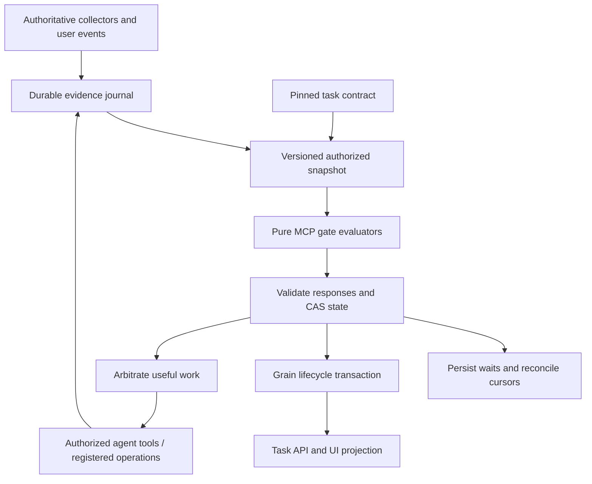
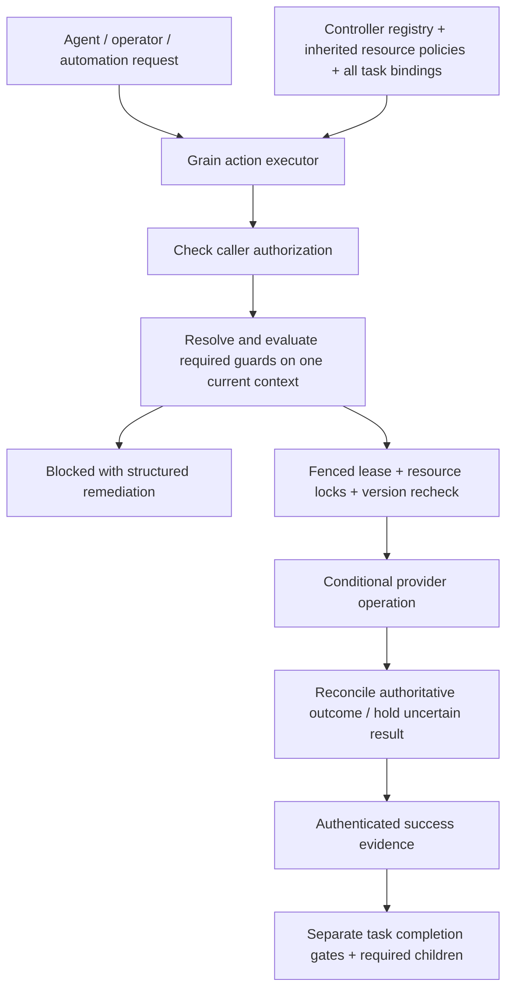

# Extensible MCP gates for actions, completion and scheduling

**Owner:** @ai-on-gke/ai-factory-root-owners

**Status:** proposed architecture; documentation only, not implemented. Implementation phases below are dependencies for later work, not authorization to implement, deploy, or file follow-up tasks.

**The core rule:** Grain alone owns task lifecycle and dispatch. Explicitly attached, pinned, read-only MCP gate evaluators explain whether action prerequisites and completion obligations are satisfied and what useful work or durable waits remain; they never acquire action authority from their names, results, or persisted state.

The normative contract is [MCP gates specification](../spec/mcp-gates/mcp-gates.spec.md), with [wire schemas](../spec/mcp-gates/wire.schema.json) and the normative [action gate bindings extension](../spec/mcp-gates/action-bindings.spec.md), [binding/action schema](../spec/mcp-gates/action-bindings.schema.json) and [examples](../spec/mcp-gates/action-bindings.examples.json). This design explains the boundaries and migration. The specification governs the proposed gate protocol; existing behavior remains governed by its current contracts until separately authorized task migration or resource action admission.

**Terminology:** Existing task **goals** describe desired outcomes or standing intent, such as `pr-merged`, `base-green` and `person-closes`. **Gates** are the new extensible evaluators/requirements used to determine readiness or completion in service of those goals. A goal can require several gates; a gate is not a replacement name for an existing task goal. Existing goal APIs, configuration, collectors and runtime behavior retain their names and semantics. In this proposal, `gate_*`, `gate_state`, gate IDs/versions/scopes and the proposed `completion_authority=gates` value name only the new extension.

This terminology correction follows [Task #39's merged documentation PR #1666](https://github.com/ai-on-gke/grain/pull/1666); its authority and lifecycle decisions are preserved; Task #47 now replaces the unspecified snapshot transport with the bounded v2 protocol below. Stable `MGD-*` and `MGS-*` requirement IDs are retained for traceability.

Related proposal: [extensible tracked resources](tracked-resources.design.md) supplies resource identity, scoped observations and durable change detection to evaluator snapshots. It uses the **gates** terminology from the merged Task #44 documentation rename; neither proposal implements the runtime protocol. Resource providers report facts, while gates interpret required action prerequisites and task outcomes; existing concrete task goals remain distinct.

## Problem and verified baseline

Inspected `origin/main` at `5a5189ae4a11afd30e142a467fd0ef7cd34cd4a9` (2026-11-16). That was Task #39’s baseline. Task #47 started at `d8ff32019` and reuses Task #44’s rename commit `1ac7e412d`; it does not repeat or rename legacy goal APIs. Task #50's action-binding extension builds on Task #47's committed transport (`3df930079`) without changing its wire schema or fixtures. These are source observations, not claims that all older designs are fully implemented:

| Authority or observation today | Verified source | Consequence for migration |
|---|---|---|
| Run endings infer reports, nothing-needed, questions, branches, reviews and completion | [`finish.go`](../../pkg/orchestrator/finish.go), especially `processResultFrom`, `restOnGoal`, `finishNothingNeeded`, `finishAnswered` | Keep recording run/tool evidence; remove lifecycle writes only for migrated tasks. A plain final answer is not generic proof of completion. |
| Go computes state from observations, live run, streak, deferral and admission | [`state.go`](../../pkg/model/state.go), `StateOf`, `AwaitsAck`, `ClosesOnAnswer` | Keep run outcome separate from task outcome and replace precedence in both projections together. |
| SQL independently projects the same state | [`schema.go`](../../pkg/model/schema.go), `task_state`, and [`state_test.go`](../../pkg/model/state_test.go); PostgreSQL uses [`postgres/schema.go`](../../pkg/model/postgres/schema.go) | A protocol-only change cannot fix divergent Go/SQL state. Migration requires parity fixtures and transactional authority selection. |
| Explicit goals already override ordinary finish | [`taskgoals.go`](../../pkg/orchestrator/taskgoals.go), `checkGoal`, `reconcileTaskGoals`, `accountGoalProgress`, `meetGoal` | Preserve evidence collectors, close/rest and no-progress policy, replace the fixed kind switch behind an explicit authority flag. |
| Change synchronization, review and merge have their own facts and actions | [`sync.go`](../../pkg/orchestrator/sync.go), [`mergegates.go`](../../pkg/orchestrator/mergegates.go), [`humanreviewhold.go`](../../pkg/orchestrator/humanreviewhold.go), [`pkg/change`](../../pkg/change), [`pkg/ui`](../../pkg/ui) | Reviews, check runs, Submit, merge and CL submission remain authoritative evidence sources; provider assertions cannot replace them. |
| Wakes and dispatch resume work independently | [`wake.go`](../../pkg/orchestrator/wake.go), [`pkg/dispatch`](../../pkg/dispatch), [`wait_target.go`](../../pkg/model/wait_target.go) | Replace direct wake-to-agent behavior only after completion ownership is centralized. Keep message backstops and durable recovery. |

### Reconciliation with existing contracts

- [Durable tasks](durable-tasks.design.md), particularly DT-4, already says an agent ending a goal task's run does not end the task. Map its fixed goal kinds to multiple explicit MCP gate obligations. Its pauses, durable admission, suspensions, idle watchdog, budgets, on-limit and close/rest behavior remain Grain policies. `person-closes` becomes a standing lifecycle policy with an explicit person-close event, rather than an evaluator forced to return unmet forever.
- [Task liveness](task-liveness.design.md) requires every wait to name its resource, driver and escalation. Gate waits add durable cursors, timers and reconciliation to that rule. A wait blocks its dependent work, not all work on the task.
- [Capabilities design](capabilities.design.md), [capability protocol](../spec/capabilities/capabilities.spec.md), and [unified grants](unified-grants.design.md) retain server identity, transport, configuration validation and least authority. `gate_*` is an additive discovery class alongside `mint_*`/`release_*`; it does not mint credentials or become a grant. Gate configuration uses the capability argument-schema subset. The enclosing versioned snapshot protocol has its own schema. Capability mint retry/refusal rules do not become lifecycle decisions for gate errors.
- [Merging](merging.design.md) and [contributions](../spec/contributions/contributions.spec.md) retain exact-head checks, ordinary/targeted/security reviews, human-only holds, explicit gate overrides and approver identity. `gate_merge_ready` reports action prerequisites; it cannot satisfy `gate_integrated`. Submit approves the scoped change; it does not clear findings or finish a review. No new queue ordering, base-tip retest, or review policy is introduced.
- [RBAC](../spec/rbac/rbac.spec.md), [director capabilities](../spec/director/director-capabilities.spec.md), and [operator attribution](../spec/operator-attribution/operator-attribution.spec.md) continue to govern every action. Requirement attachment, evaluation permission, snapshot reads, waiver, Submit and protected execution are separate checks. This proposal deliberately strengthens requirement removal beyond an ordinary metadata edit: agents cannot relax their own completion obligations.
- [Closing from a run](../../docs/closing-a-task-from-a-run.md) and [closed-task messages](../../docs/comments-and-closed-tasks.md) supply compatibility cases, not a new general self-close tool. Preserve report acknowledgment versus report-only child closure, existing-PR precedence over nothing-needed, and historical closed-task messages pending explicit reopening. Atomic close adds a stronger no-unprocessed-message fence.
- [Angular UI](angular-ui.design.md) and the [UI design book](ui-design-book.design.md) govern presentation: server-derived honest state, action on the evidence the person saw, scoped confirmation, accessibility and shared API. New gate UI goes in `ui-ng` only; API compatibility keeps classic readers working. This PR changes neither UI.

The merging design's own **Implementation gaps** section correctly distinguishes intended independent merging from current queue/recheck machinery. Source still has `mergerecheck.go`, lane ordering in `sync.go`, and effective rules in `mergerules.go`; this proposal does not claim those gaps have landed or remove them during compatibility import. Existing effective action prerequisites (including configured bypass policies and their authority) must be captured as versioned policy inputs, not silently replaced with the design's aspirational defaults. Resolving merge-policy gaps remains separate from this documentation-only proposal.

For concrete goal collectors, [`stage1repair.go`](../../pkg/orchestrator/stage1repair.go)'s `nightlyGreenReading` distinguishes verified default-branch push verdicts from ordinary nightly selection: it filters jobs since declaration, selects the newest applicable non-idle-skipped/non-canceled-unjudged run, and accepts success/skipped/neutral job conclusions. [`pipelinesteward.go`](../../pkg/orchestrator/pipelinesteward.go)'s `pipelineStewardQuiet` also checks branch health, stalled nonpaused tasks and merge blockers; it is not simply a notification count. Compatibility imports preserve these predicates and their source provenance before later authorized refinements.

The contributions spec describes `.github/CODEOWNERS` and triggers that are absent at this baseline; actual [`CODEOWNERS`](../../CODEOWNERS) assigns the root owners team. This document uses that actual owner and the prescribed design/spec locations and requirement IDs; it does not create enforcement or deployment configuration to repair unrelated drift.

## Architecture and boundaries {#MGD-1}

An attachment states an obligation. A grant permits a read or action. Neither implies the other. Grain can refuse to evaluate an attached provider until an authorized operator grants the bounded read scope. It shows the missing permission without granting it or dropping the gate. The provider is a trusted choice for interpretation within its pinned contract, but all its output remains untrusted data. Evidence authenticity, authorization, and closure fencing belong to Grain.

The task contract has stable attachment IDs, provider identity and artifact/version pins, gate and state/schema versions, canonical argument hash, child links, and lifecycle policy revision. There are no automatically required gates based solely on tool-name discovery. Grain can offer discovered tools in an editor, then record a separately authorized attachment. Defaults/templates resolve into explicit attachments at admission.

A snapshot materializes a bounded redacted cut of Grain’s committed observations at a durable evidence revision, including required children, messages and action records. It does not promise simultaneous historical reads of independent external systems. Bounded inline data plus retained snapshot-bound pages provide the declared evidence scope; explicit completeness/unavailability markers prevent omitted data from becoming negative facts. Missing necessary data yields unknown or a permission blocker, never a favorable assumption. All results in a decision bundle use the same snapshot. A changed head, contract, message watermark, permissions, child outcome or relevant external evidence invalidates the bundle.

Opaque state is an optimization for provider interpretation, not proof of an approval or CI verdict. Grain persists it with an expected revision, byte/depth bounds, a schema version and attachment identity. State migrations are explicit pure operations through a pinned compatible evaluator mode; recovery can discard state only if the provider declares replay from authoritative evidence safe. Otherwise the task rests visibly for migration or repair.

### Snapshot transport decision

Use bounded **Grain-driven rounds**, specified in [MGS-11](../spec/mcp-gates/mcp-gates.spec.md#MGS-11), over the existing Grain-to-capability call direction. [Server.Refresh/CallTool](../../pkg/capability/protocol/server.go) already retains advertised control tools and calls them with context timeouts; the [client](../../pkg/capability/protocol/client.go) returns structured JSON or the first JSON text result. No provider-to-Grain callback path is established. A handle cannot supply that path.

Before evaluation Grain copies the authorized DB observation cut and fixed page contents into its own retained store, then repeatedly calls the same pinned gate tool. The provider returns either non-final `needs_data` (catalog references/cursors plus a small request-carried accumulator) or a final verdict. Grain reauthorizes and fulfills requested reads from those bytes, then calls again at the same snapshot/pins/clock. Prefetched declared inputs allow a single-round fast path. V2 providers need no network access, persistent session or callback credential for snapshot reads.

Continuation records cannot CAS `gate_state`, install waits/buttons/actions, grant progress or trigger agent/evaluator/task dispatch. Only a valid final can enter the existing acceptance transaction. Retrying a round reuses its exact stored payload; a bounded accumulator is transient and distinct from durable provider state. Revocation, evidence/freshness changes, expired/lost pages or deadline exhaustion abort rather than mixing snapshots.

The 30-second budget covers construction plus every round/retry; eight rounds share the original 64-page/8-MiB allowance. Published bulk pages expire after 60 seconds; cited evidence/decision receipts survive for audit. Stale churn is coalesced, limited to three starts per minute and held/escalated under fixed bounds. There is no arbitrary namespace traversal, late live fetch, unbounded transcript or truncation-to-success path.

This **supersedes** the historical “registered read-only snapshot access handle” transport requirement. Opaque IDs remain selectors only. Callback/bidirectional transport is deferred to a separately reviewed protocol, not an unspecified future hook. Concrete schema/transcript, authorization, cancellation and storage responsibilities are in the [implementation checklist](../spec/mcp-gates/mcp-gates.spec.md#MGS-11).

## Actions, waivers and interface {#MGD-2}

Evaluation does no mutation and has no write credentials. It may return work for an agent and typed requests to registered operations. Grain validates and arbitrates these, then uses the same authorized operation path available to an agent. All protected effects use the executor and non-optional resource guard policy in MGD-7. If the agent lacks a tool or grant, the task offers a permission request; no controller-only privileged shortcut is required to make progress. A future executor optimization must use the same path, preconditions, idempotency and audit.

UI buttons contain a label, registered action ID, constrained input schema and confirmation requirements. Providers cannot send executable JavaScript, arbitrary URLs or an alternate approval mechanism. The server registry controls operation permissions, minimum confirmation, human-only restrictions and evidence scope. The server rechecks all of these at click time and records an immutable event before an idempotent operation is driven. A note is never approval; acknowledgment is receipt only.

A waiver is a Grain-owned, reasoned, actor-attributed exception to a named gate and scoped evidence/contract version. It is shown as **waived**, never **met**. A new head, changed requirement, revoked waiver or changed scoped evidence invalidates it. A waiver of a completion obligation cannot authorize merge, deployment, secret access or another protected action. Existing merge gate overrides stay separate registered operations with `merge:force`, exact-head scope, reason and confirmation.

The task detail shows each gate's result, summary, optional human text, evidence, blockers, waits and buttons. Agent prompts receive optional agent text and actionable work separately. Neither text field is machine authority. The task row has one primary state but exposes every blocker, so a running agent can coexist with a review wait and a permission need.

## Action gate bindings and enforceable operations {#MGD-7}

A gate can guard an operation before it executes as well as evaluate a completion outcome. The attachment purpose is explicit. A merge request aggregates current-head check/review/scoped approval guards; the implementation task separately aggregates integration and required child outcomes. Monitoring is advisory unless separately attached as required policy, and existing concrete task goals retain their semantics. Requiring integration before executing that same merge is a rejected dependency cycle.

Resource policy is not optional task metadata. The controller normalizes action aliases and equivalent effects, resolves authority/repository/resource policy and every active task-origin resource binding, and requires their union. Taskless actions receive the same policy. An agent cannot choose another contract, task, tool name, direct base push or queue path to omit a review. Empty coverage, incompatible guard sets and missing providers fail closed. Completion authority migration and action policy admission are independent.

The [AGB specification](../spec/mcp-gates/action-bindings.spec.md) governs exact schemas, invalidation, authorization, conditional execution, idempotency, unknown outcomes, structured remediation and scoped overrides. Registry versions, policy/contract revisions and exact resource/head identity fence the decision. Successful operation receipts feed completion; a guard result or callback text cannot confer execution permission. An override is a reasoned, separately authorized, exact-action/head/guard exception, never a completion waiver or a broad force flag.

### Source audit and actual enforcement boundary

This is a source audit, not a live credential/permission audit. The rows identify integration work still required; they do not claim these paths already implement a unified executor.

| Current path inspected | Current behavior / boundary limitation | Required protected-operation boundary |
|---|---|---|
| [`sync.go`](../../pkg/orchestrator/sync.go), [`mergegates.go`](../../pkg/orchestrator/mergegates.go), [`merge_gates.go`](../../pkg/ui/merge_gates.go), [`mergerules.go`](../../pkg/orchestrator/mergerules.go), [`github.go`](../../pkg/github/github.go) (`MergePullRequestWithMessage`), [`mergequeue.go`](../../pkg/github/mergequeue.go) | Queue checks, exact-head named review overrides and expected-SHA merge exist; queue enrollment can defer the effect. No general action binding resolution is claimed. | Route queue/merge/auto-merge effects through executor; fence final execution, not just initial enqueue. Reconcile merged head/receipt. |
| [`mergeidentity.go`](../../pkg/github/mergeidentity.go) (`forMerge`), [`githubtoken.go`](../../pkg/capability/githubtoken/githubtoken.go), [`git_credentials.go`](../../pkg/mcp/git_credentials.go), [`ssh_git_credentials.go`](../../pkg/mcp/ssh_git_credentials.go) | Named/App/personal/ambient credentials and SSH paths need assessment. When no separate merge credential is configured, merge can use the push credential. A distinct merge identity alone does not remove other tokens' rights. | Keep privileged credential inside executor adapter; all agent/automation credential and mint/refresh paths must lack direct integration authority or be constrained by an enforced proxy. |
| [`protocol.go`](../../pkg/gitproxy/protocol.go), [`core.go`](../../pkg/gitproxy/core.go), [`refupdates.go`](../../pkg/gitproxy/refupdates.go), [`cli_actions.go`](../../pkg/gitproxy/cli_actions.go), [`commandforge.go`](../../pkg/gitproxy/commandforge.go), [`agent_api.go`](../../pkg/ui/agent_api.go) | The smart-HTTP proxy restricts paths and pushes to the task branch; scoped CLI and API authorization are useful existing controls. They are not proof that every equivalent protected effect is guarded. | Deny/reroute protected-base writes and authenticated generic tunnels; cover REST/GraphQL/SSH, capability tools, CLI, API and bot/CI identities by effect. |
| [`change_submit.go`](../../pkg/ui/change_submit.go), [`submit.go`](../../pkg/change/submit.go), [`change.go`](../../pkg/change/change.go) (`Provider.Submit`, `SubmitGranter`) | Submit is person-authorized, has blockers, records a provider grant and calls a provider. Raw provider credentials/submit routes and exact-snapshot execution need separate proof. | Unified executor owns scoped approval, exact CL snapshot condition, submit grants and authoritative renumbered-target reconciliation. No unrestricted raw submit identity in admitted callers. |
| [`githubsandbox.go`](../../pkg/capability/githubsandbox/githubsandbox.go) | Disposable-repo capability places a raw repo-scoped token with contents/pull-request/packages write. Repo-scoped is not merge-disabled. Disposable repos are not implicitly protected production resources. | Inventory admission per actual repository/effect; do not admit such a token to an enforced protected cohort without removing/constraining its bypass. |
| [`registrypush.go`](../../pkg/capability/registrypush/registrypush.go), [`packagepublish.go`](../../pkg/capability/packagepublish/packagepublish.go), [`refresh.go`](../../pkg/capability/packagepublish/refresh.go), [`gcpkey`](../../pkg/capability/gcpkey), [`release.go`](../../pkg/capability/release/release.go) | Registry/package token placements and refresh, cloud keys and release tools can cross other mutation boundaries. Capability admission is not an action guard on each subsequent upload/deploy. | Promotion binds environment version and immutable digest; publication binds package/version/tag and digest. Credential refresh and alternate automation must not bypass executor; require operation-specific reconciliation. |

GitHub permissions are not a universal merge firewall: contents-write can permit merge subject to repository policy, and existing PAT/App/write tokens cannot be presumed unable to merge. Forge rules may strengthen a verified boundary but need explicit separate authorization and examination of bypass identities and direct writes. Expected SHA prevents merging a changed PR head; it does not atomically freeze every review, policy, base or external resource version. A provider lacking the required conditional/exclusion mechanism is an enforcement blocker, even after an immediate re-read.

Grain can prevent mutations only through routes and identities it controls. Independent human/credential actions are observed and attributed as external, with pending contexts invalidated. Safe initial admission requires an operator-reviewed credential/route inventory, exclusive control over admitted agent/automation effects, proven version fencing, compatible providers and durable recovery. If bypass credentials remain in that cohort, keep it observation-only with no Grain protected execution or refuse it. Independent human rights require an explicit trust limit, never a universal prevention claim. This PR changes no live credentials, grants or repository policies.

### Ownership and rollout limits

Task #47 retains snapshot transport and implementation-readiness ownership. This branch builds on its committed Grain-driven round protocol without changing `wire.schema.json` or transport fixtures. The separate binding schema composes a negotiated action-profile 3.0 envelope with that unchanged v2 transport: explicit action authority context, null task provenance when taskless, and context echoes on continuation/final replies. No callback transport or v2 compatibility fallback is added. Task #47's declaration/schema pins, copied pages, reauthorization, limits and replay/final-only commit rules apply unchanged. Direct task-record/message coordination was denied by grants; this source-level composition does not claim cross-owner implementation signoff.

The [acceptance scenarios and responsibility matrix](../spec/mcp-gates/action-bindings.spec.md#AGB-7) include an agent merge blocked by review, then allowed only after accepted current-head evidence; concurrent edits/policy invalidation; external actions; provider failure; crash/retry reconciliation; and negative bypass probes. Remaining blockers include a general executor and policy index, credential isolation, external atomicity, durable action fencing, adapter reconciliation and negotiated profile/provider support. These are admission requirements, not authorization to implement or file phases.

## Scheduling and closure {#MGD-3}

Grain evaluates when relevant facts or contracts change, not just when a displayed status changes. It coalesces dirty events per task, evaluates one snapshot bundle, commits validated state/results/subscriptions, then computes useful authorized work. Provider-authored summaries, state revisions and progress tokens do not recursively dirty their own evidence.

Arbitration deduplicates work by attachment, registered operation, target, input hash and precondition scope; merges identical requests across gates; honors dependencies and task priority; and serializes conflicting operations on shared resources. One task has at most one active agent run. Independent CI/review external operations can overlap when registered resource locks permit it. A waiting gate never globally vetoes independent useful work. Missing action permission blocks that action only. Pause, budget, admission and backoff can globally stop dispatch as lifecycle policies.

Subscriptions and snapshots share a durable cursor fence. Grain reads snapshot at cursor C, stores subscriptions with C and replays the journal after C, including events received during evaluation. Out-of-order and duplicate external deliveries are deduplicated and reconciled against authoritative source versions. Every wake causes an authoritative re-read and evaluator pass first. Polling where events are unavailable is bounded with backoff; reconciliation catches lost deliveries and expired leases. A timer can trigger reevaluation or escalation, never success.

No-progress accounting uses authoritative operation/evidence changes and processed messages, not provider summary/state churn. Repeated identical work, pending results without a viable wait, malformed responses and provider outages cannot dispatch agents repeatedly. They back off, open a named blocker and escalate after a persisted threshold. Independent work continues. An unmet gate with no safe remedy rests with an explanation; it does not imply useful agent work.

Closure is a transaction over the current contract, evidence revision, message watermark, result set, waiver set and operation ledger. Every required completion gate must be met or validly waived, all incoming user messages processed, and operations settled or explicitly dispositioned by Grain. If a live run needs stopping, Grain requests graceful stop and waits for settlement before retrying closure. A late push cannot be ignored by simply canceling a run. Retained historical completion evidence is immutable. Later regressions follow an explicit reopen or separate repair policy, never rewrite the old success silently.

Proposed tasks have no execution authority; admission approval fixes an executable contract. Active primary states are running, waiting, needs answer, needs permission and needs acknowledgment, with a separate readiness/scheduling reason for admitted runnable tasks awaiting capacity. Terminal outcomes are succeeded, canceled and failed. A standing person-closes session rests after satisfying current work and closes successfully only on an authorized person's close event; cancel records canceled rather than pretending the session achieved an outcome goal. Exhausted task retry policy may fail a task; an individual evaluator error cannot do so alone.

## Compatibility mapping {#MGD-4}

Names below are proposed examples, not built-in implicit attachments. Every configured task records its actual evaluator and arguments.

| Existing behavior | Proposed evaluator / prerequisite / policy | Compatibility and intentional improvement |
|---|---|---|
| Report / final response | `gate_report` cites durable artifact and processed-message coverage | Top-level report may require separate `gate_ack`; report-only child can omit ack as today. Receipt never approves contents. |
| `nothing_needed` | `gate_no_work` checks scoped no-change claim and run/branch evidence | Preserve pushed-work and already-open-PR precedence; a stale branch alone is not delivered work. An assertion cannot skip attached obligations. |
| Change delivered | `gate_change_delivered` cites branch/CL and expected artifacts | Delivery is not integration or merge permission. |
| Exact-head required checks | `gate_checks` reads repository's configured CI provider/check set | Preserve current-head identity; stale success cannot authorize merge. |
| Ordinary / targeted / security / path-trigger reviews | `gate_review` with pinned policy, scope, reviewer role and head/path digest | Preserve distinct gates and findings; security-sensitive new edits invalidate old scope. Reviewer task finishing with findings completes review work but does not pass merge prerequisites. |
| Operator Submit / human-review hold | Registered Submit/release/override actions plus `gate_approval` evidence | Submit records only its scoped human approval; cannot satisfy review findings. Protected hold rules remain. |
| PR merged / CL submitted | `gate_integrated` with PR or all scoped CL outcomes | Integration evidence satisfies outcome. `gate_merge_ready` supplies prerequisites for requesting merge through its protected operation; caller authorization remains separate. Closed unmerged is not integrated; unreadable CL is unknown. |
| `tasks-closed` | `gate_children` with explicit terminal-closure or success predicate | Import legacy `until=closed` literally; new required-outcome links default to success. Failed/canceled closure is not successful delivery. `until=merged` imports integration predicate. |
| Base green | `gate_base_green` references recorded branch CI confirmation | Preserve `BaseCICleared` non-reproduced failure as explicit evidence, not a provider inference or generic waiver. In-flight/broken evidence remains unmet/pending. |
| Publishing recovery | `gate_publishing_recovered` reads release health and supersession evidence | Preserve existing `Publishing` option semantics, including missing release row behavior, for compatibility imports; new contracts should require positive publication evidence and freshness. Superseded releases without publication do not demonstrate recovery. |
| Nightly green | `gate_nightly_green` cites configured nightly scopes and verdicts | Preserve existing selection/freshness predicate on import; revisions must make the expected nightly window explicit. |
| Pipeline healthy | `gate_pipeline_healthy` cites notification family/scope and steward quiet evidence | Preserve no-open-notifications **and** quiet condition, not just empty notification list. |
| Person closes | Standing close/rest policy; person-close event | Remains open across ordinary turns and healthy periods; no synthetic permanently unmet gate is needed. |
| Pause, budgets, keep-running, on-limit, close-versus-rest | Grain lifecycle policy | Not provider-defined success criteria; keep-running cannot silently bypass or remove gates. |

## Task examples {#MGD-5}

| Task | Explicit obligations | Work and wake behavior |
|---|---|---|
| Implementation | Completion: change delivered, integration and required child success. Guards: current checks/reviews/scoped approval when required. | Request fixes while CI/review waits; request merge only when prerequisites and permission hold; close on observed integration. |
| Report/research | artifact/report coverage, optional receipt acknowledgment | Ask an unresolved research question; otherwise present report and wait for receipt if configured. No PR goal or integration gate by default. |
| Review | report on exact assigned head and disposition of findings | Record findings as successful review delivery; parent's review gate remains blocked. A new head invalidates assignment scope and triggers explicit reassignment/review policy. |
| Repair | base green, optionally publishing recovered or nightly green | Work on a reproduced failure; wait on CI without rerunning an agent; non-reproduction needs recorded confirmation. Escalate unreadable CI. |
| Coordinator | successful outcomes of named required children plus synthesis report | Advisory and independent children do not hold closure. A failed required child requires repair, replacement via authorized contract edit, or scoped waiver. |
| Director | standing person-close policy, per-request report/child obligations | Rest between requests, wake evaluator on messages/child events, retain session across suspensions; spawning does not automatically require every child to finish. |

## Incremental implementation plan {#MGD-6}

This PR files and implements none of these phases. Dependencies are linear unless noted. Protected-action enforcement additionally requires AGB-5/AGB-8 admission and boundary responsibilities; migrating task completion alone never establishes an action boundary.

1. **Contract and evidence foundations.** Define DB records, the retained immutable snapshot/page store and internal read resolver (not a provider callback API), provider declaration/schema pins, journal/cursors, action registry and permissions. Implement short observation-cut transactions, atomic ready publication, 60-second bulk TTL and copied decision evidence. Retain all current collectors and legacy decisions. Add fixture coverage for current finish/state/goal cases. Capture exact legacy predicates for imports, including release-row absence and nightly windows.
2. **Observation-only evaluation (depends on 1).** Implement the v2 driver with persistent round/checkpoint/lease/counter records, exact retries, request-carried continuation and final-only state CAS; validate the complete example transcripts and MGS-11 checklist. Deploy pinned read-only evaluators without lifecycle or dispatch authority. Store differences against legacy decisions, classify incompatibilities, measure boundedness and provider reliability. Shadow errors cannot block current tasks. Expose read-only results clearly labeled observation-only.
3. **Explicit task migration and central completion (depends on 2).** Stop/settle or fence live operations, snapshot each open task, resolve requirements/policies, obtain required authority, and transactionally switch `completion_authority` from legacy to gates. Suppress every legacy completion writer for that task in the same release. Legacy wake/dispatch drivers may temporarily emit observations or proposals to the same central lifecycle owner, but must lose direct lifecycle-write authority at handoff; compatibility adapters do not become a second owner. Centralize close transaction and Go/SQL projection parity before expanding cohort. Never allow two lifecycle authorities for one task.
4. **Waiting and dispatch (depends on 3).** Move migrated tasks to cursor-fenced subscriptions, timer ledger and action arbitration. Replace the temporary legacy wake/dispatch proposal adapters (whose direct writes were already disabled in phase 3); retain collectors and journal production. Test restart, outage, contention and independent work before widening adoption.
5. **API/tools/UI and generalization (foundation can develop after 1; authoritative rollout depends on 3–4).** Add versioned contract/result/action/waiver APIs, agent tool descriptions and Angular gate panels. Keep existing API fields as documented compatibility projections and regenerate shared route contracts if routes change. Remove legacy authority paths only after every task has migrated or terminated and rollback window has closed.

### Database, upgrades and rollback

Use additive tables for contract revisions/attachments, evaluation bundles and per-gate state CAS revisions, materialized snapshot manifests/pages/ACLs and expiry, fenced round/checkpoint/read-selection/retry records, evidence references, subscriptions/cursors, durable timers, progress/no-progress counters, action intents/events, waivers, and closure receipts. Store task authority epoch and lifecycle policy revision. Use unique keys for accepted evaluation IDs, action idempotency and event delivery IDs. Foreign keys and transaction/row locking protect attachment/contract ownership. Bounds apply before storing JSON. Opaque provider state is not indexed as lifecycle evidence.

The canonical lifecycle decision reads a versioned projection record; both `StateOf` and SQL `task_state` must apply the same authority discriminator and precedence. Extend parity tests to active blockers, terminal outcome, live operation and compatibility badges across SQLite and PostgreSQL. Do not repurpose `CompletedAt` into both report-delivered and succeeded; retain legacy fields for old readers with explicit projection rules.

Upgrade readers before writers. A daemon must advertise supported protocol, schema and authority epochs; an older daemon must refuse to drive migrated tasks rather than falling back to legacy. Rolling upgrades fence ownership leases. Rollback retains evidence and records, stops gate-owned dispatch, and uses an explicit per-task reverse handoff only if a validated legacy contract can represent the obligations. Otherwise hold for a compatible daemon. Never silently downgrade a requirement, reset state or reconstruct approval from prose.

Existing open tasks remain legacy until migrated; no universal default gate is inferred from history. Import attaches equivalent predicates and records provenance plus any intentional semantic changes requiring approval. Unavailable providers leave required gates unknown with durable backoff and escalation, never automatically waived or delegated to legacy. Tasks with independent work may continue safely. Provider upgrades require new pins and an audited migration/replay decision before switching contracts.

## Resolved defaults and rollout choices

| Decision | Recommendation |
|---|---|
| Initial hosting and trust | Reuse configured capability MCP server identity/transport; separate read-only evaluator credentials and allowlisted scope. Start with in-tree providers behind the same protocol. |
| Protocol limits | Adopt the concrete v2 limits in the spec; measure shadow evaluations before changing them through a protocol/config revision. |
| Snapshot retention | Adopt MGS-11: fixed 60-second bulk TTL, no live refill; retain copied cited evidence and closure receipts for task audit lifetime. |
| Historical regression | Default to notify plus separately authorized repair; opt into automatic reopen explicitly for monitored outcomes. Standing sessions rest instead of closing. |
| Requirement editing authority | Person-authorized relaxation with reason and audit; permit agents to propose edits and append obligations only within preauthorized template constraints. |

These recommendations leave rollout choices for later work, not the agreed separation of gates, permissions, actions, lifecycle, and durable wakes.

The transport choice and defaults are resolved; no operator decision blocks protocol implementation. Follow [MGS-11’s checklist and sibling-scope integration boundaries](../spec/mcp-gates/mcp-gates.spec.md#MGS-11). Task #45’s Observe/Watch populates committed observations and Task #46’s triggers consumes authenticated events; neither supplies a callback for gate paging, and transient round activity must never feed either scheduling loop. This change implements/deploys none of those components and files no implementation tasks.
