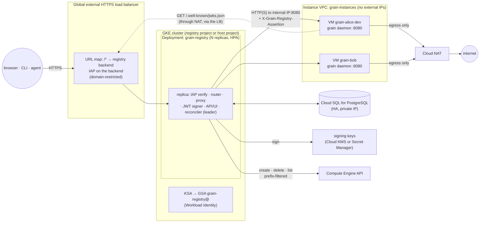
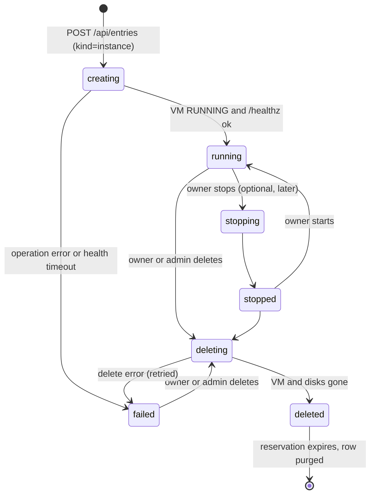

# Grain registry: one URL, many owned grain instances

**Owner:** @bwsalmon

**Status:** Proposed (design only; no code yet)

A grain deployment today is one controller with one owner (`architecture.design.md`). People who want their own grain have to stand one up: a machine, a domain, IAP or an access code, and a release to keep current. The **grain registry** is a small service that does this for many people at once. It runs on Kubernetes behind one IAP-protected URL. For each **entry** `/<name>/` it either reverse-proxies to a grain VM that the registry created for that entry's owner, or redirects to a URL the owner chose. It also passes the signed-in person through to the instance, so the instance's own allowlist and attribution decide what that person may do.

This document is written for the open-source core. It uses public GCP products (GKE, Cloud SQL for PostgreSQL, IAP, Compute Engine, Cloud NAT) and keeps each cloud-specific piece behind a small interface, so another cloud or an internal edition can swap one out. A company-wide deployment, with its own Terraform, belongs in a wrapper distribution and is not described here.

Read with: [`authentication.design.md`](authentication.design.md) (the `IdentityVerifier` seam, the allowlist, `-ui-require-iap`), [`operator-attribution.design.md`](operator-attribution.design.md), [`architecture.design.md`](architecture.design.md), [`grain-on-gke.design.md`](grain-on-gke.design.md) (Gateway, IAP backend policy, Cloud SQL) and the reference Terraform in `deploy/terraform/gcp/`.

## Goals

- One URL, `https://<registry-host>/<name>/…`, routes to one grain instance. Each instance is one Compute Engine VM.
- Every entry is owned by exactly one person, identified by the email in their verified IAP assertion.
- IAP authenticates every user at the registry, limited to one or more configured domains.
- The registry passes the verified user to the instance in a signed, short-lived JWT. The instance decides, with its own access rules, whether to admit that user.
- Any admitted user can create an instance under a free name, picking from configured VM shapes, within a per-user quota. Owners can delete their instances. Every user has a page and an API listing what they own.
- Entries can also be **redirects** to a fixed `https://` URL, such as a grain the owner runs elsewhere.
- Instance VMs reach the public internet and nothing else: not each other, not other resources in the project, and not the metadata of other VMs.
- Path routing first, with a data model that already allows `<name>.<registry-host>` subdomain routing later.

## Non-goals

- Multi-tenancy inside one grain. Each instance is still a single-tenant grain, as `docs/access-code.md` describes. The registry gives each person their own grain. It does not divide one grain between people.
- Running anything except grain on the VMs.
- Multi-project or multi-region placement. All VMs are in one project and one region, possibly across several zones.
- Billing or chargeback. Quotas limit spending; the registry does not record cost.
- Backups of instance data in v1 (see *Backups and data*).

## Terms

- **Registry**: the Kubernetes service this document describes (`grain registry` subcommand or its own binary; see *Open questions*).
- **Entry**: a row the registry owns at a name. Its **kind** is `instance` or `redirect`.
- **Instance**: an entry of kind `instance`, which is a grain controller on one VM.
- **Redirect**: an entry of kind `redirect`, which is a name pointing at a fixed external URL.
- **Name**: the path segment, `[a-z][a-z0-9-]{1,30}[a-z0-9]`, the same shape as a DNS label, so it can become a subdomain later without being renamed.
- **VM name**: `<prefix><name>`, for example `grain-alice-dev`. The prefix is fixed by configuration.
- **Owner**: the verified email that owns an entry.
- **Admin**: a principal listed in the registry's `admins` configuration.

## Components and data flow



1. **Load balancer and IAP.** One global external HTTPS load balancer (a GKE Gateway, `gke-l7-global-external-managed`, as `grain-on-gke.design.md` uses) fronts the registry Service. IAP is on that one backend. IAP's IAM binding grants `roles/iap.httpsResourceAccessor` to `domain:<d>` for each configured domain, so IAP itself turns away anyone outside them. The registry checks the assertion again (below), so a mistake in IAM is not the only defence. The hostd and long-lived routes get a `GCPBackendPolicy` with `timeoutSec: 86400`, as in `grain-on-gke.design.md`, because on this load balancer the backend timeout is also the longest an upgraded connection may live.
2. **The registry Deployment.** Stateless replicas, two at least, behind a ClusterIP Service, with a HorizontalPodAutoscaler on CPU and in-flight requests. Every replica serves every name: the routing table is in Cloud SQL, with a short in-process cache (below). Each replica verifies IAP, resolves the name, signs a JWT for the target instance and reverse-proxies. One replica at a time also runs the reconciler (see *Scale and HA*).
3. **Cloud SQL for PostgreSQL**, private IP, regional HA. It holds entries, owners, quotas, shapes, the audit log and the reconciler's lease. The registry connects through the Cloud SQL Auth Proxy sidecar or the Go connector with IAM database authentication, so no database password is stored.
4. **The VM fleet.** One VM per instance, in one project, on a dedicated VPC (`grain-instances`) with no external IPs. Each runs the grain release image as a machine install (`scripts/setup.sh`: the release container, `grain hostd` beside it, local sandboxes).
5. **The reverse-proxy path.** The registry reaches each VM at its **internal IP** on port 8080. The GKE cluster's nodes (or a VPC-native pod range) are the only source the instance firewall admits (see *Network isolation*). VMs have no public ingress at all. Two ways to make that path, both supported by the reference Terraform:
   - **Same VPC, separate subnet (default).** The cluster runs in a `registry` subnet of `grain-instances`, and the instance VMs run in an `instances` subnet. Firewall rules use secure tags: ingress to `instances` only from the registry nodes' service account on `tcp:8080`.
   - **Separate VPCs, peered.** The cluster lives in its own VPC, which is peered with `grain-instances` without exporting custom routes. Use this when the cluster already exists. The firewall rule then matches on the pod CIDR range.

   Traffic between the registry and a VM is plain HTTP inside the VPC in v1. Google Cloud authenticates and encrypts VPC traffic that crosses physical boundaries, and the JWT carries its own integrity. Optional TLS to the VM, with a per-instance certificate the registry issues at creation, is an open question.

### Why one IAP backend and a registry JWT, not IAP on every VM

Per-VM IAP would put every VM behind its own backend service, serverless or internet NEG, OAuth client and IAM binding. That is one load balancer resource set per instance, minutes of propagation on every create, a quota on backend services per project, and an assertion per audience that the instance would have to verify. It would also give each VM a path from the internet. With one IAP backend at the registry and a registry-signed JWT, a create is only a VM, each VM is reachable only from inside the VPC, and the instance verifies one issuer's keys. IAP is still what signs people in. The registry turns that one verified identity into a token scoped to one instance.

### Cloud-specific seams

The registry core (routing, data model, quotas, state machine, JWT, UI and API) has no GCP dependency. Each cloud-specific piece is an interface with a GCP implementation in the tree:

```go
// Compute creates, inspects and deletes instance VMs. Every method takes the
// VM name, and every implementation refuses one outside the configured
// project, zones and prefix before making any call (see Reconciliation).
type Compute interface {
	Create(ctx context.Context, spec VMSpec) (op OperationRef, err error)
	Get(ctx context.Context, zone, vmName string) (VMStatus, error)
	Delete(ctx context.Context, zone, vmName string) (op OperationRef, err error)
	List(ctx context.Context) ([]VMStatus, error) // only VMs with the prefix and label
	Operation(ctx context.Context, op OperationRef) (OperationStatus, error)
}

// FrontIdentity verifies the identity the edge proxy attached (IAP's assertion
// on GCP). It returns the verified email and refuses one outside the allowed domains.
type FrontIdentity interface {
	Verify(r *http.Request) (email string, err error)
}

// Signer signs registry JWTs with the current key and publishes the key set.
type Signer interface {
	Sign(ctx context.Context, claims jwt.Claims) (string, error)
	PublicKeys(ctx context.Context) (jose.JSONWebKeySet, error)
}
```

`FrontIdentity` is the registry's own counterpart of core's `IdentityVerifier`, and the IAP implementation reuses `pkg/jwks` and the IAP verifier code. A wrapper distribution that fronts the registry with a different signed-header proxy registers its own `FrontIdentity` the same way it registers an `IdentityVerifier` in grain. `Signer` has two implementations: Cloud KMS (asymmetric signing; the key never leaves KMS) and a local key from a Kubernetes Secret, for development and other clouds. The store is Postgres through `database/sql`, so any Postgres works.

## Data model

All tables are in one Postgres schema, `registry`, with versioned migrations like grain's own (`pkg/model/migrations.go`).

```sql
-- Who has ever signed in. Created on first verified request.
CREATE TABLE owners (
  email          TEXT PRIMARY KEY,          -- verified, lower-cased
  first_seen_at  TIMESTAMPTZ NOT NULL,
  last_seen_at   TIMESTAMPTZ NOT NULL,
  disabled       BOOLEAN NOT NULL DEFAULT false   -- admin can block an owner
);

-- VM shapes users may pick. Seeded from configuration on start (config wins).
CREATE TABLE shapes (
  id             TEXT PRIMARY KEY,          -- "small", "standard", "large"
  machine_type   TEXT NOT NULL,             -- "e2-standard-4"
  boot_disk_gb   INT  NOT NULL,
  data_disk_gb   INT  NOT NULL,
  disk_type      TEXT NOT NULL,             -- "pd-balanced"
  description    TEXT NOT NULL,
  weight         INT  NOT NULL DEFAULT 1,   -- quota units this shape costs
  enabled        BOOLEAN NOT NULL DEFAULT true  -- disabled: no new creates
);

-- Per-owner quota overrides. Absent row means the configured default.
CREATE TABLE quotas (
  email          TEXT PRIMARY KEY REFERENCES owners(email),
  max_instance_units INT,                   -- NULL = default
  max_redirects  INT,                       -- NULL = default
  set_by         TEXT NOT NULL,
  set_at         TIMESTAMPTZ NOT NULL
);

-- One row per name, live or reserved. The name is the routing key whatever
-- the routing mode (path today, subdomain later).
CREATE TABLE entries (
  name           TEXT PRIMARY KEY,
  kind           TEXT NOT NULL CHECK (kind IN ('instance','redirect')),
  owner          TEXT NOT NULL REFERENCES owners(email),
  state          TEXT NOT NULL,             -- see State machine
  created_at     TIMESTAMPTZ NOT NULL,
  deleted_at     TIMESTAMPTZ,               -- set on entering deleted
  reserved_until TIMESTAMPTZ,               -- name held for owner after delete
  generation     BIGINT NOT NULL DEFAULT 1, -- bumped on every change; optimistic locking
  -- kind = 'instance'
  shape          TEXT REFERENCES shapes(id),
  vm_name        TEXT UNIQUE,               -- prefix || name, never edited
  zone           TEXT,
  internal_ip    INET,
  image          TEXT,                      -- image the VM was created from
  grain_version  TEXT,                      -- reported by the instance's /api/version
  operation      TEXT,                      -- in-flight Compute operation, if any
  failure        TEXT,                      -- last error, for failed
  -- kind = 'redirect'
  target_url     TEXT,
  append_path    BOOLEAN,                   -- default true
  CHECK ((kind = 'instance') = (vm_name IS NOT NULL)),
  CHECK ((kind = 'redirect') = (target_url IS NOT NULL))
);
CREATE INDEX entries_owner ON entries(owner) WHERE state <> 'deleted';

-- Who has dismissed a redirect's interstitial (see Redirect entries).
CREATE TABLE redirect_acks (
  name           TEXT NOT NULL,
  generation     BIGINT NOT NULL,           -- a target change resets acks
  email          TEXT NOT NULL,
  acked_at       TIMESTAMPTZ NOT NULL,
  PRIMARY KEY (name, generation, email)
);

-- Append-only. Every mutation and every admin read of another owner's data.
CREATE TABLE audit_log (
  id             BIGSERIAL PRIMARY KEY,
  at             TIMESTAMPTZ NOT NULL,
  actor          TEXT NOT NULL,             -- verified email, or "registry" for the reconciler
  action         TEXT NOT NULL,             -- create, delete, transfer, set-target, quota, state, ...
  name           TEXT,
  detail         JSONB NOT NULL             -- before/after, shape, target, op id, request id
);

-- Reconciler leadership (see Scale and HA).
CREATE TABLE leases (
  name           TEXT PRIMARY KEY,
  holder         TEXT NOT NULL,
  expires_at     TIMESTAMPTZ NOT NULL
);
```

The `vm_name` column is written once, at create, as `prefix || name`. Code never builds a VM name from a request path. It reads `vm_name` from the row and checks it against the prefix again before any Compute call. A name is unique across both kinds and across reserved rows, because the row's primary key is the name.

### State machine



- `creating`: the row exists and the quota is taken. The reconciler has issued, or will issue, `Compute.Create`. Requests to the name get a "starting" page with a 503 and `Retry-After`.
- `running`: the VM is `RUNNING` and grain's `/healthz` answered through the proxy path. Requests are proxied.
- `stopping` / `stopped`: optional, for a later version. A stopped VM keeps its disks and quota but costs no CPU. The MVP has no stop.
- `deleting`: the owner confirmed deletion. Requests get 410. The reconciler deletes the VM with its disks.
- `deleted`: the VM is gone. The row is kept, with `reserved_until`, so the name is held for its former owner (see *Authorization*). Quota is released when the row enters `deleted`.
- `failed`: create or delete failed after retries. The row keeps `failure`. The owner can delete (which retries the VM delete) and an admin can retry. A `failed` instance counts against quota until it is deleted, so a broken create cannot be used to grab more than the quota allows.

Redirect entries use only `running` (active) and `deleted`. They are created and deleted in one transaction, with no reconciler step.

Every transition is a single `UPDATE … WHERE name = $1 AND generation = $2`, and every transition writes an `audit_log` row in the same transaction.

### Reconciliation

VM operations take minutes and can fail halfway, and replicas restart. So the API never calls Compute inline. It writes the desired state and returns `202`. The reconciler, on the leader replica, runs every few seconds and after each write (a Postgres `NOTIFY`), and moves each row one step:

- `creating` with no `operation`: issue `Compute.Create`, store the operation. If the VM already exists with the registry's labels and this entry's `generation`, adopt it (an earlier attempt got as far as creating it).
- `creating` with an `operation`: poll it. When done, read the internal IP, then probe `http://<ip>:8080/healthz`. On success, `running`. After the configured health timeout (default 10 min), `failed`.
- `deleting`: issue `Compute.Delete` (disks have `auto_delete`; see *Delete*), poll it, then confirm with `Compute.Get` returning not-found, and set `deleted`.
- `running`: every minute, `Compute.Get`. A VM that is gone or `TERMINATED` outside the registry's own actions is flagged (`failure` set, owner and admins told), and is not silently recreated. Its `grain_version` is refreshed from `/api/version`.
- **Orphans**: `Compute.List` returns VMs carrying the prefix and the label `grain-registry=<registry-id>`. A VM with no matching row, or whose row is `deleted`, is reported on the admin page. It is deleted automatically only if it also carries this registry's label and a `generation` label matching a row that was deleted, so a VM somebody created by hand under the prefix is never removed without an admin.

**The registry never acts on a VM outside its scope.** That rule has three layers:

1. **Names.** A name must match the name pattern, and `vm_name` is `prefix || name`. Nothing in a request is ever used as a VM name, zone or project directly. The proxy uses the row's `internal_ip`, never a host taken from the request.
2. **The `Compute` implementation** checks every call: the project is the configured project, the zone is one of the configured zones, the VM name starts with the prefix, and for `Delete` the VM carries `grain-registry=<registry-id>`. A failed check is an error that is logged and alerted, not a no-op.
3. **IAM**, which is the layer that holds even if the code is wrong. The registry's service account has a custom role on the project with only `compute.instances.{create,delete,get,list,setMetadata,setLabels,start,stop}`, `compute.disks.{create,delete,get,use}`, `compute.subnetworks.use`, `compute.images.useReadOnly`, `compute.zoneOperations.get` and `iam.serviceAccounts.actAs` on the one instance service account. That role is granted with an IAM condition: `resource.name.extract("instances/{name}").startsWith("<prefix>")` (and the same for disks). The VM project should be dedicated to the registry, so there is nothing else in it to touch.

## Routing

### Path routing

A request for `https://<registry-host>/<name>/<rest>?<query>` is handled like this:

1. Verify IAP (`FrontIdentity`). Refuse with 401 if the assertion does not verify, and with 403 if the email's domain is not allowed or the owner is `disabled`.
2. Paths the registry itself serves are matched first: `/` (the user's page), `/-/…` (the registry UI and its assets), `/api/…` (the registry API), `/.well-known/jwks.json`, `/healthz`. Names that would collide with these (`api`, `-`, `healthz`, `well-known`, `static`, `admin`, `login`, `logout`, `www`, and a configurable list) are **reserved** and cannot be created.
3. `/<name>` without the trailing slash redirects to `/<name>/`, so relative URLs resolve under the instance.
4. Look up `name` (cache, see *Scale and HA*). Missing: 404 with a "create this name" link. `deleted`: 404, with the reservation shown to its former owner. `creating`: 503 starting page. `deleting`: 410. `failed`: 502 with the failure for the owner, and a generic page for others.
5. A redirect entry: see *Redirect entries*.
6. An instance in `running`: strip `/<name>` from the path, sign a registry JWT for this instance, and reverse-proxy to `http://<internal_ip>:8080/<rest>?<query>`.

The reverse proxy (`httputil.ReverseProxy`, which proxies HTTP/1.1 `Upgrade` connections):

- **Removes headers a caller could use to impersonate.** It removes IAP's `X-Goog-IAP-JWT-Assertion` and `X-Goog-Authenticated-User-*`, any incoming `X-Grain-Registry-Assertion`, `Forwarded` and `X-Forwarded-*`, and the `Cookie`s the registry itself set. It adds `X-Grain-Registry-Assertion: <jwt>`, `X-Forwarded-Proto: https`, `X-Forwarded-Host: <registry-host>`, `X-Forwarded-Prefix: /<name>`, and a `X-Request-Id` that it also logs.
- **Rewrites nothing in the response body.** Base-path awareness is grain's job (below), because rewriting HTML and JavaScript on the fly is fragile.
- **Rewrites `Location` and `Set-Cookie` defensively.** A `Location` that is root-relative (`/x`) or names the instance's internal address is rewritten to `/<name>/x`. A `Set-Cookie` with no `Path`, or with a `Path` outside `/<name>/`, has its `Path` set to `/<name>/`, and any `Domain` attribute is removed. This keeps an instance on an older release, or one that gets it wrong, inside its prefix (see *Cookie scoping*).
- **Streams.** No response buffering, flush on write (for long polls such as the console, and for any `text/event-stream`), and an idle timeout of 24 h on upgraded connections, matching the load balancer.

### What grain sees, and the base path it needs

Grain today assumes it is served at `/`:

- The UI calls the API with root-relative URLs (`api("/api/templates")` in `ui/src/api.js` and its callers).
- The SPA parses `window.location.pathname` to pick its view (`parsePath` in `ui/src/App.jsx`), and its internal links, and the links agents are told to write (`/tasks/<id>`, `director.design.md`), are root-relative.
- `ui/index.html` loads `/grain-mark-light.svg`, `/apple-touch-icon.png` and the bundle from `/`, and Vite's `base` is the default `/`.
- `grain_access` and the other UI cookies are set with `Path=/` (`pkg/ui/accesscode.go`).
- Server-side redirects (`http.Redirect` in `pkg/ui`) use root-relative locations.

So the claim that grain's links "are already relative" holds for the root-relative links a proxy at the *same root* needs, not for a sub-path. Grain needs a base path. The proposal is a new daemon flag:

```
-ui-base-path=/alice-dev      (GRAIN_UI_BASE_PATH)
```

- **Requests arrive without the prefix.** The registry strips `/<name>`, so grain's routes, its API, `/api/hostd/connect` (`pkg/hostd/dialout.go`, `RemotePath`), the agent API and every test stay as they are. That also means an SSH tunnel to the VM's `:8080` keeps working for break-glass, and only the URLs grain *emits* change.
- **The flag is static, set at creation.** Grain does not take its base from `X-Forwarded-Prefix` on each request. The header is set for logging only. A static value cannot be steered by a request.
- **What the flag changes:**
  - **HTML.** `index.html` is served with `<base href="/alice-dev/">` and `window.__GRAIN_BASE__ = "/alice-dev"` injected, and Vite builds with `base: "./"` so the bundle's own asset URLs are relative.
  - **`api()`** prefixes every path with the base. One change in `ui/src/api.js` covers every call site, `EventSource` and the console's long poll included.
  - **The router** strips the base before `parsePath` and adds it in `pushState`. Markdown links that are root-relative grain routes (`/tasks/…`, `/settings/…`, `/system/…`) are rewritten to the base when rendered, so agent-written links keep working.
  - **Cookies** get `Path=<base>/` (see *Cookie scoping*), with the name suffixed by the instance name so two instances cannot collide even under a misconfigured path.
  - **`http.Redirect`** locations get the base prepended.
  - **External URLs.** URLs grain writes elsewhere (in PR descriptions, notifications, `grain` CLI output, the hostd install script) are built from a public URL, which the registry sets to `https://<registry-host>/<name>`. If grain has no such setting yet, the same work adds `-ui-public-url`.
- **WebSockets and upgrades.** `/api/hostd/connect` is an HTTP/1.1 upgrade. Through the registry it is `wss://<registry-host>/<name>/api/hostd/connect`. A remote hostd configured with `-server=https://<registry-host>/<name>` must join the path rather than replace it (`url.JoinPath`, not `ResolveReference` against `/api/…`), and `hostd` and the CLI need a test for a server URL with a path. The hostd's IAP ID token is minted for the **registry's** IAP audience. The registry then signs a JWT for the instance as for any request, with the hostd's service account (or the person) as subject, and the hostd token in the hello frame still names which hostd it is.
- **SSE and long polls** need nothing beyond flushing, which the proxy does.
- **The CLI and agents** use `GRAIN_SERVER=https://<registry-host>/<name>` with the registry's IAP audience. The same path-joining fix applies to the CLI's client.

A grain without `-ui-base-path` behaves exactly as today.

### Cookie scoping, and why it is path routing's main weakness

Every instance is served from the same origin, `https://<registry-host>`. The browser's same-origin policy, which is what really separates websites, does not separate one instance from another. Cookie `Path` is not a security boundary:

- A cookie set with `Path=/alice-dev/` is not *sent* to `/bob/`. But script running on a page under `/bob/` can open `/alice-dev/` in an iframe or a `fetch`, and read that response, its DOM and its cookies, because it is the same origin.
- Any script on any instance can therefore make requests to any other instance **with the victim's credentials**. Here that is the IAP cookie, which is scoped to the registry host. The registry would then sign a JWT for the victim and forward it. `Sec-Fetch-Site` is `same-origin` for such a request, so grain's CSRF check (`authentication.design.md`) passes too.

So, under path routing, **one instance that runs attacker-controlled script in the browser can act as any visitor on every other instance that visitor can use**. The script does not need to be the instance owner's. Grain renders agent-written markdown, repository content, CI logs and attachments, and any XSS in any of those becomes cross-instance. Mitigations in the path-routing phase:

1. **Per-instance cookies.** Every grain cookie is `Path=/<name>/; Secure; HttpOnly; SameSite=Strict` with an instance-suffixed name, and the registry enforces the path on every `Set-Cookie`. This stops accidental collisions and casual reads. It does not stop a same-origin script, as above.
2. **Per-instance CSRF.** Each state-changing request must also carry `X-Grain-CSRF: <token>`, a token grain derives from the instance name and a per-instance secret and hands to its own UI in the HTML it serves. A script on `/bob/` can fetch `/alice-dev/`'s HTML and read the token, so this too only raises the bar.
3. **A strict Content-Security-Policy** on every grain response: `default-src 'self'; script-src 'self'; object-src 'none'; frame-ancestors 'self'; base-uri 'self'`, no inline script (the base and the `__GRAIN_BASE__` value are passed in a `<meta>` tag, not inline script), and user-provided HTML and attachments served with `Content-Disposition: attachment` or from a sandboxed path with `Content-Security-Policy: sandbox`. This is the mitigation that matters, because it makes XSS rare in the first place.
4. **The registry adds `X-Frame-Options: SAMEORIGIN`** and refuses to proxy responses with `Content-Type: text/html` that set `Content-Security-Policy` weaker than the floor above (it adds the floor if absent).

None of these is a boundary. The design says so in the user-facing page: in path mode, **use only instances you trust**. Visiting another person's instance exposes your session on yours.

**Subdomains fix it.** With `https://<name>.<registry-host>`, each instance is its own origin. The same-origin policy separates them, cookies are host-only (no `Domain` attribute, so `alice-dev.<registry-host>` cookies never go to `bob.<registry-host>`), and a request from one instance to another is `Sec-Fetch-Site: same-site`, which grain's CSRF check refuses. The changes:

- A wildcard DNS record and a wildcard certificate (Certificate Manager DNS authorisation) for `*.<registry-host>`. The URL map sends the wildcard host to the same backend, with the same IAP.
- IAP's own cookie is scoped to the host it signed in on, so the user signs in to each subdomain once (IAP redirects through its own login domain, so this is a redirect, not a password prompt).
- The registry routes on `Host` before path. `entries.name` is the subdomain label, which is why names are DNS labels. No data model change.
- Grain runs with `-ui-base-path=` empty, and the JWT audience becomes the subdomain URL.
- Path routing stays on as a redirect: `/<name>/x` → `https://<name>.<registry-host>/x`, so old links work. A config flag `routing: path | subdomain | both` controls this.

**Recommendation:** ship path routing as the MVP, for convenience, inside a single organisation where everyone with access is a colleague, and with the CSP work as part of the MVP. Make subdomain routing the next milestone and the default for any deployment shared beyond one team.

## Identity

### The registry JWT

After IAP verifies, the registry signs a JWT for the one instance the request is going to and forwards it in `X-Grain-Registry-Assertion`.

| Claim | Value |
|---|---|
| `iss` | The registry's issuer URL, `https://<registry-host>` (configured, never taken from the request) |
| `aud` | The instance's URL, `https://<registry-host>/<name>` (later `https://<name>.<registry-host>`). Exactly one audience. |
| `sub` | The verified email, lower-cased |
| `email` | The same email, so grain's existing IAP claim handling can be reused |
| `kind` | `human` or `service` (`.gserviceaccount.com`, as `authentication.design.md` decides) |
| `iat`, `nbf` | Now, with `nbf` 30 s back for clock skew |
| `exp` | `iat + 60 s` |
| `jti` | Random, logged with the request id |
| `rid` | The registry request id, for joining logs |

- **Header:** `alg: ES256` (KMS `EC_SIGN_P256_SHA256`), `kid` the KMS key version.
- **Lifetime: 60 s.** The token is made per request and used once, at once. A long-lived upgraded connection (hostd, a WebSocket) is authenticated when it opens. The instance does not need to re-check it while the connection lasts. It does tie the connection to the identity it verified, and a connection outlives the registry's view of the user only until the 24 h timeout.
- **Signing cost.** KMS signing is a network call (a few ms). Per-request KMS calls at scale are expensive, so each replica keeps a short-lived cache: one JWT per `(email, name)` is reused for up to 30 s of its 60 s life. The `jti` is therefore not one-use, and the instance does not track it.
- **Keys and rotation.** One asymmetric KMS key with versions. The current version signs. Rotation every 30 days: a new version is created and **published** in the JWKS first; after one JWKS cache lifetime (1 h) plus margin it becomes the signing version; the old version stays published for another day, then is disabled. Emergency rotation: disable the version in KMS, publish, and the instances' JWKS cache refreshes on the next unknown `kid` (rate-limited to once per minute) or within an hour. With the local-key `Signer`, the same rotation is done with two keys in the Secret.
- **JWKS endpoint.** `GET https://<registry-host>/.well-known/jwks.json` returns the public keys (all published versions) with `Cache-Control: max-age=3600`. It is the one registry path **outside IAP**: IAP is set per backend service, so the Gateway sends `/.well-known/*` to a second Service (`grain-registry-public`, same pods) whose backend has no IAP policy, and the registry serves only the key set and discovery document on that Service's port, because instances fetch it through Cloud NAT from the public internet and have no identity to present. The keys are public, so this is safe. An optional `/.well-known/openid-configuration` names it.

### The instance-side verifier

A new `IdentityVerifier` in core, `registry`, registered on the seam `authentication.design.md` defines. It is in the open-source tree because the registry is.

```
-ui-registry-issuer=https://registry.example.com
-ui-registry-audience=https://registry.example.com/alice-dev
-ui-registry-keys-url=https://registry.example.com/.well-known/jwks.json
-ui-require-registry            (see Access code below)
```

- `Name()` is `registry`, which becomes the `AuthMethod` and the principal `Source` in operator attribution (`{human, alice@example.com, via registry}`).
- `Headers()` is `X-Grain-Registry-Assertion`, so it also counts as a proxy header for `relayedByProxy`.
- `Verify` checks the signature against the JWKS (`pkg/jwks`, which already handles JWK sets and caching), `alg` is `ES256` (or the configured algorithm, never `none` or HMAC), `iss` and `aud` equal the configured values exactly, `exp`, `nbf` and `iat` with 30 s skew, and `exp - iat <= 5 min` (a token claiming a longer life is refused even if signed). It returns `VerifiedIdentity{Email: sub, Kind: kind}`.
- It does **not** implement `AccessCodePrecedence`. A verified registry identity beats the access code, as IAP does.
- A present token that fails to verify is a 401 with no fallback, as for IAP.

Then the instance's normal rules apply, unchanged:

- **The allowlist** (`-ui-allowed-principals`). The registry sets it at creation to `user:<owner>`. The default "deployment owner" is also the owner, so the owner is admitted and nobody else is until the owner adds people in the instance's settings. A user the instance does not admit gets the instance's own 403, which names their email. The registry does not know or decide who an instance admits.
- **Attribution.** `operator-attribution.design.md` records the verified person on every write, through `ui.RequestActor`.
- **CSRF.** Grain's `Sec-Fetch-Site`/`Origin` check applies to registry-authenticated writes as to IAP ones, plus the per-instance `X-Grain-CSRF` header under path routing.

### Defence against a VM forging requests to other VMs

An instance runs agents and untrusted repository code (in its sandboxes, but the threat model has to assume the VM itself can be taken over). A compromised VM must not be able to act on another instance:

1. **It cannot reach other VMs.** The firewall denies all ingress to instance VMs except from the registry's nodes (see *Network isolation*), and there are no external IPs. A VM can reach the registry only the way anybody on the internet can: through the load balancer and IAP, where it has no identity in an allowed domain.
2. **It cannot use a token it received.** The only registry JWTs a VM ever sees have `aud` set to itself, and every instance checks `aud` exactly. A token captured on `alice-dev` is refused by `bob`. It lives for a minute.
3. **It cannot mint a token.** The signing key is in KMS (or the registry's Secret), and the VM's service account has no access to it.
4. **It cannot inject the header through the registry.** The registry deletes any incoming `X-Grain-Registry-Assertion` before adding its own.
5. **What a compromised VM can do** is act within its own instance with the identities of people who visit it, which is the instance's own business, and, under path routing, serve script to visitors' browsers (see *Cookie scoping*).

### The access code on registry-created instances

**Recommendation:** registry-created instances run with **`-ui-require-registry`**, the registry verifier's counterpart of `-ui-require-iap`. With it set:

- The network listener does not accept the access code (bearer or `grain_access` cookie), and there is no login page. Every request through the registry carries a JWT anyway, so the access code would only add a path that skips the owner's identity and attribution.
- The access code still works **over loopback with no forwarding headers**, exactly as `-ui-require-iap` does (`accessCodeAccepted`, `relayedByProxy`). That is the **break-glass path**: the owner (or an admin) SSHes to the VM through IAP TCP forwarding (`gcloud compute ssh --tunnel-through-iap`, allowed by the `35.235.240.0/20` firewall rule for owners only; see *Network isolation*) and runs `grain …` on the VM, or tunnels `:8080` to their workstation and uses the access code there. This keeps an instance usable when the registry is down, when the JWKS cannot be fetched, or when the allowlist locks the owner out.
- The daemon refuses to start with `-ui-require-registry` and no registry issuer, audience and keys URL.
- `-ui-require-iap` and `-ui-require-registry` are two cases of one rule: "the access code is loopback-only when the named verifier is configured". The implementation should generalise the flag (`-ui-require-verifier=registry`) rather than add a second special case to `accessCodeAccepted`, keeping `-ui-require-iap` as an alias.

Who may SSH is controlled by IAM, not by grain: the registry grants `roles/iap.tunnelResourceAccessor` and `roles/compute.osAdminLogin`, with an IAM condition on the instance name, to the owner, and the same roles to admins on the whole prefix. The owner's OS Login identity is their email, so this still keys on the one verified identity. A deployment that does not want SSH at all can turn it off (`ssh_break_glass: false`). Then the owner's only recovery is an admin, who can delete and re-create.

## Instance lifecycle

### Create

`POST /api/entries {name, kind: "instance", shape}` from an admitted user:

1. **Validate.** The name matches the pattern, is not reserved by configuration, and either has no row, or has a `deleted` row whose `reserved_until` has passed, or has a `deleted` row reserved for this same caller. The shape exists and is `enabled`.
2. **Check quota and allocate, in one transaction.** `SELECT … FOR UPDATE` the owner row, sum `shapes.weight` over the owner's non-deleted instances, compare with the owner's `max_instance_units` (or the default), and insert the entry as `creating` with `vm_name = prefix || name` and a zone picked round-robin from the configured zones (or the zone with the most free capacity, when the reconciler has seen a zonal stockout recently). The primary key makes two concurrent creates of one name fail cleanly. Write the audit row.
3. **Return `202`** with the entry and a status URL. The UI shows the starting page and polls.
4. **The reconciler creates the VM:**
   - image: the configured image (a family such as `grain-release` or a pinned image), resolved at create time and recorded in `entries.image`;
   - shape's machine type, boot disk, and a separate data disk mounted at `/var/lib/grain`;
   - the instance subnet, **no external IP**, the instance service account (no roles), Shielded VM, secure tag `grain-instance`;
   - labels `grain-registry=<registry-id>`, `grain-entry=<name>`, `grain-generation=<generation>`, `grain-owner=<owner hash>` (labels cannot hold an email);
   - `metadata.enable-oslogin=TRUE`, `block-project-ssh-keys=TRUE`, and startup configuration in metadata key `grain-config`. That key holds the registry's issuer, the JWKS URL, the audience, the instance name, `-ui-base-path=/<name>`, the public URL, the owner (as grain's deployment owner, which seeds the allowlist with `user:<owner>`), and `-ui-require-registry`. These values are not secret. The access code is generated on the VM at first boot and never leaves it.
   The release image's first-boot unit reads `grain-config` once, writes `/etc/grain/daemon.env`, and starts `grain-daemon.service`.
5. **Wait for health.** The reconciler waits for the operation, then probes `GET http://<ip>:8080/healthz` and `GET /api/version` through the same path the proxy uses, then marks `running`.
6. **Tell the owner.** The page updates. Optionally an email, through a `Notifier` interface (no implementation in v1).

### Delete

`DELETE /api/entries/<name>` with `{"confirm": "<name>"}` in the body. The UI asks the owner to type the name, and states what is lost.

1. The entry moves to `deleting` in one transaction, with an audit row, and requests to the name get 410 at once.
2. The reconciler calls `Compute.Delete`. Both disks are created with `auto_delete: true`, so deleting the VM deletes them. It then lists disks labelled `grain-entry=<name>` to catch any that survived, and deletes those under the same prefix check.
3. On success, `deleted`, `deleted_at`, and `reserved_until = now + reservation period` (default 30 days). The quota is released.
4. Admin deletes are the same call, audited with the admin as actor.

### Upgrade

An instance runs the grain release it was created with until it upgrades. Grain already upgrades itself: `pkg/upgrade` and the UI's upgrade flow pull a newer release image and restart without interrupting work (`non-disruptive-upgrade.design.md`). On registry instances:

- **The owner upgrades from inside their instance**, as on any grain. That flow needs only egress to the image registry, which the VM has.
- **The registry shows each instance's `grain_version`** (from `/api/version`) beside the current release, and offers "upgrade" on the owner's page. That calls the instance's own upgrade API **as the owner** (the owner's request, carried by the owner's JWT). The registry gets no power of its own over the instance's contents.
- **Admins** can see which instances are behind. A later version adds a policy (`auto_upgrade: off | notify | minor`) under which the registry asks instances to upgrade during a window. Grain's own scheduled-upgrade setting is the cleaner place for that, and the registry would just set it at creation.
- **The image** used for *new* VMs follows the release flow: when a release is promoted (`release-from-trunk.design.md`, `promote.yml`), a VM image is baked into the image family `grain-release`. New creates resolve the family, so new instances start current. The registry itself never replaces an existing VM to upgrade it, because that would discard the boot disk's state for no gain.

### Backups and data

- Everything an instance holds is on its data disk: its SQLite or Postgres store, secrets (`secrets.enc`), model and forge credentials the owner added, checkouts and logs. Git repositories are on the forge, and pull requests and their history are not lost with the VM.
- **Delete loses all of it, permanently.** The confirmation says so, and lists the instance's open tasks if the instance answers.
- **v1 has no registry backups.** Owners who want them use grain's own state repository export (`pkg/staterepo`, which already exports a grain's state as text to a git repository) or attach their own store.
- **Later:** a daily snapshot schedule on the data disk (a resource policy, kept 7 days), and delete keeps a last snapshot for the reservation period so an owner can ask an admin to restore. Snapshots hold the owner's secrets, so they must be in the VM project and only admins may restore them.

## Network isolation

The instance VPC exists so a VM can reach the internet and nothing else.

- **VPC `grain-instances`** with one subnet per region for instances, custom mode, no default routes other than the internet gateway route used by Cloud NAT, Private Google Access **off** on the instance subnet (so VMs cannot reach Google APIs by private address either; see below), and VPC Flow Logs on.
- **No external IPs.** An organisation policy constraint (`compute.vmExternalIpAccess`, deny all) on the VM project enforces it beyond the registry's own code.
- **Cloud NAT** on a Cloud Router gives egress, with logging of errors and a configurable number of ports per VM (agents make many connections).
- **Firewall** (network firewall policy, rules matched on the secure tag `grain-instance`):

  | Priority | Direction | Rule |
  |---|---|---|
  | 100 | ingress | allow `tcp:8080` from the registry's nodes (their service account tag, or the pod range if peered) |
  | 110 | ingress | allow `tcp:22` from `35.235.240.0/20` (IAP TCP forwarding), only if SSH break-glass is on |
  | 120 | ingress | allow health-check ranges only if a load balancer health check is used (not needed: the reconciler probes) |
  | 1000 | ingress | **deny all** |
  | 100 | egress | **deny** to the instance subnet and every other RFC 1918, RFC 6598 (`100.64.0.0/10`) and link-local range (`169.254.0.0/16`) except the metadata server |
  | 110 | egress | **deny** to `199.36.153.4/30`, `199.36.153.8/30` (restricted and private Google API ranges) |
  | 1000 | egress | allow `0.0.0.0/0` (to the internet through NAT) |

  IPv6 is off on the instance subnet in v1, so there are no IPv6 rules to get wrong.
- **VMs cannot reach each other.** Egress to the subnet is denied, and ingress is only from the registry. Two rules have to fail for one VM to reach another.
- **The metadata server.** Each VM reaches only its *own* metadata server (`169.254.169.254` is answered on the host, per VM, and no VM can query another's). There is nothing secret in an instance's metadata: the `grain-config` values are public, and the service account has no roles. Still, inside the VM, grain's sandboxes already block the metadata server from guest code (`architecture.design.md`, *Network invariants*), so agents cannot read even that.
- **A minimal service account.** Each VM runs as `grain-instance@<project>`, which has **no project roles** and no access to any resource. Every VM shares it. Per-instance service accounts give nothing extra when the account has no permissions, and would add create-time latency and an IAM quota.
- **Do the VMs need any GCP API?** No, in the default configuration. They pull the grain image and talk to model providers and forges over the public internet, through NAT. They do not write logs to Cloud Logging (grain keeps its own), do not read Secret Manager (the owner enters credentials in their instance) and do not call Compute. An option, off by default, is to let the instance service account write logs and metrics (`roles/logging.logWriter`, `roles/monitoring.metricWriter`) for fleet observability. That gives the VM a token from the metadata server that is good for writing logs only, which is an acceptable risk, but it is a choice for the deployment.
- **Organisation policy** on the VM project: no external IPs, no service account key creation, OS Login required, Shielded VM required, and `compute.restrictVpcPeering` so nobody peers the instance VPC with anything else.

### The risk from agent workloads

Agents run arbitrary code: repository builds, tests, tools they download. Grain runs that in sandboxes on the VM, but a sandbox escape, a misconfigured open-network task, or the owner choosing to run agents on the host is possible. The design assumes the whole VM can be controlled by an attacker, and limits what that buys:

- **Inside the VM:** the owner's own credentials (model keys, forge tokens). That is the same risk as running grain on their own machine, which the owner has accepted by running agents.
- **Toward the cloud:** nothing. The service account has no roles, the metadata server gives only that account's token, and Google API ranges are blocked.
- **Toward other instances and the registry:** nothing beyond the internet's view. See *Defence against a VM forging requests*.
- **Toward the internet:** the VM is a general internet client. It could be used for abuse (scanning, spam) under the project's NAT IPs. Mitigations: NAT logging, egress rate monitoring with an admin alert, a per-VM port cap on NAT, blocking egress `tcp:25`, and an admin "disable" action that stops a VM at once.
- **Toward visitors' browsers (path routing):** see *Cookie scoping*. This is the most important reason to move to subdomains.

## Redirect entries

A redirect entry is a name the owner points at a fixed external URL. A request to `/<name>/…` gets an HTTP redirect there instead of being proxied. The usual case is a grain the owner runs somewhere else, behind its own sign-in: `/alice` → `https://grain.alice.example.org/`.

### Data model

Same `entries` table, `kind = 'redirect'`: a `target_url`, an `append_path` flag, no VM, no shape, no zone. It goes straight to `running` on create and to `deleted` on delete, in one transaction. It has the same name rules, ownership, listing, audit, transfer and reservation-after-delete as an instance, and the owner's page lists both kinds together, with the kind shown.

It does **not** count against the instance quota. Redirects have their own cap per owner (`max_redirects`, default 10), so nobody can squat a large part of the namespace for free.

### Behaviour

- **Status code: `302 Found`.** A redirect is reached by browsers and by grain's CLI with GET, so the method-preserving guarantee of `307` would matter only for a non-GET, and a non-GET to a redirect entry is one we want to stop rather than forward: a `307` would replay a `POST` (with its body) to another site. The registry answers `302` for `GET` and `HEAD`, and `405` with an explanation for every other method. It does not use `301`/`308`, because browsers cache permanent redirects and the owner must be able to change the target.
- **Path and query.** `append_path` is a per-entry option, default **true**. With it, `/<name>/a/b?x=1` goes to `<target>/a/b?x=1`, joining with exactly one `/` (`url.JoinPath`), and keeping the target's own query parameters, with the request's appended after them. Without it, every request goes to the target exactly. The remaining path is normalised first (`path.Clean`, no `..` escaping the name, no encoded `/`), and any request query parameters are passed through as-is. The fragment never reaches the server.
- **No identity passes through.** **The registry never sends a registry JWT, an IAP assertion, a cookie or any identity header to a redirect target.** A redirect is a response to the browser, not a proxied request, so the registry does not make any request to the target at all. The target authenticates the user itself, with its own sign-in. This is the difference between the two kinds: an instance trusts the registry, and a redirect target does not know it exists.
- **Caching.** `Cache-Control: no-store` on the redirect, and `Referrer-Policy: no-referrer`, so the target does not learn the registry path.

### Safety

A registry that hands out names under a company's trusted host, pointing anywhere, is a phishing aid unless it is careful. The rules:

- **Only `https://` targets.** The target must parse as an absolute URL with scheme `https`, a host, no userinfo (`https://user:pass@…` is refused, a common phishing trick), and at most 2 KB. IP-literal hosts are refused unless an admin allows them.
- **An optional target allowlist** of domains and suffixes (`redirect_target_allow: ["example.com", ".example.org"]`). When set, a target's host must equal an entry or end with a `.`-prefixed suffix. **Recommendation:** a company-wide deployment sets it to the company's own domains, so redirects can only point at company properties. A small deployment can leave it empty, which allows any `https://` host.
- **An optional denylist** (`redirect_target_deny`) for hosts that are always refused, for example the IAP sign-in host.
- **No loops.** A target whose host is the registry host, or any `*.<registry-host>` (subdomain mode), or a configured alias of it, is refused. Redirects therefore never chain through the registry.
- **Interstitial.** **Recommendation: show it the first time each visitor uses an entry, and again whenever its target changes.** The page says "`/<name>` is owned by `<owner email>` and goes to `<target host>`", with the full target URL and a "Continue" button, and the visitor's acknowledgement is recorded in `redirect_acks` against the entry's `generation`. Showing it every time would make redirects annoying enough that nobody uses them. Never showing it lets an owner quietly retarget a well-known name to a look-alike site. The owner's own visits skip it. A deployment can set `redirect_interstitial: always | first-use | never`. `first-use` is the default, and `never` is meant only for deployments with a target allowlist.
- **Audit.** Create, every target change (old and new URL), the `append_path` flag, and delete are written to `audit_log`. Each target change bumps `generation`, so every visitor sees the interstitial again.
- **Admin review.** Admins can see every redirect and its target on the admin page, and disable or delete any.

### Converting between kinds

**Not in place.** An instance has a VM, disks and a quota, and a redirect has none; changing one into the other in a row would mix the two state machines. **Recommendation:** delete and re-create. Deleting an entry reserves its name for its owner (`reserved_until`), and during the reservation only that owner can create at that name, with either kind. The owner's page offers "Replace with a redirect" (or "with an instance"), which runs the delete and then the create of the other kind as one action. For an instance that means its VM is still deleted first, with the usual confirmation.

### Subdomain routing later

In subdomain mode, `https://<name>.<registry-host>/<rest>` redirects the same way, with the same rules. Two things change. The interstitial is served on the subdomain, so the acknowledgement is per origin, which suits it. And the loop check refuses every `*.<registry-host>`. In `both` mode, `/<name>/…` on the main host redirects straight to the target (not to the subdomain first), so there is only one hop.

## Authorization rules

| Action | Who |
|---|---|
| Sign in, see own page | Any user IAP admits whose domain is allowed |
| Create an instance or redirect at a free name | Any admitted user, within their quota and cap |
| See an entry's existence and owner (on its 404/503 pages, and the interstitial) | Any admitted user |
| Delete, change a redirect's target, upgrade, transfer | The owner only |
| See all entries, delete any, change quotas and shapes, disable an owner, retry a failed entry | Admins |
| Use an instance | Decided by the instance's own allowlist, never by the registry |

- **Only the owner may delete** their entry. An admin may delete any, and is recorded as the actor. Nobody else can, including people the owner admitted to the instance itself: admission to an instance is the instance's business, and ownership of the name is the registry's.
- **Admins** are listed in configuration (`admins: [user:…, group:…]`). `group:` entries are resolved as in grain's allowlist (Cloud Identity, only when configured, behind a `Groups` interface). Admin reads of other owners' entries are audited.
- **Ownership transfer** is two-step: the owner offers the entry to another admitted email (`POST /api/entries/<name>/transfer {to}`), and the recipient accepts within 7 days. On accept, in one transaction, the recipient's quota is checked (the entry must fit) and `owner` changes. For an instance, the registry then asks the instance, as the old owner (a JWT for the old owner is the authority), to add the new owner to its allowlist and make them deployment owner. The old owner stays on the instance's allowlist until the new owner removes them, since the new owner now controls the instance. Admins can transfer without acceptance (for people who leave), and that is audited.
- **Names** are unique across kinds and across reserved rows. After delete, a name is reserved for its former owner for the reservation period (default 30 days, configurable). Then it is free for anybody. An owner who is `disabled` keeps no reservation. Admins can release a reservation.
- **Owners who leave.** When an owner's identity no longer passes IAP (they left the domain), their entries keep running. Admins see entries whose owner has not signed in for a configured time, and transfer or delete them. The registry cannot tell "left" from "on holiday", so it does not delete on its own.

## APIs and UI

### HTTP API

JSON over HTTPS, under `/api/`, behind the same IAP. The CLI and agents use it with an ID token for the registry's IAP audience in `Proxy-Authorization` (`authentication.design.md`, *grain CLI*). Every write needs the same-origin CSRF check (`Sec-Fetch-Site`, or a non-browser caller with no `Origin`). Errors are `{error, code}` with a stable `code`.

| Method and path | Purpose |
|---|---|
| `GET /api/me` | The caller's email, admin flag, quota (`used`, `limit` for instance units and redirects) |
| `GET /api/shapes` | The enabled shapes with machine type, disks and quota weight |
| `GET /api/entries` | The caller's entries (both kinds, including reserved names). Admins: `?owner=…` or `?all=1` |
| `POST /api/entries` | Create. `{name, kind: "instance", shape}` or `{name, kind: "redirect", target_url, append_path}`. `202` with the entry for instances, `201` for redirects. `409` taken, `403` reserved or over quota, `422` invalid |
| `GET /api/entries/<name>` | One entry: kind, state, shape, zone, version, created, failure, URL. Owner and admins see all fields; others see name, kind, owner and state |
| `PATCH /api/entries/<name>` | Redirect: `{target_url, append_path}`. Instance: nothing in v1 |
| `DELETE /api/entries/<name>` | Body `{"confirm": "<name>"}`. `202` |
| `POST /api/entries/<name>/transfer` / `…/accept` | Ownership transfer |
| `POST /api/entries/<name>/upgrade` | Ask the instance to upgrade, as the owner |
| `GET /api/names/<name>` | Is this name free for me? (`free`, `taken`, `reserved`, `invalid`) |
| `GET /api/admin/…` | Owners, quotas, orphans, audit log, fleet versions |
| `GET /.well-known/jwks.json` | Public signing keys (outside IAP) |
| `GET /healthz` | Liveness and readiness (database reachable) |

`grain registry` subcommands in the CLI (`list`, `create`, `delete`, `redirect`) wrap this API, so agents can drive it with the `grain` CLI they already have.

### UI

A small server-rendered UI (Go templates, no SPA build; it is a handful of pages), under `/-/…` with `/` as the home page:

- **My entries** (`/`): a table of the caller's instances and redirects (name, kind, state, shape or target, version, created), with **Open**, **Delete** and, for redirects, **Edit**. A quota bar: "3 of 4 instance units used, 1 of 10 redirects".
- **Create** (`/-/new`): name (checked as you type through `/api/names/…`), kind, then either a shape picker (shape cards with machine type, disks and quota cost; shapes that would exceed the quota are disabled with the reason) or a target URL with the `append_path` checkbox and the allowlist shown.
- **Entry status** (`/-/entries/<name>`): state, with progress while `creating`/`deleting`, failure text, version and upgrade, transfer, and the audit trail for the entry.
- **Delete confirmation**: type the name, with what is lost.
- **Interstitial** for redirects, as above.
- **Admin** (`/-/admin`): all entries with filters, owners, quotas, shapes, orphans, versions, and the audit log.
- **Status page** (`/-/status`): registry health, the reconciler leader and lag, Compute and database reachability, and the number of instances by state. Visible to every admitted user; details for admins.

The pages use grain's visual style (the same CSS tokens) but none of grain's UI code, so the registry has no Node build.

## Scale and HA

- **Stateless replicas.** Any replica answers any request. Minimum two, spread across zones (`topologySpreadConstraints`), with a PodDisruptionBudget of one. The HPA scales on CPU and on in-flight proxied requests.
- **Routing cache.** Each replica caches `name → (kind, state, internal_ip, target, generation)` for 5 s and listens on a Postgres channel (`LISTEN registry_entries`) to invalidate a name at once when it changes. A database outage leaves routing working from the cache for up to a configured grace period (default 10 min) for `running` entries, so a short Cloud SQL failover does not take every instance offline. Writes fail during the outage.
- **Cloud SQL HA.** Regional instance with automatic failover, point-in-time recovery, daily backups. The registry's data is small. Losing it would orphan VMs, which the reconciler's orphan report (VM labels carry name, owner hash and generation) is designed to recover from.
- **One reconciler.** Leadership is a row in `leases`, renewed every 5 s with a 15 s expiry (`UPDATE … WHERE expires_at < now() OR holder = $me`). Every reconciler write also checks the row's `generation`, so a leader that lost its lease without noticing cannot overwrite newer state. Kubernetes `Lease` objects would work too, but the database lease keeps the registry independent of the cluster API and fences writes in the same store. Compute calls are idempotent by VM name, so a duplicated `Create` after a handover finds the VM and adopts it.
- **Rate limits.**
  - Per user: writes (create, delete, patch) at 10 per minute, creates at 20 per day; reads and proxied requests are not limited by the registry beyond a generous per-user ceiling (e.g. 100 requests per second) to stop runaway clients.
  - Global: concurrent VM creates (default 10) and Compute API calls per second, under the project's Compute quota, with backoff on `RESOURCE_EXHAUSTED` and zonal stockouts (try another configured zone).
  - Per redirect entry: no limit; it is a cheap response.
- **Long-lived connections.** Upgraded connections (hostd, and any future WebSocket) pin to one replica. A replica drains on shutdown (`terminationGracePeriodSeconds` of a few minutes, then closes); hostd and the UI reconnect.
- **Observability.** Prometheus metrics (requests by entry state and status, proxy latency, reconciler lag, entries by state, Compute errors, signing latency) and structured logs with the request id, which is also the JWT's `rid` and is logged by the instance, so one request can be followed across both.

## Configuration

One YAML file (a ConfigMap) plus flags for secrets' locations. Example:

```yaml
registry_id: main                  # label value on every VM; distinguishes registries sharing a project
host: registry.example.com
issuer: https://registry.example.com
routing: path                      # path | subdomain | both

identity:
  front: iap                       # FrontIdentity implementation
  iap_audience: /projects/123/global/backendServices/456
  allowed_domains: [example.com, example.org]
  admins: [user:admin@example.com, group:grain-registry-admins@example.com]

compute:
  provider: gce                    # Compute implementation
  project: grain-instances-prod
  region: us-central1
  zones: [us-central1-a, us-central1-b, us-central1-c]
  vm_prefix: grain-
  network: projects/grain-instances-prod/global/networks/grain-instances
  subnetwork: projects/grain-instances-prod/regions/us-central1/subnetworks/instances
  service_account: grain-instance@grain-instances-prod.iam.gserviceaccount.com
  image: projects/grain-images/global/images/family/grain-release
  ssh_break_glass: true
  health_timeout: 10m

shapes:
  - {id: small,    machine_type: e2-standard-4,  boot_disk_gb: 30, data_disk_gb: 100, disk_type: pd-balanced, weight: 1, description: "4 vCPU, 16 GB"}
  - {id: standard, machine_type: n2-standard-8,  boot_disk_gb: 30, data_disk_gb: 200, disk_type: pd-balanced, weight: 2, description: "8 vCPU, 32 GB"}
  - {id: large,    machine_type: n2-standard-16, boot_disk_gb: 30, data_disk_gb: 500, disk_type: pd-ssd,      weight: 4, description: "16 vCPU, 64 GB"}

quotas:
  default_instance_units: 2
  default_redirects: 10
  reservation_period: 720h

names:
  reserved: [api, admin, www, static, healthz, login, logout, well-known]

redirects:
  target_allow: [example.com, .example.org]   # empty: any https host
  target_deny: []
  interstitial: first-use                      # always | first-use | never

signing:
  signer: kms                      # kms | local
  kms_key: projects/grain-registry/locations/global/keyRings/registry/cryptoKeys/jwt
  token_ttl: 60s

database:
  dsn_from: cloudsql-connector     # or a DSN in a Secret
  instance: grain-registry:us-central1:registry
```

The registry checks the configuration at start and refuses to run with an empty `vm_prefix`, a prefix that is not a valid name start, zones outside the region, a shape with an unknown machine type, or no allowed domains.

## Rollout

1. **MVP.**
   - The registry service: IAP verification, path routing and proxy, the data model, create and delete with the reconciler, quotas, shapes, the owner page and the API.
   - The `registry` `IdentityVerifier` in grain, `-ui-require-registry` (as a generalised `-ui-require-verifier`), and `-ui-base-path` with its UI, cookie, redirect and CLI/hostd path-joining changes.
   - Per-instance cookies, the CSP floor and per-instance CSRF.
   - The VM image built from each release, and its first-boot configuration.
   - Reference Terraform for the network, the projects, IAM, Cloud SQL, KMS and GKE.
   - Redirect entries with the safety rules and the first-use interstitial.
2. **Admin tools.** The admin page, quota overrides, owner disable, orphan handling, transfer, the audit viewer and the status page details.
3. **Subdomain routing.** Wildcard DNS and certificate, host routing, `routing: both` with path → subdomain redirects, and the default switched to subdomains for new deployments.
4. **Upgrades and lifecycle.** Fleet version view, owner-triggered and scheduled upgrades, stop/start, data-disk snapshots and restore.

## Open questions

1. **One binary or two?** The registry could be `grain registry` in the grain binary or its own `cmd/grain-registry`. **Recommendation:** its own command in this repository, sharing `pkg/jwks` and the verifier code, built into its own small image. It has a different trust profile from grain (it holds the signing key and Compute permissions) and should not carry grain's agent and sandbox code.
2. **TLS between the registry and VMs.** **Recommendation:** not in the MVP (the path stays in one VPC and the JWT is signed). Add it when the registry and VMs can sit in different VPCs, with a per-instance certificate the registry issues and pins.
3. **JWT lifetime and caching.** 60 s with a 30 s per-replica cache is a guess at the cost/exposure balance. **Recommendation:** keep it, measure KMS cost and latency, and move to a local signing key wrapped by KMS (envelope signing) if KMS calls dominate.
4. **Stop/start in the MVP?** Stopping saves money for instances people use occasionally, but adds two states and the question of whether a stopped instance should auto-start on first request. **Recommendation:** not in the MVP. Add stop/start with auto-start on request in step 4.
5. **Who can create: everyone in the domain, or an allowlist?** The operator asked for every admitted user. **Recommendation:** that, plus an optional `creators: [...]` list for deployments that want to pilot with a group first.
6. **Quota units or counts?** **Recommendation:** units (shape weights), so one large VM costs what four small ones do. With every weight at 1 it is a count.
7. **Should a name be reusable by another person after the reservation?** Links to the old name will then open someone else's instance. **Recommendation:** yes after 30 days. Deployments that care can lengthen the period. An admin can release earlier.
8. **Should redirects be allowed to point at another entry's URL elsewhere** (for example a second registry)? **Recommendation:** only through the target allowlist, like any other host.
9. **Interstitial default.** **Recommendation:** `first-use`, as above. Revisit if users find it noisy.
10. **Per-instance SSH for owners.** Granting OS Login per instance to the owner makes the owner root on their VM, which is fine (it is theirs), but it is an IAM binding per create. **Recommendation:** keep it, with `ssh_break_glass: false` available.
11. **Fleet logs.** **Recommendation:** off by default (no GCP API from VMs). Revisit if admins need fleet-wide debugging.
12. **CSP compatibility.** Grain's UI may today rely on inline script or styles somewhere. **Recommendation:** the base-path work includes a CSP audit of the UI and fixes whatever breaks under the floor policy, behind a test that serves the UI with the policy.

## Implementation plan

These are the follow-up tasks the design implies, in dependency order. They are not filed yet: the operator reviews this design first.

1. **Grain: generalise `-ui-require-iap` to `-ui-require-verifier`.** One rule in `accessCodeAccepted`, `-ui-require-iap` kept as an alias, tests for both. No dependencies.
2. **Grain: the `registry` `IdentityVerifier`.** Flags `-ui-registry-issuer`, `-ui-registry-audience`, `-ui-registry-keys-url`; verification with `pkg/jwks`; `AuthMethod`/`Source` `registry`; a test with a fake JWKS that pins issuer, audience, lifetime and algorithm checks. Depends on 1 for `-ui-require-registry`.
3. **Grain: `-ui-base-path`.** HTML `<base>` and `<meta>` injection, Vite `base: "./"`, `api()` prefixing, router and markdown link rewriting, cookie `Path` and instance-suffixed names, `http.Redirect` prefixing, `-ui-public-url` if missing, and a Playwright run of the UI served under `/x/`. No dependencies.
4. **Grain: path-joining server URLs in the CLI and hostd.** `GRAIN_SERVER` and hostd's `-server` with a path, `/api/hostd/connect` under it, with tests. No dependencies.
5. **Grain: CSP floor and per-instance CSRF.** A CSP audit of the UI, the policy header, attachment and user-HTML handling, and `X-Grain-CSRF` when `-ui-base-path` is set. Depends on 3.
6. **Grain: VM image and first-boot configuration.** Bake a Compute Engine image per promoted release into family `grain-release`, and a first-boot unit that reads metadata `grain-config` into `/etc/grain/daemon.env`. Depends on 2 and 3 for the flags it writes.
7. **Registry: service skeleton.** `cmd/grain-registry`, configuration loading and validation, Postgres migrations for the data model, `FrontIdentity` (IAP), `Signer` (KMS and local), the JWKS endpoint, health and metrics. No dependencies.
8. **Registry: routing and proxy.** Name resolution with the cache and `LISTEN`, header stripping and injection, JWT per request, `Location`/`Set-Cookie` rewriting, upgrade and streaming support, state pages. Depends on 7.
9. **Registry: `Compute` (GCE) and the reconciler.** Create, delete, health probe, orphan report, the database lease, scope checks on every call. Depends on 7.
10. **Registry: API, quotas and UI.** The endpoints above, quota accounting, the owner page, create and delete flows, and the status page. Depends on 8 and 9.
11. **Registry: redirect entries.** Target validation, allow and deny lists, loop check, the interstitial and `redirect_acks`, the `302`/`405` behaviour, audit. Depends on 10.
12. **Reference Terraform** under `deploy/terraform/registry/`: VM project, instance VPC and firewall policy, Cloud NAT, organisation policy constraints, instance and registry service accounts with the conditional custom role, KMS key, Cloud SQL, GKE cluster with Workload Identity, Gateway with IAP and the JWKS route without it, and the ConfigMap. Depends on 7–10 for the values it wires.
13. **End-to-end test.** A registry against a fake `Compute` that runs grain processes locally, covering create, route, JWT admission, allowlist refusal, delete, redirects, and a VM name outside the prefix being refused. Depends on 2, 3, 8–11.
14. **Admin tools** (rollout step 2). Depends on 10.
15. **Subdomain routing** (rollout step 3). Depends on 8 and 12.
16. **Upgrades, stop/start and snapshots** (rollout step 4). Depends on 9 and 10.
17. **Docs.** `docs/registry.md` for operators and users, and an update to `docs/access-code.md` for the registry mode. Depends on 2 and 10.
