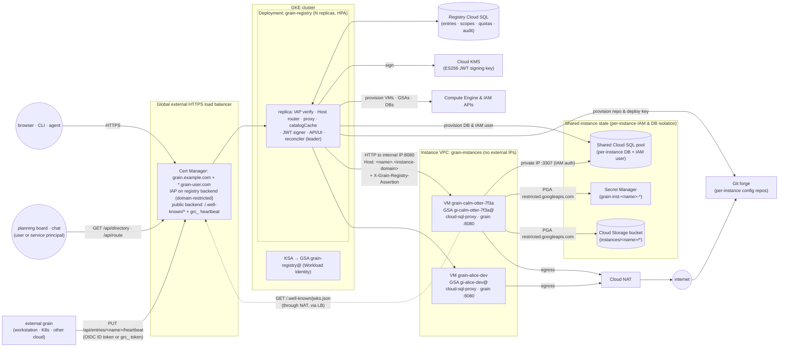
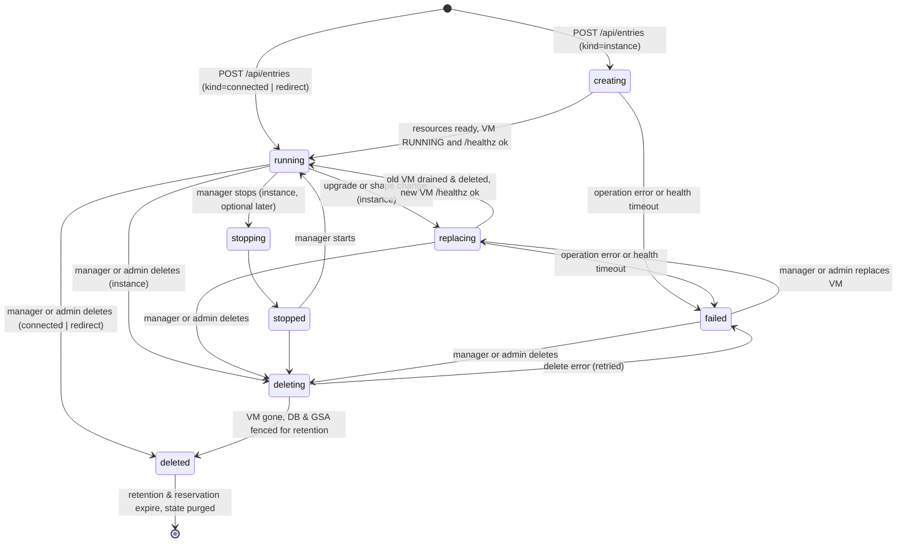

# Grain registry: catalog, work routing, and self-service grain instances

**Owner:** @bwsalmon

**Status:** Proposed (design only; no code yet)

A grain deployment today is one controller with one owner ([`architecture.design.md`](architecture.design.md)). That creates two problems across an organisation. First, people who want their own grain have to stand one up: a machine, a domain, IAP or an access code, a database, and a release to keep current. Second, a product-lifecycle layer that sits above grain—planning boards, chat commands, issue triagers, and cross-team handoffs—cannot tell *which* grain owns a repository or subdirectory, whether that grain is alive, or which person and team are accountable for it.

The **grain registry** solves both in one small service. It runs on Kubernetes behind one IAP-protected load balancer. Its own UI and API live at `https://<registry-host>/`, and each **entry** gets its own host `https://<name>.<instance-domain>/` under a wildcard certificate and the same IAP backend:

- **As a host**, the registry provisions stateless, **replaceable** single-tenant grain VMs (`kind = instance`) whose persistent state lives in a shared Cloud SQL for PostgreSQL pool, Secret Manager, a per-instance Git config repository, and Cloud Storage—each isolated per instance by IAM and database permissions. Deleting an instance's VM and creating a new one from the current image or a new shape loses nothing. The registry reverse-proxies `https://<name>.<instance-domain>/` to the VM with the signed-in caller in a short-lived, single-audience JWT, so the instance's own allowlist and attribution decide what that caller may do.
- **As a catalog that routes work to grains**, every entry—whether a hosted VM (`instance`), a self-registering grain running on a workstation, cluster, or another cloud (`connected`), or an unmonitored external URL (`redirect`)—carries accountable ownership (`owner` plus an optional `owner_group`), human-readable purpose and host metadata, opt-in catalog visibility (`listed`, default `false`), and repository + path-prefix **scopes** (`primary` or `secondary`, preferring scopes the grain reports from its own configured repositories and work-ownership settings). Both hosted instances (via reconciler polling) and connected grains (via ~15 s heartbeats) expose unified liveness (`online` / `degraded` / `offline`), load counts, and build stamps, and `GET /api/directory` and `GET /api/route` let admitted users and service principals discover listed grains and rank the best grain for `(repo, path)` in milliseconds.

This document is written for the open-source core. It uses public GCP products (GKE, Cloud SQL for PostgreSQL, Secret Manager, Cloud Storage, Cloud KMS, IAP, Certificate Manager, Compute Engine, Cloud NAT) and keeps each cloud-, identity-, or forge-specific piece behind a small interface, so another cloud or an internal edition can swap one out. A company-wide deployment, with its own Terraform, belongs in a wrapper distribution and is not described here.

Read with: [`authentication.design.md`](authentication.design.md) and [`authentication.spec.md`](../spec/authentication/authentication.spec.md) (`ui.IdentityVerifier`, `ui.AccessCodePrecedence`, `allowed_principal` `{#AU-6}`, `-ui-require-iap`, `checkVerifiedIdentityCSRF`, `GroupMemberChecker`), [`operator-attribution.design.md`](operator-attribution.design.md), [`rbac.design.md`](rbac.design.md) and [`rbac.spec.md`](../spec/rbac/rbac.spec.md), [`unified-grants.design.md`](unified-grants.design.md), [`architecture.design.md`](architecture.design.md), [`settings.design.md`](settings.design.md), [`simple-config.design.md`](simple-config.design.md), [`non-disruptive-upgrade.design.md`](non-disruptive-upgrade.design.md), [`grain-on-gke.design.md`](grain-on-gke.design.md) (Gateway, IAP backend policy, Cloud SQL), [`docs/cloudsql-postgres.md`](../../docs/cloudsql-postgres.md), [`docs/external-config-repo.md`](../../docs/external-config-repo.md), `pkg/model/work_ownership.go` (`WorkOwnership`), and the reference Terraform in `deploy/terraform/gcp/`.

**The core rule:** Every registry-managed grain instance remains a single-tenant controller on replaceable compute whose persistent state lives in isolated Cloud SQL, Secret Manager, Git config-repo, and Cloud Storage resources, and whose caller identity arrives solely as a short-lived, single-audience JWT verified by the instance's `registry` `IdentityVerifier`. Catalog discovery exposes only entries explicitly marked `listed`, never leaks unlisted entries or internal infrastructure state, never grants access to a grain, and never lets one owner claim another listed entry's primary repository scope.

## Goals

- Each entry gets its own host, `https://<name>.<instance-domain>/`, fronted by one global external HTTPS load balancer with a wildcard certificate and a single IAP backend. The registry's own UI and API live on a separate host, `https://<registry-host>/`, not a sibling of the instances.
- Every instance VM is **replaceable**: deleting VM `<prefix><name>` and creating a new one from the current release image or a new shape loses no tasks, configuration, secrets, transcripts, or CI artifacts.
- Every entry has exactly one accountable `owner` (verified email, to whom quota is charged) and an optional `owner_group` (`group:<email>`) whose members may manage the entry alongside the owner.
- IAP authenticates every user at the edge, limited to one or more configured domains, and verified service principals may query the read-only catalog and routing endpoints.
- The registry passes the verified user to a hosted instance in a signed, short-lived JWT whose audience is `https://<name>.<instance-domain>`. The instance decides, with its own access rules (`allowed_principal` and `rbac.design.md`), whether to admit that user.
- Any admitted user can create a hosted `instance` (with a randomly generated name by default, or a chosen free name), picking from configured VM shapes within a per-user quota, change its shape, upgrade it, or delete it. Every user has a page and an API listing what they own or co-manage via `owner_group`.
- Grains running anywhere outside the registry fleet (a workstation, a Kubernetes cluster, another cloud) can register as **`connected`** entries under a reserved name and report version, commit, health, active/awaiting task counts, and repository scopes via ~15 s heartbeats, exposing the same derived `online` / `degraded` / `offline` status as hosted instances.
- Entries can also be **`redirect`** entries from `https://<name>.<instance-domain>/…` to a fixed external `https://` URL for static or unmonitored targets.
- Every entry carries catalog metadata (`display_name`, `purpose`, `host_kind`, `tags`, `listed` defaulting to `false`) and `(repo, path_prefix, role)` **scopes** preferring instance-reported scopes over manual overrides, with non-overlapping `primary` prefixes across listed entries and low-latency discovery (`GET /api/directory`) and longest-prefix routing (`GET /api/route`).
- Instance VMs reach only the public internet, plus Cloud SQL (private IP, through the connector) and Secret Manager / Cloud Storage (through Private Google Access, restricted to their own resources by IAM). They never reach each other, the registry's cluster, or anything else in the project.
- Subdomain routing is the primary design; path routing (`https://<registry-host>/<name>/…`) is documented only as an optional secondary mode for small single-team setups and is outside the MVP.

## Non-goals

- Multi-tenancy inside one grain. Each instance is still a single-tenant grain, as [`docs/access-code.md`](../../docs/access-code.md) describes. The registry gives each person or team their own grain and routes work to the right grain; it does not divide one grain between tenants.
- Running anything except grain on the VMs.
- Multi-project or multi-region placement in v1. All VMs run in one dedicated instance project and one region, across several zones.
- Billing or chargeback. Quotas limit spending; the registry does not record cost.
- Live migration of in-flight sandbox runs across a VM replacement. Replacing a VM drains it and interrupts active local runs so they re-queue cleanly on the new VM, matching a daemon restart today.
- **Outbound-connected reverse-proxying** to `connected` grains behind NAT or firewalls (deferred to a follow-up design; hooks are left on `entries.connect_mode`, `pkg/registry/server`, and the public listener).
- **Delegated (on-behalf-of) identity and cross-grain task submission** through the registry (deferred to a follow-up design; `/api/directory` and `/api/route` return ranked candidates and URLs, and hooks are left on `DelegationPolicy` and the registry JWT claims).

## Terms

- **Registry**: the Kubernetes service this document describes (`cmd/grain-registry`).
- **Registry host**: the hostname serving the registry's own UI, API, and JWKS (`grain.example.com`).
- **Instance domain**: the wildcard parent domain under which entries live (`grain-user.com`, giving `<name>.grain-user.com`). Recommended to be a separate registrable domain from the registry host.
- **Entry**: a catalog and routing row at `<name>`. Its **kind** is `instance`, `connected`, or `redirect`.
- **Instance**: an entry of kind `instance`, which is one replaceable grain VM backed by externalised state and polled by the reconciler.
- **Connected entry**: an entry of kind `connected`, representing a grain running outside the registry (workstation, Kubernetes, another cloud) that authenticates to the registry and pushes ~15 s heartbeats.
- **Redirect**: an entry of kind `redirect`, whose host `<name>.<instance-domain>` redirects to an unmonitored external `https://` URL.
- **Name**: a DNS label matching `[a-z][a-z0-9-]{1,30}[a-z0-9]`, generated at random by default or chosen by the owner.
- **VM name**: `<prefix><name>`, for example `grain-calm-otter-7f3a` or `grain-alice-dev`. The prefix is fixed by configuration.
- **Owner**: the single verified human email accountable for an entry and charged its quota.
- **Owner group**: an optional group principal (`group:<email>`) on an entry whose verified members may manage the entry like the owner while quota remains charged to `owner`.
- **Entry manager**: the entry's `owner` or any verified member of its `owner_group`.
- **Listed entry**: an entry with `listed = true`, making its catalog metadata, scopes, and liveness status visible in `/api/directory` and `/api/route` (entries default to `listed = false`).
- **Scope**: a `(repo, path_prefix, role)` claim (`role` in `primary` | `secondary`) declaring that an entry handles work in `<owner>/<name>` under `<path_prefix>`.
- **Status**: derived runtime health of an entry (`online`, `degraded`, `offline`, or `unknown` for redirects), distinct from its provisioning lifecycle `state` (`creating`, `running`, `replacing`, `deleting`, `deleted`, `failed`).
- **Admin**: a principal listed in the registry's `admins` configuration.

## Components and data flow



1. **Load balancer, wildcard certificate, and IAP.** One global external HTTPS load balancer (a GKE Gateway, `gke-l7-global-external-managed`, as [`grain-on-gke.design.md`](grain-on-gke.design.md) uses) fronts both `<registry-host>` and `*.<instance-domain>` on one anycast IP. Google Cloud Certificate Manager attaches a certificate covering `<registry-host>` and `*.<instance-domain>` via **DNS authorization** (`_acme-challenge.<instance-domain>`), paired with a wildcard DNS `A`/`AAAA` record for `*.<instance-domain>`. IAP is enabled on the single `grain-registry` backend service, with `roles/iap.httpsResourceAccessor` granted to `domain:<d>` for each configured domain (plus configured service-principal catalog readers), so creating or deleting an entry changes no load-balancer, certificate, DNS, or IAP resource. The registry verifies the IAP assertion again in process. Long-lived routes (`/api/hostd/connect`, streaming endpoints) carry a `GCPBackendPolicy` with `timeoutSec: 86400`. The dedicated `grain-registry-public` backend exposes only `/.well-known/jwks.json` and the bearer-authenticated `connected` heartbeat ingress (`PUT /api/entries/<name>/heartbeat` with a per-entry `grc_` credential, plus a hook for future outbound-tunnel connections) outside IAP.
2. **The registry Deployment.** Stateless replicas, at least two across zones, behind a ClusterIP Service with a HorizontalPodAutoscaler on CPU and in-flight requests. Every replica serves `<registry-host>` (UI, CRUD API, heartbeats, and in-memory `catalogCache` for `/api/directory` and `/api/route`) and every `<name>.<instance-domain>` (from `hostCache`). One replica at a time holds the database lease and runs the reconciler (see *Scale and HA*).
3. **Registry Cloud SQL and shared instance Cloud SQL.** The registry's own tables (`registry` schema) sit in a regional HA Cloud SQL for PostgreSQL instance, separate from the shared Cloud SQL pool that holds grain instances' databases so a busy grain instance cannot starve routing or reconciliation (small deployments can place both in one Cloud SQL instance). All connections use IAM database authentication with no stored passwords.
4. **Externalised instance state.** Each hosted `instance` gets its own per-instance GCP service account (`gi-<slug>@<project>.iam.gserviceaccount.com`), its own database and IAM user on a shared Cloud SQL instance, its own Secret Manager prefix (`grain-inst-<name>-*`), its own Cloud Storage Managed Folder (`instances/<name>/`), and its own private Git config repository with a repository-scoped SSH deploy key.
5. **The VM fleet and external connected grains.** Hosted `instance` entries run one Compute Engine VM per running instance, in one dedicated project, on VPC `grain-instances` with no external IPs and only an ephemeral disk, booted from the baked `grain-release` machine image (`scripts/setup.sh`: the release container, local `grain hostd`, local sandboxes, and `cloud-sql-proxy`). External `connected` grains run anywhere their owner operates them and push periodic heartbeats to `<registry-host>`.
6. **The reverse-proxy path.** For hosted `instance` entries, the registry reaches each VM at its **internal IP** on `tcp:8080`. Only the GKE cluster's nodes (or pod CIDR when peered) may open `tcp:8080` on instance VMs:
   - **Same VPC, separate subnet (default).** The cluster runs in a `registry` subnet and the VMs run in an `instances` subnet of `grain-instances`. Firewall rules match secure tags and service accounts.
   - **Separate VPCs, peered.** When using an existing cluster VPC, VPC peering without custom route export connects the two, and the ingress rule matches the cluster's pod/node CIDRs.

   Traffic between the registry and a VM is plain HTTP inside the VPC in v1; Google Cloud encrypts VPC traffic on the wire and the registry JWT carries cryptographic integrity.

### Why one IAP backend and a registry JWT, not IAP on every VM

Per-VM IAP would put every VM behind its own backend service, NEG, OAuth client, and IAM policy—minutes of load-balancer propagation on every create, hard project quotas on backend services, and a direct internet ingress path to each VM. Fronting `<registry-host>` and `*.<instance-domain>` with a single wildcard certificate and one IAP backend means creating an instance touches no edge infrastructure, VMs remain reachable only inside the VPC, programmatic callers (`grain` CLI, remote `hostd`, planning boards) mint ID tokens against a single IAP audience, and each instance verifies one registry issuer's JWKS while enforcing its own audience (`https://<name>.<instance-domain>`).

### Cloud- and identity-specific seams

The registry core (routing, catalog & scope resolution, data model, quotas, state machine, JWT minting, UI, and API) has no GCP or GitHub dependency. Cloud-, identity-, and forge-specific operations sit behind interfaces:

```go
// Compute manages replaceable instance VMs. Every method refuses a VM name
// outside the configured project, zones and prefix (see Reconciliation).
type Compute interface {
	Create(ctx context.Context, spec VMSpec) (op OperationRef, err error)
	Stop(ctx context.Context, zone, vmName string) (op OperationRef, err error)
	Get(ctx context.Context, zone, vmName string) (VMStatus, error)
	Delete(ctx context.Context, zone, vmName string) (op OperationRef, err error)
	List(ctx context.Context) ([]VMStatus, error) // only VMs with prefix and label
	Operation(ctx context.Context, op OperationRef) (OperationStatus, error)
}

// InstanceResources provisions and tears down the externalised identity,
// database, secret scope, and object-storage prefix that outlive a VM replace.
type InstanceResources interface {
	EnsureIdentity(ctx context.Context, entry Entry) (serviceAccount string, err error)
	EnsureDatabase(ctx context.Context, entry Entry, serviceAccount string) (sqlInstance, dbName string, err error)
	EnsureStorageAndSecrets(ctx context.Context, entry Entry, serviceAccount string) error
	FenceOnDelete(ctx context.Context, entry Entry) error
	Purge(ctx context.Context, entry Entry) error
}

// ConfigRepos manages per-instance configuration repositories on the Git forge.
// A no-op implementation backs config_repo.provider = "none".
type ConfigRepos interface {
	Ensure(ctx context.Context, entry Entry, pubKey []byte) (repoURL string, err error)
	Delete(ctx context.Context, entry Entry) error
}

// FrontIdentity verifies the human or service principal attached by the edge
// proxy (IAP on GCP, via pkg/webauth).
type FrontIdentity interface {
	Verify(r *http.Request) (webauth.VerifiedIdentity, error)
}

// GroupResolver checks membership in "group:<email>" principals for owner_group,
// admins, and creators. Implementations cache lookups with bounded timeouts.
type GroupResolver interface {
	IsMember(ctx context.Context, groupEmail, memberEmail string) (bool, error)
}

// DelegationPolicy decides which verified service principals may read the
// catalog (/api/directory, /api/route) and—in the follow-up delegation design—
// act on a human's behalf. Core ships a static service-principal reader list
// and a deny-all delegation stub.
type DelegationPolicy interface {
	MayReadCatalog(ctx context.Context, caller webauth.VerifiedIdentity) bool
	AuthorizeOnBehalfOf(ctx context.Context, caller webauth.VerifiedIdentity, r *http.Request) (*DelegatedActor, error)
}

// Signer signs registry JWTs with the current key and publishes the JWKS.
type Signer interface {
	Sign(ctx context.Context, claims jwt.Claims) (string, error)
	PublicKeys(ctx context.Context) (jose.JSONWebKeySet, error)
}
```

`FrontIdentity` and the Cloud Identity `GroupResolver` reuse `pkg/jwks` and `pkg/webauth`; wrapper distributions register alternative edge proxies, group directories, and delegation policies the same way they register an `IdentityVerifier` in grain. `Signer` has Cloud KMS and local Kubernetes Secret implementations.

## Repository layout and boundaries

The registry ships from this repository as its own binary and container image, alongside `cmd/github-webhook` and `cmd/grit`, with strict compile-time boundaries keeping daemon/sandbox machinery out of the registry and registry internals out of the daemon.

### Packages

| Path | Responsibility |
|---|---|
| `cmd/grain-registry/` | Thin `package main` calling `registry.Main()` (after blank-importing core GCP/GitHub provider registrations, mirroring `cmd/grain/main.go` → `cli.Main()`). |
| `pkg/registry` | `Main()`, configuration loading/validation, and `Register*` extension hooks for wrapper distributions. |
| `pkg/registry/api` | Wire structs (`Entry`, `DirectoryEntry`, `RouteCandidate`, `Scope`, `HeartbeatRequest`, `HeartbeatResponse`, …) and typed HTTP `Client`. **The only `pkg/registry/...` package that the grain daemon and CLI may import** (used for connected self-registration/heartbeats and `grain registry …`). Depends only on the standard library and leaf error helpers. |
| `pkg/registry/server` | `Host` routing (`<name>.<instance-domain>` vs `<registry-host>`), reverse proxy, `hostCache` and `catalogCache`, JWT minting, JSON API, embedded `pkg/registry/server/static` SPA assets, server-rendered subdomain state pages, and quotas/rate limits. |
| `pkg/registry/reconcile` | Database leader lease, `creating` / `replacing` / `deleting` / `purge_after` state machine, hosted-instance status/scope polling, and orphan VM reporting. |
| `pkg/registry/store` | PostgreSQL `registry` schema, versioned migrations, optimistic-locking transitions, scope combination/conflict evaluation, `LISTEN`/`NOTIFY` channels, and `audit_log`. |
| `pkg/registry/providers/<cloud>` | Provider implementations behind the seams above (`pkg/registry/providers/gcp` for GCE `Compute`, Cloud SQL / Secret Manager / GCS `InstanceResources`, Cloud KMS `Signer`, and Cloud Identity `GroupResolver`; `pkg/registry/providers/github` for `ConfigRepos`; `pkg/registry/providers/local` for local secrets, static groups, and in-process test fakes). |
| `deploy/kubernetes/registry/` | Kubernetes Deployment, Services (`grain-registry` and `grain-registry-public`), HPA, PDB, Gateway / `GCPBackendPolicy`, and NetworkPolicy manifests. |
| `deploy/terraform/gcp/registry/` | Reference Terraform for the dedicated instance project, `grain-instances` VPC, Private Google Access DNS/firewall, Cloud NAT, shared Cloud SQL pool, GCS bucket, Cloud KMS key, GKE cluster, and wildcard Certificate Manager + IAP Gateway. |
| `design/spec/registry/` | Normative RFC 2119 specification (`registry.spec.md`) and requirement IDs (`{#RG-*}`). |

### Shared auth without the daemon's web server (`pkg/webauth`)

Today, the Google IAP JWT verifier (`IAPAssertionHeader`, `GoogleIAPCertURL`, `NewIAPVerifier`, `normalizeIdentityEmail` in `pkg/ui/principal.go` and `pkg/ui/verifier.go`), the Cloud Identity `GroupMemberChecker` (`pkg/ui/allowlist.go`), and the browser CSRF / Fetch-Metadata checks (`checkCrossOrigin`, `verifySameOriginForProxyAuth`, `originMatchesRequestHost` in `pkg/ui/csrf.go`) live inside `pkg/ui`. Importing `pkg/ui` from `cmd/grain-registry` would link the embedded daemon SPA (`pkg/ui/static`) and pull in `pkg/model`, `pkg/orchestrator`, `pkg/capability`, `pkg/mcp`, and `pkg/ci`.

Before the registry service skeleton lands, those self-contained HTTP authentication primitives move into **`pkg/webauth`** (alongside already-standalone `pkg/jwks`), with zero dependency on `pkg/model` or `pkg/ui` (`PrincipalKind` represented by a minimal neutral enum mapped trivially to `model.PrincipalKind` inside `pkg/ui`). `pkg/ui` delegates to `pkg/webauth` so every invariant in [`authentication.spec.md`](../spec/authentication/authentication.spec.md) (`{#AU-1}`–`{#AU-20}`) holds unchanged, while `pkg/registry/server` imports `pkg/webauth` and `pkg/jwks` directly.

### Import-boundary test

`pkg/registry/independence_test.go` (modelled on `pkg/grit/independence_test.go`, running `go list -deps` in `go test`) enforces three hard boundaries on every CI run:

1. **Registry isolation from daemon/sandbox packages:** `cmd/grain-registry` and `pkg/registry/...` MUST NOT import—directly or transitively—`pkg/orchestrator`, `pkg/agent/...`, `pkg/dispatch`, `pkg/sandbox...` (`pkg/sandboxaccess`, `pkg/sandboxaddr`, `pkg/sandboxcli`, `pkg/sandboximage`), `pkg/granule/...`, `pkg/hostd`, `pkg/modelproxy`, `pkg/ui`, `pkg/daemon`, `pkg/ci/...`, `pkg/mcp`, `pkg/capability/...`, or `pkg/model`. An explicit allowlist of shared leaf packages (`pkg/webauth`, `pkg/jwks`, `pkg/version`, `pkg/redact`, `pkg/apierror`) ensures newly added daemon packages are off-limits to `pkg/registry/...` by default.
2. **Daemon and CLI isolation from registry internals:** every package outside `cmd/grain-registry` and `pkg/registry/...` (including `cmd/grain`, `pkg/daemon/...`, `pkg/ui/...`, `pkg/cli/...`, and `pkg/orchestrator/...`) MAY import **`pkg/registry/api` only**, and MUST NOT import `pkg/registry`, `pkg/registry/server`, `pkg/registry/reconcile`, `pkg/registry/store`, or `pkg/registry/providers/...`.
3. **Pure wire client (`pkg/registry/api`):** `pkg/registry/api` MUST NOT import any sibling `pkg/registry/...` package or external cloud SDK.

### Extension points for wrapper distributions

`pkg/registry` exposes `registry.Main()` plus package-level `Register*` hooks, following grain's `cli.Main()` (`cmd/grain/main.go`) and `Register*` pattern (`ui.RegisterIdentityVerifier`, `change.Register`, `capability.RegisterProvider`). A downstream wrapper distribution builds its own `cmd/grain-registry/main.go` that blank-imports its internal registrations and calls `registry.Main()`:

- **`RegisterFrontIdentity(name, factory)`:** edge identity verification (`"iap"` built in; downstream proxies registered by name and selected via `identity.front`).
- **`RegisterGroupResolver(name, factory)`:** resolves `group:<email>` membership for `owner_group`, `admins`, and `creators` (`"cloud-identity"` and `"static"` built in; corporate directory resolvers registered by wrapper editions).
- **`RegisterDelegationPolicy(name, factory)`:** governs which verified service principals may query `/api/directory` and `/api/route` and provides the hook (`AuthorizeOnBehalfOf`) for the follow-up delegated (on-behalf-of) identity design (default `"static"` admits configured `identity.service_principals` for read-only catalog/route calls and refuses all on-behalf-of assertions until the delegation design lands).
- **`RegisterComputeProvider`, `RegisterInstanceResourcesProvider`, `RegisterConfigReposProvider`, `RegisterSignerProvider`:** cloud and forge provider seams (`"gce"`, `"gcp"`, `"github"`, `"none"`, `"kms"`, `"local"`).
- **`RegisterConnectTransport(name, factory)` *(hook)*:** reserved seam on `pkg/registry/server` for the follow-up outbound-connected proxying design, allowing a `connected` grain to terminate proxied `<name>.<instance-domain>` traffic over an outbound tunnel without modifying the core router.

### One Go module for now

`cmd/grain-registry` and `pkg/registry/...` stay in the root `github.com/ai-on-gke/grain` Go module. Because Go links only packages reachable from a binary's `main`—and `cmd/grain` reaches only stdlib-backed `pkg/registry/api`—keeping one `go.mod` adds zero binary size or cloud-client initialization to `grain`, `grit`, or `grain-sandbox`. `pkg/registry/providers/gcp` will move into a nested `pkg/registry/providers/gcp/go.mod` only if its GCP Admin SDK dependencies (`compute`, `sqladmin`, `kms`, `iam`) ever introduce dependency conflicts, vulnerability-scanner noise, or `go mod` churn that burdens contributors who only build or use `grain`. Confining all cloud SDK imports to `pkg/registry/providers/gcp` keeps that future split mechanical.

### Image and release

The registry ships as a minimal distroless/slim container image (`grain-registry`, built from `Dockerfile.registry`) containing only `/usr/local/bin/grain-registry` (with embedded `ui-registry` static assets) and CA certificates—**no** agent CLIs, **no** `granule`, KVM, Docker, or sandbox guests, and **no** Node, Python, or Git binaries at runtime. `scripts/release-images.sh` and `.github/workflows/release.yml` build, version-stamp (`scripts/build-version.sh`), sign, and publish `grain-registry` alongside the `grain` daemon image on every release candidate and promotion.

### Separate React UI (`ui-registry/`)

Instead of server-rendered Go templates on `<registry-host>`, the registry UI is a dedicated React single-page application in **`ui-registry/`**:

- **Isolated bundle, aligned toolchain:** `ui-registry/` has its own `package.json`, `package-lock.json`, `index.html`, `vite.config.js`, and `vitest.config.js`, pinned to the exact same React and Vite versions as `ui/`, so the registry bundle stays small and never ships daemon UI code (`App.jsx`, chat widgets, diff viewers, or task/CI panels).
- **Shared tokens and generic primitives without copying:** design tokens (light/dark CSS custom properties, typography, spacing, `ThemeMode` persistence) and generic UI primitives (status pills, sortable tables, filter bars, form controls, confirmation dialogs, page header chrome) live in a shared folder **`ui-shared/`** imported by both `ui/` and `ui-registry/` via npm workspaces / Vite path alias (`@grain/ui-shared`), never duplicated across the two apps.
- **Static embed at image-build time:** `vite build` in `ui-registry/` writes into `pkg/registry/server/static` (`emptyOutDir: false`, preserving tracked `.gitignore`, `.gitkeep`, and `placeholder.html` so `go build` and `go test` succeed on a fresh checkout before `npm run build`, matching `pkg/ui/static` in `Makefile`'s `frontend` target). `pkg/registry/server` embeds `static` with `//go:embed`, requiring Node at image-build and CI time only.
- **JSON API only + strict CSP:** `ui-registry/` talks exclusively to same-origin `https://<registry-host>/api/*`. Responses on `<registry-host>` carry `Content-Security-Policy: default-src 'none'; script-src 'self'; style-src 'self'; img-src 'self' data:; connect-src 'self'; font-src 'self'; base-uri 'none'; frame-ancestors 'none'; form-action 'self'`.
- **Tests and visual verification:** `Makefile` (`frontend`, `fmt-frontend`) and `.github/workflows/tests.yml` (`frontend` job) run `vitest run`, `prettier --check`, Playwright E2E specs, and `screenshot.mjs` (desktop and phone widths, light and dark) against a registry demo/fake server, matching `ui/`'s workflow ([`docs/ui-screenshots.md`](../../docs/ui-screenshots.md)).
- **Exception — subdomain state and interstitial pages stay server-rendered:** the `503` (starting / updating / unconfigured connected), `410` (deleting), `502` (failed), `404` (missing / deleted), and first-use redirect interstitial pages served on **entry hosts (`https://<name>.<instance-domain>`)** remain small, self-contained, server-rendered Go HTML pages with inline CSS and zero external scripts, fonts, or cross-origin asset loads from `<registry-host>`. They must render reliably when nothing else does and keep origins strictly self-contained.

## Data model

All registry tables live in one PostgreSQL schema, `registry`, with versioned migrations like grain's own (`pkg/model/migrations.go`).

```sql
-- Who has ever signed in. Created on first verified human request.
CREATE TABLE owners (
  email          TEXT PRIMARY KEY,          -- verified, lower-cased
  first_seen_at  TIMESTAMPTZ NOT NULL,
  last_seen_at   TIMESTAMPTZ NOT NULL,
  disabled       BOOLEAN NOT NULL DEFAULT false   -- admin can block an owner
);

-- VM shapes users may pick. Seeded from configuration on start (config wins).
CREATE TABLE shapes (
  id              TEXT PRIMARY KEY,         -- "small", "standard", "large"
  machine_type    TEXT NOT NULL,            -- "e2-standard-4"
  boot_disk_gb    INT  NOT NULL,
  scratch_disk_gb INT  NOT NULL,            -- ephemeral local disk for sandboxes and caches
  disk_type       TEXT NOT NULL,            -- "pd-balanced"
  description     TEXT NOT NULL,
  weight          INT  NOT NULL DEFAULT 1,  -- quota units this shape costs
  enabled         BOOLEAN NOT NULL DEFAULT true
);

-- Shared Cloud SQL instances available for grain instance databases.
-- Seeded from configuration; max_databases caps placement on each host.
CREATE TABLE sql_instances (
  id             TEXT PRIMARY KEY,          -- "project:region:grain-inst-sql-0"
  private_ip     INET NOT NULL,
  max_databases  INT  NOT NULL DEFAULT 200,
  enabled        BOOLEAN NOT NULL DEFAULT true
);

-- Per-owner quota overrides. Absent row means the configured default.
-- Quota is always charged to entries.owner, never split across owner_group.
CREATE TABLE quotas (
  email              TEXT PRIMARY KEY REFERENCES owners(email),
  max_instance_units INT,                   -- NULL = default
  max_connected      INT,                   -- NULL = default
  max_redirects      INT,                   -- NULL = default
  set_by             TEXT NOT NULL,
  set_at             TIMESTAMPTZ NOT NULL
);

-- One row per entry, live or reserved. hostname is written at creation as
-- name || '.' || instance_domain and is the exact Host key for subdomain routing.
-- FILLFACTOR = 80 leaves page headroom so 15 s heartbeat updates stay Heap-Only
-- Tuple (HOT) writes when indexed columns do not change.
CREATE TABLE entries (
  name                 TEXT PRIMARY KEY,
  hostname             TEXT NOT NULL UNIQUE,      -- "<name>.<instance-domain>", never edited
  kind                 TEXT NOT NULL CHECK (kind IN ('instance', 'connected', 'redirect')),
  owner                TEXT NOT NULL REFERENCES owners(email),
  owner_group          TEXT CHECK (owner_group IS NULL OR owner_group LIKE 'group:%@%'),
  state                TEXT NOT NULL,             -- provisioning lifecycle; see State machine
  created_at           TIMESTAMPTZ NOT NULL,
  deleted_at           TIMESTAMPTZ,               -- set on entering deleted
  reserved_until       TIMESTAMPTZ,               -- name held for owner after delete
  purge_after          TIMESTAMPTZ,               -- when retained DB/secrets/GCS/repo may drop
  purged_at            TIMESTAMPTZ,               -- set once externalised state is purged
  generation           BIGINT NOT NULL DEFAULT 1, -- bumped on config/lifecycle mutations; optimistic locking
  -- catalog metadata (every kind)
  display_name         TEXT NOT NULL DEFAULT '',
  purpose              TEXT NOT NULL DEFAULT '',  -- 1–2 plain sentences on what this grain is for
  host_kind            TEXT NOT NULL CHECK (host_kind IN ('registry-vm', 'workstation', 'kubernetes', 'other')),
  listed               BOOLEAN NOT NULL DEFAULT false,
  tags                 TEXT[] NOT NULL DEFAULT '{}',
  -- unified liveness & load (reconciler-polled on instance; heartbeat-pushed on connected)
  grain_version        TEXT,                      -- release version (pkg/version)
  grain_commit         TEXT,                      -- full VCS commit hash
  health_state         TEXT CHECK (health_state IN ('ok', 'degraded', 'unhealthy')),
  active_tasks         INT CHECK (active_tasks IS NULL OR active_tasks >= 0),
  awaiting_reply_tasks INT CHECK (awaiting_reply_tasks IS NULL OR awaiting_reply_tasks >= 0),
  last_heartbeat_at    TIMESTAMPTZ,
  has_reported_scopes  BOOLEAN NOT NULL DEFAULT false,
  -- kind = 'instance'
  shape                TEXT REFERENCES shapes(id),
  target_shape         TEXT REFERENCES shapes(id),-- set while replacing for a shape change
  vm_name              TEXT UNIQUE,               -- prefix || name, never edited
  service_account      TEXT UNIQUE,               -- per-instance GSA email
  sql_instance         TEXT REFERENCES sql_instances(id),
  db_name              TEXT,                      -- per-instance database on sql_instance
  config_repo          TEXT,                      -- forge repo slug/URL, NULL when disabled
  zone                 TEXT,
  internal_ip          INET,
  image                TEXT,                      -- image the active VM was created from
  target_image         TEXT,                      -- target image while replacing
  operation            TEXT,                      -- in-flight Compute operation, if any
  replace_step         TEXT,                      -- draining | deleting_vm | creating_vm | probing
  failure              TEXT,                      -- last error, for failed
  -- kind = 'connected'
  external_url         TEXT,                      -- optional https:// browser URL (redirected until tunnel lands)
  connected_principal  TEXT,                      -- optional workload OIDC principal ("serviceAccount:..." or "user:...")
  connect_mode         TEXT NOT NULL DEFAULT 'none'
                         CHECK (connect_mode IN ('none', 'redirect', 'tunnel')), -- 'tunnel' reserved for outbound-proxy design
  -- kind = 'redirect'
  target_url           TEXT,
  append_path          BOOLEAN,                   -- default true (used by redirect and connected external_url)
  -- pending two-step ownership transfer
  transfer_to          TEXT,                      -- offered recipient email
  transfer_expires_at  TIMESTAMPTZ,
  CHECK ((kind = 'instance') = (vm_name IS NOT NULL)),
  CHECK ((kind = 'instance') = (host_kind = 'registry-vm')),
  CHECK ((kind = 'redirect') = (target_url IS NOT NULL)),
  CHECK (kind = 'connected' OR (external_url IS NULL AND connected_principal IS NULL AND connect_mode = 'none')),
  UNIQUE (sql_instance, db_name)
) WITH (fillfactor = 80);
CREATE INDEX entries_owner ON entries(owner) WHERE state <> 'deleted';
CREATE INDEX entries_owner_group ON entries(owner_group) WHERE owner_group IS NOT NULL AND state <> 'deleted';
CREATE INDEX entries_listed ON entries(name) WHERE listed = true AND state <> 'deleted';
CREATE INDEX entries_purge ON entries(purge_after) WHERE state = 'deleted' AND purged_at IS NULL;

-- Repository and path-prefix scopes per entry.
-- source = 'reported' comes from the grain itself (heartbeat or reconciler poll);
-- source = 'declared' comes from registry API/UI edits.
-- Whenever either set or entries.listed changes, the store transaction recomputes
-- effective_role, active, inactive_reason, and conflict_with.
CREATE TABLE entry_scopes (
  name            TEXT NOT NULL REFERENCES entries(name) ON DELETE CASCADE,
  source          TEXT NOT NULL CHECK (source IN ('reported', 'declared')),
  repo            TEXT NOT NULL,             -- normalized lowercase "<owner>/<name>"
  path_prefix     TEXT NOT NULL DEFAULT '',  -- "" = whole repo, or clean relative path without leading/trailing '/'
  role            TEXT NOT NULL CHECK (role IN ('primary', 'secondary')),
  effective_role  TEXT CHECK (effective_role IN ('primary', 'secondary')),
  active          BOOLEAN NOT NULL DEFAULT false, -- true iff in effective scope set and free of primary overlap
  conflict_with   TEXT REFERENCES entries(name) ON DELETE SET NULL,
  inactive_reason TEXT,                      -- NULL | 'overridden_by_narrower' | 'not_reported_by_instance' | 'primary_conflict'
  claimed_at      TIMESTAMPTZ NOT NULL,      -- preserved across heartbeats while (name, repo, path_prefix) stays claimed
  updated_at      TIMESTAMPTZ NOT NULL,
  PRIMARY KEY (name, source, repo, path_prefix)
);
CREATE INDEX entry_scopes_active_repo ON entry_scopes(repo, effective_role)
  WHERE active = true;

-- Hashed per-entry registration tokens ("grc_...") for kind = 'connected'.
-- Plaintext tokens are returned once on create/rotate and never persisted.
CREATE TABLE entry_credentials (
  id           BIGSERIAL PRIMARY KEY,
  name         TEXT NOT NULL REFERENCES entries(name) ON DELETE CASCADE,
  token_sha256 BYTEA NOT NULL UNIQUE,        -- SHA-256 of full "grc_..." bearer token
  token_hint   TEXT NOT NULL,                -- trailing 4 chars for UI identification
  created_by   TEXT NOT NULL,
  created_at   TIMESTAMPTZ NOT NULL,
  expires_at   TIMESTAMPTZ,                  -- set on previous token during rotation overlap window
  last_used_at TIMESTAMPTZ
);
CREATE INDEX entry_credentials_name ON entry_credentials(name);

-- Who has dismissed a redirect or connected external_url interstitial.
CREATE TABLE redirect_acks (
  name           TEXT NOT NULL,
  generation     BIGINT NOT NULL,           -- a target/external_url change resets acks
  email          TEXT NOT NULL,
  acked_at       TIMESTAMPTZ NOT NULL,
  PRIMARY KEY (name, generation, email)
);

-- Append-only. Every mutation and every admin read of another owner's data.
CREATE TABLE audit_log (
  id             BIGSERIAL PRIMARY KEY,
  at             TIMESTAMPTZ NOT NULL,
  actor          TEXT NOT NULL,             -- verified email, "grain:<name>", or "registry"
  action         TEXT NOT NULL,             -- create, replace, delete, purge, transfer, scopes, ...
  name           TEXT,
  detail         JSONB NOT NULL
);

-- Reconciler leadership (see Scale and HA).
CREATE TABLE leases (
  name           TEXT PRIMARY KEY,
  holder         TEXT NOT NULL,
  expires_at     TIMESTAMPTZ NOT NULL
);
```

Both `hostname` (`<name>.<instance-domain>`) and `vm_name` (`<prefix><name>`) are written once at creation and validated against configuration before any external call. Code never constructs a VM name, service account, database name, or proxy address directly from an HTTP request.

### Catalog metadata and scopes

Every entry (`instance`, `connected`, and `redirect`) carries the same catalog fields:

- **`display_name` and `purpose`:** `display_name` (up to 120 chars; falls back to `name` when empty) names the grain in human lists, and `purpose` (up to 500 chars) states in one or two plain sentences what work belongs on this grain—for example *"Autoscaler control-loop heuristics and scale-down simulations"* versus *"Bulk node and slice provisioning"*.
- **`host_kind`:** `'registry-vm'` (pinned automatically when `kind = 'instance'` and forbidden for other kinds), `'workstation'`, `'kubernetes'`, or `'other'`.
- **`listed` (default `false`) and `tags`:** newly created entries start unlisted (`listed = false`), keeping personal and experimental grains visible **only** to their `owner`, verified `owner_group` members, and registry `admins`. Setting `listed = true` publishes the entry's catalog projection into `/api/directory` and `/api/route`. `tags` holds normalized lowercase `[a-z0-9][a-z0-9-]{0,31}` labels (up to 16 per entry) for directory filtering.
- **Scopes (`repo`, `path_prefix`, `role`):** each scope claims `primary` or `secondary` responsibility for `<owner>/<name>` under normalized repo-relative directory prefix `path_prefix` (`""` for the entire repository, or clean slash-separated segments such as `"pkg/autoscaler"` with no leading or trailing `/` and no `..` elements). Path matching operates strictly on **path-segment boundaries**: `"pkg/auth"` matches `"pkg/auth"` and `"pkg/auth/jwt.go"`, never `"pkg/autoscaler/loop.go"`.

**How instance-reported scopes and registry-declared scopes combine.** A running grain already knows which repositories it works on and whether it owns their standing work (`model.RepoConfig` and `model.WorkOwnership` in `pkg/model/repo_config.go` and `pkg/model/work_ownership.go`). Preferring self-reported scopes eliminates dual maintenance and stops registry entries from advertising repositories a grain cannot actually serve:

1. **What a grain reports (`source = 'reported'`):** For every repository configured on the grain **excluding** its own `grain/config` state repository (`staterepo` / `IsConfigRepo`), the grain reports `(repo, path_prefix: "", role)`:
   - `role = "primary"` when `RepoConfig.Work.Default` is `OwnershipUnset` (`""`) or `OwnershipOn` (`"on"`)—meaning in grain's own model this deployment runs the repository's standing work;
   - `role = "secondary"` when `RepoConfig.Work.Default` is `OwnershipOff` (`"off"`)—meaning another deployment owns standing work while this grain handles manual or delegated tasks on the repo.
2. **Combining `reported` and `declared` rows per entry:**
   - **Before first report (`has_reported_scopes = false`, including all `redirect` entries and newly created `instance`/`connected` entries):** `declared` rows typed into the registry UI/API (`source = 'declared'`) are the entry's effective scopes (`effective_role = role`).
   - **Once the grain reports (`has_reported_scopes = true`):** the grain's `reported` set is authoritative for **which repositories are active** and **the maximum `role` (`primary` > `secondary`) on each repository**:
     - If no `declared` rows exist for a reported `repo`, the `reported` row is effective verbatim (`effective_role = reported.role`).
     - If the entry manager has entered `declared` sub-path or role rows for a reported `repo` (for example narrowing whole-repo `""` to `"pkg/autoscaler"` in a shared monorepo, or demoting a repo to `secondary`), those `declared` rows replace the broader `reported` row for that `repo` (marking the `reported` row `inactive_reason = 'overridden_by_narrower'`), with each row's `effective_role` capped at `min(reported.role, declared.role)`. A value typed into the registry can **narrow** `path_prefix` or **demote** `primary → secondary`, never promote a repo the grain reported as `Work.Default = off` (`secondary`) to `primary`.
     - Any `declared` row naming a `repo` absent from the grain's latest report is marked `active = false` (`inactive_reason = 'not_reported_by_instance'`) and omitted from `/api/directory` and `/api/route` until the repo is configured on the grain.

**Primary-prefix overlap and conflict rule.** Across all non-deleted **`listed = true`** entries, two `primary` scopes in the same `repo` **overlap** whenever one `path_prefix` equals or is a path-segment ancestor of the other (`a == b`, `a == ""`, `b == ""`, `strings.HasPrefix(b, a+"/")`, or `strings.HasPrefix(a, b+"/")`). Disallowing ancestor/descendant overlap prevents another owner from hijacking a subdirectory of a repository whose `""` primary scope already belongs to an existing listed grain; monorepos shared across subteams give each subteam a disjoint `primary` prefix (`"services/billing"`, `"services/auth"`) and give any repo-wide catch-all grain `path_prefix: ""` with `role: "secondary"`. Unlisted entries (`listed = false`) never reserve or block primary prefixes.

Overlap is enforced symmetrically across synchronous human writes and asynchronous background reports (serialised per `repo` under `pg_advisory_xact_lock(hashtext(repo))`):

- **Synchronous registry API writes** (`POST /api/entries` with `listed = true`, `PATCH /api/entries/<name>` flipping `listed: false → true`, or `PUT /api/entries/<name>/scopes` on a listed entry): **refused with `409 Conflict`**, returning the conflicting entry's `name`, `owner`, `owner_group`, and `path_prefix` so the caller can narrow their prefix, use `role: "secondary"`, or coordinate a handoff.
- **Asynchronous instance self-reports** (`PUT /api/entries/<name>/heartbeat` on `connected` entries and reconciler polling on `instance` entries): **first-registered (`claimed_at`) wins with a visible conflict**. The heartbeat or poll itself always succeeds (`200 OK`) so liveness tracking never breaks; the incumbent holder keeps `active = true`, while the colliding newcomer's scope row is stored with `active = false`, `inactive_reason = 'primary_conflict'`, and `conflict_with = <holder-name>`. The conflict is returned in `HeartbeatResponse.scope_conflicts`, badged on `/entries/<name>` and `/admin`, and excluded from `/api/directory` and `/api/route` until resolved. When an incumbent deletes, unlists, or drops a primary scope, the same transaction re-evaluates rows with `conflict_with = <incumbent>` in `claimed_at` order and promotes the earliest non-overlapping contender.

### State machine



**Provisioning `state` (stored):**

- `creating` (`instance`): quota is reserved; the reconciler idempotently creates the per-instance service account, Cloud SQL database and IAM user, GCS Managed Folder, config repo, and VM, then probes `/healthz`. Requests to `<name>.<instance-domain>` get a `503` starting page with `Retry-After: 5`.
- `running` (`instance`, `connected`, `redirect`): for `instance`, the VM is `RUNNING` and `/healthz` answered, so requests are proxied; for `connected` and `redirect`, the entry is active from creation until deletion.
- `replacing` (`instance`): the VM is being replaced for a grain upgrade, shape change, or recovery from `failed`. Externalised state (Cloud SQL database, Secret Manager prefix, GCS prefix, config repo) and any `listed` primary scope claims stay untouched so a transient 60 s upgrade never forfeits scope ownership; the old VM is drained and deleted, a new VM `<prefix><name>` is created and reattached, and routing switches once `/healthz` passes. While `replacing`, requests receive a `503` updating page with `Retry-After: 5`.
- `stopping` / `stopped` (`instance`): optional later milestone. Stopping deletes or halts the VM while keeping externalised state. Not in the MVP.
- `deleting` (`instance`): requests receive `410 Gone` immediately, and active `entry_scopes` are cleared so listed prefixes release without waiting for `purge_after`. The reconciler deletes the VM (and its auto-deleted disks) and fences the instance's service account and database so nothing can connect during retention.
- `deleted` (all kinds): quota is released and `entry_scopes` / `entry_credentials` are deactivated. The name stays reserved for `owner` until `reserved_until`. For `instance`, the database, secrets, GCS objects, and config repo stay fenced until `purge_after` (see *Delete and retention*) so an accidental delete can be undone before final purge.
- `failed` (`instance`): create, replace, or delete failed after retries. Because state lives outside the VM, an instance that failed during `replacing` (or whose VM died) loses no data and can move straight to `replacing` to build a fresh VM. A `failed` entry counts against quota until deleted.

`connected` and `redirect` entries use only `running` and `deleted`, transitioning in a single database transaction with no reconciler VM work. Every lifecycle or configuration mutation uses optimistic locking (`UPDATE … WHERE name = $1 AND generation = $2`) and appends an `audit_log` row in the same transaction.

**Derived runtime `status` (computed at read time, never thrashing `entries.state`):**

Every API response, CLI view, and UI surface that shows `grain_version` also reports `status` and `heartbeat_age_seconds` (`now() - last_heartbeat_at`), computed from `kind`, `state`, `last_heartbeat_at`, and `health_state` against configurable thresholds (`degraded_after`, default `45s`; `offline_after`, default `90s`):

| Kind & `state` | Condition | Derived `status` |
|---|---|---|
| `instance` or `connected` in `running` | `last_heartbeat_at IS NOT NULL`, `age <= degraded_after`, and `health_state = 'ok'` | `online` |
| `instance` or `connected` in `running` | `degraded_after < age <= offline_after`, or (`age <= offline_after` and `health_state IN ('degraded', 'unhealthy')`) | `degraded` |
| `instance` in `creating` or `replacing` | Provisioning or VM replacement in progress | `degraded` |
| `instance` or `connected` in `running` | `last_heartbeat_at IS NULL` or `age > offline_after` | `offline` |
| `instance` in `stopped`, `failed`, `deleting`, `deleted` | Not serving | `offline` |
| `redirect` in `running` | External link (never probed by the registry) | `unknown` |

### Reconciliation

The HTTP API never calls Compute, IAM, Cloud SQL Admin, or the Git forge inline; it records the desired state and returns `202`. The leader replica's reconciler runs every few seconds and on `NOTIFY registry_entries`, advancing each `instance` entry one idempotent step:

- `creating`: call `InstanceResources.EnsureIdentity`, `EnsureDatabase`, `EnsureStorageAndSecrets`, and `ConfigRepos.Ensure` (each idempotent on retry), then `Compute.Create` (adopting the VM if an earlier attempt already created it with matching `grain-registry` and `grain-generation` labels), then poll `Compute.Operation` and probe `http://<ip>:8080/healthz` and `/api/registry/status` until `running` or `health_timeout` (default 10 min).
- `replacing`: step through `draining` → `deleting_vm` → `creating_vm` → `probing` (see *Replace*).
- `deleting`: delete the VM via `Compute.Delete`, sweep any orphaned disks labelled `grain-entry=<name>`, call `InstanceResources.FenceOnDelete`, and mark `deleted` with `reserved_until` and `purge_after`.
- `deleted` past `purge_after` (with `purged_at IS NULL`, `kind = 'instance'`): call `ConfigRepos.Delete` and `InstanceResources.Purge` to drop the Postgres database and role, delete Secret Manager secrets, delete GCS objects and Managed Folder, and delete the per-instance service account; set `purged_at`. Once `(kind <> 'instance' OR purged_at IS NOT NULL)` and `reserved_until < now()`, purge the `entries` row.
- `running` (`kind = 'instance'`): every `status_poll_interval` (default `15 s`), poll `http://<ip>:8080/api/registry/status` to refresh `last_heartbeat_at`, `health_state`, `grain_version`, `grain_commit`, `active_tasks`, `awaiting_reply_tasks`, and self-reported `entry_scopes`, and every minute verify `Compute.Get`. An unexpected VM disappearance sets `failure` and alerts the entry managers and admins with a one-click **Replace VM** recovery action rather than silently thrashing.
- **Orphans**: `Compute.List` lists VMs with `<vm_prefix>` and `grain-registry=<registry-id>`. Unmatched VMs are surfaced on the admin page and auto-deleted only when their `grain-generation` matches a deleted or replaced generation of this registry.

**Scope defense in depth** holds across three independent layers: (1) validated DNS-label names mapped to stored `vm_name` and `internal_ip`, (2) explicit project, zone, prefix, and `grain-registry` label assertions inside `Compute`, and (3) conditional IAM bindings restricting `grain-registry@` to `<vm_prefix>` VMs/disks and `gi-*` service accounts in the dedicated instance project.

## Routing

### Subdomain routing and wildcard IAP

The registry serves two distinct host patterns behind one load balancer and one IAP backend:

1. **`https://<registry-host>/`** (for example `https://grain.example.com/`): serves the `ui-registry` SPA (`/`, `/directory`, `/new`, `/entries/<name>`, `/admin`, `/status`), JSON API (`/api/…`), `/healthz`, and—on the unauthenticated public backend port—`/.well-known/jwks.json` and the `grc_`-authenticated `connected` heartbeat ingress (`PUT /api/entries/<name>/heartbeat`). The registry host is **not** a sibling subdomain of `<instance-domain>`, so instance origins never sit beside the registry UI.
2. **`https://<name>.<instance-domain>/…`** (for example `https://calm-otter-7f3a.grain-user.com/…`): routes to entry `<name>`.

**Chosen and random names.** `POST /api/entries` and the create form accept an optional `name`:

- **Default (recommended): random name.** When `name` is omitted, the registry generates an unused lowercase `<adjective>-<noun>-<4hex>` label (such as `calm-otter-7f3a`), skipping reserved words. Making random the default removes naming friction on creation, avoids squatting on common words (`dev`, `test`, `release`, `security`), prevents directory-based enumeration of subdomains (Certificate Transparency logs record only the `*.<instance-domain>` wildcard certificate, not individual instance hosts), and avoids implied authority if a name is later reused or pointed at a redirect.
- **Custom name.** An owner who wants a memorable bookmark (`alice-dev.<instance-domain>`) supplies `name` explicitly, validated against `[a-z][a-z0-9-]{1,30}[a-z0-9]` and the reserved list (`www`, `api`, `admin`, `mail`, `auth`, `login`, `logout`, `status`, `static`, `healthz`, `autoconfig`, `wpad`, plus configured names).

**IAP's per-host session behaviour.** IAP is enabled once on the single `grain-registry` backend service, so there is no per-VM load balancer, NEG, OAuth client, or IAP binding. However, IAP scopes its browser session cookie (`GCP_IAAP_AUTH_TOKEN_*`) as a **host-only cookie** on the exact hostname visited, with no `Domain` attribute:

- On a user's **first visit** to `calm-otter-7f3a.<instance-domain>` (and when that cookie expires), the browser has no IAP cookie for that subdomain yet. IAP answers with a `302` through Google's sign-in endpoint; because the user is already signed in to their Google account, this completes automatically as a fast browser redirect (~200–400 ms, with no password or MFA prompt) and sets a host-only IAP cookie on `calm-otter-7f3a.<instance-domain>`.
- Subsequent requests, SSE streams, and WebSocket upgrades on that subdomain carry the host-only cookie directly without redirecting.
- Non-browser clients (`grain` CLI, remote `grain hostd`, external agents) send an OIDC ID token minted for the registry's single IAP backend audience in `Proxy-Authorization: Bearer <token>` and never redirect.

**Request flow for `https://<name>.<instance-domain>/<path>?<query>`:**

1. Verify IAP (`FrontIdentity`). Refuse with `401` if invalid, and `403` if the caller's domain is not allowed or the owner is `disabled`.
2. Match `Host` (lowercased, port stripped) against `<instance-domain>`, extracting `<name>` and confirming `entries.hostname == Host` in the routing cache. Reject multi-label prefixes (`a.b.<instance-domain>`) and unknown `Host` headers with `404`.
3. Missing entry: `404` (offering a link to `https://<registry-host>/new?name=<name>`). `deleted`: `404` (showing reservation/retention info to entry managers). `creating` or `replacing`: `503` status page with `Retry-After: 5`. `deleting`: `410`. `failed`: `502` with failure details and a **Replace VM** button for entry managers, generic for others.
4. For `kind = 'redirect'`: handle per *Redirect entries*.
5. For `kind = 'connected'`: if `connect_mode = 'redirect'` (`external_url` is set), redirect (`302` for `GET`/`HEAD`, `405` otherwise) under the same safety and `interstitial: first-use` rules as *Redirect entries*; if `connect_mode = 'none'`, serve a self-contained `503` info page naming the entry's `owner` / `owner_group`, `status`, and heartbeat age. (`connect_mode = 'tunnel'` is reserved as the hook for the follow-up outbound-connected proxying design, which will reverse-proxy with `X-Grain-Registry-Assertion` just like step 6.)
6. For `kind = 'instance'` in `running`: verify browser CSRF via `pkg/webauth` when cookies or fetch-metadata headers are present (below), sign a registry JWT with `aud = "https://" + entry.hostname`, and reverse-proxy to `http://<internal_ip>:8080/<path>?<query>` **without stripping or rewriting paths**.

The reverse proxy (`httputil.ReverseProxy`, supporting HTTP/1.1 `Upgrade` and unbuffered streaming with a 24 h upgraded idle timeout):

- **Strips untrusted and edge-only credentials:** removes `X-Goog-IAP-JWT-Assertion`, `X-Goog-Authenticated-User-*`, incoming `X-Grain-Registry-Assertion`, `Proxy-Authorization`, `Forwarded`, and `X-Forwarded-*`. It also removes `GCP_IAAP_AUTH_TOKEN_*` (and `__Host-GCP_IAP_*`) from the `Cookie` header before forwarding, so a compromised VM cannot capture a visitor's IAP session cookie and replay it against the load balancer.
- **Preserves the instance `Host`:** sets outbound `Host: <name>.<instance-domain>`, `X-Forwarded-Host: <name>.<instance-domain>`, `X-Forwarded-Proto: https`, `X-Grain-Registry-Assertion: <jwt>`, and `X-Request-Id`.
- **Hardens `Set-Cookie`:** removes any `Domain` attribute on instance `Set-Cookie` headers so an instance response can never set a parent-domain cookie across `.<instance-domain>`.

Because each instance sits at `/` of its own host, grain runs with **no base-path flag**: root-relative UI routes (`/tasks/42`, `/settings/ci`), SPA asset paths, server redirects, `/api/hostd/connect`, and `GRAIN_SERVER=https://<name>.<instance-domain>` work identically to a standalone grain deployment.

### Origin isolation, CSRF, and the instance domain

With `https://<name>.<instance-domain>`, every instance is its own **Web origin**. The browser's same-origin policy isolates DOM access, `fetch`/`XMLHttpRequest` response reads, `localStorage` (where grain stores display preferences, [`settings.design.md`](settings.design.md)), `IndexedDB`, and service workers between `alice.<instance-domain>` and `bob.<instance-domain>`.

**The sibling-subdomain CSRF caveat, and why Grain's CSRF check holds.** Sibling subdomains under one registrable domain (`alice.grain-user.com` and `bob.grain-user.com`) are distinct *origins*, but browsers classify them as **same-site** (same scheme and `eTLD+1`). Consequently, `SameSite=Lax` and `SameSite=Strict` cookies—including IAP's host-only cookie on `alice.grain-user.com`—**are still attached by the browser** when a page on `bob.grain-user.com` submits a `<form>` or calls `fetch("https://alice.grain-user.com/api/tasks", {method: "POST", credentials: "include"})`. Cross-instance forgery protection therefore relies on origin and fetch-metadata checks rather than `SameSite`.

Grain's existing implementation in `pkg/ui/csrf.go` already blocks sibling-subdomain forgery, verified against `pkg/ui/server.go` and `pkg/ui/accesscode.go`:

1. **`checkCrossOrigin` (`pkg/ui/server.go`, wrapping `http.CrossOriginProtection`) and `checkVerifiedIdentityCSRF` (`pkg/ui/accesscode.go` → `verifySameOriginForProxyAuth` in `pkg/ui/csrf.go`) both run on every verified-identity state-changing request** (every method except `GET` and `HEAD`).
2. **Fetch Metadata check:** A browser request from `bob.<instance-domain>` to `alice.<instance-domain>` carries `Sec-Fetch-Site: same-site`. Both checks accept **only** `Sec-Fetch-Site: same-origin` or `none`, rejecting `same-site` and `cross-site` with `403 Forbidden` (pinned in `pkg/ui/csrf_test.go`).
3. **`Origin` fallback:** When `Sec-Fetch-Site` is absent, both checks parse `Origin` and compare its host against `r.Host` (and `X-Forwarded-Host` in `originMatchesRequestHost`), rejecting `Origin: https://bob.<instance-domain>` against `alice.<instance-domain>` with `403`.
4. **Two registry-proxy invariants make this airtight:**
   - **Outbound `Host` preservation:** The registry sets outbound `Host` and `X-Forwarded-Host` to `<name>.<instance-domain>` from the entry row (never `<internal_ip>:8080`), so `http.CrossOriginProtection` and `originMatchesRequestHost` match legitimate `same-origin` requests and reject every other origin.
   - **Pre-strip CSRF check at the registry:** In `verifySameOriginForProxyAuth`, a request carrying *neither* `Sec-Fetch-Site` *nor* `Origin` is recognised as a browser request and refused if `Cookie` is non-empty, while cookie-less requests pass as CLI/programmatic callers. Because the registry strips `GCP_IAAP_AUTH_TOKEN_*` cookies before forwarding—and a `-ui-require-registry` instance sets no `grain_access` cookie of its own—stripping IAP's cookie could otherwise leave the forwarded `Cookie` header empty. The registry proxy therefore enforces `verifySameOriginForProxyAuth` **before** stripping IAP cookies on any unsafe method that arrived with a `Cookie`, `Origin`, or `Sec-Fetch-Site` header.

**Recommendation: put instances on a dedicated registrable domain (`eTLD+1`), or a Public Suffix List entry.**

- **Recommended layout:** serve the registry UI and API on the organisation's domain (`grain.example.com`) and serve instances on a **separate registrable domain** (`<name>.grain-user.com`, in the style of `googleusercontent.com` versus `google.com`, or `github.io` versus `github.com`).
- **Why:** If instances lived on `*.grain.example.com`, they would be `same-site` with `grain.example.com` and with every other `*.example.com` application:
  1. Any organisation-wide cookie set with `Domain=.example.com` would be sent by browsers to every grain instance.
  2. Any internal `*.example.com` application that relies on `SameSite=Lax` or `SameSite=Strict` cookies without checking `Sec-Fetch-Site: same-origin` would accept cross-subdomain requests forged from an untrusted script rendered in an instance.
  3. Script running under XSS on one instance could toss `Domain=.grain.example.com` cookies onto `grain.example.com` through `document.cookie`.

  Using a dedicated registrable domain (`grain-user.com`) makes every instance **`cross-site`** from `grain.example.com` and `*.example.com`, so browser `SameSite` rules, cookie domain boundaries, and storage partitioning isolate corporate properties and the registry UI completely. Between two instances on `grain-user.com`, stripping `Domain` on `Set-Cookie`, stripping IAP cookies at the proxy, and ignoring `grain_access` cookies under `-ui-require-registry` neutralise cookie tossing for grain itself; company-wide or multi-org deployments that also expose user-hosted web previews on instances can register `<instance-domain>` on the **Public Suffix List** so even sibling instances become mutually `cross-site`.

### Optional secondary mode: path routing

For a small single-team setup that cannot provision wildcard DNS or a DNS-authorized wildcard certificate, the registry design permits an optional `routing: path` mode (`https://<registry-host>/<name>/…`). **Path routing is not part of the MVP** and should not be used beyond a single mutually trusted team:

- **Fundamental security limit:** Under path routing, every instance shares one origin (`https://<registry-host>`). Cookie `Path=/<name>/` is not a security boundary: script executing on `/bob/` (for example via XSS in rendered markdown or an attachment) can `fetch` or `iframe` `/alice/`, read its DOM and tokens, and make `Sec-Fetch-Site: same-origin` requests to every other instance the visitor can access, plus `/api/entries` on the registry host itself.
- **What grain would need before enabling `routing: path`:** a static `-ui-base-path=/<name>` daemon flag injecting `<base href="/<name>/">` and a `<meta>` base tag into `index.html`, Vite built with `base: "./"`, `api()` and SPA router prefixing, markdown root-relative link rewriting, `http.Redirect` prefixing, cookie `Path=/<name>/` with instance-suffixed cookie names, `url.JoinPath` server-URL joining in `grain` CLI and `grain hostd`, a strict `Content-Security-Policy` floor (`script-src 'self'`, sandboxed attachments), and per-instance `X-Grain-CSRF` headers. None of these grain changes is required for subdomain routing.

## Identity

### The registry JWT

After IAP verifies, the registry signs a JWT for the single target instance and forwards it in `X-Grain-Registry-Assertion`.

| Claim | Value |
|---|---|
| `iss` | The registry's issuer URL, `https://<registry-host>` (configured, never taken from the request) |
| `aud` | The instance's origin URL, `https://<name>.<instance-domain>`. Exactly one audience. |
| `sub` | The verified email, lower-cased |
| `email` | The same email, reusing `pkg/webauth`'s `NormalizeIdentityEmail` (extracted from `pkg/ui/principal.go`) |
| `kind` | `human` (`model.PrincipalHuman`) or `service` (`model.PrincipalService` for `.gserviceaccount.com`, matching `VerifiedIdentity` in [`authentication.design.md`](authentication.design.md) §2 and `{#AU-5}` in [`authentication.spec.md`](../spec/authentication/authentication.spec.md)) |
| `act` *(reserved)* | Omitted today. Reserved hook (`{sub, kind}`) for the follow-up delegated (on-behalf-of) identity design, mapping to `OnBehalfOf` in [`operator-attribution.design.md`](operator-attribution.design.md) and [`rbac.design.md`](rbac.design.md). |
| `iat`, `nbf` | Now, with `nbf` 30 s back for clock skew |
| `exp` | `iat + 60 s` |
| `jti` | Random identifier, logged with the request id |
| `rid` | The registry request id, for joining logs across registry and instance |

- **Header:** `alg: ES256` (Cloud KMS `EC_SIGN_P256_SHA256`), `kid` set to the KMS key version.
- **Lifetime and caching:** 60 s lifetime; each registry replica caches a signed JWT per `(email, name)` for up to 30 s to amortise KMS signing latency and cost. Upgraded connections (`hostd`, WebSockets) verify at handshake and live up to the 24 h backend timeout.
- **Keys, rotation, and how rotation reaches instances:** The signing key lives in Cloud KMS (or a Kubernetes Secret in `local` mode); **no signing key or shared secret is ever copied to an instance VM**. Instances fetch `GET https://<registry-host>/.well-known/jwks.json` (`Cache-Control: max-age=3600`), served on a dedicated `grain-registry-public` Service port whose Gateway route omits IAP so VMs reaching it via Cloud NAT need no edge identity. Planned 30-day rotation creates a new KMS key version and publishes its public key in the JWKS first, promotes it to active signer after one cache lifetime plus margin (>1 h), and disables the previous version 24 h later. On emergency key disablement, `pkg/jwks` refreshes on seeing an unknown `kid` (rate-limited to once per minute).

### The instance-side verifier

A new `ui.IdentityVerifier` in core, `registry`, registered via `ui.RegisterIdentityVerifier` on the seam [`authentication.design.md`](authentication.design.md) §1 ([`authentication.spec.md`](../spec/authentication/authentication.spec.md) `{#AU-1}`–`{#AU-2}`) defines:

```
-ui-registry-issuer=https://grain.example.com
-ui-registry-audience=https://calm-otter-7f3a.grain-user.com
-ui-registry-keys-url=https://grain.example.com/.well-known/jwks.json
-ui-require-verifier=registry
```

- `Name()` is `registry` (`AuthMethod` and `model.Principal.Source` `model.AuthSource("registry")`: `{human, alice@example.com, registry}`, rendered by `ui.PrincipalLabel` as `alice@example.com (via registry)`).
- `AccessCodeWins()` is `false` (default `ui.AccessCodePrecedence`: the verified `registry` assertion takes precedence over any access code, matching IAP under `{#AU-10}`).
- `Headers()` is `["X-Grain-Registry-Assertion"]`, which `Server.relayedByProxy` automatically treats as a proxy header (`{#AU-1}`, `{#AU-13}`).
- `Verify` validates the signature via `pkg/jwks`, pins `alg` to `ES256` (never `none` or HMAC), checks `iss` and `aud` for exact equality, enforces `exp`, `nbf`, and `iat` with 30 s skew and `exp - iat <= 5 min`, and fails closed with `401` (`writeAssertionRefused`, `{#AU-2}`, `{#AU-16}`) on any invalid present assertion (rejecting any unexpected `act` claim until the delegation design lands).
- The instance's own database `allowed_principal` allowlist and role gate (`pkg/ui/access_principals.go`, `pkg/ui/access_roles.go`, `{#AU-6}`, [`rbac.design.md`](rbac.design.md), with `-deployment-owner=<owner>` pinning the owner's immutable `admin` floor and optional initial seeding of `owner_group`), refusal pages (`writePrincipalRefusedPage` in `pkg/ui/principalrefusal.go`), remote `hostd` owner verification (`hostdConnectIdentity` in `pkg/ui/hostd_connect.go`, `{#AU-17}`–`{#AU-18}`), operator attribution (`ui.RequestActor(ctx)`, [`operator-attribution.design.md`](operator-attribution.design.md)), and `checkVerifiedIdentityCSRF` (`pkg/ui/csrf.go` delegating to `pkg/webauth`, `{#AU-14}`) then apply unchanged.

### Defence against a VM forging requests to other VMs

Assuming an attacker compromises a whole instance VM, it still cannot act on another instance:

1. **No network path to other VMs or the registry cluster.** Firewall rules deny VM-to-VM and VM-to-cluster traffic; VMs have no external IPs and can reach the registry only over the internet through the load balancer and IAP, where the VM's service account is not in an allowed user domain.
2. **Captured tokens are audience-bound.** Every JWT arriving at `alice-dev` has `aud = https://alice-dev.<instance-domain>` and expires within 60 s; `bob.<instance-domain>` rejects it. No IAP cookie reaches the VM because the registry strips `GCP_IAAP_AUTH_TOKEN_*`.
3. **No signing capability or header injection.** Signing keys never leave Cloud KMS / the registry cluster, and the registry strips incoming `X-Grain-Registry-Assertion` headers on every request.

### The access code on registry-created instances

Registry instances run with **`-ui-require-verifier=registry`** (generalising `-ui-require-iap` in `accessCodeAccepted`, `pkg/ui/accesscode.go`, [`authentication.design.md`](authentication.design.md) §4 and `{#AU-12}`–`{#AU-13}`, with `-ui-require-iap` kept as an alias). Over the network listener, `grain_access` cookies and bearer access codes are disabled and unauthenticated browser navigations receive a `401` sign-in refusal page rather than the access-code form. Over **unproxied loopback** (`isLoopbackRequest && !relayedByProxy`), the access code (`local-api-token`) remains accepted as the **break-glass path**: the owner (granted conditional `roles/iap.tunnelResourceAccessor` and `roles/compute.osAdminLogin` on `<prefix><name>`) runs `gcloud compute ssh --tunnel-through-iap` and invokes `grain` locally or over a forwarded port. Storing `local-api-token` in the instance's Secret Manager prefix keeps the break-glass credential intact across VM replacements. Deployments that forbid SSH can set `ssh_break_glass: false`.

## Replaceable instances and externalised state

Every registry-run VM is disposable compute. Deleting VM `<prefix><name>` and booting a fresh one from a newer image or a different shape loses nothing because all durable state lives in four isolated backing services.

### Shared Cloud SQL for PostgreSQL

Grain already runs on PostgreSQL with automatic schema migrations (`store.Init`) and startup connection retries ([`docs/cloudsql-postgres.md`](../../docs/cloudsql-postgres.md)). Instead of a Cloud SQL instance per user (costly and slow to create) or SQLite on a persistent disk (tied to one VM and zone), instances share a small pool of regional HA **Cloud SQL for PostgreSQL** instances (`sql_instances`).

- **Placement rule.** At `creating` time, the reconciler selects the enabled `sql_instances` row with the fewest non-deleted assigned databases below `max_databases` (default 200) and records `(sql_instance, db_name)` on `entries`, where `db_name` is `grain_<name with '-' as '_'>`. Existing entries stay pinned to their assigned `sql_instance` across VM replacements; adding a new Cloud SQL instance to configuration immediately absorbs new creates without migrating live databases.
- **Passwordless connection via IAM database authentication.** Shared Cloud SQL instances set `cloudsql.iam_authentication = on`. Each VM runs its own per-instance GCP service account (`gi-<slug>@<project>.iam.gserviceaccount.com`, where `<slug>` fits GCP's 6–30 character account-id limit via `<truncated-name>-<6-char-hash>` when needed) and runs `cloud-sql-proxy --auto-iam-authn --unix-socket /cloudsql <sql_instance>` as a dedicated host systemd user (`cloudsqlproxy`). Grain connects with `-db-driver=postgres` and `GRAIN_DB_DSN="postgres://<sa-without-.gserviceaccount.com>@/<db_name>?host=/cloudsql/<sql_instance>"`—**no database password exists on the VM, in metadata, or in Secret Manager**.
- **Strict per-database isolation with no superuser.** The registry reconciler connects as `grain_registry_admin` to provision each instance's database and `CLOUD_IAM_SERVICE_ACCOUNT` role (`<sa>@<project>.iam`):
  1. The per-instance role is created with `NOSUPERUSER NOCREATEDB NOCREATEROLE NOBYPASSRLS` and is **not** granted `cloudsqlsuperuser`.
  2. PostgreSQL grants `CONNECT` on newly created databases to `PUBLIC` by default. Without revoking that default, any sibling VM holding `roles/cloudsql.instanceUser` on the same Cloud SQL host could authenticate as its own IAM user and open a sibling's database. The provisioner therefore runs, in one transaction on creation:
     ```sql
     CREATE DATABASE grain_calm_otter_7f3a;
     REVOKE ALL ON DATABASE grain_calm_otter_7f3a FROM PUBLIC;
     GRANT CONNECT, TEMPORARY ON DATABASE grain_calm_otter_7f3a TO "gi-calm-otter-7f3a@proj.iam";
     ```
     and inside that database revokes `PUBLIC` rights on schema `public` and grants schema ownership/DDL rights solely to `"gi-calm-otter-7f3a@proj.iam"` so `store.Init` can run grain's migrations inside its own database and nowhere else (`REVOKE CONNECT ON DATABASE postgres FROM PUBLIC` is applied once when each shared Cloud SQL host is initialised).
  3. At the GCP IAM layer, `roles/cloudsql.client` and `roles/cloudsql.instanceUser` for `gi-<slug>@` are conditioned on `resource.name == "projects/<project>/instances/<sql_instance>"`, so the VM cannot even open a proxy tunnel to other Cloud SQL instances in the pool.
- **Backups, point-in-time recovery, and delete retention.** Shared Cloud SQL instances run regional HA (synchronous standby in a second zone), automated daily backups (retained 14 days), and write-ahead log archiving (**Point-in-Time Recovery**, 7 days). Every grain instance inherits HA and PITR with zero per-VM backup jobs. When an owner deletes an instance (`deleting` → `deleted`), its database is **not** dropped at once: the reconciler revokes the instance service account's Cloud SQL access, sets `ALTER DATABASE <db_name> WITH ALLOW_CONNECTIONS false`, terminates active backends (`pg_terminate_backend`), and retains the database for `db_retention_period` (default 7 days, configurable up to `reservation_period`, recorded in `entries.purge_after`). During that window, the owner or an admin can restore the deleted instance; once `purge_after` passes, the reconciler runs `DROP DATABASE` and `DROP ROLE`. Admins also have an immediate purge action when erasure cannot wait.
- **Capacity, connection limits, and sizing.** A single-owner grain controller needs few concurrent SQL connections. Registry instances configure grain's SQL pool to `max_open_conns = 15`, `max_idle_conns = 3`, and the provisioner enforces `ALTER ROLE "<sa>@<project>.iam" CONNECTION LIMIT 20` in PostgreSQL so one runaway or compromised VM can never exhaust `max_connections` for neighbours. A regional `db-custom-4-16384` (4 vCPU, 16 GB RAM, `max_connections = 1000`, storage autoresize enabled) comfortably hosts 60–100 active instances (or up to `max_databases = 200` mixed active/idle instances with idle connection release), with `pg_database_size` monitored per database on the admin status page.

### Secrets in Secret Manager

Instance credentials—model API keys (`gemini-api-key`, `claude-oauth-token`, `openai-api-key`), GitHub App keys and PATs, capability server secrets, `request_secret` answers, the break-glass `local-api-token`, and the config-repo deploy key—live in **Google Cloud Secret Manager**, one Secret Manager secret per logical item under the per-instance prefix `grain-inst-<name>-<item>` with labels `grain-registry=<registry-id>` and `grain-entry=<name>`.

- **IAM isolation without cross-instance name discovery.** Each VM's per-instance service account holds a custom role (`secretmanager.secrets.{create,get,delete}`, `secretmanager.versions.{add,access,destroy}`) scoped by an IAM condition on the secret resource name, including the trailing hyphen so instance `alice` never matches `alice-dev`:
  ```cel
  resource.name.startsWith("projects/<project-number>/secrets/grain-inst-<name>-")
  ```
  Notice `secretmanager.secrets.list` is **omitted**: in GCP, `secrets.list` is evaluated on the parent project and would let a compromised VM enumerate the secret *names* of other instances. Instead, grain records its own secret names and key metadata (never secret values, preserving [`docs/data-model.md`](../../docs/data-model.md)'s rule) in a `secret_entries` table in its own Postgres database, and resolves/writes each secret directly by full resource ID (`projects/<project-number>/secrets/grain-inst-<name>-<slug>`).
- **How grain reads and writes them.** Grain already uses Secret Manager in two places: `deploy/terraform/gcp/secrets.tf` + `files/deploy.sh` (one secret per host credential fetched into `0700` `tmpfs` at boot) and `pkg/sandboxaccess/secretmanager.go` (a direct REST client against `secretmanager.googleapis.com/v1` using metadata-server credentials). Replaceable instances combine both cleanly:
  1. **Boot-time files (`grain-instance-init.service`):** Before `grain-daemon` starts, a small root oneshot unit fetches `grain-inst-<name>-local-api-token` (generating and writing version 1 if `404`) and `grain-inst-<name>-config-repo-key` into `/run/grain-secrets` (`tmpfs`, `0700`), exactly as `deploy/terraform/gcp/files/deploy.sh` does.
  2. **Runtime secret store (`pkg/secrets` Secret Manager backend):** `pkg/secrets` gains `-secrets-backend=secretmanager` with `-secrets-sm-prefix=projects/<project-number>/secrets/grain-inst-<name>-` (reusing `pkg/sandboxaccess/secretmanager.go`'s client pattern with a short in-memory cache and destroying superseded versions on overwrite). Whenever an owner pastes a model key, git credential, capability secret, or `request_secret` value in the UI/API, grain writes it straight to Secret Manager under its prefix and records the item name in Postgres. Replacing the VM minutes later loses zero credentials.
- **Registry-side secrets.** The registry's JWT signing key stays in Cloud KMS (`roles/cloudkms.signerVerifier` granted only to `grain-registry@`; private key material never leaves KMS), and rotation reaches instances exclusively through the public `/.well-known/jwks.json` endpoint—no registry secret is ever copied to an instance. Any forge credential the registry uses to create per-instance config repositories (such as a GitHub App private key on the config-repo org) lives in the registry project's own Secret Manager, readable only by `grain-registry@`.

### Configuration repository

Grain separates live runtime queries (always read from PostgreSQL, [`settings.design.md`](settings.design.md)) from declarative configuration projected to a Git repository (`pkg/staterepo`, [`docs/external-config-repo.md`](../../docs/external-config-repo.md)): `tables/*.json`, `settings/*.yml` (`capabilities.yml`, `templates.yml`, `schedules.yml`, `suites.yml`, `config-policy.yml`, `new-task-form.yml`), `memory/**`, `scripts/**`, `workflows/**`, and `release-notes/**`.

Three homes were weighed for standing configuration on replaceable instances:

| Option | Isolation & security | UX & GitOps workflow | Operational cost |
|---|---|---|---|
| **1. One private repo per instance** *(recommended)* | **Strong:** repository-scoped SSH deploy key in Secret Manager can read/write **only** that single instance's config repo | Preserves full `grain/config` commit history, blame, open config PRs, and both UI editing (Mode 2/3) and PR-only GitOps (Mode 4) across VM replacements | Automated via GitHub App on a dedicated private org; zero per-repo cost on GitHub |
| **2. One shared registry-owned repo with `instances/<name>/` directories** | **Broken without a custom Git proxy:** Git and forge tokens are repo-scoped, not path-scoped, so one VM's credential could read every sibling's repos, prompts, and setup scripts and contend on `main` | Noisy cross-owner history and push races; incompatible with `pkg/staterepo` (which expects root `settings/`, `tables/`, `memory/`) and agent `config://` browsing | One repo, or requires building and running a path-filtering Git server in the registry |
| **3. Database-only (no remote config repo)** | **Strong** (isolated in Cloud SQL) | Current settings survive VM replace in Postgres, **but** `grain/config` commit history, revertability, and open unmerged `grain/config` PRs on local disk are lost on every VM replace | Zero forge setup; kept as `config_repo.provider: none` fallback for minimal installs |

**Recommendation: one private repository per instance on GitHub** (for example `<config-org>/<registry-id>-<name>`), behind the `ConfigRepos` seam so deployments on GitLab, Gitea, or without a forge (`provider: none`) work cleanly:

- **Host and authentication:** At instance creation, the reconciler generates an `ed25519` SSH deploy keypair, stores the private key in `grain-inst-<name>-config-repo-key` in Secret Manager, creates private repository `<config-org>/<registry-id>-<name>` using the registry's GitHub App on `<config-org>`, and registers the public half as a **repository-scoped deploy key** on that one repo. Even a fully compromised VM cannot read or push to any other repository in `<config-org>`.
- **Modes supported seamlessly:** By default, `grain-instance-init` clones `<config-org>/<registry-id>-<name>` into `<data-dir>/state-repo` at boot and `StateManager` mirrors `grain/config` commits (`SyncAfterWrite` in Mode 2 Unlocked, or human-submitted `grain/config` PRs in Mode 3 Locked) back to `origin` over the read-write deploy key—so a brand-new owner can configure Models and Repositories straight from the UI on first visit and still keep full Git history across VM replacements. Owners who want strict external GitOps ([`docs/external-config-repo.md`](../../docs/external-config-repo.md), Mode 4) either switch the instance to external mode on that repo (read-only deploy key; GitHub collaborator access for the owner) or point `-external-config-repo` at their own repository (`alice/grain-config`).

### Everything else on disk

Because the VM has only an ephemeral disk (`auto_delete: true`), every path grain writes on disk is classified explicitly as either **persistent** (externalised to Cloud SQL, Secret Manager, the config repo, or Cloud Storage) or **ephemeral** (safe to discard and rebuild on VM replace):

| Path / component on a grain VM | Contents | Classification | Where it lives on registry instances |
|---|---|---|---|
| `<data-dir>/store/`, `db-config.json` | Tasks, runs, comments, **task & comment attachments** (`pkg/model/store.go`), links, CI run/job metadata & verdicts, merge-queue state, `task_run_spool_cursor`, notifications, audit logs, live `SettingsTables` & `memoryTables` | **Must persist** | **Shared Cloud SQL** (`db_name`) |
| `<data-dir>/secrets/`, `local-api-token` | Model keys, GitHub App/PAT tokens, capability secrets, `request_secret` values, break-glass access code, config-repo deploy key | **Must persist** | **Secret Manager** (`grain-inst-<name>-*`) + name index in Cloud SQL |
| `<data-dir>/state-repo/` (`grain/config`) | Declarative settings YAML/JSON, `memory/**`, `scripts/**`, `workflows/**`, `release-notes/**`, Git commit history & open branches | **Must persist** | Live tables in **Cloud SQL** + Git repository in **per-instance config repo** (cloned on boot, pushed on sync) |
| `<data-dir>/state/transcripts/` | Per-run agent conversation logs (`transcript.jsonl`, tool calls, prompts) | **Must persist** | **Cloud Storage** `gs://<bucket>/instances/<name>/transcripts/` (flushed periodically and on run end; read through an object-store cache on UI view) |
| `<data-dir>/state/ci-artifacts/` | Uploaded grain CI build/test artifacts and retained step logs | **Must persist** (within retention) | **Cloud Storage** `gs://<bucket>/instances/<name>/ci-artifacts/` (governed by GCS lifecycle retention, e.g. 30 days) |
| `<data-dir>/state/agent-sessions/` | CLI `HOME` state for standing Director and durable interactive sessions ([`durable-tasks.design.md`](durable-tasks.design.md)) | Session history **persists**; CLI tool caches **ephemeral** | Conversation state in **Cloud SQL** + archived session state tarballs in **Cloud Storage** `gs://<bucket>/instances/<name>/agent-sessions/` synced at turn boundaries |
| `<data-dir>/github-webhook-cursor.json`, `github-webhooks.jsonl` | Webhook replay cursor and raw delivery log | Cursor **persists**; raw log **ephemeral** | Cursor moved into **Cloud SQL**; raw JSONL log stays ephemeral on scratch disk |
| `<data-dir>/state/git-proxy/audit.log`, `hub-audit.log`, journald | Process and proxy diagnostic logs (task/security audit events are in Postgres) | **Ephemeral** | Scratch disk (optional Cloud Logging sink when `fleet_logs: true`) |
| `sandbox-tokens.json`, `modelproxy-*-tokens.json`, `sandbox-access-ca.pem`, `package-cache-ca.pem` | Short-lived sandbox/model-proxy tokens and local CA keys | **Ephemeral** | Regenerated on boot (all local sandboxes terminate with the old VM) |
| `<data-dir>/cache/packages/`, `<data-dir>/cache/actions/`, `<data-dir>/state/ci-cache/` | Package proxy objects (`pkg/pkgcache`), Actions cache (`pkg/actionscache`), cached CI job workspace outputs | **Ephemeral** | Scratch disk; repopulated on demand (CI job verdicts live in Postgres and re-run only if an uncached downstream artifact is needed) |
| Bare git mirrors, `port-cache/`, worktrees | Cached upstream repository fetches | **Ephemeral** | Scratch disk; re-fetched from upstream Git forges on demand |
| Sandboxes (`<sandbox-dir>`, granule VMs, `/var/lib/docker`) | Active run microVMs/containers, standing sandboxes, guest images | **Ephemeral** | Scratch disk. Active run sandboxes discard and re-queue; standing sandboxes (`standing_sandboxes.go`) re-create from `grain/config` on boot |
| Local `grain hostd` (`/run/grain-hostd`, spools, `/etc/grain/hostd.yaml`) | Local hostd socket, built-in allowlist (`intree.HostdBuiltins`), local CLI spools | **Ephemeral** | Recreated from the release image at boot; local runs drain or re-queue. Remote workstation `hostd`s dial `/api/hostd/connect` through the registry and reconnect to the new VM, keeping any detached runs alive on the workstation |

**Cloud Storage isolation.** One regional bucket (`<registry-bucket>`, uniform bucket-level access enabled, public access prevention `enforced`) holds all instances' objects under `instances/<name>/`. For each instance, `InstanceResources.EnsureStorageAndSecrets` creates a **GCS Managed Folder** `instances/<name>/` and grants `roles/storage.objectUser` on that Managed Folder solely to `gi-<slug>@<project>.iam.gserviceaccount.com` (using Managed Folders avoids hitting the 1,500-binding limit on a bucket-level IAM policy; smaller setups can equivalently use a bucket IAM condition matching `resource.name.startsWith("projects/_/buckets/<bucket>/objects/instances/<name>/") || api.getAttribute("storage.googleapis.com/objectListPrefix", "").startsWith("instances/<name>/")`).

## Instance lifecycle

### Create

`POST /api/entries {name?, kind: "instance", shape, display_name?, purpose?, owner_group?, tags?, listed?, scopes?}` from an admitted user:

1. **Choose and validate name, group, and scopes.** If `name` is omitted, generate a free random label; if supplied, validate against the DNS-label pattern, reserved names, and existing `entries` (allowing reuse of a `deleted` row only if `reserved_until` has passed and `purged_at IS NOT NULL`, or if reserved for this same caller after prior purge/restore). Validate optional `owner_group` (ensuring a non-admin caller belongs to it via `GroupResolver`) and, if `listed = true`, verify that any initial `primary` scopes do not overlap existing listed entries (`409` on conflict).
2. **Check quota and allocate in one transaction.** `SELECT … FOR UPDATE` the `owners` row for `owner` (quota is always charged to `owner`, never to `owner_group`), sum `shapes.weight` over `owner`'s non-deleted instances, verify quota, pick a zone and an enabled `sql_instances` target with free capacity, and insert the `entries` row as `creating` with `host_kind = 'registry-vm'`, `hostname = name || '.' || instance_domain`, `vm_name = vm_prefix || name`, and `db_name`. Write `audit_log`.
3. **Return `202`** with the entry (including its `https://<name>.<instance-domain>` URL) and status URL.
4. **The reconciler provisions externalised resources and the VM:**
   - creates per-instance service account `gi-<slug>@` (`EnsureIdentity`);
   - creates database `db_name` and IAM role on `sql_instance` with `PUBLIC` connect revoked (`EnsureDatabase`);
   - creates GCS Managed Folder `instances/<name>/` and conditional Secret Manager IAM binding (`EnsureStorageAndSecrets`);
   - creates the per-instance config repo and stores its deploy key in `grain-inst-<name>-config-repo-key` (`ConfigRepos.Ensure`);
   - boots VM `<vm_name>` from `grain-release` with the shape's machine type, boot disk, and `auto_delete: true` scratch disk mounted at `/var/lib/grain`, no external IP, Shielded VM, secure tag `grain-instance`, labels (`grain-registry`, `grain-entry`, `grain-generation`, `grain-owner`), OS Login enabled, and non-secret `grain-config` metadata (issuer, JWKS URL, audience `https://<name>.<instance-domain>`, `-deployment-owner=<owner>`, optional initial `owner_group` seed for `allowed_principal`, `-ui-require-verifier=registry`, `-disable-self-upgrade`, `sql_instance`, `db_name`, Secret Manager prefix, GCS URI `gs://<bucket>/instances/<name>/`, and config-repo SSH URL).
5. **Boot and health check.** On the VM, `cloud-sql-proxy` opens the IAM-authenticated socket, `grain-instance-init` loads `/run/grain-secrets` and clones the config repo, and `grain-daemon` takes a PostgreSQL session advisory lock (`pg_try_advisory_lock`), runs `store.Init`, and opens `:8080`. The reconciler probes `/healthz` and `/api/registry/status` (populating `grain_version`, `grain_commit`, `health_state`, `active_tasks`, `awaiting_reply_tasks`, `last_heartbeat_at`, and initial self-reported `entry_scopes`), then marks `running` and notifies `registry_entries` (and `registry_catalog` when `listed`).

### Replace (upgrades and shape changes)

Upgrading grain (`POST /api/entries/<name>/upgrade`), changing VM shape (`PATCH /api/entries/<name> {shape}`), or recovering a broken VM (`POST /api/entries/<name>/replace`) all execute the **same VM replace flow**:

1. **Initiate (`running` or `failed` → `replacing`).** In one transaction, check any positive quota delta if `target_shape.weight > shape.weight` (releasing negative deltas only after completion), set `state = 'replacing'`, `replace_step = 'draining'`, `target_shape`, `target_image` (resolved from `grain-release`), bump `generation`, write `audit_log`, and `NOTIFY registry_entries`. Replicas immediately serve the `503` "updating instance" page with `Retry-After: 5` instead of proxying new traffic to the outgoing VM.
2. **Drain the old VM cleanly (`draining`).** The reconciler stops the old VM cleanly (`Compute.Stop`, triggering systemd `ExecStop` / `SIGTERM` on `grain-daemon.service` with a bounded drain window, default 2 min). During drain, `grain daemon` stops admitting dispatches, flushes open transcripts, session bundles, and CI artifacts to `gs://<bucket>/instances/<name>/`, pushes any pending `SyncAfterWrite` export to the config repo, marks active local runs `interrupted`, and closes its PostgreSQL connections (releasing its session advisory lock).
3. **Delete the old VM (`deleting_vm`).** Once stopped (or once the drain timeout elapses), the reconciler calls `Compute.Delete` on `<vm_name>`, discarding its boot and scratch disks. Deleting the old VM before creating its replacement both preserves the exact VM name `<prefix><name>` and guarantees **single-writer safety** on the instance's PostgreSQL database (backed by `pg_try_advisory_lock` inside `grain daemon` so a partitioned VM losing its DB session cannot race the new VM).
4. **Create and reattach (`creating_vm`).** The reconciler calls `Compute.Create` under the **same `vm_name`** (`<prefix><name>`) with `target_image` and `target_shape`, attaching the same `service_account` and passing the unchanged `sql_instance`, `db_name`, Secret Manager prefix, GCS prefix, and `config_repo` in `grain-config`. On boot, the new VM reconnects to the same Cloud SQL database (running any forward schema migrations in `store.Init`), reads the same Secret Manager secrets, mounts the same GCS prefix, and clones the same config repo.
5. **Health check and routing switch (`probing` → `running`).** The reconciler polls `GET http://<new_ip>:8080/healthz` and `/api/registry/status`. When healthy, it updates `internal_ip`, `image = target_image`, `shape = target_shape`, `grain_version`, `grain_commit`, `health_state`, `active_tasks`, `awaiting_reply_tasks`, `last_heartbeat_at`, and reported `entry_scopes`, clears `target_shape`, `target_image`, and `replace_step`, sets `state = 'running'`, adjusts `owner`'s quota if shrinking, and sends `NOTIFY registry_entries` (plus `NOTIFY registry_catalog` if `listed`). Traffic switches cleanly to the new VM.

**What happens to in-flight runs across a replace.** Replacing a VM behaves identically to a controller restart today ([`non-disruptive-upgrade.design.md`](non-disruptive-upgrade.design.md), *What a restart costs today*):

- **In-flight agent runs on the VM** are cancelled during drain (or stamped `interrupted` at startup by `RecoverOrphanedRuns` if the drain timed out). An `interrupted` outcome **never counts toward the task's failure streak**; the task returns to `queued` and dispatches fresh on the new VM, while any commits already pushed to the Git forge stay intact on the branch.
- **Built-in grain CI runs** have unfinished jobs stamped cancelled-and-interrupted (`RecoverUnattachable`) and re-plan on the new VM, keeping completed job verdicts stored in Postgres (external forge checks under `ci_mode: github` continue undisturbed on the forge).
- **Standing Director and durable sessions** resume from their Postgres conversation rows and GCS session archive on the new VM.
- **Remote `grain hostd` daemons** running on an owner's workstation disconnect when the old VM drains and automatically redial `wss://<name>.<instance-domain>/api/hostd/connect` once the new VM enters `running`; detached CLI runs executing on that remote workstation survive the VM replacement and reattach from their `task_run_spool_cursor` offsets in Postgres.

Self-upgrade inside the VM (`pkg/upgrade`) is disabled on registry instances (`-disable-self-upgrade`): every upgrade goes through `replacing`, so the running OS, `cloud-sql-proxy`, sandbox images, and `grain` binary always match `entries.image` and exercise the replaceable path.

### Delete and retention

`DELETE /api/entries/<name>` with `{"confirm": "<name>"}`:

1. Entry moves to `deleting` in one transaction; `<name>.<instance-domain>` answers `410 Gone` immediately.
2. The reconciler deletes VM `<vm_name>` (and its `auto_delete` disks, sweeping any stragglers labelled `grain-entry=<name>`) and calls `InstanceResources.FenceOnDelete`—removing the instance service account's Cloud SQL and Secret Manager bindings and setting `ALLOW_CONNECTIONS false` on `db_name`.
3. Entry moves to `deleted` with `reserved_until = now + reservation_period` (default 30 days) and `purge_after = now + db_retention_period` (default 7 days). Instance quota is released immediately on entering `deleted`.
4. While `now < purge_after`, the owner (re-acquiring quota) or an admin can restore the deleted entry (`POST /api/entries/<name>/restore`), which un-fences the database and service account and moves the entry into `replacing` to boot a new VM attached to the preserved state.
5. Once `purge_after` passes, the reconciler drops `db_name` and its Postgres IAM role, deletes all `grain-inst-<name>-*` secrets, deletes `gs://<bucket>/instances/<name>/*` and its Managed Folder, deletes the config repository, deletes the per-instance service account, and sets `purged_at = now()`.

## Network isolation

Instance VMs reach **only** the public internet (via Cloud NAT), the shared Cloud SQL private IP(s) on the connector port, and Google APIs over `restricted.googleapis.com` (`199.36.153.4/30`, Private Google Access, scoped to their own resources by IAM). They cannot reach each other, the registry cluster, or any other internal IP.

- **VPC `grain-instances`**: custom mode, IPv6 disabled in v1, VPC Flow Logs enabled. The `instances` subnet has **no external IPs** (enforced project-wide by org policy `compute.vmExternalIpAccess` = deny all) and **Private Google Access enabled** (`privateIpGoogleAccess: true`).
- **Private DNS for Google APIs**: a VPC-scoped Cloud DNS private zone maps `*.googleapis.com` (and `*.pkg.dev` / `*.gcr.io`) to **`restricted.googleapis.com` (`199.36.153.4/30`)**. Secret Manager, Cloud Storage, and Cloud SQL Admin API calls (used by `cloud-sql-proxy` to mint ephemeral mTLS client certificates) stay inside Google's network off Cloud NAT, and remain compatible with a VPC Service Controls perimeter so a compromised VM cannot exfiltrate to an external GCP project's Cloud Storage or Secret Manager API.
- **Cloud SQL private IP**: shared Cloud SQL instances expose private `/32` endpoints in a dedicated `sql-psc` subnet via Private Service Connect (avoiding VPC peering altogether, so org policy `compute.restrictVpcPeering` stays locked down; Private Services Access `/24` peering is also supported).
- **Cloud NAT** on a Cloud Router provides public internet egress with error logging and a configurable port allocation per VM.
- **Network firewall policy** (matched on secure tag `grain-instance`):

  | Priority | Direction | Rule | Purpose |
  |---|---|---|---|
  | 100 | ingress | **allow** `tcp:8080` from the registry GKE nodes (service account / secure tag, or pod CIDR if peered) | Reverse proxy and reconciler `/healthz` probes |
  | 110 | ingress | **allow** `tcp:22` from `35.235.240.0/20` (only when `ssh_break_glass: true`) | Owner/admin break-glass SSH via IAP TCP forwarding |
  | 1000 | ingress | **deny all** (`0.0.0.0/0`) | Blocks all VM-to-VM and internet ingress |
  | 90 | egress | **allow** `tcp:3307` to the exact `/32` private IP(s) of `sql_instances` | `cloud-sql-proxy` mTLS tunnel to shared Cloud SQL |
  | 95 | egress | **allow** `tcp:443` to `199.36.153.4/30` (`restricted.googleapis.com`) | Secret Manager, GCS, and `sqladmin.googleapis.com` via Private Google Access |
  | 100 | egress | **deny** to `instances`, `registry`, and all RFC 1918 (`10.0.0.0/8`, `172.16.0.0/12`, `192.168.0.0/16`), RFC 6598 (`100.64.0.0/10`), and link-local (`169.254.0.0/16`, outside host-local `169.254.169.254`) ranges | Prevents VM-to-VM, VM-to-registry-cluster, and internal lateral traffic |
  | 110 | egress | **deny** `tcp:25` to `0.0.0.0/0` and **deny** `199.36.153.8/30` (`private.googleapis.com`) | Blocks SMTP abuse and forces Google APIs onto `restricted.googleapis.com` |
  | 1000 | egress | **allow** `0.0.0.0/0` (through Cloud NAT) | Public internet egress (model APIs, Git forges, packages) |

- **In-VM sandbox and container boundary**: inside each VM, grain's host firewall (`grain-block-metadata.service` and granule's sandbox nftables rules, [`architecture.design.md`](architecture.design.md)) blocks sandbox guests and unprivileged UIDs from reaching `169.254.169.254` and restricts `/cloudsql` Unix socket permissions (`0770`, group `grain-db`) to the `grain` daemon user, so untrusted code inside a sandbox cannot mint a VM service-account token or talk directly to Cloud SQL.
- **Service-account permissions**:
  - **Per-instance VM service account (`gi-<slug>@<project>.iam.gserviceaccount.com`)**:
    1. `roles/cloudsql.client` and `roles/cloudsql.instanceUser`, conditioned on `resource.name == "projects/<project>/instances/<sql_instance>"` (paired with PostgreSQL `REVOKE ALL ON DATABASE … FROM PUBLIC` so it reaches only `db_name`).
    2. Custom role `grainInstanceSecrets` (`secretmanager.secrets.{create,get,delete}`, `secretmanager.versions.{add,access,destroy}`), conditioned on `resource.name.startsWith("projects/<project-number>/secrets/grain-inst-<name>-")`.
    3. `roles/storage.objectUser` on the GCS Managed Folder `instances/<name>/` inside `<registry-bucket>`.
    4. Optional `roles/logging.logWriter` and `roles/monitoring.metricWriter` only when `fleet_logs: true` (default `false`).
    5. **No** Compute, KMS, IAM, or project-wide list permissions.
  - **Registry service account (`grain-registry@<project>.iam.gserviceaccount.com`, via GKE Workload Identity)**:
    1. Custom Compute role (`compute.instances.{create,delete,get,list,setMetadata,setLabels,start,stop}`, `compute.disks.{create,delete,get,use}`, `compute.subnetworks.use`, `compute.images.useReadOnly`, `compute.zoneOperations.get`), conditioned on `resource.name.extract("instances/{name}").startsWith("<vm_prefix>")` (and matching disk prefix).
    2. Service-account lifecycle (`iam.serviceAccounts.{create,get,delete,list,actAs}`) conditioned on account email prefix `gi-`, plus Managed Folder / Secret Manager IAM administration in the dedicated instance project.
    3. Cloud SQL database/user administration (`cloudsql.databases.*`, `cloudsql.users.*`, `cloudsql.instances.connect`) on `sql_instances` and `roles/cloudsql.instanceUser` on the registry's own Cloud SQL instance.
    4. `roles/cloudkms.signerVerifier` on the single JWT signing key and `roles/secretmanager.secretAccessor` on the registry's own forge-app key secret.
- **Organisation policy** on the VM project: `compute.vmExternalIpAccess` (deny all), `iam.disableServiceAccountKeyCreation`, `compute.requireOsLogin`, `compute.requireShieldedVm`, and `compute.restrictVpcPeering`.

### The risk from agent workloads

Agents execute untrusted repository code inside sandboxes on the VM, and the security model assumes an attacker could escape to root on the VM itself:

- **Inside the instance's own scope:** root on VM `alice` can read `alice`'s own database (`db_name`), `alice`'s own Secret Manager secrets (`grain-inst-alice-*`), `alice`'s own GCS prefix (`instances/alice/`), and `alice`'s own config repo—the exact resources `alice`'s grain controller already holds, matching a single-tenant machine install.
- **Toward sibling instances and the cloud:** zero access. PostgreSQL ACLs block connections to sibling databases on the same Cloud SQL host, IAM conditions and Managed Folders block sibling secrets and GCS prefixes, the SSH deploy key is scoped to one repository, and Compute/KMS APIs refuse the VM's service account.
- **Toward visitors' browsers:** each instance is its own origin under `<instance-domain>`, isolated from `<registry-host>` and corporate domains by a separate registrable domain and from sibling instances by the same-origin policy and `pkg/ui/csrf.go`.
- **Toward the internet:** mitigated by Cloud NAT error logging, egress rate alerts, per-VM NAT port caps, `tcp:25` egress block, and an admin disable/delete action that stops the VM immediately.

## Connected entries

A **`connected`** entry represents a `grain` controller that the registry did not create—running on a developer's workstation, an existing Kubernetes cluster, or another cloud—that registers itself in the catalog and reports live health, load, build stamps, and repository scopes.

### Reservation, credentials, and heartbeat flow

1. **Reserve the name (`POST /api/entries` with `kind: "connected"`).** An admitted user calls `POST /api/entries` (or `grain registry register [name]`) with `kind: "connected"`, `host_kind` (`"workstation"` | `"kubernetes"` | `"other"`, default `"other"`), optional `external_url`, `connected_principal`, `display_name`, `purpose`, `owner_group`, `tags`, `listed`, and initial `scopes`. The entry counts against a lightweight per-owner cap (`max_connected`, default `20`), consuming zero VM instance quota units, and enters `state = 'running'` with `last_heartbeat_at = NULL` (`status = "offline"` until the first heartbeat lands).
2. **Authenticate the grain to the registry.** Two authentication modes are supported so grains both inside and outside GCP can report without friction:
   - **Per-entry registration credential (`grc_<random-256-bit-base64url>`):** minted on creation (and rotatable with an optional overlap grace window via `POST /api/entries/<name>/credentials/rotate`). The registry returns the plaintext token once and stores only `SHA-256(token)` and a 4-character hint in `entry_credentials`. On the grain, the operator stores the token in `pkg/secrets` (`registry-registration-token`, never in `grain/config`) and sets `-registry-url=https://<registry-host> -registry-entry=<name>`. Requests bearing `Authorization: Bearer grc_…` are accepted on the `grain-registry-public` backend route for `PUT /api/entries/{name}/heartbeat` (verified in constant time and rate-limited per IP and per entry), so a workstation or non-GCP cluster needs no Google OIDC identity to cross IAP. A `grc_…` token is scoped strictly to `<name>`'s heartbeat (and, once the follow-up tunnel design lands, `<name>`'s outbound tunnel); it can never mutate ownership, `listed`, or other entries, nor read `/api/directory`.
   - **OIDC ID token for the registry audience:** when the grain runs as a workload identity or developer account that can mint an OIDC ID token for the registry's IAP audience (or `https://<registry-host>`), the entry manager sets `connected_principal` (for example `serviceAccount:grain@team-proj.iam.gserviceaccount.com`) on the entry. The grain sends its OIDC ID token through the normal IAP backend with zero stored secret.
3. **Push periodic heartbeats (`PUT /api/entries/<name>/heartbeat` every ~15 s).** Using `pkg/registry/api.Client`, the grain daemon sends a heartbeat on startup, immediately whenever `RepoConfig` or `WorkOwnership` changes, and every `15 s` thereafter (with jitter and backoff on `5xx`/`429`):
   ```json
   {
     "grain_version": "v1.4.0",
     "grain_commit": "215a1150f3c9...",
     "health": "ok",
     "active_tasks": 3,
     "awaiting_reply_tasks": 1,
     "host_kind": "kubernetes",
     "scopes": [
       {"repo": "acme/autoscaler", "path_prefix": "", "role": "primary"},
       {"repo": "acme/cluster-api", "path_prefix": "", "role": "secondary"}
     ]
   }
   ```
   The registry updates `last_heartbeat_at`, `health_state`, `grain_version`, `grain_commit`, `active_tasks`, `awaiting_reply_tasks`, and `reported` `entry_scopes` (applying the combination and first-registered-wins conflict rules in *Catalog metadata and scopes*) and replies with `{next_heartbeat_seconds, scope_conflicts}` so the grain can surface any primary-scope collision in its own UI health banner.
4. **Unified status with hosted instances.** Status (`online` / `degraded` / `offline`, derived from `degraded_after` and `offline_after` heartbeat-age thresholds plus `health_state`) and load counts (`active_tasks`, `awaiting_reply_tasks`) are identical between `connected` entries and hosted `instance` entries. Hosted `instance` VMs keep reconciler polling (`GET http://<ip>:8080/api/registry/status` every `15 s`) rather than dialing `<registry-host>` themselves, preserving the *Network isolation* rule that hosted VMs hold no registry credentials and never open connections to the registry cluster.

### Subdomain routing and hook for outbound-connected proxying

When a `connected` entry configures an `external_url` (validated by the same `https://`, allow/deny, loop, and `interstitial: first-use` rules as `redirect.target_url`), `connect_mode` is `'redirect'` and browser visits to `https://<name>.<instance-domain>/…` `302`-redirect to `external_url` without forwarding registry JWTs or cookies. When `external_url` is unset (`connect_mode = 'none'`, such as a NATed workstation grain), `https://<name>.<instance-domain>` renders a self-contained `503` info page showing `owner` / `owner_group`, derived `status`, and heartbeat age.

**Hook for follow-up outbound-connected proxying design:** `entries.connect_mode = 'tunnel'`, `RegisterConnectTransport` in `pkg/registry`, and the `grain-registry-public` listener leave a clean attachment point for the follow-up outbound-tunnel design, where a `connected` grain opens a persistent outbound session (`grc_` or workload OIDC authenticated) so the registry can reverse-proxy `https://<name>.<instance-domain>/` with `X-Grain-Registry-Assertion` just as it does for a hosted VM.

### How `connected` differs from `redirect`, and why `redirect` is kept separate

| Property | `connected` | `redirect` |
|---|---|---|
| Target process | A running `grain` daemon pushing ~15 s heartbeats | Any static external `https://` URL (legacy/isolated grain, dashboard, or runbook) |
| Runtime `status` | Live `online` / `degraded` / `offline` + `heartbeat_age_seconds`, `active_tasks`, `awaiting_reply_tasks` | Always `unknown` (`heartbeat_age_seconds: null`); the registry never probes external URLs, avoiding SSRF |
| Version & scopes | Self-reported from `pkg/version`, `RepoConfig`, and `WorkOwnership` (with optional sub-path narrowing) | Manually declared only (`source = 'declared'`) |
| Registry credentials | Per-entry `grc_…` token in `entry_credentials` or bound `connected_principal` | None |
| Browser URL | Optional `external_url` (`connect_mode = 'redirect'`), headless (`'none'`), or future `'tunnel'` | Required `target_url` (`302` redirect) |

**Should `redirect` be folded into `connected`? No—keep both.** Folding `redirect` into `connected` (as a `connected` entry that never sends a heartbeat) would report every static link or firewalled bookmark permanently as `status = "offline"`, training both humans and `/api/route` callers to ignore `offline` and eroding the exact liveness signal `connected` provides. Keeping `redirect` distinct preserves unambiguous semantics—`offline` on `connected` or `instance` means a grain that *should* be heartbeating is down, whereas `unknown` on `redirect` means an unmonitored external link—and keeps SQL `CHECK` invariants tight (`redirect` requires `target_url` and holds zero credentials; `connected` needs no `external_url`). `connected` is the recommended choice whenever the external target is a `grain` controller.

## Redirect entries

A redirect entry points `https://<name>.<instance-domain>/…` at a fixed external `https://` URL—typically an unmonitored external link or a grain deployment in an environment that cannot call back to the registry (`https://alice.grain-user.com/` → `https://grain.alice.example.org/`).

### Data model

Same `entries` table with `kind = 'redirect'`, `hostname = '<name>.<instance-domain>'`, `target_url`, and `append_path` (default `true`), and no VM, GSA, database, credentials, or shape. Redirects go straight to `running` on create (`status = "unknown"`) and `deleted` on delete in one transaction, share the same naming, catalog metadata, declared scopes, `owner` / `owner_group`, transfer, audit, and `reserved_until` rules as other entries, and count against `max_redirects` (default 10) rather than instance quota units.

### Behaviour

- **Status code: `302 Found` for `GET` and `HEAD`, `405 Method Not Allowed` for everything else** (avoiding `307` replaying a `POST` body to another site, and avoiding cached `301`/`308` so managers can retarget).
- **Path and query:** With `append_path = true`, `https://<name>.<instance-domain>/a/b?x=1` redirects to `<target>/a/b?x=1` (`url.JoinPath` after `path.Clean`, rejecting `..` or encoded `/` escapes, appending request query parameters). With `append_path = false`, every path redirects to `target_url` verbatim.
- **No identity passes through:** the registry never sends a registry JWT, IAP assertion, cookie, or identity header to a redirect target; it returns `302` with `Cache-Control: no-store` and `Referrer-Policy: no-referrer` to the browser, and the target authenticates the visitor itself.

### Safety

- **Only `https://` targets** (valid host, no `user:pass@` userinfo, at most 2 KB, no IP literals unless admin-enabled).
- **Optional `target_allow` and `target_deny` lists** (company-wide deployments set `target_allow` to company domains).
- **No loops:** targets matching `<registry-host>`, `<instance-domain>`, any `*.<instance-domain>`, or configured aliases are refused.
- **Per-origin first-use interstitial (`interstitial: first-use`, default):** served on `https://<name>.<instance-domain>` before redirecting, naming `<owner>` (and `<owner_group>` when set) and the full `target_url`, and recording the visitor's acknowledgement in `redirect_acks` against `(name, generation, email)`. Every target edit increments `generation`, resetting acknowledgements; entry managers' own visits skip the interstitial.
- **Audit and admin review:** every create, target edit, and delete writes `audit_log` and appears on the admin page.

### Converting between kinds

Hosted `instance` entries stay strictly disjoint from `connected` and `redirect` because an `instance` owns externalised Cloud SQL, Secret Manager, GCS, and config-repo resources: replacing an `instance` with `connected` or `redirect` (or the reverse) runs delete followed by create under the owner's `reserved_until` hold. A `redirect` entry can be upgraded in place to `connected` (`POST /api/entries/<name>/promote-connected`, moving `target_url` to `external_url`, setting `connect_mode = 'redirect'`, checking `owner`'s `max_connected` cap, and minting a `grc_` credential without resetting `redirect_acks` when the URL is unchanged).

## Catalog discovery and work routing

Product-lifecycle tools sitting above grain—planning boards, chat slash-commands, issue routers, and cross-grain handoffs—use two read-only endpoints on `https://<registry-host>/api/` to discover listed grains and route work to the right one.

### `GET /api/directory`

`GET /api/directory?q=&repo=&tag=&status=` returns all entries with **`listed = true AND state <> 'deleted'`** matching every supplied filter:

- `q`: case-insensitive token match across `name`, `display_name`, `purpose`, `owner`, `owner_group`, `tags`, and active `scopes` (`repo` and `path_prefix`).
- `repo`: normalized `<owner>/<name>`; matches entries with at least one `active = true` scope for that repository.
- `tag`: normalized tag label (repeatable or comma-separated); matches entries whose `tags` contain every requested tag.
- `status`: comma-separated status filter (`online`, `degraded`, `offline`, `unknown`). Additional optional filters `host_kind` and `owner` (matching `owner` or `owner_group`) narrow large catalogs.

Each item in the response carries only public catalog fields—`name`, `display_name`, `url` (`https://<name>.<instance-domain>`), `external_url` (if any), `kind`, `host_kind`, `owner`, `owner_group`, `purpose`, `tags`, active `scopes` (`[{repo, path_prefix, role, source}]`), `status`, `state`, `heartbeat_age_seconds`, `grain_version`, `grain_commit`, `active_tasks`, and `awaiting_reply_tasks`—never internal columns (`vm_name`, `internal_ip`, `sql_instance`, `db_name`, `service_account`, `failure`) and never unlisted entries. Results sort by `status` (`online`, `degraded`, `unknown`, `offline`) and then `name ASC`.

### `GET /api/route`

`GET /api/route?repo=<owner/name>&path=<path>` answers *"which grain should receive work for this repository and path?"*:

1. **Normalize inputs.** Require `repo` (`<owner>/<name>`, lowercased; `400` if missing or invalid). Normalize optional `path` (default `""`) by trimming leading/trailing `/` and rejecting `..` escapes (`400`).
2. **Match on path-segment boundaries.** Select every entry in `catalogCache` (`listed = true AND state <> 'deleted'`) with at least one `active = true` (unconflicted) scope for `repo` where `path_prefix == ""` or `path == path_prefix` or `strings.HasPrefix(path, path_prefix + "/")`. If one entry has multiple matching scopes in `repo`, keep its strongest match (`primary` over `secondary`, then longest `path_prefix`).
3. **Rank candidates.** Order matching entries by:
   - **Role:** `primary` candidates before `secondary` candidates;
   - **Specificity:** longest matching `path_prefix` first (`char_length(path_prefix) DESC`, where `""` is `0`);
   - **Liveness and load tie-breaker** (across `secondary` ties; `primary` prefixes are mutually disjoint): `online` > `degraded` > `unknown` > `offline`, then lowest `active_tasks` (`NULLS LAST`), then `name ASC`.
4. **Preserve offline primaries in the response.** Every candidate is returned with its live `status`, `state`, `heartbeat_age_seconds`, `matched_scope` (`{repo, path_prefix, role}`), `owner`, `owner_group`, `purpose`, and `url`. Keeping an `offline` or `replacing` `primary` candidate in rank 1 with `status: "offline"` / `"degraded"` ahead of an `online` `secondary` candidate lets a caller say *"primary grain `autoscaler` is currently offline (last seen 12m ago); wait or route to secondary `gke-core` (`online`)"* instead of silently sending work to the wrong controller.

### Service-principal callers and delegation hook

Both `GET /api/directory` and `GET /api/route` admit:

- any verified human user in `identity.allowed_domains` (not `disabled`), and
- any verified service principal (`Kind == PrincipalService`) permitted by `DelegationPolicy.MayReadCatalog` (configured in core via `identity.service_principals`, such as a planning board's or chat bot's service account).

Service principals admitted via `MayReadCatalog` hold **catalog-read access only**: mutating routes and `GET /api/entries` reject them with `403`. When a caller has picked a target grain from `/api/route`, filing a task on that grain still authenticates directly against that grain's own `allowed_principal` / external-agent policy; the follow-up delegated (on-behalf-of) identity design will fill in `DelegationPolicy.AuthorizeOnBehalfOf` and the registry JWT `act` claim so trusted lifecycle services can forward end-user attribution.

### Latency target and split caching (`hostCache` vs `catalogCache`)

Rather than stretching the subdomain `Host` routing cache to serve catalog queries, each replica maintains **two separate in-memory caches**:

| Cache | Contents | Invalidation & refresh | Why separate |
|---|---|---|---|
| **`hostCache`** | `hostname → (name, kind, state, internal_ip, target_url, external_url, connect_mode, append_path, generation)` across **all** entries (`listed` and unlisted) | 5 s TTL + immediate `LISTEN registry_entries` on lifecycle/target changes; 10 min read-only grace window during DB failover | Runs on every proxied HTTP/WebSocket request; must never churn on 15 s heartbeats or scope edits |
| **`catalogCache`** | Immutable snapshot of **`listed = true AND state <> 'deleted'`** entries only, pre-indexed by `repo` (`map[string][]scopedEntry` sorted by role and prefix length) and lowercased search tokens | Background refresh every `3 s` (`catalog.cache_ttl`) + immediate `LISTEN registry_catalog` when `listed`, catalog metadata, or `entry_scopes` change (routine heartbeats with unchanged scopes do **not** emit `NOTIFY`) | Guarantees unlisted entries and `internal_ip` never enter the catalog memory structure, and answers `/api/directory` and `/api/route` with **zero SQL queries on the request path** |

**Latency target:** **p50 < 2 ms, p99 < 10 ms** inside the registry pod (< 30 ms end-to-end through the load balancer) for fleets up to several thousand listed entries, with `status` and `heartbeat_age_seconds` evaluated against `time.Now()` on read so `degraded` / `offline` transitions take effect to the millisecond without waiting for a database write.

## Authorization rules

### Group ownership, two-step transfer, and quota composition

Every entry keeps a single accountable human **`owner`** (`owners.email`) and adds an optional **`owner_group`** (`group:<email>`), resolved through `GroupResolver` (cached 5 min, 10 s lookup timeout, failing closed with `503` + `Retry-After: 5` if the group backend is unreachable while leaving direct `owner` and `admin` checks unaffected):

- **Shared management (`entry manager`):** Verified members of `owner_group` may manage the entry just like `owner`: view full operational details (`GET /api/entries`, `GET /api/entries/<name>`, `502`/`503` diagnostics, entry audit history), edit catalog metadata (`display_name`, `purpose`, `host_kind`, `tags`, `listed`) and `declared` scopes, upgrade, replace/recover, resize, delete, restore during retention, edit redirect/`external_url` targets, rotate `connected` `grc_` credentials, and initiate an ownership transfer. Setting or changing `owner_group` itself requires `owner` (or an admin, or an existing `owner_group` member who is also a member of the new group, preventing a user from attaching an unrelated team's group).
- **Quotas stay charged to `owner`:** Instance weight (`shapes.weight`), `max_connected`, and `max_redirects` are **always charged solely to `entries.owner`**, never pooled on or divided across `owner_group`. When an `owner_group` member deletes or shrinks an entry, quota returns to `entries.owner`; when an `owner_group` member resizes upward or restores a deleted instance, the transaction checks `entries.owner`'s quota under `SELECT … FOR UPDATE` and logs both `actor` and `quota_owner` in `audit_log` (if `entries.owner` has no free quota, the group member can transfer `owner` to themselves first). Break-glass SSH IAM (`ssh_break_glass: true`) binds to `user:<owner>` (and `owner_group` when configured via `compute.ssh_break_glass_allow_group`, default `false` so individual accountability holds on root shell access).
- **Two-step ownership transfer with `owner_group`:** Either `owner` **or** a verified `owner_group` member may offer a transfer (`POST /api/entries/<name>/transfer {to, owner_group?}`) so a team is never stuck when an accountable owner goes on leave. **Only the named human recipient `to`**—never a group peer on `to`'s behalf—may call `POST /api/entries/<name>/transfer/accept` within 7 days, because accepting charges the entry against `to`'s personal quota and makes `to` the accountable `owner`. Across an intra-team transfer, `owner_group` is preserved by default unless explicitly cleared or updated on the transfer. On acceptance for `kind = 'instance'`, the registry updates `owner` in one transaction, updates conditional break-glass SSH IAM, and updates the instance's `-deployment-owner` / `allowed_principal` `admin` floor. Admins retain audited force-transfer when an owner leaves the organisation.
- **Name reservation:** deleted names remain reserved for their former `owner` (and reusable by `owner`) until `reserved_until` (default 30 days), and cannot be claimed by anyone else until both `reserved_until` has expired and `(kind <> 'instance' OR purged_at IS NOT NULL)`. Disabled owners hold no reservation.

| Action | Who |
|---|---|
| Sign in on `<registry-host>`, see own & `owner_group` entries (`GET /api/entries`) | Any human IAP admits whose domain is allowed |
| Query `GET /api/directory` and `GET /api/route` (listed non-deleted entries only) | Any admitted human user, or any verified service principal allowed by `DelegationPolicy.MayReadCatalog` |
| Create an `instance`, `connected` entry, or `redirect` (random or free custom name) | Any admitted human user (or `creators` allowlist if configured), charged to caller's quota |
| Push `PUT /api/entries/<name>/heartbeat` (`kind = connected`) | Entry's `grc_…` bearer credential, `connected_principal` OIDC identity, or any entry manager (`owner` / `owner_group`) |
| See an entry's existence and `owner` / `owner_group` on `<name>.<instance-domain>` state/interstitial pages | Any admitted human user visiting that exact host (never enumerated via catalog APIs when `listed = false`) |
| Edit catalog metadata & scopes (`listed` subject to primary-overlap check), upgrade, resize, replace VM, delete, restore during retention, edit redirect/`external_url`, rotate `grc_` token, offer transfer | Entry managers (`owner` or verified member of `owner_group`) |
| Set or clear `owner_group` | `owner` (caller must belong to target group unless admin), or an existing `owner_group` member belonging to target group, or Admins |
| Accept a pending ownership transfer (`…/transfer/accept`) | Only the named recipient `user:<to>`, within `to`'s personal quota |
| See all entries (listed & unlisted) and scope conflicts, delete or hard-purge any, force-transfer, restore any, change quotas and shapes, disable an owner, manage orphans | Admins |
| Use a running grain instance | Decided solely by the grain's own `allowed_principal` and `rbac.design.md` roles, never by the registry |

## APIs and UI

### HTTP API

Served over HTTPS on **`https://<registry-host>/api/`** behind IAP (`grain-registry-iap`), except for the two endpoints marked **(public listener)** (`PUT /api/entries/<name>/heartbeat` and `GET /.well-known/jwks.json`), which are routed by the Gateway to `grain-registry-public` outside IAP so self-registering grains and JWKS verifiers do not need browser cookies. CLI, chat-bot, and planning-board callers pass an ID token for the registry's IAP audience in `Proxy-Authorization`, and browser writes pass the `pkg/webauth` same-origin CSRF check.

| Method and path | Purpose |
|---|---|
| `GET /api/me` | Caller's principal, admin flag, resolved group memberships (optional preview), and quota (`used`, `limit` for instance units, connected entries, and redirects) |
| `GET /api/shapes` | Enabled shapes (`machine_type`, `boot_disk_gb`, `scratch_disk_gb`, `weight`) |
| `GET /api/directory` | **Catalog discovery (`?q=&repo=&tag=&status=`)**: listed, active entries visible to any admitted user or configured service principal, with URL, `owner`, `owner_group`, `display_name`, `purpose`, `host_kind`, `tags`, effective `scopes`, derived `status`, `heartbeat_age_seconds`, `grain_version`, `grain_commit`, `active_tasks`, `awaiting_reply` |
| `GET /api/route` | **Work routing (`?repo=<owner/name>&path=<path>&include_offline=false`)**: ranked candidate grains (`primary` longest-prefix first, then `secondary`) with matched scope, derived `status`, `heartbeat_age_seconds`, load counts, `owner`, `owner_group`, and `purpose` |
| `GET /api/entries` | Entries owned by caller or a group `owner_group` of which caller is a member (including `deleted` entries still in retention/reservation), plus pending incoming transfers. Admins: `?owner=…`, `?owner_group=…`, `?listed=…`, `?conflict=1`, or `?all=1` |
| `POST /api/entries` | Create `{name?, kind: "instance", shape, display_name?, purpose?, owner_group?, listed?, tags?, scopes?}` (`202`); `{name?, kind: "connected", target_url?, connect_mode?, host_kind?, display_name?, purpose?, owner_group?, listed?, tags?, scopes?, allowed_heartbeat_principals?}` (`201`, returns one-time `grc_…` token when requested); or `{name?, kind: "redirect", target_url, append_path, host_kind?, display_name?, purpose?, owner_group?, listed?, tags?, scopes?}` (`201`). Returns `409` on listed primary-scope overlap |
| `GET /api/entries/<name>` | Full entry detail (owner/co-owner/admin only for unlisted entries): `hostname` (`https://<name>.<instance-domain>`), `kind`, lifecycle `state`, `replace_step`, derived `status`, `heartbeat_age_seconds`, `health_detail`, `grain_version`, `grain_commit`, `active_tasks`, `awaiting_reply`, catalog metadata, `owner`, `owner_group`, `scopes` (`reported` + `declared`, with `conflict_with`), credential metadata (`id`, `prefix`, `last_used_at`), shape, retention timestamps |
| `PATCH /api/entries/<name>` | Update catalog metadata (`display_name`, `purpose`, `owner_group`, `listed`, `tags`, `host_kind` where mutable), instance `{shape}` (triggers `replacing`, `202`), connected `{target_url, connect_mode, allowed_heartbeat_principals}`, or redirect `{target_url, append_path}`. Returns `409` if flipping `listed: true` creates a primary-scope overlap |
| `PUT /api/entries/<name>/scopes` | Replace `source = 'declared'` scope rows (`[{repo, path_prefix, role}]`). Validates listed primary-prefix non-overlap (`409` with conflicting entry metadata on collision) |
| `PUT /api/entries/<name>/heartbeat` | **(public listener)** Self-registration heartbeat from a `connected` grain (authenticated via `Bearer grc_…` or OIDC ID token): `{grain_version, grain_commit, host_kind?, target_url?, health, health_detail?, active_tasks, awaiting_reply, scopes}`. Updates status fields and `reported` scopes; returns `{status, heartbeat_interval_seconds, scope_conflicts}` (`200`) |
| `POST /api/entries/<name>/credentials/rotate` | Mint a replacement `grc_…` heartbeat token (returning raw token once) and optionally revoke a prior `cred_id`, or `DELETE /api/entries/<name>/credentials/<id>` to revoke immediately |
| `POST /api/entries/<name>/promote-connected` | Convert a `redirect` entry into `kind = 'connected'` in place, preserving `name`, `owner`, `owner_group`, catalog metadata, and `target_url`, and optionally minting an initial `grc_…` token |
| `POST /api/entries/<name>/upgrade` | Trigger `replacing` onto the current `grain-release` image (`202`, `instance` only) |
| `POST /api/entries/<name>/replace` | Rebuild VM (`replacing`) on current image and shape, including recovery from `failed` (`202`, `instance` only) |
| `POST /api/entries/<name>/restore` | Restore a `deleted` instance whose `purge_after` has not passed (`202`) |
| `DELETE /api/entries/<name>` | Body `{"confirm": "<name>"}`. Deletes VM and fences state for retention (`202` for `instance`; immediate credential revocation + name reservation for `connected` and `redirect`) |
| `POST /api/entries/<name>/transfer` / `…/accept` | Two-step accountable `owner` transfer (`{to, clear_owner_group?}`) |
| `GET /api/names/<name>` | Availability check (`free`, `taken`, `reserved`, `invalid`) |
| `GET /api/admin/…` / `POST /api/admin/…` | Owners, group overrides, quotas, scope conflicts, SQL pool utilisation, orphans, hard purge, fleet versions, audit log |
| `GET /.well-known/jwks.json` | **(public listener)** Public signing keys for registry-minted instance JWTs |
| `GET /healthz` | Liveness and readiness (registry database reachable) |

### CLI (`grain registry`)

Implemented in `pkg/cli` importing **only `pkg/registry/api`** (enforced by `pkg/registry/independence_test.go`), authenticating with an OIDC/IAP ID token (`--registry-url` or `GRAIN_REGISTRY_URL`):

- **Catalog and routing (any admitted user):**
  - `grain registry directory [--query <q>] [--repo <owner/name>] [--tag <tag>] [--status online|degraded|offline]` — search listed grains across the organization (`--json` supported for scripts).
  - `grain registry route --repo <owner/name> [--path <dir/file>] [--include-offline]` — print ranked target grains for a repo/path with status, load, owner, and URL.
- **Entry management (owner, `owner_group` member, or admin):**
  - `grain registry list [--all]` — caller's and `owner_group` entries with kind, derived `status`, heartbeat age, `grain_version`, active/awaiting tasks, and `listed` badge.
  - `grain registry show <name>` — full entry metadata, health, `reported` vs `declared` scopes (highlighting any `conflict_with`), and credentials.
  - `grain registry create [--name <name>] [--shape <id>] [--display-name …] [--purpose …] [--owner-group group:…] [--listed]` — provision a hosted VM instance.
  - `grain registry register <name> [--host-kind workstation|kubernetes|other] [--target-url https://…] [--display-name …] [--purpose …] [--owner-group group:…] [--listed] [--mint-token]` — reserve a `connected` entry (or promote an existing `redirect` with `--from-redirect`) and print the `registry:` config snippet for the grain daemon.
  - `grain registry redirect <name> <target-url> [--append-path=false] [--host-kind …] [--purpose …] [--listed]` — create or update a bare URL redirect.
  - `grain registry update <name> [--display-name …] [--purpose …] [--owner-group …] [--listed=true|false] [--tags a,b] [--target-url …]` — edit catalog metadata and settings.
  - `grain registry scopes <name> [--set <repo>:<prefix>:<primary|secondary> … | --clear-declared]` — inspect or replace registry-declared scope overrides.
  - `grain registry rotate-credential <name> [--revoke-previous]` — rotate a `connected` entry's `grc_…` heartbeat credential.
  - `grain registry upgrade <name>`, `resize <name> <shape>`, `delete <name>`, `restore <name>`, `transfer <name> <email>`, `accept-transfer <name>` — lifecycle and ownership commands.

### UI (`ui-registry/`)

Built from the standalone `ui-registry/` React app (sharing design tokens and accessible primitives from `ui-shared/` with `ui/`, embedded into `pkg/registry/server/static` via `//go:embed`, talking exclusively to `/api/*` under a strict `script-src 'self'` CSP, and covered by Vitest unit tests plus Playwright screenshot baselines):

- **Directory (`/directory`)**: organization-wide catalog of `listed` entries with search box (`q`), `repo`, `tag`, and `status` filters, plus an interactive **"Find a grain for a path"** route tester (`repo` + `path` → ranked `GET /api/route` results). Each card shows `display_name` (and `<name>`), `purpose`, `host_kind` badge (`registry-vm`, `workstation`, `kubernetes`, `other`), derived `status` pill (`online` / `degraded` / `offline` with relative heartbeat age), `grain_version`, active/awaiting task counts, effective `scopes`, `owner` + `owner_group`, and an **Open grain** link when reachable.
- **My entries (`/`)**: entries where the caller is `owner` or a member of `owner_group`, plus any pending incoming ownership transfers. Shows `https://<name>.<instance-domain>` (or connected `target_url`), `kind`, lifecycle `state` (for `instance`), derived `status` + heartbeat age, `grain_version` (highlighting when behind current release), `active_tasks` / `awaiting_reply`, `listed` visibility badge, scope-conflict warning badge if any `conflict_with` is set, quick actions (**Open**, **Upgrade**, **Resize**, **Delete**, **Restore**), and the personal quota bar (`instance` units, `connected`, `redirect`).
- **Create / Register (`/new`)**: mode picker across **Hosted VM (`instance`)**, **Self-registered grain (`connected`)** (with copyable `daemon.yaml` snippet and one-time `grc_…` token display), and **Static URL (`redirect`)**; defaults to **Generate a random name** for hosted VMs with expandable live `/api/names/<name>` validation; collects `display_name`, `purpose`, `owner_group`, `listed` toggle, and initial declared scopes.
- **Entry detail (`/entries/<name>`)**:
  - Live lifecycle progress across `creating` / `replacing` steps (`draining` → `deleting_vm` → `creating_vm` → `probing`) for `instance` entries, and live heartbeat status (`status`, last heartbeat age, `grain_version` + commit, `active_tasks`, `awaiting_reply`, `health_detail`) across both `instance` and `connected` entries.
  - **Catalog & ownership editor**: inline form for `display_name`, `purpose`, `host_kind` (on `connected`/`redirect`), `tags`, `owner_group`, `listed` visibility toggle (with immediate `409` primary-scope conflict preview), and two-step accountable `owner` transfer.
  - **Scopes panel**: table showing self-`reported` scopes (read-only badge: *"Reported by grain from repo config"*) alongside editable `declared` scope overrides (`repo`, `path_prefix`, `role`), highlighting effective precedence and any `conflict_with` warning with a direct link to the conflicting listed entry.
  - **Credentials & lifecycle actions**: `grc_…` credential prefixes, `last_used_at`, **Rotate token** / **Revoke** for `connected` entries, **Promote to connected** on `redirect` entries, shape/upgrade controls on `instance` entries, and entry audit history.
- **Delete confirmation**: requires typing `<name>`; explains that for `instance` entries active sandboxes stop immediately while DB, secrets, transcripts, and config repo remain recoverable during `db_retention_period`, whereas for `connected` entries credentials are revoked immediately without touching the remote grain process.
- **Admin (`/admin`)** and **Status (`/status`)**: all entries (listed and unlisted), active scope conflicts, owners and `owner_group` bindings, quotas, Cloud SQL pool database counts and sizes, orphans, fleet versions, reconciler lease lag, and audit log.
- **Instance-host error and interstitial exception (`<name>.<instance-domain>`)**: kept as tiny self-contained server-rendered Go HTML pages with inline CSS (`503`, `410`, `502`, `404`, and the first-use redirect interstitial) so instance subdomains never load `ui-registry/` JS bundles.

## Scale and HA

- **Stateless replicas.** Minimum two replicas across zones (`topologySpreadConstraints`, `PodDisruptionBudget` of one), scaled by HPA on CPU and in-flight proxied requests.
- **Split proxy and catalog caches.** Each replica maintains two independent caches: `hostCache` (`hostname → (name, kind, state, internal_ip, target_url, append_path, generation)`, 5 s TTL, invalidated via `LISTEN registry_entries`) for zero-DB-hit subdomain proxying with a 10 min read-only failover grace window, and `catalogCache` (in-memory snapshot + inverted `repo` index of listed entries and effective scopes, 3 s TTL, invalidated via `LISTEN registry_catalog`) serving `/api/directory` and `/api/route` in under 2 ms p50 / 10 ms p99 without touching `hostCache`.
- **High-frequency heartbeats without table bloat or cache churn.** One thousand `connected` entries heartbeating every 15 s plus reconciler status polls produce ~70–100 short row updates per second—well within a small Cloud SQL instance's budget when `entries` uses `FILLFACTOR = 80` so routine `last_heartbeat_at` / task-count updates stay PostgreSQL HOT (Heap-Only Tuple) updates on the same heap page. Heartbeats rewrite `entry_scopes` and fire `NOTIFY registry_catalog` **only** when the reported scope set, `grain_version`, `health`, or `online`/`degraded`/`offline` bucket changes.
- **Single reconciler via database lease.** One replica holds the `leases` row (5 s renewal, 15 s TTL), and every reconciler transition checks `entries.generation` so a stale leader cannot clobber newer writes. All provisioning steps (`EnsureIdentity`, `EnsureDatabase`, `EnsureStorageAndSecrets`, `ConfigRepos.Ensure`, `Compute.Create`) are idempotent on handover.
- **GCP IAM policy limits at scale.** GCP caps project-level IAM policies at 1,500 bindings. Using **GCS Managed Folders** (`instances/<name>/`) puts storage bindings on per-folder policies rather than the bucket/project policy. For Secret Manager, conditional prefix bindings on the project work cleanly up to ~400 instances per instance project; larger fleets either grant per-secret IAM bindings via a small registry RPC (`POST /internal/secrets/ensure`, authenticated by the VM's GCE identity token) so zero per-instance bindings sit on the project policy, or shard across multiple instance projects in a later milestone.
- **Rate limits and long-lived streams.** Per-user control-plane mutations capped at 10/min and 20 creates/day; per-entry `PUT /api/entries/<name>/heartbeat` token-bucketed separately (burst 4, sustained 12/min per entry) so a misconfigured connected grain cannot starve mutations; global concurrent VM creates/replaces capped (default 10) with zone fallback on `RESOURCE_EXHAUSTED`. Upgraded WebSocket/`hostd` streams pin to one replica and reconnect cleanly across rolling restarts.

## Configuration

One YAML ConfigMap plus secret paths for registry-owned credentials:

```yaml
registry_id: main
host: grain.example.com                    # registry UI, API, and JWKS host
instance_domain: grain-user.com            # separate registrable domain for <name>.<instance-domain>
issuer: https://grain.example.com
routing: subdomain                         # subdomain (default) | path (optional single-team mode)

identity:
  front: iap
  iap_audience: /projects/123456789/global/backendServices/987654321
  allowed_domains: [example.com, example.org]
  group_resolver: cloud-identity           # cloud-identity | config | oidc-claims (via GroupResolver hook)
  group_cache_ttl: 60s
  admins: [user:admin@example.com, group:grain-registry-admins@example.com]
  service_principals:                      # non-human callers permitted to read /api/directory and /api/route
    - serviceAccount:lifecycle-router@example-prod.iam.gserviceaccount.com

names:
  default_random: true                     # generate random name when POST /api/entries omits name
  reserved: [api, admin, www, static, status, healthz, login, logout, auth, mail, well-known, directory, route]

catalog:
  heartbeat_interval: 15s                  # returned to connected grains in heartbeat responses
  degraded_after: 45s                      # 3 missed 15 s intervals -> status: degraded
  offline_after: 90s                       # 6 missed 15 s intervals -> status: offline
  cache_ttl: 3s                            # replica catalogCache refresh fallback alongside LISTEN registry_catalog

compute:
  provider: gce
  project: grain-instances-prod
  project_number: "234567890123"
  region: us-central1
  zones: [us-central1-a, us-central1-b, us-central1-c]
  vm_prefix: grain-
  sa_prefix: gi-
  network: projects/grain-instances-prod/global/networks/grain-instances
  subnetwork: projects/grain-instances-prod/regions/us-central1/subnetworks/instances
  image: projects/grain-images/global/images/family/grain-release
  ssh_break_glass: true
  drain_timeout: 2m
  health_timeout: 10m
  status_poll_interval: 15s                # reconciler /api/registry/status poll for running instances
  fleet_logs: false

instance_state:
  sql_instances:
    - {id: "grain-instances-prod:us-central1:grain-inst-sql-0", private_ip: 10.10.16.2, max_databases: 200}
    - {id: "grain-instances-prod:us-central1:grain-inst-sql-1", private_ip: 10.10.16.3, max_databases: 200}
  gcs_bucket: grain-instances-prod-state
  secret_prefix: grain-inst-
  db_retention_period: 168h                # 7 days fenced retention after delete before purge

config_repo:
  provider: github                         # github | none
  org: acme-grain-configs
  github_app_id: 112233
  github_app_key_secret: projects/grain-registry/secrets/config-org-app-key/versions/latest

shapes:
  - {id: small,    machine_type: e2-standard-4,  boot_disk_gb: 30, scratch_disk_gb: 100, disk_type: pd-balanced, weight: 1, description: "4 vCPU, 16 GB"}
  - {id: standard, machine_type: n2-standard-8,  boot_disk_gb: 30, scratch_disk_gb: 200, disk_type: pd-balanced, weight: 2, description: "8 vCPU, 32 GB"}
  - {id: large,    machine_type: n2-standard-16, boot_disk_gb: 30, scratch_disk_gb: 500, disk_type: pd-ssd,      weight: 4, description: "16 vCPU, 64 GB"}

quotas:
  default_instance_units: 2
  default_connected: 20
  default_redirects: 10
  reservation_period: 720h                 # 30 days name hold after delete

redirects:
  target_allow: [example.com, .example.org]
  target_deny: []
  interstitial: first-use                  # always | first-use | never

signing:
  signer: kms                              # kms | local
  kms_key: projects/grain-registry/locations/global/keyRings/registry/cryptoKeys/jwt
  token_ttl: 60s

database:
  dsn_from: cloudsql-connector
  instance: grain-registry:us-central1:registry
```

At startup the registry validates configuration and refuses to start if `host` is a subdomain of `instance_domain` (or equal to it in `subdomain` mode), if `vm_prefix` or `sa_prefix` is empty or invalid, if zones fall outside `region`, if `sql_instances` is empty when `compute.provider != "none"`, if `allowed_domains` is empty, or if `catalog.offline_after <= catalog.degraded_after`.

## Rollout

1. **MVP (catalog, connected grains, replaceable instances, and standalone UI).**
   - Shared boundaries and grain daemon hooks: extract `pkg/webauth`, define `pkg/registry/api` wire types/client and `pkg/registry/independence_test.go`, add `-ui-require-verifier` + the `registry` `IdentityVerifier`, externalised instance state (Secret Manager in `pkg/secrets`, GCS object store, Postgres webhook cursor + advisory lock, `-disable-self-upgrade`, `grain-release` VM image), plus the grain daemon's `GET /api/registry/status` endpoint and optional background `connected` heartbeat reporter (`PUT /api/entries/<name>/heartbeat` from `RepoConfig` + `WorkOwnership`). **No grain base-path changes are needed.**
   - The registry service (`cmd/grain-registry`) and React UI (`ui-registry/`): IAP + service-principal verification via `pkg/webauth`, wildcard `Host` routing (`<name>.<instance-domain>`) and separate `<registry-host>` UI/API, pre-strip CSRF enforcement, JWT minting and public JWKS + heartbeat listener (`grain-registry-public`), GCE / Cloud SQL / Secret Manager / GCS / GitHub config-repo reconciler with 15 s status polling, `connected` self-registration and `grc_…` / OIDC heartbeats, catalog metadata and (`repo`, `path_prefix`, `role`) scopes, `owner_group` co-management, `GET /api/directory` + `GET /api/route`, `grain registry` CLI, and redirect entries.
   - Reference Kubernetes and Terraform deployment assets under `deploy/kubernetes/registry/` and `deploy/terraform/gcp/registry/`, plus the minimal `grain-registry` container image in CI/release scripts.
2. **Formal spec, admin recovery, and ownership transfer.** Authoritative `design/spec/registry/registry.spec.md`, admin UI (`Owners`, `Quotas`, active scope conflicts, SQL pool view, `Orphans`, `Audit`), self-service and admin `restore` during `db_retention_period`, hard purge, and two-step accountable `owner` transfer composing with `owner_group`.
3. **Fleet lifecycle policies and follow-up connectivity/delegation extensions.**
   - Scheduled fleet upgrades (`auto_upgrade: off | notify | minor` driving `replacing` during idle/maintenance windows) and `stopping`/`stopped` with optional auto-start on request so occasional hosted instances consume zero VM compute while idle.
   - **Follow-up designs (hooks already reserved above):** outbound-connected reverse tunnel proxying (`connect_mode = 'tunnel'` via `RegisterConnectTransport`) so NATed workstation/cluster `connected` entries become reachable at `https://<name>.<instance-domain>` without inbound ports, and delegated (`act` / on-behalf-of) identity via `DelegationPolicy` so planning boards and chat bots can file tasks on routed grains as the invoking human.
4. **Optional path-routing mode (if needed).** Only if small single-team installations ask for single-hostname deployments without wildcard DNS: `-ui-base-path`, CLI/hostd URL path-joining, CSP floor, and `routing: path`.

## Open questions

1. **Binary, auth sharing, and UI boundary.** **Decided:** ship `cmd/grain-registry` as its own thin binary calling `registry.Main()`, extract IAP/CSRF/group helpers into `pkg/webauth` (so the registry never imports `pkg/ui`), restrict daemon/CLI imports to `pkg/registry/api` enforced by `pkg/registry/independence_test.go`, and build a dedicated `ui-registry/` React SPA sharing `ui-shared/` primitives while keeping instance-host (`<name>.<instance-domain>`) error/interstitial responses as zero-JS inline-CSS HTML.
2. **TLS between the registry and VMs.** **Recommendation:** plain HTTP inside the VPC in the MVP (VPC encryption + signed short-lived JWT); add per-instance mTLS/TLS if cross-VPC unpeered routing is ever introduced.
3. **JWT lifetime and KMS signing cost.** **Recommendation:** keep 60 s TTL with a 30 s per-`(email, name)` replica cache, and switch to KMS-wrapped local envelope signing only if KMS latency or cost warrants it.
4. **Stop/start in the MVP?** With all state already externalised, `stopped` is simply "no VM running, state kept" (very close to `replacing` paused between delete and create). **Recommendation:** keep out of step 1 to narrow the initial state machine, then add in step 3 with auto-wake on visit.
5. **Who can create: everyone in the domain, or an allowlist?** **Recommendation:** every admitted user by default, plus an optional `creators: [group:…]` list for staged rollouts.
6. **Quota units or counts?** **Recommendation:** weighted units (`shapes.weight`) for hosted VMs and separate per-owner integer caps for `connected` and `redirect` entries, charged to the single accountable `owner` even when `owner_group` is set.
7. **Name reuse after reservation and purge.** **Recommendation:** allow after `reservation_period` (30 days, always `>= db_retention_period`); random names as the default for hosted VMs make collisions and stale-link reuse rare in practice.
8. **Redirect interstitial default and relationship to `connected`.** **Recommendation:** keep `redirect` distinct from `connected` (zero-daemon HTTP `302` alias vs live-heartbeating grain with catalog health/load/self-reported scopes), provide one-click promotion from `redirect` to `connected`, and default `redirect` interstitials to `first-use` per subdomain origin.
9. **Per-instance SSH break-glass.** **Recommendation:** keep enabled by default with conditional OS Login + IAP tunnel IAM for the owner, with `ssh_break_glass: false` available for locked-down fleets.
10. **Fleet logs.** **Recommendation:** off by default; keep instance logs local unless a deployment opts into `fleet_logs: true`.
11. **Secret Manager IAM binding scale past ~400 instances.** Conditional project-level IAM bindings cap out near GCP's 1,500-binding project policy limit. **Recommendation:** start with conditional prefix bindings in the MVP (simplest, zero runtime callback), and switch `SecretManagerBackend` to call a tiny registry-authenticated secret-create helper that attaches per-secret IAM bindings (`google_secret_manager_secret_iam_member` style, unlimited per project) once fleet size approaches a few hundred instances.

## Implementation plan

These are the follow-up tasks the design implies, in dependency order. They are not filed yet: the operator reviews this design first.

1. **Shared `pkg/webauth`, `pkg/registry/api` wire package, and import-boundary test.** Extract IAP JWT verification, `GroupMemberChecker`, and Fetch-Metadata / `Origin` CSRF helpers from `pkg/ui` into `pkg/webauth` (re-exporting/using them in `pkg/ui` with zero behaviour change); create `pkg/registry/api` (wire DTOs for entries, catalog metadata, scopes, heartbeats, directory, route, plus typed HTTP client); add `pkg/registry/independence_test.go` enforcing both directions of the import boundary. No dependencies.
2. **Grain: generalise `-ui-require-iap` to `-ui-require-verifier`.** Single rule in `accessCodeAccepted`, keeping `-ui-require-iap` as an alias, with unit tests. Depends on 1.
3. **Grain: the `registry` `IdentityVerifier`.** Flags `-ui-registry-issuer`, `-ui-registry-audience`, `-ui-registry-keys-url`; signature, algorithm, issuer, single-audience (`https://<name>.<instance-domain>`), reserved `act`-claim rejection (until delegated-identity support is enabled), and lifetime checks via `pkg/jwks`; `AuthMethod`/`Source` `registry`. Depends on 2.
4. **Grain: PostgreSQL single-writer advisory lock, DB webhook cursor, and `-disable-self-upgrade`.** Session-level `pg_try_advisory_lock` fence on Postgres startup, moving `github-webhook-cursor.json` into Postgres when running on Postgres, and `-disable-self-upgrade` hiding in-VM self-upgrade actions in favour of an optional external management URL. No dependencies.
5. **Grain: Secret Manager backend for `pkg/secrets`.** `-secrets-backend=secretmanager` and `-secrets-sm-prefix`, secret-name catalogue table in Postgres (avoiding project-wide `secrets.list`), version cleanup on update, and tests against a fake Secret Manager HTTP server. No dependencies.
6. **Grain: GCS object store for transcripts, CI artifacts, and durable session bundles.** `-object-store=gs://<bucket>/instances/<name>/` flushing run transcripts, uploaded CI artifacts, and durable `agent-sessions` archives to GCS with local read-through caching, tested against an in-memory object-store fake. No dependencies.
7. **Grain: registry status endpoint and `connected` self-registration heartbeat reporter.** Loopback/internal `GET /api/registry/status` (version, commit, health, active/awaiting task counts, and self-reported scopes derived from `RepoConfig` + `WorkOwnership`, excluding the `grain/config` repo) plus optional background reporter calling `PUT /api/entries/<name>/heartbeat` every ~15 s via `pkg/registry/api` using `grc_…` or OIDC credentials. Depends on 1.
8. **Grain: replaceable VM image and `grain-instance-init`.** Bake per-release Compute Engine images into family `grain-release` with `cloud-sql-proxy` (`--auto-iam-authn`), `grain-instance-init.service` (reads `grain-config` metadata, fetches `local-api-token` and `config-repo-key` from Secret Manager into `/run/grain-secrets`, clones the per-instance config repo, writes `/etc/grain/daemon.env` including `-deployment-owner`), and bounded systemd shutdown drain. Depends on 3–7.
9. **Registry: service skeleton, `pkg/registry/store`, and `registry.Main()` extension hooks.** `cmd/grain-registry` calling `registry.Main()`, `RegisterFrontIdentity` / `RegisterGroupResolver` / `RegisterDelegationPolicy` (with refuse-all stub) / `RegisterConnectTransport` / provider seam registries, config validation (`host` vs `instance_domain`, `catalog` thresholds, prefixes, SQL pool), `pkg/registry/store` PostgreSQL migrations (`entries` with `FILLFACTOR = 80`, `entry_scopes`, `entry_credentials`, `quotas`, `redirect_acks`, `leases`, `audit_log`), `pkg/webauth` IAP + service-principal admission, `Signer` (`kms` and `local`), public JWKS listener, `/healthz`, metrics, and `grain-registry` Dockerfile/Makefile/release targets. Depends on 1.
10. **Registry: subdomain routing and reverse proxy (`pkg/registry/server`).** `Host` extraction for `<name>.<instance-domain>` vs `<registry-host>`, `hostCache` + `LISTEN registry_entries`, pre-strip CSRF verification, IAP cookie and identity header stripping, `Host` preservation, `Set-Cookie` `Domain` stripping, per-request JWT signing/caching, WebSocket/`hostd` upgrade streaming, and self-contained inline-CSS `503`/`410`/`502`/`404` instance-host state pages. Depends on 9.
11. **Registry: `pkg/registry/providers/gcp` and `pkg/registry/reconcile`.** GCE `Compute` with prefix/label scope checks, per-instance GSA provisioner, shared Cloud SQL database + IAM user provisioner (`REVOKE … FROM PUBLIC`, `CONNECTION LIMIT`, placement across `sql_instances`), GCS Managed Folder and Secret Manager conditional IAM provisioner, GitHub per-instance config-repo + deploy-key provisioner, and reconciler loops for `creating`, `replacing` (drain → delete → create → health check → switch), `deleting`, delayed `purge_after` cleanup, 15 s `/api/registry/status` polling into `entries` + `entry_scopes(source='reported')`, and orphan reporting under the database lease. Depends on 9.
12. **Registry: catalog metadata, `owner_group`, `connected` heartbeats, redirect entries, `/api/directory`, and `/api/route`.** Entry CRUD + random/custom naming + weighted/`connected`/`redirect` quotas, `owner_group` authorization via `GroupResolver`, `entry_scopes` (`reported` + `declared` combination, synchronous `409` and async `conflict_with` primary-prefix conflict rules), `PUT /api/entries/<name>/heartbeat` on the public listener (`grc_…` SHA-256 token + OIDC auth, token rotation, HOT-friendly updates), `redirect` entries with interstitials and in-place promotion to `connected`, and `catalogCache`-backed `GET /api/directory` and `GET /api/route`. Depends on 10 and 11.
13. **Registry: `ui-shared/`, `ui-registry/` React app, and `grain registry` CLI.** Extract shared CSS tokens and accessible primitives into `ui-shared/`, build `ui-registry/` (`Directory` with route tester, `My entries`, `Create / Register`, `Entry detail` with metadata/scopes/conflict/credentials editor, `Admin`, `Status`) embedded into `pkg/registry/server/static` with strict CSP, Vitest tests, Playwright screenshot baselines, CI change-detection wiring, and `grain registry` CLI subcommands (`list`, `directory`, `route`, `show`, `create`, `register`, `redirect`, `update`, `scopes`, `rotate-credential`, `upgrade`, `resize`, `delete`, `restore`, `transfer`, `accept-transfer`, updating the CLI spec snapshot with `GRAIN_UPDATE_CLI_SPEC=1`). Depends on 1 and 12.
14. **Kubernetes manifests (`deploy/kubernetes/registry/`) and GCP Terraform (`deploy/terraform/gcp/registry/`).** Dedicated VM project, `grain-instances` VPC, `restricted.googleapis.com` Private Google Access DNS zone and network firewall policy, Cloud NAT, org policy constraints, shared Cloud SQL HA pool via Private Service Connect, GCS state bucket, Cloud KMS signing key, GKE cluster with Workload Identity, and Gateway with Certificate Manager DNS-authorized wildcard certificate (`<registry-host>` + `*.<instance-domain>`), IAP backend (`grain-registry-iap`), and unauthenticated `/.well-known/jwks.json` + `/api/entries/*/heartbeat` backend (`grain-registry-public`). Depends on 9–12.
15. **End-to-end test.** Registry running against in-process fakes for `Compute`, shared PostgreSQL, Secret Manager, object storage, `GroupResolver`, and local bare Git remotes driving real `grain` processes: covers hosted `instance` create/replace/delete/restore, `connected` grain reservation + 15 s heartbeat + `online`/`degraded`/`offline` transitions + self-reported `WorkOwnership` scopes, unlisted privacy, listed primary-prefix `409` and async `conflict_with` handling, `owner_group` co-management + quota attribution, `/api/directory` and `/api/route` ranking, sibling-subdomain CSRF refusal, redirects, and prefix-escape refusal. Depends on 3–8 and 10–13.
16. **Registry spec (`design/spec/registry/registry.spec.md`), admin recovery, and two-step ownership transfer** (rollout step 2). Authoritative requirement IDs (`{#REG-…}`), admin conflict/orphan/quota tools, retention `restore`, and two-step accountable `owner` transfer. Depends on 12 and 13.
17. **Scheduled fleet upgrades and stop/start** (rollout step 3a). Depends on 11 and 12.
18. **Docs.** `docs/registry.md` covering hosted instances, self-registering `connected` grains, catalog scopes, `owner_group`, and `/api/directory` + `/api/route`, plus an update to `docs/access-code.md` covering `-ui-require-verifier=registry` and break-glass SSH. Depends on 3 and 13.

*(Separate follow-up design tasks—not part of this plan—will specify outbound-connected reverse-tunnel proxying via `RegisterConnectTransport` and on-behalf-of delegated task submission via `DelegationPolicy`.)*
