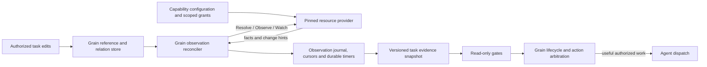

# Extensible tracked resources and capability-backed resource providers

**Owner:** @ai-on-gke/ai-factory-root-owners

**Status:** proposed architecture, documentation only. No runtime, infrastructure, live integration verification or follow-up filing is authorized by this proposal.

**The core rule:** A tracked resource is an explicitly referenced observable entity. Grain persists its identity, observations and durable subscriptions; capability extensions integrate with the resource. Gates interpret evidence against a task's desired outcome. A reference grants no access and adds no completion requirement.

The [companion normative specification](../spec/tracked-resources/tracked-resources.spec.md) defines the proposed v1 contract. All extension and API names below are proposals, not existing endpoints or promises of provider availability.

## Terminology and coordination

[Task #39](/tasks/39), merged as [PR #1666](https://github.com/ai-on-gke/grain/pull/1666), designed MCP completion evaluators. [Task #44](/tasks/44), merged as [PR #1699](https://github.com/ai-on-gke/grain/pull/1699) in base commit `befe68b54`, names that **new extension** gates, with `gate_*`, `gate_state` and `completion_authority=gates`. The canonical references are now [mcp-gates.design.md](mcp-gates.design.md), [mcp-gates.spec.md](../spec/mcp-gates/mcp-gates.spec.md) and [wire.schema.json](../spec/mcp-gates/wire.schema.json). This proposal reconciles with that inspected merge; the gate protocol remains proposed and unimplemented.

Gate names, state, attachment IDs and authority discriminators name only the new extension. Future implementation must pin the actual supported evaluator protocol and explicitly migrate or reject incompatible versions; a documentation merge does not make old endpoints accept new wire spellings. Do not rename concrete `TaskGoal`, `GoalKind`, `task_goal`, `ResumeOn.Goal`, `SetTaskGoal`, `ClearTaskGoal`, `PUT/DELETE /api/tasks/{id}/goal`, or their existing semantics as part of this work. Autonomous Goal Mode's `record_assumption`/`complete_goal` tools in [goal_tools.go](../../pkg/mcp/goal_tools.go) are also distinct and remain unchanged.

The terminology boundary is explicit:

- **Tracked resource:** the observable entity and its canonical reference, observations and change history.
- **Resource provider:** the capability-backed integration supplying Resolve, Observe and Watch.
- **Watch:** the durable subscription/change-detection relationship, never the entity itself.
- **Task dependency:** the existing task prerequisite relationship, including `depends_on`; this proposal preserves its semantics.
- **Gate:** interprets evidence and decides an explicitly attached blocking requirement.
- **Trigger:** creates work from events under its own policy and authorization.

A tracked resource can be watched by several tasks, and one task can apply several gates to it. The UI shows “Required outcome” through an explicit gate binding, never a resource-level `met` property. Resource changes first wake existing evaluators; a watch does not itself create tasks. Triggers may consume authorized events to create work, but trigger configuration and authority remain separate and are not implemented by this proposal. A task-resource relation is distinct from a spawned-task relationship and from a task dependency.

## Verified baseline and intentional changes {#TDD-1}

The inventory below comes from the checkout, not an assertion that every older design is implemented.

| Current path | Source and current behavior | Proposed treatment |
|---|---|---|
| Declared `depends_on`, dependency picker and agent proposals | [client.go](../../pkg/ui/client.go), `dependsOnLinks`, `SetDependency`; [finish.go](../../pkg/orchestrator/finish.go), `proposedDependencies`. Local task links validate self/unknown/standing-task blockers and detect blocking paths; proposals may drop invalid dependencies with a note. | Import as explicit **dispatch prerequisites**, retaining provenance and current closure predicate; no inferred completion gate. New structured edits fail atomically rather than silently dropping a required condition. |
| Blocking link projection | [task.go](../../pkg/model/task.go), `LinkKind.Blocks`; [state.go](../../pkg/model/state.go), `IsBlocked`; [schema.go](../../pkg/model/schema.go), `task_blocked`; [store.go](../../pkg/model/store.go), `Ready`. `depends-on` and `child-of` block on target closure. | Preserve Go/SQL parity for legacy tasks. New completion requirements need successful outcome evidence, not simply closure. Do not reinterpret the direction or meaning of legacy `child-of` records as a new parent contract. |
| Blocking and parked waits | [wait_for_task_tool.go](../../pkg/mcp/wait_for_task_tool.go), [wait_task.go](../../pkg/ui/wait_task.go), [wait_target.go](../../pkg/model/wait_target.go). `Settled(false)` treats failed as well as closed tasks as reached; a merge wait can settle negatively on closure, except while an open PR is still being read. | Keep “wait ended” distinct from success. Expose settled reason/outcome; a failed child wakes the evaluator for repair/escalation, not parent success. |
| Park/resume ownership | `ResumeOn.Tasks/Links/UntilMerged/At/CI/Head/Message/Goal` in [wait_target.go](../../pkg/model/wait_target.go); [wake.go](../../pkg/orchestrator/wake.go); [suspend.go](../../pkg/model/suspend.go), `resumeSuspensionsTx`. A park records which links it created; resumption removes only those links. | Durable resource waits replace transient holds for migrated tasks, with the same link ownership and one-shot behavior. Existing declared prerequisites remain. Preserve OR wake conditions, CI head invalidation and messages. |
| Concrete task goals | [task_goal.go](../../pkg/model/task_goal.go), [taskgoals.go](../../pkg/orchestrator/taskgoals.go), [taskgoal.go](../../pkg/ui/taskgoal.go). Fixed kinds include PR merged, CL submitted, tasks closed, base/nightly green and pipeline healthy; close/rest and no-progress policy are already Grain-owned. | Preserve APIs and exact imported predicates. A legacy `tasks-closed` condition remains visibly a closure condition, not relabeled successful children. New required children default to success. |
| Change-specific dependencies | [pkg/change](../../pkg/change), [sync.go](../../pkg/orchestrator/sync.go), [mergegates.go](../../pkg/orchestrator/mergegates.go), [mergerecheck.go](../../pkg/orchestrator/mergerecheck.go); `merge-with`, fixes, review and QA links in [task.go](../../pkg/model/task.go). | Keep merge-only holds, exact-head review, Submit and integration collectors authoritative. Do not convert every link into a completion gate or replace current merge policy. |
| Other dependency producers | [qualification_store.go](../../pkg/model/qualification_store.go), qualification plan dependencies; [rollover.go](../../pkg/model/rollover.go), [supersede.go](../../pkg/model/supersede.go), task identity/link transformations. | Migrate producer paths as well as UI; preserve audit and explicit successor rules. Stable resource identity never silently changes because a successor exists. |
| Existing read boundary | `WaitTargetFor/MayReadTaskOf` withholds title/closing note across inaccessible repositories; [wait_target_scope_test.go](../../tests/security/wait_target_scope_test.go), [agent_api_gate.go](../../pkg/ui/agent_api_gate.go). | Explicitly preserve the legacy minimal ordering view only under its existing route policy. New generic resource reads require a scoped grant, including for existence/status; no generic private-resource oracle. |

See [durable tasks](durable-tasks.design.md), [task liveness](task-liveness.design.md), [capabilities](capabilities.design.md), [capability specification](../spec/capabilities/capabilities.spec.md), [unified grants](unified-grants.design.md), [RBAC](../spec/rbac/rbac.spec.md), [merging](merging.design.md) and the Task #39 contract for surrounding policies. The contributions spec names enforcement files absent at this baseline; actual [CODEOWNERS](../../CODEOWNERS) supplies this document's owner. This PR repairs no unrelated enforcement drift.

## Recommended architecture {#TDD-2}



Grain stores an additive resource catalog, task-local references, relations, provider pins, authorization partitions, immutable observations, subscriptions/cursors, journal fan-out and timers. The provider registry describes open resource-kind strings and their local schemas. Core does not contain an enum of every forge, workspace or issue tracker.

A provider identity is a configured canonical capability ID plus registered method; its artifact pin is separate from resource identity. Display aliases and mutable URLs are not identity. The structured identifier includes the authority/installation and a stable provider resource ID; names and numbers are validated locators. Tracking scope names the facet (for example PR change, issue lifecycle, workspace content/submission) and either follows current state or pins a provider-defined snapshot. Two references differing in scope are not interchangeable. An upgrade cannot reassign an existing identity to another resource.

Task-local `reference_id` is stable across display edits. It points to a canonical resource/scope and an authorized observation view. Relations describe “watches”, “uses”, “produced by” or “spawned task”; none imply blocking. Gates separately bind `reference_id`, desired outcome and evidence scope. Dispatch prerequisites separately identify what work is held, why and until which predicate. This permits report writing while a PR is pending.

For CITC, distinguish persistent workspace identity, mutable workspace contents, immutable snapshot, and submission identity. A follow-latest content change invalidates decisions about the old snapshot even if the workspace name is unchanged. A pinned snapshot never moves to a new snapshot; its submission can only be established by evidence explicitly binding that snapshot to a submission. If an adapter cannot preserve/re-read the snapshot or prove that binding, the gate remains unknown. The examples in the spec are illustrative adapter contracts; existing change-provider hooks do not establish generic CITC or Buganizer tracked-resource support.

## Providers and authority {#TDD-3}

Use capability server configuration, schema validation, encrypted secrets and policy admission. Discover a versioned Resolve/Observe/Watch tool trio alongside `mint_*`/`release_*` and `gate_*`, with explicit registration metadata and immutable pins. The spec recommends exact names. Discovery never grants credentials, attaches a reference or adds gates. Providers are read-only with respect to resources; Watch may maintain delivery infrastructure within a separately granted watch scope. Commenting, submitting, merging and closing are typed actions in the gates action registry, with independent permissions and precondition checks.

Current capability leases are attempt-scoped. Durable observation outlives an agent run, so later implementation needs a distinct, revocable controller read/watch lease attached to the task/grant and bounded by expiry. Do not keep a run's credential after release or mint an immortal controller credential. Configuration changes in this deployment belong to grain/config, not this repository; this proposal changes neither.

The provider and its remote service are outside Grain's lifecycle trust boundary. Even an authenticated provider can return stale, incomplete or malicious data. Grain validates envelopes, identities, bounds and provenance; a pinned gate understands the declared fact semantics. A provider cannot assert human approval, invent a Grain action receipt or direct arbitrary remote fetches. Grain records how evidence was collected; immutable stored evidence means reproducible decision input, not proof that the provider is infallible.

Scoped deduplication uses resource/scope + provider pin + effective visibility/field policy + tenant/principal/grant lineage + authorization epoch. Default isolation is per task grant. Share a physical subscription only where Grain proves identical access and field policy; keep independently authorized task views and fan-out recipients. Never use another task's broader credential to answer a narrower task. Do not leak shared cache hits, watcher counts, titles, URLs or existence through errors. Revocation fences both in-flight writes and evidence consumption, removes that recipient and its cached views, stops an unneeded watch, and invalidates affected gate bundles. Other independently authorized watchers continue.

## Observation, waiting and closure {#TDD-4}

Resolve validates and canonicalizes an authorized reference. Observe returns an opaque equality token, lifecycle facts and bounded details, evidence handles, human summary/link, collection time, validity and explicit failure state. It never returns `met`. A PR can be open, merged or closed unmerged; a task can be failed; an issue “closed” does not universally mean resolved. Unknown facts stay unknown. Gates use exact normalized fact versions or declared provider-specific semantics.

Grain serializes observation commits using a lease generation and compare-and-swap baseline. Revision tokens cannot be lexically or numerically ordered. External events are hints: duplicate/out-of-order delivery requests a current Observe, rather than overwriting current truth with an old payload. A refresh with the same token may renew freshness without falsely recording resource progress. A changed token, access state or meaningful evidence invalidates relevant evaluator snapshots.

Watch supports authenticated events, incremental cursors, bounded polling or combinations. Persist intent before registration, subscribe before the baseline read, replay from the accepted fence and reconcile after registration. A provider that cannot give gap-free replay must declare the gap and use a second Observe plus periodic polling. Persist subscriptions, receipt deduplication, cursors and fan-out transactionally. Crash recovery reuses idempotency keys and reconciles remote registration; it does not assume the last received event was processed.

Each wait names a resource, driver, freshness/reconciliation timer and escalation. A timeout, expired cursor, deleted resource, access denial or provider outage never satisfies a required condition. Errors wake evaluators only as needed to change blockers; repeated errors back off and escalate without running an agent to poll. Freshness expiration wakes the evaluator even without an event. A deadline rechecks or escalates, never auto-passes.

Gates consume immutable, authorized observation records in the Task #39 versioned task snapshot. All results in a closure bundle use one contract/evidence revision, authority epoch, policy revision and message watermark. Required evidence must be fresh at the closure transaction. Relevant changes invalidate results, buttons, action preconditions and evidence-scoped waivers; a PR head or workspace snapshot change requires new evidence. Settle/fence live writers and pending observation invalidations before atomic closure. External systems cannot participate in Grain's SQL transaction: closure records the fresh observed evidence and external cutoff, not a claim of linearizable remote truth. Later discovered changes follow the explicit historical regression/reopen policy.

## Tasks, UI and agent surface {#TDD-5}

Provide a built-in Grain task provider behind the same read-only protocol, identified by immutable installation ID plus task ID. It observes lifecycle, terminal outcome, outcome evidence and successor relationship separately. “Closed” is not “succeeded”; a failed/canceled required child leaves its success gate unmet (or unknown where outcome evidence is unavailable). A legacy task without trustworthy success evidence is unknown for a new success gate. Required/advisory/independent spawned-task relationships are explicit: required adds a success gate through an authorized contract edit; advisory supplies evidence without holding closure; independent supplies provenance only. Spawn alone adds no obligation. Neither required children nor gates automatically block dispatch.

Check the union of local dispatch-wait and required completion-wait edges transactionally, including concurrent edits and reopening/retargeting. Reject self-dependencies and cycles with a permission-filtered explanation. Advisory references can be cyclic. Unknown remote graphs and hidden dependencies cannot be proven acyclic: show the limitation, persist a patience deadline, detect no progress, and escalate rather than dropping the requirement.

New UI belongs in Angular (`ui-ng`). A task Tracked resources panel provides add/resolve preview, canonical identity and safe link, follow-latest/pinned scope, relation, observed status/time/freshness, unavailable state, wait driver/deadline and retry/access controls. “Required outcome” links to the actual gate and its evidence, rather than showing a provider's green completion badge. Show separately the dispatch hold, gate blocker and advisory state. Hide unauthorized private details, including titles/URLs in histories and notifications.

Add/remove is an audited task edit. Removing a reference used by a required gate must atomically edit the gate contract with the required approval or fail; no dangling gate is silently ignored. Changes in identity, tracking mode, required predicate, provider pin or grant scope invalidate affected results. Relaxation/replacement/waiver requires a reasoned authorized person unless the exact transformation was preauthorized; agents can propose it. Typed action buttons show scope and evidence the person is authorizing, and recheck permission on invocation.

Proposed bounded agent tools are `resource_attach`, `resource_list`, `resource_get`, `resource_remove`, `resource_watch_change`. API equivalents and permission behavior are specified in the companion. A watch-change call waits for a revision/access/freshness change, not a successful outcome. Attaching an inaccessible reference returns a redacted permission blocker; it does not request or manufacture a grant. Permission requests use existing explicit approval flows, independently of attach.

## Worked cases {#TDD-6}

| Case | Resource evidence and decisions |
|---|---|
| Shared PR | Tasks A and B refer to PR 1666 on GitHub with identical resource identity. A requires integration of head H1; B requires a review report about H1 and watches integration only as advisory. B can complete on report delivery while A waits. C has PR metadata-only access and cannot see private review bodies; its observation partition differs. Neither A's integration requirement nor B's report permission authorizes merging. |
| Mutable workspace | Task W follows workspace ws-17 content. Snapshot S1 is reviewed and waived for one finding. Observe later reports S2, same workspace ID. The S1 review/waiver and any S1 submit button are stale for W. A separate task pinned to S1 still references S1; it cannot claim S2 submission as S1 success. Missing historical snapshot access makes its gate unknown. |
| Inaccessible bug | A task explicitly references bug 9001 but has no read grant. Preserve the submitted opaque identifier privately; return unavailable/unauthorized without confirming existence or exposing title. Its required “resolved” gate is unknown, advisory linking does not block completion, and the UI offers an explicit access request only to an authorized requester. No Buganizer API is assumed. |
| Failed child | Child 72 fails. A parked legacy wait may end and show failure; a new required-child success gate remains unmet. Evaluator proposes authorized repair or escalates. A contract-approved replacement or scoped waiver is possible; closure itself is never success evidence. |
| Missed webhook | PR event is lost during restart. Persisted reconciliation timer runs Observe, detects H2 or merge, appends a new observation and invalidates/evaluates dependent gates. No agent runs merely to ask again. |
| Permission revoked | A and B once shared a watch under proven equivalent access. A's grant is revoked while Observe is in flight. A's authorization epoch advances; response cannot publish into A's view and its previous evidence is unusable. B keeps its independently authorized view/subscription. Any cached action button for A fails authorization. |

For example, the following proposed task-contract fragment makes the shared-PR distinction explicit. This is a resource-binding sketch, not a replacement for the pinned gate attachment envelope from Task #39/#44:

```json
{
  "task_id": "A",
  "references": [{"reference_id": "change", "canonical_resource_key": "github:repo-81:pr-1666", "relation": "uses", "view_id": "A-read-4"}],
  "gates": [{"gate_id": "integrated", "required": true, "tool": "gate_integrated", "bindings": {"change": "change"}, "outcome": {"merged_head": "H1"}}],
  "dispatch_prerequisites": [],
  "observation_scope": {"grant_lineage": "grant-A", "fields": ["change_metadata", "integration"]},
  "action_permissions": []
}
```

```json
{
  "task_id": "B",
  "references": [{"reference_id": "reviewed-change", "canonical_resource_key": "github:repo-81:pr-1666", "relation": "watches", "view_id": "B-read-2"}],
  "gates": [{"gate_id": "report", "required": true, "tool": "gate_report", "bindings": {"subject": "reviewed-change"}, "outcome": {"report_delivered_for_head": "H1"}}],
  "dispatch_prerequisites": [],
  "observation_scope": {"grant_lineage": "grant-B", "fields": ["change_metadata"]},
  "action_permissions": []
}
```

The canonical resource key above is a display abbreviation for the full structured reference in the spec, never a core parsing format. Task B's gate also consumes Grain's authenticated report-delivery evidence; PR metadata alone cannot prove delivery. Broader review content is unavailable to B unless separately granted.

## Migration, rollout and rollback {#TDD-7}

This is a phased implementation breakdown, not tasks to file or work to implement now.

| Phase | Depends on | Deliverable and exit criterion |
|---|---|---|
| 1. Contracts and storage | Merged Task #44 terminology; independent of gate runtime implementation | Additive resource/reference/view/observation/subscription/timer records, pins, limits and audit, built-in task adapter fixtures. Readers understand authority/version fields before writers. No lifecycle authority change. |
| 2. Shadow read/watch | 1 | Capability controller read/watch leases, fenced reconciler, authorization partitions, crash/revocation tests and shadow legacy comparisons. Optional GitHub adapter only with configured access. No gate or dispatch effects. |
| 3. Gates integration | 2 and Task #39 central lifecycle/snapshot ownership implemented using Task #44 gates protocol | Include immutable tracked-resource evidence, expiry, invalidation and waivers in snapshots/atomic close. One completion authority per task. Verify head/snapshot races and independent work. |
| 4. Task links and API/UI | 3 for authoritative rollout; UI prototype can follow 1 | Explicit per-task import of depends_on, park ownership, child roles and concrete goals; API authorization and Angular views. Verify all producer paths and Go/SQL state parity. |
| 5. Additional adapters and adoption | 2 for shadow; 3–4 for required gates | Provider conformance suite, quotas and audited pins. CITC/Buganizer require owner-approved access, documented semantics, deployment configuration and implemented/tested adapters. No support promised here. |

Use additive tables, foreign keys and unique keys for canonical identity per partition, task-local IDs, subscription idempotency, event delivery IDs and observation generations. Keep immutable decision evidence and closure receipts for the task audit lifetime; expire payloads under explicit retention/redaction policy without rewriting historical decisions. Backups preserve durable cursors and authorization lineage but never restore an expired credential as valid. Reconcile every restored subscription before consuming evidence.

Import records the source predicate and authority epoch. In particular, importing a legacy closure wait is not permission to change it into success, and changing a required success gate back into closure requires authorization. No universal gate is inferred from a URL, child link or old final answer. Switch lifecycle authority transactionally using the Task #39 handoff, suppressing all legacy completion writers for migrated tasks; observe-only tracked resources can remain alongside legacy tasks.

Rollback stops new writers, fences leases and preserves records/evidence. Older daemons must refuse unsupported resource/gate versions. Only a validated reverse handoff can restore legacy authority, and only when the contract is representable; otherwise hold for a compatible daemon. Disable/uninstall leaves references visible and required gates unknown, never silently deletes gates. Retain compatible legacy projections through the rollback window. No infrastructure/config change is included in this PR.

## Remaining decisions and recommendations

| Decision | Recommendation |
|---|---|
| Default privacy partition | Per task grant; opt into sharing only after equivalence checks, never by canonical URL alone. |
| First external adapter | GitHub PR/issue shadow reads after built-in Grain task; reuse existing trusted collectors where possible. |
| Revision provenance | Provider tokens are equality-only. Grain owns ordered journal sequence and collection generations; never compare remote opaque strings for ordering. |
| Completion freshness | Default 5-minute evidence budget, configurable narrower by gate; mandatory on-demand refresh before integration-sensitive closure if outside budget. No grace that converts stale into met. |
| Pins and schema changes | Immutable artifact + protocol/fact/identifier schema digests; explicit migration and replay before switching. |
| External consistency | Record bounded observation cutoff; use explicit regression notification/reopen policy instead of claiming cross-system atomicity. |
| Nonimplemented providers | Show unavailable with prerequisites; do not add catalogue entries or grants until separately reviewed implementation/configuration exists. |

The [acceptance matrix](../spec/tracked-resources/tracked-resources.spec.md) is the exit contract for future implementation, including restart, races and failures.
