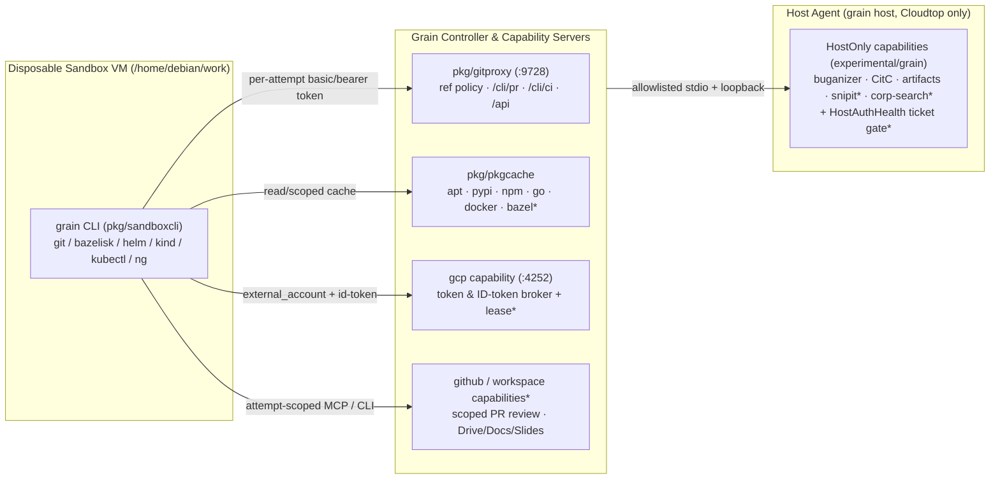

# XMC developer workflow parity: gap analysis, Grain-native additions, and task briefs

**Owner:** @bwsalmon

**The core rule:** every workflow gap between an interactive workstation agent session and an unattended Grain run is closed through Grain's trust boundary—controller-held credentials, per-attempt scoped capabilities, and disposable VM sandboxes—never by placing long-lived personal access tokens, ambient corporate tickets, or unrecorded host shell wrappers inside a sandbox.

**Status:** proposed design and task breakdown (2026-11-10, [Task #3915](/tasks/3915)). Evaluates two weeks of day-to-day XMC (`google/xmc`) engineering tool usage across three environments—interactive **Jetski** on a Cloudtop workstation, **Grain on GCP** (24/7, outside corporate host authentication), and **Grain on a Cloudtop** (inside corporate host authentication, subject to ~20-hour host ticket expiry)—verifies each claim against `ai-on-gke/grain` and the Google edition (`experimental/grain`), proposes nine minimal Grain-native additions (`#XMC-1` through `#XMC-9`), ranks them by value-to-cost, and concludes with ready-to-file task briefs.

> **Repository naming note:** Core open-source Grain is `ai-on-gke/grain`. Throughout this document and its task briefs, the Google-edition wrapper repository is written `experimental/grain` (hosted on the internal corporate Git host) so this file complies with core's repository boundary hygiene check (`tests/hygiene/boundary_test.go`).

---

## 1. Environment Baseline and Architecture Context

| Environment | Execution & Credential Model | Availability | Key Constraint |
| :--- | :--- | :--- | :--- |
| **Interactive Jetski (Cloudtop)** | Runs directly on the developer's workstation with ambient user logins (`gh`, `gcloud`, corporate LOAS2/SSH ticket, local `~/.gemini/jetski/knowledge/`, untracked `.agents/`, host subagents). | Interactive / while ticket is valid (~20h) | Single-machine resource contention; ambient credentials reachable by every local subprocess; stops when the ~20h corporate ticket expires. |
| **Grain on GCP** (`ai-on-gke/grain`) | Controller + Granule microVMs (`pkg/granule`) or GKE sandbox pods (`-k8s-granule-sandboxes`). Credentials stay in `grain daemon` and capability servers (`pkg/capability/intree`). | **24/7 unattended** | No corporate LOAS2 identity or internal monorepo access; sandboxes hold only per-attempt proxy tokens (`pkg/gitproxy`, `gcp_token.go`). |
| **Grain on Cloudtop** (`experimental/grain`) | Containerized controller paired with the host agent (`grain host`, `pkg/hostd`) running allowlisted host binaries (`agy`, `grain-buganizer`, `grain-artifacts`, `grain-gcp`, `host-git`, `CitC`). | Unattended until the ~20h corporate host ticket lapses | When the host ticket expires, `/opt` / corporate binary mounts return `ENOKEY` (`required key not available`) and internal endpoints redirect to SSO login (`corpauth`). |



*(Items marked `*` are additions proposed in §3.)*

---

## 2. Row-by-Row Codebase Verification (Rows 1–11)

Each row below states the engineer's need and reported findings, verifies the exact behavior on `main` across `ai-on-gke/grain` and `experimental/grain`, explicitly **confirms or corrects** the report, and names the minimal addition in §3 that closes the remaining gap.

### Summary Verification Matrix

| Row | Workflow Area | Engineer's Claim vs. Codebase Reality | Gap Closed By |
| :--- | :--- | :--- | :--- |
| **1** | `git`, `gh pr`, `gh-stack` (stacked & Draft PRs) | **Confirmed on single-branch default; refined on template push & sandbox API.** `pkg/gitproxy/refupdates.go` locks ad-hoc tasks to one branch unless granted `repo#write` (formerly `git-push-any-ref`), though repository templates already support `push:` ref globs (`DeclaredPush`). Even with ref push access, sandboxes carry no `gh` CLI or GitHub API token, and `model.Task` tracks one PR rather than a stack. | [`#XMC-5`](#35-multi-branch-push-sets-and-stacked-pull-request-flow-xmc-5) |
| **2** | `gh api` REST/GraphQL & `PENDING` draft-review staging | **Confirmed on own-PR lock-in; corrected on `config-map` & existing `pkg/github` code.** `/cli/pr/*` (`pkg/gitproxy/cli_actions.go`) only acts on the task's own PR. Putting a PAT in `config-map` breaks the trust boundary and fails on `NetworkNone`. However, `pkg/github` *already* implements GraphQL `reviewThreadsQuery`, `resolveReviewThreadMutation`, and `CreateReview` (which posts a `PENDING` draft review when `event` is omitted). Note: GitHub hides bot-created pending reviews from humans, so staging requires a user credential (`repo#credential`). | [`#XMC-4`](#34-scoped-github-pull-request-review-capability-githubpr-review-xmc-4) |
| **3** | `gh workflow run` & `gh run watch/view` (`workflow_dispatch`) | **Confirmed on `workflow_dispatch`; corrected on log reading.** `grain ci run-job` and `retrigger` are Grain-CI / check-rerun only; `pkg/github/actions.go` has no workflow-dispatch call. However, reading arbitrary Actions runs and job logs *already works today* via `api#ci:read` (`grain ci list/show/log gha:<owner>:<name>:<run-id>`). | [`#XMC-3`](#33-github-actions-workflow_dispatch-and-correlated-run-waiting-xmc-3) |
| **4** | `gcluster` (`ctk_v2`), `helm`, `gcloud` & dev GKE deploys | **Confirmed on missing tools & cluster collisions; corrected on GCP capability & YAML mount.** `gcp#gcp-key` (`credential: token`) already works on GCP (`ambient` GCE/GKE WIF or `configured`)—it is merely unconfigured in `grain/config`. `gcloud`, `kubectl`, `docker`, and `terraform` are baked into `Granulefile`; `helm`, `bazelisk`, and `gcluster` are missing. `config-map` already places gitignored YAML up to 1 MiB/file, but parallel runs collide without counted cluster/namespace leases and template interpolation. | [`#XMC-1`](#31-sandbox-toolchain-per-templaterepo-sizing-and-bazel-http-action-cache-xmc-1), [`#XMC-2`](#32-dev-cluster-concurrency-leases-templated-deploy-configs-and-iap-id-token-ergonomics-xmc-2) |
| **5** | `kubectl`, XMC Python SDK, & IAP OIDC ID tokens | **Refined: token broker already mints `--audience` ID tokens, but `gcloud` CLI UX trips.** `pkg/capability/intree/gcp_token.go` (`case "id-token"`) already mints IAM OIDC ID tokens for any audience (`GET /runs/<attempt>/id-token?audience=<aud>`) and places `~/.gcp-token/<attempt>/<set>-id-token`. However, `gcloud auth print-identity-token --audiences=...` rejects `external_account` JSON, breaking unmodified scripts and `google-auth` metadata callers unless bridged via `grain gcp id-token` / a loopback metadata identity shim. | [`#XMC-2`](#32-dev-cluster-concurrency-leases-templated-deploy-configs-and-iap-id-token-ergonomics-xmc-2) |
| **6** | `bazel` (`bazelisk`), `kind`, `ng`/`npm`, Playwright, 12–16 GB RAM, caches | **Confirmed on `bazelisk`/`helm` & Bazel cache; corrected on default RAM & `npm` cache.** `granule.DefaultMemoryMB` is 8192 MiB (8 GiB, not 4 GiB, unless overridden in deployment settings), and per-task `sandbox_memory_mb` exists on tasks/API/UI presets—but is missing on `.grain/templates`, per-repo settings, and `grain task create`. `pkg/pkgcache` *already* caches `npm`, `go`, `pypi`, `apt`, `docker`, GitHub releases, and Playwright CDNs across runs; only a Bazel remote HTTP cache (`/bazel/`) is missing. | [`#XMC-1`](#31-sandbox-toolchain-per-templaterepo-sizing-and-bazel-http-action-cache-xmc-1) |
| **7** | `gdocs`, `gslides`, `gdrive` (PRD/RFC comments & publishing) | **Corrected: NOT impossible on Grain-on-GCP.** Drive, Docs, and Slides are public Google Workspace APIs (`*.googleapis.com`) that authenticate with Workspace OAuth2 or Domain-Wide Delegation / Shared-Drive service accounts—no corporate LOAS required (proven by core's in-tree `gchat` server, `pkg/capability/intree/gchat.go`). A core `workspace` capability works 24/7 on GCP and Cloudtop alike. | [`#XMC-6`](#36-google-workspace-capability-server-workspaceread-workspacewrite-xmc-6) |
| **8** | `cs` (`code_search`), `CitC`, `g4`/Critique alignment | **Confirmed on GCP boundary; refined on framework coverage.** Monorepo and Critique stay Cloudtop-only (`experimental/grain`). Today `corp#research` (`capability/corpresearch`) hooks only `antigravity` (`agy`), leaving `claude` and `codex` runs without `code_search` or Critique read tools unless exposed via a framework-agnostic `HostOnly` MCP server. | [`#XMC-9`](#39-google-edition-host-ticket-lifecycle-gate-framework-agnostic-corp-search-and-snipit-capability-xmc-9) |
| **9** | Buganizer (`issues`), internal doc search, SnipIt screenshots | **Corrected on Buganizer & GitHub PR screenshots; confirmed on SnipIt.** `experimental/grain` *already* ships a built-in `HostOnly` `https://grain.dev/capabilities/buganizer` server (`#read` and component/hotlist-scoped `#write`, MCP + sandbox CLI)—no `host-script` needed! Core's `comment_on_issue(attachments=[...])` already embeds PNGs in GitHub PR descriptions on GCP & Cloudtop; only `screenshot.googleplex.com` (`SnipIt`) lacks a `HostOnly` capability. | [`#XMC-9`](#39-google-edition-host-ticket-lifecycle-gate-framework-agnostic-corp-search-and-snipit-capability-xmc-9) |
| **10** | Local `.agents/` skills, 9.8 MB `knowledge/`, `brain/*` logs | **Corrected on `config-map` & `grain memory` size limits and `brain/*`.** `protocol.MaxPlacementTotal` is **8 MiB** (`64` files max, `1 MiB`/file) and `grain memory` caps at **1.5 MiB/scope** (`24 × 64 KiB`), so **neither** can hold the 9.8 MB `knowledge/` directory! Past run trajectories already live in `task://` (`api#tasks:read`), replacing `brain/*`. Closing the 9.8 MB gap needs `-read <context-repo>` on GCP and data-plane directory streaming on `config-map` alongside Task #3913. | [`#XMC-7`](#37-host-streamed-read-only-knowledge-and-local-skill-mounts-xmc-7) |
| **11** | `swarm`, `invoke_subagent`, `agentapi`, `schedule`, ticket stalls | **Refined on child-task primitives & `corpauth` parking.** `propose_task` + `wait_for_task` (blocking with deadline credit or `park: true`, returning child closing notes) already exist, but non-Director tasks lack auto-approval for covered read-only review subtasks and branch-tip review handoff. On Cloudtop, `experimental/grain`'s CL poller pauses on expired LOAS2, whereas schedules keep firing and `stopOnExpiredHostCredentials` (`pkg/orchestrator/obsolete.go`) parks tasks on comments requiring manual human replies to resume. | [`#XMC-8`](#38-subagent-fan-out-ergonomics-and-automated-self-review-loop-templates-xmc-8), [`#XMC-9`](#39-google-edition-host-ticket-lifecycle-gate-framework-agnostic-corp-search-and-snipit-capability-xmc-9) |

---

### Detailed Row Verifications

#### Row 1: `git`, `gh pr`, and `gh-stack` (Stacked & Linked Draft PRs)
- **Need:** Push multiple feature branches, manage 3-PR stacks (`schema → repository → handler`), open Draft PRs chained onto parent branches, and keep stack tables in PR bodies synchronized.
- **Code verification:**
  - `pkg/gitproxy/refupdates.go` (`AuthorizeRefUpdates`) parses git pkt-line ref updates before the packfile and allows updates only to `GitPushBranch(sandbox)` (`grain/<deployment>/task-<id>...`) unless lifted by:
    1. `https://grain.dev/capabilities/repo#write` (`model.GitPushAnyRefGrant`, formerly `git-push-any-ref`, `pkg/capability/grainserver/grainserver.go:142`), which grants unrestricted branch/ref pushes across writable repos; or
    2. `DeclaredPushLookup` (`model.Store.GitDeclaredPush`, `refupdates.go:95`), which already lets repository-declared templates declare narrow `push:` ref patterns without holding `GitPushAnyRefGrant`.
  - Named credentials (`https://grain.dev/capabilities/repo#credential={"credential":"<name>"}`, formerly `github-credential:<name>`) select which stored GitHub token signs git proxy traffic and PR opens. On Cloudtop, `experimental/grain`'s `host-git` adapter wraps the ambient GitHub-on-Prem CLI helper for internal hosts (`*.code.*`), not `github.com` (`google/xmc`), unless explicitly pointed there.
  - Crucially, **even with `GitPushAnyRefGrant`, `gh-stack` cannot run inside a sandbox**: `Granulefile` installs no `gh` CLI, sandboxes hold no GitHub REST/GraphQL token, `grain pr open` (`pkg/sandboxcli/actions.go`) accepts no `--head`, `--base`, or `--draft` flags, and `model.Task` tracks a single branch/PR rather than an ordered stack.
- **Verdict:** Confirmed that the default single-branch rule blocks stacked pushes; **corrected** that `GitPushAnyRefGrant` + `repo#credential` alone still cannot run `gh-stack` inside a sandbox without breaking the no-token-in-sandbox boundary. Closed natively by [`#XMC-5`](#35-multi-branch-push-sets-and-stacked-pull-request-flow-xmc-5).

#### Row 2: `gh api` REST/GraphQL and Draft-Review Staging on Teammates' PRs
- **Need:** Audit teammates' PRs (`google/xmc#1493`), deduplicate inline review threads via GraphQL, stage a single `PENDING` draft review for human sign-off, resolve threads, and re-request reviewers.
- **Code verification:**
  - PR interaction moved from MCP tools to `pkg/sandboxcli/actions.go` (`grain pr open|reply|resolve|review-comment`) backed by `/cli/pr/*` (`pkg/gitproxy/cli_actions.go`), which enforces `scope.TaskID` ownership—agents cannot target arbitrary PR numbers.
  - **Correction on `config-map`:** Injecting a GitHub PAT via `config-map` or `secret` map violates `architecture.design.md`'s core rule (prompt injection in an untrusted PR diff could exfiltrate or abuse the PAT) and fails outright in `NetworkNone` sandboxes.
  - **Codebase leverage:** `pkg/github/github.go` *already* implements `CreateReview` (lines 4614–4641, posting `POST /repos/{owner}/{repo}/pulls/{number}/reviews` with `event` omitted so GitHub creates a **`PENDING` draft review**), `reviewThreadsQuery` (line 4489, paginated GraphQL thread listing with node IDs, `isResolved`, `isOutdated`, file/line, and bodies), and `resolveReviewThreadMutation` (line 4561).
  - **Critical GitHub identity constraint:** On GitHub, a `PENDING` review is private to the exact GitHub user account that created it. If created with a GitHub App installation token (`grain-app[bot]`), the human engineer **cannot see or submit** the draft review in GitHub's UI. Therefore, staging a `PENDING` draft review must authenticate in the controller using the operator's user credential (`repo#credential` user OAuth/PAT stored in `secrets.enc`), never a bot installation token.
- **Verdict:** Confirmed gap; `config-map` PAT workaround rejected on security grounds; controller plumbing is ~70% present in `pkg/github`. Closed by [`#XMC-4`](#34-scoped-github-pull-request-review-capability-githubpr-review-xmc-4).

#### Row 3: `gh workflow run` and `gh run watch/view` (`workflow_dispatch`)
- **Need:** Trigger `workflow_dispatch` E2E workflows (e.g. `nightly-examples-e2e.yml --ref fix/sdk-shadowing`) and read failed job logs.
- **Code verification:**
  - **Correction on log reading:** With `https://grain.dev/capabilities/api#ci:read` (`api:ci-read@google/xmc`), `grain ci list`, `grain ci show`, and `grain ci log gha:google:xmc:<run-id> [--job <name>]` (`pkg/github/actions.go:ListActionsRuns`, `GetActionsRun`, `ListActionsJobs`, `ActionsJobLog`) **already read arbitrary GitHub Actions runs and full job logs today**, and `resume_later` already accepts `when: {"ci": "gha:google:xmc:<run-id>"}`.
  - **Confirmed gap on dispatch:** `grain ci run-job` and `grain ci retrigger` (`pkg/gitproxy/cli_actions.go:serveCIRetrigger`) only start Grain-CI jobs or re-request existing check runs. `pkg/github/actions.go` has no `POST .../actions/workflows/{id}/dispatches` client method.
- **Verdict:** Log inspection and async waiting already exist under `api#ci:read`; only `workflow_dispatch` triggering and run-ID correlation are missing. Closed by [`#XMC-3`](#33-github-actions-workflow_dispatch-and-correlated-run-waiting-xmc-3).

#### Row 4: `gcluster` (`ctk_v2`), `helm`, `gcloud` — GCP & GKE Deploys
- **Need:** Build container images, push to Artifact Registry, and upgrade a personal GKE dev cluster (`xmc-test-project-2`) using a local gitignored deployment YAML without parallel runs clobbering one cluster.
- **Code verification:**
  - **Correction on `gcp` capability on GCP:** `https://grain.dev/capabilities/gcp#gcp-key` (`pkg/capability/intree/gcp.go`, `gcp-access.design.md`) already works natively on Grain-on-GCP via keyless `credential: token` mode (`credential_source: "ambient"` using GCE/GKE Workload Identity or `"configured"` WIF/SA JSON), requiring only `roles/iam.serviceAccountTokenCreator` on the target dev SA. Its absence on the evaluated GCP deployment is an operator configuration omission in `grain/config`, not a code limitation.
  - **Image audit (`Granulefile:344`):** `docker-ce` + `docker-buildx-plugin` (`gcloud auth configure-docker` works with `gcp#gcp-key`), `kubectl`, `kind`, `terraform`, and `google-cloud-cli` + `gke-gcloud-auth-plugin` are **already baked in**. Confirmed missing: `helm`, `bazelisk` (`bazel`), and `gcluster` (open-source `github.com/GoogleCloudPlatform/cluster-toolkit`).
  - **Gitignored YAML & parallel collisions:** `https://grain.dev/capabilities/config-map` (`pkg/capability/intree/skill.go`) already places gitignored files at explicit paths (`path: "/home/debian/work/deploy/dev-cluster.yaml"`). However, because `credential: token` allows unlimited concurrent runs on one SA, two parallel tasks targeting `xmc-test-project-2` collide unless serialized or assigned disjoint leased namespaces/clusters.
- **Verdict:** Missing image binaries closed by [`#XMC-1`](#31-sandbox-toolchain-per-templaterepo-sizing-and-bazel-http-action-cache-xmc-1); parallel collision and templated deploy YAML closed by [`#XMC-2`](#32-dev-cluster-concurrency-leases-templated-deploy-configs-and-iap-id-token-ergonomics-xmc-2).

#### Row 5: `kubectl`, XMC Python SDK, and `gcloud auth print-identity-token` (IAP Audience)
- **Need:** End-to-end runtime checks (`SDK → Kueue → JobSet → Redpanda/ClickHouse → IAP-protected UI/API`) minting OIDC ID tokens with `--audiences=<iap-client-id>`.
- **Code verification:**
  - **Refinement:** `pkg/capability/intree/gcp_token.go` (`case "id-token"`, lines 232–245 and 311–323) **already mints OIDC ID tokens for arbitrary audiences** via IAM `generateIdToken` (`includeEmail: true`), audited per call, and `gcp.go` already places an executable helper `~/.gcp-token/<attempt_id>/<set>-id-token <audience>` inside the sandbox (`gcp-access.design.md` §1).
  - **Why XMC scripts still break:** `gcloud auth print-identity-token --audiences=<aud>` refuses `external_account` ADC files (`credential_file_override`), and Python's `google.oauth2.id_token.fetch_id_token` expects either a `service_account` private key or a GCE metadata server `/computeMetadata/v1/instance/service-accounts/default/identity?audience=<aud>` endpoint. Neither automatically discovers `~/.gcp-token/<attempt_id>/<set>-id-token`.
- **Verdict:** Token-mode backend already supports IAP ID tokens; adding a stable `grain gcp id-token --audience <aud>` command plus a loopback metadata/ADC bridge in [`#XMC-2`](#32-dev-cluster-concurrency-leases-templated-deploy-configs-and-iap-id-token-ergonomics-xmc-2) makes unmodified SDK and shell scripts work out of the box.

#### Row 6: `bazel` (`bazelisk`), `kind`, `ng`/`npm`, Playwright, 12–16 GB RAM, and Warm Caches
- **Need:** Run `bazel coverage`, `ng test`, and Tier-1/2 E2E on KinD + Dex + Spanner emulator without OOMs or cold-cache penalties.
- **Code verification:**
  - **Correction on default memory & sizing surfaces:** `granule.DefaultMemoryMB` is **`8192` (8 GiB)** (`pkg/granule/granule.go:91`), not 4 GiB (4 GiB occurs only when `grain_config.sandbox_memory_mb` is explicitly set to `4096`, and note `Granulefile:159` mounts `/tmp` as `tmpfs` with `size=50%`, leaving only 2 GiB userland + 2 GiB `/tmp` on a 4 GiB VM). Per-task `sandbox_cpus`, `sandbox_memory_mb`, and `sandbox_disk_gb` already work on `POST /api/tasks`, `propose_task`, and UI `new_task_form` presets (`pkg/ui/new_task_form.go:117`), **but are absent from** `.grain/templates/*.yml` (`model.Template`), per-repo `.grain/settings.yml` (`model.RepoConfig`), and `grain task create` CLI flags (`pkg/ui/client.go:3871`).
  - **Correction on warm caches:** `pkg/pkgcache` (`cache.go`) **already caches** `npm` tarballs (`/npm/`), Go modules (`/go/`), PyPI wheels (`/pypi/`), Debian packages (`apt`), Docker Hub layers (`/v2/`), GitHub release archives (`github.go`, which automatically caches `bazelisk` downloading Bazel binaries!), and Playwright browser archives (`playwright.go`) across all runs—even in `NetworkNone` sandboxes. What is **not** cached for agent runs is **Bazel's action/CAS output cache** (`~/.cache/bazel`), which is discarded on VM teardown.
- **Verdict:** Closed by [`#XMC-1`](#31-sandbox-toolchain-per-templaterepo-sizing-and-bazel-http-action-cache-xmc-1) (baking `bazelisk` + `helm`, adding template/repo sandbox sizing, and adding a `/bazel/` remote HTTP cache to `pkg/pkgcache`).

#### Row 7: `gdocs`, `gslides`, and `gdrive` (PRD/RFC Comment Threads & Proposal Publishing)
- **Need:** Read PRD/RFC Google Docs including anchored comment threads, read Slides decks, and publish proposal docs to Drive.
- **Code verification:**
  - **Correction ("impossible on GCP" is incorrect):** Google Drive (`drive.googleapis.com`), Docs (`docs.googleapis.com`), and Slides (`slides.googleapis.com`) are public Google Cloud/Workspace REST APIs, **not** corporate LOAS services. Core `ai-on-gke/grain` already ships `https://grain.dev/capabilities/gchat` (`pkg/capability/intree/gchat.go`) authenticating to Workspace APIs via stored OAuth2 credentials, service accounts (Shared Drives / Domain-Wide Delegation), or host ambient ADC.
- **Verdict:** A first-class `workspace` capability server in core `ai-on-gke/grain` works **24/7 on Grain-on-GCP** as well as on Cloudtop, replacing fragile host-script CLI wrappers. Closed by [`#XMC-6`](#36-google-workspace-capability-server-workspaceread-workspacewrite-xmc-6).

#### Row 8: `cs` (`code_search`), `CitC`, and `g4`/Critique Alignment
- **Need:** Keep `google/xmc` aligned with internal `third_party/xmanager_cloud`, check internal conventions/AIPs, and inspect Critique CLs.
- **Code verification:**
  - **Confirmed on GCP:** Internal monorepo source and Critique require corporate LOAS2 and stay strictly on Cloudtop (`experimental/grain`).
  - **Refined on Cloudtop (`experimental/grain`):** `https://grain.dev/capabilities/corp#research` (`capability/corpresearch`) admits host `code_search` and internal doc search via `antigravity.RegisterHostToolGrant` (`grain agy-tool-hook`), recording every query in `host-tool-calls.jsonl`. However:
    1. `corp#research` **only functions on the `antigravity` framework**—runs dispatched to `claude` or `codex` (including multi-model `default_model` pools!) silently lack internal search (`docs/corp-research.md`); and
    2. While `CitC` (the Google edition's `CitC` client design) provides full CL lifecycle for monorepo-targeted tasks, a GitHub-targeted task (`repo: "google/xmc"`) only needs lightweight read-only Critique CL / monorepo file inspection without provisioning one of the 50 persistent `max_task_workspaces` slots.
- **Verdict:** Closed on Cloudtop by [`#XMC-9`](#39-google-edition-host-ticket-lifecycle-gate-framework-agnostic-corp-search-and-snipit-capability-xmc-9) (framework-agnostic `HostOnly` read-only code/CL search MCP tools).

#### Row 9: Buganizer (`issues`), Internal Doc Search, and SnipIt (`screenshot.googleplex.com`)
- **Need:** Read Buganizer acceptance criteria and internal docs, and attach/upload UI screenshots to `screenshot.googleplex.com` for PRs.
- **Code verification:**
  - **Major correction on Buganizer:** `experimental/grain` **already ships a built-in `HostOnly` capability server `https://grain.dev/capabilities/buganizer`** (`capability/buganizer`, `grain-buganizer` on port 4252), providing `buganizer#read` (`ISSUES_CLI_READONLY=1`) and `buganizer#write` (scoped by `components` and `hotlists` integer arrays, rate-limited at 60 reads/min and 10 writes/min, audited per write) over both MCP (`buganizer_search`, `buganizer_get_issue`, `buganizer_list_comments`, `buganizer_get_hotlist`, `buganizer_create_issue`, `buganizer_add_comment`, `buganizer_update_issue`) and a sandbox CLI. **No `host-script` is needed for Buganizer.**
  - **Refinement on PR screenshots:** Core's `comment_on_issue(attachments=[{"path": "..."}])` already uploads PNGs from the sandbox and renders them in GitHub PR descriptions on **both GCP and Cloudtop**. `experimental/grain`'s `artifacts` server (`capability/artifacts`) only *reads* `artifacts.*`; it does not upload to `screenshot.googleplex.com` (`SnipIt`).
- **Verdict:** Buganizer and internal doc search (`corp#research`) already exist natively on Cloudtop; only `snipit#upload` is missing for teams requiring `screenshot.googleplex.com` shortlinks. Closed by [`#XMC-9`](#39-google-edition-host-ticket-lifecycle-gate-framework-agnostic-corp-search-and-snipit-capability-xmc-9).

#### Row 10: Local `.agents/` Skills, 9.8 MB `knowledge/`, and `brain/*` Trajectory Logs
- **Need:** Use untracked local review/cleanup skills, ~9.8 MB of exported design docs and cluster constants (`~/.gemini/jetski/knowledge/`), and reflect over past agent trajectories (`brain/*`).
- **Code verification:**
  - **Why `agy` isolated them (`pkg/agent/antigravity/antigravity.go:1202`):** `writeAgyHome` intentionally creates an isolated private `HOME` per task/run and runs `agy` in a host scratch workspace (`grain-run/workspace`) while the checkout lives in `/home/debian/work` inside the microVM. Host `~/.gemini/jetski/` and `brain/*` are hidden so ambient MCP servers and host files cannot leak across tasks. (Task #3913 bridges committed `.agents/` skills from the repository checkout.)
  - **Critical correction on `config-map` and `grain memory` limits:**
    - `pkg/capability/protocol/response.go:40-42` enforces `MaxPlacements = 64`, `MaxPlacementBytes = 1 MiB`, and **`MaxPlacementTotal = 8 MiB`** across an entire `mint` response. **A 9.8 MB `knowledge/` corpus fails `mint` validation outright.**
    - `pkg/model/memory_document.go:147-159` caps `grain memory` at `24` documents × `64 KiB` = **1.5 MiB per scope** (`MaxMemoryLength = 8 KiB` inline). `grain memory` is for distilled operational lessons, not bulk reference docs.
  - **Correction on `brain/*`:** Grain records every run's full transcript, tool calls, and closing notes in its own store, readable inside sandboxes via `grain ls/read/grep task://<id>/...` when granted `https://grain.dev/capabilities/api#tasks:read`.
- **Verdict:** On GCP + Cloudtop, private context repos (`reads: ["<owner>/xmc-knowledge"]`, `docs/committed-context.md`) work today with no 8 MiB ceiling; for untracked workstation `knowledge/` and local skills without committing them, [`#XMC-7`](#37-host-streamed-read-only-knowledge-and-local-skill-mounts-xmc-7) adds data-plane archive/directory streaming to `config-map`.

#### Row 11: `swarm`, `invoke_subagent`, `agentapi`, `schedule`, and Ticket-Expiry Stalls
- **Need:** Parallel worktree swarms, concurrent specialist review subagents, iterative developer↔self-review loops until zero findings, and resilient Cloudtop schedules across ~20h ticket expiry.
- **Code verification:**
  - **In-run fan-out today:** Grain blocks host-side `invoke_subagent`, `swarm`, and `schedule` (`pkg/agent/antigravity` hook; `codex` `[orchestrator.skills] enabled = false`) because host subagents bypass sandbox isolation and per-task budgets. In their place, `propose_task` + `wait_for_task` (`park: true` zero-VM-cost suspension or short blocking wait returning the child's state, outcome, and closing note!) + `grain task message` (`pkg/sandboxcli/task.go`) already form a microVM-isolated subagent graph.
  - **Two concrete friction points blocking subagent/review parity:**
    1. Unless `Task.AutoApproveProposals` is set (default on Director sessions, off on ordinary tasks), `propose_task` holds every child task for human approval—stalling an unattended run that spawns three read-only specialist reviewers!
    2. A specialist reviewer child task needs `start_ref` (an unmerged task branch tip pushed via git proxy) checked out read-only with `no_port: true` so it returns structured findings via `comment_on_issue` without opening a competing PR.
  - **Cloudtop cron/ticket stalls (`pkg/orchestrator/obsolete.go:324`):** Whereas `experimental/grain`'s `CitC` CL poller runs a ticket status probe and pauses polling cleanly, core's scheduler keeps firing tasks while host credentials are lapsed. Each dispatched run hits `ENOKEY` (`corpauth`), and `stopOnExpiredHostCredentials` parks each task individually on a `PendingQuestionCommentID`—requiring manual human replies on every parked task even after the operator renews their host ticket!
- **Verdict:** Subagent fan-out and self-review loops closed by [`#XMC-8`](#38-subagent-fan-out-ergonomics-and-automated-self-review-loop-templates-xmc-8); graceful Cloudtop ticket pause/notify/auto-resume closed by [`#XMC-9`](#39-google-edition-host-ticket-lifecycle-gate-framework-agnostic-corp-search-and-snipit-capability-xmc-9).

---

## 3. Proposed Grain-Native Additions

### 3.1 Sandbox Toolchain, Per-Template/Repo Sizing, and Bazel HTTP Action Cache {#XMC-1}
- **Closes gaps:** Rows 4, 6
- **Applies to:** Both (Grain on GCP and Grain on Cloudtop)
- **Target repo:** `ai-on-gke/grain` (inherited by `experimental/grain` guest image sync)
- **Design:**
  1. **Guest image binaries (`Granulefile` & `Dockerfile.k8s-sandbox`):** Bake pinned, SHA-256-verified multi-arch releases of **`bazelisk`** (installed as `/usr/local/bin/bazelisk` with `/usr/local/bin/bazel` symlink; Bazel binary downloads already hit `pkg/pkgcache/github.go`), **`helm`** v3, and **`gcluster`** (`github.com/GoogleCloudPlatform/cluster-toolkit` built from pinned source tag in the Go builder stage).
  2. **Declarative sandbox sizing (`sandbox_cpus`, `sandbox_memory_mb`, `sandbox_disk_gb`):** Add optional shape fields to `model.Template` (`.grain/templates/*.yml`), `model.RepoConfig` (`.grain/settings.yml` and Settings → Repositories), and `grain task create` CLI flags (`--sandbox-cpus`, `--sandbox-memory-mb`, `--sandbox-disk-gb`). Precedence: `task explicit > template > repo default > deployment default (8192 MiB)`. Propagate per-task CPU/memory requests and limits to `-k8s-granule-sandboxes` pods as well as single-host Granule VMs. For `google/xmc`, setting repo default `sandbox_memory_mb: 16384` and `sandbox_cpus: 8` eliminates Bazel/KinD/Spanner-emulator OOMs (and gives `/tmp` tmpfs 8 GiB headroom).
  3. **Bazel remote HTTP cache (`pkg/pkgcache/bazel.go`):** Extend `pkg/pkgcache` with Bazel's standard WebDAV/HTTP remote cache protocol (`GET`/`PUT`/`HEAD` on `/bazel/<token>/cas/<sha256>` and `/bazel/<token>/ac/<sha256>`):
     - `cas/<sha256>` verifies `sha256(body) == key` on `PUT` before storing (identical to `pkgcache`'s Docker layer digest verification—immune to CAS poisoning!).
     - `ac/<sha256>` (Action Cache, mapping action digest → output digests) is namespaced by `<owner>/<repo>` and **writable only by trusted runs on protected/base branches** (or isolated per-task-lineage), while PR/task sandboxes get **read-through from base + task-local write scope** via a per-attempt `<token>` revocable on sandbox teardown.
     - Sandbox setup writes `/etc/bazel.bazelrc` pointing `build --remote_cache=http://<proxy>:<port>/bazel/<token>` with `--remote_upload_local_results` set according to the token's scope.
- **Security considerations:** CAS blobs are content-addressed and SHA-256-verified on write; untrusted PR runs cannot poison base-branch Action Cache entries (`ac/` keys partitioned by trust tier, matching `docs/actions-cache.md`). All downloaded binaries in `Granulefile` carry per-arch SHA-256 pins (`TestEveryBaseImageIsPinnedByDigest`).
- **Rough size:** **M** (`Granulefile`, `Dockerfile.k8s-sandbox`, `pkg/model`, `pkg/declschema`, `pkg/cli`, `pkg/orchestrator`, `pkg/pkgcache`)
- **Dependencies:** None.

### 3.2 Dev-Cluster Concurrency Leases, Templated Deploy Configs, and IAP ID-Token Ergonomics {#XMC-2}
- **Closes gaps:** Rows 4, 5
- **Applies to:** Both (Grain on GCP and Grain on Cloudtop)
- **Target repo:** `ai-on-gke/grain`
- **Design:**
  1. **Counted resource leases (`https://grain.dev/capabilities/lease#acquire`):** New lightweight in-tree capability server (`pkg/capability/intree/lease.go`) where operators configure named pools of exclusive slots in `grain/config` (for example `pool: "xmc-dev-gke"`, `slots: [{name: "ns-alpha", vars: {"CLUSTER": "xmc-dev-1", "NAMESPACE": "grain-alpha"}}, {name: "ns-beta", ...}]`, or a single-slot mutex `slots: [{name: "xmc-test-project-2"}]`):
     - On `mint`, the server atomically leases one free slot until `deadline` (reaped past `deadline` and freed on `release`), exporting `GRAIN_LEASE_<POOL>_SLOT` and `vars` into `/home/debian/.grain/leases/<pool>.env` (sourced by sandbox `run_command`).
     - When all slots in `pool` are busy, `mint` returns `protocol.StatusResourceExhausted` with `RetryAfter` (`pkg/capability/protocol`: the **exact** mechanism `gcpsets.Exhausted` already uses in `gcp.go:326`!), causing the orchestrator to requeue the task cleanly without burning an attempt or colliding on the GKE cluster!
  2. **Lease-aware `config-map` rendering (`pkg/capability/intree/skill.go`):** Allow optional `template: true` on `config-map` file entries substituting only `${GRAIN_LEASE_*}` and `${GRAIN_TASK_ID}` variables at setup time, so a gitignored XMC deployment YAML (`xmc-deploy.yaml`) automatically targets the leased namespace/cluster and unique release prefix.
  3. **IAP OIDC ID-token CLI & metadata shim (`pkg/sandboxcli` + `pkg/capability/intree/gcp_token.go`):**
     - Add `grain gcp id-token --audience <aud> [--set <permission_set>]` to `cmd/grain-sandbox`, calling the local token broker's existing `/runs/<attempt_id>/id-token?audience=<aud>` endpoint (`gcp_token.go:232`).
     - Add a GCE-metadata-compatible route on the `gcp` token listener (`/computeMetadata/v1/instance/service-accounts/default/identity?audience=<aud>&format=full`, requiring `Metadata-Flavor: Google` and bound to the primary permission set's attempt listener) and export `GCE_METADATA_HOST=127.0.0.1:<port>` when `metadata_shim: true` is set on the permission set—allowing `google.oauth2.id_token.fetch_id_token` in the XMC Python SDK and `gcloud` metadata flows to mint IAP tokens with **zero code changes** in `google/xmc`.
- **Security considerations:** No SA private keys enter the sandbox; IAP access is bounded to the dedicated dev-cluster SA's IAM grant (`roles/iap.httpsResourceAccessor` on the dev IAP resource only, never on Grain's own IAP backend—`uitrust` and `pkg/ui` already block `gcp-key` pool SAs from authenticating to Grain itself). Every minted ID token and audience is logged in the `gcp` capability audit trail.
- **Rough size:** **M** (`pkg/capability/intree/lease.go`, `skill.go`, `gcp_token.go`, `pkg/sandboxcli`)
- **Dependencies:** None.

### 3.3 GitHub Actions `workflow_dispatch` and Correlated Run Waiting {#XMC-3}
- **Closes gaps:** Row 3
- **Applies to:** Both (Grain on GCP and Grain on Cloudtop)
- **Target repo:** `ai-on-gke/grain`
- **Design:**
  1. **`pkg/github/actions.go`:** Add `DispatchWorkflow(owner, repo, workflowFileOrID, ref string, inputs map[string]string) error` calling `POST /repos/{owner}/{repo}/actions/workflows/{workflow_id}/dispatches` (HTTP `204 No Content`). Because GitHub's dispatch endpoint returns an empty 204 body without the newly created `run_id`, poll `ListActionsRunsPage` (`event: "workflow_dispatch"`, `branch: ref`, `created >= dispatchTime - 5s`, bounded to 30s) to resolve and return the exact `gha:<owner>:<name>:<run-id>` identifier.
  2. **Scoped capability & CLI (`pkg/gitproxy/cli_actions.go`, `pkg/sandboxcli/actions.go`):**
     - Gate on `https://grain.dev/capabilities/api#ci:write` scoped to `{repo}` (optionally narrowed by a new `workflows: ["nightly-examples-e2e.yml"]` allowlist argument and enforcing that `--ref` is either the task's own branch, the repo's default branch, or covered by the task's `repo#write` grant—preventing workflow execution of untrusted fork refs!).
     - Expose `grain ci dispatch <workflow> [--ref <branch>] [-f key=value ...] [--wait]`: prints `gha:<owner>:<name>:<run-id>`, and with `--wait` chains directly into `grain ci wait` (crediting wait time against the run budget) or pairs with `resume_later(when: {"ci": "gha:<owner>:<name>:<run-id>"})` to free the VM during 45-minute E2E suites.
- **Security considerations:** Never exposes an `actions:write` token to the sandbox; enforces a ref allowlist (own task branch or default branch, never arbitrary fork PR refs that could run malicious workflow code with repo secrets); rate-limits dispatches per task; records every dispatch (`workflow`, `ref`, `inputs`, resolved `run_id`) in the daemon audit log.
- **Rough size:** **S** (`pkg/github/actions.go`, `pkg/gitproxy/cli_actions.go`, `pkg/sandboxcli/actions.go`, `design/spec/cli/*.spec.md`)
- **Dependencies:** None.

### 3.4 Scoped GitHub Pull Request Review Capability (`github#pr-review`) {#XMC-4}
- **Closes gaps:** Row 2
- **Applies to:** Both (Grain on GCP and Grain on Cloudtop)
- **Target repo:** `ai-on-gke/grain`
- **Design:**
  1. **Capability method (`https://grain.dev/capabilities/github#pr-review`):** Register a method on core's `github` capability (`pkg/capability/grainserver`) taking:
     ```json
     {"repos": ["google/xmc"], "mode": "draft_only"}
     ```
     - `mode: "draft_only"` (default, `GrantCovered` / team-grantable): permits reading any PR, diff, commits, and GraphQL review threads in `repos`, staging/updating **only `PENDING` draft reviews** (omitting `event` so nothing is published until the human clicks **Submit review** on GitHub!), resolving threads, and requesting reviewers from a configured team/collaborator set.
     - `mode: "submit"` (`GrantByPerson`): additionally permits publishing `COMMENT` / `REQUEST_CHANGES` reviews (never self-approving the credential owner's own PR).
  2. **Credential rule for `PENDING` reviews:** When staging a `PENDING` draft review (`mode: "draft_only"`), the controller **must** use a user-backed credential (`repo#credential` naming the operator's GitHub user token stored in `secrets.enc`), refusing with a clear setup message if only a GitHub App installation token is configured—because GitHub scopes pending draft reviews strictly to their author's user account.
  3. **Idempotent draft staging & deduplication (`pkg/github` + `grain pr`):**
     - Extend `pkg/github` with GraphQL `viewerPendingReviewsQuery` + `deletePullRequestReview` / `addPullRequestReviewThread` and REST `RequestReviewers` (`POST .../requested_reviewers`).
     - Extend `grain pr` (`pkg/sandboxcli`) with `--repo <owner/repo> --pr <number>` on:
       - `grain pr threads --repo google/xmc --pr 1493 [--json]` (returns all threads with GraphQL `thread_id`, `path`, `line`, `is_resolved`, `is_outdated`, and comment bodies for agent-side deduplication);
       - `grain pr stage-review --repo google/xmc --pr 1493 --file review.json [--replace-pending]` (atomically replaces any prior pending draft review from this task/user and stages one clean `PENDING` review with inline comments);
       - `grain pr resolve --repo google/xmc --pr 1493 --thread-id <node_id>`;
       - `grain pr request-reviewers --repo google/xmc --pr 1493 --users u1,u2`.
- **Security considerations:** Teammates' PR diffs and comments are wrapped/annotated as untrusted input; no GitHub token enters the sandbox; `draft_only` mode guarantees a human reviews every staged comment before teammates see it; secret redaction (`pkg/redact`) scans outgoing review bodies; every mutation is recorded in the capability audit log.
- **Rough size:** **M** (`pkg/github`, `pkg/capability/grainserver`, `pkg/gitproxy/cli_actions.go`, `pkg/sandboxcli`, `design/spec/cli/*.spec.md`)
- **Dependencies:** None.

### 3.5 Multi-Branch Push Sets and Stacked Pull Request Flow {#XMC-5}
- **Closes gaps:** Row 1
- **Applies to:** Both (Grain on GCP and Grain on Cloudtop)
- **Target repo:** `ai-on-gke/grain`
- **Design:**
  1. **Task-scoped branch prefix in `pkg/gitproxy/refupdates.go`:** Allow `https://grain.dev/capabilities/repo#write` (or a new `stack: true` task/template attribute) to authorize pushing any sub-branch under the task's own namespace—`refs/heads/grain/<deployment>/task-<id>/*` (for example `.../01-schema`, `.../02-repo`, `.../03-handler`)—including non-fast-forward rebases across the stack, **without** granting `GitPushAnyRefGrant` over unrelated repository branches or tags.
  2. **Multi-PR stack model & `grain pr open` extensions:**
     - Allow `model.Task` to own an ordered list of `LinkPullRequest` links (`stack_index`, `head_branch`, `base_branch`, `draft: bool`) rather than assuming a 1:1 `Task.Branch` ↔ PR mapping.
     - Extend `grain pr open` (`pkg/sandboxcli/actions.go` & `/cli/pr/open`) with `--head <sub-branch>`, `--base <parent-branch-or-main>`, `--draft`, `--ready`, `--title`, and `--body-file`.
     - Add `grain pr sync-stack`: inspects all open PRs linked to the task, validates topological `base ← head` ancestry, and idempotently rewrites a delimited `<!-- grain:stack:start -->...<!-- grain:stack:end -->` Markdown navigation table in each PR's description while preserving commit/reviewer prose outside the markers.
     - **Merge-queue & base retargeting:** When PR `k` in a stack merges into `main`, GitHub (or Grain's merge reconciler) retargets PR `k+1`'s `base` from branch `k` to `main` and wakes the task only if rebasing conflicts.
- **Security considerations:** Sandboxes still push only under `grain/<deployment>/task-<id>/*`, preserving strict isolation from `main`, release branches, tags, and other tasks' branches. Required checks and `grain/review` gates still run per PR in the stack before merge.
- **Rough size:** **L** (`pkg/gitproxy/refupdates.go`, `pkg/model`, `pkg/orchestrator`, `pkg/gitproxy/cli_actions.go`, `pkg/sandboxcli`, UI task PR list)
- **Dependencies:** None (orthogonal to `#XMC-4`, though shares `pkg/github` draft-PR fields).

### 3.6 Google Workspace Capability Server (`workspace#read`, `workspace#write`) {#XMC-6}
- **Closes gaps:** Row 7
- **Applies to:** **Both** (24/7 Grain on GCP via Workspace OAuth/SA, and Grain on Cloudtop via OAuth or `run: host` ambient ADC)
- **Target repo:** `ai-on-gke/grain` (optional `experimental/grain` ambient credential hook if needed)
- **Design:**
  - Build an in-tree capability server `https://grain.dev/capabilities/workspace` (`pkg/capability/intree/workspace.go`), following the exact credential and transport architecture of `pkg/capability/intree/gchat.go` (`credential_source: "configured" | "ambient"`):
    - **`workspace#read`** (`GrantCovered` when `with:` scopes `file_ids` and/or `folder_ids`; `GrantByPerson` when unscoped):
      - `workspace_read_doc(file_id, include_comments=true)`: exports structured Markdown from Docs API (`documents.get`) **plus anchored open and resolved comment threads** via Drive API (`comments.list`), mapping each comment's `quotedFileContent` to its heading/section—directly solving PRD/RFC comment-thread review!
      - `workspace_read_slides(file_id, include_comments=true)`: extracts slide titles, speaker notes, text shapes, tables, and Drive comments.
      - `workspace_list_folder(folder_id, query?)`: lists files inside allowed Drive folders.
    - **`workspace#write`** (`GrantCovered` only with explicit `folder_ids` or `file_ids`; `GrantByPerson` unscoped):
      - `workspace_create_doc(folder_id, title, markdown)` and `workspace_update_doc(file_id, markdown)` / `workspace_reply_comment(file_id, comment_id, body)`: publishes formatted Google Docs proposals into a designated team Shared Drive folder, verifying parent folder ancestry against `with.folder_ids` before mutating.
- **Security considerations:** Zero OAuth refresh tokens or SA keys enter the sandbox (attempt-scoped loopback MCP endpoint only); external document text and comments are untrusted input; `#write` verifies target file/folder ancestry against `with.folder_ids` on every call (preventing path/ID traversal to arbitrary user Drive files) and emits a per-write audit record; outgoing proposal content passes `pkg/redact`.
- **Rough size:** **M** (`pkg/capability/intree/workspace.go`, tests against `httptest` fake Drive/Docs/Slides servers, docs)
- **Dependencies:** None.

### 3.7 Host-Streamed Read-Only Knowledge and Local Skill Mounts {#XMC-7}
- **Closes gaps:** Row 10
- **Applies to:** Both (`-read` context repos on GCP & Cloudtop today; streamed `config-map` directory bundles on Cloudtop `run: host` and container deployments)
- **Target repo:** `ai-on-gke/grain`
- **Design:**
  1. **Data-plane directory bundles on `config-map` (`pkg/capability/intree/skill.go`):** Today `config-map` embeds every file inline in JSON-RPC `MintResponse.Placements`, hitting `protocol.MaxPlacementTotal = 8 MiB` and `MaxPlacements = 64`—which rejects the engineer's 9.8 MB `~/.gemini/jetski/knowledge/` folder. Add a **`source_dir` data-plane mode** on `config-map` entries (supported on `run: host` via `grain-config-map` host allowlist entry and `run: container`):
     - Operator configures named read-only directories in Settings → Capabilities → `config-map` (for example `xmc-knowledge` → `~/.gemini/jetski/knowledge`, `local-skills` → `~/.gemini/jetski/skills`, each with `kind: "knowledge" | "skills"` and `max_mb`, default `64 MiB`, hard cap `256 MiB`).
     - At `mint`, instead of inline `Placements`, `config-map` returns a single `setup` command (`curl -sf --basic -u ... http://127.0.0.1:<port>/runs/<attempt>/bundle/<name>.tar.gz | tar -xzf - -C /home/debian/.knowledge/<name>`) over its authenticated loopback data plane!
     - On the host, walking `source_dir` uses `pkg/safepath` to **skip/refuse symlinks escaping the root**, enforces a secret-filename denylist (`.env*`, `*credentials*.json`, `*.pem`, `*.key`, `.git-credentials`, `.netrc`), and sets `0444`/`0555` read-only permissions inside the sandbox.
  2. **Integration with Task #3913 skill discovery & `task://` trajectory reflection:**
     - When `kind: "skills"` is mounted at `/home/debian/.skills/<name>`, surface each `SKILL.md` frontmatter in the capability's `prompt_section` (and sync into the framework's skill index alongside `#3913`'s repo `.agents/skills/` discovery so `agy`, `claude`, and `codex` all see identical skills).
     - Document the 3-tier knowledge architecture clearly:
       - **Distilled repo/deployment operational rules (≤ 64 KiB/doc, ≤ 1.5 MiB/scope):** `grain memory` (`memory://`).
       - **Shared team knowledge & exported design docs on 24/7 GCP (unbounded size, versioned):** private Git repository attached via `reads: ["<owner>/xmc-knowledge"]` (`docs/committed-context.md`).
       - **Personal workstation `knowledge/` (9.8 MB+) & untracked local skills on Cloudtop:** `config-map` `source_dir` streaming.
       - **Past trajectory reflection (replacing `brain/*`):** `api#tasks:read` (`grain ls/read/grep task://<id>/...`).
- **Security considerations:** `safepath` prevents symlink escapes from `~/.gemini/jetski/knowledge` into `~/.ssh` or `~/.config/gcloud`; secret-file denylist + `pkg/redact` check blocks accidental credential ingestion; mounts are strictly read-only (`0444`) inside the disposable VM; audit record logs the directory digest and byte count per mint.
- **Rough size:** **S–M** (`pkg/capability/intree/skill.go`, `hostd_entries.go`, tests)
- **Dependencies:** Complements Task #3913 (repo `.agents/` skill discovery), no hard blocker.

### 3.8 Subagent Fan-Out Ergonomics and Automated Self-Review Loop Templates {#XMC-8}
- **Closes gaps:** Row 11 (in-run subagents, specialist review swarms, developer↔self-review convergence loops)
- **Applies to:** Both (Grain on GCP and Grain on Cloudtop)
- **Target repo:** `ai-on-gke/grain`
- **Design:**
  1. **Covered auto-approval for ephemeral read-only subtasks (`pkg/orchestrator` & `pkg/mcp`):** Allow an approved parent task to spawn **covered ephemeral subtasks** via `propose_task` (`ephemeral_subtask: true`, implying `no_port: true`—no PR opened, no repo writes, capabilities strictly `GrantCovered` by the parent task, bounded by `max_subtasks_per_task`, default `8`) that **auto-approve immediately** without needing `Task.AutoApproveProposals` or human inbox sign-off!
  2. **Unmerged branch-tip handoff (`start_ref`):** Allow `propose_task` on a `no_port: true` child task to pass `start_ref: "<parent-branch-or-sha>"`. The child sandbox clones the repo at `start_ref` read-only, runs its specialist review (security, API conventions, Bazel/Angular test audit), and closes via `comment_on_issue` with structured JSON/Markdown findings. The parent pushes its work-in-progress commit, spawns `k` specialist subtasks in parallel, and calls `wait_for_task(task_ids: [...], park: true)` (freeing the parent's 16 GB VM while lightweight 4 GB review VMs run in parallel!) or blocks briefly—receiving every child's closing note directly on wakeup!
  3. **Built-in `dev-with-self-review` template pattern (`.grain/templates/` & docs):** Ship a reference template and grainfile workflow pattern implementing the bounded `implement → push → fan out specialist reviewers → fix findings → repeat until 0 findings (max 3 rounds)` loop natively on Grain microVMs.
- **Security considerations:** Preserves microVM isolation per subagent; child tasks can never escalate privileges beyond `GrantCovered` of the parent, cannot push commits or open PRs (`no_port: true`), and share the parent's attribution (`Owner`) and bounded fan-out depth/count (`max_subtasks_per_task = 8`, `max_depth = 2`) to prevent runaway model spend.
- **Rough size:** **S–M** (`pkg/orchestrator`, `pkg/mcp/propose_args.go`, `pkg/model`, reference template + e2e test)
- **Dependencies:** None.

### 3.9 Google-Edition Host Ticket Lifecycle Gate, Framework-Agnostic Corp Search, and SnipIt Capability {#XMC-9}
- **Closes gaps:** Rows 7 (ambient host option), 8, 9, and 11 (Cloudtop cron/run stalls on ~20h corporate ticket expiry)
- **Applies to:** Grain on Cloudtop (`experimental/grain`, plus a small host-health seam in `ai-on-gke/grain`)
- **Target repos:** `ai-on-gke/grain` (Part A seam, **S**) and `experimental/grain` (Part B implementation + capabilities, **M**)
- **Design:**
  1. **Part A — Core `HostAuthHealth` seam (`ai-on-gke/grain`):**
     - Extend `pkg/hostd` heartbeats with an optional `AuthStatus` payload (`healthy: bool`, `expires_at?: time.Time`, `summary`, `fix_action`) reported by registered `authfix` host probes (`authfix.RegisterHostProbe`).
     - When a host reports `healthy: false`:
       - **Dispatcher & scheduler hold (`pkg/dispatch`, `pkg/orchestrator`):** Any queued task or due schedule whose model connection (`agy` on host) or required `HostOnly` capability server is pinned to that host enters a transient **`waiting_host_auth` hold** (no sandbox booted, no attempt started, no schedule spam!).
       - **Pre-expiry & lapse notification:** Raises **one** deduplicated operator Inbox notification (`model.Notification`, e.g. 2h before `expires_at` when known, and on transition to `unhealthy`) naming the host and `fix_action`.
       - **Automatic unpark & resume:** Any task that *did* hit a race into `stopOnExpiredHostCredentials` (`obsolete.go:324`) is tagged with the host's auth-hold marker rather than an untyped human question, so **the moment the host agent's probe flips back to `healthy: true`, all `waiting_host_auth` tasks and schedules automatically resume with zero manual comment replies!**
  2. **Part B — Google-edition `corpauth` probe, `snipit#upload`, and MCP `corp-search` (`experimental/grain`):**
     - **Ticket probe (`experimental/grain/corpauth`):** Register an `authfix.HostProbe` reading remaining LOAS2 ticket lifetime (the same check `CitC`'s CL poller already uses) every 60s on the host, feeding `expires_at` and `healthy` into `HostAuthHealth`.
     - **SnipIt capability (`https://grain.dev/capabilities/snipit#upload`):** New `HostOnly` capability server (`grain-snipit`, port 4255, `GrantByAgent` or policy-controlled) accepting `(filename, png_or_jpeg_or_webp_bytes, title?)` up to 10 MiB, verifying magic bytes/MIME header (refusing non-image files so arbitrary source code cannot be uploaded!), invoking the host SnipIt uploader via `localexec` (no shell), rate-limiting to 10 uploads/min/task, auditing `{sha256, bytes, url}`, and returning the `https://screenshot.googleplex.com/<id>` URL.
     - **Framework-agnostic `corp#search` MCP server (`capability/corpresearch`):** Alongside `agy`'s native pre-tool hook (`corp#research`), expose a `HostOnly` read-only MCP endpoint (`corp_code_search`, `corp_doc_search`, `corp_critique_read_cl`) wrapping read-only `cs` and `critique readonly` on the host so `claude` and `codex` runs on Cloudtop get identical internal code/AIP/CL alignment capabilities, recorded to the same audit log.
- **Security considerations:** Zero corporate credentials enter sandboxes; `snipit#upload` validates image headers and records SHA-256 + returned URL in the grant audit trail; `corp#search` is strictly read-only (`critique readonly`, bounded output bytes, rate-limited) and recorded identically to `host-tool-calls.jsonl`.
- **Rough size:** **S** in `ai-on-gke/grain` (Part A seam) + **M** in `experimental/grain` (Part B probe + `snipit` + MCP `corp#search`)
- **Dependencies:** Part B's ticket probe depends on Part A landing in `ai-on-gke/grain` and syncing into `experimental/grain`; `snipit#upload` and MCP `corp#search` have no core dependencies.

---

## 4. Value-vs-Cost Ranking and Recommended First Wave

Rankings prioritize **unblocking 24/7 unattended XMC development on Grain-on-GCP first** (where corporate ticket expiry does not exist), weighted by daily XMC engineering frequency against implementation size and risk.

| Rank | Addition | Rows Closed | Environments | Target Repo | Size | XMC Workflow Value / Rationale | Wave |
| :---: | :--- | :---: | :---: | :--- | :---: | :--- | :---: |
| **1** | [`#XMC-1`](#31-sandbox-toolchain-per-templaterepo-sizing-and-bazel-http-action-cache-xmc-1) Toolchain (`bazelisk`, `helm`, `gcluster`), template/repo 16 GB sizing & Bazel cache | 4, 6 | Both | `ai-on-gke/grain` | **M** | **Critical blocker.** Every XMC PR needs `bazel test`/`coverage`, `helm`, and ≥12–16 GB RAM without cold-build timeouts or OOMs. | **Wave 1** |
| **2** | [`#XMC-3`](#33-github-actions-workflow_dispatch-and-correlated-run-waiting-xmc-3) GitHub Actions `workflow_dispatch` + correlated `grain ci wait` | 3 | Both | `ai-on-gke/grain` | **S** | **High value, tiny cost.** Immediately unblocks triggering E2E workflows (`nightly-examples-e2e.yml`) and reading failed logs via existing `api#ci:read`. | **Wave 1** |
| **3** | [`#XMC-2`](#32-dev-cluster-concurrency-leases-templated-deploy-configs-and-iap-id-token-ergonomics-xmc-2) Dev-cluster leases, templated deploy YAML & IAP ID-token CLI/metadata shim | 4, 5 | Both | `ai-on-gke/grain` | **M** | **High value.** Unblocks safe parallel GKE dev-cluster deploys (`xmc-test-project-2`) and zero-edit SDK/IAP runtime verification on 24/7 GCP. | **Wave 1** |
| **4** | [`#XMC-4`](#34-scoped-github-pull-request-review-capability-githubpr-review-xmc-4) Scoped `github#pr-review` (GraphQL threads + `PENDING` draft staging) | 2 | Both | `ai-on-gke/grain` | **M** | **High daily leverage.** Reuses 70% existing `pkg/github` code to audit teammates' PRs and stage one human-submittable `PENDING` draft review safely. | **Wave 1** |
| **5** | [`#XMC-9`](#39-google-edition-host-ticket-lifecycle-gate-framework-agnostic-corp-search-and-snipit-capability-xmc-9) Host ticket gate + auto-resume, `snipit#upload`, & MCP `corp#search` | 7, 8, 9, 11 | Cloudtop | `ai-on-gke/grain` (S) + `experimental/grain` (M) | **S + M** | **Top Cloudtop multiplier.** Eliminates manual replies after ~20h ticket expiry, unblocks `claude`/`codex` internal search, and replaces `SnipIt` host-scripts. | **Wave 2** |
| **6** | [`#XMC-8`](#38-subagent-fan-out-ergonomics-and-automated-self-review-loop-templates-xmc-8) Covered read-only subtasks (`start_ref`) & self-review loop template | 11 | Both | `ai-on-gke/grain` | **S–M** | **High quality multiplier.** Turns existing `propose_task` + `wait_for_task` into frictionless parallel specialist review swarms and zero-finding loops. | **Wave 2** |
| **7** | [`#XMC-7`](#37-host-streamed-read-only-knowledge-and-local-skill-mounts-xmc-7) Streamed `config-map` `source_dir` (>8 MiB `knowledge/` & local skills) | 10 | Both (host/container) | `ai-on-gke/grain` | **S–M** | **Medium value** (since `-read <knowledge-repo>` already works on GCP/Cloudtop with no size limit); removes friction for untracked local workstation docs. | **Wave 2** |
| **8** | [`#XMC-6`](#36-google-workspace-capability-server-workspaceread-workspacewrite-xmc-6) `workspace` capability (Drive/Docs/Slides + comment threads) | 7 | Both | `ai-on-gke/grain` | **M** | **Medium value, strategic unlock.** Brings PRD/RFC comment reading and doc publishing onto 24/7 Grain-on-GCP without corporate LOAS. | **Wave 3** |
| **9** | [`#XMC-5`](#35-multi-branch-push-sets-and-stacked-pull-request-flow-xmc-5) Multi-branch push sets & stacked PR lifecycle (`grain pr sync-stack`) | 1 | Both | `ai-on-gke/grain` | **L** | **Moderate urgency, largest surface.** Multi-task DAGs (`depends_on` + base branch chaining) already work today; native single-task stacks touch merge-queue & UI assumptions. | **Wave 3** |

### Recommended First Wave (Wave 1 + GCP Operator Config)
1. **Immediate zero-code config changes in `grain/config` (Day 1):**
   - Configure `https://grain.dev/capabilities/gcp` on the GCP deployment with a `credential: token` permission set targeting the XMC dev service account (`roles/container.developer`, Artifact Registry writer, `roles/iap.httpsResourceAccessor` on XMC dev IAP).
   - Commit the 9.8 MB exported XMC design docs/constants into a private Git repo (`<org>/xmc-knowledge`) and add `reads: ["<org>/xmc-knowledge"]` + `api:ci-read@google/xmc` to the `google/xmc` repo defaults.
   - On Cloudtop, enable the **already built-in** `https://grain.dev/capabilities/buganizer` server (`buganizer#read` default-on for XMC tasks).
2. **Wave 1 engineering tasks (`#XMC-1`, `#XMC-3`, `#XMC-2`, `#XMC-4` — all in `ai-on-gke/grain`, zero cross-task blocking dependencies):** Can be dispatched in parallel immediately after this design lands; together they make **24/7 Grain-on-GCP** capable of building, testing (`bazel` + `ng` + KinD + Playwright on 16 GB VMs with warm Bazel caches), triggering E2E `workflow_dispatch` runs, deploying collision-free to dev GKE clusters with IAP verification, and staging deduplicated `PENDING` draft PR reviews on `google/xmc`.

---

## 5. Ready-to-File Task Briefs

*(Do not auto-file; each brief below is ready for the operator to file as chosen. Note that `#XMC-9` is split into Brief 9A in `ai-on-gke/grain` and Brief 9B in `experimental/grain` so every task targets a single repository.)*

### Brief 1: Bake `bazelisk`, `helm`, and `gcluster`, add template/repo sandbox sizing, and add Bazel cache to `pkgcache` (`#XMC-1`)
- **Target repo:** `ai-on-gke/grain`
- **Dependencies:** `["3915"]`
- **Size:** `M`
- **Title:** `feat(sandbox): bake bazelisk/helm/gcluster, add template/repo sandbox shapes, and cache Bazel HTTP CAS/AC`
- **Body:**
  Implement `design/design/xmc-dev-workflow-gaps.design.md#XMC-1`:
  1. **Sandbox images (`Granulefile`, `Dockerfile.k8s-sandbox`):** Install multi-arch SHA-256-pinned releases of `bazelisk` (symlinked at `/usr/local/bin/bazel`), `helm` v3, and `gcluster` (`github.com/GoogleCloudPlatform/cluster-toolkit` built from a pinned tag in the Go builder stage). Update `/etc/granule-guest/README` and image contract tests.
  2. **Declarative sandbox shape (`pkg/model`, `pkg/declschema`, `pkg/repodecl`, `pkg/cli`, `pkg/orchestrator`, `pkg/ui`):** Add optional `sandbox_cpus`, `sandbox_memory_mb`, and `sandbox_disk_gb` fields to `model.Template` (`.grain/templates/*.yml`), `model.RepoConfig` (`.grain/settings.yml` and Settings → Repositories), and `grain task create` flags (`--sandbox-cpus`, `--sandbox-memory-mb`, `--sandbox-disk-gb`), resolving with precedence `task > template > repo > deployment`. Propagate shapes to `-k8s-granule-sandboxes` pod requests/limits as well as Granule VMs, and regenerate CLI specs (`GRAIN_UPDATE_CLI_SPEC=1`).
  3. **Bazel HTTP cache (`pkg/pkgcache`):** Add `/bazel/<token>/cas/<sha256>` (verifying SHA-256 on `PUT`) and `/bazel/<token>/ac/<sha256>` (partitioned by `<owner>/<repo>` and writable on base-branch/trusted scopes, read-through + attempt-local on PR scopes) to `pkg/pkgcache`, writing `/etc/bazel.bazelrc` during sandbox setup when `package_cache_enabled` is on. Add unit and integration tests covering CAS digest mismatch rejection and cross-run cache hits.

### Brief 2: Add `lease` capability server, lease-templated `config-map` placements, and `grain gcp id-token` + metadata shim (`#XMC-2`)
- **Target repo:** `ai-on-gke/grain`
- **Dependencies:** `["3915"]`
- **Size:** `M`
- **Title:** `feat(capability): add counted resource leases, templated config-map vars, and IAP ID-token helpers`
- **Body:**
  Implement `design/design/xmc-dev-workflow-gaps.design.md#XMC-2`:
  1. **Counted resource leases (`pkg/capability/intree/lease.go`):** Register built-in server `https://grain.dev/capabilities/lease` with `#acquire` (`with: {pool: "<name>"}`). Operators configure named pools of slots (`name` + `vars` map) in server settings. `mint` leases one free slot until `deadline` (placing `/home/debian/.grain/leases/<pool>.env` and exporting `GRAIN_LEASE_<POOL>_SLOT` + `vars` into `run_command`), reaps expired leases, frees on `release`, and returns `protocol.StatusResourceExhausted` + `RetryAfter` when all slots are occupied so contending tasks requeue cleanly without burning attempts.
  2. **Template interpolation in `config-map` (`pkg/capability/intree/skill.go`):** Support optional `template: true` on `config-map` file keys expanding only `${GRAIN_LEASE_*}` and `${GRAIN_TASK_ID}` at sandbox setup.
  3. **IAP ID-token UX (`pkg/sandboxcli`, `pkg/capability/intree/gcp_token.go`):** Add `grain gcp id-token --audience <aud> [--set <set>]` to the sandbox CLI backed by `/runs/<attempt_id>/id-token?audience=<aud>`, and add an opt-in GCE metadata identity route (`/computeMetadata/v1/instance/service-accounts/default/identity?audience=...`, checking `Metadata-Flavor: Google`) on the `gcp` token listener so `google.oauth2.id_token.fetch_id_token` works unmodified. Regenerate CLI specs and add tests in `pkg/capability/intree` and `pkg/sandboxcli`.

### Brief 3: Support GitHub Actions `workflow_dispatch` and correlated run waiting under `api#ci:write` (`#XMC-3`)
- **Target repo:** `ai-on-gke/grain`
- **Dependencies:** `["3915"]`
- **Size:** `S`
- **Title:** `feat(ci): add grain ci dispatch for GitHub Actions workflow_dispatch runs`
- **Body:**
  Implement `design/design/xmc-dev-workflow-gaps.design.md#XMC-3`:
  1. **`pkg/github/actions.go`:** Add `DispatchWorkflow(owner, repo, workflow, ref string, inputs map[string]string)` posting to `/repos/{owner}/{repo}/actions/workflows/{workflow}/dispatches` and correlating the newly created `workflow_dispatch` run via `ListActionsRunsPage` (`gha:<owner>:<name>:<run-id>`), with `githubsim` support.
  2. **Authorization & proxy route (`pkg/gitproxy/cli_actions.go`, `pkg/capability/grainserver`):** Serve `POST /cli/ci/dispatch` gated on `https://grain.dev/capabilities/api#ci:write` for the target repository (supporting an optional `workflows: [...]` allowlist on the grant). Enforce that `ref` is the task's own branch, the repository's default branch, or covered by the task's `repo#write` grant (never arbitrary external refs), rate-limit dispatches per run, and log an audit entry.
  3. **Sandbox CLI (`pkg/sandboxcli/actions.go`):** Add `grain ci dispatch <workflow> [--ref <branch>] [-f key=val ...] [--wait]`, printing `gha:<owner>:<name>:<run-id>` and optionally chaining into `ciWait`. Regenerate `design/spec/cli/*.spec.md` and add end-to-end `githubsim` tests.

### Brief 4: Add scoped `github#pr-review` capability for cross-PR thread inspection and `PENDING` draft review staging (`#XMC-4`)
- **Target repo:** `ai-on-gke/grain`
- **Dependencies:** `["3915"]`
- **Size:** `M`
- **Title:** `feat(github): add github#pr-review capability for GraphQL thread triage and PENDING draft reviews`
- **Body:**
  Implement `design/design/xmc-dev-workflow-gaps.design.md#XMC-4`:
  1. **Capability registration (`pkg/capability/grainserver`):** Add `https://grain.dev/capabilities/github#pr-review` with `with: {repos: [...], mode?: "draft_only" | "submit"}` (`draft_only` default `GrantCovered`; `submit` `GrantByPerson`).
  2. **GitHub client (`pkg/github`):** Add GraphQL query/mutation support to list and delete/replace the authenticated user's existing `PENDING` review on a PR (for idempotent re-staging) plus REST `RequestReviewers` (`POST /repos/{owner}/{repo}/pulls/{number}/requested_reviewers`), alongside existing `reviewThreadsQuery`, `CreateReview` (pending review when `event` is empty), and `resolveReviewThreadMutation`. Require a user-backed git credential (`repo#credential`) when staging a `PENDING` review (`draft_only`), failing fast with an actionable error if only a GitHub App installation token is present.
  3. **Proxy & sandbox CLI (`pkg/gitproxy/cli_actions.go`, `pkg/sandboxcli/actions.go`):** Add `--repo <owner/repo> --pr <number>` support to `grain pr threads [--json]`, `grain pr stage-review --file <review.json> [--replace-pending]`, `grain pr resolve --thread-id <id>`, and `grain pr request-reviewers --users <u1,u2>`. Apply `pkg/redact` to outgoing review bodies, wrap fetched PR text as untrusted, audit every mutation, regenerate CLI specs, and test against `githubsim`.

### Brief 5: Add multi-branch task push prefixes and stacked pull request management (`#XMC-5`)
- **Target repo:** `ai-on-gke/grain`
- **Dependencies:** `["3915"]`
- **Size:** `L`
- **Title:** `feat(pr): support multi-branch task stacks, draft PRs, and stack body sync`
- **Body:**
  Implement `design/design/xmc-dev-workflow-gaps.design.md#XMC-5`:
  1. **Git proxy ref policy (`pkg/gitproxy/refupdates.go`):** Allow a task holding `repo#write` with `stack: true` (or `refs: ["grain/{deployment}/task-{id}/*"]`) to create, update, and rebase sub-branches under its own `grain/<deployment>/task-<id>/*` namespace without holding wide `GitPushAnyRefGrant`.
  2. **Ordered PR stack on tasks (`pkg/model`, `pkg/orchestrator`, `pkg/ui`):** Allow a task to link an ordered stack of pull requests (`stack_index`, `head`, `base`, `draft`), updating merge-readiness, rebase-on-parent-merge retargeting (`base` → `main` when parent PR merges), and the task UI's PR list.
  3. **Sandbox CLI (`pkg/sandboxcli`, `pkg/gitproxy/cli_actions.go`):** Extend `grain pr open` with `--head`, `--base`, `--draft`, `--ready`, `--title`, and `--body-file`, and add `grain pr sync-stack` to maintain a `<!-- grain:stack:start -->...<!-- grain:stack:end -->` navigation table across every PR in the task's stack. Regenerate CLI specs and add `githubsim` stack lifecycle tests.

### Brief 6: Add built-in `workspace` capability server for Google Drive, Docs (with comment threads), and Slides (`#XMC-6`)
- **Target repo:** `ai-on-gke/grain`
- **Dependencies:** `["3915"]`
- **Size:** `M`
- **Title:** `feat(capability): add built-in workspace server for Drive, Docs comment threads, and Slides`
- **Body:**
  Implement `design/design/xmc-dev-workflow-gaps.design.md#XMC-6`:
  1. **Capability server (`pkg/capability/intree/workspace.go`):** Register built-in capability server `https://grain.dev/capabilities/workspace` (`Host: true`, supporting `credential_source: "configured" | "ambient"` modeled on `pkg/capability/intree/gchat.go`).
  2. **Methods & scope enforcement:**
     - `#read` (`with: {folder_ids?: [...], file_ids?: [...]}`): expose MCP tools `workspace_read_doc` (Markdown export + Drive `comments.list` open/resolved threads anchored to quoted text), `workspace_read_slides`, and `workspace_list_folder`, verifying file/parent-folder membership against `with:` when scoped.
     - `#write` (`GrantCovered` when `folder_ids`/`file_ids` set, `GrantByPerson` unscoped): expose `workspace_create_doc`, `workspace_update_doc`, and `workspace_reply_comment`, verifying parent folder ancestry before every write, running `pkg/redact` on outgoing content, and recording per-write audit entries.
  3. **Tests & docs:** Add `httptest` fake Drive/Docs/Slides server fidelity tests in `pkg/capability/intree/workspace_test.go` and document operator setup (Shared Drive service account on GCP vs. ambient user ADC on hosts) in `docs/capabilities.md`.

### Brief 7: Stream read-only host knowledge directories and local skill bundles in `config-map` past the 8 MiB placement limit (`#XMC-7`)
- **Target repo:** `ai-on-gke/grain`
- **Dependencies:** `["3915"]`
- **Size:** `S`
- **Title:** `feat(config-map): stream read-only source_dir knowledge and skill bundles over the data plane`
- **Body:**
  Implement `design/design/xmc-dev-workflow-gaps.design.md#XMC-7`:
  1. **Data-plane archive streaming (`pkg/capability/intree/skill.go`, `hostd_entries.go`):** Add `source_dir` (`kind: "knowledge" | "skills"`, `max_mb` default `64`, cap `256`) to `config-map` server settings, and register `grain-config-map` as a `Host: true` allowlist entry so workstation installs can serve host directories via `grain host`.
  2. **Safe walking & setup materialization:** Stream `source_dir` over `config-map`'s authenticated loopback HTTP data plane (`/runs/<attempt_id>/bundle/<name>.tar.gz`) unpacked by `setup` into `/home/debian/.knowledge/<name>` (or `/home/debian/.skills/<name>`), bypassing JSON-RPC `MaxPlacementTotal = 8 MiB`. Enforce `pkg/safepath` (refusing symlinks escaping `source_dir`), skip secret filenames (`.env*`, `*credentials*.json`, `*.pem`, `*.key`, `.netrc`), stamp `0444`/`0555` modes, surface skill summaries in `prompt_section` alongside Task #3913's skill discovery, and record `{sha256, files, bytes}` in the mint log. Add unit and host-mode tests for >10 MiB corpora and symlink refusal.

### Brief 8: Enable covered auto-approved read-only subtasks (`start_ref`) and ship a self-review loop template (`#XMC-8`)
- **Target repo:** `ai-on-gke/grain`
- **Dependencies:** `["3915"]`
- **Size:** `S`
- **Title:** `feat(orchestrator): auto-approve covered read-only subtasks on start_ref and add self-review loop template`
- **Body:**
  Implement `design/design/xmc-dev-workflow-gaps.design.md#XMC-8`:
  1. **Covered ephemeral subtasks (`pkg/mcp/propose_args.go`, `pkg/model`, `pkg/orchestrator`):** Add `ephemeral_subtask: true` and `start_ref: "<branch-or-sha>"` to `propose_task`. When an approved parent task files a proposal with `ephemeral_subtask: true`, enforce `no_port: true`, zero `writes`, grants strictly `GrantCovered` by the parent, `depth <= 2`, and `count <= 8` per parent task—and auto-approve the child task immediately without requiring `Task.AutoApproveProposals`.
  2. **Read-only `start_ref` checkout (`pkg/orchestrator`):** Check out `start_ref` (including the parent task's pushed branch tip via the git proxy) in the child's sandbox so specialist review subtasks inspect unmerged work and return structured findings in their closing note (`comment_on_issue`) read back by `wait_for_task`.
  3. **Template & tests:** Add a documented reusable self-review convergence template pattern and end-to-end orchestrator test verifying `parent push → parallel review subtasks → wait_for_task(park: true) → wakeup with child closing notes`.

### Brief 9A: Add `HostAuthHealth` heartbeat seam, `waiting_host_auth` dispatch/schedule hold, and auto-resume (`#XMC-9` core seam)
- **Target repo:** `ai-on-gke/grain`
- **Dependencies:** `["3915"]`
- **Size:** `S`
- **Title:** `feat(host,orchestrator): hold host-bound schedules/dispatches on lapsed host auth and auto-resume on renewal`
- **Body:**
  Implement Part A of `design/design/xmc-dev-workflow-gaps.design.md#XMC-9`:
  1. **`authfix` & host agent probe seam (`pkg/authfix`, `pkg/hostd`):** Add `authfix.RegisterHostProbe` (`Healthy`, `ExpiresAt`, `Summary`, `Action`) sampled periodically by `grain host` and carried on host heartbeats (`HostAuthHealth`).
  2. **Proactive hold & notification (`pkg/dispatch`, `pkg/orchestrator`):** When a host's `HostAuthHealth` is unhealthy (or within a configurable pre-expiry warning window, raising a single deduplicated operator notification), hold dispatches and schedule firings whose model connection or `HostOnly` capability requires that host (`waiting_host_auth`) without starting sandboxes or counting attempts.
  3. **Automatic unpark on renewal (`pkg/orchestrator/obsolete.go`):** Mark tasks parked by `stopOnExpiredHostCredentials` with the host's auth-hold state so that when `HostAuthHealth` returns to `healthy: true`, held tasks and schedules resume automatically without requiring a manual comment reply on each task. Test with `authfixtest`.

### Brief 9B: Add LOAS2 ticket probe, `snipit#upload` capability, and framework-agnostic `corp#search` MCP server (`#XMC-9` Google edition)
- **Target repo:** `experimental/grain`
- **Dependencies:** `["3915", "<Brief-9A-id>"]` *(ticket probe depends on Brief 9A syncing into `experimental/grain`; `snipit#upload` and `corp#search` MCP can start earlier if split)*
- **Size:** `M`
- **Title:** `feat(google): wire LOAS2 HostAuthHealth probe, add snipit#upload capability, and expose corp#search MCP`
- **Body:**
  Implement Part B of `ai-on-gke/grain`'s `design/design/xmc-dev-workflow-gaps.design.md#XMC-9` in the Google edition:
  1. **LOAS2 ticket health probe (`corpauth/`):** Register an `authfix.HostProbe` checking host certificate validity and remaining lifetime every 60s (reusing the status check already used by `CitC`'s CL poller), surfacing a 2h pre-expiry warning and triggering automatic `waiting_host_auth` pause and auto-resume across runs and crons when renewed.
  2. **`snipit` capability server (`capability/snipit`):** Add a built-in `HostOnly` capability server `https://grain.dev/capabilities/snipit` (`grain-snipit`, port 4255) with `#upload`: validates PNG/JPEG/WebP magic bytes and `<= 10 MiB` size (refusing non-image files), invokes the host SnipIt CLI via `localexec` without a shell, rate-limits to 10 uploads/min/task, records `{sha256, bytes, url}` in the release audit trail, and returns the `https://screenshot.googleplex.com/...` URL. Add `docs/snipit.md`.
  3. **Framework-agnostic `corp#search` MCP (`capability/corpresearch`):** Add a `HostOnly` read-only MCP endpoint (`corp_code_search`, `corp_doc_search`, `corp_critique_read_cl`) wrapping read-only code search and `critique readonly` on the host so `claude` and `codex` runs receive the same audited internal code/AIP/CL alignment tools that `agy` gets via `corp#research`. Add unit and boundary tests.
