# Continuous releases

**Owner:** @bwsalmon

[`contributions.playbook.md`](contributions.playbook.md) defines how designs, specifications, tasks, and code land on `main`, and [`merging.design.md`](../design/merging.design.md) defines how pull requests merge independently once they are clean, green, and through their gates. This playbook design defines how landed commits on `main` become official releases.

**The core rule:** grain releases continuously from `main`—cutting a release candidate `vX.Y.Z-rc.N` from the newest known-good trunk commit, running the deterministic CI and agent qualification suite against it, promoting `vX.Y.Z` and `latest` as soon as qualification passes, with no person's approval (§1), or triaging, fixing, and cutting `vX.Y.Z-rc.(N+1)` when qualification fails. Releases go out at most once a calendar day (§7, 2026-11-09), with no long-lived stabilization branch and no timed staging soak.

**The one-action rule (operator, 2026-11-02):** a release takes **at most one action from a person, always**, and that action is **approving the release**. Everything before and after the approval — cutting the RC, qualification, release notes, promotion, the Google edition's sync, merge and image publishing, and upgrading the deployment — is grain's. Where this rule and an older section disagree, this rule wins; [§0](#0-at-most-one-person-action-per-release) lays out the flow, who owns each step and the file that enforces it.

**The continuous-train rule (operator, 2026-11-04):** the core release train runs **continuously** and **promotes automatically**. It tags a build `vX.Y.Z-rc.N`, qualifies it (Stage 1 `nightly.yml` on the rc tag, Stage 2 `grain/release-qualification`), and on a pass tags it `vX.Y.Z` and moves `latest` with **no person's Approve**; on a fail it drops it (`-rc.N-discarded`) and cuts the next rc once a fix lands (§5, §12). A routine release now takes **no** person action. The person's Approve (§0.2) remains only for what the train may not release itself: the first release of a new `RELEASE_MAJOR`, a release carrying breaking changes, and every release while `RELEASE_AUTO_PROMOTE=false`. This amends §0 and §1.

**The continuous-loop rule (operator, 2026-11-10; §15):** the train **tries to release continually**: one rc is always in qualification, and every one that passes is released. `RELEASE_MAX_PER_DAY` is `0` (no cap) in `scripts/release.conf`; the knob stays. This supersedes the daily-release rule below, which now describes what a non-zero cap does.

**The daily-release rule (operator, 2026-11-09; superseded by §15 while `RELEASE_MAX_PER_DAY=0`):** "Let's not release more than once a day, but let's keep cutting rcs until we get one that day." The train releases at most `RELEASE_MAX_PER_DAY` (1) times per calendar day in `RELEASE_DAY_TZ` (`America/Los_Angeles`). From the first tick after midnight there it cuts `rc.1` of the next version from the newest known-good `main`. A red rc is re-cut from `main` at once, with no interval and no attempt limit, until one qualifies and releases. After that release the train cuts nothing more that day. It never releases an rc held over from an earlier day, and it drops an rc that can no longer release today rather than hold it (refinement, 2026-11-09). This avoids a release followed a few hours later by another with only a few hours' changes. A person's approve can go past the cap. This amends §1, §5 and §7.

---

## Relationship to `release-from-trunk`

This playbook supersedes the staging-soak and human-staging flow in [`release-from-trunk.design.md`](../design/release-from-trunk.design.md) and [`docs/release-candidate-management.md`](../../docs/release-candidate-management.md) while keeping trunk-based release selection, immutable version numbering, and container image provenance.

| Mechanism | Disposition | Continuous-release rule |
| --- | --- | --- |
| **Release from trunk (`main`)** | **Survives** | Ordinary development and bug fixes land on `main` through normal pull requests. There is no long-lived stabilization branch, no `candidate -> main` back-merge, and no owed-ports ledger. |
| **LKG commit selection (`select-lkg` in `scripts/candidate-gate.sh`)** | **Survives (narrowed)** | `select-lkg` picks the newest `main` commit after the floor whose per-push `tests.yml` and `release.yml` runs are green (with `:sha-<short>` images already published). `nightly.yml` moves out of pre-cut LKG selection and runs as Stage 1 of RC qualification itself. |
| **Tag and channel conventions (`vX.Y.Z-rc.N`, `-discarded`, `vX.Y.Z`, `latest`, `candidate`/`rc`)** | **Survives** | Every RC is an annotated `vX.Y.Z-rc.N` tag; failed RCs receive `vX.Y.Z-rc.N-discarded` markers without moving `:candidate`/`:rc` backwards; promoted releases receive immutable `vX.Y.Z` tags and advance `latest`; `scripts/build-version.sh` orders all builds monotonically. |
| **Operator controls in `scripts/release.conf`** | **Survives (extended)** | `RELEASE_MAJOR`, `RELEASE_FLOOR_MINOR`, and `RELEASE_NEVER_PROMOTE` remain authoritative, joined by `RELEASE_MAX_PER_DAY`, `RELEASE_DAY_TZ`, `RELEASE_MAX_RC_ATTEMPTS` and `RELEASE_MIN_INTERVAL_MINUTES` (§5, §7). |
| **`infra` verdict classification** | **Survives (extended)** | Cancelled, timed-out, capacity-starved, quota-paused, or restart-interrupted runs classify as `infra` and re-run without counting against the RC, across both CI jobs and agent qualification tasks. |
| **Mechanical release notes (`scripts/release-notes.sh`)** | **Survives (automated)** | `scripts/release-notes.sh` generates `docs/releases/vX.Y.Z.md` and the GitHub Release body deterministically during promotion, extended to flag breaking changes, replacing the per-release `.grain/templates/release-notes.yml` agent task. |
| **24-hour staging soak (`check-soak`, `RELEASE_STAGING_URL`, persistent staging sandbox, `staging-ui-exploration`)** | **Superseded** | Retired. Qualification is an active, deterministic two-stage suite run against the RC commit rather than a 24-hour wall-clock wait on a staging sandbox. |
| **Daily cron bottleneck (`04:15 UTC` once-a-day train)** | **Superseded** | Retired as the primary driver. The train runs event-driven back-to-back whenever an RC finishes and new LKG commits exist on `main`, with a periodic cron kept only as a safety wake. |
| **`vX.Y.0-pending` staging and routine human Approve/Reject (`promote-release.yml`)** | **Kept only for releases the train may not make itself (§1, 2026-11-04)** | A passing qualification is released by the train (`vX.Y.0` and `latest`). `vX.Y.0-pending` and the person's Approve remain for a major bump, breaking changes, or `RELEASE_AUTO_PROMOTE=false`; `promote-release.yml` also keeps rollback and a person's manual promote. |

---

## Lifecycle and state machine

At most one release candidate qualifies at a time. Each candidate moves through a single deterministic loop:

```mermaid
stateDiagram-v2
    [*] --> CutRC: New LKG on main (the day has not released yet)

    state "rc cut (vX.Y.Z-rc.N)" as CutRC
    state "qualifying (Stage 1 CI -> Stage 2 Agent Suite)" as Qualifying
    state "passed" as Passed
    state "released (vX.Y.Z & latest)" as Released
    state "failed (vX.Y.Z-rc.N-discarded)" as Failed
    state "fixing (steward triage & high-priority fixes)" as Fixing
    state "next rc (vX.Y.Z-rc.N+1)" as NextRC
    state "escalated (human inbox)" as Escalated
    state "dropped by the daily cap (vX.Y.Z-rc.N-discarded, not red)" as Dropped

    CutRC --> Qualifying: Tag vX.Y.Z-rc.N, publish :rc images, start Stage 1
    Qualifying --> Qualifying: infra (capacity / quota / restart) -> re-run
    Qualifying --> Qualifying: flake (first failure of job or item) -> re-run once on same RC
    Qualifying --> Passed: Stage 1 + Stage 2 clean & not in RELEASE_NEVER_PROMOTE
    Passed --> Released: Tag vX.Y.Z, move latest, publish images & release notes
    Released --> [*]

    Qualifying --> Failed: Confirmed failure after single retry (or superseded)
    Qualifying --> Dropped: The day has already released, or the rc was cut on an earlier day
    Dropped --> NextRC: The next day's first tick, from the newest LKG on main
    Failed --> Escalated: Attempt count N >= RELEASE_MAX_RC_ATTEMPTS (3); a report, the train goes on
    Failed --> Fixing: Wake pipeline steward (pipeline.rc-failed)
    Fixing --> NextRC: The next tick, from the newest LKG on main (unless grain/rc-hold holds it for a blocker)
    NextRC --> Qualifying: Tag vX.Y.Z-rc.(N+1), publish :rc images
```



1. **Cut RC (`rc cut`):** When no RC is in qualification and the day (`RELEASE_DAY_TZ`) has not had its release yet (§7), the train selects the newest `main` commit after the current `latest` release whose `tests.yml` and `release.yml` runs are green (`:sha-<short>` images verified and published). It tags `vX.Y.Z-rc.1`, force-moves `refs/heads/candidate` onto that commit, and publishes `:vX.Y.Z-rc.1`, `:candidate`, and `:rc` container images stamped with `RELEASE=vX.Y.Z-rc.1`.
2. **Qualify (`qualifying`):** Qualification runs in two sequential stages against `vX.Y.Z-rc.N` (§2, §13):
   - **Stage 1 (CI qualification):** `.github/workflows/nightly.yml` runs against `vX.Y.Z-rc.N`.
   - **Stage 2 (Agent qualification):** Only after Stage 1 passes, the deployment starts the `release-qualification` suite against `vX.Y.Z-rc.N` and reports the verdict back to the commit as check run `grain/release-qualification`.
   - Transient infrastructure interruptions re-run via `infra -> re-run` (§4). A first failure of any job or suite item retries once on the same RC via `flake -> re-run once` (§3).
3. **Promote on pass (`passed -> released`):** When Stage 1 and Stage 2 both pass and neither `vX.Y.Z-rc.N` nor `vX.Y.Z` appears in `RELEASE_NEVER_PROMOTE`, the train tags `vX.Y.Z`, advances `latest`, re-stamps and publishes `:vX.Y.Z` and `:latest` images from the verified `:sha-<short>` artifacts, and publishes deterministic release notes (§1, §8).
4. **Fix and re-cut on fail (`failed -> fixing -> next rc`):** When any required check remains red after its single retry, the train tags `vX.Y.Z-rc.N-discarded`, marks the RC images discarded, and raises `pipeline.rc-failed:vX.Y.Z-rc.N` to wake the pipeline steward. The steward triages the failure, files high-priority fix tasks (or reverts), holds the next RC cut until the known blocker lands, and then allows `vX.Y.Z-rc.(N+1)` to cut and re-enter qualification (§5, §12).

---

## Design decisions

### 0. At most one person action per release

> **Amended 2026-11-04.** A routine release now takes **no** person action: the continuous train releases a qualified rc itself (§1). Steps 7–9 below happen only for a release the train stages for a person (major bump, breaking changes, `RELEASE_AUTO_PROMOTE=false`); otherwise step 4 tags `vX.Y.0` and moves `latest`, and `publish-release.yml` does step 10 and the GitHub Release.

**Rule (operator, 2026-11-02):** a release takes **no more than one action from a person, always**. That action is **approving the release**: one press of Approve on the `release.pending:vX.Y.0` Inbox notification, or the equivalent `promote-release.yml` dispatch on GitHub. Every other step, before and after it, is automatic. A step that needs a person anywhere else is a bug in the release machinery, not a part of the process. It gets a task, as each gap below did.

Getting v3.1.0 out on 2026-11-01/02 took a long series of manual steps: re-submitting fixes whose auto-merge had flipped off, pressing Submit on release-script fixes, cutting the RC and pushing tags, starting the Google edition's sync and its release runs by hand, re-running flaked release jobs, resolving review threads, and upgrading the deployment from Settings. The rule exists so that list is empty.

#### 0.1 End-to-end flow and owners

| # | Step | Owner | Enforced by |
| --- | --- | --- | --- |
| 1 | A fix or feature merges to core `main`; an `auto_merge: true` task merges on green CI and a clean review without a Submit | grain | `pkg/model` auto-merge stickiness (task 2442 for `false`; gap 1 for `true`), `.grain/merge-rules.yml` |
| 2 | Release-path changes clear on grain's security review alone, except the approval path (§0.3) | grain | `pkg/trustboundary/trustboundary.go`, `.grain/triggers/release-promotion.yml`, `.grain/triggers/release-machinery.yml` |
| 3 | `release images` publishes `:sha-<short>` for the merge, re-running on its own after an infrastructure failure (checkout 5xx, VM death) | grain | `.github/workflows/release.yml`, `scripts/release-images.sh`, `pkg/orchestrator/basebranchrelease.go` (`retryInfraBaseBranchRelease`), `pkg/orchestrator/infraverdict.go` |
| 4 | The release train, every 20 minutes, selects LKG, cuts `vX.Y.Z-rc.N`, drops a red rc, and releases a qualified one (`vX.Y.0`, `latest`) or stages it as `-pending` for a person, with its own narrow grant (§0.4) | grain | `.grain/schedules/release-train.yml`, `.grain/templates/release-train.yml` `push:` list (`pkg/model/ref_push.go`), `scripts/release-train-task.sh`, `scripts/release-from-trunk.sh`, `scripts/candidate-gate.sh` |
| 5 | Qualification: Stage 1 `nightly.yml`, Stage 2 `release-qualification` (§2) | grain | `.github/workflows/nightly.yml`, `.grain/suites/release-qualification.yml` |
| 6 | Release notes generated mechanically (§8) | grain | `scripts/release-notes.sh` |
| 7 | The deployment notices `vX.Y.0-pending` and raises `release.pending:vX.Y.0` in the Inbox with the notes | grain | `pkg/model/notification.go` (`FamilyReleasePending`), `pkg/orchestrator/releasepending.go` (the outbound watcher, gap 4) |
| **8** | **Approve the release** | **the person** | `pkg/ui/release_approval.go` (person-only route), `pkg/ui/release_approval_github.go` and `pkg/releaseapproval` (the signed dispatch on GitHub Actions repos), `ui/src/notifications.js` (Approve button), `promote-release.yml` "Refuse anybody but a person" and `scripts/verify-release-approval.sh` |
| 9 | Promotion tags `vX.Y.0` and moves `latest` | grain (the approval's own run) | `promote-release.yml` → `scripts/release-from-trunk.sh approve` |
| 10 | `:vX.Y.0` and `:latest` images retagged from the verified `:sha-<short>` images, and the GitHub Release written | grain | `.github/workflows/publish-release.yml` on the train's `vX.Y.0` tag (after `release-from-trunk.sh verify`), `.github/workflows/promote.yml`, `scripts/release-images.sh promote`, `scripts/release-notes.sh write` |
| 11 | The Google edition's sync pins exactly the release commit (`go get …@vX.Y.0`), files with `auto_merge: true` and merges on green with no Submit (§9) | grain | the edition's `sync-tags` and its "Sync OSS release" schedule (grain/config), the edition's merge rules |
| 12 | Agents resolve their own review threads on the edition's forge, so the conversation-resolution rule doesn't wait on a person | grain | the edition's forge thread API (task 2634) |
| 13 | The edition's merge to `main` starts its `release` workflow, which publishes the edition's `vX.Y.0` / `latest` images | grain | `pkg/orchestrator/basebranchrelease.go` (`reconcileBaseBranchRelease`, gap 6) |
| 14 | The deployment upgrades itself to the new release through the existing drain-and-upgrade path, and a failure (the schema rehearsal above all) is reported to the Inbox, not left silent (§0.5) | grain | `pkg/orchestrator/autoupgrade.go`, `pkg/orchestrator/scheduledupgrade.go`, `pkg/upgrade` |

A red RC adds no person action: the steward triages and files fixes (§5, §12). Escalation to the Inbox after `RELEASE_MAX_RC_ATTEMPTS` is a report, not a step of the release. A rollback (§11) is a separate person action on a bad release, not part of shipping one.

#### 0.2 The one action: Approve, from grain or from GitHub

`promote-release.yml`'s person check stays as it is: the approval is the one action, and an agent, executor, steward or schedule is refused. The person must be able to make the approval from grain's Inbox with one press, without opening GitHub. On a repository that publishes from GitHub Actions, that means the deployment raises `release.pending` itself, by watching for `-pending` tags outbound (a hosted runner can't reach it). It also means the Approve button dispatches the workflow that actually holds the publishing credentials, and carries proof that a person pressed it. Both are gap 4.

How gap 4 does it:

- **Raising.** The orchestrator's `release-pending` reconciler (`pkg/orchestrator/releasepending.go`) reads, every 10 minutes, the tags of each repository whose effective `ci_mode` is `github` and whose release work is on. For each `vX.Y.Z-pending` with no `vX.Y.Z` it raises `release.pending:vX.Y.Z` with Approve/Reject, the `-pending` tag's message and `docs/releases/vX.Y.Z.md` from `main` in the body. It clears an open one once `vX.Y.Z` is tagged or the `-pending` tag is gone. A release a person answered in the last 24 hours isn't raised again while its promotion run still has the `-pending` tag. After that it is, as the daily train run would raise it on grain CI.
- **Approving.** On a `ci_mode: github` repository, `DecideRelease` (`pkg/ui/release_approval_github.go`) refuses every caller but a person, as before. It then reads the commit `vX.Y.Z-pending` stages and signs a record (`pkg/releaseapproval`): repository, version, decision, that commit, the person, `short_soak_ok`, `allow_breaking`, and a 15-minute expiry. The key is an ECDSA P-256 key kept in the deployment's data directory, which no sandbox can reach. Then it dispatches `.github/workflows/promote-release.yml` on `main` with the record and its signature as the `approval` and `approval_signature` inputs. A second press while that record is good is refused, so one Approve dispatches once.
- **Verifying.** The workflow's "Refuse anybody but a person" step keeps its rule: it runs only on `workflow_dispatch`, and a dispatch with no record still refuses a `*[bot]` or `grain-ci*` actor. A dispatch carrying a record must pass `scripts/verify-release-approval.sh`, which checks the signature against the repository variable `GRAIN_RELEASE_APPROVAL_KEY` and that the record is for this repository, version, decision, short-soak and allow-breaking answers and the commit `vX.Y.Z-pending` tags here, and hasn't expired. The person it names becomes `GRAIN_CI_REQUESTED_BY` and the promotion tag's "approved by".
- **Setup, once per repository:** set the repository variable `GRAIN_RELEASE_APPROVAL_KEY` to the output of `grain release approval-key` (`GET /api/release-approval-key`). The deployment's forge credential needs `actions: write` to dispatch and `contents: read` to read tags.

What still can't approve: an agent's token, an executor, a steward or a schedule is refused by `DecideRelease` before anything is signed. Without the private key nobody can forge a record. A record replayed within its 15 minutes by somebody with dispatch rights only repeats the same person's answer about the same commit. A record from before the train re-staged the release names a different commit and is refused.

#### 0.3 Which release-path changes need a person's Submit

A release-path change that **can't reach the approval** clears on grain's security review alone, with no findings. One that **is** the approval, or decides who may act without it, waits for a person.

| Needs a person's Submit | Clears on security review alone (no findings) |
| --- | --- |
| `.grain/workflows/promote-release.yml`, `.github/workflows/promote-release.yml` | `scripts/release-images.sh`, `scripts/release-notes.sh`, `scripts/candidate-gate.sh`, and the helpers the release jobs run (`scripts/patch-tag-guard.sh`, `scripts/build-version.sh`, `scripts/grain-ci-host.sh`) |
| `pkg/ui/release_approval.go`, `pkg/ui/release_approval_github.go`, `pkg/releaseapproval/`, `scripts/verify-release-approval.sh` | `.grain/workflows/release.yml`, `.github/workflows/release.yml` |
| The train's own promotion (2026-11-04): `scripts/release-from-trunk.sh`, `scripts/release-train-task.sh` (the CI verdicts it promotes on), `scripts/release.conf` (all of it: `RELEASE_AUTO_PROMOTE`, `RELEASE_NEVER_PROMOTE`, `RELEASE_MAJOR` and the intervals are the operator's controls over it), `.grain/schedules/release-train.yml`, `.github/workflows/publish-release.yml` | |
| `pkg/trustboundary/trustboundary.go`, `.grain/triggers/**`, `.grain/merge-rules.yml` | `.grain/workflows/promote.yml`, `.github/workflows/promote.yml` (they follow the git `latest` tag the approval moved) |
| Any template's `push:` list (the release train's tag grant, §0.4) | `.github/workflows/release-train.yml`, `.grain/workflows/release-train.yml` |

For the right-hand column, the security review counts any of the following as a finding, and a finding (or a review that can't decide) sends the change to a person:
- the change could move `vX.Y.Z` or `latest`, as a git tag or an image, other than as a result of the person's approval or the train's promotion of a qualified rc;
- it widens a workflow's `permissions:`, the secrets it reads, or who may dispatch it;
- it weakens a "refuse anybody but a person" check.

This is the release-promotion rule narrowed to the approval path. The narrowing is gap 2, and that change itself waits for a person's Submit, because it changes the rules rather than shipping a release.

#### 0.4 The release train's tag grant

The release train runs as a grain task filed from `.grain/templates/release-train.yml` by `.grain/schedules/release-train.yml`, **every 20 minutes** with `overlap: skip` (operator, 2026-11-04). A tick is one command, `scripts/release-train-task.sh`: it clones, writes the CI verdicts, runs `scripts/release-from-trunk.sh` once, and prints `RELEASE_TRAIN_RESULT=noop|acted|failed`. Most ticks are `noop` (an rc still qualifying, nothing new on `main`, the interval not over) and the task closes as `nothing_needed` at once, so an idle tick costs one sandbox and two tool calls. Its tag pushes come from the template's `push:` list (`pkg/model/ref_push.go`), which is read from `main`, limited to this repository and to tasks filed from that template, and made by a person once, when the template merges (§0.3). It isn't the broad `repo#write {refs, force}` grant. The list holds the refs the train owns, and no more:

```yaml
push:
  - refs/tags/v*-rc.*
  - refs/tags/v*-pending
  - refs/tags/v*-discarded
  - ref: refs/heads/candidate
    force: true
  - refs/heads/release/v*
  - refs/tags/v?.?.0        # ... through v??.???.0: vM.Y.0, created once
  - ref: refs/tags/latest
    force: true
```

`refs/heads/release/v*` was the rc.3 convergence branch (§5). Since 2026-11-09 the train no longer makes it, because every rc is cut from `main`. The grant still names it, so a release cut from a person's branch can be verified, and that is all it is used for. A person's approval run deletes it, and after a train release it stays until somebody deletes it (patch branches stay anyway, §9 of `docs/release-candidate-management.md`).

`vM.Y.0` and `latest` joined the list on 2026-11-04, when the operator made promotion automatic (§1). `path.Match` can't say "digits", so the release tags are spelt by length; no `-rc`, `-pending`, `-retracted` or patch tag (`vM.Y.Z`, `Z ≥ 1`) matches, and a release can be created but never moved or deleted. Five checks keep the train to releasing **only the commit of an rc that qualified**:

- **The proxy, on names.** It refuses the train's run anything outside the list, and `TestTheReleaseTrainsGrantReachesOnlyItsOwnRefs` (`pkg/gitproxy`) holds the real template and schedule to that: `vM.Y.0` and `latest` pass on `main`'s history, and a moved or deleted release, a patch, a retraction or `latest` deleted are refused.
- **The proxy, on commits.** A declared push moves refs onto commits the repository already has; it doesn't publish new code. So outside the default branch itself, the new tip has to be on the default branch already, or on a branch the same list declares (`candidate`, `release/v*`). An annotated tag is peeled to the commit it names. A commit the push itself carries, or one only on the run's own task branch, is refused (`pushCheck.onHistory`). The workflows these refs start (`release.yml`, `publish-release.yml`, `nightly.yml`) run from the pushed commit, so without this a run could have them run code nobody merged.
- **The script.** In train mode it pushes `vX.Y.Z` or `latest` only as that run's promotion (`promotion_allowed`): the version it is promoting, or `latest`, tagged locally on the exact commit of the rc whose Stage 1 and Stage 2 both passed in that run, an rc not `-discarded`, pushed from that commit. Both are checked before either is pushed. It never deletes them. With `RELEASE_PUSH_GRANT=train` (which the tick sets) it pushes nothing outside the list, deletes nothing, and refuses `approve`, `reject` and `rollback`.
- **The publisher.** `publish-release.yml` runs `release-from-trunk.sh verify vX.Y.0` before it publishes anything: the tag names its rc (`Promoted-From:`), sits on that rc's commit, the rc isn't dropped, the commit is on `main` or `release/vX.Y.0`, the rc still passes both stages, read from GitHub with `vars.RELEASE_QUALIFICATION_APP`, and none of the guards that would have had the train stage it for a person applies (`auto_promote_blocker`: a major bump, breaking changes, `RELEASE_NEVER_PROMOTE`, `RELEASE_AUTO_PROMOTE=false`, judged with the tag hidden). A tag that fails publishes no image. A tag with no `Promoted-From:` publishes nothing at all, GitHub Release included: the grant reaches any `vM.Y.0` on main, and nothing on a tag push tells a person's approval from another holder of it.
- **The trust boundary.** A change to any template's `push:` list is person-only: `trustboundary.TemplatePush`, matched by `guardTemplatePush` (`pkg/orchestrator/repoguard.go`), which compares the list at the base and the head and fails closed. The script, `release.conf`, the schedule and `publish-release.yml` are `release-promotion`, also person-only (§0.3).

What the grant doesn't give the train: the `release-gate-read` API and the `…/release#package-publish` and `…/release#image-signing` credentials are CI-only, so a task holds none of them. The tick hands the script its CI verdicts as files, read through grain's own forge connection (`https://grain.dev/capabilities/grain#ci`, formerly the `grain-ci` capability, retired in schema migration 96) and written in GitHub's own REST shapes: main's workflow runs (`grain ci list --format github`), every attempt of the rc's nightly.yml jobs (`--format github-jobs`), every attempt of the `grain/release-qualification` check run on the rc's commit and of `grain/rc-hold` on the dropped rc's (`grain ci checks <sha> --format github`), whose `grain_app` is the App the train trusts them from (`RELEASE_QUALIFICATION_APP`). It runs with `RELEASE_IMAGES=off`, `RELEASE_NOTES_TASK=off` and `RELEASE_NOTIFY=off`. The rc images (`release.yml` on `candidate`), the release's images and GitHub Release (`publish-release.yml` on `vX.Y.0`) and `release.pending` for a staged release (gap 4 watches `-pending`) are each a CI job's or the deployment's to do on the tag the train pushed.

**Running it without an agent.** Every tick is deterministic, so an agent adds only cost. Two ways to drop it, neither done yet: (a) a grain CI job on a `workflow:` schedule, `.grain/workflows/release-train.yml` holding `release-gate-read` -- which needs the git proxy to honour a declared `push:` grant for a CI job (today grants bind to tasks filed from a template, `gitproxy.ModelAuthorizer`) and needs `release-gate-read` to read the `grain/release-qualification` and `grain/rc-hold` check runs; or (b) a grain-native reconciler that runs `release-train-task.sh` in a sandbox with the template's grant and files a task only on `acted` or `failed`. (b) is the smaller change.

`.github/workflows/release-train.yml` stays retired to an always-dry dispatch, so two trains can never both cut (task 2382).

#### 0.5 Upgrading the deployment

Upgrading the deployment that runs grain is part of the release, not a separate chore. A deployment may opt in to **upgrading on release**: once its image channel publishes a new release (the Google edition's images, for a deployment that runs that edition), it schedules an upgrade to `latest` or to the exact release tag, per its channel setting, through the existing drain-and-upgrade path (`model.ScheduledUpgrade`). It never follows `-rc.N`, `-discarded` or `-retracted`. A failed upgrade, the pre-cutover schema rehearsal above all, raises one Inbox notification naming the stage and the error, and isn't retried until the target changes. The setting is opt-in per deployment and **recommended on**. The daily `autoUpgradeTime` mode (§10) stays for deployments that prefer a fixed window. That's gap 8.

#### 0.6 Gaps and the tasks that close them

| Gap | Closed by |
| --- | --- |
| 1. Auto-merge doesn't stick | Task 2442 (explicit `false` sticks; merged) and the gap 1 follow-up (explicit `true` survives holds) |
| 2. Release-path changes always wait for a Submit | Task 2664: `release-promotion` narrowed to the approval path, the rest moved to `release-machinery` (`trust-boundary/v12`) |
| 3. The RC cut and pending tags need a person | Gap 3 task: release-train template with the §0.4 grant |
| 4. The approval needs GitHub | Gap 4 task: the deployment raises `release.pending`, and the Inbox Approve dispatches the publishing workflow |
| 5. The Google edition doesn't follow releases | Tasks 2533 (sync template) and 2315, and the gap 5 task in the edition's repository |
| 6. Edition merges don't start `release` | Gap 6 task |
| 7. Release-job flakes need a re-run | Tasks 2558, 2590, 2621 (fixes), and the gap 7 task (automatic infra retry) |
| 8. Upgrading the deployment is manual | Task 2670 (`autoUpgradeOn: release`, `reconcileReleaseUpgrade`, `upgrade.failed` notifications); each deployment turns it on in its own config |
| 9. Edition review threads need a person | Task 2634 |

### 1. Promotion gate

> **Amended 2026-11-04: automatic promotion, as originally decided.** The operator reversed the 2026-11-02 amendment: the continuous train releases an rc whose Stage 1 and Stage 2 both passed -- `vX.Y.0` on its commit, `latest` moved onto it -- with no person's Approve (`scripts/release-from-trunk.sh`, phase 1). Its guards:
>
> - `RELEASE_AUTO_PROMOTE=false` in `scripts/release.conf` stages every qualified rc as `vX.Y.0-pending` for a person instead (the 2026-11-02 behaviour);
> - `RELEASE_NEVER_PROMOTE` drops a named rc and skips a named version: neither is ever released;
> - the first release of a new `RELEASE_MAJOR` (a major bump) and a release with breaking changes since the last (`release-notes.sh check-breaking`, §8) are always staged as `-pending` for a person;
> - at most `RELEASE_MAX_PER_DAY` (1) releases per calendar day in `RELEASE_DAY_TZ`. Once the day has released, a qualified rc is dropped, not released or staged as `-pending`, and so is an rc cut on an earlier day (§7). A person's approve of a `-pending` release goes past the cap and records that on the release tag;
> - the train never pushes `vX.Y.0` or `latest` for any commit but the qualified rc's (§0.4).
>
> `-pending` is kept only as that person's queue. `promote-release.yml` keeps a person's manual promote of it, rollback (§11) and major bumps.

**Original decision (2026-11-01, now in force again):** **Promote automatically on a clean qualification pass**, retiring `-pending` and the routine human one-click approval step in `promote-release.yml`. Keep synchronous human control via `RELEASE_NEVER_PROMOTE` / `RELEASE_HOLD` in `scripts/release.conf`, human review on all qualification and release-machinery files, and human approval on `RELEASE_MAJOR` increases.

- **Why:** In a continuous release loop targeting multi-release-per-day throughput, a mandatory human click re-creates the exact queue latency that continuous qualification removes: `-pending` blocks the pipeline whenever an operator is asleep or away, or forces multiple releases to batch into large jumps that are harder to bisect. Under [`contributions.playbook.md`](contributions.playbook.md), humans govern *designs, qualification suites, and trust-boundary rules*, while clean, green artifacts flow automatically.
- **Trade-off:** A product defect that escapes both `tests.yml`/`release.yml` and the two-stage RC qualification suite reaches `latest` immediately without a human eyeball pause. We accept that trade-off because:
  1. Qualification is deeper and more objective than a passive demo soak (§2);
  2. Unattended deployments on `autoUpgradeChannel: latest` upgrade once daily at their configured window rather than instantaneously (§10);
  3. Rollback re-points `latest` in minutes without mutating history (§11); and
  4. Any edit to `.github/workflows/*`, `.grain/**`, `scripts/release*.sh`, or `design/playbook/releases.playbook.md` remains human-reviewed before merge. (Amended by §0.3: release-machinery edits that cannot reach the approval clear on grain's security review alone.)

---

### 2. What "pass" means

A release candidate `vX.Y.Z-rc.N` passes qualification if and only if **every required check in Stage 0, Stage 1, and Stage 2 succeeds on `rc_sha`**, with zero required checks skipped, cancelled, or unanswered, and neither `vX.Y.Z-rc.N` nor `vX.Y.Z` listed in `RELEASE_NEVER_PROMOTE`.

> **Stage 2 skipped by policy (`RELEASE_QUALIFICATION_APP=none`, PR #954).** A deployment whose forge connection is a personal access token rather than a GitHub App cannot post `grain/release-qualification` (or `grain/rc-hold`) check runs. Setting `RELEASE_QUALIFICATION_APP=none` explicitly, in the environment or in `scripts/release.conf` as `main` has it today, is that deployment's opt-in to Stage 2 not being required: the train reads no check run, logs `SKIPPED grain/release-qualification: CHECK_QUALIFICATION_APP=none (qualified by Stage 1 nightly.yml)`, and Stages 0 and 1 alone qualify the rc. It is never `none` by default. With the variable empty in both places the train refuses (`RELEASE_QUALIFICATION_APP is unset ...`) rather than trust any check run ([`docs/release-candidate-management.md`](../../docs/release-candidate-management.md)).

#### Stage 0 — Trunk LKG pre-filter (already green on `main` before cutting the RC)
- `.github/workflows/tests.yml`: all active hosted push-gate jobs (`go`, `go-e2e`, `go-orchestrator`, `go-model`, `go-unit`, `granule`, `postgres`, `run-host`, `host-script-container`, `frontend`, `ui-e2e`, `lint`, `terraform`, `installer`, `package-cache`), plus workflow security scans.
- `.github/workflows/release.yml`: the image vulnerability gate between build and push (below), then full container and installer verification (`tests/container` and `tests/installer` across stock host, `trixie`, and `hostmode`, each failing if `--- SKIP` appears or zero tests pass) and `:sha-<short>` images pushed to the registry.

#### Stage 1 — Deterministic CI qualification (`.github/workflows/nightly.yml` on `vX.Y.Z-rc.N`)

Today `nightly.yml` has not run on GitHub Actions in over a week because relying on a single daily cron leaves qualification blind whenever schedules pause or fail to trigger. Under continuous releases, **cutting `vX.Y.Z-rc.N` triggers `nightly.yml` directly on the RC ref**, making Stage 1 deterministic and independent of cron health.

| Job(s) | Workflow | Required now | Required once WIF infra lands |
| --- | --- | --- | --- |
| `go-long` (4 shards), `staterepo-soak`, `loadtest`, `scalability`, `merge-stress`, `long-term-test`, `long-sim`, `postgres-stress`, `tunnel-stress`, `ui-e2e-long` (3 passes), `installer-variants`, `vulns`, `image-vulns`, `cmd-grain-stress`, `upgrade-test`, `kvm-sandboxes`, `kvm-route-stress`, `real-kubernetes` | `nightly.yml` | **Yes (all 18 jobs, `success` required; `skipped` is a failure)** | **Yes** |
| `real-vm`, `real-kubernetes` | `tests.yml` | **Yes (Stage 0)** — on GitHub-hosted `ubuntu-latest` (nested KVM; single-node `kind`), whenever the change touches the Go backend; each fails, never skips, when `/dev/kvm` is missing or an expected test does not run and pass. Stage 1 runs the same suites on every RC as `kvm-sandboxes` (a superset of `real-vm`'s tests) and `real-kubernetes` above | **Yes** |
| `smoke` (`GCE and GKE lifecycle`) | `gcp-smoke.yml` (`GCP_WIF_PROVIDER`, `GCP_SA_EMAIL`) | **No (advisory)** — stays in `CANDIDATE_GATE_ADVISORY` and skips every step while WIF variables are unset; a skipped job carries no verdict | **Yes** — dispatched in Stage 1 once WIF variables are set, with non-skipping assertion and transient cloud quota/IAM errors routed through `infra` retry (§4) |

#### The image vulnerability gate (`image-vulns`)

`vulns` (govulncheck) reads Go source; `image-vulns` reads what ships. It scans every image the release builds (`grain`, `sandbox`, `sandbox-k8s`, `hub`; `registry` is `hub` under its old name) with Trivy, over both OS packages and language packages, which is the same ground Artifact Registry's scanning covers. It runs in four places:
- `release.yml`, after `release-images.sh build` and before anything is signed or published;
- `nightly.yml`'s `image-vulns` job on every `vX.Y.Z-rc.N`, against that RC's published images, as a required Stage 1 job;
- `image-vulns.yml` on pull requests that change a `Dockerfile*` or `Granulefile*` (where base images, apt package lists, pinned binaries and agent CLI versions live);
- `image-vulns.yml` weekly, as a report that never fails.

Only a **fixable** CRITICAL or HIGH finding fails the gate: one with a fixed version available that no unexpired entry in `.grain/baselines/image-vulns-allowlist.yaml` waives. Unfixable findings and lower severities are reported, not failed. An allowlist entry names the vulnerability, package, image, a reason, an owner and an expiry date at most 180 days ahead. Once the date passes the entry stops applying and the gate fails again. A red `image-vulns` on an RC is a product failure (§4), not a flake. Its one automatic retry gives the same verdict unless the vulnerability database changed in between. The job reads the allowlist from the RC's own ref, so the fix lands on `main` and reaches the next RC: either a base-image or package bump, or an allowlist entry with an owner and an expiry (§5). See `docs/image-vulnerability-scanning.md` for how to read the reports and add an entry.

#### Stage 2 — Agent qualification (`release-qualification` suite)

Stage 2 runs the four templates in `.grain/suites/release-qualification.yml` (`repo:suite:<owner>:<repo>:release-qualification` in the state repository) against the RC build:

1. `qualification-mergequeue` — exercises independent clean-and-green pull request merging, review gates, and conflict-cluster repair (`merging.design.md`) against an isolated `qualification/<task-id>` scratch branch created from `rc_sha` and deleted on exit.
2. `qualification-ci-diagnostics` — exercises CI log byte-range inspection, test history, quarantine, and retrigger tools against `rc_sha`.
3. `qualification-base-triage` — stages a deliberate failure on an isolated `qualification/<task-id>` scratch branch, verifies base-branch failure detection, team attribution, steward/repair unblocking, and deletes the scratch branch.
4. `qualification-system-smoke` — builds and runs `grain` from `rc_sha`, executes multi-team Playwright journeys, exercises bidirectional state-repository sync, checks deployment health/reconciler latency, and runs only after items 1–3 pass.

Items 1–3 get pull requests by proposing fixture tasks with `branch: qualification/<task-id>`. A fixture there is queued with no human approval, and auto-merges into that branch unless its `propose_task` call says `auto_merge: false`. The permission for this is the template's own `push:` of `refs/heads/qualification/*` (`model.ScratchFixture`), not `auto-approve-proposals`, which the suite does not set. The task could push that branch itself, so a fixture merging there lands nothing new. The rule covers only the proposer's own scratch branch, in its own repository. It does not cover a fixture that asks for a capability or a read its proposer lacks, or that declares write targets of its own. Anything a qualification task proposes on another branch is a defect report and waits for a person. The usual limits on self-approved proposals (depth and fan-out) still apply.

#### Making an agent qualification item's verdict objective

Prose comments cannot gate an automated release. Today `release-qualification` uses `mode: count` (`count: 1`, `auto-merge: true`), which marks `SuiteRunSucceeded` whenever its tasks finish—even if an agent discovered a bug and opened a fix PR or filed a follow-up defect task (`PassChanged` in `pkg/model/suite.go`). Under continuous releases, an agent item passes if and only if **all four objective conditions** hold:

1. **Suite pass outcome is `PassClean` (`mode: until_clean`, `max-passes: 1`, `auto-merge: false`):** Every task in the suite run finishes in `StateCompleted` (`nothing_needed`) or `StateAwaitingReply` (`comment_on_issue`), with `OpenedPullRequest == false` and `Proposed == false`. Opening a PR, proposing any follow-up task, calling `ask_question`, failing, or closing uncompleted evaluates objectively to `FAIL`.
2. **Structured machine-parsed verdict trailer:** Every qualification template requires its closing note to end with a strict key-value footer:
   ```text
   Qualification-Verdict: PASS | FAIL | INFRA
   Qualified-Tag: vX.Y.Z-rc.N
   Qualified-Commit: <full 40-char rc_sha>
   ```
   A missing footer, a mismatched `Qualified-Commit`, or `Qualification-Verdict != PASS` fails the item even if the agent exited cleanly via `comment_on_issue`.
3. **Zero leaked scratch state:** Any `refs/heads/qualification/<task-id>` scratch branch left undeleted or any open child defect task linked via `Origin:` to the qualification task fails cleanup verification (or triggers automated ref reaping + `FAIL` if a defect task remains open).
4. **Check-run projection:** The deployment aggregates the four items into a single GitHub check run `grain/release-qualification` (`conclusion: success | failure | neutral`) on `rc_sha`, giving the promotion workflow a binary, auditable status on the exact commit.

---

### 3. Flakes

Without flake isolation, a 1% flake across ~20 qualification jobs and tasks fails ~18% of RC runs and stalls continuous delivery.

- **Re-run once on the same RC:** When a required job in `nightly.yml` or an agent item in `release-qualification` fails for the first time on `vX.Y.Z-rc.N` with a product-failure exit (not `infra`), the qualification controller automatically re-runs **only the failed job(s)** (GitHub Actions `rerun-failed-jobs`, or selective `jobs` dispatch) or **only the failed qualification template** once against the exact same `rc_sha`.
  - If the retry passes, the failure is classified as a **flake**, the RC continues qualifying, and no human intervention is needed.
  - If the retry also fails (same or different assertion in that job/item), the RC is confirmed **red** (`vX.Y.Z-rc.N-discarded`).
  - At most **two distinct jobs/items** may consume flake retries on a single RC; three independent red jobs in one run indicate systemic breakage rather than coincidence and fail immediately without burning retry quota.
- **Quarantine known flakes (`.grain/quarantine.yml`):** Known flaky unit or E2E tests are added to `.grain/quarantine.yml` (a trust-boundary path requiring review). Every quarantine entry names an exact test identifier (never a regex), carries an owning de-flake task ID and a mandatory expiry date (at most 14 days), and never excuses step timeouts or process crashes. Quarantined failures remain recorded in `FailureSummary` (`passed (quarantined)`).
- **Record flake rate and enforce de-flaking:** Every pass-on-retry and every quarantined failure is recorded in CI test history (`pkg/ci`). Reconcilers compute a rolling 7-day flake rate (`flaky_runs / total_runs`) per test, job, and qualification template. Crossing **>2% over 7 days** or **>=2 RC flake retries in 24 hours** raises `pipeline.flake-budget:<target>`, waking the pipeline steward to file a high-priority de-flake or quarantine task.

---

### 4. Infra failures versus product failures

Environmental failures must never discard a healthy RC, burn a version retry attempt, or trigger false code bisection.

- **What counts as `infra`:**
  - **CI jobs (`nightly.yml`, `gcp-smoke.yml`):** workflow/job conclusions `cancelled` (when not superseded by a newer RC), `timed_out` during runner provisioning/cache/setup, `startup_failure`, runner preemption/spot eviction, registry/network HTTP 5xx/429 during setup, or cloud WIF/IAM token rate-limiting before test assertions run.
  - **Agent qualification tasks (`release-qualification`):** sandbox provisioning timeouts, microVM/pod startup failures, host git-proxy or CA-rotation disconnects across a daemon restart, model connection quota/rate-limit pauses, daemon upgrade drains, or an explicit `Qualification-Verdict: INFRA` backed by a verified environmental error pattern.
- **How `infra` is handled:**
  - `infra` verdicts **never** mark the RC red and **never** consume the single flake-retry allowance (§3) or the 3-attempt RC cap (§5).
  - The controller re-queues the affected job or task automatically (with exponential backoff, and waiting out model quota reset windows before re-dispatching agent tasks).
  - **`release images` itself (gap 7):** a trunk release run that failed only on infrastructure is re-run by the deployment, up to 2 times, before it counts as a failed release or files triage. On grain CI that is the existing `infraVerdict` re-run, which now also reads git's checkout/fetch 5xx (`The requested URL returned error: 502/503/504`, `RPC failed; HTTP 5xx`, from the first or checkout step only) and a sandbox VM lost mid-step (the job concludes errored with `infra: sandbox lost`). On `ci_mode: github` the deployment asks GitHub to `rerun-failed-jobs` when every failed job of the attempt matches the same signatures or a lost runner. The triage filed after the last re-run says `infra, retried N times`.
  - **Bounded patience:** If the same job or item hits **3 consecutive `infra` failures** or remains blocked on `infra` for **more than 2 hours**, the reconciler leaves the RC in `qualifying` (not `-discarded`) and raises `pipeline.release-infra-stalled:vX.Y.Z-rc.N` so the steward or operator repairs the underlying runner, quota, or credential issue. Once Stage 2 has exhausted an item's re-runs and posted a `neutral` `grain/release-qualification` check run, acknowledging or clearing `pipeline.release-infra-stalled:vX.Y.Z-rc.N` starts a fresh Stage 2 attempt and posts a new check run (`external_id` per attempt) on the same commit, which `candidate-gate.sh` reads as the newest verdict.

---

### 5. Fix-loop convergence

While `vX.Y.Z-rc.1` runs qualification (~60–90 minutes), `main` keeps accepting merges. Cutting every retry blindly from `main` risks non-convergence when trunk is busy; cutting every RC onto a release branch re-introduces cherry-pick toil on happy paths.

> **Amended 2026-11-09 (the daily-release rule): every rc is cut from `main`, and nothing stops a day that has not released.** The train used to cut `rc.3` from a `release/vX.Y.Z` convergence branch and stop after `RELEASE_MAX_RC_ATTEMPTS` (3) red rcs until a person reset it. Both are retired from the train:
>
> 1. **Every rc is cut from the newest known-good `main` commit**, `rc.(N+1)` on the tick after `rc.N` is dropped, with no interval between attempts. The convergence branch waited for somebody to cherry-pick a fix onto it, and the attempt limit waited for a person. Either could stall the day the operator wants a release from. The cap itself bounds what trunk churn costs: an rc that misses today is replaced by a fresh cut tomorrow, so the release never falls more than a day behind `main`. Fixes land on `main` first anyway, and the next cut picks them up without a backport.
> 2. **`RELEASE_MAX_RC_ATTEMPTS` (3) is an escalation threshold.** When the first rc past it is cut, the train emits `escalated_version=vX.Y.Z` (`release-train-actions.sh` reports it) and grain raises `pipeline.release-escalated:vX.Y.Z`. The train still cuts `rc.(N+1)`. A person is asked why the version keeps failing; the train does not wait for that answer.
> 3. **The steward's hold still counts.** While `[rc-blocker vX.Y.Z-rc.N]` tasks are open, `grain/rc-hold` on the red rc's commit holds the next cut (§12). The rc after a known blocker waits for the fix, and only for the fix. Neither a cap drop nor a held-over drop (§7) was red, so neither has a hold, and the next cut may reuse that rc's commit.
> 4. **`release/vX.Y.Z` is now made only by a person.** That covers patch hotfixes (`scripts/release-patch.sh`) and a branch made by hand. Approval, verification and the train's tag grant still accept a release cut from one (§0.4), and approval deletes it.
>
> Points 2 and 3 of the original decision below are superseded.

**Original decision (2026-11-01):** **Trunk-first for `rc.1` and `rc.2`, automatic short-lived branch lock (`release/vX.Y.Z`) on `rc.3`, bounded at 3 RC attempts before steward escalation.**

1. **`rc.1` and `rc.2` cut directly from `main`:** When `vX.Y.Z-rc.1` fails, the fix lands on `main` as a high-priority PR. Once that fix (and any concurrent trunk merges) passes `tests.yml` and `release.yml`, `vX.Y.Z-rc.2` is cut directly from the new `main` LKG commit. Under normal merge rates, `rc.2` converges cleanly with zero cherry-picking and ships the latest trunk state.
2. **(Superseded 2026-11-09) `rc.3` isolates on short-lived `release/vX.Y.Z` if `main` introduced a new regression:** If `rc.2` fails—especially on a regression absent from `rc.1`, showing trunk churn outpaced stabilization—the steward branches `release/vX.Y.Z` from `rc.2`'s commit, allows **only** targeted `fix:` commits cherry-picked from `main` (`Backported-from: <main_sha>`—fixes always land on `main` first so trunk never regresses), lets `release.yml` (which already runs on `release/v*`) build `:sha-<short>` images, and cuts `vX.Y.Z-rc.3` from `release/vX.Y.Z`. Once `vX.Y.Z` promotes, `release/vX.Y.Z` is deleted immediately; `main` already carries every fix.
3. **(Superseded 2026-11-09) Hard bound of 3 attempts (`RELEASE_MAX_RC_ATTEMPTS=3`):** If `vX.Y.Z-rc.3` also fails qualification, automatic RC cutting pauses for `vX.Y.Z` and the steward raises `pipeline.release-escalated:vX.Y.Z` to the human Inbox with the three failure summaries and suspect commits. A human (or steward wake after human reply) resets or advances the train.

- **Trade-off (original):** When `rc.3` uses `release/vX.Y.Z`, the resulting `vX.Y.Z` tag sits on a 1–2 commit cherry-pick spur off `rc.2` rather than `main`'s first-parent line (identical to hotfix patch branches today). `scripts/build-version.sh` and `scripts/release-notes.sh` already support `release/v*` ancestry, and reserving the branch strictly for `rc.3` keeps >90% of releases purely linear on `main` while guaranteeing convergence under heavy trunk traffic. Since 2026-11-09 every release is on `main`'s line. The cost is that on a day `main` keeps breaking, the train keeps cutting from it. The escalation and the steward's holds are what bring a person in.

---

### 6. Concurrency

- **One RC in qualification at a time:** The train never qualifies two RCs concurrently.
- **New commits on `main` do not preempt an active RC:** When `vX.Y.Z-rc.N` is healthy and mid-qualification, newer commits landing on `main` wait for `vX.(Y+1).0-rc.1`. Cancelling an in-flight RC whenever `main` moves would cause livelock (zero releases ever finishing during active development hours).
- **Superseded RCs are cancelled immediately:** A newer RC is cut while `rc.N` is still running in only two cases:
  1. A required job or item in `rc.N` has **already confirmed red** (failed twice) while sibling jobs are still running—there is no value in letting remaining jobs burn 60 minutes of compute on a doomed RC; or
  2. An operator explicitly dispatches a forced replacement cut or adds `vX.Y.Z-rc.N` to `RELEASE_NEVER_PROMOTE`.
  In both cases, the controller **cancels `rc.N`'s in-flight `nightly.yml` workflow run and active `SuiteRun` tasks immediately**, tags `vX.Y.Z-rc.N-discarded`, publishes `:vX.Y.Z-rc.N-discarded` markers, and frees runner/sandbox capacity before starting `rc.(N+1)`.
- **Superseded release runs on `main` are normal, and filled on demand:** `release.yml`'s `release images` job keeps one run in flight and **one pending** per branch (`concurrency`, `cancel-in-progress` off on `main` and `candidate`), so a burst of merges cancels every pending run except the newest. On 2026-11-06, nine merges between 05:42 and 05:49Z ended eight runs `cancelled`; only the running one and the newest pending one ran. That is right for the branch -- the newest commit contains the others and is what `main`'s images move to -- but the commits in between have no `docker.io/grainai/*:sha-<short>` images. Two consequences, both handled (grain/task-3334):
  1. **A tag on a superseded commit is built on demand.** When `release-images.sh promote`, `rc` or `pending` needs a commit's `sha-` images and they are missing, it dispatches `release.yml` with `commit: <sha>` (the promote workflows set `RELEASE_ON_DEMAND_BUILD=dispatch` and grant `actions: write`; in `promote.yml`, which runs on every merge, only the `on-demand` job holds it, and only on a tag or a dispatch, never on a push), waits for that run to publish, and carries on. The on-demand run is the same `release images` job checked out at that commit -- build, container e2e, installer e2e, push -- so a promotion still publishes only what was built and tested for its commit. It runs in a concurrency group of its own (`release-images-commit-<sha>`), refuses a commit that is not on `main`, `candidate`, `rc/v*` or `release/v*`, and builds nothing for a commit whose images already exist, so a repeated dispatch is harmless; a second promote tick waits on the run already in flight. The run is named `release <sha> (on demand)`, and grain does not record it as a release of `main` (GitHub files it under `main`'s head, but it built an older commit).
  2. **A superseded run is not a failed release.** Grain classifies a `cancelled` release run as **superseded** when a newer run of the same workflow on the same branch exists -- queued, running or done -- whose commit is a descendant (`pkg/orchestrator/releasesuperseded.go`). A superseded run files no release-fix task, counts toward no `pipeline.not-publishing` streak, and is recorded as "superseded by `<sha>` (run N)". `pipeline.not-publishing` is raised only for real failures (three in a row) or when nothing has published on the branch for `GRAIN_RELEASE_NOT_PUBLISHING_AFTER` (default 3h) while merges keep landing. A `cancelled` run with nothing newer behind it -- somebody cancelled the newest run -- still counts.

---

### 7. Cadence and versioning

- **Minor vs. patch numbering:**
  - **Every trunk promotion increments `minor` (`vX.(Y+1).0`).** Trunk merges carry both features (`feat:`) and fixes (`fix:`). Bumping `minor` on every trunk release keeps `scripts/build-version.sh`'s `vX.(Y+1).0-dev.<n>+<sha>` builds strictly monotonic with the upcoming release without changing target version numbers mid-qualification when a `feat:` commit lands between `rc.1` and `rc.2`.
  - **Patch versions (`vX.Y.Z`, `Z >= 1`) are reserved for surgical hotfixes** cherry-picked onto `release/vX.Y.Z` from an already-promoted `vX.Y.0` when `main` holds unshipped changes that must not ship with an emergency fix. Hotfix RCs (`vX.Y.1-rc.1`) run the same two-stage qualification suite before promoting `vX.Y.1`.
  - **Failed RCs never consume a minor:** Discarding `v3.1.0-rc.1` cuts `v3.1.0-rc.2` on the same `3.1.0` target.
- **`RELEASE_MAJOR` and breaking changes:**
  - `RELEASE_MAJOR` in `scripts/release.conf` is human-owned. Raising `RELEASE_MAJOR` advances the next target to `v{RELEASE_MAJOR}.{RELEASE_FLOOR_MINOR}.0`.
  - Commits and PR titles carrying Conventional Commit breaking markers (`feat!:`, `fix!:`, `<type>(<scope>)!:`, or a `BREAKING CHANGE:` trailer) are **gated in PR CI (`tests.yml`) and review**: a breaking change may merge to `main` only when `RELEASE_MAJOR` in `scripts/release.conf` already exceeds the highest promoted major tag (indicating `main` is actively accumulating a planned major release), or when accompanied by a human-approved bump to `RELEASE_MAJOR`. This prevents continuous auto-promotion from silently shipping breaking changes inside an ordinary minor release.
- **No daily cap by default (operator, 2026-11-10; §15).** `scripts/release.conf` sets `RELEASE_MAX_PER_DAY=0`: the train releases every rc that qualifies and cuts the next at once. Each release is still the next minor, so several a day are `v3.6.0`, `v3.7.0`, ... with no special casing: `scripts/build-version.sh` and the version bump take the highest `vX.Y.0`, `scripts/release-notes.sh` writes `docs/releases/vX.Y.Z.md` from the previous release (one release-notes task per release), `publish-release.yml` and `promote` act per tag, and the edition sync (`git_ref` on `refs/tags/latest`) fires on each move of `latest` and coalesces moves made while its previous firing is open (docs/schedules.md). The bullets below describe a non-zero cap.
- **At most `RELEASE_MAX_PER_DAY` releases per calendar day, when it is not 0 (`RELEASE_DAY_TZ`; operator, 2026-11-09):**
  - **Cadence.** The day is the calendar day in `RELEASE_DAY_TZ` (default `America/Los_Angeles`). It is not a rolling 24h window, so the release time does not drift later each day. The train ticks every 20 minutes (§0.4). The first tick after midnight there cuts `rc.1` of the next version from the newest known-good `main`. Qualification takes ~60–90 minutes. A red rc is re-cut from `main` on the next tick (§5), until one qualifies and is released: the day's release, typically in the early hours Pacific. After it, nothing more is cut that day. On a day `main` never produces a qualifying rc, nothing is released and `latest` stands.
  - **What counts.** A day's releases are the `vX.Y.Z` tags dated that day, whether the train made them or a person approved them, plus a `vX.Y.Z-pending` the train staged that day. A placeholder named in `RELEASE_NEVER_PROMOTE` does not count. Default `RELEASE_MAX_PER_DAY=1`; `0` turns the cap off.
  - **No carry-over (refinement, 2026-11-09).** An rc is never released, or staged for a person, on a later day than the one it was cut on. The first tick of a new day drops a held-over rc (`-discarded`, `Discard-Reason: held-over`) and cuts a fresh one in the same run. An rc still in qualification when the day releases is dropped too (`Discard-Reason: daily-cap`); normally there is none, because nothing is cut after the day's release. Neither drop is a failure, so nothing holds the next cut and it may reuse the commit. `RELEASE_DAY_CAP_EXEMPT` names rcs the cap spares: `v3.4.0-rc.1` was in qualification when the cap came in on 2026-11-09, a day that had already released `v3.3.0`, and it releases under the rules it was cut under.
  - **A person can go past the cap.** `grain release approve` of a `-pending` release (§0.2) is never refused for the cap. It logs that it went past it (`day_cap_bypassed=`), and the release tag says so. The release then counts as the day's. Breaking-change and first-major releases are still staged for a person (§1), within the cap.
  - **Why once a day.** Deployments on `autoUpgradeChannel: latest` upgrade once a day (§10). Several releases a day mostly produce versions nobody runs, plus the qualification spend of each (§13). One release a day ships everything that was known-good by the start of the day, and the next day's release carries a full day's changes.
- **Minimum interval (`RELEASE_MIN_INTERVAL_MINUTES`), kept only for a day that may release more than once:**
  - It used to be the cadence, at 120 minutes between releases. It now applies only when `RELEASE_MAX_PER_DAY` is `0` or above `1` and the day has already released: then it is the time from the newest release to the next version's `rc.1` cut, and to releasing the next qualified rc. It never delays the day's first release, and it never delays the rc after a dropped one. Under `RELEASE_MAX_PER_DAY=1` it can never apply, so `scripts/release.conf` sets it to `0` (also the default). `FORCE=true` skips it for a cut. `FORCE=true` never goes past the daily cap, because an rc cut after the day's release would only be dropped.

---

### 8. Release notes per release

Spawning an LLM agent task (`.grain/templates/release-notes.yml`) on every release does not scale to multiple releases per day and leaves promoted tags temporarily undocumented while the notes PR queues.

- **Mechanical generation during promotion:** During promotion of `vX.Y.Z`, the workflow runs `scripts/release-notes.sh vX.Y.Z <prev_release> vX.Y.Z` directly (no agent sandbox, no LLM call), where `<prev_release>` is the newest promoted `vM.P.Z` tag not listed in `RELEASE_NEVER_PROMOTE` or retracted.
- **Structured sections + breaking-change detection:** `scripts/release-notes.sh` groups first-parent PRs and commits into:
  1. `## Breaking changes` (rendered only when `!:` subjects or `BREAKING CHANGE:` trailers appear—omitted when empty);
  2. `## Features` (`feat:`);
  3. `## Fixes` (`fix:`);
  4. `## Other changes` (`refactor:`, `perf:`, `docs:`, `test:`, `chore:`).
- **Where notes publish:**
  1. Attached immediately as the body of the GitHub Release (`refs/tags/vX.Y.Z`) at promotion time, so downstream readers and `pkg/upgrade`'s release-notes view have instant notes; and
  2. Committed to `docs/releases/vX.Y.Z.md` via an automated fast-path PR (`auto-merge: true`, docs-only path filter).
- **Flagging breaking changes for a person:** If `scripts/release-notes.sh` detects any breaking-change commit in `<prev_release>..vX.Y.Z`:
  - If `vX.Y.Z` is not a major bump (`Y != 0` or `Z != 0`), promotion **halts before pushing `vX.Y.Z` / `latest`** and raises `release.breaking-unapproved:vX.Y.Z` in the human Inbox (defense-in-depth behind the PR check in §7).
  - On an approved major release, promotion proceeds and raises an informational `release.breaking-published:vX.Y.Z` summary in the Inbox highlighting every breaking item.
- **Curated prose digests stay weekly:** Narrative prose summaries move to the existing weekly `release-process-review` schedule rather than blocking individual continuous releases.

---

### 9. Downstream editions

A downstream edition repository imports core via Go modules (`go.mod`) and cuts its own edition release **only when its `go.mod` pins the exact commit of a core release tag (`vX.Y.Z`)**. If an automated updater advances `go.mod` to an untagged `main` pseudo-version (`vX.Y.0-0.2026...`), `go.mod` sits ahead of every release tag and the downstream edition never releases.

**Decision:** **Sync downstream editions exclusively to core's `latest` release tag, coalescing skipped versions onto the newest promoted tag.**

1. **Never sync to untagged `main` or `-rc.N`:** Downstream trunk automation forbids `go get <module>@main`. Only promoted release tags reachable through `refs/tags/latest` are eligible sync targets.
2. **Event-driven or periodic-poll trigger on `latest`:** Whenever core moves `refs/tags/latest` to `vX.Y.Z` (detected via release webhook or a periodic tag poll), the downstream sync job resolves the exact `vX.Y.Z` tag pointing at `latest`'s commit (ignoring any tag with a `-retracted` or `-discarded` marker or listed in `RELEASE_NEVER_PROMOTE`), runs `go get <core-module>@vX.Y.Z && go mod tidy`, runs downstream CI, and submits.
   - **The poll cadence is the edition's own choice.** Each poll that finds `latest` unmoved still costs the edition a sandbox and a script run, and almost every poll closes as nothing needed, so an edition weighs how soon it picks up a release against that cost. Hourly is a reasonable default; a 15-minute poll is allowed but not required. Nothing in core waits on an edition's sync, so a longer cadence only delays the edition's own release (and the upgrades of deployments that run it) by up to one interval, and the coalescing below keeps a slow poll from queueing one change per skipped tag.
3. **Coalesce intermediate tags (`latest` wins):** If core promotes `v3.4.0` and then `v3.5.0` before the downstream sync change for `v3.4.0` finishes CI, the syncer **amends or supersedes** the in-flight downstream change directly to `v3.5.0` rather than queueing serial changes for every intermediate minor. Because `v3.5.0` is itself an exact core release tag, the moment that change lands, the downstream edition's `go.mod` matches `v3.5.0` exactly and immediately qualifies to tag its own `v3.5.0` edition release.
4. **Rollback safety:** Because the syncer reads `refs/tags/latest` rather than sorting `v*` tags lexicographically, rolling `latest` back from a bad `v3.5.0` to `v3.4.0` (§11) stops downstream editions from syncing onto `v3.5.0` (and if already on `v3.5.0`, wait for `v3.6.0` or pin `v3.4.0` explicitly).

---

### 10. Upgrades of deployments

> **Amended 2026-11-02 (§0.5).** A deployment may also opt in (recommended) to upgrading as soon as its image channel publishes a release, rather than at a daily time, and a failed upgrade is reported to the Inbox.

Continuous releases mean `latest` moves several times a day while individual deployments upgrade once a day, once a week, or on demand—routinely jumping across many minor versions at once (`v3.2.0 -> v3.11.0`).

- **Strictly forward-only, sequential, multi-version-safe schema migrations:**
  - Every `SchemaVersion` bump in `pkg/model/migrations.go` is an idempotent/transactional step `v_k -> v_{k+1}` that runs sequentially across arbitrarily many skipped versions (`v_27 -> ... -> v_N`) in a single startup transaction on both SQLite and PostgreSQL, alongside any required `pkg/staterepo` dump fixup.
  - Destructive schema changes (dropping or repurposing a live column before data is migrated in place) are forbidden; removals use expand-and-migrate steps so jumping 20 releases never loses state.
  - `pkg/upgrade`'s pre-cutover schema rehearsal (`Prepare` export + running `grain state check -migrate` inside the target image before touching the active ref file) remains mandatory on every upgrade: a migration failure aborts the upgrade cleanly with the running daemon untouched.
  - `nightly.yml`'s `upgrade-test` tests **both** upgrading from the previous `latest` release (`latest -> RC`) **and** a multi-version jump from an older baseline release (`floor -> RC`) so multi-release skips are continuously verified before promotion.
- **Auto-upgrade follows `latest` on the deployment's own daily clock:**
  - Deployments configured with `autoUpgradeChannel: "latest"` continue using `reconcileAutoUpgrade` (`pkg/orchestrator/autoupgrade.go`), which schedules at most **one non-disruptive drain-and-upgrade per calendar day at `autoUpgradeTime`** (skipping the drain altogether via `UpgradeUnchanged` when `latest` has not moved since yesterday).
  - Thus rapid upstream promotions never bounce a deployment multiple times an hour; operators still get a fresh, fully qualified `latest` target immediately whenever they click **Upgrade now** in Settings.
- **Or upgrade on each release (recommended, gap 8):**
  - `autoUpgradeOn: release` (Settings → General → Updates, "On each release") runs `reconcileReleaseUpgrade` (`pkg/orchestrator/releaseupgrade.go`) instead of the daily clock. It watches the newest release tag on the deployment's image channel (`Upgrader.LatestRelease`: own edition, never `-rc.N`, `-discarded` or `-retracted`), waits until a tag has stood for an hour and at least `autoUpgradeMinIntervalHours` (default `6`; `0` = off) has passed since the last successful automatic upgrade (`auto_upgrade_release.succeeded_at`), and schedules one drain-and-upgrade onto `latest` or the exact tag. An automatic drain that is still waiting is re-pointed at a newer release instead of being followed by a second one, so releases close together give one drain.
  - A failed automatic upgrade (either mode) raises one `upgrade.failed:<release>` notification naming the stage and quoting its output. The release isn't retried until a newer one appears, and the next successful automatic upgrade clears it.

- **Releases several times a day (§15).** `autoUpgradeOn: release` coalesces rapid promotions in three ways: a tag must stand for an hour before it is acted on, a drain still waiting is re-pointed at a newer release rather than followed by a second, and `autoUpgradeMinIntervalHours` (`grain_config.auto_upgrade_min_interval_hours`, default `6`; `0` turns it off) waits at least that long after a completed automatic upgrade before scheduling the next drain, then jumps straight to whatever release is newest then. A deployment that prefers a fixed daily window instead can still use `autoUpgradeOn: daily` (`autoUpgradeChannel: latest` at `autoUpgradeTime`).

---

### 11. Rollback

If a promoted release `vX.Y.Z` is discovered to be bad after `latest` has moved to it:

1. **Never delete `vX.Y.Z`:** Neither the git tag `refs/tags/vX.Y.Z` nor the `:vX.Y.Z` container images are ever deleted or force-moved onto another commit. Go module proxies, container digests, and audit logs depend on release tag immutability.
2. **Re-point `latest` to the previous good release and mark `vX.Y.Z` retracted:** A human runs the rollback workflow (`promote.yml` / `scripts/release-from-trunk.sh rollback --bad vX.Y.Z --to vX.(Y-1).0`), which:
   - Verifies that `vX.(Y-1).0` is an existing, non-retracted release tag;
   - Pushes an annotated tag **`vX.Y.Z-retracted`** (recording who retracted it and why) and publishes `:vX.Y.Z-retracted` image markers;
   - Force-moves git `refs/tags/latest` back to `vX.(Y-1).0` and retags container `:latest` to `vX.(Y-1).0`'s verified images (`scripts/release-images.sh promote vX.(Y-1).0`); and
   - Marks the `vX.Y.Z` GitHub Release as retracted/pre-release so human readers see the warning immediately.
3. **Deployment behavior on a retracted release:**
   - `pkg/upgrade` detects `:vX.Y.Z-retracted` in the registry tag list (mirroring `DiscardedRC`): a deployment not yet on `vX.Y.Z` follows `latest` to `vX.(Y-1).0` (no-op if already there). A deployment that *already* upgraded onto `vX.Y.Z` **never auto-downgrades across a schema version**; instead, the Upgrade pane shows a prominent `RetractedRelease` alert offering safe downgrade if `SchemaVersion` matches `vX.(Y-1).0`, or advising wait-for-`vX.(Y+1).0` if `vX.Y.Z` bumped `SchemaVersion`.
4. **Fix forward on trunk:** Rolling back `latest` automatically files (or wakes the steward to file) a top-priority fix task on `main` (plus a `retract vX.Y.Z` entry in `go.mod` when module consumers are affected) and appends `vX.Y.Z` to `RELEASE_NEVER_PROMOTE`. The next RC targets **`vX.(Y+1).0-rc.1`** from a commit carrying the fix, moving `latest` cleanly forward once qualified.

---

### 12. Who acts on a red RC: reconciler vs. pipeline steward

Following [`merging.design.md`](../design/merging.design.md) and [`docs/pipeline-steward.md`](../../docs/pipeline-steward.md), mechanical state transitions belong in deterministic reconcilers/workflows while causal triage and convergence decisions belong to the durable **pipeline steward** (`system:pipeline-steward`, subscribed to `pipeline.*`).

| Responsibility | Reconciler / Release Train (mechanical) | Pipeline Steward (judgement) |
| --- | --- | --- |
| **Cut & run qualification** | Select LKG after floor & cooldown; cut `vX.Y.Z-rc.N`; run Stage 1 (`nightly.yml`), then Stage 2 (`release-qualification`); project `grain/release-qualification` check run | — |
| **Handle `infra` & flakes** | Auto-rerun `infra` failures with backoff; re-run first product failure per job/item once on same RC; record flake metrics; raise `pipeline.flake-budget` or `pipeline.release-infra-stalled` when bounds trip | When woken on flake-budget or infra-stall, file de-flake / quarantine PRs or notify operator on persistent infra outages |
| **Promote passing RC** | Verify Stage 1 + Stage 2 green and `RELEASE_NEVER_PROMOTE` clear; push `vX.Y.Z` & `latest`, publish images & mechanical release notes | — |
| **Discard red RC** | Tag `vX.Y.Z-rc.N-discarded`, publish discarded image marker, cancel remaining jobs/tasks on `rc.N`, raise **`pipeline.rc-failed:vX.Y.Z-rc.N`** with failing logs and commit range `<floor>..<rc_sha>`, place an `rc-hold` cursor until cleared | Woken immediately by `pipeline.rc-failed:vX.Y.Z-rc.N` |
| **Triage & fix red RC** | — | Inspect failing logs and commits in `<floor>..<rc_sha>`; identify suspect PR(s); propose a revert or file high-priority fix task(s) (`priority` above normal backlog, `fixes_base_branch: true` when `main` is also broken) |
| **Gate next RC (`rc.N+1`)** | Wait while steward's `rc-hold` / linked `rc-blocker` tasks remain open; cut `vX.Y.Z-rc.(N+1)` automatically as soon as blockers merge and pass Stage 0 | Link blocking fix tasks to the RC hold (so the train never wastes `rc.2` on an unfixed tree); fixes land on `main` only, since every rc is cut from it (§5); add triage to `pipeline.release-escalated` once `rc.3` fails, while the train keeps cutting |

Notice the crucial rule: **the steward still never promotes a release** (`releases:write` is not needed to promote, because promotion is purely deterministic on green qualification). What the steward controls on a red RC is *diagnosis, fix filing/reverts, holding `rc.(N+1)` until the fix lands, and triage for the human escalation*.

---

### 13. Cost and capacity

Every run of the four-item `release-qualification` agent suite boots multiple sandboxes, runs sub-tasks against scratch branches, and spends frontier-model tokens. Unbounded execution would contend with engineering tasks for sandbox RAM and model quota.

1. **Two-stage gating (cheap deterministic CI gates expensive agent sandboxes):**
   - **Stage 0 (`tests.yml` + `release.yml`):** Already paid once per trunk merge. Commits failing Stage 0 are never cut as RCs.
   - **Stage 1 (`nightly.yml` on GitHub Actions):** Costs **zero model tokens** and zero deployment sandboxes. Any Go race, soak, stress, installer, or upgrade regression fails in Stage 1 and discards the RC **before a single qualification agent task is filed**.
   - **Stage 2 (`release-qualification` agent suite):** Starts **only after Stage 1 is 100% green**. Inside Stage 2, the three targeted functional items (`qualification-mergequeue`, `-ci-diagnostics`, `-base-triage`) run first; `qualification-system-smoke` depends on them, and fail-fast cancellation stops remaining items if any item confirms red after its retry.
2. **Acceptable cadence and quota ceiling:**
   - **Continuous loop (§15, 2026-11-10).** With no cap and one rc always qualifying, Stage 1 runs back to back while `main` moves: at ~60–90 minutes a run, at most ~16–24 rc qualifications a day, typically fewer (a tick only cuts when `main` has a new known-good fix or feature). Stage 1 is 18 hosted jobs on `ubuntu-latest`, all GitHub-hosted (KVM jobs use the hosted runners' nested virtualisation; there are no self-hosted runners), timeouts summing to ~1,310 job-minutes (23 jobs once `go-long` and `ui-e2e-long` fan out) and typically ~400–500 actually used, so ~6,000–10,000 runner-minutes a day at the ceiling; one run uses ~23 concurrent jobs, inside a hosted organisation's concurrency limit, and runs never overlap because only one rc qualifies at a time. Nothing needs splitting into per-rc and every-N-hours jobs today; if a job ever must (a scarce self-hosted runner), the verdict would combine as: per-rc jobs on the rc's own run, plus the N-hourly job's newest green run on a commit at or before the rc's, no older than N hours.
   - With `RELEASE_MAX_PER_DAY=1` and ~60–90 minutes per full qualification cycle, Stage 2 runs **once a day** when the day's first rc qualifies. It runs again only for each red rc before that, **0 times when `main` is idle**, and never after the day's release. That is ~4 agent tasks a day, plus ~4 per red rc. (Before 2026-11-09, `RELEASE_MIN_INTERVAL_MINUTES=120` allowed up to 6–8 cycles per 24 hours.)
3. **Admission priority & quota awareness:**
   - Qualification suite tasks dispatch ahead of normal backlog tasks (`PriorityReleaseGate` / elevated task priority) so full worker queues do not starve releases for 14 hours, while remaining below `priority-dispatch` interactive console and steward sessions and respecting hard host sandbox RAM caps.
   - If all configured model pools are in active quota-reset pause, Stage 2 waits in `queued` (classified as `pending`/`infra`, never `failed`) rather than burning task retries into empty quota windows.

---

### 14. Credentials, Docker Hub repositories, and registry limits

Open-source container images publish to **Docker Hub** under the `grainai` namespace (`scripts/release-image-repos.sh` and `pkg/installtrack`):

- **Published repositories:** `docker.io/grainai/grain` (daemon), `docker.io/grainai/sandbox` (Granule VM guest, formerly `guest`), `docker.io/grainai/sandbox-base` (minimal VM base, formerly `guest-base`), `docker.io/grainai/sandbox-k8s` (Kubernetes/container sandbox, formerly `k8s-sandbox`), and `docker.io/grainai/sandbox-k8s-base` (minimal container/pod base, formerly `k8s-sandbox-base`).
- **Hub image:** `docker.io/grainai/hub` is the `grain-hub` image (the Grain Hub, formerly the Grain Registry); for one release every tag below is also published, identically, as its pre-rename `docker.io/grainai/registry`. It is (hub.design.md step 9), built from `Dockerfile.hub` by `scripts/release-images.sh` beside the daemon image: every merge publishes and signs its `sha-<short>` and branch tags, and `promote`, `rc` and `pending` rebuild it with the release stamped and publish it as `vX.Y.Z` / `latest`, `vX.Y.0-rc.N` / `candidate` / `rc`, or `vX.Y.0-pending`, as they do `grain`. A release cut before its release job built the registry image has none, and is promoted without it.
- **Legacy GHCR transition:** Historical `ghcr.io/bwsalmon/grain/*` images remain in place untouched; installers, `pkg/upgrade`, and `pkg/daemon` map legacy `ghcr.io/bwsalmon/grain/*` references onto their `docker.io/grainai/*` successors via a single alias table (`pkg/installtrack/installtrack.go`, `scripts/release-image-repos.sh`).
- **Docker Hub operational limits:**
  - **Pull rate limits:** Unauthenticated Docker Hub pulls are capped at 100 pulls / 6 hours per IPv4 address. GitHub Actions CI workflows perform authenticated pulls (`./scripts/configure-dockerhub-auth.sh --pull-only`) when `DOCKER_PAT` is set, and deployed hosts reuse local Docker layer caches and `pkg/pkgcache` mirrors.
  - **Tag immutability:** Docker Hub tag-immutability rules, if enabled on `grainai/*`, **must match only `^v[0-9]+\.[0-9]+\.[0-9]+$`** and **must never match moving tags** (`latest`, `main`, `candidate`, `rc`, branch tags) **or `sha-*`** (`promote` and `rc` re-point `grain:sha-<short>` onto the release-stamped image so `cmd/ghcr-prune` preserves it alongside `vX.Y.Z`).
  - **Pruning (`cmd/ghcr-prune`):** `cmd/ghcr-prune` defaults to `-registry=docker.io` (`-org=grainai`), authenticating against the Docker Hub v2 API (`DOCKER_PAT` / `DOCKERHUB_USERNAME`, default `grainai`) to delete aged-out untagged digests and superseded tags while retaining `-registry=ghcr.io` compatibility.

The train separates GitHub runner duties from private deployment duties so neither side requires cross-network inbound secrets (`DOCKER_PAT`, `REPO_WRITE_TOKEN`, and `GRAIN_API_TOKEN`):

| Capability / Operation | Where it runs | Credential & minimum scope | Failure mode avoided |
| --- | --- | --- | --- |
| **Push tags & pointers (`vX.Y.Z-rc.N`, `-discarded`, `-retracted`, `vX.Y.Z`, `latest`, `refs/heads/candidate`, `release/vX.Y.Z`)** | GitHub Actions (`release-train.yml`, `promote.yml`) | Scoped **GitHub App installation token** (preferred) or fine-grained **`REPO_WRITE_TOKEN`** (`contents: write` on this repo only; `refs/heads/main` remains protected against force-push and unreviewed commits) | Default `GITHUB_TOKEN` (`github-actions[bot]`) is blocked by tag rulesets and **does not fire downstream `on: push: tags` / `on: release` workflows** when pushing tags. An App token or `REPO_WRITE_TOKEN` authorizes protected tag pushes and triggers downstream release events cleanly. |
| **Dispatch, retry & cancel qualification workflows (`nightly.yml`, `gcp-smoke.yml`)** | GitHub Actions (`release-train.yml`) | Job permission **`actions: write`** on `GITHUB_TOKEN` (or App token) | A `release-train.yml` with `actions: read` cannot dispatch `nightly.yml` on `vX.Y.Z-rc.N`, invoke `rerun-failed-jobs` on flakes, or cancel superseded RC runs; `actions: write` grants all three within the repository. |
| **Re-run an infra-failed `release images` (gap 7)** | **Grain deployment reconciler** (outbound) | The repository's forge connection with **`actions: write`** (`POST /actions/runs/{id}/rerun-failed-jobs`) | Without it GitHub answers 403; the release is recorded and triaged at once, its triage saying the re-run was refused. |
| **Publish, retag & prune container images (`:vX.Y.Z-rc.N`, `:rc`, `:candidate`, `:vX.Y.Z`, `:latest`, `:-discarded`, `:-retracted`)** | GitHub Actions (`release.yml`, `release-train.yml`, `promote.yml`, `promote-release.yml`, `publish-release.yml`) | **`DOCKER_PAT`** secret + optional **`DOCKERHUB_USERNAME`** variable (defaults to `grainai`) targeting `docker.io/grainai/*` | `scripts/configure-dockerhub-auth.sh` and `scripts/release-images.sh` fail fast before building or pushing any image if `DOCKER_PAT` is unset on a live publish or if `docker login` fails, avoiding an hour-long build that fails at push time. |
| **Sign release & RC images** | GitHub Actions (`release.yml`, `release-train.yml`, `promote.yml`) | **`IMAGE_SIGNING_KEY`** (+ optional `IMAGE_SIGNING_PASSWORD`), or keyless Cosign Sigstore OIDC via **`id-token: write`** | Without `IMAGE_SIGNING_KEY` or keyless OIDC, workflows fall back to publishing unsigned images. Requiring keyless OIDC (`id-token: write`) or `IMAGE_SIGNING_KEY` ensures every `:vX.Y.Z-rc.N` and `:vX.Y.Z` image carries a verifiable signature. |
| **Run Stage 2 agent qualification & report verdict (`grain/release-qualification`)** | **Grain deployment reconciler** (outbound to GitHub via its existing forge GitHub App / token) | Existing repository forge connection (`checks: write`, `contents: read` on GitHub); **no inbound `GRAIN_API_URL`, `GRAIN_API_TOKEN`, or `RELEASE_STAGING_URL` required on GitHub-hosted runners** | A GitHub-hosted runner cannot reach a firewalled deployment on `localhost` (`GRAIN_API_URL` / `RELEASE_STAGING_URL`), causing live train runs to fail preflight whenever `GRAIN_API_TOKEN` or external URLs are unset. Dropping staging removes `RELEASE_STAGING_URL`, and having the Grain daemon watch GitHub outbound for `vX.Y.Z-rc.N` + green `nightly.yml`, run `release-qualification` locally, and post check run `grain/release-qualification` back to GitHub removes inbound runner-to-daemon network and token requirements altogether. (Deployments that expose `GRAIN_API_URL` may still optionally set `GRAIN_API_TOKEN` with `api:release-gate-read`.) |

---

### 15. The continuous loop (operator, 2026-11-10)

**Loop.** One rc is always in qualification. A tick of the release train (`scripts/release-from-trunk.sh` through `scripts/release-train-task.sh`) that finds the rc decided acts in the same run:

- **Passed:** released (`vX.Y.Z` and `latest`), or staged `vX.Y.Z-pending` for a major or breaking release (§1), and the next rc is cut from `main`'s newest known-good commit in the same run.
- **Failed:** dropped (`-discarded`), and `rc.N+1` cut in the same run from a known-good commit strictly newer than the dropped one. If `main` has not moved past it, nothing is cut ("no new LKG commit on main since ...") until it does: the same commit is never re-qualified. The deliberate single flake retry is the existing one (§3: one re-run of a failed job on the same rc, `qualification_rerun=`).
- With `RELEASE_QUALIFICATION_APP` naming an App (Stage 2 on), a drop waits one tick for `grain/rc-hold` (§12) before the next cut, as before.

**Triggers.** `.grain/schedules/release-train-on-stage1.yml` ticks the train as soon as `nightly.yml` concludes on an rc tag (`github_workflow_run`, `branches: ["v*-rc.*"]`; grain hears of it by webhook or its polling fallback). `.grain/schedules/release-train.yml` (every 20 minutes) stays as the backstop. Both are in overlap group `release-train`, so two ticks never race for tags. A tick is filed at priority 9 (#4086), and the scheduler escalates a never-started tick holding its schedule (`pipeline.schedule-starved`), so queue starvation is surfaced rather than silent. The release watchdog (`.grain/templates/release-watchdog.yml`, every 6h) reports "no rc while `main` moves", and grain's own release-loop watchdog (`pkg/orchestrator/releaseloopidle.go`) raises `pipeline.release-loop-idle:<repo>` when no `vX.Y.Z-rc.N` without a `-discarded`/release marker has been in qualification for more than 3h (~2× a normal Stage 1) while `main` has a `tests.yml` + `release.yml` green commit carrying a fix or feature newer than the newest rc or release, and neither `grain/rc-hold` (or an open `[rc-blocker <rc>]`, or the triage-pending window of `pipeline.rc-failed`) nor a `-pending` release explains the wait. The notification names whether the release-train schedules' newest tick is queued, starved or failed (a failed firing, a failed run, or `RELEASE_TRAIN_RESULT=failed`), and clears as soon as an rc is cut. Opt-in is the same as for Stage 1 repairs: declaring the train's schedules (overlap group `release-train`); `GRAIN_RELEASE_LOOP_IDLE_AFTER` overrides the 3h.

**Timeline of a normal day.** No fixed times: `t` an rc is cut → `t+60–90m` Stage 1 concludes → within a minute or two the trigger's tick releases or drops it and cuts the next → repeat while `main` has new known-good fixes or features. Docs-, chore- and test-only changes alone release nothing (§7). With Stage 2 on, add its duration (the four-item suite, ~30–60 minutes) after Stage 1, still one rc at a time.

**Deployment upgrades (§10).** Because `latest` can move many times a day under `RELEASE_MAX_PER_DAY=0`, deployments on `autoUpgradeOn: release` bound their drain rate with `autoUpgradeMinIntervalHours` (Settings → General → Updates, default `6`; `0` = off): after an automatic upgrade succeeds, `reconcileReleaseUpgrade` waits at least that long before draining again and then upgrades straight to the newest settled release, skipping intermediate tags.

**A red Stage 1 always has a high-priority owner.** When Stage 1 concludes red -- on an rc, including rc-only failures such as `image-vulns`, or a run on `main` -- grain (`pkg/orchestrator/stage1repair.go`) files **one** repair task at priority 9 tagged `stage1-repair:<repo>`, carrying the failing jobs, failing steps, log tails, the run link and the commit, with goal `nightly-green` (`on_met: close`): the next fully green Stage 1 run closes it. While it is open, further red runs are appended to it as comments and its priority is restored to 9; a second repair is never filed. If it is queued and not started within an hour, or deferred, paused or awaiting a reply for more than three hours, grain raises `pipeline.nightly-red-unattended:<repo>` saying what it is waiting on (and quoting the question, if it asked one). Declaring the train's Stage 1 trigger is what opts a repository in. Find the open repair from the train's output by its tag (`stage1-repair:ai-on-gke/grain`) in the task list.

**A red `main` on GitHub Actions always has an owner too.** On a `ci_mode: github` repository grain's base-green repair (`basebranchci.go`) stands down, and the train cuts only from a commit whose `tests.yml` passed, so a red `main` stalls it at "no new LKG". When a run of the gating workflow (`tests.yml`, `test.yml` or `ci.yml`; `nightly.yml` is Stage 1's and `release.yml` release triage's) concludes **failure** on the default branch, grain (`pkg/orchestrator/githubbaserepair.go`) files **one** repair at priority 9 tagged `github-base-repair:<repo>`, with the failing jobs, log tails, run link and commit, and goal `nightly-green` on that workflow (`on_met: close`): the next fully green run pushed to the default branch closes it -- only a run grain saw as a push there, never a pull request's, even one opened from a fork's own `main`. Further red runs are appended as comments, its priority is kept at 9, and it raises `pipeline.base-red-unattended:<repo>` on the same patience as Stage 1's. A **cancelled** run -- most `main` runs, under cancel-in-progress -- is never red and never closes it. When the gating workflow keeps running on the default branch but nothing has finished for six hours, grain raises `pipeline.base-no-verdict:<repo>`, since that alone stalls the train. It is on for every `ci_mode: github` repository, with no declaration. While the repair is open, `grain ci list` of `main`'s runs names it in `grain_note`, and the train's noop line repeats it when it reads `main`'s runs through grain (the `release-train` template's `scripts/release-train-task.sh`, or `RELEASE_CI_SOURCE=grain`; the GitHub-hosted `release-train.yml`, which reads the Actions API itself, has no note to repeat): `no new LKG commit on main since <sha>; nothing to cut (repair task <id> is open for the red main)`.

**The scheduled nightly on `main`.** Still fires at 02:11 UTC as the safety net for an idle train, but is a no-op while the train is busy. Its first job, `idle-gate`, asks the Actions API (on `schedule` only) whether any `nightly.yml` run on a `vX.Y.Z-rc.N` ref concluded, other than cancelled, in the last 24h; if one did it outputs `run=false`, every Stage 1 job (`needs: [idle-gate]`, `if: needs.idle-gate.outputs.run == 'true' && (...)`) and the `stage-1` verdict (`always() && needs.idle-gate.outputs.run == 'true'`) skip, and the run concludes green. A skipped `stage-1` is not a red Stage 1, so it files no repair, and grain (`stage1RunSkipped` in `pkg/orchestrator/stage1repair.go`) does not count such a run as the green Stage 1 that closes an open one either. An rc tag push and `workflow_dispatch` (including the train's one-job flake retry) always run, and an Actions API error fails open to `run=true`. After a day with no rc Stage 1 the scheduled run is a full Stage 1 on `main` again, and its red runs feed the same repair (`tests/deploy/nightly_rc_qualification_test.go` pins the conditions and runs the gate against a fake Actions API).

**Future: candidate invalidation.** Overnight agent testing (`ui-walkthrough`, `nightly-features-test-plan`, `nightly-security-review`, `nightly-ci-review`, the weekly reviews) does not gate releases. A later feature may let such a test invalidate a candidate or a release for a bug it found. It would hook in at Phase 1 of `scripts/release-from-trunk.sh` (an rc whose commit range a filed blocker names is dropped like a red one, `Discard-Reason: invalidated`), and for a released version at rollback (§11) or a patch (§7), driven by a machine-readable verdict the test files against a commit range.

---

## Implementation gaps

Nothing in this playbook design is implemented by this document. Once approved, implementation splits cleanly into the following candidate follow-up tasks across workflows, scripts, `.grain/` and state-repository (`grain/config`) declarations, the pipeline steward, and downstream edition sync:

1. **Workflow — Trigger and shard `.github/workflows/nightly.yml` as Stage 1 RC qualification**
   - Trigger `nightly.yml` on `push: tags: ['v*-rc.*']` as well as `workflow_dispatch` (adding an optional `jobs` input for selective single-job retry and `cancel-in-progress: false` on RC tags).
   - Extend `upgrade-test` in `nightly.yml` to verify both `latest -> RC` and multi-version baseline -> RC schema upgrades.
   - Verify all 14 hosted `nightly.yml` jobs run and pass end-to-end on GitHub Actions.

2. **Workflow — Continuous `.github/workflows/release-train.yml` and auto-promotion**
   - Remove `RELEASE_STAGING_URL`, the `GRAIN_API_URL` / `GRAIN_API_TOKEN` hard failure on hosted runners, the 24-hour soak check, and `-pending` staging.
   - Upgrade permissions to `actions: write` (plus App token / `REPO_WRITE_TOKEN` for tag pushes) so the train cuts `vX.Y.Z-rc.N`, monitors Stage 1 (`nightly.yml`) + Stage 2 (`grain/release-qualification` check run), performs single-job flake retries and `infra` re-runs, cancels superseded RCs, and automatically promotes `vX.Y.Z` + `latest` on pass.
   - Trigger event-driven on `workflow_run` completions (`release`, `nightly`) and check-run completions (`grain/release-qualification`), keeping a periodic cron as a safety net.
   - Repurpose `promote-release.yml` / `promote.yml` for human rollback (`vX.Y.Z-retracted` + re-pointing `latest`) and major-version overrides; update `.grain/triggers/release-promotion.yml` and `tests/deploy` tests (`TestTheReleaseTrainNeverPromotesARelease`, scheduled workflow assertions) to match.

3. **Infra & workflow — KVM tests and `gcp-smoke` WIF in Stage 1**
   - Done (2026-11-11): there are no self-hosted runners. `real-vm` and `real-kubernetes` run on GitHub-hosted `ubuntu-latest` in `tests.yml`, and `kvm-sandboxes`, `kvm-route-stress` and `real-kubernetes` are required Stage 1 jobs in `nightly.yml`'s `stage-1` verdict and `CHECK_QUALIFICATION_JOBS`.
   - Open: configure `GCP_WIF_PROVIDER` / `GCP_SA_EMAIL`, then make `gcp-smoke.yml`'s `smoke` job fail rather than skip when they are unset, move it from `CANDIDATE_GATE_ADVISORY` into the required Stage 1 gate, and route transient cloud quota/IAM errors through `infra`. Until then `gcp-smoke` stays advisory.

4. **Scripts & upgrade — Refactor `scripts/release-from-trunk.sh`, `scripts/candidate-gate.sh`, `scripts/release.conf`, and `pkg/upgrade`**
   - Replace `check-soak` with `check-qualification` reading `nightly.yml` job conclusions and the `grain/release-qualification` check run on `rc_sha`, with `infra` vs. single-retry flake accounting.
   - Update `select-lkg` so `tests.yml` + `release.yml` alone qualify a trunk commit for cutting `vX.Y.Z-rc.N` (moving `nightly.yml` to post-cut Stage 1).
   - Add `RELEASE_MIN_INTERVAL_MINUTES=120` and `RELEASE_MAX_RC_ATTEMPTS=3` to `scripts/release.conf`, `release/vX.Y.Z` convergence-branch creation on `rc.3`, and the `rollback` subcommand (`vX.Y.Z-retracted` + `RetractedRelease` warning in `pkg/upgrade`).
   - Fix `scripts/release-from-trunk.sh` so `DRY_RUN=true` never mutates repo-local `.git/config` `user.name`/`user.email` or leaves stray local tags.

5. **Scripts & CI — Deterministic `scripts/release-notes.sh` and breaking-change gate**
   - Extend `scripts/release-notes.sh` to extract `!:` subjects and `BREAKING CHANGE:` trailers into `## Breaking changes`, publish the GitHub Release body and `docs/releases/vX.Y.Z.md` mechanically during promotion without filing `.grain/templates/release-notes.yml`, and enforce the PR/promotion check requiring a `RELEASE_MAJOR` bump (or explicit human override) when breaking changes are present.

6. **Daemon, `.grain/` & `grain/config` — Objective `release-qualification` suite and GitHub check-run bridge**
   - Update `.grain/suites/release-qualification.yml` (and the synced suite in `grain/config`) to `mode: until_clean`, `max-passes: 1`, `auto-merge: false` so `PassChanged` (any opened PR or proposed follow-up task) fails qualification objectively.
   - Parameterize all four `.grain/templates/qualification-*.yml` templates with `rc_tag` and `rc_sha`, enforce the machine-parsed `Qualification-Verdict` / `Qualified-Commit` footer and scratch-branch cleanup, update `qualification-mergequeue.yml` to test independent clean+green merges and conflict clusters (`merging.design.md`) instead of retired optimistic batching, and sequence `qualification-system-smoke` after the first three items.
   - Add the Grain orchestrator reconciler that watches target repos for `vX.Y.Z-rc.N` tags with a green Stage 1 `nightly.yml`, starts `release-qualification` at `PriorityReleaseGate` (with single-item flake retry and `infra`/quota-pause handling), and posts the `grain/release-qualification` check run back to GitHub.

7. **`.grain/` & `grain/config` — Retire staging-soak schedules and update release templates/docs**
   - Remove `staging-ui-exploration` schedules and persistent staging-sandbox entries from `grain/config`; retire per-release `release-notes` filing.
   - Update `.grain/templates/release-watchdog.yml`, `.grain/templates/release-process-review.yml`, and `docs/release-candidate-management.md` to measure continuous RC qualification lead time, flake rates, and retracted releases instead of 24-hour staging soaks.

8. **Steward & reconcilers — Red-RC triage, blocker holds, and escalation (`pkg/model/`, `pkg/orchestrator/`)**
   - Raise `pipeline.rc-failed:<rc_tag>`, `pipeline.flake-budget:<target>`, `pipeline.release-infra-stalled:<rc_tag>`, and `pipeline.release-escalated:<version>` notifications.
   - Raise them for Stage 1 as well as Stage 2 (`pkg/orchestrator/releasestage1.go`): grain reads every attempt of every `nightly.yml` job on `rc_sha` and judges them as `candidate-gate.sh check-qualification` does, so a job that fails its one retry raises `pipeline.rc-failed` and posts the triage-pending `grain/rc-hold`, a spent flake retry counts against `pipeline.flake-budget:<repo>:<job>`, and a job stuck on infrastructure raises `pipeline.release-infra-stalled`. An rc the train drops (`-discarded`) on a red Stage 1 that grain has not raised for yet is raised from the tag. None of these notifications needs a check run, so a forge connection that is no GitHub App still raises them; only the check runs are skipped. The train, for its part, never cuts `rc.(N+1)` in the same run that dropped `rc.N` while no `grain/rc-hold` is posted on it yet.
   - Update `pipelineStewardTemplate` (`pkg/model/pipeline_steward_template.go` and `docs/pipeline-steward.md`) so the steward triages `<floor>..<rc_sha>` on `pipeline.rc-failed`, files high-priority fix tasks or reverts, holds `rc.(N+1)` until linked blockers land, switches `rc.3` to `release/vX.Y.Z` when trunk churn caused `rc.2` to fail, and escalates to the human Inbox after 3 failed RC attempts.

9. **Downstream edition — Release-tag-following `go.mod` sync**
   - Configure the downstream edition repository's automated dependency sync to track core's `refs/tags/latest` release tag (never untagged `main` HEAD and never `-retracted` / `-discarded` tags), coalescing intermediate releases onto the newest promoted `vX.Y.Z` tag so every merged sync pins an exact core release tag and cuts a matching edition release.

10. **One person action per release (§0)** — the gaps in §0.6, one task each: auto-merge stickiness, the narrowed release-promotion trust rule, the release train's tag grant, the Inbox Approve on GitHub-Actions repos, the edition's release-following sync, release-on-merge for the edition, automatic infra retry of `release images`, and upgrade-on-release.
