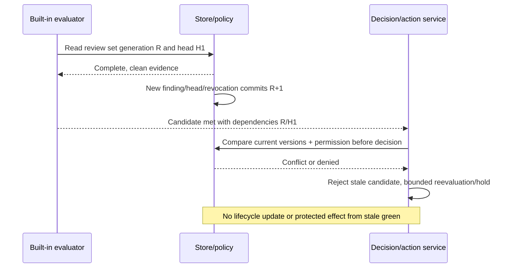
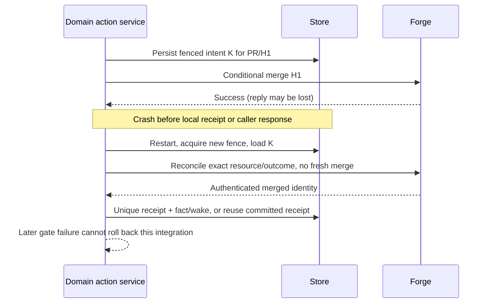

# Gate acceptance and recovery scenarios

These are required **future runtime qualification** scenarios, not a claim that runtime code or tests exist. [validate.py](validate.py) checks documentation schemas, examples and selected semantic admission invariants; it cannot prove DB serializability, external exclusion, wake delivery or effective credential rights.

| Scenario | Required behavior |
| --- | --- |
| Report without a change | Durable report satisfies delivery; required receipt remains pending/needs acknowledgment. Human reply asking for revision queues useful work; it is not receipt. Revised report invalidates old receipt. |
| Report/no-work plus pushed branch | Existing artifact/question/suspension precedence preserved. A PR may be created while report/no-work is recorded; integration and required children still need their own proof. |
| Review delivers findings | Review delivery can succeed; merge review disposition remains unmet until fixed/accepted in its exact scope. Submit and thread resolution do not accept findings. |
| Child fails/cancels or closes unmerged | Explicit success-required parent stays unmet; legacy closure requirement remains visibly distinct. Advisory child does not block. Independent parent report/repair may run. |
| Two concurrent required-child edits form a cycle | One fails transactionally; no hidden-edge leak in diagnostic. Removing/replacing requirement needs current revision and contract authority. |
| Merge blocked, then review completes | Agent/person/automation merge request sees current checks and approval met but review unmet: no effect, named remediation. Eligible exact-head clean review permits action only after all current fences/permissions pass. Integration receipt satisfies a later outcome, not every completion obligation. |
| Merge head changes H1→H2 after evaluation/click | H1 checks/reviews/approval/override/button are stale; expected-H1 merge cannot integrate H2. Refresh and reevaluate; no head coercion. |
| Other task or alias protects same PR | Resource/action policy union includes every binding. Different task, CLI/MCP/API name or taskless caller cannot choose a weaker set. Missing coverage refuses, not an empty pass. |
| Permission revoked after displayed green | Action/read refused using current revision; cached result conveys no authority. Regrant needs fresh evaluation. Private existence/title/result remains redacted. |
| New review finding/required job or child outcome changes after reads | Complete-set generations invalidate negative evidence, even if cited records are unchanged. An empty/incomplete/500-row result cannot prove no failures. |
| Mixed DB/forge reads, ABA or source clock gap | Changed generation restarts; reverted value cannot reuse old result. Untrusted source time/incomplete membership is unknown for required predicate. No promise of global external atomicity. |
| Message arrives during close | Incoming/processed watermark and closure transaction choose one order. Pre-close message prevents success until disposed; post-close message follows explicit historical-message/reopen policy. Evaluator reads do not mark processed. |
| All met with live push/submit or unknown external effect | Fence/settle writers and reconcile effect before successful close. Failure/cancel records honest terminal outcome, never fictitious rollback. |
| Independent gate waits, another has useful work | Dispatch one deduplicated authorized run for useful work; preserve the first wait. Admission/capacity/pause/budgets still apply. No worker run from status/text churn. |
| Event arrives between evaluation and wait registration | Transactional version interest registration+reread or existing journal replay catches it; no lost wake. Duplicate notifications coalesce. |
| Missed event / restart | Persisted dirty marker/timer and ≤60-second level scan recover current truth. Expired green not reused, authorization and pin/version rechecked. No provider session/state needed. |
| Timeout/repeated stale reads | Unknown/error with persisted bounded backoff, blocker and eventual authorized-resume hold; no auto-success, requirement removal or agent failure attribution. |
| Person waives one required outcome | Exact reason/scope/evidence/config/expiry/authority required. Result remains unmet but effective decision marks waived; another child/head/policy change invalidates scope. Waiver cannot authorize merge. |
| Action override | Only named eligible CI/review guards for one operation/head and ≤1 hour. Approval/authorization/conflict/boundary failures cannot be overridden. Completion obligations remain. |
| Merge succeeds, then controller response/evaluator fails | Stable intent reconciles to one immutable successful receipt. A retry returns that receipt under read authority; no second effect or rollback. |
| Merge times out with unknown outcome | Hold resource, query authoritative source using existing adapter; do not issue a new effect until known safe. Late old lease owner cannot write receipt/dispatch. |
| Direct forge/SSH/base push token remains usable | Enforced cohort admission fails; shadow/observation-only performs no Grain protected action. Do not rely on prompt/UI/AutoMerge flags. |
| Outside person/app merges | Observe authenticated integration and actor as external; do not claim guards prevented it. Use integration outcome only within current contract/identity. |
| Deferred queue can bypass guard at final merge | Refuse enforced queue admission unless final execution exclusion/conditional guard is proven. Checking enrollment is insufficient. |
| CL changes reviewed snapshot or renumbers on submission | Exact source-version precondition or proven exclusion; reconcile canonical submitted identity, all scoped targets. If unsupported, hold that cohort, never assume PR SHA semantics transfer. |
| Legacy base/nightly/publishing health import | Preserve explicit missing-row/non-reproduction/500-row/source/threshold behavior with provenance and limitations. New positive/current/window contracts don't inherit weak absence-as-success. |
| Pipeline repo scope is narrow | Deployment-wide legacy quiet predicate needs explicit wider authorization or unknown. Current scoped mode covers expected base and task/notification/queue sets completely. |
| QA shadow/control or custom stage | Monitoring only for shadow/control; missing custom typed effect/version proof holds enforced migration, existing legacy cohort unchanged. |
| Upgrade/rollback during task handoff | Exactly one authority epoch across finish/goal/PR/CL/review/UI/wake/recovery and Go/SQL projections. Old writer fenced. Unrepresentable reverse contract holds for compatible binary; action guard policy remains. |
| Resource/trigger providers absent | Initial built-ins use existing DB/forge collectors; no dependency on their installation. Resource attachment adds neither permission nor obligation; gate evaluation is not a trigger occurrence. |

## Evaluate, wait and close

```mermaid
sequenceDiagram
  participant C as Existing collectors
  participant O as Lifecycle owner
  participant G as Compiled gates
  participant D as Store
  C->>D: Commit facts, versions, dirty marker
  O->>G: Evaluate typed attachments and focused read view
  G->>D: Read values + complete sets + versions
  G-->>O: Results, dependencies, useful work, waits
  O->>D: Validate contract/policy/auth and dependency union
  alt Independent useful work
    O->>D: Deduplicate intent, ask existing scheduler
  else External wait
    O->>D: Register version interests + deadline; reread
  else All required met/waived
    O->>D: Fence writers, messages, children; unique close receipt
  end
```

## Guarded merge, separate integration

```mermaid
sequenceDiagram
  participant U as Agent/person/automation
  participant A as Merge service
  participant G as Built-in guards
  participant F as Forge
  participant O as Lifecycle owner
  U->>A: Merge exact PR/H1, expected policy, idempotency key
  A->>A: Current authorization, policy union, fenced resource lock
  A->>G: Checks + reviews + approval for H1
  G-->>A: Review unmet; remediation
  A-->>U: Blocked, no merge
  Note over A,G: Later authenticated clean review for H1
  U->>A: Refresh evidence, new request ID/key for same intended action
  A->>G: Revalidate complete current evidence
  G-->>A: Required guards met
  A->>A: Validate boundary, persist intent, dispatch fence
  A->>F: Conditional expected-H1 merge
  F-->>A: Authoritative integration outcome
  A->>A: Durable receipt + observation/wake
  A-->>U: Success receipt
  A->>O: Integration fact; evaluate other outcomes/children
```

## Concurrent evidence or authorization change



## Success before crash/restart


