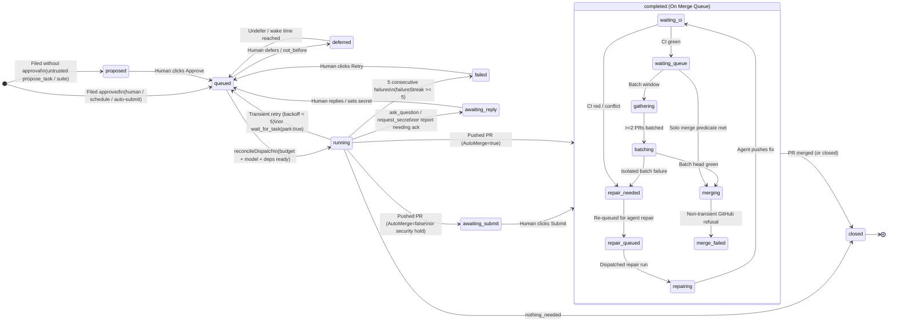

# Grain Architecture

> **Reading time:** ~25 minutes · **Audience:** Operators setting up, running, or inheriting a Grain deployment.
> For initial setup, start with the [Quickstart](quickstart.md). For internal package boundary rules aimed at Grain contributors, see [Three Pieces](three-pieces.md).

Grain is a single-tenant control plane that drives coding agents against Git repositories, validates their changes with its own CI engine, and lands approved pull requests through a batching merge queue.

This document explains how the system holds together end to end: what the running pieces are, how a task moves from filing to a merged commit, where every piece of state lives on disk and in Git, and where to look when something is stuck.

---

## Contents

1. [The Big Picture](#1-the-big-picture)
2. [The Three Pieces](#2-the-three-pieces)
3. [Life of a Task, End to End](#3-life-of-a-task-end-to-end)
4. [Where State Lives](#4-where-state-lives)
5. [Agents and Models](#5-agents-and-models)
6. [Capabilities](#6-capabilities)
7. [CI and the Merge Queue](#7-ci-and-the-merge-queue)
8. [Schedules, Suites, Templates, and System Jobs](#8-schedules-suites-templates-and-system-jobs)
9. [Releases and Upgrades](#9-releases-and-upgrades)
10. [Operating Grain](#10-operating-grain)
11. [Glossary](#11-glossary)

---

## 1. The Big Picture

A Grain deployment is a **single daemon** (`grain daemon`) owned by one person or team. You give it work—by typing a task in the web UI, firing a schedule or test suite, chatting with the standing Director agent, or letting an agent propose follow-up tasks—and Grain drives that work through to a merged pull request.

```
                         ┌───────────────────────────────────────────────────┐
                         │           grain controller (grain daemon)         │
                         │                                                   │
  Operator (Web UI / CLI)│  ┌─────────────────────────────────────────────┐  │
 ────────────────────────┼─▶│  Orchestrator & Dispatch (pkg/orchestrator) │  │
                         │  │  • Reconcile loop (every few seconds)       │  │
                         │  │  • Task state, admission, sandbox budget    │  │
                         │  │  • Prompt assembly & capability minting     │  │
                         │  └──────┬───────────────────────────────┬──────┘  │
                         │         │                               │         │
                         │         ▼                               ▼         │
                         │  ┌─────────────────────┐   ┌───────────────────┐  │
                         │  │ Forge & Merge Queue │   │ Agent & MCP Host  │  │
                         │  │ (pkg/forge, pkg/ci) │   │ (pkg/agent,       │  │
                         │  │ • .grain/workflows  │   │  pkg/mcp,         │  │
                         │  │ • Merge batches     │   │  pkg/modelexec,   │  │
                         │  │ • Local git proxy   │   │  pkg/runhost)     │  │
                         │  └──────┬──────┬───────┘   └────┬──────────┬───┘  │
                         └─────────┼──────┼────────────────┼──────────┼──────┘
                                   │      │                │          │
       ┌───────────────────────────┘      │                ▼          ▼
       ▼                                  │  ┌──────────────────┐  ┌────────────────────────┐
┌─────────────────────┐                   │  │   model-server   │  │ grain hostd (optional) │
│   grit controller   │                   │  │ (grain           │  │ • Capability server set│
│  (CI service split, │                   │  │  model-server)   │  │   (grain-gcp,          │
│   grit-split.md)    │                   │  │ • Runs agent CLIs│  │    grain-host-script,  │
└──────────┬──────────┘                   │  │   (agy, claude,  │  │    grain-gchat,        │
           │                              │  │    codex) on host│  │    host-git)           │
           │                              │  └────────┬─────────┘  └───────────┬────────────┘
           │                              │           │                        │
           ▼                              ▼           ▼                        ▼
                               ┌─────────────────────────────────────────────┐
                               │      Disposable Sandboxes (pkg/granule)     │
                               │  • Granule KVM microVMs (or pods/containers)│
                               │  • Untrusted repo code, tests, builds       │
                               │  • Reaches Git only via daemon git proxy    │
                               └─────────────────────────────────────────────┘
```

### The 4-component architecture

Across single-host, hybrid, and Kubernetes deployments, Grain's runtime splits into **four components**:

1. **`grain` controller (`grain daemon`):** Owns the task store (`pkg/model`), the level-triggered orchestrator and dispatch loop (`pkg/orchestrator`, `pkg/dispatch`), the batching merge queue (`pkg/forge`), the web UI and REST/SSE API (`pkg/ui`), and disposable sandbox lifecycle (`pkg/granule`, `pkg/k8s`).
2. **`grit` controller (`pkg/ci`, [Grit Split](design/grit-split.md)):** The CI controller service that plans `.grain/workflows` DAGs, executes steps in isolated sandboxes, maintains the content-addressed job cache and CI artifacts, and reports verdicts back to `grain` (in progress as a standalone service under [`docs/design/grit-split.md`](design/grit-split.md)).
3. **`model-server` (`grain model-server`, aliases `grain executor` and `grain modelexec`, `pkg/modelexec`):** A service that runs agent model CLIs (`agy`, `claude`, `codex`) on a host with local ambient credentials and binaries, connecting outbound to the `grain` controller (`GET /api/executors/connect`) while tunneling MCP tool calls back into Grain's sandboxes. Bootstrapped with `./scripts/run-model-server.sh` or `/api/model-servers/install.sh`.
4. **`hostd` (capability server set, `grain hostd`, `pkg/hostd`):** A host companion service that brings up allowlisted capability servers (`grain-gcp`, `grain-host-script`, `grain-gchat`, `host-git`, etc. from `/etc/grain/hostd.yaml`) and host CLIs, connecting them back to `grain` over `/run/grain-hostd` or outbound via `grain hostd -server` (`GET /api/hostd/connect`).

### How it is deployed

Grain runs in one of three footprints:

- **Dedicated Linux machine or Cloudtop (`scripts/setup.sh`, `google/scripts/cloudtop-install.sh`):** `grain daemon` runs inside the release Docker container (`grain-daemon.service`), while a small companion binary, **`grain hostd`** (`grain-hostd.service`), runs as a systemd unit on the host outside the container. `hostd` gives the containerized daemon a controlled Unix-socket bridge (`/run/grain-hostd`, governed by the root-owned allowlist `/etc/grain/hostd.yaml`) to spawn allowlisted host-side binaries (such as the Antigravity `agy` CLI, which needs host corp credentials, or host-side capability servers) without mounting the host user's home directory into the container.
- **Kubernetes (`deploy/kubernetes/`):** `grain daemon` runs as a single-replica Deployment (`strategy: Recreate`) backed by a ReadWriteOnce PersistentVolumeClaim at `/var/lib/grain`, and launches agent sandboxes and CI jobs as ephemeral Pods in the cluster.
- **Local workstation or demo (`grain init workstation`, `grain demo`):** `grain daemon` runs directly on the developer's machine against a local state directory (`~/.grain/`), restricted by a [local workstation policy](local-policy.md) that enforces `127.0.0.1` binding and allows pushing only `grain/*` branches.

### The trust boundary

The central security invariant of Grain is that **untrusted repository code and model-generated commands execute inside disposable sandboxes, never inside `grain daemon`**.

- **The agent CLI (`agy`, `claude`, `codex`) runs outside the sandbox** (in a sibling `runhost` container, a Kubernetes pod, or on the host via `hostd`). It talks to the model provider and to a per-run **`grain mcpserver`** process over stdio.
- **Every tool call (`mcp_grain-sandbox_run_command`, `read_file`, `edit_file`, `write_file`) crosses into the sandbox VM**, where the target repository is checked out at `/home/debian/work`.
- **The sandbox holds no long-lived GitHub tokens or model API keys.** When code inside the sandbox runs `git fetch` or `git push`, it talks to the daemon's local **Git HTTP proxy** (`:9728`) using a short-lived, per-run bearer token that is authorized to push only that task's single branch (`grain/<deployment>/task-<id>`). When a run needs cloud credentials or internal APIs, the daemon mints an attempt-scoped capability pass and forwards only the narrow socket or temporary token into the sandbox.

### What Grain is *not*

- **Not a multi-tenant SaaS:** Since Grain 2.0, each deployment has a single owner authenticated by an access code (`<data-dir>/access-code`; see [Access Code](access-code.md)). All tasks in a deployment share one queue, one sandbox resource budget, and one set of credentials.
- **Not an interactive IDE or single-session chat wrapper:** You do not sit in a terminal approving individual shell commands. Agents run autonomously in fresh VMs; humans interact at the task boundary (approving proposed tasks, answering blocking questions from `ask_question`, or reviewing pull requests).
- **Not a distributed multi-master scheduler:** One `grain daemon` process owns the task database and reconcile loop. Scaling up means giving the machine more cores/RAM for parallel KVM microVMs or pointing the daemon at a Kubernetes cluster for sandbox pods.

---

## 2. The Three Pieces

Internally, Grain is organized into three layers with a strict one-way dependency rule (documented for contributors in [Three Pieces](three-pieces.md)):

```
   ┌────────────────────────────────────────────────────────────┐
   │  1. Orchestration / Tasks ("what should happen next")      │
   │     pkg/orchestrator, pkg/dispatch, pkg/model, pkg/agent,  │
   │     pkg/capability, pkg/mcp, pkg/staterepo, pkg/ui         │
   └──────────────┬──────────────────────────────┬──────────────┘
                  │                              │
                  ▼                              │
   ┌──────────────────────────────────────┐      │
   │  2. Forge ("what is true about this  │      │
   │     branch, may it land, and land")  │      │
   │     pkg/forge, pkg/ci, pkg/cifault,  │      │
   │     pkg/github, pkg/gitproxy,        │      │
   │     pkg/gitrefs, pkg/portpick        │      │
   └──────────────┬───────────────────────┘      │
                  │                              │
                  ▼                              ▼
   ┌────────────────────────────────────────────────────────────┐
   │  3. Sandboxes ("give me a machine with this shape")        │
   │     pkg/granule, pkg/sandboximage, pkg/k8s, pkg/runhost,   │
   │     pkg/hostd, third_party/granule                         │
   └────────────────────────────────────────────────────────────┘
```

Nothing points upward: the sandbox layer knows how to boot a VM, place files, forward TCP ports, and run commands, but has no concept of a Git branch or a task. The forge layer knows how to evaluate a branch's health, run `.grain/workflows` CI jobs in sandboxes, and merge a pull request, but does not know what a task is.

### Package map for operators

When reading logs (`pkg/...`), metrics, or stack traces, here is how the repository's packages map to the three pieces:

| Layer | Package | What it does |
| :--- | :--- | :--- |
| **Orchestration** | `pkg/model` (`sqlite`, `postgres`) | The domain types (`Task`, `Observation`, `Run`, `Comment`, `Link`, `Grant`, `Schedule`, `Template`, `Suite`) and SQL store. Defines `model.StateOf` (`pkg/model/state.go`) and run endings (`pkg/model/ending.go`). |
| | `pkg/dispatch` | Pure store-backed admission logic (`dispatch.Cycle`). Orders ready tasks, enforces retry backoff, handles `RunNow` and base-repair preemption, and charges the shared sandbox resource budget (`model.Budget` / `model.Ledger`). |
| | `pkg/orchestrator` | The heart of the `grain` controller. Runs the level-triggered reconcile loop (`RunCycle` in `cycle.go`, comprising 29 reconcilers), builds agent prompts, materializes capabilities, processes run results, drives the merge queue (`sync.go`, `queuestatus.go`, `mergepredicate.go`, `mergebatch.go`), enforces the liveness rule (`liveness.go`), and files paired-branch ports (`port.go`). |
| | `pkg/agent` | Drivers for each agent CLI framework (`agy`, `claude`, `codex`, `custom`), parsing streaming transcripts, token usage, and rate-limit resets. |
| | `pkg/modelexec` | The **`model-server`** (`grain model-server`, aliases `grain executor` and `grain modelexec`) server and outbound client daemon that runs agent model CLIs (`agy`, `claude`, `codex`) on a remote host with ambient credentials and tunnels MCP tool calls back to `grain`. |
| | `pkg/capability` | Built-in capability grant providers (`pkg/capability/*`), the external capability MCP protocol (`pkg/capability/protocol`), and in-tree capability servers (`pkg/capability/intree`). |
| | `pkg/mcp` | The `grain mcpserver` binary attached to each agent run over stdio, exposing `mcp_grain-sandbox_*` tools (`run_command`, `read_file`, `edit_file`, `write_file`, `wait_for_checks`, `propose_task`, `ask_question`, etc.). |
| | `pkg/staterepo` | Syncs live settings, secrets metadata, agent memory, and release notes between the database and the `grain/config` Git state repository (`tables/*.json`, `memory/`). |
| | `pkg/ui` & `ui/` | The HTTP REST/SSE server and embedded React single-page application. |
| | `pkg/daemon` | Wires all stores, proxies, caches, and the orchestrator loop into the `grain daemon` binary (`cmd/grain`, `google/cmd/grain`). |
| **Forge** | `pkg/forge` | Computes branch health (`PrClean`, `PrPending`, `PrFailing`, `PrConflicted`) from GitHub pull-request state and CI runs, and executes merges. |
| | `pkg/ci` & `pkg/cifault` | The **`grit` controller** engine ([`docs/design/grit-split.md`](design/grit-split.md)): parses `.grain/workflows/*.yml`, plans job DAGs, caches job results by content fingerprint (`DirCache`), runs steps inside sandboxes, and detects cross-branch shared faults (`sharedfault.go`). |
| | `pkg/github` & `pkg/gitproxy` | GitHub REST/GraphQL client and the local authenticating Git HTTP proxy (`:9728`) that gates every `git clone`, `fetch`, and `push` from sandboxes. |
| | `pkg/portpick` | Performs mechanical git cherry-picks across paired branches (`main` ↔ `candidate`) without spinning up an agent sandbox when commits apply cleanly. |
| **Sandboxes** | `pkg/granule` & `third_party/granule` | Manages disposable KVM microVMs (`granule`), rootfs overlays, vsock guest-agent channels, and guest image builds (`pkg/sandboximage`). |
| | `pkg/k8s` | Manages Kubernetes Pod sandboxes when running on a cluster. |
| | `pkg/runhost` | Runs the agent CLI and `grain mcpserver` in a detached sibling Docker container (`docker.go`) or Kubernetes pod (`kube.go`) with an append-only disk spool (`spool.go`), allowing in-flight agent runs to survive a `grain daemon` restart (`adopt.go`). |
| | `pkg/hostd` | The **`hostd` capability server set** daemon (`grain hostd`) that brings up allowlisted capability servers (`grain-gcp`, `grain-host-script`, `grain-gchat`, `host-git`, etc. from `/etc/grain/hostd.yaml`) and host CLIs on a host and connects them back to `grain`. |

---

## 3. Life of a Task, End to End

A task's lifecycle splits into two sequential lanes: the **Task lane** (getting an agent to produce an answer or a pull request) and, if the task opens an auto-merging pull request, the **Merge-Queue lane** (getting that pull request tested, repaired if needed, batched, and merged).



### Step 1: Filing (`model.Origin`)

Every task is created with an immutable `Origin` recording **who** filed it (`Attribution`: `human`, `agent`, or `automation`, plus an optional `OnBehalfOf` chain) and **why** (`OriginReason`):

- **A person (`direct`, `console-session`):** Filed in the web UI, CLI, or as a standing Director chat session.
- **A schedule or suite (`schedule`, `suite`, `qualification`):** Fired automatically by `reconcileSchedules` on a cron expression, or triggered by an operator running a multi-task test suite (including pre-release `qualification` runs on `candidate`).
- **An agent (`proposal`):** A running agent calls `mcp_grain-sandbox_propose_task` to split out follow-up work or file a bug it noticed out of scope.
- **The orchestrator or merge queue (`fix`, `review`, `upgrade-check`):** Grain itself files tasks to repair a broken base branch (`system:base-repair`), run a pre-merge code or security review (`system:security-review`, `system:workflow-review:<stem>`), port a change that hit cherry-pick conflicts, or verify a freshly upgraded daemon (`reconcileUpgradeCheck`).

### Step 2: Approval and the trust gate

Whether a new task starts in `proposed` or `queued` is decided by `Task.Approval` (`*model.Attribution`):

- **Human filings and schedule firings** land **approved** (`queued`). Creating a schedule is the standing approval for the tasks it fires.
- **Suite runs** follow the suite's `RequireApproval` setting (`proposed` if true, `queued` if false).
- **Agent proposals (`propose_task`)** default to **`proposed`** (unapproved, waiting in `/inbox` for a human to click **Approve**) unless the parent task's own permission covers the child via `model.AutoSubmits` (`pkg/model/task.go`):
  1. The parent task has `AutoMerge: true` or `AutoApproveProposals: true` (or is a standing chat session with `QueuesProposals` enabled in its UI pane, and `hold_for_approval` was not set).
  2. The proposal lands on the same repository and base branch as its parent (or a repository/branch declared in the parent's `Writes`), and **never** targets the `grain/config` state repository unless the parent itself targeted `grain/config`.
  3. Every capability grant, `Reads` repo, and `Writes` repo requested by the proposal is a subset of what the parent task already holds (`GrantsSubsetOf`).
  4. The proposal chain stays within `AutoSubmitLimits` (max depth and fan-out per root task) to prevent runaway self-reproduction.

### Step 3: Task states (`model.State`)

A task's state is **never stored as a mutable column**; it is a pure function (`model.StateOf` in `pkg/model/state.go`, mirrored by the `task_state` SQL view) derived from the task's `Task` definition, its mutable `Observation` record, and its `task_run` history:

| `model.State` | How `StateOf` computes it | What it means |
| :--- | :--- | :--- |
| `proposed` | `Approval == nil` (and not closed) | Waiting for a human to review and click **Approve**. |
| `deferred` | `DeferredAt != nil` | Parked manually by a human or scheduled for the future via `not_before` (`DeferredUntil`, woken automatically by `reconcileWake`). |
| `queued` | Approved, not deferred, no unfinished run, `failureStreak < 5` | Eligible to run. Note: a task waiting on an open `depends-on` or `child-of` link stays in `queued` with `IsBlocked == true` (`task_blocked` SQL view), which holds it out of `task_ready` until its dependencies close. |
| `running` | Has a `task_run` row with `FinishedAt == nil` | Currently executing in a sandbox. |
| `awaiting_reply` | `PendingQuestionCommentID != nil`, OR (`CompletedAt != nil` and `AwaitsAck(task)`) | Either the agent called `ask_question` / `request_secret` and is parked waiting for a human's answer, or the task finished with a written report (`comment_on_issue`) and no pull request, waiting for a human to read and acknowledge it. |
| `awaiting_submit` | `CompletedAt != nil` and `AwaitsSubmit(task)` | The agent opened a pull request (`LinkFixes`), but `AutoMerge` is `false` (or was withdrawn by a security hold or path trigger). Waiting for a human to review the PR and click **Submit** to put it on the merge queue. |
| `completed` | `CompletedAt != nil`, has a `LinkFixes` PR, and `AutoMerge == true` | Agent work is done; the pull request is now driven by the **Merge Queue**. |
| `failed` | `failureStreak >= 5` (`MaxConsecutiveFailures`) | Five consecutive runs ended in an agent/task failure without producing a completion or question. Stopped until a human clicks **Retry**. |
| `closed` | `ClosedAt != nil` | Terminal: the pull request merged (or was closed), the agent called `nothing_needed`, a human closed the task, or a newer proposal superseded it (`supersedes`). |

### Step 4: Dispatch (`reconcileDispatch` & `pkg/dispatch`)

Every few seconds, `reconcileDispatch` asks `dispatch.Cycle` which `queued` tasks can start right now. Before a task can launch, it must clear six gates:

1. **Dependencies (`task_ready`):** All tasks linked via `depends-on` or `child-of` must be `closed` (`completed` is not enough—a child task that opened a PR must wait for that PR to merge if a downstream task depends on its code).
2. **Target repository & pipeline state:** The target repository must be cloned/reachable (`reconcileTargetRepos`), and the deployment pipeline must not be paused (`reconcilePipelinePause`) or held by workstation policy (`heldByPolicy`).
3. **Retry backoff:** If the task's previous run failed (`failureStreak` 1–4), exponential retry backoff (`FailureStreak.BackoffCount`) must have elapsed (unless an operator clicked **Run now**, which sets `RunNow` and bypasses backoff).
4. **Model connection & quota availability (`ModelAvailability`):** At least one enabled connection advertising the task's requested model (or a model in the `default_model` rotation) must have free concurrency slots and must not be in a usage-limit pause (`pkg/orchestrator/pause.go`).
5. **Sandbox resource budget (`model.Budget` & `model.Ledger`):** Every sandbox declares its vCPUs, memory (`sandbox_memory_mb`), and disk (`sandbox_disk_gb`). `dispatch.Cycle` charges these against the deployment's total CPU/RAM budget—which is **shared between agent runs and CI jobs**—and verifies that host disk space stays above `Budget.DiskFloor`. Base-branch repair tasks (`FixesBaseBranch: true`) can draw from a dedicated repair reserve and preempt lower-priority work (`pkg/dispatch/repair.go`). Console sessions (`console-session`) and `priority-dispatch` tasks bypass worker count limits, and the budget refuses them only for a physical shortage (the disk floor, or no node that can schedule the pod). Their sandboxes are charged, so CI waits for them rather than they for CI ([Sandbox budget](sandbox-budget.md)), and an operator is never locked out of the console when the queue or the budget is full.
6. **Capability pass minting (`mintCapabilityPass`):** If the task requests capabilities from external capability MCP servers, the orchestrator calls `mint_<method>` on each server at admission time.

### Step 5: A Run (`runOne`)

Once admitted, the orchestrator creates a `task_run` row (`StateRunning`) and executes `runOne`:

1. **Sandbox creation:** Allocates a fresh Granule microVM (or container/Kubernetes pod) with the task's requested CPU, RAM, disk, and network mode (`open` or `none`).
2. **Scoped Git proxy token:** Mints a short-lived bearer token (`MintSandboxToken`, refreshed periodically while the run is alive and revoked immediately on teardown) registered in `Store.GitScope`. The local git proxy (`:9728`) allows that token to read `Target`, `Reads`, and `Writes` repositories and to push **only** `grain/<deployment>/task-<id>` (plus declared `Writes` branches, unless granted `git-push-any-ref`).
3. **Repository checkout & setup:** Clones the target repository into `/home/debian/work` on branch `grain/<deployment>/task-<id>`, configures the Git author identity (`CredentialGitIdentity`), and runs the repository's configured setup script if one exists.
4. **Capability materialization (`materializePass`):** Places any credential files (`placements`), opens TCP port-forward relays (`:9731`) into the sandbox (`ports`), runs privileged (`setup_root`) and user (`setup`) commands inside the VM, and prepares attempt-scoped MCP endpoints (`mcp_endpoint`). If the task holds `self-debug`, Grain also mounts a read-only checkout of Grain's own source tree at `/home/debian/grain-src` and exposes a read-only replica of the database.
5. **Prompt assembly (`BuildPrompt`):** Builds the full prompt containing:
   - Sandbox environment instructions and available `mcp_grain-sandbox_*` tools;
   - The task's title, body, custom fields, and required commit trailers (`Origin: task <id>`, `Filed-by: task <id>`);
   - The task's conversation history—or, if the conversation grew too long and an earlier run called `write_handover`, the standing `Handover` summary plus the recent uncut messages;
   - Deployment memory (`memory/deployment.md`) and repository memory (`memory/repos/<owner>/<repo>.md`) from `grain/config`, plus any capability prompt sections.
6. **Agent CLI execution:** Starts the selected agent CLI (`agy`, `claude`, `codex`, or a `custom` backend) in the configured run location (`container` via `pkg/runhost` or `host` via `pkg/hostd`), connected over stdio to `grain mcpserver`. Each run has a wall-clock budget (default 2 hours `MaxRunRuntime`), and time spent blocked inside `wait_for_checks` or `wait_for_task` is credited back to the deadline (up to 45 minutes `waitCredit`).

### Step 6: Run outcomes (`ProcessResult` & `model.EndingOf`)

When the agent CLI exits, `ProcessResult` inspects the branch state on the remote and the MCP tool calls recorded during the run to determine its `Ending` (`pkg/model/ending.go`):

- **Pushed commits (`EndingCompleted` with `LinkFixes`):** If the agent pushed commits to `grain/<deployment>/task-<id>` (or called `open_pull_request` during the run), Grain opens or updates the pull request on GitHub and links it to the task (`LinkFixes`).
  - Before placing the PR on the merge queue, Grain checks **security holds and path triggers**: if the diff modifies `.grain/workflows/*`, a workflow security review task (`system:workflow-review:<stem>`) is filed; if a repository path trigger matches with `hold_merge: true`, a review task is filed; if a reviewer agent left open questions via `add_review_comment`, `AutoMerge` is paused.
  - If the diff touches grain's trust boundary (`pkg/trustboundary`), the **security hold** withdraws `AutoMerge` and files a `system:security-review` task. That review works on the change's own branch: its checkout is that branch, the git proxy lets its run push that branch and no other, and it never opens a pull request, so what it fixes lands in the change's own pull request (`pkg/orchestrator/securityhold_inplace.go`). A review that finishes with no open finding or question -- whether or not it pushed fixes -- hands auto-merge back, clearing the change at the head the review left -- unless the review's own fixes touch the trust boundary, in which case that head is held again for a second review, since no agent clears its own trust-boundary edits; any later commit is classified again before it merges. A finding or question it could not settle leaves the change for a human's **Submit**. A superseded or closed review can no longer push the branch. Security reviews filed before this, and declared reviews (`review_template_id`) and gating path-trigger reviews, still stack a branch and pull request of their own that merge back into the change.
  - If `AutoMerge` is `true` and no hold applies, `Observation.CompletedAt` is stamped and the task enters **`completed`** (joining the merge queue). Otherwise it enters **`awaiting_submit`**.
- **Comment only (`comment_on_issue`, no pushed commits):** Grain relays the agent's comment into the task conversation and stamps `CompletedAt`. Unless the task is an automated review, `AwaitsAck` keeps the task in **`awaiting_reply`** in the operator's `/inbox` until they read it and click **Acknowledge / Close**.
- **Question or secret request (`ask_question` / `request_secret` → `EndingQuestion`):** Grain posts the question to the task conversation, with the one-line summary the agent gave (or one derived from the question's first sentence) that the inbox, task list and notifications show in its place ([question-summaries.md](question-summaries.md)) (and for `request_secret`, renders a write-only encrypted secret input box in the UI so the secret value never enters the conversation text or agent prompt), sets `PendingQuestionCommentID`, preserves the agent's `SuspendedSession` ID, and parks the task in **`awaiting_reply`**. When the human replies or saves the secret, the task returns to **`queued`** and the next run resumes with the answer.
- **No work needed (`nothing_needed` → `EndingNothingNeeded`):** Grain posts the agent's explanation as the closing comment and moves the task directly to **`closed`** (unless the task has `nothing_needed_action: ack`, which leaves it in `awaiting_reply` for human acknowledgement).
- **Parked on another task (`wait_for_task(park: true)` → `EndingParked`):** Grain adds the target task IDs to this task's `depends-on` links, tears down the sandbox so it consumes no resources while waiting, and returns the task to **`queued`** (blocked) until every target task closes.
- **Non-penalizing interruptions (`PausedOutcome`, `CapacityOutcome`, `EnvironmentOutcome`, `InterruptedOutcome`):** If a run hits a provider usage limit (`paused`), a transient 503 overload (`capacity`), expired host credentials (`environment`), or a daemon shutdown (`interrupted`), Grain **does not increment `failureStreak`**, so infrastructure hiccups never burn through a task's 5-strike retry budget.

### Step 7: Grain CI and the merge queue

Once a task is in `completed` (meaning `AutoMerge: true` with an open PR), the **Merge Queue** (`reconcileSync`, `reconcileCI`, `reconcileMergeBatches`) takes over.

Every merge in Grain is governed by one invariant—the **merge predicate** (`pkg/orchestrator/mergepredicate.go`, [Merge Queue Behind](merge-queue-behind.md)):

> A change may merge into target branch `B` if and only if:
> 1. It merges cleanly into `B` (no git conflicts), **and**
> 2. Either **(a)** no merge batch is in flight for `B` and the change has a green Grain CI run on its own head SHA, or **(b)** a merge batch for `B` is in flight, that batch has a green Grain CI run, and this change is the head of that batch's frontier.

Notice what this rule does **not** require: a solo pull request does not have to sit on the exact tip of `B` (`BEHIND` on GitHub) unless the repository explicitly enables strict up-to-date branch protection (`RequireBranchUpToDate`). When two or more PRs are ready at once, the batcher tests their combined tree against the tip of `B`.

As the merge queue drives a pull request, it updates `Observation.MergeQueueState` (`pkg/orchestrator/queuestatus.go`):

| `MergeQueueState` | Phase | Meaning |
| :--- | :--- | :--- |
| `waiting_ci` | Driving | Waiting for Grain CI (`.grain/workflows`) or required GitHub checks to finish on the PR's head commit. |
| `waiting_review` | Driving | Waiting for an automated pre-merge review task (`ReviewTemplateID` or workflow security review) to complete. |
| `waiting_queue` | Driving | Checks are green and the PR is mergeable; waiting for its turn at the front of the branch's merge queue. |
| `gathering` | Driving | Checks are green; held briefly for `MergeGatherWindow` so nearby PRs finishing CI can batch together. |
| `batching` | Driving | Combined with other ready PRs on a throwaway ref (`grain-merge-queue/<deployment>/<branch>`) and running CI on the combined tree. |
| `updating_branch` | Driving | Merging the base branch into the PR head (only when `RequireBranchUpToDate` is set). |
| `merging` | Driving | All gates passed; calling GitHub to merge the pull request now. |
| `base_broken` | Driving (info) | Post-merge base-branch CI (`BaseBranchCI`) is red and a `system:base-repair` task is open. Informational: does not deadlock new merges while the repair runs. |
| `checks_unfixable` | Driving | Only checks configured in `RepoConfig.UnfixableChecks` failed (infrastructure checks an agent cannot fix by editing code). |
| `waiting_github_approval` | Awaiting External | GitHub branch protection or `CODEOWNERS` requires an external human review on GitHub before merging. |
| `github_merge_queue` | Awaiting External | Handed off to GitHub's native merge queue (`gh-readonly-queue/*`). |
| `unreadable` | Awaiting External | GitHub API reads for this PR have failed past the transient flake threshold; retrying on each sync cycle. |
| `repair_needed` | Agent Repair | Merge conflict or red CI detected; about to re-queue the task for an agent repair run. |
| `repair_queued` | Agent Repair | Task is re-queued (`CompletedAt` cleared, back in `queued`) waiting for a sandbox to fix the conflict or CI failure. |
| `repairing` / `agent_working` | Agent Repair | An agent run is actively running in a sandbox to fix the PR (`agent_working` when triggered manually via **Run now**). |
| `merge_failed` | Awaiting Person | GitHub refused the merge with a non-transient error (e.g., branch protection rule mismatch, or unresolved human review conversations reported as `blocked: N unresolved review conversations by <people>`; threads opened by grain's own review tasks are replied to and resolved automatically once the owner's decision is handled). Stopped until the condition is resolved or a human clicks **Retry merge**. |

### Step 8: The liveness rule (`pkg/orchestrator/liveness.go`)

To guarantee that no task or pull request can silently stall forever, `pkg/orchestrator/liveness.go` statically classifies **every** `model.State` and **every** `MergeQueueState` into one of three liveness classes (enforced at test time by `TestEveryStateIsClassified`):

1. **`driven` (`livenessDriven`):** Grain itself is responsible for moving the task out of this state. The classification names the exact Go function (`driver`, such as `reconcileDispatch`, `reconcileCI`, or `syncEntry`), an optional automatic recovery `backstop` (`RecoverOrphanedRuns`, `escalateToUser`, `escalateStalledChecks`, `gatherHeld`), and a **`patience`** duration (ranging from `10m` for `repair_needed` or `merging` to `2h` for `waiting_ci` or `running`). If a task remains in a `driven` state longer than its `patience`, Grain stamps `Observation.MergeQueueStalledAt`, surfaces a stall warning in the UI (`noteWithStall`), and fires the backstop.
2. **`awaiting a person` (`livenessAwaitingPerson`):** Terminal by design until a human acts (`proposed`, `awaiting_reply`, `awaiting_submit`, `failed`, `deferred`, `closed`, and `merge_failed`). The liveness table records the exact UI button (`control`: `"Approve"`, `"Reply"`, `"Submit"`, `"Retry"`, `"Undefer"`, `"Reopen"`, `"Retry merge"`) that restarts the cycle, which the UI renders directly in the status note (`noteWithWayOut`).
3. **`awaiting an external answer` (`livenessAwaitingExternal`):** Waiting on GitHub (`waiting_github_approval`, `github_merge_queue`, `unreadable`). Bounded by a `patience` timer so multi-hour external stalls are flagged for the operator.

### Step 9: Merged, closed, and paired-branch ports (`pkg/orchestrator/port.go`)

When `syncEntry` observes that the pull request has merged on GitHub, it records the merge event and stamps `Observation.ClosedAt`, moving the task to **`closed`**.

If the repository configures **paired branches** (`RepoConfig.PortTargets`, such as `main` ↔ `candidate`; see [Ports](ports.md)), `filePorts` immediately evaluates whether the merged commit should be carried across to the sibling branch:

- A commit with a `Port: no` trailer (or a task with `no_port: true`) is never ported. A commit already carrying `Backported-from: <sha>` is recognized as an existing port and never re-ported in a loop.
- When `port-types` filters are configured (for example, porting only `fix:` and `revert:` commits from `main` to `candidate`), `filePorts` checks the commit's Conventional Commit prefix (`Port: yes` overrides the filter).
- **Mechanical port first (`pkg/portpick`):** Grain first attempts to cherry-pick the merged commit(s) onto a fresh `grain/<deployment>/port-<pr>-to-<branch>` branch inside the git cache without starting a sandbox or an agent. If the cherry-pick applies cleanly, Grain pushes the branch, opens the port PR directly in the merge queue tagged `port-mechanical`, and lets Grain CI validate and merge it automatically.
- **Agent port on conflict:** Only if the mechanical cherry-pick hits a merge conflict does Grain file an approved agent task (linked via `LinkPortOf` / `LinkPortedBy`) with the conflicting files and diff in its prompt so an agent can resolve the conflict in a sandbox.

---

## 4. Where State Lives

On a machine install (`scripts/setup.sh`), Grain splits its host filesystem under `/var/lib/grain` into two roots (`~/.grain` on workstation installs; `/var/lib/grain` PVC on Kubernetes):

- **`/var/lib/grain/data/` (`GRAIN_DATA_DIR`, `-data-dir`):** Everything persistent that you **back up**—the SQLite database, encrypted secrets and master key, operator tokens, and the `grain/config` state repository checkout.
- **`/var/lib/grain/scratch/` (`GRAIN_SANDBOX_DIR`, `-sandbox-dir`):** Disposable working space and caches that Grain can rebuild at any time (never back this up; placing it on a separate disk/partition prevents a runaway build from filling the store disk).

```
/var/lib/grain/
├── data/                        # GRAIN_DATA_DIR (-data-dir) — back this up
│   ├── access-code              # Single-owner UI/API access code (0600)
│   ├── local-api-token          # Host CLI operator credential (0600)
│   ├── store/
│   │   └── grain.db             # SQLite database (WAL mode): tasks, runs, comments, CI runs
│   ├── state-repo/              # Checkout of the grain/config Git repository
│   │   ├── tables/              # Exported DB config tables (grain_config.json, repos.json, ...)
│   │   ├── memory/              # Agent-maintained deployment.md and repos/<owner>/<repo>.md
│   │   ├── release-notes/       # Weekly generated release notes (<YYYY-Www>.md)
│   │   ├── scripts/             # Operator-committed helper scripts
│   │   └── workflows/           # Deployment-level workflows
│   ├── secrets/
│   │   ├── secrets.key          # AES-256-GCM master key (0600 — irreplaceable!)
│   │   ├── secrets.enc          # Encrypted operator & capability secrets store
│   │   ├── github/              # GitHub App private key / PAT credentials
│   │   └── codex-auth.json      # OAuth tokens for Codex / model proxies
│   ├── state/
│   │   ├── agent-sessions/      # Per-run agent CLI session dirs (antigravity/<run>, claude/, codex/)
│   │   ├── ci-cache/            # Content-addressed job result cache (pkg/ci/DirCache)
│   │   ├── ci-artifacts/        # Retained logs and uploaded artifacts from CI runs
│   │   └── git-proxy/audit.log  # Audit log of every sandbox git fetch/push request
│   └── runhosts/
│       └── spool/               # Append-only run event spools for live run adoption across restarts
└── scratch/                     # GRAIN_SANDBOX_DIR (-sandbox-dir) — disposable caches & scratch
    └── cache/
        ├── git/                 # Bare git mirrors used for fast sandbox clones & mechanical ports
        ├── packages/            # Shared apt/PyPI/Docker/npm/Go module proxy cache
        └── actions/             # Per-repository GitHub Actions cache (cache-from: type=gha)
```

### 1. The database (`store/grain.db` or PostgreSQL)

The operational source of truth (`pkg/model/sqlite` or `pkg/model/postgres`). It stores:

- **Tasks & history:** `tasks`, `task_observations`, `task_runs`, `task_comments`, `task_links`, `task_events`, and `boards`.
- **CI & merge queue:** `ci_runs`, `ci_job_runs`, `merge_batches`, and `base_branch_ci`.
- **Configuration & automation tables:** `grain_config`, `repos`, `schedules`, `templates`, `suites`, `connections`, `model_settings`, and `project_configs`.

### 2. The state/config repository (`grain/config`, `pkg/staterepo`)

Grain mirrors its configuration tables and standing knowledge into a Git repository (conventionally named `<owner>/grain-config` or `grain/config`, stored locally at `<data-dir>/state-repo`).

- **Two-way sync:** When you change a setting in the `/settings` UI, Grain writes it to the database and commits the updated JSON table (`tables/grain_config.json`, `tables/repos.json`, `tables/schedules.json`, `tables/templates.json`, `tables/suites.json`, `tables/connections.json`, `tables/model_settings.json`) to `grain/config` (`pkg/staterepo/dump.go`). Conversely, when a pull request merges into `grain/config` (for example, an operator editing config in Git or an `infra-review` tuning PR), `staterepo.Apply` (`pkg/staterepo/bind.go`) hot-reloads the changes into the live database on the next reconcile cycle.
- **No secrets in `tables/*.json`:** Before exporting `connections.json` or `grain_config.json`, `staterepo` scrubs every inline API key, token, and webhook secret (`scrubConnectionAuth`), replacing them with secret-store references so `grain/config` is safe to host on GitHub.
- **Deployment & repository memory (`memory/`):** Standing markdown notes (`memory/deployment.md` and `memory/repos/<owner>/<repo>.md`) maintained by the nightly `system:memory-agent` and injected into future agent prompts.

### 3. The secrets store (`<data-dir>/secrets/`)

Credential material lives outside both the SQLite database and the `grain/config` Git export:

- `secrets.enc` holds named secrets (such as `stripe-api-key`, `github-app/private-key`, capability server tokens, and values entered by humans in response to `request_secret`), encrypted at rest with AES-256-GCM using `secrets.key`.
- Optionally, a deployment can configure a separate **secrets repository** (`secrets-repo`) where secret values are stored encrypted so the entire deployment can be reconstructed from Git plus the master key.

### 4. Agent session stores and run spools

- **`state/agent-sessions/<framework>/<run-id>/`:** Working directories for the agent CLI process (holding transcripts, `transcript.jsonl`, and framework-specific session state used when resuming a suspended session after `ask_question`).
- **`runhosts/spool/<run-id>/` and `/var/lib/grain/hostd/runs/<run-id>/`:** When an agent runs in a detached `runhost` container/pod or under `grain hostd` v2, its stdout/stderr, MCP events, and exit status are written to an append-only disk spool (`pkg/runhost/spool.go`).

### 5. CI cache and artifacts

- **`state/ci-cache/`:** Stores cached pass/fail verdicts and output logs keyed by each CI job's **content fingerprint** (`pkg/ci/fingerprint.go`), computed from the workflow YAML definition, the git tree SHA of the paths the job reads, and the sandbox image digest.
- **`state/ci-artifacts/`:** Stores build outputs and test logs for recent CI runs (viewable in `/ci` and via `get_ci_log`).

### What survives a restart or upgrade—and what doesn't

| Component / State | Survives `grain daemon` restart / upgrade? | Notes |
| :--- | :--- | :--- |
| Tasks, comments, links, merge queue state | **Yes** | Persisted in `store/grain.db` (or Postgres). |
| Settings, connections, schedules, memory | **Yes** | Persisted in both `grain.db` and `grain/config` (`state-repo/`). |
| Encrypted secrets (`secrets.enc`) | **Yes** | Persisted on the host volume / PVC. |
| CI job fingerprint cache & artifacts | **Yes** | Stored in `state/ci-cache/` and `state/ci-artifacts/`. |
| **In-flight agent runs (`runhost` / `hostd` v2)** | **Yes (adopted)** | The agent CLI, `grain mcpserver`, and the Granule sandbox VM stay alive outside the daemon container. On startup, `adopt.go` reconnects to the run spool and resumes streaming without interrupting the agent (see [Non-Disruptive Upgrade](non-disruptive-upgrade.md)). |
| **In-flight agent runs (in-process subprocess)** | **No (retried)** | If the CLI ran as a direct child process inside the daemon container without `runhost`/`hostd` detachment, `RecoverOrphanedRuns` marks the run `interrupted` (0 failure strikes) and re-queues the task. |
| **In-flight CI job steps** | **Reconciled** | Jobs that already finished reuse their cached fingerprint in `state/ci-cache/`; only the step that was mid-execution when the daemon stopped is re-run. |
| **Completed sandbox VM rootfs** | **No (by design)** | Sandbox microVMs are destroyed as soon as a run finishes, parks, or fails; only pushed Git commits, MCP comments/attachments, and transcripts persist. |

---

## 5. Agents and Models

Grain separates **how an agent CLI is invoked** (the framework), **how it authenticates and where its quota lives** (the connection), and **which LLM weights it uses** (the model). Full details live in [Connections and Models](connections-and-models.md).

### Agent frameworks (`pkg/agent`)

Grain supports four agent backends:

1. **Antigravity (`agy`):** Google's internal coding agent CLI. Typically executed on the host via `grain hostd` so it can use the host account's own login.
2. **Claude Code (`claude`):** Anthropic's Claude Code CLI, authenticated via an Anthropic API key, OAuth token, or cloud provider proxy.
3. **Codex (`codex`):** OpenAI's Codex CLI, authenticated via an OpenAI API key or `codex-auth.json` OAuth credentials.
4. **Custom (`custom`):** Any command-line agent wrapper that conforms to Grain's custom backend contract (see [Custom Agent Backends](custom-agent-backends.md)).

### Connections and discovered models

In **Settings → Models** (`/settings/models`), you configure one or more **Connections** (`model.Connection`). A connection binds:

- An **agent framework** (`agy`, `claude`, `codex`, `custom`);
- **Authentication material** (referenced from the secret store or host environment);
- An optional **max concurrency limit** (capping how many simultaneous runs may use that subscription/key);
- **Advertised models:** Every 10 minutes (and whenever a connection is edited), `AdvertiseDiscoveredModels` queries the provider to discover which models that connection can serve. You can filter out unwanted models with `excludedModels` or pin an explicit allowlist in `models`.

### `default_model` rotation and reasoning effort

A task can pin a specific model (e.g. `claude-sonnet-4-6` or `gemini-3.1-pro`), or leave its model blank to use the deployment's **`default_model`**.

- `default_model` accepts a **comma-separated rotation** (for example, `claude-opus-4-6, gemini-3.1-pro`). When dispatching a task that uses the default, Grain rotates across the listed models and picks an enabled connection advertising that model that is neither at its concurrency cap nor paused for quota.
- Per-model parameters such as reasoning effort (`low`, `medium`, `high`) are configured in `model_settings` (`tables/model_settings.json`).

### CLI run location: container vs. host (`docs/design/cli-run-location.md`)

Remember that the **repository code and shell commands always run inside the sandbox VM**. The `cli_run` setting (`grain_config.cli_run`) controls where the **agent CLI binary itself** (`agy`, `claude`, `codex`) executes:

- **`container` (default for `claude` and `codex`):** The CLI runs inside a sibling `runhost` container (or inside the daemon container), isolated from the host OS.
- **`host` (via `grain hostd`, default for `agy` on Cloudtops):** The daemon asks `grain hostd` over its Unix socket in `/run/grain-hostd` to spawn the CLI on the host OS. `hostd` enforces the root-owned binary allowlist `/etc/grain/hostd.yaml` and passes through only the host environment variables required for authentication (such as the host account's credential sockets), while piping all tool calls back into the Granule sandbox VM. See [CLI Run Location](design/cli-run-location.md).
- **Remote `model-server` (`grain model-server`, aliases `grain executor` and `grain modelexec`, `pkg/modelexec`):** When `grain` runs in Kubernetes or on a headless server without local model credentials, a separate host runs `grain model-server` (bootstrapped via `./scripts/run-model-server.sh` or `/api/model-servers/install.sh`). It connects outbound to the `grain` controller using a token from **Settings → Executors** (`/settings/executors`), advertises its local agent CLIs (`agy`, `claude`, `codex`), and executes model turns on the remote host while tunneling `grain mcpserver` stdio back to the task's sandbox on `grain`. Connected model servers are shown on **System → Sandboxes** (`/system/sandboxes`).

### Quotas, rate limits, and pauses (`pkg/orchestrator/pause.go`)

When an agent run hits a provider error, Grain distinguishes three cases so tasks never fail spuriously on quota windows:

1. **Usage-limit / quota window (`model.PausedOutcome`):** The provider reports a 429 usage cap or quota reset timestamp. Grain pauses that specific **`(connection, model)` scope** for the provider's stated reset duration (clamped between 1 minute and 6 hours, or 15 minutes if no reset time was parseable). The interrupted run finishes with outcome `paused` (0 failure strikes), the task returns to `queued`, and `ModelAvailability` holds any task needing that model (or routes default-model tasks to another unpaused connection/model in the rotation) until the pause expires.
2. **Transient overload (`model.CapacityOutcome`):** The provider returns a momentary 503/529 overload. Grain finishes the run as `capacity` (0 failure strikes) and retries the task with short backoff without pausing the whole connection for other tasks.
3. **Host credential expiry (`model.EnvironmentOutcome`):** On host-executed runs (such as `agy` when the host's login has expired), Grain finishes the run as `environment` (0 failure strikes) and surfaces an alert telling the operator to refresh credentials on the host.

---

## 6. Capabilities

By default, a task's sandbox can only clone its target repository and push its own `grain/<deployment>/task-<id>` branch. When a task or CI job needs extra privileges—such as GCP service-account credentials, access to internal corp search, permission to inspect Grain's own logs, or an external API key—it requests **capabilities** (`Task.Grants`).

For full reference, see [Capabilities](capabilities.md), [Capabilities Spec](capabilities-spec.md), [CI Capabilities](ci-capabilities.md), and [Capability Servers UI](capability-servers-ui.md).

### Two layers of capability providers

Grain supports two capability mechanisms side by side:

1. **Built-in in-process grant providers (`pkg/capability/*`):** Compiled directly into `grain daemon`. Common built-in capabilities include:
   - `grain-ci`: Granted automatically to every task run so `mcp_grain-sandbox_wait_for_checks`, `get_ci_log`, `retrigger_ci`, and `run_ci_job` work.
   - `self-debug`, `grain-log`, `deployment-health`: Read-only access to Grain's own source (`/home/debian/grain-src`), scrubbed SQLite replica, daemon logs, and health metrics.
   - `memory`, `release-notes`: Permission to commit updates to `memory/` or `release-notes/` in `grain/config`.
   - `self-repair`, `self-upgrade`, `quarantine`: Operator-level control plane actions (used by the Director or system jobs when explicitly enabled). `dispatch-control`, manual mode for an agent (pause, Run now chosen tasks, resume; [manual-mode.md](manual-mode.md)), and `pipeline-control` are now the `api:dispatch-control` and `api:pipeline-control` presets rather than in-process capabilities.
   - `gcp-key`, `gemini-key`, `github-token`, `git-push-any-ref`, `local-scripts`: Scoped cloud/forge credentials and host script access.
2. **Capability MCP servers (`pkg/capability/protocol`, `pkg/capability/intree`, `grain_config.mcp_servers`):** External or in-tree MCP servers (`grain capability <name>` over stdio for `gcp`, `self-debug`, `git`, `model-proxy`, `skill`, `host-script`, or remote HTTP servers) configured in **Settings → Capabilities → Capability servers** (`/settings/capabilities`, one tab per server). A capability server advertises `mint_<method>` and `release_<method>` tools.

### What a grant gives a run (`protocol.Pass`)

When a task or CI job with capability grants starts, the orchestrator mints a **Pass** (`pkg/orchestrator/capability_pass.go`) and materializes it into the sandbox (`pkg/orchestrator/capability_materialize.go` and `capability_ci.go`). A pass can contribute any combination of five primitives:

- **File placements (`placements`):** Writes short-lived credentials or config files (e.g., an OAuth access token or kubeconfig) to specific paths inside the sandbox with explicit file modes.
- **TCP port forwards (`ports`):** Opens a listener inside the sandbox forwarded through the daemon's capability port relay (`:9731`) to a proxy on the host, so the sandbox can reach a service without holding raw network access or long-lived keys.
- **Setup commands (`setup_root` and `setup`):** Runs initialization commands inside the sandbox as `root` or `debian` before the agent or CI step begins.
- **Attempt-scoped MCP endpoints (`mcp_endpoint`):** Exposes additional MCP tools to the agent CLI (or writes `/home/debian/.grain/mcp.json` inside a CI job) proxied through the daemon for the duration of the run.
- **Prompt instructions (`prompt_section`):** Appends usage instructions for the granted capability to the agent's prompt.

When the run finishes (whether it succeeds, fails, or is cancelled), the orchestrator immediately revokes the pass (`release_<method>`) and closes all relays.

### Admission policy

A task cannot simply ask for any capability and run with it:

- **Trust gate on proposals:** If an agent calls `propose_task` requesting a capability that the parent task did not hold, `model.AutoSubmits` refuses auto-approval and parks the proposal in `proposed` for a human to review and approve.
- **Capability policy (`grain_config.capability_policy`):** Operators can define ordered **Allow-only** and **Deny** rules in **Settings → Capabilities → Capability policy** (`/settings/capabilities#capability-policy`) restricting which capabilities may be used by run kind (`task` vs `ci`), repository, CI event (`pull_request` vs `push`), or untrusted fork pull requests (`untrusted_pr`).
- **Workstation policy (`-policy`):** Local workstation installs disallow privileged host-mutating capabilities by default ([Local Policy](local-policy.md)).

---

## 7. CI and the Merge Queue

Grain includes its own continuous integration engine (`pkg/ci`) so repositories do not have to wait on external GitHub Actions runners or expose internal code to third-party CI services.

For deep dives into the merge queue's edge cases, see [Merge Queue Batching](merge-queue-batching.md), [Merge Queue Behind](merge-queue-behind.md), [Merge Queue Staleness](merge-queue-staleness.md), and [CI Capabilities](ci-capabilities.md).

### `.grain/workflows` and content-addressed caching

Repositories define CI workflows in `.grain/workflows/*.yml` using a GitHub Actions-compatible job/step syntax (`on: [push, pull_request]`, `jobs.<id>.steps`, `needs`, `paths`, `capabilities`).

- **Same sandboxes, same budget:** Each CI job runs in a fresh disposable sandbox (Granule microVM, container, or pod) and charges the same `model.Ledger` CPU/RAM budget as agent runs.
- **Content fingerprinting (`pkg/ci/fingerprint.go`):** Before running a job, `pkg/ci` hashes the job's YAML definition, the sandbox image digest, and the git tree SHA of the repository paths the job touches. If `state/ci-cache/` already holds a verdict for that exact fingerprint, Grain replays the cached result in milliseconds instead of booting a VM. If two runs need the same fingerprint simultaneously, in-flight job coalescing runs the job once and shares the result.
- **Agent interaction with CI:** During a run, an agent calls `mcp_grain-sandbox_run_ci_job` (or `wait_for_checks(jobs: ["lint"])`) for fast targeted feedback, and calls `wait_for_checks()` (with no `jobs` filter) to run the full required suite before finishing. If a job fails due to a transient flake, calling `retrigger_ci` reruns **only** the failed jobs uncached and combines their fresh pass with the already-passed jobs' cached results—so the agent never needs to make cosmetic commits just to change a commit SHA.

### Base-branch CI, cache warming, and release publishing

When changes merge into a base branch (`main` or `candidate`), three separate reconcilers act on the new base commit:

1. **`reconcileBaseBranchCI`:** Runs the repository's `push` workflows on the base branch tip. If a post-merge check fails, Grain marks merge-queue entries on that branch with the informational `base_broken` status and automatically files a high-priority **`system:base-repair`** task (`FixesBaseBranch: true`) to diagnose and fix or revert the break. While the base branch is red, `base_broken` does **not** deadlock the merge queue—PRs that pass their own CI (including the repair PR itself) can still merge.
2. **`reconcileBaseBranchDispatch`:** Runs cache-warming jobs on the base branch so subsequent PR sandboxes hit warm package and fingerprint caches.
3. **`reconcileBaseBranchRelease`:** Runs release/publishing workflows decoupled from the merge gate, ensuring that a flaky container registry push or release artifact upload never blocks developers' PRs from merging.

### Flakes, shared faults, and cancellations

- **Cross-branch shared-fault detection (`pkg/ci/sharedfault.go`):** Whenever a CI job step fails, Grain normalizes the last lines of its log (stripping timestamps, temp paths, and memory addresses) and compares the hash against failures across all branches over the last 6 hours (`DefaultFaultWindow`). If the same job and step fail the exact same way on **2 or more branches**, Grain flags the failure as a **shared fault** in `wait_for_checks` and `get_ci_log`—and names any open pull request that touches the file path appearing in the stack trace—so neither the agent nor the operator wastes time debugging an inherited tree break as if their own branch caused it.
- **Automatic repair limits (`requeueForRepair`):** When a PR on the merge queue fails CI or develops a merge conflict (`repair_needed`), Grain automatically wakes the task (`repair_queued` → `repairing`) for one agent repair pass. On repositories that still rely on external GitHub check runs, `refreshStaleHead` ([Merge Queue Staleness](merge-queue-staleness.md)) first attempts a clean server-side merge of the base branch into the PR so stale-base failures are cleared without an agent run. To prevent infinite repair loops, Grain grants a second automatic repair (`secondRepairReason`) only if the base branch moved or the set of failing checks changed after the first repair; otherwise it escalates the task to a human.
- **Person-cancelled CI:** If a human explicitly cancels a CI run in the UI, `reconcileCI` records the cancellation and holds off automatic re-triggering until a new commit is pushed or a human clicks **Retrigger CI**.

### Batching (`pkg/orchestrator/mergebatch.go`, [Merge Queue Batching](merge-queue-batching.md))

When multiple pull requests are ready to merge into the same base branch:

1. **Gather window (`MergeGatherWindow`):** The first green PR enters `gathering` briefly so other PRs whose CI is about to finish can join the same batch.
2. **Speculative combined tree (`batching`):** Grain merges the candidate PRs in queue order onto a throwaway ref (`grain-merge-queue/<deployment>/<branch>`) on top of the current base branch tip, skipping any PR that conflicts with the base or with an earlier PR in the batch, and starts one Grain CI run on the combined head.
3. **Fast-path merge:** If the batch head passes CI, every PR in that batch satisfies clause (b) of the merge predicate and merges in sequence without re-running CI on each individual PR.
4. **Flake recheck and bisection:** If the combined batch run fails CI, Grain first runs **one uncached recheck** of only the failed jobs on the same batch tree to rule out a transient flake. If the failure reproduces, Grain **bisects the batch by halving from the front** (`split(A..D) → test(A..B)`), isolating the culprit PR and routing only that PR to `repair_needed` while the healthy half merges.
5. **Overlap re-check of a single change (`pkg/orchestrator/mergerecheck.go`):** A change merging on its own green is re-checked on top of the branch only if what it touches overlaps what has landed since it forked: a shared file, a shared Go package, or a global build input in what landed. In `enforce` mode that re-check is a batch of one on the same ref. In `observe` mode, the per-repository default (`repo_config.merge_recheck`), it is only recorded. See [Merge Queue Behind](merge-queue-behind.md#the-overlap-re-check-grain-task-985).

---

## 8. Schedules, Suites, Templates, and System Jobs

Grain automates recurring work through three composable building blocks (`pkg/model/compose.go`, [Composition](composition.md), [Schedules](schedules.md)):

| Concept | What it defines | Where it can live |
| :--- | :--- | :--- |
| **Template** (`model.Template`) | Reusable task blueprint: parameterized title/body (`{{field}}`), default model, capabilities, custom fields, and an optional repository/branch binding. | Database (`/settings/templates`) or declared in a repo at `.grain/templates/*.yml`. |
| **Suite** (`model.Suite`) | A named group of templates (with optional `depends_on` edges between entries) that can be launched together as a batch—for example, a pre-release qualification suite. | Database (`/settings/suites`) or declared in a repo at `.grain/suites/*.yml`. |
| **Schedule** (`model.Schedule`) | A cron timer (with timezone, `skip_if_running` deduplication, and `only_if_changed` commit-activity guard) that fires a template, an inline task prompt, or an entire suite. | Database (`/settings/schedules`) or declared in a repo at `.grain/schedules/*.yml`. |

### How composition works (`pkg/model/compose.go`)

Whenever a template, suite, or schedule fires, Grain resolves three orthogonal facets:

1. **Content:** Taken from the template (with `{{input}}` fields substituted) or from the schedule's inline title/body.
2. **Placement (which repo and branch):** If the template binds a specific repository/branch, that binding wins; otherwise it inherits the firing schedule's or suite run's target repository and branch (and for release `qualification` suite runs, placement is forced onto `candidate`).
3. **Disposition (approval and auto-merge):** Schedule firings always land **approved** (`queued`). Suite runs use the batch's `RequireApproval` and `AutoMerge` flags.

### Repository-declared configs (`.grain/`)

When a repository has `Declarations: true` enabled in **Settings → Repositories** (`/settings/repos`), `reconcileDeclarations` reads `.grain/templates/`, `.grain/suites/`, `.grain/schedules/`, `.grain/triggers/`, and `.grain/settings.yml` from the repository's default branch and syncs them into the database.

> **Security boundary:** Repository declarations **cannot grant themselves capabilities** (`Grants` are ignored on repo-declared templates/schedules). A developer committing `.grain/schedules/foo.yml` to a repository cannot escalate privileges without an operator granting capabilities in the deployment's own `/settings` or `grain/config`.

### Standing system jobs (`reconcileSystemSchedules`)

On deployments with a state repository (`grain/config`), `reconcileSystemSchedules` (`pkg/orchestrator/systemschedule.go`, `pkg/model/system_template.go`) automatically seeds and maintains four standing background schedules:

- **Nightly Memory Agent (`system:memory-agent`, 03:00 UTC daily):** Runs with `self-debug` and `memory` capabilities. It inspects tasks, run failures, and operator corrections from the past 24 hours and updates `memory/deployment.md` and `memory/repos/<owner>/<repo>.md` in `grain/config` so future runs learn from past mistakes.
- **Nightly Infrastructure Review (`system:infra-review`, 03:00 UTC daily):** Reads the deployment's operational metrics (`docs/tuning-stats.md`—cache hit rates, sandbox budget waits, repair rates, batch sizes) and, when a parameter is measurably mis-sized, opens a **pull request** against `grain/config` (`tables/grain_config.json`) with a 7-day per-parameter cooldown. It never mutates live config without a PR ([Infrastructure Review](infrastructure-review.md)).
- **Weekly Release Notes (`system:release-notes`, Mondays at 03:00 UTC):** Summarizes the week's merged changes and writes `release-notes/<YYYY-Www>.md` in `grain/config`.
- **Pipeline Steward (`system:pipeline-steward`, every 30 minutes):** One standing task, re-woken by each firing rather than filed anew, that keeps the merge pipeline moving: it files the one repair a red base branch needs, parks work that keeps failing against it, retriggers flakes and unsticks stalled tasks and held batches. The daemon skips a firing when every base branch is green, nothing is stalled and no merge batch is failing or held, and a confirmed red wakes it at once ([Pipeline Steward](pipeline-steward.md)).
- **Release-candidate schedules:** In the Grain repository itself, `.grain/schedules/release-candidate.yml` (nightly at 19:00 `America/Los_Angeles`) and `.grain/schedules/release-watchdog.yml` (hourly) drive the release-candidate cut and monitor the promotion gate.

In addition to scheduled jobs, Grain provides built-in system templates that fire on demand: **`system:base-repair`** (when base-branch CI turns red), **`system:security-review`**, and **`system:workflow-review:<stem>`** (when a PR modifies `.grain/workflows/<stem>.yml`).

---

## 9. Releases and Upgrades

Grain releases itself from trunk and upgrades live deployments without dropping in-flight agent runs. See [Release Candidate Management](release-candidate-management.md), [Release from trunk](design/release-from-trunk.md) and [Non-Disruptive Upgrade](non-disruptive-upgrade.md).

### Release from trunk (`docs/release-candidate-management.md`)

```
main ──daily 04:15 UTC release-train.yml──▶ LKG commit tagged vX.Y.0-rc.N, candidate → it
                                              │ 24h soak on grain-candidate (:4280)
                                              ▼
                       FAIL: vX.Y.0-rc.N-discarded, next run cuts rc.(N+1)
                       PASS: vX.Y.0-pending + release-notes task + "ready to promote"
                                              │ a person: Approve / Reject
                                              ▼
                       promote-release.yml: tag vX.Y.0, move latest
```

- **`main`** receives every pull request through the merge queue. Every release tag is a commit on `main`. Nothing is merged into `candidate`, back-merged from it or ported to it, and pull requests targeting it are refused.
- **The release train** (`.grain/workflows/release-train.yml`, `scripts/release-from-trunk.sh`) picks the newest `main` commit whose `tests.yml`, `release.yml` and `nightly.yml` are green (`scripts/candidate-gate.sh select-lkg`). It tags that commit `vX.Y.0-rc.N`, force-moves `refs/heads/candidate` onto it, and publishes `:vX.Y.0-rc.N`, `:candidate` and `:rc`.
- **The soak**: the `grain-candidate` staging sandbox runs the rc for 24 hours. `check-soak` then reads its supervisor health, an HTTP/version probe, the daily `staging-ui-exploration` run, and open rc defects. A failed rc is dropped, and the next rc of the same minor is cut. A minor number is never skipped.
- **A person makes the release.** A passing soak stages `vX.Y.0-pending` and its images, files the release-notes task, and raises an Approve/Reject notification. Only a person's Approve (`.grain/workflows/promote-release.yml`, `human: required`) tags `vX.Y.0` and moves `latest`.

### Container image tracks (`pkg/installtrack`)

Grain publishes two signed container image tracks (verified with `cosign`; see [Image Signing](image-signing.md)):

- **OSS track (`oss`):** `ghcr.io/bwsalmon/grain/grain` — standard open-source build.
- **Google track (`google`):** `ghcr.io/bwsalmon/grain/google-grain` — includes Google-internal integrations (`google/cmd/grain`, `corp-research`, Cloudtop `hostd` defaults).

Each deployment subscribes to a release channel (`latest` for promoted releases, `candidate` or its alias `rc` for the soaking RC, or `main` for bleeding-edge builds). A deployment whose RC is discarded stays where it is, never downgrades on its own, and is offered `latest` or the replacement RC in the Upgrade pane.

### How a deployment upgrades (`pkg/upgrade`, [Non-Disruptive Upgrade](non-disruptive-upgrade.md))

Operators can trigger or schedule upgrades from **Settings → Upgrade** (`/settings/upgrade`; the old `/system/upgrade` redirects there) or via `self-upgrade`:

1. **Drain or live adoption:**
   - A **scheduled upgrade** (`reconcileScheduledUpgrade`) waits until the deployment is idle (or until `-upgrade-drain-window` expires) before restarting the daemon container.
   - Even on an **immediate upgrade**, agent runs executing in detached `runhost` containers/pods or under `grain hostd` v2 keep running while `grain daemon` restarts; the new daemon adopts their event spools on startup (`pkg/runhost/adopt.go`).
2. **Schema-upgrade dump and restore (`pkg/daemon/schemaupgrade.go`):** Before applying a new SQLite schema version, the daemon snapshots the database so an operator can roll back cleanly if needed.
3. **Post-upgrade self-check (`reconcileUpgradeCheck`):** After booting onto a new version, Grain can automatically file an `upgrade-check` verification task to confirm that sandboxes, git proxy auth, and model connections work end to end on the new binary.

---

## 10. Operating Grain

### Main UI views

The web UI (served by `pkg/ui` from `ui/src/`) is organized around operator workflows:

| Route | View | What you use it for |
| :--- | :--- | :--- |
| `/inbox` | **Inbox** | Your primary action queue: tasks in `proposed` (needing **Approve**), `awaiting_reply` (questions, secret requests, or reports needing **Acknowledge**), `awaiting_submit` (PRs needing **Submit**), and `failed` (needing **Retry**). |
| `/` | **Tasks** | Full filterable list of all tasks across states, repositories, and origins; click any task `/tasks/<id>` for its live run transcript, comments, diff links, and liveness status note. |
| `/boards` | **Boards** | Kanban board views grouping tasks by state or custom fields. |
| `/sessions` (`/sessions/director`) | **Director & Chat Sessions** | Standing interactive conversations, led by the built-in **Director** console session. |
| `/repos` | **Repositories** | Enrolled repositories, base-branch health, open merge-queue items, paired-branch port config, and `.grain/` declaration sync status. |
| `/processes` | **Processes** | Unified view of Schedules, Templates, Suites, and Repository Triggers (`/processes?kind=schedules`, `templates`, `suites`, `triggers`). |
| `/ci` | **CI Runs** | Live and historical `.grain/workflows` runs (`/ci/<run-id>`), job step logs, cache hits, and shared-fault annotations. |
| `/settings/<section>` | **Settings** | Declarative configuration synced to `grain/config`: `models` (Connections & default rotation), `repos`, `sandbox`, `capabilities`, `secrets`, `access`, `Appearance`. |
| `/system/<tab>` | **System** | Operational internals: `status` (daemon health & active pauses), `logs` (live daemon log tail), `metrics` (throughput, cache hit rate, budget utilization), `upgrade` (image track & version control), `storage` (disk usage & cache pruning). |

### The Director chat (`/sessions/director`, [Director](director.md))

The **Director** is a built-in standing task (`OriginReason: console-session`) that never completes—it parks in `awaiting_reply` between messages so you can return to the same conversation thread at any time (storing a `Handover` summary when the thread grows long).

By default, the Director holds **read-only diagnostic capabilities**:
- `self-debug`, `grain-log`, `deployment-health`, and `bootstrap-playbooks` (plus `corp-research` on Google builds), allowing it to query the deployment's task/CI database replica, read daemon logs, inspect stuck tasks, and propose follow-up tasks via `propose_task`.

In the Director's right-hand pane, you can toggle elevated permissions on the fly (taking effect on your next message):
- **`self-repair` checkbox:** Lets the Director cancel stuck runs, retrigger CI, or unstick wedged state directly.
- **`memory` checkbox:** Lets the Director edit `memory/deployment.md` and `memory/repos/*.md` in `grain/config`.
- **`TasksApproved` (`QueuesProposals`) toggle:** When checked, tasks proposed by the Director land directly in `queued` (approved) instead of waiting in `proposed`.

### Logs and metrics

- **Daemon & hostd logs:** Viewable in `/system/logs`, or on the host via `journalctl -u grain-daemon -f` and `journalctl -u grain-hostd -f`.
- **Git proxy audit log:** `<data-dir>/state/git-proxy/audit.log` records every sandbox git clone, fetch, and push decision along with the run ID and branch scope.
- **Metrics & tuning stats:** `/system/metrics` (and `/api/metrics`) reports task cycle times, CI cache hit rates, sandbox CPU/RAM ledger saturation, merge batch sizes, and failure streaks (documented in [Tuning Stats](tuning-stats.md)).
- **Header alerts rail:** Any active connection pause, expired host credential, disk-floor warning, or stalled `driven` state surfaces immediately in the top navigation bar's **Alerts** indicator.

### When something is stuck, look here

When a task or pull request is not moving, check its status note on `/tasks/<id>` first—the liveness rule (`pkg/orchestrator/liveness.go`) prints either the exact button waiting for you (`awaiting a person`) or the driver function and patience timer (`driven`). Then consult this table:

| Symptom | Most likely cause | Where to look | How to fix it |
| :--- | :--- | :--- | :--- |
| Task sits in `queued` and never starts a run | **1. Blocked on dependency**<br>**2. Model quota pause**<br>**3. Sandbox budget / disk floor full**<br>**4. Pipeline paused or retry backoff** | • Task page `/tasks/<id>` ("Blocked by #…")<br>• Header **Alerts** badge or `/settings/models` (paused connection banner)<br>• `/system/status` & `/system/storage` (CPU/RAM ledger or disk floor reached)<br>• Task run history (backoff timer after 1–4 failures) | • Wait for or close the blocking `depends-on` task.<br>• Add another model connection in `/settings/models` or wait out the provider's quota reset window.<br>• Prune CI/package caches in `/system/storage` or lower task `sandbox_cpus` / `sandbox_memory_mb`.<br>• Click **Run now** on the task to bypass retry backoff. |
| Host-executed agent (`agy`) immediately parks with `environment` outcome | **Host credentials expired** on the machine running `grain hostd` | • Header **Alerts** badge<br>• `/tasks/<id>` run note ("host corp credentials expired")<br>• `journalctl -u grain-hostd` | SSH to the host running `grain-hostd` and renew its login, then click **Retry** / **Run now** in the UI. |
| PR on the merge queue shows `base_broken` | Post-merge `BaseBranchCI` failed on `main` or `candidate` | • `/repos` (base branch status banner)<br>• `/tasks` filtered by `system:base-repair`<br>• `/ci` for the latest `push` run on the base branch | Note that `base_broken` is informational and does **not** block green PRs from merging. Inspect the open `system:base-repair` task (which gets priority sandbox budget) or push/merge a fix or revert. |
| PR sits in `waiting_ci` and no CI run is progressing | **1. Person-cancelled CI run**<br>**2. CI sandbox waiting for CPU/RAM budget**<br>**3. Stalled check past patience (`2h`)** | • `/ci` for the PR's branch (`grain/<deployment>/task-<id>`)<br>• `/tasks/<id>` merge-queue status note | • If a human cancelled the CI run, grain will not auto-retrigger it: click **Retrigger CI** on `/ci/<run-id>` or `/tasks/<id>`.<br>• If `MergeQueueStalledAt` fired after `2h`, `escalateStalledChecks` automatically re-triggers CI once; if still stuck, check `/system/logs` for sandbox creation errors. |
| PR stops in `awaiting_submit` even though the task had `AutoMerge: true` | **Security hold or path trigger** withdrew auto-merge | • `/tasks/<id>` links and status note ("Held for review…") | • If the PR touched `.grain/workflows/*`, wait for the linked `system:workflow-review:<stem>` task to pass, or review the diff yourself and click **Submit**.<br>• If a review agent left an open question via `add_review_comment`, reply on the task thread to trigger a follow-up run.<br>• A **Submit** clears the head the pull request was at when you pressed it (GitHub's head, else grain CI's last commit), and no other: a push landing after that is classified again and, if it touches the trust boundary, held for a fresh review instead of merging under your Submit. A push in the seconds between the page loading and the click is the one window this does not cover, so glance at the head commit before you Submit a change an agent may still be pushing to. |
| PR stops in `merge_failed` | GitHub rejected the `PUT /pulls/:number/merge` call with a non-transient error | • `/tasks/<id>` status note (shows GitHub's error message)<br>• `/system/logs` (`syncEntry`) | Check GitHub branch protection rules or repository permissions for the deployment's GitHub App/token, resolve the mismatch, and click **Retry merge** on `/tasks/<id>`. |
| PR sits in `waiting_github_approval` | GitHub branch protection or `CODEOWNERS` requires an external GitHub review | • Pull request page on GitHub | Approve the PR on GitHub with an account that satisfies `CODEOWNERS` / branch protection, or relax the GitHub branch rule so Grain's own review/CI gate governs merges. |
| Multiple branches start failing the same CI job at once | **Inherited tree break or external dependency outage (shared fault)** | • `/ci/<run-id>` job log header ("Shared fault across N branches") | Check the linked culprit PR named in the shared-fault banner. Once the fix lands on the base branch, run **Retrigger CI** on the affected PRs. |
| Daemon container is crash-looping or unreachable | Corrupt config, full disk (`ENOSPC`), or failed host KVM/Docker socket | • Host shell: `journalctl -u grain-daemon -n 200`<br>• `df -h /var/lib/grain`<br>• `ls -l /dev/kvm` | • Free disk space under `/var/lib/grain/state/ci-artifacts` or `/var/lib/grain/cache` if full.<br>• If a bad `grain/config` commit caused the issue, revert the commit in `/var/lib/grain/state-repo` and restart `grain-daemon`. Detached agent runs in `runhost`/`hostd` will be re-adopted when the daemon comes back up. |

---

## 11. Glossary

| Term | Definition |
| :--- | :--- |
| **Task** (`model.Task`) | A unit of work tracked by Grain from filing to closure. Defined by an immutable specification (`Task`: title, body, target repo/branch, capabilities, origin) and a mutable state record (`Observation`). |
| **Observation** (`model.Observation`) | The mutable database record associated with a task (`task_observations`), holding its approval attribution, completion/closure timestamps, pending question ID, handover text, and current `MergeQueueState`. |
| **Run / Attempt** (`model.Run`) | One execution of an agent in a fresh sandbox for a task (`task_runs`). A single task may have multiple runs across its lifetime (initial work, follow-up after a human replies to `ask_question`, or a merge-queue repair run). |
| **Sandbox** | An isolated, disposable execution environment (by default a **Granule** KVM microVM; alternatively a Docker container, Kubernetes pod, or local workstation directory) where repository code is cloned at `/home/debian/work` and all agent tool commands or CI steps run. |
| **Granule** (`pkg/granule`) | Grain's lightweight KVM microVM manager (`third_party/granule/`), booting isolated Linux guest VMs in roughly a second with a copy-on-write rootfs and a vsock guest-agent channel. |
| **Run Host** (`pkg/runhost`) | A detached sibling Docker container or Kubernetes pod that hosts the agent CLI (`claude`, `codex`) and `grain mcpserver` with an on-disk event spool (`runhosts/spool/`), allowing live runs to survive a `grain daemon` restart. |
| **grit controller** (`pkg/ci`, [Grit Split](design/grit-split.md)) | The CI controller service that runs `.grain/workflows`, manages the content-addressed CI job cache and artifacts, and reports commit verdicts to `grain` (in progress as an independent service under `docs/design/grit-split.md`). |
| **model-server** (`pkg/modelexec`) | The service (`grain model-server`, aliases `grain executor` and `grain modelexec`) that runs agent model CLIs (`agy`, `claude`, `codex`) on a host with local ambient credentials/binaries and connects outbound to the `grain` controller. |
| **hostd** (`pkg/hostd`) | The companion capability-server-set daemon (`grain hostd`) running on a host. Runs allowlisted capability servers (`grain-gcp`, `grain-host-script`, `grain-gchat`, `host-git`, etc. from `/etc/grain/hostd.yaml`) and host CLIs, connecting them back to the `grain` controller over `/run/grain-hostd` or outbound via `grain hostd -server`. |
| **Connection** (`model.Connection`) | A configured credential and concurrency boundary for an agent framework (`agy`, `claude`, `codex`, `custom`) in `/settings/models`. Connections advertise the models they can serve and track usage-limit pauses per `(connection, model)`. |
| **Grant** (`model.Grant`) | A capability attached to a task or CI job (e.g., `self-debug`, `gcp-key`, or a capability server URI with `with` arguments) authorizing extra credentials, port forwards, MCP tools, or setup steps for that run. |
| **Capability Server** | An MCP server (in-tree via `grain capability <name>` or external over stdio/HTTP) that implements `mint_<method>` and `release_<method>` to issue short-lived, attempt-scoped capability **Passes** (`protocol.Pass`). |
| **Pass** (`protocol.Pass`) | The materialized bundle returned by a capability server for a single run, containing file `placements`, TCP `ports`, `setup_root`/`setup` commands, proxied `mcp_endpoint`s, and `prompt_section` instructions. |
| **Template** (`model.Template`) | A parameterized task blueprint (`{{field}}` placeholders, model, capabilities, target repo binding) stored in the DB or `.grain/templates/*.yml`. |
| **Suite** (`model.Suite`) | A collection of templates (with optional dependency edges between them) that launches as a coordinated batch of tasks. |
| **Schedule** (`model.Schedule`) | A cron timer (in the DB or `.grain/schedules/*.yml`) that automatically fires a template, inline task, or suite, with built-in `skip_if_running` and `only_if_changed` guards. |
| **Declaration** | Version-controlled automation config committed inside a target repository under `.grain/` (`templates/`, `suites/`, `schedules/`, `triggers/`, `settings.yml`) and synced into Grain when `RepoConfig.Declarations` is enabled. |
| **State Repository** (`grain/config`) | The dedicated Git repository (`<data-dir>/state-repo`, `pkg/staterepo`) where Grain exports its scrubbed configuration tables (`tables/*.json`), agent-maintained memory (`memory/`), and weekly release notes (`release-notes/`), and from which merged config PRs are hot-reloaded into the database. |
| **Port** (`pkg/orchestrator/port.go`) | Carrying a merged change from one paired branch to another (`main` ↔ `candidate`). Performed first as a sandbox-free **mechanical port** (`pkg/portpick` cherry-pick), falling back to an **agent port** task only on merge conflict. Controlled by `Port: yes` / `Port: no` commit trailers. |
| **Repair** | An automatic agent run triggered by the merge queue (`repair_needed` → `repair_queued` → `repairing`) when an auto-merge PR hits a git conflict or fails CI. |
| **`base_broken`** | An informational `MergeQueueState` shown when post-merge `BaseBranchCI` on the target branch is red and a `system:base-repair` task is open. Does not block green PRs from merging. |
| **Merge Batch & Frontier** | A speculative combination of 2+ ready PRs merged in queue order onto `grain-merge-queue/<deployment>/<branch>` and tested together in a single CI run (`pkg/orchestrator/mergebatch.go`). |
| **Shared Fault** (`pkg/ci/sharedfault.go`) | A CI failure whose normalized log tail matches failures of the same job and step on ≥2 branches within 6 hours, indicating a broken base branch or shared infrastructure outage rather than a branch-specific regression. |
| **Park** | Ending the current run cleanly while keeping the task open to resume later—either waiting on a human (`ask_question` / `request_secret` → `awaiting_reply`) or waiting on another task (`wait_for_task(park: true)` → `queued` with `depends-on`, destroying the sandbox while waiting). |
| **Handover** (`Observation.Handover`) | A standing summary written by an agent via `mcp_grain-sandbox_write_handover` when a task's conversation history grows too long for one prompt. Preserved across runs outside the truncated message window. |
| **Director** (`console-session`) | The standing interactive chat task at `/sessions/director` that holds read-only diagnostic capabilities (`self-debug`, `grain-log`, `deployment-health`) and optional one-click `self-repair` / `memory` / auto-approve toggles. |
| **Liveness & Patience** (`pkg/orchestrator/liveness.go`) | Grain's invariant that every task state and merge-queue state is classified as **`driven`** (with a named Go driver function, recovery backstop, and `patience` timeout), **`awaiting a person`** (with a named UI button), or **`awaiting an external answer`** (with a `patience` timeout). |
