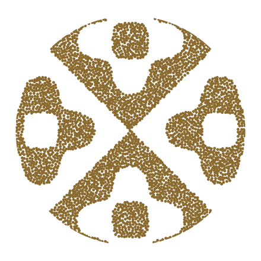

# The grain mark

Four glyphs cut from square-plate Chladni eigenmodes. Each one is a
region of the vibrating plate, stippled into grains; on a mode change
every grain scatters and flies to its place in the next glyph. The name
is literal — sand organizing into structure under vibration is the
visual metaphor for many parallel agent processes converging into one
deterministic workflow.

There is no ring. The circle is an invisible clip, so the shape itself
is the mark.



## What is where

| Path | What it is |
|---|---|
| `ui/src/brand/grain-mark.js` | The renderer, and the one definition of the mark. A verbatim copy of the design pack (v2) — see its header. `createGrainMark()` animates it, `renderStatic()` draws a still. No dependencies. |
| `ui/src/brand/mark-sheet.js` | The contract between the recorded animation and the component that plays it: which sizes have a sheet, how many frames, how long a loop. |
| `ui/src/components/GrainMark.jsx` | The React component the app uses. Picks between the still, the recorded animation and the live one; see below. |
| `ui/src/brand/item-glyphs.js` | The UI's figures: the item glyphs (which figure stands for a task, a repo, a branch, a saved board, a schedule, a template, a suite, a CI run, and why) and the destination glyphs (Inbox, Director, Cache, Settings, System, Metrics, Alerts). Modes the mark's own cycle does not use. |
| `ui/src/brand/item-glyph-paths.js` | Those figures traced to paths. Generated by `npm run brand:assets`; a module rather than a file under `public/` so they can be drawn inline in `currentColor`. |
| `ui/src/components/ItemGlyph.jsx` | The React component that draws one. |
| `ui/scripts/export-glyph-candidates.mjs` | `npm run brand:candidates`. Renders the candidate contact sheets below (`docs/brand/{alerts,ci}-candidates.{svg,png}`) through the real `fillScalar` + `traceFilledContour` pipeline at 16, 20 and 32px in light and dark themes. |
| `docs/brand/{alerts,ci}-candidates.{svg,png}` | Contact sheets of 8 legal Chladni eigenmode candidates each for the Alerts and CI glyphs. |
| `ui/scripts/export-mark-sheets.mjs` | `npm run brand:sheets`. Records the animation to the sprite sheets below, out of a real browser running the renderer. |
| `ui/public/grain-mark-{20,32}.png` | The recorded animation, one sprite sheet per size. Alpha masks, so one file serves both themes. |
| `ui/scripts/export-brand-assets.mjs` | `npm run brand` in `ui/`. Regenerates everything below out of the renderer. |
| `ui/public/grain-mark-{light,dark}.svg` | The static logo as a solid filled path. Scale-free: the favicon, and the still the app shows wherever the mark is not animating. |
| `ui/public/grain-mark-{light,dark}.png` | The same fill at 128px. Favicon fallback only, for browsers with no SVG-favicon support (Safari before 16.4). |
| `ui/public/apple-touch-icon.png` | The same fill at 180px, on the dark ground, opaque and square-cornered: the iOS Home Screen icon. One file, in one theme, because iOS bakes it into the shortcut when it is added — see `index.html` for why none of the three above can serve as one. |
| `docs/brand/grain-hero-2-3minus-{light,dark}.svg` | The static logo at hero scale, as grains. For a README, a slide, print. |

The assets are committed rather than generated during `npm run build`, so
a checkout builds without running the export. Change the mark or the
colours and you re-run `npm run brand` and commit what it writes. That
is two halves: `brand:assets` is plain node, `brand:sheets` needs a
Playwright browser (or `CHROMIUM_PATH` pointing at one already on the
machine).

## The math

Square-plate Chladni eigenfunction, domain normalized to the frame radius:

```
f(x, y) = cos(nπx)·cos(mπy) + s·cos(mπx)·cos(nπy)      s ∈ {−1, +1}
```

v1 of the mark drew the **nodal lines** — the zero set. v2 fills
**regions** instead: `fillScalar` is the scalar whose positive part is
solid, which for three of the four glyphs is `−f` (the negative lobes,
filled) and for 1·3 (+) is the last factor of `2ab(2a²+2b²−3)`, filling
the centre loop and the corner caps while the grid lines `a = 0`, `b = 0`
come back as stroke overlays. That change is why nothing from v1's
notes about tracing and pruning chains carries over.

Only **integer** `n, m` are real resonances — fractional values pile up
spurious features, so never interpolate a mode number to get between two
figures. Scale is the free parameter instead: two glyphs reach their
shape by zooming the field (`glyphZoom`), never by moving `n` or `m`.

## The glyphs

| Slot | Mode | Glyph | Treatment |
|---|---|---|---|
| 0 | 1·3 (+) | grid-and-loops | centre loop and corner caps filled; the grid lines are stroke overlays, with grain rows along them |
| 1 | 1·2 (+) | diamond | inverted fill |
| 2 | 2·3 (−) | **rosette — the static logo** | inverted fill, zoom 0.78 so the rosette sits inside the circle rather than running off it |
| 3 | 2·3 (+) | plus | inverted fill, zoom 1.5 so it fills the circle; keeps the centre ring |

Cycle order is 0 → 1 → 2 → 3 → 0.

## The item glyphs

The mark says whether agents are working. The **item glyphs** say what a
row *is*: one figure per kind of thing grain keeps a list of, cut from
the same plate and clipped to the same circle, and shown in the sidebar
beside Repos, Schedules, Templates, Suites and CI. Before them those nav
entries carried an invisible spacer dot each, so nothing but the word
distinguished them.

The set grows with the app. Tasks and branches joined it in
grain/task-372, which is the round that caught it up with the two kinds
this UI names most often and had never drawn: a task on the rail's own
All tasks entry, at the head of every task list and in the schedule
editor's "a task or a suite"; a branch on a repo's Branches list and in
the Base menu the task views filter by. Saved boards joined in
grain/task-465: unlike the task views inside them, boards themselves are
saved, ordered items with a list page of their own.

| Item | Mode | Zoom | Figure | Why this one |
|---|---|---|---|---|
| Tasks | 3·4 (−) | 1.6 | four lobes on one centre | Several components converged into a single cohesive unit of work: four heavy lobes meeting at one centre. |
| Repos | 2·4 (+) | 2.2 | ring | A repo is the boundary everything else sits inside — a task, a schedule and a suite each name one, and none names two. The only figure in the set that closes a single loop around its own middle and is nothing else: the task's mass above encloses a hole too, but as an opening cut in a solid rather than as a ring. |
| Branches | 3·5 (+) | 2.4 | a stem split in two | One line of work leaving another and coming back to it, which is the whole life of a branch grain cuts: a stem that opens into two down the middle and closes again above and below. The split is the figure, so it is framed where the two halves are as wide as the stem carrying them. |
| Boards | 3·3 (+) | 1.0 | columns and blocks | The arrangement a saved view gives the tasks inside it. The figure appears on the Boards page heading and on saved board entries in the rail. |
| Schedules | 1·4 (−) | 1.7 | two posts, open middle | Two heavy posts either side of an open middle, capturing the recurring cadence of timed dispatches. |
| Templates | 4·5 (+) | 1.2 | lattice | One cell stamped across the whole frame — which is what a template is: one task definition, used again and again. |
| Suites | 3·6 (−) | 1.4 | six lobes in clustered pairs | Six lobes arranged in clustered pairs meeting across the plate: composite task definitions grouped as a single qualification suite. |
| CI | 3·2 (−) | 1.4 | winged gate arms closing on a channel | The gate a commit passes through: two broad winged arms converging from either side onto a central pipeline channel, with twin entry/exit beads above and below the pass. The transpose of the static mark's 2·3 (−) rosette mode, chosen from `docs/brand/ci-candidates.svg`. |
| Sandboxes | 4·1 (−) | 1.7 | nested chambers | Nested chambers for isolated executions. |
| Sessions | 5·1 (−) | 1.5 | dialogue bars across a channel | Interactive console sessions and conversations with agents. |
| User | 2·5 (+) | 2.0 | head and shoulders | A rounded head resting above an arched shoulder bust, capturing the classic avatar / user silhouette. |

## The destination glyphs

The rail's last three entries — **Settings**, **System** and **Metrics** —
are not kinds of thing grain keeps a list of, so they are not item
glyphs. They were, though, the only entries in the rail with no marker at
all and no icon column either, which left their labels starting a
figure's width to the left of everything above them. They have a set of
their own now (grain/task-58), cut off the same plate and by the same
rules — and the **Inbox** and **Director** at the top of the rail joined them,
being destinations rather than a list of items:

| Destination | Mode | Zoom | Figure | Why this one |
|---|---|---|---|---|
| Inbox | 2·2 (+) | 2.4 | tray | Heavy straight walls all the way round a middle that is left open. The inbox is the one pane about the reader rather than about the work, and a tray is what fills up while nobody is looking. It is the third closed outline in the two sets, so it is framed to be read against the other two rather than with them: a wall thick enough to be the figure, with the hole as its middle. |
| Director | 3·4 (+) | 1.4 | portico and podium | The standing director session at the top of the rail, directing and orchestrating work across the deployment. |
| Cache | 1·6 (+) | 1.4 | crate of stacked layers | A crate of stacked layers for cached dependencies and packages. |
| Settings | 2·6 (+) | 1.6 | gear | A toothed gear with a hollow central hub. The settings are the machinery and enclosure everything else in this deployment runs inside, and the gear serves as the icon wherever settings or configuration are represented. |
| System | 1·5 (+) | 1.4 | case around a core | Two walls, two caps and one solid block in the middle: the machine this deployment runs on, and grain running inside it. The only figure in either set with an outer wall and a centre of its own. |
| Metrics | 1·5 (−) | 1.5 | tiered gauge between caps | Two solid caps bounding horizontal measurement tiers, capturing throughput, latency, and execution statistics. |
| Alerts | 2·5 (−) | 1.4 | bell dome over a flared lip and clapper | A rounded dome over a wide flared lip and clapper bead below, echoing the silhouette of a notification bell. The minus partner of the user avatar's 2·5 (+) resonance, chosen from `docs/brand/alerts-candidates.svg` and rendered in the header rail and phone bar (`AlertsButton.jsx`). |

**They read as a set.** What separates a destination from a kind, before
a reader has learned any single figure, is what the figures are made of:
the item glyphs are mostly the plate's curved and pointed regions — a
diamond ring, a bowtie, a diagonal lattice, four lobes, winged gate arms, a split
stem, a filled mass — and the destinations are its straight-walled ones,
trays and boxes and posts. Boards deliberately make one straight-walled
exception: columns are the clearest figure for the kind, and the figure
appears on its list heading rather than among the rail's destinations.
Settings, Inbox and Repos are the sets' closed outlines, and
those are the ones to watch: a toothed gear with a hollow center,
a thick-walled tray, and a diamond ring that fills the frame.

**Saved boards, Director, and console sessions carry figures.** A board
is a row in grain's database, exported to the state repository, ordered and
filed under a folder, with a list page of its own and entries in the rail.
3·3 (+) at 1.0 gives boards the literal columns and blocks of a saved view.
Director and interactive console sessions carry dedicated figures representing
orchestration (portico and podium) and dialogue (dialogue bars across a channel).
State filters keep the dots whose colour is their useful meaning.

**These framings are the first cut**, and the plate has less left than it
looks. Two properties of the fill decide most of it: the fill is inverted
(`fillScalar`), and `f(0, 0) = 2` for every `s = +1` mode, so a plus mode
*always* has a hollow centre and reads as a ring or a frame; and every
`s = −1` mode is zero along both diagonals, so a minus mode always
pinches there and reads as a bowtie or as pieces around an open middle.
Zooming in far enough that only the innermost contour is in frame drives
every mode to one of those two limits, so the character lives in the
middle of the zoom range, where several contours are in shot. That leaves
about six readable characters — ring, frame, bowtie, lattice, lobed star,
pieces around a hole — and the figures now use all of them. CI's gate
arms (3·2 (−) at 1.4) take the static mark's 2·3 (−) rosette mode on its
transposed axis, which the plate gives for free because swapping `n` and `m`
transposes the field. That is not free of the constraint above — a
transposed mode is a new figure only at `s = −1`, where the swap negates
the field; at `s = +1` the field is symmetric in `n` and `m` and 4·2 (+)
is simply the repos ring under another name, which `item-glyphs.test.js`
now refuses. Alerts (2·5 (−) at 1.4) pairs with the user avatar's 2·5 (+)
mode by flipping the sign, turning the head-and-shoulders arch into a
rounded bell dome over a flared lip.

The three added in grain/task-372 mine a different seam, and it is the
one left: **weight and what the hollow is**. All three are plus modes, so
all three have the hollow centre the paragraph above promises — they
differ in how much of the frame the wall takes and what shape it leaves.
Tasks is a wall so heavy the figure reads as a solid with a lens cut out
of it (70% of the frame inked); Inbox is a tray whose hollow is most of
its middle (50%); Branches leaves a slot rather than a middle, which is
what makes it a split stem rather than a ring. Ink is worth measuring the
next time this set grows: it is what tells the task's mass from the
inbox's tray at 16px, and it is not what the overlap test measures. The
zooms above are chosen by eye rather than derived; expect them to be
refined, and expect a genuinely new character to want a new dial rather
than a new mode number.

## What holds them apart

**No mode the cycle uses.** All of them are absent from `GLYPHS`, so a
nav icon is never the figure the mark beside them is showing at that
moment. Sign counts as part of the mode: 1·2 (−) is the hourglass and
1·2 (+) is the mark's diamond — the same resonance, the plate's other
half, a different figure. So does the order of `n` and `m`, but only at
`s = −1`: 2·1 (−) is CI's jaws, and at this framing it is nearly the
hourglass's inverse, while at `s = +1` a swap is no change at all and
`item-glyphs.test.js` treats `n·m (+)` and `m·n (+)` as one mode.
It holds them all off the cycle, and holds them apart
from each other: it fails if any pair of figures agrees on more than
four fifths of the frame, which is the way two icons stop being worth
two icons. The closest pair in the set is the settings frame against the
repo ring at 27% of the frame — two of the three closed outlines — with
the split stem against that same ring at 28% and the hourglass against
the four lobes at 29%. All are a comfortable distance above the floor,
and all are pairs worth looking at again if these figures are ever
refined. The furthest apart are the jaws and the hourglass at 97%.

**Zoom is the only other dial**, for the pack's own reason — mode
numbers are resonances and interpolating one piles spurious features
into the field, so a figure is framed by scaling it (`glyphZoom` already
does this for two of the mark's four). Each zoom above is the framing
where the figure reads as one shape at 16px instead of as texture.

**Where they are used.** The nav rail's list entries and the list
pages' headings first, and then everywhere else a row refers to one
of these kinds and the word was doing the work alone. The three
destination figures are used in one place only — the rail — because
there is no second place a destination is named in passing the way a
template or a repo is, and the pane each one opens says its own name in
a heading three sizes up:

| Site | Figure | What it says |
|---|---|---|
| Nav rail; the list pages' headings (`ListHeader`'s `icon`) | that kind's own | which list this is; Boards uses it only on the heading, not on each saved view in the rail |
| Nav rail, the three footer entries | that destination's own | which of the three this is |
| A task row's and a board card's `scheduled` / `suite` chip | schedules / suites | which of the two filed a task nobody typed in |
| The task pane's Review row | templates | the review attached to this task came out of a template |
| The filter editor's value menus for Repo, Reads and Origin (`taskAttributes`' `glyphOf`) | repos, schedules / suites | these values are repos; these two origins are a schedule and a suite |
| A schedule row's "Suite:" / "Template:" chip | suites / templates | which of the two this schedule fires |
| A suite row's template count; a suite run's "Scheduled" chip | templates, schedules | a suite is a list of templates; a clock started this run |
| Every heading that opens one of the four: the template, schedule and suite editors, `SuiteRunOverlay`, `RepoPage`, `RepoReleases` | that kind's own | this pane is the thing the row that opened it named |
| Every picker that names a template: `ScheduleOverlay`'s, `SuiteOverlay`'s, `NewTaskOverlay`'s Review, a repo's qualification plan | templates | this list is written on the Templates page |
| `ScheduleOverlay`'s "Fires" choice and suite picker; `SuiteRunOverlay`'s suite picker; the Suites page's "Runs" heading | suites | a run is a run *of a suite* |
| `RepoField`, `ReadOnlyReposField`'s results | repos | this field names a repo |

**One placement rule** for all of them, in `ItemGlyph`'s own
`GlyphLabel`: 16px, inline, in front of the word, decorative — the
label is right beside it, and a screen reader announcing the figure too
would only say it twice. A list heading is the one exception at 20px,
and so is a heading that opens one of these kinds, which is the same
figure at the same size as the list heading it opened over. A row that
sits in a glyphed menu but names none of the four kinds ("A task"
beside "A suite", the template picker's "None", "Any repo") holds the
slot open and empty rather than starting its label a figure's width to
the left. `RepoField` is the one site that marks the field rather than
each option, because a native `<option>` can hold no markup; a menu row
that opens with a checkbox takes the glyph *after* the box, which is a
control rather than a label.

**What deliberately carries none.** A marker every row has marks
nothing: the repo chip on a task row, and the rows of the list
pages themselves, are left plain — the page heading has already said
what kind of thing the list holds. Neither do the views that show tasks
rather than a list of their own kind (Inbox, the board, the state
filters), which is why those nav entries keep the invisible `dot
dot-all` that holds their labels in the rail's own column.

**Solid, traced, inline.** They are drawn as filled paths rather than
grains for the reason the still is: at 16px a grain is smaller than a
pixel. `npm run brand:assets` traces them out of the field the same way
it traces the still, into `item-glyph-paths.js`, and the test compares
the committed paths back against the field — so a figure changed without
the export being re-run fails rather than leaving the nav showing the
previous icons. Two things differ from the still's export: the frame is
met *while tracing* rather than clipped afterwards, so each glyph is one
self-contained `<path>` with no `clipPath` and so no document-unique id
on a page rendering several; and the fill is `currentColor`, so the
glyph takes the colour of the label beside it — it brightens with a
selected nav entry, and one asset serves both themes.

## The two states

The mark has exactly two jobs in the app, and the split between them is
the point of it:

**Still — the 2·3 (−) rosette.** Everywhere an icon has to hold still:
the favicon, the iOS Home Screen icon, the mark beside the wordmark in
the sidebar whenever nothing is running, and a task row that is not
currently running. It is drawn as a **solid fill** rather than as
grains, at every size — under about 20px a grain is smaller than a pixel
and the stipple washes out to a smudge, and a still that switched
treatment partway up the size range would make the sidebar and the
loading screen two different pictures of the same mark. It ships as one
scale-free vector, so a single file is sharp everywhere a browser asks
for an icon. The Home Screen tile is the one exception, and the reason
`apple-touch-icon.png` is a file of its own: iOS takes no vector there,
discards the alpha channel, and rounds the tile itself, so that one is
the same fill rasterized at 180px on an opaque ground, square-cornered
and inset from the edges.

**Animated — the cycle.** Shown while agents are actually working, which
in the UI means at least one task is in the `running` state. Grains
scatter and fly between the four glyphs, matched to their targets by
nearest free slot, so the flight reads as sand reorganizing rather than
as a crossfade.

It comes in two forms, split at 48px — the pack's own line, above which
it asks for grains and below which it asks for the solid fill.

*Below 48px the mark holds its dwell crisp.* It settles, sharpens into
the solid glyph, dissolves back into sand to move, and re-forms. A
stipple standing still at icon size is the thing that reads as mush, and
this takes that away without giving up the flight. The dwell is 0.9s
rather than the pack's 0.33s — held that briefly the settled glyph would
read as a flicker in the flight rather than as a state — which makes the
loop about 9s against the pack's 6.5s.

**The settle overlaps the flight**, starting at seven tenths of it. The
module eases the flight with a cubic, so its last fifth covers three
percent of the distance: 260ms in which the grains have visibly arrived
and nothing is happening. Waiting for the clock and only then fading put
the crisp glyph a third of a second after the motion stopped, which
reads as a snap however soft the fade is. Starting at 0.7 — 91% of the
distance, still visibly moving — the 280ms fade finishes just before the
flight's own clock does, and the mark crystallizes *as* it arrives.

The fade is doing real work rather than softening a seam. `sampleGlyph`
places grain *centres* inside the region, so every grain bleeds a radius
past its edge: the settled cloud is the solid glyph **dilated** by that
much, about half again as much ink at 20px. Cut, that pops four times a
loop; faded, the same difference is the point — the mark reads loose
while the sand is in the air and tight once it lands.

*Above 48px it runs the pack's own uninterrupted cycle* — 1.3s of flight
and 0.33s held, about 6.5s round. Not because crisping would be
invisible at that size (the gap is a thin outline there and would fade
cleanly) but because the stipple **is** the picture at hero scale, and
flattening it to a fill four times a loop would throw away the texture
that makes the mark worth showing large.

Either way the animation **opens on slot 2** — the rosette, the figure
the still was already showing — so the mark comes to life rather than
cutting to a different image.

## Recorded, not simulated

Every animated mark at a recorded size plays a **sprite sheet** rather than
running the particle system. `npm run brand:sheets` captures one cycle
frame by frame out of a real browser running `grain-mark.js` itself, on
a stubbed clock and a seeded `Math.random` — so a sheet is not an
imitation of the animation, it is that animation, recorded. Nothing in
the exporter reimplements the flight, which is what keeps it from
drifting; all it shares with `GrainMark.jsx` is the four timeline
constants.

| | |
|---|---|
| Frames | 204 — one full cycle of all four glyphs |
| Rate | 24fps. At the peak of a flight a grain covers about half a CSS pixel per frame, so the quantization is invisible and there is nothing to gain from more. Frames are the whole cost of a sheet, so this is the dial. |
| Size | Rendered at 2× device pixels: sharp on a retina display, clean downscaled on a 1× one |
| Weight | 114 KB at 20px, 221 KB at 32px, fetched only when a mark first animates |

Three things make it cheap. The sheet is an **alpha mask**, not a
picture — every pixel of the mark is one colour at a varying alpha — so
`background: var(--accent)` supplies the colour and one file serves both
themes and follows a theme change with no reload. (It is a
grayscale+*alpha* PNG for that reason: a CSS mask reads the alpha
channel, and a plain grayscale image has none, so it masks nothing and
the mark renders as a filled square.) Frames are stacked **vertically**,
so the 43% of them that are held dwells become repeated scanlines that
PNG's Up filter collapses to nothing; in a row they would be repeated
columns, which it cannot. And playing it is a `steps()` animation on
`mask-position` — compositor work that costs the same whether one mark
is on screen or twenty. A task list with twenty running rows used to be
twenty particle systems.

It also fixes something the live renderer could not do: every mark is
**in lockstep**. A CSS animation starts when its element is attached, so
a task row that started running ten seconds after the sidebar would keep
its own phase; `GrainMark.jsx` pins every one to the document timeline's
origin instead, so the sidebar and every running row scatter and settle
together. It re-pins on every `animationstart` rather than only at
mount, because an element that is detached and reattached starts its
animation over from the moment of the move — and moving a row's DOM node
is what React does whenever a keyed list reorders, which a task list
does every time a task changes state under the "State" sort or a filter
drops the rows above it.

The hero keeps the live renderer. Its frames would be 640px square —
80MB of pixels in a strip, past what a browser will decode — and it is
one canvas on a screen with nothing else on it, which is the case the
pack's renderer was written for. Any size without a sheet falls there
too, so a new call site works before anyone has recorded one for it: the
upgrade pane's 96px mark is one such, and for the same reason as the
hero rather than by accident — one mark, on a pane that is being watched
and has nothing else moving on it, for the minutes an upgrade lasts.

Two things suppress the animation and fall back to the still: a reader
who has asked for reduced motion, and an environment with no canvas to
paint on. A hidden tab pauses it.

## Sizes

| Where | Size | Why |
|---|---|---|
| Task-row badge (`StateDot.jsx`) | 20px | The floor: below this the glyphs stop being shapes. Replaces an 11px dot, and the ~40px task row absorbs it. |
| Sidebar (`Sidebar.jsx`) | 32px | The four glyphs are clearly distinguishable here, which matters because this mark is a brand element people look at rather than a status light. |
| Upgrade pane (`UpgradePanel.jsx`) | 96px | An upgrade takes minutes and this pane is what is watched for them; the mark is the subject here rather than a status light, so it is sized like one. As much of the hero's treatment as fits in a settings tab above the step list. |
| Loading screen (`LoadingScreen.jsx`) | 320px | Over the pack's 300px threshold, so it gets the full 3200 grains. |

Grain count and radius are the pack's `grainSpec()` at every size:

- **≥ 300px** — 3200 grains, radius 0.55% of the width (hero, splash)
- **29–299px** — 140·(W/28)² grains, ~1.05px radius
- **≤ 28px** — 230·(W/28)² grains, ~0.85px radius

Grain stippled the small marks three times more thickly than this for a
while, in a `grain-density.js` that is now gone. It was there to make a
*settled* small mark read as a shape rather than as hatching, and
crisping the dwell made it first unnecessary and then actively harmful:
the flight is the only place those grains are still seen, and at that
density a 20px mark in the air is a featureless blob rather than sand.
The pack's own count is what reads as sand — that is what it was tuned
for.

`GrainMark.jsx` reads the spec at the mark's **CSS size, not the
canvas's backing size**. The module keys the spec off `canvas.width`, so
on a 2× display a 20px mark backing onto a 40px canvas would take four
times the grains at half the size — a finer stipple, not a sharper one.
The radius is a fraction of `canvas.width` and so scales itself; only
the count needs the correction. Count and radius are both plain options
on the module, so all of this costs the vendoring no deviation.

## Colour

The grain colour is the app's accent, and everything else in the palette
is arranged under it (`ui/src/style.css` for the custom properties,
`ui/src/theme.js` for the MUI palette — the two carry the same values
and are edited together).

| | Grain / accent | Ground |
|---|---|---|
| Dark | `#D9A441` wheat | `#0F1013` canvas, `#14161A` surface |
| Light | `#8A6A2E` bronze | `#F7F6F3` canvas, `#FFFFFF` surface |

The gold washes out on white, which is why the light theme gets bronze
instead of the same value at a different opacity. The neutrals are
warmed to sit under both.

`running` is the accent itself rather than a colour of its own: the dot
in a task row and the animating mark in the sidebar are reporting the
same thing. `warning` is pulled off MUI's default bright orange to a
burnt one so it reads as the accent's louder cousin rather than fighting
it; `info` is the one cool tone left, gold's complement.

## Notes on the assets

- The hero SVGs are the pack's own export reproduced: `npm run brand`
  writes the same 440px, seed-42 grain field the pack's `export-svg.mjs`
  does, byte for byte. That is what pins the vendoring — if the module
  drifts from the pack, those two files stop matching.
- The still's vector is traced out of `fillScalar` by marching squares
  and then simplified, because a filled region has no chains to export
  the way v1's line figure did. `grain-mark.test.js` compares the
  committed path back against the field, so a mark changed without
  `npm run brand` being re-run fails rather than leaving the tab showing
  the previous logo.
- The canvas particle system is a proof of concept; a version that ran
  the mark large and continuously should move it to a shader.
  `sampleGlyph()` and `fillScalar()` are pure geometry and port
  straight — evaluate `fillScalar` per pixel for the solid version, or
  drive a GPU particle system with `sampleGlyph` output. At the sizes
  the app uses it is a hundred-odd filled arcs a frame, which is why it
  is worth keeping here — and why it stops when the tab is hidden.
- Wordmark: **Space Grotesk 600**, lowercase `grain`. The app itself
  ships no webfont and sets the wordmark in the system stack.
