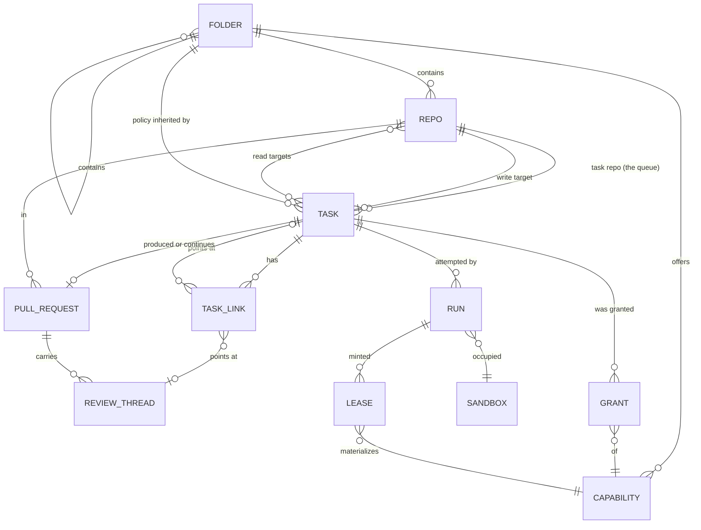

# The task data model

## Status

A design, not an implementation. Nothing in `grain/` changes with this
document. One question is
[decided](#decided-whoever-writes-it-owns-it) — three records, sorted by
who writes what — and one
[direction](#direction-the-declaration-moves-into-a-repo) is stated but
not settled: the declared half of the model moving out of issues and into
a repo, with [a first-party UI](#direction-a-first-party-ui) over it.
Everything below is written for tasks-as-issues and stays correct for
that; it names the entities the automation loop already manipulates,
states the invariants it already relies on, and proposes a shape that
makes the next few features cost less than the last few did. The
[migration](#migration) at the end is staged so that each stage is
shippable on its own and none of them changes what an operator sees on
GitHub.

The model covers **tasks and everything hanging off one**: the repos a
task reads and writes, the folder tree whose policy it inherits, the
capabilities it is granted, the pull requests it produces or continues,
the review threads it answers, the sub-tasks it spawns, and the runs it
takes to get there. It deliberately does not cover the VM layer (`grain/adapter/`),
the git proxy, or the credential files — those have their own designs and
no task ever names one directly.

## The problem: the model is real, but it is not written down

Grain already has a task data model. It is spread across four places that
each hold a piece of it:

- **GitHub labels** hold a task's state — `trigger_label`,
  `in_progress_label`, `awaiting_reply_label`, `needs_approval_label`,
  `completed_label` — and its capability grants: `gemini_key_label`,
  `self_debug_label`, `self_repair_label`, `scratch_repo_label`,
  `grain-github-<name>`. `labels.py` is explicit that these are two
  different tiers and that a task is in exactly one state at a time, but
  that invariant is prose and a colour-lightness test, not a type.
- **The issue body** holds the rest, as slash directives: `/repo`, `/pr`,
  `/base`, `/auto-merge`, `/review`, `/depends` (`directives.py`).
- **`AutomationState`** holds what only grain knows: which sandbox is
  working which task, what got minted for it, what a poll should compare
  against next cycle.
- **`ResolvedTask`** holds the joined-up answer for exactly as long as one
  `_dispatch` call, and is then flattened onto an `Assignment`.

That arrangement works, and much of it is right for good reasons this
model keeps. What it costs is visible in the shape of the code:

**A new capability costs five edits in four files.** `gemini_key_label`
needed a field on `AutomationConfig`, a row in `labels._STYLES`, a branch
in `_resolve_target`, a field on `ResolvedTask`, a field on `Assignment`
*plus* its hand-written `load`/`save` pair, a revoke branch in
`sweeper._release`, and a reaper of its own in `core.py`. `gcp_key_id`
then repeated every one of those steps for a value that means the same
thing — *something was minted for this task and must be revoked when the
slot frees* — which is why `core.py` now carries `_reap_expired_gcp_keys`
and `_reap_expired_gemini_keys` side by side, two loops that differ only
in which client they call.

**One task is spread across five parallel dicts.** `AutomationState` keys
`assignments`, `pending_questions`, `open_pull_requests`,
`completed_issues`, and `proposed_task_issues` separately, each with its
own `record_*`/`clear_*` pair. They are five views of one entity, and
nothing structurally prevents two of them from disagreeing about the same
issue number.

**Relationships between tasks exist but are not represented.** Three of
them already do, and each is tracked differently:

| Relationship | How it exists today | Where it is stored |
|---|---|---|
| *blocked by* | `/depends 12,34` | re-parsed from the body every cycle |
| *fixes this PR* | `_suggest_fix` files a task | `OpenPullRequest.fix_issue` |
| *proposed while working on* | `_file_proposed_tasks` | an English sentence in the issue body |

The third is the sharpest example: `_file_proposed_tasks` writes
"Proposed by `owner/repo#N` while working on that task" into the body as
prose. The edge is real, grain created it deliberately, and nothing can
query it.

**A bare issue number is not an identity.** `Assignment.issue` is an
`int`, implicitly in whatever `AutomationConfig` currently names as the
task repo. `docs/next-session.md` records what that cost: repointing a
live controller at a different task repo left a stale `sandbox-0 → #201`
assignment that made `_requeue` throw an uncaught 404 and abort
`run_once` entirely. The fix caught the 404. The reason it was possible
is that the record could not tell anyone which repo its number belonged
to.

None of this is urgent. All of it gets worse with sub-tasks, which
multiply every one of the above by the number of children a task has.

## The one decision the rest follows from

**What is a record, and what is a derivation.** Grain already has a
doctrine here, stated in fragments across four module docstrings. Written
out, it is four rules, and the model is mostly just the consequence of
taking them seriously:

1. **GitHub is the system of record for anything a human touches.** A
   task exists because an issue exists. Its text, its state pill, its
   capability grants, and the approval that lets it run are all things a
   human reads and edits on GitHub. Grain never invents a task with no
   issue behind it — which is exactly why `_suggest_fix` and
   `_file_proposed_tasks` file real issues rather than queueing something
   internal.
2. **Grain's store is the record for what only grain knows.** Which
   sandbox holds which task, which key was minted, which comment id a
   poll is comparing against. None of that has a home on GitHub, and none
   of it is a human's to edit.
3. **Anything derivable is derived, never stored.** `branch_name(issue)`,
   `repo_for_sandbox(sandbox)`, `agent_label(sandbox)` are pure
   functions of something already in hand. `Assignment` records
   `branch` only for the PR-continuation case, where the name is the PR
   author's choice and there is nothing to derive it from. This is
   `docs/roadmap.md` item 2's "deterministic, not self-reported."
4. **Anything read from editable text is pinned once, at dispatch, and
   never re-read.** `Assignment.target_owner`, `.base`, `.auto_merge` are
   all on that dataclass for this one reason: an issue body can be edited
   mid-run, and an edit landing between dispatch and finish must not be
   able to redirect where the work lands.

Rule 4 has one deliberate exception, and it is worth naming because the
model has to keep it: **`/depends` is re-read every cycle on purpose.**
Whether a dependency is still open changes with nothing about the task
itself changing, so pinning it at dispatch would mean a task stayed
blocked after its blocker closed. Pinned-at-dispatch is the default;
"evaluated fresh" is a property some relationships have.

### Decided: whoever writes it, owns it

Where grain's own store and GitHub's labels disagree, **the store wins**.
Labels are a projection, reconciled every cycle by reasserting what the
store believes — the self-healing shape `_refresh_agent_labels` already
uses, where a label knocked off by hand comes back on the next pass
rather than staying wrong.

But "the store is authoritative" is too broad as a general rule, and the
place it breaks is pull requests. Whether a PR is open, whether it merges
cleanly, whether its checks pass, whether a human resolved a review
thread — none of that is grain's to decide. Grain did not cause it and
cannot overrule it. If the store says a PR is clean and GitHub says it is
conflicted, GitHub is right, and no amount of reasserting will change it.

So the rule is not two categories but three, and the test that sorts them
is **who is the writer**:

| | Written by | Record | Grain's copy is |
|---|---|---|---|
| **Declaration** | a human, deliberately | the issue body — or a repo, per the direction below | the parsed form, pinned at dispatch |
| **Grain's own acts** | grain, and only grain | the store | the record itself |
| **The outside world** | GitHub, and humans through it | GitHub | a baseline, not a belief |

The third row is what the PR case is about, and it covers more than PRs:
issue open/closed (`_is_issue_closed`'s cancel-on-close poll), branch
existence and head sha, check runs, review threads and their resolution,
and every label a *human* applies.

**Grain already behaves this way; it just was not written down.**
`PullRequestDetail.mergeable` is read as `None` while GitHub is still
computing it, and `_close_finished_prs` treats that as "ask again next
cycle" rather than as an answer — an explicit admission that grain's view
is a possibly-absent cache of something it does not own. Every finish
path calls `branch_exists` before acting, on the stated grounds that the
unit exiting zero is not proof the branch is there. That is the same rule:
for anything GitHub owns, a fresh read beats grain's own record.

**A stale copy is not corruption — it is the signal.** This is the part
worth being precise about, because "cache" undersells it. When the store
says grain opened PR #42 and a fresh read says #42 is closed, the store
is not wrong; it holds the *previous* value, and the delta is exactly the
event `_close_finished_prs` exists to notice. The same shape is already
load-bearing three times over: `PendingQuestion.question_comment_id` and
`CompletedIssue.baseline_comment_id` are both last-seen values whose only
purpose is comparison against a fresh read. So the store's copy of an
external fact is a **baseline**, and its job is delta detection rather
than truth.

**The trigger label stops being an exception.** In the two-category
version it had to be carved out — a human applying it is an input, not a
claim about state. With three categories it is simply an ordinary member
of the third: a thing the outside world writes, which grain observes and
never reasserts. The carve-out was an artifact of the wrong number of
categories.

### What grain still owns about a pull request

GitHub owns a PR's **state**. Grain owns its **meaning in the task
model**, and GitHub has no representation for any of it:

- which task the PR belongs to, and why it exists;
- whether it was asked to auto-merge (a property of the *task's*
  declaration, not of the PR);
- whether it is a member of a `MERGE_WITH` group;
- which of its review threads have already been turned into tasks;
- whether grain is still watching it at all.

So `TrackedPullRequest` keeps every field that is grain's own and marks
the rest as observed:

```python
@dataclass(frozen=True)
class TrackedPullRequest:
    ref: PullRequestRef
    task: TaskRef
    branch: str
    base: str
    auto_merge: bool              # the task's declaration
    merge_group: tuple[TaskRef, ...]

    # Observed. A baseline for comparison, never a basis for a decision
    # without a fresh read.
    health: PrHealth
    head: str | None              # last-seen head sha
    observed_at: datetime | None
```

`head` is what makes "did anything change since we last looked" a cheap
question — for the review-comment loop bound, for confirming an agent
actually pushed, and for deciding whether a cached `health` is worth
trusting for one more cycle. `BranchHead` (sha plus commit message)
already exists and already returns it.

**One disagreement is a decision, not a fact.** GitHub has its own
auto-merge feature. If somebody enables it on a PR whose task did not ask
for it, grain and GitHub disagree about what *should* happen rather than
about what is true. Grain should not fight it: the PR merging is an
observation like any other, and `_close_finished_prs` already handles a
merged PR correctly. Nothing should try to turn it back off.

### Representation is not the model

The entities below are the model. Every storage and wire detail this
document mentions is **representation**, and each can change without the
model changing:

| Model | Representation, today |
|---|---|
| a task has a stable identity | a GitHub issue number in a repo |
| `TaskState` | a label, in a particular hex colour |
| `Grant` of a capability | a label named `grain-<capability>` |
| a task's declared fields | slash directives in an issue body |
| the store | one JSON file, rewritten whole |
| `PrHealth` | GitHub's `mergeable: true/false/null` |
| `Folder` | a JSON file under `/data/config` |

Reading the table top to bottom is also a list of the places this
document has had to argue about a representation as if it were a design
question — the label palette, the directive grammar, whether a folder
name extends `/repo`. Naming the split once is what makes those
recognisable as the smaller questions they are.

**The three records want three different representations, and should not
share one.** This is the most useful thing the split buys, and it is
easy to miss:

- **Declaration** is reviewed in pull requests, so it must be diffable,
  human-readable text. Its pressure is legibility in a diff.
- **Grain's own record** is written many times an hour and read by both
  the loop and a UI. Its pressure is cheap read-modify-write with atomic
  durability — which is what a whole-file JSON rewrite is already
  straining against.
- **Observed facts** are a cache of something GitHub owns. Their pressure
  is freshness, and their durability requirement is the weakest of the
  three: losing them costs an API refetch, not correctness.

That last point is a real freedom rather than a technicality. The
observed record does not need to live in the durable store at all — it
can be in memory, or in a file that is safe to delete. The one caveat is
baselines: losing `CompletedIssue.baseline_comment_id` or
`PendingQuestion.question_comment_id` degrades rather than corrupts, and
`CompletedIssue` already re-primes from a fresh read by design for
exactly this reason, but a lost question baseline can cost a redispatch
nobody asked for. Rebuildable, not free.

**The anti-pattern to avoid is already in the codebase.**
`AutomationState.load`/`save` are hand-written per field, so every new
field costs three edits — the dataclass, the loader, the writer — and
`gemini_key_name` and `gcp_key_id` each paid it. That is representation
leaking into the model: the model gained a field, and the cost was
serialization boilerplate. One serialization boundary, generic over the
dataclasses, makes the model free to gain fields, which is most of why
the five-dicts consolidation in stage 1 is worth doing at all.

**Identity is where the split needs stating carefully**, because it is
the one place a representation detail has leaked into behaviour. The
model requires an identity that is stable, opaque, and **makes a branch
name derivable** (rule 3). A GitHub issue number satisfies all three, and
`branch_name(issue)` uses it. A slug or a monotonic id would satisfy them
equally. Nothing in the model may assume the identity is an integer, is
assigned by GitHub, or is comparable — a task filed later having a higher
number is a property of the representation, not a fact to sort by.

### Principals: three actors behind one GitHub identity

The identity above is a task's. The sharper problem is the *actor's*.
GitHub knows one entity — the user — and grain currently has exactly one
GitHub identity for three different things that act:

```python
class PrincipalKind(Enum):
    AUTOMATION = "automation"  # the controller loop. One per deployment.
    AGENT = "agent"            # one dispatched run, in one sandbox.
    HUMAN = "human"            # a person.
```

**Collapsing them costs three things, all of them visible in the code
today.**

*The trust gate authenticates by string.* Grain posts as a credential
GitHub reports as `OWNER`, squarely inside `_TRUSTED_REPLY_ASSOCIATIONS`,
so every "did a trusted human say something new" check has to subtract
grain's own comments — and it does that by looking for
`_AUTOMATION_SIGNATURE` in the body. That is authentication by
convention. It leaks if a finish path ever forgets to stamp the marker,
or if an agent's relayed output ever contains it. It is also what
[review-sourced tasks](#tasks-from-review-comments) depend on to avoid
grain reviewing its own PR and tasking itself from its own comments
forever, which is a lot of weight for a substring check.

*Attribution stops at the boundary.* `audit.py` records `sandbox`,
`issue` and `outcome`. A sandbox is a *slot*, reused across tasks — so
even grain's own log identifies where something ran, not who ran it.

*The agent identity is minted and then thrown away.* `agent_id()` already
generates eight hex characters per dispatch, and threads them into the
prompt so two agents cannot name cloud infrastructure identically
(roadmap item 16). It is never persisted. `janitor.py`'s own docstring
states the consequence plainly — the agent-id convention is "a prompt
sentence an agent may or may not act on, never enforced or persisted," so
there is **no positive signal** by which agent-created infrastructure can
be recognised. The janitor is therefore built the dangerous way round: an
exclusion list that assumes everything in the project older than the TTL
is fair game *except* what Terraform can be proved to have named. A real
agent principal turns that into an inclusion list.

**The asymmetry that makes this tractable: automation is always the
speaker.** Agents hold no GitHub credential and have no API access — that
is the whole point of the split surface. `core.py` posts every comment,
label, review and merge. The only artifact an agent authors directly is a
**commit**, pushed through the proxy.

So an action has two principals, not one:

```python
@dataclass(frozen=True)
class Attribution:
    actor: PrincipalRef                 # who performed the action
    on_behalf_of: PrincipalRef | None   # whose output is being relayed
```

A comment relaying an agent's `ask_question` is `actor=AUTOMATION,
on_behalf_of=AGENT(run)`. A label grain applies on its own schedule is
`actor=AUTOMATION, on_behalf_of=None`. A human's approval is
`actor=HUMAN`. `_AUTOMATION_SIGNATURE` is one bit gesturing at this
two-field distinction, and becomes a *projection* of it for humans
reading a GitHub thread rather than the mechanism anything checks.

**Authorization stops being implicit.** Three principals with genuinely
different powers, which is what makes the trust gate a table rather than
an argument:

| | Start work | Write the task repo | Push to target repos | GitHub API |
|---|---|---|---|---|
| **Human** (write access) | yes | yes | yes | own account |
| **Automation** | only what a human approved | yes — this is how it proposes | no; it does not author code | full, deployment credential |
| **Agent** | never | **never** | yes, via the proxy, allow-listed only | none |

The two absolutes are already stated elsewhere in this document and now
have a principal to attach to: an agent never writes the task repo (which
is the whole gate — see the [repo
direction](#direction-the-declaration-moves-into-a-repo)), and automation
never starts work a human did not approve.

**The cheap win: `Run.id` and `agent_id()` are the same concept.** One is
in this model and persisted; the other exists in `dispatch.py` and is
discarded. Unifying them costs almost nothing and buys attribution for
free — every commit trailer, audit line and relayed comment can name the
run, an orphaned cloud resource becomes traceable to the task that made
it, and the janitor gets the positive signal it currently does without.

**Principals are model; how they appear on GitHub is
[representation](#representation-is-not-the-model).** This matters
because the obvious objection — "one GitHub account per agent" — is a
representation problem, and an expensive one. It is not required. A
GitHub App or machine account gives automation a distinguishable
identity; a commit trailer names the agent and run in git history
permanently, without any account at all; humans authenticate as
themselves. Three principals, one credential, no seats bought.

### Direction: the declaration moves into a repo

**A stated direction, not yet a decision.** Everything below in this
document is written for tasks-as-issues and stays correct for that. This
section is what changes when the model moves into a repo instead, so
that the decisions still open are made with it in view.

The change is narrower than it sounds, because it splits one thing the
current model conflates:

- **The declaration** — what this task is: intent, target, reads, folder,
  capabilities requested, links, base. Written by a human (or proposed by
  grain), changed rarely, and worth reviewing when it changes.
- **Grain's own record** — which sandbox holds it, what leases are
  outstanding, which PR it opened, how many attempts it has taken.
  Written by grain, changed many times an hour, and worth reviewing
  never.

The third category — what GitHub owns — is unaffected by this direction
and stays where it is.

Today both live half in GitHub and half in the store. The direction puts
the declaration in a git repo as files and leaves the observation in the
store — which is the same line rules 1 and 2 already draw, sharpened
from "what a human touches" to "what a human *authors*."

Answering "whoever writes it, owns it" and moving the declaration into a
repo are the same decision arriving from two directions. The direction
does not collapse the three categories into two — GitHub still owns pull
requests, checks and review threads exactly as before. What it changes is
only the first row: the declaration moves from an issue body to a file,
and stops sharing a surface with the third row's labels.

**What gets simpler.** Five things this document currently works around:

- **`TaskLink` stops needing prose.** `_file_proposed_tasks` writes
  "Proposed by `owner/repo#N`" into an issue body as English because a
  body is the only place it has. In a file it is a field.
- **Approval becomes code review.** `needs_approval_label` exists so
  grain can suggest work without starting it. If grain proposes a task by
  opening a *pull request* against the task repo, approval is merging it
  — reviewed, attributable, revertible, with a diff. The whole
  `PROPOSED` state and the `/lgtm` promotion path collapse into
  machinery GitHub already has.
- **The folder tree comes home.** This document puts it in
  `/data/config` and then spends a subsection on why an in-repo
  `.grain/` file may narrow but never widen. That rule exists because
  agents can write *target* repo content. A folder tree in the *task*
  repo, which no agent can write, needs no such rule — it is just a file
  next to the tasks it governs. There is precedent: a deployment already
  has an operator-owned config repo (bwsalmon/agents), and
  `labels.py` already treats it as the place deployment-wide decisions
  live.
- **A task changes atomically.** Retargeting a task today means editing a
  body and moving a label, with a window where they disagree. In a repo
  it is one commit.
- **Reading the queue stops being an API call.** A `git pull` gives the
  whole declared state, offline, with no pagination and no rate limit.
  `runs_per_hour` does not disappear — PRs, review threads and merges are
  still API work — but the polling pressure moves off the critical path.

**The trust gate gets stronger, with one hard requirement.** Today the
gate is "a human applied a label." It becomes "a human merged a commit to
the task repo," which is better in every way that matters: reviewed
rather than clicked, attributable to a commit author, and revertible.

It holds only if **no agent can write to the task repo, ever.** Not
through the git proxy's allowlist, not through a named credential, not
through a `/repo` directive naming it. A task repo an agent can push to
is a task repo an agent can grant itself capabilities in, which is the
whole gate in one commit. That is one allowlist entry to never add and
one invariant to test, but it is absolute — and it argues for the task
repo being a repo that appears nowhere in `repo-allowlist.json` at all.

**What gets harder: conversation.** Issues are good at the thing files
are worst at. `ask_question` posts a comment and waits for a trusted
reply; `_finish_no_changes` posts an analysis; a parked task explains
itself in a comment a human answers. None of that has a home in a file.

Three ways out, none obviously right:

1. **Hybrid** — files are the declaration, an issue is opened per task
   purely as its conversation thread. Keeps everything that works today
   and pays for it with two objects per task that can drift.
2. **PR threads** — a task's conversation is the review thread on the PR
   that introduced or last amended its file. Elegant for proposal and
   approval; awkward for a question asked days into a running task whose
   file has long since merged.
3. **Conversation moves to the target PR** — questions and analyses land
   on the work's own pull request rather than on the task. Right for a
   question about the code; wrong for a task parked before it ever
   produced a PR to ask on.

This is the question the direction actually turns on, and it is worth
answering before anything is built rather than discovering it in the
middle.

**Identity changes shape.** `TaskRef(repo, number)` borrows GitHub's
issue numbering. Files need their own — a slug, a path, or a monotonic id
assigned at creation — and `branch_name()` derives from the number, so it
follows. This is a small change but it touches rule 3: whatever replaces
the number must still make a branch name *derivable*, not self-reported.

**Consequences for the migration.** Stage 1 becomes more valuable, not
less: if the store holds the whole of runtime state, getting its identity
and shape right is the foundation rather than a cleanup. Stage 2 is
unaffected — a capability registry is a registry wherever grants are
declared. Stage 6's folder work gets cheaper by roughly the whole
narrow-never-widen subsection. Nothing in stages 1–4 is wasted work if
the direction is taken, which is the main reason it is safe to keep
building while this stays open.

### Direction: a sandbox per task

The third assumption, and unlike the other two it is not a preference —
it follows from a decision already made in this document.

**`docs/design.md` names its own trigger.** Long-lived sandboxes are
chosen there knowingly, with the security cost accepted for one stated
reason: tasks "come from the same repo allowlist and run under the same
credential set — they are not mutually distrusting. **That stops holding
if the allowlist ever spans repos of genuinely different sensitivity,
which is the trigger to revisit.**"

[Folder capabilities](#attaching-capabilities-to-repos-and-folders) are
that trigger, by construction. The entire point of a folder offering
`gcp-key` is that tasks under it hold something tasks elsewhere do not.
Two tasks under different folders are then, precisely, under different
credential sets — mutually distrusting in exactly the sense that
paragraph reserves. `/reads` pushes the same way: more repos cloned into
a sandbox that a later task inherits. So the capability model does not
merely coexist with sequential reuse; it dissolves the argument that made
reuse acceptable.

**What it costs, and how to pay it.** The reason for long-lived
sandboxes is provisioning time — a boot plus docker and `kind` — on the
critical path of every task. Two mitigations make that nearly free, and
neither is novel:

- **A golden image.** Provision once into a base image; each task gets a
  fresh VM from it, paying a boot rather than a provision. The adapter
  interface already takes one — `create(name, image, cpus, memMb,
  diskGb)`.
- **A warm spare.** Keep one more VM than the concurrency limit, booting
  ahead of demand, so the boot is off the critical path too. The pool
  already hands out slots; this is a change to which one `free_sandbox`
  returns, not a new mechanism.

**What changes in this model**, which is the part that belongs here:

- **A slot and a sandbox stop being the same thing.** Today "sandbox-1"
  is both the concurrency unit and the VM. Per task, the slot persists
  and the VM does not, so `Run` names both: the slot it occupied and the
  instance created for it. `assignments: sandbox -> run_id` largely
  collapses, since the mapping becomes one-to-one.
- **Un-placement and `cleanup()` both become unnecessary.** Their entire
  job is making a reused VM safe for the next task.
- **The proxy token gets materially better.** `sandbox-tokens.json` mints
  one bearer token per sandbox, today living as long as the VM and
  therefore spanning many tasks. Per task, a leaked proxy token dies with
  the task that leaked it.
- **`SandboxCredentialStore`'s defensive dance goes away.** It currently
  sets *and* clears on every dispatch attempt, specifically to close the
  gap where a `CommandError` partway through dispatch leaves an override
  with no `Assignment` for `_release` to find. A VM that does not survive
  the task cannot carry a stale override into the next one.
- **`design.md`'s non-goal becomes a property.** "Isolating sequential
  tasks on one sandbox from each other" moves from knowingly given up to
  achieved — which is that document's edit to make, not this one's.

**What it does not fix, and this is why the placement design still
stands.** Disposability governs what *remains* in a sandbox. It does
nothing about what *leaves* one: a credential in argv is already in a
process table, one rendered into a prompt is already in a transcript
retained on the controller, and one swept into a commit is already in a
remote repo. Those are the three
[disciplines](#placement-what-materialize-returns), and per-task
sandboxes make them more load-bearing rather than less, since they become
the only thing standing between minted material and somewhere permanent.

### Direction: a first-party UI

Also assumed. It composes with the direction above — a UI is the editor,
a repo is the storage and audit layer, and git stays underneath — and it
removes a constraint that has been shaping this document more than is
obvious.

**Almost everything about labels is a workaround for not having one.**
`labels.py` spends its docstring on a two-tier palette: state labels dark
and saturated so they read as a solid pill down a list of issues,
capability labels pale so they annotate rather than compete. That is a
rendering strategy for GitHub's issue list, expressed in hex colours,
with a test holding the tiers apart by lightness. With a UI, `TaskState`
and `Grant` render however the UI renders them, and the palette stops
being part of the model's correctness. Labels either disappear with the
issues or degrade to an **export** — a projection for people still
looking at GitHub, which is a nice thing to have and a bad thing to
depend on.

The same goes for three other workarounds this document carries:
relationships written as prose because a body is the only place for them,
`needs_approval_label` because GitHub has no approve button for a thing
that is not a PR, and `/lgtm` because a comment is the only affordance a
thread offers.

**The most valuable thing a UI adds is authoring-time validation.**
Directives exist because an issue body is free text and that was the only
channel. Everything they can get wrong is therefore discovered *after*
the task is filed, which is why `DirectiveError`, `_park`, and a whole
family of hand-written explanatory comments exist: an unparseable
`/repo`, a repo that is not allow-listed, two conflicting `/depends`
lines, a `grain-github-<name>` label naming a credential this deployment
does not have, a `/review` with no `/pr` beside it.

A form knows all of that before the task exists. The repo picker offers
allow-listed repos; the folder picker walks the tree; the capability
checkboxes show what the folder already offers, so a grant is not
requested twice;
`/review` cannot be checked without a PR selected. **A whole class of
failure moves from runtime to authoring time**, and the parked-task path
shrinks to the cases that are genuinely dynamic — a dependency that has
not closed, a credential removed after the task was written.

**Every question of the form "how is this spelled in an issue body" goes
with it.** Directive grammar is an artifact of the issues interface, not
of the model: `/repo owner/name:path` versus a separate `/folder`,
whether `/reads` repeats or takes a comma-separated list, how a review
thread asks to be fixed. Under a schema and a form, each of those is a
field with a type, and the design question evaporates. What survives in
every case is the part that was never about spelling — what the value
*means*, when it has to be known, and what it grants. The folder question
is the worked example: the grammar is moot, and the two rules underneath
it ([declared, not derived, and exactly
one](#folder--one-containment-tree-around-and-inside-repos)) are not.

The text form itself does not disappear, since task files stay
hand-editable and `_suggest_fix` and `propose_task` author tasks
programmatically. But a hand-edited file writes a schema field, not a
directive, so even the fallback is not the directive grammar this
document describes.

**The one rule that matters: the UI is not a fourth record.** This
document opened with five parallel dicts that could disagree about one
task. A UI is the most natural place in the world to accidentally add a
sixth. It must stay a *view plus an input surface*:

- It reads declarations from the repo, grain's own acts from the store,
  and outside facts from GitHub through grain — never its own copy of
  any of them.
- A human's action in it lands in whichever record owns that fact: a
  commit to the task repo for a declaration change, a store write for a
  cancel or a retarget of a running task, a GitHub call for a merge or a
  thread reply. Never a UI-local database that then has to be
  reconciled.
- It shows **freshness** for anything in the third category.
  `TrackedPullRequest.observed_at` exists precisely so a UI can say "PR
  health as of 40 seconds ago" rather than presenting a cached value as
  live. A UI that hides staleness turns the baseline rule back into a
  correctness bug.

**Identity should stay GitHub's.** A UI needs to know who a user is and
what they may do — approve a task, grant a capability, cancel a run —
and the temptation is to build a permission model for it. The trust gate
today is `author_association`: can this person write to the task repo.
That is GitHub's model, maintained by whoever administers the org, and it
is already exactly the question grain needs answered.

So: authenticate with GitHub OAuth and keep deriving permission from repo
access. One permission model instead of two that can drift, no new
credential store, and the gate keeps meaning the same thing it means
today — which matters, because that gate is the whole prompt-injection
defence and it should not be quietly reimplemented in a web app.

**What it does to the open questions.** Conversation
([the question the repo direction turns on](#open-questions)) stops being
a choice between three unattractive GitHub surfaces: a task can simply
have a thread, in grain's store, rendered by the UI, with `ask_question`
posting to it. That is not a free win — GitHub supplies notifications,
email and mobile for nothing, and a first-party thread supplies none of
them — so the question changes shape rather than disappearing: it becomes
*how does someone find out that a task is waiting on them*, which is a
smaller and more tractable problem than which GitHub object to overload.

**What it does not change.** The three records and their authority, the
trust gate's meaning, the capability model, and every invariant below. A
UI is a better window onto the model. It is not a change to the model,
and the moment it starts being one, it has become the sixth dict.

## Entities



Nine things. Four of them exist today under other names; the rest
(`Folder`, `TaskLink`, `Grant`, `Lease`, `ReviewThread`) are the ones
that turn repeated special cases into rows.

### `RepoRef` and repo roles

`RepoRef` stays exactly as `directives.py` already defines it — an
`owner`/`name` pair kept together because nothing ever wants one half.
What the model adds is that a repo is always in a *role* relative to a
task, and the roles have genuinely different rules:

```python
class RepoRole(Enum):
    TASK = "task"        # the queue. One per deployment. Grain writes
                         # labels and comments here and nowhere else.
    TARGET = "target"    # where the clone, branch, and PR happen. Many.
                         # Must be allow-listed; never written to by the
                         # API side except to open and merge a PR.
    SCRATCH = "scratch"  # per-sandbox, derived from the sandbox name,
                         # resolvable only once a slot is assigned.
```

The task/target split is `config.py`'s existing distinction and this
changes nothing about it. Naming `SCRATCH` as a role rather than a
special case is what buys something: `_resolve_target` currently has to
handle "this task's target cannot be known until a sandbox exists" as an
exception to its own pinning discipline, because `repo_for_sandbox`
needs a sandbox name that dispatch has not chosen yet. Recording *how*
a target was bound makes that ordering explicit instead of implicit:

```python
class RepoBinding(Enum):
    DIRECTIVE = "directive"   # /repo owner/name — pinned before dispatch
    DEFAULT = "default"       # config.default_target_repo
    SCRATCH = "scratch"       # resolved at assignment, from the sandbox
    INHERITED = "inherited"   # a sub-task taking its parent's target
```

The allowlist is unchanged and stays where it is
(`/data/config/repo-allowlist.json`, enforced on both the API and
git-transport sides). It is a property of the deployment, not of a task,
and the model has no business copying it.

### `Folder` — one containment tree, around and inside repos

A repo is not the right granularity for everything a deployment wants to
say. "Every task in the payments area may mint a GCP key" is about a
group of repos; "tasks under `services/billing/` need the deploy
credential" is about a path inside one. Both are the same shape — a node
in a containment tree that carries policy its descendants inherit — so
both are the same entity:

```
deployment                                  (root; the implicit folder)
└── folder  "payments"                      around: a group of repos
    ├── repo    owner/payments-api
    │   ├── folder  "services/billing"      inside: a path in that repo
    │   └── folder  "services/ledger"
    └── repo    owner/payments-web
```

```python
@dataclass(frozen=True)
class FolderRef:
    path: tuple[str, ...]     # ("payments", "owner/payments-api",
                              #  "services/billing")

@dataclass(frozen=True)
class Folder:
    ref: FolderRef
    repos: tuple[RepoRef, ...]        # for an "around" folder
    offers: frozenset[str]            # capabilities granted here
    base: str | None                  # default base branch for tasks here
    preamble: str | None              # prompt text every task here carries
    max_concurrent: int | None        # cap on simultaneous runs here
```

No `permits` field. Ceilings are
[deliberately not in v1](#attaching-capabilities-to-repos-and-folders),
and a field the resolver ignores is a trap — an operator writes it,
nothing enforces it, and it reads as policy that is not there.

The tree is **operator config**, hot-reloaded from `/data/config` the way
the allowlist already is, and it is not a persisted entity — a task
records the `FolderRef` it resolved to, never a copy of the folder's
contents.

**A task is in exactly one folder, and it is declared, not derived.**
Both halves matter:

*Declared* — because a folder's capabilities have to resolve before
dispatch, and the obvious alternative (infer the folder from the paths
the task's diff touches) needs a diff that does not exist yet. This is
the same ordering constraint that makes `SCRATCH` a distinct
`RepoBinding`, and it is a property of the model rather than of any
interface: no way of spelling a folder reference gets around it.

*Exactly one* — the same shape as one write target, and for the same
reason. A task that genuinely needs two policy domains is a
decomposition: one child per folder, each with exactly its own folder's
grants. That is the sub-task model doing what it is for.

One note for whenever spanning and ceilings both exist: the effective
permit set would have to be the **intersection of the folders spanned** —
never their common ancestor's. Rising to the ancestor looks like the
natural move and is a widening, since ceilings intersect *down* the tree,
so going up is always a grant. Neither feature is in v1; the trap is
recorded here so it is not rediscovered.

Capabilities are the first use and the one this document works through,
but the entity is deliberately general: `base`, `preamble`, and
`max_concurrent` are the obvious next three, and each of them is
currently either a global or a per-task directive with no middle ground.

`preamble` has since grown one, without the folder tree
(`model.Config.PromptExtension`, `model.RepoConfig.PromptExtension`,
`model.Task.PromptExtension` — see `pkg/model/prompt_extension.go`): a
deployment-wide block of standing instructions, a per-repo one appended
to it, and a per-task one that replaces both. That composition rule is
the shape a folder-level `preamble` would join rather than replace, and
it is *not* the same rule capabilities compose by — text appends where a
capability set unions, and a task overrides where a task can never drop
an offer. Nothing about the repo layer presumes the tree: a repo is
where the middle ground was actually needed first, and a folder that
carries one later composes at the same point in the same function.

### Attaching capabilities to repos and folders

Yes. **v1 is floors only** — a node says what every task under it gets
without asking, and there is no mechanism for saying what a node may
*not* use:

```
offered(node)   = ∪ offers(n) for n in ancestors(node) + [node]
effective(task) = requested(task) ∪ offered(folder)
```

Union down the tree: a deeper folder can add a convenience its parent did
not. That is the whole composition rule in v1.

**Why floors and not ceilings, given ceilings cannot grant anything.**
An earlier draft recommended the reverse, on the grounds that a ceiling
is safe unconditionally and a floor is an escalation surface. The second
half of that is true and the implication was not: ceilings were never the
guard that makes floors safe. The operator's floor-grantable list is,
along with the existing trust gate, and both hold with no ceiling
anywhere in the tree. Ceilings are a *separate* policy feature that also happened to
bound floors as a side effect.

And the policy they provide is a restriction on **humans** — on which
capabilities an operator's own team may request where. A deployment with
one team and a handful of repos is not being attacked by its own
maintainers, so in v1 that is ceremony guarding against something that is
not happening. Floors are the half that does work every day.

**What v1 gives up, stated plainly**, because both are real:

- **No "except here."** Offers only widen going down, so a restricted
  subfolder inside a permissive parent is not expressible. If `payments`
  offers `gcp-key`, everything beneath it does too, and
  `payments/experimental` cannot be carved out as stricter. **The first
  time someone wants "except here" is the signal ceilings are needed** —
  it is a better trigger than a date.
- **The allowlist keeps no read/write axis.** `proxy/core.py` checks
  `allows()` identically before `git-upload-pack` and `git-receive-pack`,
  so allow-listing a repo for reading also allow-lists pushing to it. A
  `push` capability in a `permits` set was the natural fix, and it is a
  ceiling, so it is not available in v1. This is the most concrete
  security improvement this document identifies and it is now explicitly
  deferred rather than quietly dropped.

**Adding ceilings later is purely additive.** The composition gains one
term — `effective = (requested ∪ offered) ∩ permitted` — and `permitted`
defaults to *everything* for a node that sets none, so every v1 config
keeps behaving exactly as it did. Nothing about floors changes shape.

**Floors still need their guard, and it is not the ceiling.** A task
chooses its own target repo through `/repo` — text in an issue body. If
`owner/deploy` offers `gcp-key`, then getting a task pointed at
`owner/deploy` is equivalent to being granted a GCP key. Three rules keep
that bounded, and all three are v1:

1. **A capability is floor-grantable only if the operator's own config
   lists it.** Not the capability's declaration —
   [a provider cannot make itself
   auto-grantable](#capabilities-are-an-extension-point-not-a-table) —
   and the list stays empty of the mutating ones: `self-repair` and named
   GitHub credentials are requested per task, by a human, or not at all.
2. **A floor grant is recorded and visible.** It is pinned onto the task
   at dispatch like every other resolved value, written into the audit
   line, and applied to the issue as a label grain adds itself — the same
   self-healing "grain applies this one, not a human" pattern
   `waiting_on_dependency_label` already established. A capability nobody
   can see on the issue is a capability nobody reviews.
3. **`/repo` is still trusted text.** It is read only from authors who
   could have applied the trigger label, and the target must still be
   allow-listed. Floors do not widen that gate; they ride on it.

**The tree is operator config, and in v1 there is no in-repo file at
all.** A `.grain/` file in the target repo is the tempting design — it is
how `CODEOWNERS` works, and it puts the policy next to the code it
governs. It is also exactly the file a task with write access to that
repo can edit, and a task that could widen its own folder's `offers`
would convert one human grant into a permanent one on the next run.

An earlier draft rescued the idea with a narrow-never-widen rule: an
in-repo file may set `permits`, never `offers`, so the worst an agent can
do is take capabilities away from itself. That rule is made entirely of
ceilings. With floors only, an in-repo file has nothing safe left to say,
so v1 does not read one — which retires the rule, the warning path, and
the whole subsection along with it. It comes back if and when ceilings
do.

**Why this is not a second allowlist.** `config.py` argues against two
lists that can disagree, and the argument holds — but in v1 there is
nothing for them to disagree about. `repo-allowlist.json` governs *which
repos this deployment may touch*; the folder tree governs *which
capabilities a task gets*. Different questions, no overlap, so the flat
default-deny file the git proxy reads on every fetch and push stays
exactly as it is, deliberately simple because it sits in that path.

The two would begin to overlap the moment ceilings arrive, since a
`permits` set is the natural place to give the allowlist the read/write
axis it lacks (see above). At that point the rule from the earlier draft
applies again: the tree may only narrow what the allowlist already
permits, so the direction of authority stays one-way.

### One write target, many read targets

A task frequently needs to *read* a second repo to change the first — a
shared library's source, an API schema, a sibling service's client. That
is a different problem from a change that *spans* repos, and conflating
them is what makes multi-repo support look hard. Three cases:

| | Shape | Answer |
|---|---|---|
| Read-many, write-one | change A, needs to read B | `/reads`, below |
| Write-many, coordinated | A and B must land together | a merge group |
| Sequential | change A, then change B after it merges | `/depends`, today |

**Read-many is cheap, and the transport already allows it.** A `/reads
owner/name` directive (repeatable) adds a repo to `Task.reads`; those
repos are cloned read-only into the sandbox alongside the target. This
needs nothing new below the orchestrator: the proxy's allowlist check
does not distinguish fetch from push, so a repo that is allow-listed at
all is already fetchable by any sandbox that can authenticate. The whole
feature is a directive, an allowlist check per named repo, and a clone
line in the dispatch script.

**A read target grants nothing.** The folder capabilities a task inherits
come from its *write* target's chain only. Without that rule, `/reads
owner/deploy` becomes a capability-laundering channel: name a
capability-offering repo as a read dependency, inherit its grants, do the
work somewhere else entirely. This is the single most important rule in
this subsection and it needs to be a test, not a convention.

**So: exactly one write target per task, any number of read targets.**
That invariant is what keeps the rest of the model intact, and the next
subsection is what happens when a change genuinely does not fit inside
it.

### `TaskRef` — identity

```python
@dataclass(frozen=True)
class TaskRef:
    repo: RepoRef   # the *task* repo — the queue, never the target
    number: int
```

Every stored reference to a task carries the repo its number is in. This
is a small change with one specific payoff: a record left over from a
different task repo becomes self-identifying. It does not 404, it does
not match anything current, and a reconciliation pass can drop it —
rather than the 404-catching workaround `_requeue` needs today.

Issues and PRs share one number sequence per repo on GitHub, so a
`TaskRef` is unambiguous even though a PR is also an issue. That is the
same property `Assignment.issue`'s comment already relies on.

### `Task` — the aggregate

```python
@dataclass(frozen=True)
class Task:
    ref: TaskRef
    intent: TaskIntent
    origin: Origin
    approval: Attribution | None    # None = not approved. Declaration.

    target: RepoRef | None          # the one *write* target; None until a
                                    # SCRATCH binding resolves
    binding: RepoBinding
    base: str | None                # /base, else the folder's, else the
                                    # target's own default branch
    folder: FolderRef | None        # the node whose policy this inherits
    reads: tuple[RepoRef, ...]      # read-only clones. Grant nothing.

    grants: frozenset[Grant]
    links: tuple[TaskLink, ...]

    pull_request: PullRequestRef | None   # produced, continued, or reviewed
    auto_merge: bool

    tags: frozenset[str]            # e.g. a scheduled job's marker label

    created_at: datetime
```

No `state` field, and no `state_since`: `TaskState` is
[derived](#taskstate-is-derived-not-stored), so there is nothing to store
or to timestamp.

Four of those fields need their own vocabulary.

**`TaskIntent` — what finishing means.** This is `TriggerKind` widened
from three cases to four and moved onto the task, where it belongs: it is
a property of what was asked for, not of the run that attempts it.

```python
class TaskIntent(Enum):
    IMPLEMENT = "implement"  # fresh branch -> a new PR
    CONTINUE  = "continue"   # /pr — more commits on an existing branch
    REVIEW    = "review"     # /review — post a draft review, push nothing
    ANALYZE   = "analyze"    # answer in a comment; no branch expected
```

The first three are today's `TriggerKind.ISSUE`/`PR`/`REVIEW` and carry
their existing meaning: a successful finish is a new PR, new commits on
the named branch, or a posted draft review respectively.

`ANALYZE` is new *as a declaration*, though the behaviour is old. Grain
already supports analysis-only tasks, but it detects them after the fact:
`_finish_no_changes` runs when the branch never appeared and the agent
called `comment_on_issue`. That makes "no branch appeared" ambiguous
between *this was never going to produce one* and *the agent failed to
push*, which is the ambiguity `docs/roadmap.md` item 21 ("stop letting an
agent's own signal decide whether a PR opens") is about. A declared
intent resolves it from the other end: an `IMPLEMENT` task that produced
no branch has failed, and an `ANALYZE` task that produced one is a
surprise worth surfacing. The existing behaviour stays the default for a
task that declares nothing, so this costs no compatibility.

#### `TaskState` is derived, not stored

```python
class TaskState(Enum):
    PROPOSED = "proposed"              # needs_approval_label
    QUEUED = "queued"                  # trigger_label
    RUNNING = "running"                # in_progress_label + agent_label
    AWAITING_REPLY = "awaiting_reply"  # awaiting_reply_label
    COMPLETED = "completed"            # completed_label
    CLOSED = "closed"                  # the issue itself is closed
```

**Decided.** State straddled the
[three records](#decided-whoever-writes-it-owns-it) — `PROPOSED` →
`QUEUED` is a human approving, while `RUNNING`, `AWAITING_REPLY` and
`COMPLETED` are grain observing itself — and putting the whole enum in
either record would have been wrong in one direction or the other. The
resolution: **approval is declaration; state is a pure function of that
plus grain's observations, and nothing writes it.**

```python
def state(task, obs) -> TaskState:
    if obs.closed:            return CLOSED
    if obs.completed:         return COMPLETED
    if obs.pending_question:  return AWAITING_REPLY
    if obs.active_run:        return RUNNING
    if task.approval is None: return PROPOSED
    return QUEUED
```

`QUEUED` is *approved and not running*; `PROPOSED` is *not yet
approved*. Nothing is authoritative for state, because state is not a
fact anybody writes — which is why it needed neither record.

**Approval is an `Attribution`, not a flag.** The obvious shape is
`approved: bool`, and it loses the thing worth keeping: who approved, and
whether they did it directly. The [principals
model](#principals-three-actors-behind-one-github-identity) already has
the right type. A human applying the trigger label is
`(actor=HUMAN, on_behalf_of=None)`. Grain restarting a completed task
because a human commented on it — `_restart_commented_completions` today
— is `(actor=AUTOMATION, on_behalf_of=HUMAN)`, which says exactly what is
true: grain performed it, a human meant it. `/lgtm` promotion is the same
shape. Under the repo direction the approving commit's author corroborates
the record rather than replacing it.

This does not conflict with the rule that
[the creating actor decides landing state](#task--the-aggregate). That
rule is about task *creation*; re-approving an existing task is a
different action, and it is still a human's intent either way — relayed
rather than direct.

**Three things fall out.**

- **Exactly-one-state stops being a rule to maintain.** `labels.py`
  asserts it in prose and `_dispatch` upholds it by stripping the old
  label as it applies the new one. Derived state cannot be two things at
  once, so the invariant is structural rather than something every future
  finish path has to remember.
- **`proposed_task_issues` disappears rather than consolidating.** Of the
  five parallel dicts in `AutomationState`, four hold observations and
  belong in the store. That one tracked which tasks carry
  `needs_approval_label` — which is now just `approval is None`, so it is
  derived, not stored.
- **Cancellation gets a mechanism it did not have.** Under the repo
  direction, closing an issue is not available; withdrawing approval is,
  and it is a commit, reviewable like any other declaration change.

**Blocked is deliberately not a state.** `waiting_on_dependency_label` is
in the capability tier today, and `labels.py` gives the reason: a blocked
task is still queued, it is just visibly not runnable yet, so the label
must read as an annotation beside the state pill rather than replacing
it. The model keeps that exactly — `is_blocked` is derived from the
task's own links (`any(link.unresolved for link in task.links if
link.blocks)`), and the label is a projection of that derivation. No new
state, no change to what an operator sees.

**`Origin` — who asked, and why.** Today this is inferable only from which
label a task was filed with, and only for two of the four cases.

```python
class OriginReason(Enum):
    DIRECT = "direct"      # somebody just filed it
    SCHEDULE = "schedule"  # scheduled_jobs.py fired from a template
    FIX = "fix"            # _suggest_fix, for a broken PR
    REVIEW = "review"      # review threads on a PR asked for it
    PROPOSAL = "proposal"  # propose_task, or a parent decomposing

@dataclass(frozen=True)
class Origin:
    attribution: Attribution   # who created the task
    reason: OriginReason       # why
```

**Origin is two orthogonal facts, and an earlier draft of this document
had them fused into one enum.** `Attribution` (added by the
[principals](#principals-three-actors-behind-one-github-identity)
section) answers *who*; `OriginReason` answers *why*. Neither subsumes
the other, and stored as parallel fields they can disagree — a task
claiming `PROPOSED` whose creating actor was a human. Storing the
attribution *as* part of the origin is what makes that unrepresentable.

The old five-way enum expands cleanly, and two things it was hiding come
out:

| Was | actor | on_behalf_of | reason |
|---|---|---|---|
| `HUMAN` | HUMAN | — | `DIRECT` |
| `SCHEDULED` | AUTOMATION | — | `SCHEDULE` |
| `FIX` | AUTOMATION | — | `FIX` |
| `PROPOSED` | AUTOMATION | AGENT | `PROPOSAL` |
| `REVIEW` | AUTOMATION | HUMAN (the reviewer) | `REVIEW` |

- `SCHEDULED` and `FIX` are **identical in who** and differ only in why,
  which is the tell that one field was carrying two facts.
- `REVIEW`'s `on_behalf_of` is a *human*, which is why it always felt
  unlike `FIX` despite both meaning "a PR needs more work." The reviewer
  is now identified rather than lost, so a review-sourced task can say
  whose request it is answering.

`REVIEW` reads wider than this in the implementation (grain/task-284,
`orchestrator.SyncReviews`): the reviewer whose request it answers may
have made it by attaching a review template to a task rather than by
leaving comments on the pull request that came out of it. It is the same
reason either way -- a review of a change somebody has proposed -- and it
is deliberately still not `FIX`, which is the merge queue's own repair
and draws on the capacity `model.Limits.Mergers` keeps back for it.

**The landing rule gets sharper: the actor decides, the reason does
not.** A task whose creating actor is a `HUMAN` lands `QUEUED`. A task
whose creating actor is `AUTOMATION` lands `PROPOSED` — whatever the
reason, and whoever it was acting on behalf of.

That is a stronger statement of the same trust property the enum version
made, and it is stronger in the way that matters: a sixth reason added
later cannot accidentally queue itself, because reasons do not decide
landing state at all. *Grain proposing work is never approval of it,
regardless of why grain proposed.*

**And the `SCHEDULED` special case dissolves.** An earlier draft called
it "the one origin that chooses per instance," because
`ScheduledJob.needs_approval` decides whether a firing lands queued or
waiting — an override on the enum's default. Under the recommendation
that [approval is
declaration](#open-questions), it is not an override at all: the job
definition is a human's *standing* approval, written once and reviewed
like any other declaration. A firing is an ordinary approved task whose
creation happens to be automated. Nothing special-cased, and the actor
rule holds unqualified.

A scheduled job also carries a `marker_label` derived from its name,
which is neither a state nor a capability: it is an idempotency tag, the
thing `_scheduled_jobs` lists by to find out whether the previous firing
has finished. The model keeps it exactly as it is, as a `tags` set on the
task, precisely so it is not mistaken for either tier.

#### Pausing a task

An operator can pause any open task and later resume it
(`POST /api/tasks/{id}/pause` and `/resume`, the Pause and Resume buttons
on the task page and in its chat pane, `grain pause [-now] <id>` and
`grain resume <id>`). A pause is **a flag beside the state, not a
state**: it is one row in `task_pause` (`model.TaskPause`: who, when,
the state it was paused from, the grace period, the run it stopped and
the run-now request to give back), and pausing writes nothing a task's
state or dispatch standing is derived from — approval, backlog position
(`order_key`), a deferral and its wake time, `depends_on` and other
links, tags (fixes-base-branch, console-session), a pending question.
That is what makes resume exact: deleting the row puts the task back in
the state it was in with the standing it had. The UI labels a paused
task "Paused" (by whom, when) in lists, on the board and on its page,
and a paused task stays in the default lists — unlike a deferred one.

What a pause does, by what the task is doing:

- **Running.** By default the run is told, in the operator's own voice
  (delivered into the live session on its next tool result, as any
  comment is), to commit and push what it wants kept, write its handover
  with `write_handover`, and stop, within a grace period
  (`ui.Config.PauseGrace`, default 2 minutes). The orchestrator's
  `task-pauses` reconciler cancels the run once the period has passed,
  or on the next cycle for `immediate`; a run that stops by itself ends
  the wait early. Either way the run is recorded as `interrupted` with
  the detail "paused by the operator", so it does not count toward
  `MaxConsecutiveFailures`, its CLI session is kept, and the task reads
  `queued` (not `awaiting_reply`, as Stop leaves it).
- **Awaiting submit, on the merge queue or in a batch.** The merge queue
  and batching skip a paused change, which releases its batch slot; its
  pull request stays open. Its backlog position and
  `MergeQueueEnteredAt` are untouched, so on resume it is back where it
  was.
- **Queued, proposed, deferred, failed, awaiting reply.** The flag
  alone. A pending question stays pending and is answerable after
  resume.

In every state a paused task's in-flight grain CI run is cancelled and
no new one is started, and the task is never dispatched: `task_ready`,
`Store.RunNow` and `Store.DueDeferrals` leave it out, `Store.StartRun`
refuses it, and a schedule waking a standing task treats a paused one as
held. Since worker, connection and sandbox budgets count live runs, a
paused task holds none of them. No sandbox outlives a run on a task's
behalf, so a pause has nothing else to release: standing and persistent
sandboxes (`model.StandingSandbox`, `model.PersistentSandbox`) belong to
the deployment, keyed by their configured name rather than by any task,
and keep running through a pause; a console session's task is built a
fresh sandbox for each exchange like any other task
(`reconcileConsoleSessions`), so pausing it holds no VM. Stall reporting (the task's `stall`
note, the merge lane's escalation, the pipeline steward's quiet check)
reports it as paused by a person, never as stalled.

**Resume** deletes the row. A task paused while running is queued again
and resumes its saved CLI session (falling back to its conversation and
handover); a note in its conversation, which its next prompt carries,
says when it was paused and resumed and that whatever was in the old
sandbox but not pushed is gone. The run-now request that run spent when
it started is not lost: the paused run ends `interrupted`, which is one
of the endings task 837's rule gives a request back for
(`model.RunNowSurvives`, `settleRunNow`), and a request standing when the
task was paused simply stays put. Either way it waits, ignored by
`Store.RunNow`, until the resume.

**Decided: Defer stays its own thing.** Deferral means "put away": it
hides a task from the default lists and is offered only before a task
has run, with a wake time of its own. Folding it into pause would change
what every list and filter that knows `deferred` shows and would gain
nothing, so Defer keeps its behaviour and callers; a deferred task can
also be paused like any other. Operator pause is one kind of suspension
in the sense of the durable-tasks design (task 840), which is meant to
build on it.

#### Custom fields — the columns a deployment adds to a task

Everything above is a field grain itself reasons about. A deployment
also has facts about its own work that grain cannot know and should not
guess — a customer, a priority, a due date — and the honest place for
one is not the task body in prose.

The implementation (`model.CustomField`, grain/task-53, served to the
task list as an attribute by grain/task-64) splits that in two, along
the same line this document draws everywhere else between what is
declared and what is observed:

- **The declaration is settings.** One row per field in `custom_field`
  — name, label, type (`text`, `number`, `enum` with its options,
  `date`, `boolean`), whether it holds one value or a set (`multiple`,
  allowed on `text` and `enum`), whether its value belongs on the rows
  that list a task (`show_on_row`), description, default and position — and settings
  live in the state repository (`staterepo.SettingsTables`), so
  declaring a field is a pull request against `tables/custom_field.json`
  that a human merges, validated before the merge by `grain state
  check` (`CustomField.Validate`). There is deliberately no pane and no
  endpoint that writes one: the set of fields a deployment has should be
  a diff somebody approved, not a form somebody filled in and forgot.
- **The values are task data.** One row per value in
  `task_custom_field`, keyed `(task_id, name, value)`, hydrated onto
  `Task.custom_fields` as a `dict[str, list[str]]`. A table of its own rather
  than columns on the task, for the reason the tag and link tables are
  ones too: the set of names is a deployment's to choose and grain's
  schema may not depend on it. The value is in the key so that a field
  declared `multiple` carries several — a row per value, the way
  `task_tag` holds a task's tags, which keeps the dump a diff somebody
  can read and "which tasks name `acme`?" a question SQL can answer.

The rules that fall out of that split are worth stating, because they
are what keep a declaration from breaking the tasks filed before it:

- No field is required. An empty value is "nobody said", which is the
  only truthful answer for the tasks that existed before the field did
  and for the good half of what grain files itself — a schedule firing,
  a suite run, a review — with no form in sight and nobody to ask. A
  declared default is what a *form* offers, never what the store
  applies.
- A value is canonicalised by its own field's type on the way in
  (`NormalizeValue`), and a value naming a field nobody declared is
  rejected — except an empty one, which is how a value whose
  declaration has since been deleted is cleared. Deleting a declaration
  does not walk the tasks stripping values, so "remove this" has to stay
  sayable about a field grain can no longer describe.
- What a declaration may say is what the control that renders it can
  show. A number is one `<input type="number">` will hold (HTML's valid
  floating-point number, in range) rather than anything
  `strconv.ParseFloat` takes — no `NaN`, no infinity, no `0x1p-2`, no
  leading `+`; a date is a year `0001` or later, because
  `<input type="date">` blanks year zero; an enum's options are spelled
  the way a value is stored, since a value is trimmed before it is
  compared and an option with space around it could be offered and never
  chosen; and a default is the *stored* spelling of a value rather than
  something `NormalizeValue` could make one of. A form hands the default
  straight to its control, so a default the control cannot show is a form
  that opens on an empty box, and a value stored that way is one that can
  be read in the store, edited nowhere, and lost the next time anybody
  saves the task.
- **A declaration that changes under stored values grandfathers them**
  (grain/task-64). Retiring an enum option, or taking `multiple` off a
  field, leaves values on tasks that the declaration would no longer
  produce; `NormalizeCustomFieldValuesFrom` is what an *edit* goes
  through, and it accepts a value the task already carries as it
  stands. So an edit may keep a legacy value, clear it, or replace it
  with one the declaration accepts, and a single-valued field left
  holding a set may be pared down a value at a time — while
  *introducing* one is refused exactly as it always was, so a legacy
  value never spreads from the task that has it to one that does not.
  The two alternatives are worse: walking the tasks when a declaration
  merges would let a pull request silently rewrite task data with no way
  back, and refusing the values means a form that renders every field,
  and so restates every field, cannot edit the title of a task carrying
  one. The forms show such a value rather than hiding it — a row of its
  own in the picker, chips for a stranded set — so the migration is
  something a human does while they are looking at the task, not
  something that happens to their data
  (`ui/src/components/CustomFields.jsx`). A *filing* grandfathers
  nothing: there is nothing already stored to grandfather against.
- Grain never dispatches, orders or gates on a value. What it does with
  one is show it, let a human narrow a list by it
  (`ui/src/taskAttributes.js` — a declared field is an attribute beside
  `Repo` and `State`, namespaced `custom.<name>` so it cannot shadow
  one), and put it in the run's prompt
  (`orchestrator.BuildPrompt`), which is the point: a field says
  something about the work that the title would otherwise have to say in
  prose, in a form the next task can be filed carrying too.

- A field may hold a *set* rather than one value (`multiple`,
  grain/task-106). It is a flag on the two types that can offer one, not
  a type of its own: how many values a field holds and what one value
  looks like are separate questions, and an enum of one option and an
  enum of several are checked the same way. Duplicates collapse and
  order is not kept — the questions such a field is asked are "is any
  of", "is none of" and "has all of", none of which has an opinion about
  order. On the wire a value is a string or an array of strings, one
  value marshalling as the bare string it always was, so every reader
  written against the single-valued API stays right.

- A value is shown on the *rows* that list a task, and not only in the
  task's own pane, when either half of that question says so
  (grain/task-100). The narrowing's half: a list or a board sorted by a
  field shows that field, because an order the reader cannot see is the
  one case where a row has to carry the value. The declaration's half:
  `show_on_row` puts a field on every row whether or not anything is
  being asked about it — the field this deployment reads its backlog by.
  A filter adds nothing, because the toolbar's own chip already says
  what it is asking and every row that survives it answers the same.
  The row has a width budget it does not share with the declaration
  (`ROW_FIELD_LIMIT`, three), so flagging six fields is a preference the
  row honours as far as it fits rather than an error `grain state check`
  rejects.

- **Anything that files a task can set one** (grain/task-105). A human
  at a form was the only writer for as long as that was true, which on
  a deployment that sorts and filters by a declared field left the
  column empty on exactly the tasks grain files for itself. So
  `Schedule.custom_fields` and `Template.custom_fields` carry values of
  their own, on their own settings tables beside the reads and grants,
  applied to every firing — a schedule's, a suite pass's, a
  qualification run's, a review's — and `propose_task` takes a
  `custom_fields` argument, so a run can say what the work it proposes
  is for. A template-backed schedule takes the template's values
  wholesale, exactly as it takes its title and its grants; there are no
  per-field overrides anywhere in that API.
- **And a terminal too** (grain/task-167). `grain create -field
  name=value` and `grain update <id> -field name=value`, repeatable,
  checked against `GET /api/config`'s declarations before the request
  and cut on commas only for a field declared to hold a set. `-field
  name=` clears one, which is also how a value whose declaration has
  been deleted is removed. Because `PATCH` replaces a task's values
  rather than merging into them, an edit naming one field re-states the
  rest out of the task as it stands.

- **Which is one gate, not three.** A value an automation writes is
  canonicalised by the same `NormalizeValues` a human's is. What differs
  is what happens to a value that will not pass: an API request is
  refused, because there is somebody waiting who can fix it, and a
  firing or a relayed proposal drops that one value and carries on
  (`FilterCustomFieldValues`), because there is not. That is what makes
  deleting a declaration safe: a schedule written months earlier
  against a field somebody has since retired files its task without it,
  rather than failing every cycle until a human notices a chore has
  quietly stopped.

### `Capability`, `Grant`, `Lease`

The part with the most repetition to collapse, and the part where the
existing rules are most worth keeping intact.

A capability travels through four distinct moments, and today only the
Gemini key travels all four with code written for it at each step:

1. **Requested** — a label on the issue, or a directive in trusted text.
2. **Resolved** — can this deployment honour it? If not, the task parks
   with an explanation rather than running without it.
3. **Materialized** — something is minted, placed in the sandbox, and
   named in the agent's prompt.
4. **Revoked** — when the slot frees, or when a deadline passes.

```python
class GrantSource(Enum):
    LABEL = "label"          # a human applied it. The trust gate.
    DIRECTIVE = "directive"  # a trusted author wrote it in the body
    FOLDER = "folder"        # a folder's `offers` granted it automatically
    GRAIN = "grain"          # grain applies it to itself (blocked marker)

@dataclass(frozen=True)
class Capability:
    name: str                     # "gemini-key", "self-repair", ...
    label: str                    # the label that requests it
    source: GrantSource           # how it may be asked for
    requires: str | None          # the credential or config it needs
    provision: Provision          # MINT | SELECT | GRANT -- see below
    max_lease: timedelta | None   # revoke unconditionally after this

@dataclass(frozen=True)
class Grant:
    capability: str
    via: GrantSource              # how *this* task actually got it
    folder: FolderRef | None      # which node, when `via` is FOLDER
```

`Grant.via` records how this particular task came by the capability,
which `Capability.source` cannot: the same capability can be requested by
label on one task and inherited from a folder on another, and an audit
line that cannot tell those apart is not much of an audit line.

The registry replaces both `labels._STYLES`'s capability tier and the
per-capability branches in `_resolve_target`. Four properties are worth
stating as properties of the *model*, because each is a rule the current
code follows by convention and could stop following by accident:

- **A grant is never inferred from untrusted text.** `source` is `LABEL`
  for everything that carries no value, because applying a label already
  requires the write access that the trigger gate itself depends on. This
  is bwsalmon/agents#49's reasoning, unchanged: `/gemini-key` was
  rejected as a directive precisely because a label carries the same
  trust with less machinery. `DIRECTIVE` is reserved for grants that
  carry a *value* a label cannot (`/base`, `/pr`), and those are read only
  from authors in `_TRUSTED_REPLY_ASSOCIATIONS`.
- **Not every capability needs a credential.** `provision` says which of
  three ways this one relates to one — mint a lease from a standing
  credential, select which standing credential to use, or need none at
  all. Two of grain's five need none. See
  [credentials](#how-a-capability-relates-to-a-credential).
- **Unhonourable means parked, never silently downgraded.** `requires`
  names the deployment config — `gemini_key_config`, `scratch_repo_config`,
  a `<name>.token` — whose absence parks the task with a comment saying
  what an operator would have to configure. Three capabilities do this
  today, each with its own hand-written message; the difference between
  them is which config is missing, which is a field, not a code path.
- **A grant is not a state.** The two-tier palette exists to keep a
  modifier from out-shouting the state pill, and `Grant` being a separate
  field from `state` is that same separation in the type.
- **Capabilities do not travel down.** A sub-task inherits its parent's
  *repo*, never its grants. See [sub-tasks](#sub-tasks-are-tasks). The
  one exception is not an exception: a child sitting in the same folder
  as its parent inherits that *folder's* offers, because they are the
  folder's to give and would have applied to a task filed there by hand.
- **Floor-grantability is the operator's to declare, not the
  capability's.** Which capabilities [a folder's
  `offers`](#attaching-capabilities-to-repos-and-folders) may hand out is
  a list in operator config, so no provider can make itself
  auto-grantable — see [the extension
  point](#capabilities-are-an-extension-point-not-a-table).

A `Lease` is what materialization produced:

```python
@dataclass(frozen=True)
class Lease:
    capability: str          # which capability minted this
    resource: str            # gemini key name, gcp key id, ...
    minted_by: CredentialRef # the standing credential it came from
    issued_at: datetime
    expires_at: datetime | None
```

`minted_by` is what makes revocation and rotation data rather than
control flow — see
[credentials](#credentials-the-model-holds-names-never-material).

`Assignment.gemini_key_name` and `Assignment.gcp_key_id` both become
rows in `run.leases`. That single change collapses three pieces of
duplication: the two branches in `sweeper._release` become one loop, the
two reapers in `core.py` become one pass over leases with an
`expires_at`, and the two hand-written `load`/`save` field pairs in
`state.py` become one list. Revocation stays idempotent — a lease
revoked twice, or revoked for a resource already gone, is not an error —
because the reaper and the release path can both reach the same lease and
today already have to tolerate that.

#### Capabilities are an extension point, not a table

Capabilities are expected to be added often, so the shape that matters is
not the registry's fields but the **contract a new one implements**.

**What adding one costs today.** `gemini-key` and then `gcp-key` each
paid: a field on `AutomationConfig`, a row in `labels._STYLES`, a branch
in `_resolve_target`, a field on `ResolvedTask`, a field on `Assignment`
*plus* its hand-written `load`/`save` pair, a minting call in
`_dispatch`, a constant and a `_..._line()` renderer in `dispatch.py`, a
new boolean parameter on `_prompt`, `_pr_prompt` **and** `_review_prompt`
with their call sites, a revoke branch in `sweeper._release`, and an
expiry reaper of its own. Ten-odd edits across six files, none of which
is where the capability's actual logic lives.

**The four moments are already the four methods.** A capability is
requested, resolved, materialized, revoked — so the provider is that,
and nothing else:

```python
@dataclass(frozen=True)
class CapabilitySpec:
    name: str                     # "gemini-key"
    label: str                    # the label that requests it
    colour: str                   # its row in the label palette
    description: str
    source: GrantSource
    provision: Provision          # MINT | SELECT | GRANT
    max_lease: timedelta | None

class CapabilityProvider(Protocol):
    spec: CapabilitySpec

    def resolve(self, ctx: CapabilityContext) -> Resolution: ...
    def materialize(self, ctx: CapabilityContext) -> Lease | None: ...
    def prompt_section(self, ctx: CapabilityContext) -> str | None: ...
    def revoke(self, lease: Lease, ctx: CapabilityContext) -> None: ...
```

**Adding a capability becomes one file plus one line** — a module under
`grain/automation/capabilities/` and its registration in that package's
`__init__.py`. Explicit registration rather than filesystem discovery:
the set is small, ordering should be deterministic, and this codebase is
explicit everywhere else.

**Five properties of the contract, each of which is a rule that stops
being re-litigated per capability:**

- **The context bounds what a provider can do.** `CapabilityContext`
  carries the task, the run, the deployment config, a credential resolver
  by name, and a `Runner` for *this task's* sandbox — not arbitrary
  shell, not a credential store to browse. A provider that needs
  something outside that is asking for a widening somebody should look
  at.
- **Refusal is a return value, not an exception.** `resolve` returns
  `Honoured` or `Refused(reason)`, and `reason` is human-facing: it is
  posted verbatim as the comment explaining why the task parked. That is
  what `DirectiveError` already carries, promoted from an exception
  message to part of the type.
- **Prompt text comes from the granted capabilities, in a deterministic
  order.** `_gemini_key_line`, `_gcp_key_line` and `_self_repair_line`
  stop being hardcoded, and the three prompt builders take a list of
  sections instead of one boolean each per capability — which is the
  growth that made adding the fourth capability touch nine call sites.
- **Materialization has a window that cannot be closed, and the backstop
  is why.** The order is mint → record the lease → place it in the
  sandbox. A failure after minting but before recording leaks a real
  credential that nothing knows to revoke. That is not a bug to fix; it
  is why `gcp_keys.DEFAULT_MAX_KEY_AGE_HOURS` exists, and any new MINT
  provider needs the same unconditional expiry rather than relying on
  release alone.
- **Revocation is idempotent and must tolerate a vanished resource.**
  Release and the expiry reaper can both reach the same lease.

#### What writing a new capability looks like

The context first, because the narrowing is one *absent* field:

```python
@dataclass(frozen=True)
class CapabilityContext:
    task: Task
    run: Run
    config: Deployment              # incl. this capability's own config
    credentials: CredentialResolver # by name; never enumerable
    controller: Runner              # minting, cloud APIs
    sandbox: Runner                 # setup inside this task's own VM
    workdir: Path                   # per-run scratch; see below
    now: datetime
```

**Both runners, because the line is not controller-versus-sandbox.** An
earlier draft withheld the sandbox runner, and that conflated two
different things. The three
[disciplines](#placement-what-materialize-returns) are about **credential
material** — not in argv, not in a prompt, not inside `WORKSPACE_PATH` —
and a provider that installs a package, starts a service, or writes a
config template touches none of them. Withholding a runner to protect a
rule about secrets blocked every capability that has nothing to do with
secrets.

So the line is **what crosses, not where code runs**:

> Minting is imperative. Setup is imperative. **Material moves through a
> `Placement` and never through a runner.**

Be honest about what that is: with a sandbox runner in the context, the
material rule is a **convention**, not a structure. A provider *could*
`dd` a key itself. What the design still buys is that the declared path
is the easy one — return a dataclass, versus hand-writing a
stdin-not-argv invocation and a `chmod` — that everything taking it is
enumerable and auditable, and that a provider shelling material into a
sandbox is a legible anomaly in review rather than the ordinary way.
Under [a sandbox per task](#direction-a-sandbox-per-task) the guarantee
that was lost — reversibility — is the one disposability provides
anyway.

**Yes, it needs per-run scratch on the controller — `ctx.workdir`.** The
moment a provider does more than mint-one-value-and-push-it, it needs
somewhere to work: rendering a config from a template, generating a
keypair and keeping only the public half, staging a multi-file bundle,
downloading a tool before pushing it. Four properties, none of them the
provider's to arrange:

- **Per run, not per sandbox.** Under a sandbox per task those are the
  same lifetime anyway, and per-run is the one that stays correct if they
  ever diverge again.
- **The executor owns its lifecycle.** Created before the first
  `materialize`, removed after release — so a provider that forgets to
  clean up does not leak, exactly as with placements.
- **tmpfs, not the data disk.** Scratch that has held credential material
  should not land on `/data`, which is the volume that survives
  everything. This is a preference rather than a requirement — the
  controller already holds standing credentials on disk under
  `/data/secrets` — but that store is deliberate and audited, whereas
  scratch is transient and easy to forget. On tmpfs the failure mode
  self-corrects on reboot.
- **Mode 700, owned by the automation account.** The same treatment
  `/data/secrets` already gets.

The sandbox needs no equivalent concept: it is disposable and single-task,
so `/tmp` there is already scratch.

**Sequencing, now that providers can act on both sides.** Three rules,
because "run some setup" has an order in a way "return a file" did not:

1. **Providers run in registration order**, deterministically, so two that
   both touch the sandbox compose predictably.
2. **After workspace preparation.** `ensure_workspace` leaves a known
   clean checkout; a provider that wants to configure git in it, or
   install a tool the task needs, should be able to assume it exists.
3. **A failed `materialize` means no dispatch** — the task requeues or
   parks rather than running half-provisioned. This is not new discipline;
   `dispatch()` already threads "did a key actually get minted" through
   precisely so "the prompt never claims one exists when
   `configure_gemini_key` was never called." Generalised: **`prompt_section`
   is only ever called for a capability whose `materialize` succeeded.**
   The prompt is a promise to the agent, and a capability that half-applied
   must not be described as present.

A base class carries the defaults, so a provider writes only what applies
to it:

```python
class Capability:
    spec: CapabilitySpec

    def resolve(self, ctx) -> Resolution:        return Honoured()
    def materialize(self, ctx) -> Materialization: return Materialization(lease=None)
    def prompt_section(self, ctx) -> str | None: return None
    def revoke(self, lease, ctx) -> None:        pass
```

**A `MINT` capability — `gemini-key`, ported whole:**

```python
# grain/automation/capabilities/gemini_key.py
KEY_PATH = "/home/debian/.gemini-api-key"

class GeminiKey(Capability):
    spec = CapabilitySpec(
        name="gemini-key", label="grain-gemini-key", colour="d4c5f9",
        description="Mint a short-lived Gemini API key for this task",
        source=GrantSource.LABEL, provision=Provision.MINT,
        max_lease=timedelta(hours=24),
    )

    def resolve(self, ctx):
        if ctx.config.gemini_key is None:
            return Refused(
                "this issue is labelled `grain-gemini-key`, asking for a "
                "Gemini key this deployment isn't configured for. An "
                "operator runs `grain controller configure "
                "--gemini-project-id <project>`."
            )
        return Honoured()

    def materialize(self, ctx):
        key = gemini_keys.create_key(
            ctx.controller, ctx.config.gemini_key,
            display_name=f"grain-{ctx.run.id}",
        )
        return Materialization(
            lease=Lease(
                capability=self.spec.name, resource=key.name,
                minted_by=CredentialRef("gcp-host-service-account"),
                issued_at=ctx.now, expires_at=ctx.now + self.spec.max_lease,
            ),
            placements=(Placement(Side.SANDBOX, KEY_PATH, key.value),),
        )

    def prompt_section(self, ctx):
        return (f"A Gemini API key is at {KEY_PATH}, readable only by you:\n\n"
                f'    export GEMINI_API_KEY="$(cat {KEY_PATH})"\n')

    def revoke(self, lease, ctx):
        gemini_keys.delete_key(ctx.controller, ctx.config.gemini_key, lease.resource)
```

`display_name=f"grain-{ctx.run.id}"` is the janitor's positive signal
falling out of ordinary use rather than being a separate feature: the
minted resource carries the run that made it.

**A `GRANT` capability is most of a file shorter**, because the base
class already says "mints nothing, revokes nothing":

```python
class SelfDebug(Capability):
    spec = CapabilitySpec(
        name="self-debug", label="grain-self-debug", colour="c5def5",
        description="Let this task read grain's own controller logs",
        source=GrantSource.LABEL, provision=Provision.GRANT, max_lease=None,
    )

    def prompt_section(self, ctx):
        return "You can read grain's own controller logs with ..."
```

`resolve` is not overridden because the group grant in
`provision/controller.sh` is unconditional — which is exactly why
`_resolve_target` never has to refuse this one today.

**Registration is one line**, in `capabilities/__init__.py`:

```python
REGISTRY = register(GeminiKey(), GcpKey(), SelfDebug(), SelfRepair(), ScratchRepo())
```

**What the author does not write** — every one of these is an edit that
`gemini-key` and `gcp-key` each paid for by hand:

| | Now comes from |
|---|---|
| an `AutomationConfig` field | `ctx.config`, keyed by capability name |
| a `labels._STYLES` row | `spec.label`, `spec.colour`, `spec.description` |
| a `_resolve_target` branch | `resolve()`, called in a loop |
| a `ResolvedTask` field | the `Grant` set |
| an `Assignment` field + `load`/`save` | `Lease`, through the serialization boundary |
| a `dispatch.py` path constant | `Placement.path` |
| a `_..._line()` renderer | `prompt_section()` |
| a bool on three prompt builders | one list of sections |
| a `_release` revoke branch | `revoke()`, called in a loop |
| an expiry reaper | one pass over leases with `expires_at` |

**And the test needs no sandbox and no cloud:**

```python
def test_gemini_key_places_the_key_outside_the_workspace():
    result = GeminiKey().materialize(ctx(controller=FakeRunner(...)))
    (placement,) = result.placements
    assert placement.side is Side.SANDBOX
    assert placement.mode == "600"
    assert not placement.path.startswith(WORKSPACE_PATH)
```

That last assertion is one the conformance test can make over *every*
provider, rather than each author remembering it.

#### Capabilities as containers

The contract above assumes a provider is Python in the grain package.
Running each one as a container instead is a bigger change than it looks,
and it argues for itself better than the reasons usually given for it.

**What it buys.** Two of these are the obvious ones; the third is larger.

- **Its own code and dependencies.** The controller is deliberately thin
  — `python3 git openssh-client curl ca-certificates gnupg`, plus
  `google-cloud-cli` as a noted exception. A capability needing a
  different SDK, CLI, or runtime cannot have one today without adding it
  to that list for every deployment.
- **Session-scoped local state**, as a volume mounted per run — the same
  lifetime as `ctx.workdir`, owned by the executor rather than the
  provider.
- **It converts a rule into a boundary.** This document says providers
  "are repo code" and admits the context "shapes the easy path; it does
  not enforce a wall" — a provider is Python with `import` available and
  could reach anything the controller can. A container is the one thing
  that makes that an actual boundary: no `/data/secrets`, no other
  capability's scratch, no ambient network. It is the honest answer to a
  weakness stated plainly above and not otherwise fixable.
- And a fourth, further out: **capabilities become shippable by people
  who do not commit to this repo.**

**The crux is credential delivery, and it splits by `Provision`.**
Containerising a capability whose job is *handling a credential* forces a
choice:

- **Mount the standing credential in.** The container is then isolated
  from other capabilities but holds the crown jewel, which is a real gain
  and a narrower one than it sounds.
- **Broker it.** The controller keeps material and hands the container
  only a scoped, short-lived delegation. `gcp_keys.py` already
  impersonates the agent account from the host key, so issuing a
  short-lived impersonated token instead of the key is a small step
  rather than a new mechanism. The cost is that the broker must know each
  credential *kind*, which puts the varied part back on the controller
  and partly undercuts "the capability brings its own code."

So containerisation is easy exactly where credentials are not involved
and hard exactly where they are: `GRANT` and `SELECT` capabilities can be
containers today with nothing to solve, and `MINT` is where the design
work is. Brokering is right wherever the credential kind supports scoped
delegation — GCP does; a GitHub PAT does not, since it cannot be narrowed
at runtime.

**The cost to weigh.** A container runtime on the controller is a new
dependency on the VM that holds every credential, in a design whose
stated goals include "no clustering, no cloud orchestration" and whose
package list is short on purpose. Running the capability in the *sandbox*
instead is worse, not better — minting credentials inside the untrusted
side inverts the whole arrangement. A third VM role for capability
execution would be genuinely isolated and is a larger change than this
document should decide.

**What does not change: the contract.** The same four verbs work over
`docker run <image> resolve|materialize|prompt|revoke` with JSON on
stdin and stdout. `Resolution` and `Materialization` — lease, placements,
credential override — already serialise cleanly. So this is not an
either/or: in-process providers ship now, and a container-backed provider
is a second implementation of one protocol, with no redesign and no
migration of what exists.

**What does change: a container cannot hold a `Runner`.** An in-process
provider is handed `controller` and `sandbox` runners; a container cannot
be. So a containerised provider must *return* what it wants done —
placements, and setup commands for the executor to run — rather than
doing it.

That is the placement vocabulary, and this is what makes it load-bearing
rather than a convention: **a containerised provider cannot move material
except declaratively, because it has no other route.** The two tiers fall
out of the same contract —

| | In-process provider | Containerised provider |
|---|---|---|
| Trust | repo code, reviewed | isolated, may be third-party |
| Material | *should* use `Placement` | *can only* use `Placement` |
| Setup | may use the sandbox runner | returns commands to execute |
| Dependencies | the controller's | its own |

— which means the honest earlier concession, that the material rule is a
convention once a runner exists, is a statement about the in-process tier
only. The tier that most needs a real boundary is the tier that gets one.

#### Placement: what `materialize` returns

The one open piece of the contract, and worth working through because the
answer is nearly written already.

**Both existing placements are the same three lines.** `configure_gemini_key`
and `configure_gcp_key` in `dispatch.py` differ only in a path and a
variable name:

```python
runner.run(["dd", f"of={PATH}", "status=none"], stdin=material)
runner.run(["chmod", "600", PATH])
```

`configure.py`'s `_write_remote_file` is the fuller form of the same
thing — `mkdir -p` the parent, `dd` from stdin, `chmod`, optionally
`chown` the file and its parent — used for controller-side files, where
it adds `sudo`. So a placement vocabulary would not be a new invention;
it would be naming the helper that exists twice.

**Three disciplines currently held by convention.** Each is documented in
a docstring and enforced by nothing:

1. **stdin, never argv.** "The raw key never becomes a shell-interpolated
   argument anywhere in this path." A provider that reached for
   `runner.run(["sh", "-c", f"echo {key} > ..."])` would break it and no
   test would notice.
2. **The prompt names the path, never the value.** `_gemini_key_line`
   "only ever names the *path*, not the value."
3. **Mode 600, and outside `WORKSPACE_PATH`** — deliberately, so a task's
   own `git add -A` can never sweep a credential into a commit.

All three are exactly the kind of rule that decays when the thing they
govern is added often, which is the premise here.

**Declarative placement makes all three structural.**

```python
class Side(Enum):
    SANDBOX = "sandbox"
    CONTROLLER = "controller"

@dataclass(frozen=True)
class Placement:
    side: Side
    path: str
    content: str        # material. Never logged, never reaches a prompt.
    mode: str = "600"
    owner: str | None = None

@dataclass(frozen=True)
class Materialization:
    lease: Lease | None = None
    placements: tuple[Placement, ...] = ()
    credential_override: CredentialRef | None = None   # for SELECT
```

**Three fields because there are three kinds of effect, and an earlier
draft had only two.** `SELECT` capabilities were unrepresentable:
`grain-github-<name>` mints nothing and writes nothing into the sandbox —
it sets one key in `SandboxCredentialStore`, a controller-side
sandbox-keyed file the git proxy reads. That is not a `Placement` (a
whole-file write would clobber the other sandboxes' entries) and not a
`Lease` (there is no remote resource to revoke).

The three fields then make release symmetric, and they line up exactly
with what `sweeper._release` already does: revoke the lease, clear the
credential override, free the slot — plus the un-placement it currently
lacks.

`materialize` returns this instead of doing it, and one executor performs
every placement. What that changes:

- **A provider cannot interpolate material into a shell**, because it
  never runs one. Discipline 1 stops being a rule and becomes an absence
  of the capability to break it.
- **A provider cannot leak material into a prompt.** `prompt_section`
  receives the placement's *path*; `content` is not on the object it
  sees. Discipline 2 becomes structurally impossible rather than
  carefully avoided.
- **Defaults carry the safe answer.** `mode` defaults to `600`, and the
  executor can refuse a `SANDBOX` path inside `WORKSPACE_PATH` outright.
  Discipline 3 becomes a check in one place.
- **Providers become testable with no sandbox at all** — assert on a
  returned `Placement` rather than on a fake runner's argv — and every
  placement becomes auditable in one line (side, path, mode, byte count;
  never content).

A provider that returns no placements is a `GRANT` capability, which
falls out rather than being special-cased.

**It also closes a gap that has no owner today: nothing un-places.**
`cleanup()` runs `kind delete clusters --all` and `docker system prune`,
and that is all — the minted key files at `/home/debian/.gemini-api-key`
and `/home/debian/.gcp-service-account.json` are never removed, and
nothing resets them before the next dispatch. Sandboxes are long-lived
and reused, so those files outlive the task that earned them.

This is not a hole in the threat model: the material is revoked at
release, and `docs/design.md` lists "isolating *sequential* tasks on one
sandbox from each other" as an explicit non-goal, with
`HostAdapter.recreate()` as the real boundary. But it is an asymmetry
with two costs. `_revoke_*` returns a *warning* on failure rather than
raising, so the one case where revocation fails is exactly the case where
a live credential file sits in a sandbox now free for a task that was
never granted it. And every future `MINT` capability adds another file
nobody removes.

Declarative placement fixes it for free: the executor knows every
placement it made, so release reverses them without any provider writing
cleanup code — and a provider *cannot* forget to.

**What the restriction is, and what it is not.** It is worth being exact,
because "a provider cannot run anything in the sandbox" overclaims in two
directions.

It is **not** a statement that nothing runs in a sandbox. The agent gets
`run_command` — "run a shell command in your assigned sandbox workspace"
— because a sandbox VM is precisely where arbitrary execution is meant to
happen. Different actor, different surface: grain's *provisioning of* a
sandbox is declarative; the agent's *use of* it is not.

It is also **not** containment. A provider is trusted controller code by
rule 1 below — Python, with `import` available — so one that wanted a
sandbox runner could build itself one. The context shapes the easy path;
it does not enforce a wall.

What it does buy is worth having anyway, and none of it depends on the
containment reading:

- **The three disciplines hold on the normal path**, and they matter
  regardless of what the agent can do afterwards. A key passed in argv is
  visible in a process list; a key rendered into a prompt lands in the
  captured transcript; a key written inside `WORKSPACE_PATH` is
  committable. The agent having a shell later makes none of those
  acceptable.
- **What grain put into a sandbox is enumerable**, which is what makes
  un-placement possible at all — the executor can reverse a list, and no
  amount of reading provider code reverses a `runner.run`.
- **Providers are testable without a sandbox**, and every placement is
  auditable in one line.
- **Bypassing it is legible.** An SSH runner imported inside a capability
  module is an anomaly a reviewer can see, and a conformance test can
  assert against.

**Does any of this survive disposable sandboxes?** Four of the five
reasons do, and the one that dies is worth conceding cleanly.

**What dies: the un-placement gap.** It exists only because a sandbox is
reused. `docs/design.md` chose long-lived sandboxes deliberately and
names `grain sandbox recreate` as "the boundary" — so a sandbox destroyed
after every task makes a stale key file outlive nothing, and that entire
argument goes away. (Lease revocation still matters: the credential lives
in GCP, not in the file.)

**What survives, and why: the three disciplines are about material
*leaving* the sandbox, not persisting in it.** Disposability addresses
what remains; the disciplines address what escapes, and destroying the VM
afterwards does not recall any of it.

- **A key in argv** is in the process table while it runs, and in any
  command log that records the invocation. Written and gone before the
  sandbox is.
- **A key rendered into a prompt** is captured by `capture_trajectory`
  into a transcript on the *controller* — which this document just
  decided to keep [for about a
  month](#decided-keep-run-records-indefinitely-the-transcripts-are-what-age-out).
  The sandbox being disposable is irrelevant to a credential sitting in
  retained history somewhere else. This one gets *stronger* under
  disposability, not weaker, because the transcript becomes the
  longest-lived copy.
- **A key inside `WORKSPACE_PATH`** can be swept into a commit by a
  task's own `git add -A` and pushed to a real repo, where it is
  permanent. The most consequential leak of the three, and the one
  furthest outside the sandbox's lifetime.

The other two hold unchanged: providers stay testable without a sandbox,
and what a run was given stays enumerable for audit — "which credentials
did this task hold?" is a question about the past, which a destroyed
sandbox cannot answer and a placement record can.

**The model does not depend on which way that goes.** Disposability is a
`docs/design.md` decision with its own cost — it trades provisioning time
per task for the sequential-isolation properties that document lists as
knowingly given up. If it is ever taken, the effect here is that
`cleanup()` and un-placement both become unnecessary; nothing else in
this section changes.

**Why `Placement` still exists once providers have a sandbox runner.** It
would be simpler to drop it and let every provider `dd` its own files.
Three reasons not to, none of which needs the runner withheld:

- The declared path is shorter than the hand-written one, so the safe
  path is the default path rather than the disciplined one.
- Everything taking it is enumerable — which is what makes "which
  credentials did this run hold, and where did they land?" answerable
  from a record instead of from reading provider code.
- Mode, ownership, and the `WORKSPACE_PATH` refusal are decided once, in
  the executor, rather than re-derived per provider.

The failure this accepts is a provider that moves material imperatively
anyway. That is a review finding, and a legible one: `dd` or `chmod`
inside a capability module is a grep away.

**What is deliberately not pluggable.** A provider is code that runs on
the controller with the controller's credentials, so:

1. **Providers are repo code.** Loaded from the grain package only —
   never from config, a task, a target repo, or anything an agent can
   write. A pluggable capability system that loaded plugins from
   somewhere writable would hand an agent the controller.
2. **`auto_grantable` moves out of the spec and into operator config.**
   It was a registry row when the registry was one hand-maintained table.
   With providers, the "registry" is written by whoever adds one, so a
   plugin declaring itself floor-grantable would be granting itself the
   thing [folder floors](#attaching-capabilities-to-repos-and-folders)
   were guarded against. A provider declares what it *is*; the operator
   declares, in their own config, which capabilities a folder may grant
   without asking. Separation of powers, and the reason it changed is
   worth keeping written down.

**A conformance test over the registry replaces per-capability tests for
the same things** — unique names and labels, a colour in the right tier
for `source`, a `max_lease` present whenever `provision` is `MINT`, every
provider satisfying the protocol.
`tests/test_automation_labels.py::test_no_two_labels_share_a_colour` is
the precedent: one test over the whole table beats remembering per row.

**One edge to handle: a lease whose provider is gone.** Remove or rename
a capability while a lease is outstanding and revocation has nothing to
call. The registry should keep revoke-only stubs for retired names; the
24-hour expiry is the backstop if it does not.

### Credentials: the model holds names, never material

**The rule, and it is not negotiable under either direction.** The model
holds a `CredentialRef` — a name — and resolves it to material only
inside the controller, at the moment of use. Nothing else. Under the
[repo direction](#direction-the-declaration-moves-into-a-repo) a
declaration is a file in git, so a credential on a task would be a secret
committed to a repository; under [a UI](#direction-a-first-party-ui) the
page is a view, and a view that receives material is an exfiltration
surface. `grain/proxy/credentials.py`'s `Credential` — the loaded form,
carrying a token — is the *representation*, and it exists only on the
controller.

**Three lifecycles, and the principals sort them.** This is where the
[principal model](#principals-three-actors-behind-one-github-identity)
earns its keep: the design's central security property becomes a row in a
table rather than a paragraph of prose.

| Holder | Standing | Minted lease | Identity |
|---|---|---|---|
| **Automation** | GitHub PAT or App key, GCP host SA key, Claude token | — | — |
| **Agent** | **none, ever** | Gemini key, per-task GCP SA key | the sandbox token |
| **Human** | their own GitHub identity | — | an OAuth session |

The agent row is the whole design. And its identity credential is subtler
than the table can show: a sandbox token authenticates the *sandbox*, not
the agent process, and `tokens.py` is explicit that git's credential
helper supplies it as the password half of Basic auth so **the agent
never sees it**. Even the agent's own identity is not something the agent
holds.

**Standing credentials are deployment facts, not task facts**, so none of
them appears on `Task`. A task names a capability; the capability names
what it requires; the controller resolves that at dispatch. The chain
never passes through anything an agent or a declaration can write.

#### How a capability relates to a credential

Exactly three ways, which sharpens `Capability.requires` from "the
deployment config it needs" into something with a shape:

```python
class Provision(Enum):
    MINT   = "mint"    # mints a lease from a standing credential
    SELECT = "select"  # names which standing credential to use
    GRANT  = "grant"   # needs no credential at all
```

- **MINT** — `gcp-key` mints a per-task service-account key from the host
  account's own key; `gemini-key` mints an API key. Both produce a
  `Lease`, both need revoking when the slot frees.
- **SELECT** — `grain-github-<name>` names a credential explicitly,
  overriding the owner/repo ladder rather than narrowing it. Mints
  nothing; it changes which standing credential the proxy reaches for.
- **GRANT** — `self-debug`, `self-repair` and `grain-log` need no
  credential of any kind. They are OS-level: `systemd-journal` group
  membership and a sudo rule, both provisioned unconditionally, which is
  exactly why `_resolve_target` never has to refuse them for lack of
  configuration. `grain-log` is the one whose *provisioning* is trivial
  and whose *grant* is not: what it opens is the journal itself
  (`pkg/capability/grainlog`), so it is a name a human attaches
  deliberately and separately from `self-debug`, and the redaction it
  promises happens on the host before any of it is answered with.
  `self-upgrade` is in the same row and is the one with no OS-level
  provisioning at all: what it grants is three tools that ask the daemon
  to upgrade the deployment they are running inside
  (`pkg/capability/selfupgrade`, over `GET`/`POST /api/upgrade` and
  `DELETE /api/upgrade/scheduled`). It is separate from `self-repair`
  because `self-repair` gates every call on a live human reply in the
  task's chat and reaches only an interactive run, which rules out the
  unattended scheduled task that is the point of this one — and because
  "may upgrade this deployment" is worth granting without "may run any
  command on the controller". Its accountability is the journal rather
  than a prompt: every call is logged with the task, the branch and the
  mode, and the mode defaults to the scheduled one, which waits for the
  runs and the CI jobs in flight instead of destroying them. An upgrade
  it schedules is attributed to the task as well as logged —
  `ScheduledUpgrade.By` is `{agent, <task id>}` rather than this
  deployment's operator principal — so the pane and the status tool can
  both name whoever the restart is coming from.

That third row is worth naming because "capability" and "credential"
otherwise read as synonyms, and two of grain's five capabilities involve
no credential at all.

#### A lease knows what minted it

`Lease.minted_by` above turns two things from control flow into data.
Revocation
currently picks a client by which `Assignment` field happens to be set;
with the minting credential recorded, releasing a lease is one path that
asks the lease what to call. And rotating a standing credential becomes
answerable — *which live leases came from the key I am about to
replace?* — which nothing can answer today.

#### Scope is a ladder, and `anonymous` is a real answer

A credential covers a set of repos, and `CredentialSet.select` already
resolves narrowest-first: exact `owner/repo`, then `owner/*`, then a
global `*`. Two properties of that are model facts rather than
implementation details, and both should survive any reshaping:

- **Nothing covering the repo is fail-closed**, and is a distinct
  condition from "not allow-listed." Two different refusals with two
  different fixes.
- **`anonymous` is a deliberate credential shape**, not an error — no
  `Authorization` header at all, which is what a public repo wants. A
  model that treats "no credential" and "no material" as the same thing
  loses that.

The operator convention around breadth is policy worth keeping stated:
anything wider than one exact repo is a deliberate operator edit, never
something grain widens on its own.

#### Declared authority and verified authority are different

`credential_audit.py` already ran into this and handled it correctly. A
classic PAT reports its scopes on any authenticated response
(`X-OAuth-Scopes`); a **fine-grained PAT or GitHub App token reports
nothing** — there is no API to introspect a fine-grained PAT's
permissions, and an App returns its `permissions` object only in the
one-time response to minting an installation token. So the audit reports
`UNVERIFIABLE` rather than faking a check.

The model therefore carries two different things: the **declared** scope,
which is the operator's statement of intent, and the **verified** scope,
which grain may simply not be able to obtain. That is the same shape as
[`PrHealth.UNKNOWN`](#pullrequestref-and-the-tracked-pr) and the same
rule: the outside world owns the truth, and grain's copy of it can be
legitimately absent rather than wrong.

#### PAT or GitHub App — and grain has already run this experiment

This is the [automation principal
question](#open-questions) seen from the credential side; they are one
decision, not two.

An App's installation token is *itself* a minted, one-hour credential
produced by signing a JWT with a private key. So choosing an App splits
the standing GitHub credential into standing (the private key) plus lease
(the installation token) — a shape this model already expresses, with no
new concept required.

What settles it is not the model but grain's own history, recorded in
`scratch_repo.py`: bwsalmon/agents#159 built exactly that, minting
per-scratch-repo installation tokens to keep each credential no broader
than the repo it covered. bwsalmon/agents#186 **traded it back for a
PAT** — a GitHub App, a JWT signed by shelling out to `openssl`, and two
independent minting call sites each re-deriving a token on its own clock,
all for scoping a single deployment did not need. The model should
express both. The deployment has already chosen simplicity once, with
reasons written down.

The `github-sandbox` capability (bwsalmon/agents#354, `pkg/capability/
githubsandbox`) reopens that choice deliberately, in v2's setting, where
`bwsalmon/agents#186`'s two objections no longer hold: Go's
`golang-jwt/jwt` signs the App JWT with no subprocess, and `app.go` is
this capability's one minting call site, rebuilt fresh on every call the
same way `gcpkey`'s own `NewMinter` is. `grain controller
bootstrap-github-app` (`cmd/grain/controller.go`) keeps setup close to
the "username and password" the issue first asked for and this
document's own PAT path would have needed anyway: one click, in a
browser already logged into the bot account, no password ever reaching
grain.

#### What this deliberately does not add

No secret store in the model, no material in the store or the UI, no
credential field on a task, and no hot reload — `credentials.py` loads
once at construction because rotation is "replace a file and restart the
one service that reads it." That last one has an operational consequence
worth surfacing rather than hiding: **a credential change has a restart
in it**, which is exactly the kind of thing a UI should say out loud.

#### The secret store is a folder, not a table

"No secret store in the model" is about the *task* model above — nothing
resolvable to material is allowed anywhere a `Task`, a `Grant`, or a UI
can see it. Material still has to live somewhere, and in v2 that
somewhere is `pkg/secrets`: a `model.CredentialResolver` reading a
directory shaped exactly like a Kubernetes Secret volume mount —
`<dir>/<secret>/<key>`, one subdirectory per secret, one file per key,
raw bytes, no wrapper format. `grain/proxy/credentials.py` and
`pkg/gitproxy/credentials.go`'s `<name>.token` convention already do this
for GitHub credentials specifically; `secrets.Store` generalises it to
any capability, addressed the same way Kubernetes itself addresses one
value in a Secret — `name`, or `name/key` when a secret carries more than
one. Extensible because a new capability needing a new secret is an
operator writing a new subdirectory, never a schema change.

**A run can ask for a name too, and still never see a value.**
`Observation.PendingSecret` (grain/task-230) holds the credential name a
run's `request_secret` call asked a human to set -- a name, so it is the
same kind of pointer a `CredentialRef` is and breaks none of the rule
above. What it buys is the one path by which a *new* secret gets into a
deployment because a run needed it: the task parks the way it does on a
question, the task pane offers a write-only box addressed at that name,
and the value goes from the browser to `pkg/secrets` without passing
through the task's conversation -- which is exactly where a reply would
have put it, and which is also the next run's prompt.

**A capability's `Requires` lists names, never values, and is safe to
publish.** `CapabilitySpec.Requires` (`model/capability.go`) is this
document's `requires` field, widened from one name to every name a
provider actually resolves — `gcp-key`, for instance, needs a minter
credential distinct from the key it mints. Because a name carries no
material, `Requires` is exactly the piece of a capability's contract this
repository's own model — this document, and the Go it describes — can
state in the open: which secrets a deployment must configure for a
capability to materialize, discoverable by reading `Spec()` or this
table, with nothing here or in git ever answering *what the value is*.

| Capability | `Requires` |
|---|---|
| `gcp-key` | the minter credential (`gcp-key-minter` by default) — never the agent account's own key, see `gcpkey`'s doc comment |
| `gemini-key` | the standing credential it mints under, named by `geminikey.Capability.Credential` — no built-in default, see `geminikey`'s doc comment on why it can share `gcp-key`'s own minter account |
| `github-sandbox` | a GitHub App's id and RSA private key (`github-app/app-id`, `github-app/private-key` by default) — the "PAT or GitHub App" section below's App path, finally built; see `githubsandbox`'s doc comment |
| `claude-proxy`, `openai-proxy`, `gemini-proxy` | nothing: every forwarded request spends the key of the requesting run's own team connection for that vendor — the connection its own agent spends (`CapabilityContext.Connection`, resolved to the credential owner, so a `credentialBackendId` borrower spends its source) or else the team's own connection of that vendor — read per request from that connection's `agent-backend-<id>` secret, as an agent run on it reads it. A team with no connection for the vendor is refused the capability and every request; there is no fallback to the deployment-wide `claude-oauth-token`, `openai-api-key` or `gemini-api-key`, which reach the proxy only as the default team's connections they were migrated into. A usage limit met through the proxy pauses that whole connection, together with agent runs on it (the proxy does not key its pauses by model, and it holds back only for a pause on the whole connection, not for one model's). One capability per vendor rather than one covering all three, so a task is granted the vendor it needs (`pkg/capability/modelproxy`, `pkg/modelproxy`) |
| `self-debug`, `self-repair`, `self-upgrade`, `grain-log` | none — `GRANT`, no credential of any kind |

### `TaskLink` — relationships, including sub-tasks

```python
class LinkKind(Enum):
    DEPENDS_ON = "depends-on"    # /depends. Blocks. Evaluated every cycle.
    CHILD_OF = "child-of"        # decomposition. Blocks the parent.
    FIXES = "fixes"              # -> a PullRequestRef, not a task
    MERGE_WITH = "merge-with"    # symmetric. Blocks the *merge*, not the run.
    ADDRESSES = "addresses"      # -> a ReviewThreadRef
    PROPOSED_BY = "proposed-by"  # provenance only. Never blocks.

@dataclass(frozen=True)
class TaskLink:
    kind: LinkKind
    target: TaskRef | PullRequestRef | ReviewThreadRef
    blocks: bool          # derived from kind; stored for the projection
```

`MERGE_WITH` is the one link that blocks something other than dispatch —
see [coordinated changes](#coordinated-changes-across-repos). `ADDRESSES`
points at a review thread rather than a task or a PR, which is why
`TaskLink.target` is a union of three reference types rather than two.

`DEPENDS_ON` is `/depends` with its existing semantics, including the
deliberate exception to pinning: it is evaluated fresh every cycle so a
task unblocks the moment its last dependency closes, with no reply
needed. Closing for any reason counts, with one exception: a task closed
as *superseded* (`Store.Supersede`) hands its open dependents over to
its replacement first, so they go on waiting rather than being released
alongside the task that took over the work. The replacement's own wait
on the old task, and a dependent the replacement already waits on, stay
where they are (implementation-notes, "A task is superseded when its
replacement is filed"). `FIXES` is `OpenPullRequest.fix_issue` read from the other
direction. `PROPOSED_BY` is the English sentence `_file_proposed_tasks`
writes today, made queryable — it never blocks anything, it just answers
"where did this task come from" without parsing prose.

One rule the model adds because its absence is currently a silent trap:
**links form a DAG.** `/depends 12` on an issue that #12 already depends
on deadlocks both, forever, with no signal anywhere. A cycle should be
refused at the point the link is created, with the same parking comment
every other unusable directive gets.

### Sub-tasks are tasks

**A sub-task is an ordinary `Task` with a `CHILD_OF` link.** Not a new
entity, not a row in a parent's body, not an internal work item.

The reason is the same one that made `_suggest_fix` and
`_file_proposed_tasks` file real GitHub issues rather than queueing
something internal: a task that is not an issue is invisible to exactly
the people whose approval the entire trust model rests on. A human cannot
label it, comment on it, `/lgtm` it, or close it to cancel it — and every
one of those is a control grain depends on. The cost is real (a busy
decomposition fills the queue with issues) and it is the right cost.

Five rules, each of which is a decision that could go the other way:

**Children inherit the target repo, not the base and not the grants.**
The common decomposition is "same repo, smaller piece", so
`RepoBinding.INHERITED` is the default and an explicit `/repo` on the
child overrides it.

The base deliberately does not travel down with it: `relayProposedTasks`
files a child with no base of its own, so it lands on the target repo's
default branch whatever branch its parent works against, and a human who
wants it elsewhere retargets it with `/base` before approving it. Filing
the child against the parent's base instead — so that the two really are
the same branch — is worse than it looks, because a proposal sits
unapproved for as long as a human takes and the branches tasks work
against are not all long-lived. A fix task's base is the pull request
branch it repairs, which is gone once that pull request merges, and
`prepareCheckout` refuses to start a run whose base has vanished. A child
pointed at the trunk and left for a human to retarget is dispatchable
whenever they get to it; one pointed at a branch that has since merged is
not dispatchable at all.

What that costs is auto-merge, and paying it is the point. Auto-merge is
a permission a human gave *one* branch to take commits nobody reviewed,
so a child inherits it only when it lands where its parent does —
`model.SameBranch`, the second half of the trust gate `GrantsSubsetOf`
opens. A parent with a `/base` of its own therefore passes on no
auto-merge, and says so on the child it files rather than downgrading it
silently.

Capabilities do *not* inherit either, and this is the load-bearing one:
an agent granted `self-repair` once, whose children inherited it, would
have converted a single human grant into an unbounded number of uses of
that grant. Every child asks for its capabilities on its own issue,
where a human can see the request and decide — which is the same reason
`propose_task` files with `needs_approval_label` instead of
`trigger_label`.

What a child gets instead is the *defaults*: this deployment's
`default_capabilities` plus the target repository's own, resolved at
filing and pinned onto the child like any other new task's
(`orchestrator.defaultTaskGrants`, `ui.Client.creationGrants`). Those
are the grants a human already decided every task here may have, so a
child holding them is holding nothing the deployment did not hand out by
standing policy.

**Both filing paths file the same child.** A `propose_task` call reaches
the store one of two ways — through the daemon while the run is still
going, so the proposal is visible the moment it is made
(`daemonProposalFiler.FileProposal`), or replayed from the run's tool
calls once it ends (`relayProposedTasks`) — and which one happened is an
accident of whether that run had a daemon to file through. It is not
allowed to change what the child is. The live path used to send its
parent's capability list, so the same proposal was filed either with the
defaults or with everything its parent held, recorded as
`GrantByLabel` grants on a task nobody had applied a label to.

That got worse when a proposal from an auto-merge parent started being
filed already approved. `AutoSubmits`' `GrantsSubsetOf` check passed
trivially on such a child, because its grants were *exactly* its
parent's — the rule reporting "this child asks for nothing new" about a
grant set the child should never have been handed, and then dispatching
it with nobody having seen the request. The subset check is not the
thing to fix: it is the right question asked of the wrong input. The fix
is that a proposal is never handed those grants in the first place, so
`creationGrants` ignores a request's `capabilities` entirely when it
names a proposing task, rather than trusting the one caller that is
supposed to leave it out. With that, every grant a proposal carries is a
`GrantByDefault` one, and an auto-submitted child is auto-submitted on
the strength of defaults and its parent's branch — never on a
capability a human granted once.

The case for the other answer, which is worth recording because it will
come up again: an interactive director splitting work that needs the
same access to be useful files a child that parks at dispatch for want
of a capability, and a person has to go and tick it. That is the cost,
and it is the cost this rule exists to charge. The child is visible, the
missing capability is visible on it, and ticking it is one click by the
person whose grant it was — which is a strictly better failure than a
grant quietly widening every time an agent proposes anything.

**A parent is not complete while a child is open.** Otherwise the
completion signal means nothing: a parent could report done with the
majority of its work unstarted. This needs no new machinery — an open
child is an unresolved blocking link, which is exactly what `/depends`
already knows how to evaluate every cycle, so the parent simply stays
blocked and unblocks itself when the last child closes.

**Children land in `PROPOSED` unless their parent's own permission
already covers them.** The default is unchanged and is what nearly every
child gets: an `AUTOMATION` creating actor, no approval, promoted by a
human. A child costs an approval even when its parent has one — because
the parent having *an* approval says only that somebody wanted that work
done, not that they would want this.

The exception is the parent that auto-merges, and it is a predicate over
fields that already exist rather than a policy anybody configures —
`model.AutoSubmits`, which is `parent.auto_merge` plus the two limits the
paragraphs above already impose on inheriting it: `GrantsSubsetOf`, so
the child asks for nothing new, and `LandsWhereGranted`, so it lands on a
branch the same human already opened to unreviewed commits. It adds one
of its own: `UngrantedReads` must be empty, so the child reads no
repository its parent could not already fetch (its target, its `reads`
or its write targets), since the git proxy lets a sandbox clone anything
in its task's `reads`. A parent
holding that permission could have written the child's change itself and
merged it with nobody reading it, so a gate in front of the child stops
nothing it could not route around — it only costs a round trip through a
person who has no decision left to make. What the child still does not
inherit is the permission itself in any wider form: it gets its parent's
branch and its parent's capabilities or it gets an approval queue like
everything else.

`auto_merge` on the child is a separate answer to a separate question.
`propose_task`'s own `auto_merge: false` — "this is separate work and
deserves a review" — takes that child's pull request off the merge queue
and leaves it queued for dispatch, because who reads the diff and who
decides the work happens are not the same decision.

What the permission alone does not bound is the *tree*. An auto-submitted
child inherits its parent's auto-merge too, so it may auto-submit in
turn, and one approval could otherwise grow a self-approved tree of any
size with nobody in the loop after the first — see the depth and fan-out
limits below, which are what stops it (`model.AutoSubmitLimits`,
grain/task-120).

Two notes on it:

- **`Folder` is where the policy knob belongs**, not `AutomationConfig`,
  and it is not there yet. A folder already carries `offers`, `base`,
  `preamble` and `max_concurrent`; these two limits are one more row of
  exactly that kind, and per-area is the granularity anyone actually
  wants — loose in a scratch area, strict where deploys live. That tree
  is unbuilt, so what exists today is the deployment-wide pair
  (`grain_config.max_auto_submit_depth` and `max_auto_submit_fan_out`),
  which is the only configuration surface there is; a folder's own pair
  overrides it when there are folders to hang one on.
- **Auditing it is already free.** An earlier draft of this note said
  "was this approved by a human or by policy?" was not recoverable from
  `Task` and would have to come from `audit.py`. That stopped being true
  when [approval became an
  `Attribution`](#taskstate-is-derived-not-stored): a human approval is
  `(HUMAN, None)`, a relayed one is `(AUTOMATION, on_behalf_of=HUMAN)`,
  and a policy approval is `(AUTOMATION, None)` — three distinguishable
  shapes on the task itself, with no field to add. That is the shape an
  auto-submitted child carries: `model.AutoSubmitPrincipal`, an
  automation actor on nobody's behalf. It is also what the depth limit
  below is counted over, so bounding the tree needed no field either.

**Depth and fan-out are bounded.** A child of a child of a child is
almost always an agent looping, and the cheapest place to discover that
is at creation rather than in the queue. Two levels and a small fan-out
cap per parent, both configurable, are enough — the failure this prevents
is a runaway, not a legitimate deep tree.

*Depth* is counted over `PROPOSED_BY` — but only over the run of
ancestors that were themselves queued with nobody looking at them
(`model.SelfApproved`: an `AutoSubmitPrincipal` approval, or a standing
console session's). A human approval anywhere in the chain ends the
count, and that is the property worth stating: **at most 2 levels of
self-approved work stand between one human decision and the next.** A
deep tree is still reachable, one approval at a time, which is what makes
this a bound on the loop rather than on decomposition. grain's own
machinery is outside the count — a schedule's firing, an upgrade check,
the review task filed against a pull request from a template somebody
configured once are approved by policy too, but nobody proposed them, and
spending a task's depth on tasks it never asked for would bound the
machinery instead of the agent.

*Fan-out* is how many such proposals one task may have. Per task over its
whole life rather than per run of it: a proposal carries no run identity
to count against, both filing paths have to reach the same answer from
the store alone, and a task still filing its ninth self-approved proposal
two runs later is the same loop as one filing nine in a row. With the
defaults (2 and 5) one approval bounds at thirty self-approved tasks.

A proposal over either limit is **filed unapproved, not refused**, with
its body saying which bound it ran into and that the person reading it is
now the decision. The work an agent identified is not wrong for the tree
having got deep, a human looking at a proposal that explains itself loses
nothing, and a refusal would throw away the one thing the run knew and
the queue did not. What is withheld is the approval alone: `auto_merge`
on that child is untouched, for the reason it is a separate answer to a
separate question.

The bound is on how far one permission propagates, not on the permission,
which is why a **standing console session** sits outside it: its
proposals are not a run's inherited permission but a person in front of
the chat, and every task it files is one somebody just asked for in a
message — a cap on how many would be a cap on how much a human may ask
for. What that person cannot see is what the work they asked for goes on
to queue for itself, so a session-queued task counts as a level like any
other and everything below it is bounded exactly as an auto-merge job's
proposals are.

**The parent's own PR is not the children's.** Each child that implements
something opens its own PR, off its own branch. Serializing children
onto one branch would make them undispatchable in parallel, which is the
entire reason to decompose in the first place.

### Coordinated changes across repos

The case the one-write-target rule does not cover: a change that must
land in two repos *together* — rename an endpoint and update its two
callers, bump a schema and the services that read it.

**This is not one task with several pull requests.** A task with two
write targets breaks nearly every invariant the model has: `branch_name`
derives one branch from one issue number, `Task.base` is one base,
`auto_merge` is one decision, `TrackedPullRequest` tracks one PR, and
"did the branch appear" is one question with one answer. Widening all of
them to lists would double the surface of every finish path to serve a
minority of tasks.

It is also the wrong shape for a deeper reason: GitHub has no atomic
cross-repo merge, so grain would be building distributed-transaction
machinery — two-phase commit over pull requests, with rollback — for a
problem human teams solve by merging the library first. That is a large
amount of machinery to get subtly wrong.

**A coordinated change is a parent task with one child per repo**, which
is the sub-task model already, plus one new link:

```
#500  "Rename /v1/charge to /v2/charge"   parent, ANALYZE, opens no PR
 ├── #501  payments-api    CHILD_OF #500, MERGE_WITH #502, #503
 ├── #502  payments-web    CHILD_OF #500, MERGE_WITH #501, #503
 └── #503  billing-worker  CHILD_OF #500, MERGE_WITH #501, #502
```

Each child keeps exactly one write target, one branch, one PR, and every
invariant it already had. What the group adds is a **merge gate**: no
member of a `MERGE_WITH` group merges until every member is clean.
`_close_finished_prs` already reads each PR's health and already knows
about `auto_merge`; the change is that a PR in a group asks about its
siblings before merging rather than only about itself.

Two properties follow, and both are wanted:

- **The children dispatch in parallel.** `MERGE_WITH` blocks the merge,
  not the run — that is the whole reason it is a distinct kind rather
  than a `DEPENDS_ON`. Three repos are worked simultaneously in three
  sandboxes.
- **Ordering, where it matters, is still expressible.** If the library
  genuinely must merge first, that is a `DEPENDS_ON` between the
  children, which already exists and already means what it says.

Grain does not attempt to make the merges atomic. It makes them *ready*
together and then merges them in dependency order, which is what a human
would do and what is actually achievable. If one member goes red after
its siblings merged, that is an ordinary broken PR and the existing
`_suggest_fix` path handles it.

**Why a parent at all.** The group needs somewhere to hold the intent, an
issue a human can close to cancel the whole thing, and a single thing to
report status on. An `ANALYZE`-intent parent that opens no PR of its own
is exactly that, and it is already blocked until its children close by
the parent-blocked-by-children rule above.

### `PullRequestRef` and the tracked PR

```python
@dataclass(frozen=True)
class PullRequestRef:
    repo: RepoRef        # the *target* repo, never the task repo
    number: int

class PrHealth(Enum):
    UNKNOWN = "unknown"        # GitHub hasn't computed mergeability yet
    CLEAN = "clean"
    PENDING = "pending"        # checks are still running
    CONFLICTED = "conflicted"
    FAILING = "failing"
    MERGED = "merged"
    CLOSED = "closed"

@dataclass(frozen=True)
class TrackedPullRequest:
    ref: PullRequestRef
    task: TaskRef
    branch: str
    base: str
    auto_merge: bool
    health: PrHealth
    fix_task: TaskRef | None
```

This is `OpenPullRequest` with a repo-qualified identity and `_PrHealth`
folded in as an enum instead of a tri-state of booleans. `UNKNOWN` keeps
the distinction that matters and that `_close_finished_prs` already
depends on: GitHub computes mergeability asynchronously, so `None` right
after a push means *check again next cycle*, never *conflicted*.

`PENDING` is the same idea one step further out, for CI rather than for
mergeability: a check run that has not reached a conclusion is not a
check that passed, so a pull request with anything still running is
neither `CLEAN` (nothing merges on it — that is how a queue lands a
change before its tests have said a word about it) nor yet `FAILING`. It
differs from `UNKNOWN` in who is missing the answer: `PENDING` is *CI has
not finished*, and resolves by itself; `UNKNOWN` is *grain could not find
out*, and may never resolve without an operator granting a permission.
Neither is acted on, which is what makes waiting the default.

Waiting is the default, not the end of it. "Resolves by itself" is true
of CI that finishes and false of the CI that does not — a workflow
waiting on an approval nobody gives, a self-hosted runner that never
picks the job up, a third-party check whose provider posted `queued` and
went away — and a queue acts only on its head, so an unbounded wait is a
whole repo's queue stopped on one pull request with nothing said to
anyone. `PENDING` therefore has a deadline (`defaultCheckStallDeadline`,
two hours, measured per head commit over one unbroken run of `PENDING`
reads, so a re-run hours later is timed from the re-run). When what is
unfinished is grain CI, the first time a head reaches the deadline the
queue retries once by itself (`orchestrator.retryStalledCI`). If the run
is still making progress, the queue extends the deadline once. If the
run was lost, errored, was never recorded or never got a machine, the
queue starts a fresh run for the same commit. The retry is recorded in
`Observation.MergeQueueStallRetryAt`, `…Head` and `…Why`, which a person's
"Retry merge" clears. When grain CI is short of machines deployment-wide
(several pull requests stalled at once, or jobs in live runs waiting for
a machine), the comment and the row say so and do not blame the pull
request. Otherwise (a second stall at the same head, or a stall of
GitHub-only checks) the merge queue comments on the task naming the checks it was waiting for,
sets `Observation.MergeQueueBlockedAt`, and moves on. No repair is asked
for first, unlike a `CONFLICTED` or `FAILING` head: nothing has
reported a failure, and the usual causes sit outside the pull request
entirely, so there may be nothing in it for an agent to repair. The
pull request still merges the moment its checks do finish clean — what
giving up costs is the queue position and the automatic repair, not the
merge. `UNKNOWN` gets no such deadline: what produces it cycle after
cycle is a credential that cannot read checks, which is one fact about
the deployment rather than something wrong with each of the pull
requests it would otherwise comment on one at a time.

A `CLEAN` head has one wait of its own, and it was the last unbounded one
the queue had: **a merge GitHub refuses**. The health reads clean, the
checks pass, the queue calls `PUT /pulls/N/merge` and GitHub answers no —
a branch protection wanting an approving review nobody has given, a
required check GitHub has and this deployment's own verdict does not, a
base that has to be up to date first, a credential without write access.
Nothing about the pull request changes, so the next cycle reads the same
clean head and makes the same call, and the one before that was true of
every cycle after it: the error went to the daemon's log and the task's
own row went on saying "Merging" indefinitely. So a refusal is now
recorded per head commit with a count and a clock (`forge.MergeRefusal`,
in memory alongside the two check clocks and for the same reasons), and
it has a deadline of its own — `defaultMergeRefusalDeadline`, thirty
minutes, much shorter than the two hours a `PENDING` head gets because
the refusals that resolve by themselves resolve within a cycle or two (a
head that moved between the read and the call) and the ones that do not
resolve never do. Past it the queue comments with GitHub's own words,
sets `MergeQueueBlockedAt` and moves on, the same shape as every other
escalation and with the same promise: it goes on asking every cycle, so
whatever the person changes on GitHub's side lands the change without
their having to merge it by hand.

**What the queue says while any of this is going on** is
`Observation.MergeQueueState`, with `MergeQueueNote` and
`MergeQueueStateAt` beside it. There used to be two states — `waiting_ci`
and `merging` — which between them covered one of the several ways a
finished task can sit for hours with nothing visibly happening; a change
waiting its turn behind another, one held by its own review, and a pull
request grain could not read at all said nothing whatsoever. There are
six now (`waiting_ci`, `waiting_queue`, `waiting_review`, `merging`,
`merge_failed`, `unreadable` — `orchestrator/queuestatus.go`), the note
says which check or which task or what GitHub said, and the stamp says
since when, because "Merging" ten seconds old and "Merging" three hours
old are the difference between a queue working and a queue stuck. A
blocked entry gets no state at all: the queue has stopped driving it and
said so on the thread, and a live activity line beside the "Merge
blocked" chip would be grain claiming to do what it has explicitly
stopped doing.

**Whether any of that is still getting anywhere** is a fourth field,
`Observation.MergeQueueStalledAt`. Every non-terminal state carries a
*patience* beside the component that drives it
(`orchestrator/liveness.go`) — how long that component should plausibly
take — and an entry that outlives its state's patience is stamped with
the deadline it crossed, and stays stamped at that same moment until the
state changes. It is the judgement the row's own sentence is made of,
written down as a fact rather than left in the prose, because the prose
only ever reached somebody who opened the task: the *mark* on the row —
the running dot that means grain is working on this now — is chosen from
a signal, and until this existed a flagged entry kept it and went on
reading, at a glance, as a change being landed. That is the one thing
this vocabulary was invented to stop, which is why `merge_failed`,
`unreadable` and `base_broken` are kept out of the live set to begin
with (`ui/src/state.js`). A flagged row loses the mark and gains a
"Stalled" chip; `read_grain_task` says since when and `list_grain_tasks`
marks the row, so an agent and an operator describe it the same way. It
is cleared by any change of state, by the queue giving up (the state
that follows is terminal by design, and a stall warning on it would be
grain reporting its own correct behaviour as a fault), and by a person's
"Retry merge", which starts a fresh round on a fresh clock. Nothing in
the browser keeps a copy of the patiences: they belong next to the
drivers they are about, which was the whole finding behind the stall
detector.

**Failures inherited from a red base** are kept off a pull request's
account by three more fields. Before the queue spends a repair or a block
on a red grain CI verdict it compares the failing jobs with the base
branch's own latest run (`orchestrator.inheritedFailures`). A verdict
whose every job is red on the base too gets a `depends-on` link to the
base branch's open repair task (and reads "blocked on #N"): no repair is
spent, the queue neither gives up on it (no `MergeQueueBlockedAt`)
nor waits behind it, and
`Observation.MergeQueueInherited` records the jobs it is waiting on. The
repair task closes as soon as the base's own grain CI is green, whoever
made it so; when the link clears, the queue merges the base into the
branch and its CI runs again, with nobody pressing "Retry merge" and no
agent dispatched. A red with no open repair to point at (still being
confirmed, or one whose repair was closed while it stayed red) holds
nothing. Dispatch does the same for any ready task on a confirmed-red
branch, merge-queue repairs included: it depends on the branch's repair
before it runs, and a second repair of one branch depends on the one
already running there (`orchestrator.linkBrokenBaseDependents`). "Run
now" is never held by it: a run-now request ignores blockers. A task a
person marks as fixing its base ("This fixes a red `<base>`",
`fixesBaseBranch` on the API, `fixes_base_branch` on `propose_task`)
carries the branch's repair tag, `base-ci-repair:<repo>:<branch>`, the
one grain's own repair has, plus `fixes-base-branch` to say a person
set it (`model.FixesBaseBranch`, `model.GrainBaseRepair`). It is never
linked to wait, and marking it drops any wait it already had. Once
approved, it counts as the branch's open repair, so grain files none of
its own and other work waits on it. It runs alongside a grain repair
that is already going, with a comment telling it so. A green branch
does not close it: it gets one comment per return to green, and the
work grain linked to wait on it is released. Those links carry
`base-ci-wait:<repair id>`, which is how they are told apart from links
a person added. A
blocked entry whose base later moves and merges in cleanly is re-armed the
same way, at most twice (`MergeQueueBlockedBase` is the base tip it was
blocked against and `MergeQueueRearms` the count). Each re-arm is a queue
comment, and "Retry merge" resets both fields.

**Flaky failures are rechecked before they are charged.** When a pull
request's required grain CI run fails on jobs that are not inherited, the
CI reconciler re-runs those jobs once, uncached (`ci.Request.Recheck`,
`orchestrator.startCIRecheck`), before recording the verdict:
`CIStatus.RecheckOf` is the first run and `RecheckDetail` its verdict, and
`RunID` becomes the recheck's run. Meanwhile the status is unconcluded, so
the queue reads it as running. A job that passes the second time is a
flake: the verdict is green, a queue comment names the job and its failing
tests, and the first run's job is marked `JobRun.Flake`, which is how
`query_test_history` counts it. Only a job that fails both times is the
pull request's failure. A failed merge batch is rechecked the same way
before it is bisected (`MergeBatch.RecheckOf`, `RecheckDetail`,
`RecheckAt`), so a flaky batch merges whole instead of being split.

An agent's `retrigger_ci` joins the same mechanism (grain/task-2124). By
default it reruns only the jobs whose newest result at the commit did not
pass (`ui.failedTaskJobs`, read across every run of the branch at that
commit, so a later selective run does not hide the failed job); `jobs`
names others, and `jobs: ["*"]` reruns the whole workflow. When the task's
verdict is a concluded red at that commit and the recheck reruns at least
one of its failed jobs, `ui.recordTaskRecheck` writes the recheck onto
`CIStatus` exactly as `startCIRecheck` would -- `RunID` the recheck,
`RecheckOf` the red run, `RecheckDetail` its detail -- and the CI reconciler
combines the two when it concludes (`orchestrator.recheckVerdict`): a job
rerun and passed is green, a job not rerun keeps its result. So a recheck
of just the failed jobs lifts the gate once they pass, and the passed jobs
never run again. While it is in flight a full-suite `wait_for_checks` is
handed the recheck (`ui.liveRecheck`) rather than starting a complete run
that would read the cached red and cancelling the recheck as superseded.

A named job's `needs:` come along, but a recheck does not rerun them: a
job pulled in only as a dependency (`ci.PlannedJob.DependencyOnly`) reuses
a cached pass for its fingerprint, and runs only when its entry is missing
or anything but a pass, since a job waiting behind a red dependency would
otherwise be skipped and the recheck would learn nothing.

**A pull request gets at most two automatic repairs**, and the second only
when something changed. `Observation.MergeQueueRepairs` counts them
(a row stamped with `MergeQueueRepairAt` before the count existed is
migrated to one), and `MergeQueueRepairBase` and
`MergeQueueRepairFailures` record the base tip and the sorted failing
jobs/checks the latest repair was asked about. A repair that did not take
earns a second only if the base has new commits since, or the failures
differ (`orchestrator.secondRepairReason`, whose sentence is kept in
`MergeQueueRepairWhy`). A third is never given. The repair comment and
the row's note say which attempt it is ("automatic repair 2 of 2,
allowed because ..."), and "Retry merge" resets all four. A repository's
merge rules can lower the maximum for the paths a change touches
(`repairs: 0 | 1`, grain/task-1660; `model.EffectiveMergePolicy.Repairs`).
At `0` a failure is blocked for a person without a repair. The count is
then shown as "N of 1", and the block names the rule.

**Merges GitHub refuses** are sorted by what GitHub's own rules wanted
(`github.ClassifyMergeRefusal`, then `github.MergeRequirements` reads the
branch's rulesets, its protection's required checks, and the pull
request's reviews and review requests). A missing approval (CODEOWNERS,
required approving reviews, ruleset reviewers) is
`waiting_github_approval`: nothing is retried, the entry leaves its
repository's queue so nothing behind it waits, the note names who must
approve and links the review page, and the queue reads the reviews every
couple of minutes and merges once they change. Required GitHub checks
that grain does not run, and any other rule (signed commits, linear
history, merge method, file paths), are blocked once with the checks or
the rule named; the checks re-arm themselves when GitHub reports them
passing, a rule on "Retry merge". A refusal nothing can place is retried
three times with backoff (`forge.MaxBlindMergeRetries`) and then blocked
with GitHub's words. Approvals on the two sides are separate: a grain
Submit or a sensitive-path approver does not satisfy a rule GitHub
enforces, and the reverse. The record behind all of this is in memory
(`forge.MergeRefusal`): a restart costs one more refused merge, which
re-sorts it.

**A branch that requires GitHub's merge queue** refuses every direct
merge with "Changes must be made through the merge queue"
(`github.IsMergeQueueRequired`). That refusal is not blocked: the queue
adds the pull request to GitHub's merge queue instead (GraphQL
`enqueuePullRequest`, pinned to the head grain judged), and the row reads
`github_merge_queue` (orchestrator's `githubqueue.go`). The entry keeps
its repository's slot, nothing is merged directly while it waits, and
GitHub is polled every couple of minutes for whether the pull request is
still queued. The task closes out on the cycle that reads it merged, as
for any merge. GitHub's queue can drop a pull request without merging it;
it is queued again up to three times per head and then blocked as a rule
refusal for "Retry merge". grain does not batch changes onto such a
branch, because GitHub's queue builds its own merge groups. This record is
in memory too, and after a restart `enqueuePullRequest` leaves a pull
request that is already queued where it is.

A `CONFLICTED` or `FAILING` head is repaired rather than waited on, and
**the repair happens on the pull request's own branch**. The queue
comments on the task saying what is broken and which branch to push to,
clears `Observation.CompletedAt` and stamps
`Observation.MergeQueueRepairAt`: the task reads `queued` again, the
ordinary dispatch path picks it up, and the run continues the branch its
pull request is already open from. One pull request, one round of CI. It
used to file a separate task whose branch was stacked on the broken one
and merged back once green, which bought the same resolution at the price
of two full rounds of checks — the fix branch's own before it could
merge, and the head branch's afterward — with the queue waiting out both.

One `FAILING` head is *not* repaired: one whose every failing workflow
run GitHub concluded without a job of it running a step
(`github.JobLog.NoJobStarted`, over what `github.FailedJobLogs` reports,
asked of the whole build by `github.OnlyStartupFailures`). That is two
shapes, and they are the same fact reported two ways. A run with no jobs
at all is concluded `startup_failure`: GitHub never got as far as
creating one. A run whose jobs exist but ran no step is concluded plain
`failure`, with the jobs concluded `failure` too and an empty `steps`
array under each — which is what GitHub does when it *declines to start*
a job it has already created, for no Actions minutes, a spending limit
reached, a payment that failed, or no runner for the labels the job asked
for. Nothing else in the runs or jobs API separates that second shape
from a job that ran and broke whose log has since expired, and read as
that it costs a pull request its automatic repair and an agent a run
pushing at a check that has never passed on any tree.

Either way no job ran, so nothing in the tree is what failed and no
commit pushed to the branch clears it; asking for the repair would spend
the one this pull request gets on establishing that, which a deployment
has watched an agent do for a whole run. So the queue blocks and asks a
person straight away (`orchestrator.escalateStartupFailure`), in a
comment naming the things that fail a run this way — a workflow file
GitHub cannot parse at this commit, Actions disabled or restricted for
the repository, no runner the repository may use, an account with no
Actions minutes left — and saying that only the first can be fixed from
the branch. That first cause is one an agent *could* fix, and escalating
it costs the automatic repair; the queue cannot tell it from the others
without reading which files the pull request touched, and a person who
reads the comment and recognises their own workflow edit has the answer
in a sentence rather than a run.

The comment does not stop at that list when GitHub has said which of them
it is. A failing run that served no log has the check run behind one of
its jobs read for whatever GitHub wrote there — its output's title and
summary, or failing that its annotations — into
`github.JobLog.RunFailureReason`, and that sentence goes into the comment
above the list, and into every other rendering of the build
(`github.RunFailureNote`, so `pull_request_status` and `wait_for_checks`
too). "The job was not started because recent account payments have
failed or your spending limit needs to be increased" is written there and
on the run's own page and nowhere in the Actions API, and grain had it in
hand for three escalations of one repository's build before it began
passing it on. The read is best effort in the way the job logs themselves
are — the Checks API cannot be granted to a fine-grained token at all —
so a credential that cannot reach it falls back to the list and the run's
own page, and the classification above, which comes from the jobs API,
holds either way.

A run whose failing jobs *did* run steps and whose logs merely could not
be read (past Actions' 90-day retention window, or a credential that may
not fetch one) is not this case: something in the tree ran and failed, so
it still gets its repair, and the wording it carries still says to
reproduce the failure in a checkout.

Whichever way it goes, the repair carries what CI printed — and when
nothing was printed, why. An empty `github.FailedJobLogs` is three
situations that look identical from an empty slice: no Actions run
against the commit at all (the failing check belongs to another
provider), a run still in progress (there is no *completed failed run*
to walk yet, which is much the commonest), and a finished run whose logs
are not being served. The queue used to render all three as silence — a
repair opening with a check name and no output, which is the thing
carrying logs into a fix task was meant to prevent — so a build with no
log now has `github.ActionsState` read once for it
(`orchestrator.readBuildEvidence`). The comment then says which of the
three it was, names the job that failed and the step of it that broke
(both arrive with the job, no log fetch involved), and says what the run
reading it can do: for the commonest case, that the log it was too early
for is very likely being served by now and `pull_request_status` will
fetch it from the sandbox.

The queue does not *wait* for that log, unlike the tools that read the
same CI (`mcp`'s `readJobLogs` asks again over about fifty seconds). A
cycle's default period is thirty seconds and every reconciler shares the
tick, so sleeping a minute per red head would hold up every other repo's
queue, and every merge and dispatch in that tick, to improve one
comment; waiting a cycle instead is not the free alternative it looks
like either, since a pull request gets exactly one automatic repair and
its comment is therefore written exactly once. The extra read costs one
request, happens only where there is nothing to print, and changes no
decision: `github.OnlyStartupFailures` and the repair-or-escalate split
above are still answered from the logs alone, and a build whose logs
GitHub *refused* rather than had none of carries the comment it always
did.

That wait needs its own bound for the reason the `PENDING` one does. The
head's health stays `CONFLICTED`/`FAILING` while the repair runs, so the
`PENDING` deadline never applies to it, and a repair that never finishes
(a dispatch that never happens, an agent run that never comes back) would
hold the head forever — its own change never landing, with nothing said to
anyone. So the wait has a deadline too (`defaultRepairDeadline`, six hours, measured from
`MergeQueueRepairAt`): past it the queue says so on the task and moves on
the same way. Six hours rather than two, because a repair has to be
dispatched and run an agent (capped at two hours itself), and giving up
early throws away a repair that might have worked — the queue never asks
for a second one. A repair that *does* finish is judged a cycle later
than the one it completed on, since dispatch runs before sync inside a
tick and the verdict read on that tick describes the branch as it was
before the repair's push.

A repair in flight is also what makes the run a *merger*
(`model.Limits`), so it draws on the capacity kept back for finishing
work rather than queueing behind new work; and it is what
`OpenPullRequestLinks` looks for to keep watching a task that is no
longer in a post-run state, so the head keeps its queue position while
being repaired.

Keeping the position is not the same as holding everyone up, and it used
to be. A repair is a whole agent run — a sandbox, a clone, a resolution, a
push, another round of CI — and every green pull request behind the head
waited it out, which is head-of-line blocking on the event that produces
it most often. So the queue **passes over** a head it can see is not
merging as it stands: `CONFLICTED`, `FAILING`, or with a repair in flight.
That head still holds its place and still gets its repair; it just stops
being what the changes behind it are waiting for, and the first of those
that reads `CLEAN` takes the repo's merge for that cycle
(`orchestrator.mergeWalk`). The conflict merges when its resolution lands.

Nothing else is passed over. An entry still deciding — `PENDING` while CI
runs, `UNKNOWN`, or one this cycle could not read — closes the queue
behind it as before, because it answers on its own within a cycle or two
and merging past it would put a later change in front of an earlier one
for no better reason than being quicker to test. Only an entry whose next
move is a whole agent run, or a person, is worth reordering around. And a
lane takes at most `max_merges_per_repo` merges a cycle — 5 by default,
1 before schema 85 (a deployment that stored 1 keeps it). Several merges in
one cycle are each judged on their own: the walk reads an entry's pull
request when it reaches it, so the entry behind one that merged is read
after that merge moved the base, and GitHub's answer about it is about the
base as it now stands. While GitHub is still recomputing that answer it
reads `UNKNOWN`, which closes the lane for the rest of the cycle. This is
also why "who merges" is walked down the queue as `SyncPullRequests` acts
(`orchestrator.actOrder`) rather than computed up front the way
`queueHeads` is — it turns on health nobody has read yet.

Passing over has a consequence for the head that was passed, and it is
the queue's own doing: the base moves while the repair runs, because the
changes behind the head are now merging past it. A repair pushed to the
head branch is judged a cycle later against a base that holds all of
them, so a resolution that was correct when it was pushed can be merely
*behind* by the time it is read.

The queue therefore merges the base in before it gives up. It already
does this once, before any repair is asked for: `POST /merges` of the
base branch into the head branch, with GitHub's own answer as the
classification — `201` it was behind and is not now (CI re-runs, and the
next cycle judges *that*), `204` nothing was stale so the failure is
genuine, `409` it conflicts for real (`orchestrator.refreshStaleHead`,
and docs/merge-queue-staleness.md for why the queue asks rather than
infers). A head whose repair has run and still reads
`CONFLICTED`/`FAILING` now gets that same merge one more time, on the
same terms, before `escalateToUser`: **one refresh per repair round**
(`Observation.MergeQueueRefreshedAt`, read against
`MergeQueueRepairAt`) rather than one per pull request. When it does
escalate after that, the comment says which answer the merge got, since
merging the base in is the first thing the person would otherwise try.

The bound is what makes this safe, and it is why the other two answers
were not taken. Repairs stay capped at one for the life of the pull
request, so the rounds are capped at two — refresh, repair, refresh, a
person — which is at most two branch merges and one agent run however
much the base moves in between. *Not counting the repair as spent* when
what defeated it landed after it was asked for would address the same
problem without that bound: a busy repository's own merges could then
drive an agent run per repair indefinitely, which is precisely the
"suggesting a fix for a fix risks an unbounded chain" reasoning
`escalateToUser` exists to hold to. And *leaving it alone* — a person for
every head that fell behind twice — spends the scarcest thing the queue
has on the case a single merge commit resolves, which is nearly every one
of them.

`PENDING` also covers the state before there is a check to read. GitHub
creates a workflow run's check runs asynchronously, *after* it has
processed the push, while the pull request exists from the moment the
branch lands — so a sync in that gap reads no checks at all, which is
also exactly what a repo with no CI configured reads as, forever. The
Checks API cannot tell the two apart and neither can anything built on
it. `healthFrom` gives the empty list a settling window (its own
`defaultCheckRegistrationWindow`, two minutes, measured per head commit
from grain's own clock rather than from a timestamp GitHub stamped) and
reads it `PENDING` until that elapses. The cost lands entirely on
deployments with genuinely no CI, which wait it out once per head
commit; the alternative is that every repo that does have CI can merge a
change in the seconds before its first check run appears.

`PENDING` also covers a verdict that was *cancelled*. GitHub concludes a
check run `cancelled` when somebody presses the button, when a run is
superseded, or when one failing job takes its siblings down with it, and
that is a check which finished without judging anything. Reading it as a
pass merges on the strength of a suite that never reported; reading it as
a failure dispatches an agent at a job nobody thinks is broken, and would
have a merge queue's own "cancelled, will retry" check block a pull
request grain has no business blocking. So `healthFrom` reads it
`PENDING` — no verdict yet — and the deadline above is the whole of its
patience: unlike every other `PENDING`, this one resolves only if
somebody re-runs the check, so at two hours a person is told which check
was cancelled and that a re-run is what answers it. One ordering
exception goes with it: a check that actually *failed* outranks a
cancelled one, where `PENDING` otherwise outranks `FAILING`, so a
fail-fast matrix — one job red, its siblings cancelled with it — still
gets its repair on the cycle it is read. grain's own CI is not read this
way: a cancelled `grain CI` run holds nothing at all, because those
cancellations are the deployment's own restarts and no second run is
started for a commit whose verdict is already concluded.

**One commit, from the read to the merge.** All of the above is reasoning
about a *commit*, while a pull request is a moving branch, and the two
part company whenever a push lands mid-cycle — a human's own "push a fix
by hand", a repair run pushing to the branch it was sent to fix, a
redispatched task pushing again. So the cycle names the commit at every step rather
than letting any of them mean "whatever the branch points at now": the
head sha comes off the pull-request read, the check runs are read for
that sha (a branch-scoped Checks read would answer for a commit the cycle
never saw), the settling window above is keyed on it, and the merge
carries it in GitHub's own `sha` parameter, which refuses the merge with
`409` if the branch has moved since. A refusal costs one cycle: the task
keeps its queue position, and the commit that has landed is judged next
cycle on its own CI, with its own window started afresh. Without the
pinning, a push arriving in the gap between the verdict and the merge
lands untested code with grain having had no way to know — the exact
outcome the `PENDING` rules above exist to prevent.

**The wire types stay separate.** `PullRequestDetail`, `Issue`, and
`Comment` in `github.py` are projections of GitHub's records, shaped by
what GitHub's endpoints return, and `github.py`'s own docstrings already
argue for keeping `PullRequest` and `PullRequestDetail` apart rather than
widening one. Nothing here merges them: `TrackedPullRequest` is grain's
record *about* a PR, and it is refreshed from a `PullRequestDetail` read.

**A PR is an artifact, not a task.** The three PR-shaped relationships a
task can have — produced one, continues one (`/pr`), reviews one
(`/review`) — are `TaskIntent`, above. `TrackedPullRequest` exists for
the fourth thing: a PR grain opened and is still watching, so it can
close the task when the PR closes, merge it if `auto_merge`, or send the
task back to an agent to repair the branch when it goes red.

### Tasks from review comments

Review runs in two directions, and only one of them exists. Grain can
already be told to *author* a review — `/review` on a task with a `/pr`
dispatches an agent to read the diff and leave inline comments, which
`_finish_succeeded_review` posts as one draft review
(bwsalmon/agents#154). What does not exist is the other direction:
**human review comments becoming tasks.** That is what this section
designs.

#### The unit is a thread, and the task is a `CONTINUE`

```python
@dataclass(frozen=True)
class ReviewThreadRef:
    pr: PullRequestRef
    thread_id: int        # the root comment's id
```

A thread, not a comment: a thread is what a human resolves, so thread
resolution is the natural completion signal, and a reply inside one is
part of the same request rather than a second one.

`github.py` already has most of what this needs — `ReviewComment` is the
read shape and `list_review_comments` already fetches them, since the
`/review` dispatch shows an agent what has already been said. One
widening is required: `ReviewComment` carries no thread linkage today, so
it needs GitHub's `in_reply_to_id` (and the review id) to group comments
into threads at all.

**The resulting task is a `CONTINUE` task on the PR's own branch**, and
this is forced rather than chosen. Every thread on a PR points at the
same branch, so review-derived work cannot be parallelised across
children the way a decomposition can — two sandboxes pushing to one
branch is a race. One task, one dispatch, one push, addressing every
selected thread, with the threads listed as a checklist in its body.

That means the feature reuses machinery that already works: `CONTINUE` is
today's `TriggerKind.PR`, `_finish_succeeded_pr` already means "new
commits landed on the branch it was pointed at," and `_suggest_fix`
already files exactly this shape of task for a PR that has gone red.
`OriginReason.REVIEW` and the `ADDRESSES` links are the only genuinely new
parts.

#### Three gates, and why each is needed

**Trust.** Review comments are text from whoever can comment on the PR.
On a public repo that is anyone, and treating a comment as a work order
would reopen precisely the prompt-injection hole the trigger label
exists to close. So: only threads whose author is in
`_TRUSTED_REPLY_ASSOCIATIONS` — owner, member, collaborator — are
eligible, the same tier that already gates `/lgtm` and directive-bearing
replies. Everyone else's comments are still shown to the agent as
context; they just cannot start anything.

**Grain's own comments never qualify.** Grain posts as a credential
GitHub reports as `OWNER`, which is inside the trusted tier — a hazard
`_is_automation_comment` already exists to handle. Without subtracting
grain's own threads here, a `/review` dispatch would review a PR, task
itself from its own review, push, review again, forever. The
`_AUTOMATION_SIGNATURE` check closes it, and this is the second place
that check earns its keep.

**Explicit opt-in, not every comment.** A thirty-comment review should
not produce thirty issues — nor one unrequested issue for a review that
was just discussion. So a thread becomes work only when a trusted author
says so, either per thread (a `/fix` reply in the thread) or for the
whole PR at once (a label on the PR meaning *turn every unresolved
trusted thread into a task*). The affirmative act is the point: it is the
same gate as applying the trigger label, expressed where the reviewer is
already typing.

A deployment that wants the automatic version can have it as a knob, but
it should not be the default. The failure mode is immediate, noisy, and
lands in the queue.

#### Completion, and not looping

The task is done when it has pushed. It then **replies** in each
addressed thread — a `🤖`-signed "addressed in `<sha>`", posted by
`core.py` like every other comment, since the agent has no GitHub API
access of its own. It does **not** resolve the threads: resolution is the
reviewer's judgement that the reply is adequate, and grain marking its
own work resolved would remove the one checkpoint the whole review is
for.

Two bounds keep the cycle from running away, since addressing review
comments produces a push, which invites another review:

- A thread already named by an `ADDRESSES` link on an open or completed
  task is never tasked again. The links are the record; the same
  "reconcile against what we already know" shape that stops
  `_suggest_fix` filing a second fix task for the same PR.
- A per-PR cap on review-sourced tasks. Reviews converging is normal;
  four rounds without the health signal improving is a conversation for a
  human, not a fifth dispatch.

### `Run` — one attempt

```python
@dataclass(frozen=True)
class Run:
    id: str
    task: TaskRef
    slot: str                       # the concurrency unit, e.g. "sandbox-1"
    sandbox: str                    # the VM instance. Same as slot while
                                    # sandboxes are long-lived; per-run
                                    # under a sandbox per task.
    unit: str
    started_at: datetime
    finished_at: datetime | None    # None = live. This is the assignment.
    outcome: str | None
    leases: tuple[Lease, ...]
    attempt: int
```

`Assignment` and `SessionHistory`'s record are two shapes of the same
thing separated by whether it has finished. Making a live run a `Run`
with no `finished_at` — and `assignments` a `sandbox -> run_id` index
rather than a second copy of the data — removes the need to copy fields
from one into the other at release time, which is what `sweeper._release`
spends most of its length doing.

It also makes something *actionable* that is only latent today: **how
many times has this task been attempted.** The attempts are already on
disk — `history.py` keys each session file by `started_at`, explicitly so
"a requeued issue gets redispatched under a fresh key each time, never
overwriting an earlier attempt's record." What is missing is not the
record but the count: nothing aggregates those files, so nothing can act
on the fact that a task has failed four times and is unlikely to succeed
on the fifth. `Run.attempt` is that count made first-class.

**Decided: a run is bounded at 24 hours.** Not a new number — it is the
outer bound the deployment already has, currently spread across two
configs that happen to agree. `AutomationConfig.max_runtime_minutes`
defaults to 120, the normal cap; `gcp_keys.DEFAULT_MAX_KEY_AGE_HOURS` is
24, the backstop that revokes a lease regardless of what the sweep
thinks. Stating it once as a property of `Run` makes a live run older
than the bound **definitionally stranded** rather than merely suspicious,
which is what the sweep already treats it as.

**It also resolves run retention, for a reason worth stating: the janitor
needs the run id to be *recognizable*, not *resolvable*.** An earlier
draft made retention a foundation-level question, on the grounds that
orphaned cloud infrastructure outlives the task that made it by days, so
an agent principal must stay resolvable that long. That overstated it.
The janitor is not asking "which task made this?" — it is asking "did an
agent make this at all?", and a run id embedded in a resource name
answers that by *pattern*, with no record to look up. The signal it
lacks today needs the id persisted and conventionally shaped; it does not
need it retained.

The honest limit: an inclusion signal only covers resources whose agent
followed the convention. One that ignored it stays invisible, so
`janitor.py`'s exclusion list has to remain the backstop. The improvement
is that compliant resources become positively identifiable, which is
strictly more than the nothing it has now.

So retention stops being a correctness question and becomes an ordinary
cost one.

#### A run's conversation can outlive the run, and the task holds it

A run rarely ends because the work is finished. It ends because the
wall-clock cap cut it off, because the account met its usage limit,
because the provider had no capacity, or because the agent asked a person
something and grain parked the task — and then the task is dispatched
again. The sandbox cannot be carried across that boundary (one is built
per run, and that is deliberate), but the *conversation* can, on a
framework whose CLI keeps its sessions somewhere that outlives the
process.

`Observation.SuspendedSession` (grain/task-125) is that state, and it is
an observation for the reason everything else in that half is one: nobody
declares that a task has a suspended session, grain notices that a run
left one. It holds a token, the framework whose CLI holds it, the run
that left it and when — a pointer into somebody else's store, never any
of the conversation's content, which is the same rule `CredentialRef` and
`PendingSecret` are under and is what makes it safe to show in the task
pane. A task either has one or it does not; the next dispatch resumes it
if it does, and starts from nothing if it does not.

Two consequences are worth stating rather than discovering. The token is
a hint rather than a promise — the session it names may not be there any
more, and the resume falls back to running the task from its prompt when
the CLI opens no session for it. And the framework is part of the record
rather than implied by the deployment's setting, because that setting can
change under a task that has one parked, and a token means nothing to a
CLI that did not write it.

##### Two of the three stores are now grain's own, and grain bounds them

Task 125 could only do this for `claude`, and the reason was where each
CLI keeps its conversations: claude's is the controller's own `~/.claude`,
keyed by HOME and working directory, both the same on every dispatch;
`codex` and `agy` are each given a private home per run — a temp
directory naming that run's own MCP endpoint, deleted as the run returns —
which took the thread with it.

`pkg/agent/sessionstore` (grain/task-135) is what those two now keep it
in: one directory per task per framework, which *is* the private home
that task's runs are given. The isolation the private home buys is a
statement about two runs at once rather than about time — what must never
be shared is the binding between a run and its sandbox — so the line is
drawn between the files grain writes into a home (the MCP config, the
settings, the link to a credential, the scratch) and the files the CLI
wrote. The first half is still rewritten per run and removed when the run
ends; the second half is the conversation and stays. Drawing it there
rather than at a named `sessions/` subdirectory avoids guessing at a
layout `codex migrate-rollouts` shows has already moved once.

That makes half the pruning question grain's own, and it is answered in
the same package rather than deferred: a directory grain creates is
grain's to bound, so the store drops a task that has not been dispatched
for a week, keeps only the most recently used tasks, and drops any one
task's store that passes a size ceiling — checked on the way into a run,
so a deployment that stops dispatching stops growing it. Each bound costs
the same small thing when it fires, which is the fallback above: the next
run of that task starts its conversation from nothing, exactly as every
run did before any of this.

What does *not* change is the reading of a token. `claude`'s store is
still somebody else's to prune and the other two's is now grain's, and
both are pruned out from under a token that was recorded weeks ago — so
the hint stays a hint either way.

#### Decided: keep run records indefinitely; the transcripts are what age out

**v1 keeps everything**, with no pruning path to build and nothing lost.
That is free rather than merely tolerable, because the split it needs
already exists and `history.py`'s docstring already argues for it: session
records live one-file-per-session under `/data/state/automation/sessions/`
precisely because "a session history is meant to accumulate indefinitely
over a long-lived deployment, so a single JSON blob that grows without
bound and gets fully rewritten every sweep is the wrong shape."

**That is a constraint on stage 1, not just an observation.** Stage 1
consolidates five dicts into one store, and the store is read-modify-write
with incremental saves. A finished `Run` must not go in it. Live runs
belong there — they are bounded by sandbox count, which is a handful —
and finished ones append alongside the session records. Get that
backwards and infinite retention becomes unbounded *write* cost on every
cron cycle, which is a much worse problem than disk.

**Records and transcripts have different retention profiles, and
`history.py` already stores them as separate files** — `<key>.json` for
the record, `<key>.jsonl` for the captured trajectory. That split is what
makes a policy easy:

- **The record is tiny and things derive from it.** `Run.attempt` is
  computed from runs, so pruning records silently resets a still-open
  task's attempt count — the kind of bug that looks like the retry limit
  simply not working. Keep them.
- **The transcript is the bulk, and nothing derives from it.** It is read
  by a human browsing a past session and by nothing else. This is what a
  month-long TTL should actually be pruning.

So the recommendation for whenever infinite stops being comfortable is
**not one policy but two**: records indefinitely, transcripts on a TTL of
about a month. The expected steady state is small either way — runs are
bounded at 24 hours and `max_runtime_minutes` defaults to 120, so one
sandbox tops out around a dozen runs a day and a month of a few sandboxes
is low thousands of records.

Infinite retention also makes the janitor's id *resolvable* rather than
merely [recognisable](#run--one-attempt) — "which task made this orphaned
resource" becomes answerable, not just "an agent did." A bonus, not a
reason: the safety property does not depend on it.

## Invariants

Each of these is a rule the current code follows, and each is a test in
the model:

1. `TaskState` is derived from approval plus grain's observations, never
   stored or written. Exactly-one-state is therefore structural rather
   than a rule each finish path upholds, and blocked stays an annotation
   on `QUEUED` rather than a state of its own.
2. A task's target repo and base are pinned before its first push and not
   re-read from editable text afterwards.
3. `/depends` and child links are evaluated fresh every cycle — the one
   deliberate exception to (2), because their truth changes with nothing
   about the task changing.
4. Every lease has exactly one owning run; revocation is idempotent and
   happens on every path that frees a slot.
5. Task links form a DAG.
6. Every stored reference names its repo. A record from a repo this
   deployment no longer polls is droppable, not a 404.
7. Derived values are never stored: branch names, scratch repo names,
   agent labels.
8. A capability this deployment cannot honour parks the task with an
   explanation. It never runs the task without the capability.
9. Landing state is decided by the creating **actor**, never the reason:
   a `HUMAN` actor lands `QUEUED`, an `AUTOMATION` actor lands
   `PROPOSED`. A new origin reason cannot queue itself.
10. A task has exactly one write target and any number of read targets.
11. Folder capabilities are inherited from the **write** target's chain
    only. A read target grants nothing.
12. Folder offers union down the tree: a task's grants are what it
    requested plus what its folder chain offers. Ceilings, and the
    intersection term they add, are deferred past v1.
13. Only a capability the operator's own config lists as floor-grantable
    may be granted by a folder. A capability provider cannot declare
    itself auto-grantable.
14. Only a review thread whose actor is a `HUMAN` principal can source a
    task, and only one already carrying an explicit request. A principal
    check, not a substring check.
15. A fact GitHub owns — PR state, mergeability, checks, branch heads,
    review threads, issue open/closed, a human's label — is never decided
    from the store. The store's copy is a baseline for detecting change,
    and a decision that turns on it takes a fresh read first.
16. The UI holds no record of its own. Every human action in it lands in
    whichever of the three records owns that fact, and anything observed
    is displayed with its freshness.
17. Every action records its actor, and its `on_behalf_of` when it is
    relaying another principal's output. An agent is never an actor on
    the GitHub API; automation speaks for it.
18. An agent never writes the task repo, and automation never starts work
    a human did not approve. The two absolutes of the principal table.
19. No credential material enters the model, the store, a declaration or
    the UI — only names. An agent holds no standing credential of any
    kind, and does not hold its own sandbox token either.

## What maps to what

| Today | In the model |
|---|---|
| `Assignment.issue` (bare int) | `TaskRef(repo, number)` |
| `Assignment` (live) | `Run` with `finished_at is None` |
| `SessionHistory` record | `Run` with `finished_at` set |
| `TriggerKind` | `TaskIntent`, on the task |
| `Assignment.gemini_key_name`, `.gcp_key_id` | `Run.leases` |
| `Assignment.target_owner/.target_repo/.base` | `Task.target`, `Task.base` |
| `ResolvedTask` | `Task`, persisted rather than per-dispatch |
| `OpenPullRequest` | `TrackedPullRequest` (grain's fields) |
| `_PrHealth`, `PullRequestDetail` reads | `TrackedPullRequest`'s observed fields |
| `PendingQuestion` | `Task` in `AWAITING_REPLY` + its baseline comment id |
| `CompletedIssue` | `Task` in `COMPLETED` + its baseline comment id |
| `proposed_task_issues` | gone — derived from `approval is None` |
| `trigger_label` applied by a human | `Task.approval`, an `Attribution` |
| `OpenPullRequest.fix_issue` | a `FIXES` link |
| "Proposed by X" prose in a body | a `PROPOSED_BY` link |
| `/depends` re-parsed each cycle | `DEPENDS_ON` links, still re-evaluated |
| `labels._STYLES` capability rows | each provider's own `CapabilitySpec` |
| `_resolve_target`'s per-label branches | `provider.resolve()` |
| `_gemini_key_line`, `_gcp_key_line`, `_self_repair_line` | `provider.prompt_section()` |
| a bool per capability on three prompt builders | one list of sections |
| `_release`'s revoke branches, the two reapers | `provider.revoke()` |
| `labels._STYLES` state rows | `TaskState`'s projection |
| `ScheduledJob.marker_label` | `Task.tags` — neither tier |
| `_AUTOMATION_SIGNATURE` as a filter | `Attribution.actor`; the marker becomes a projection |
| which label a task was filed with | `Origin.attribution` + `Origin.reason` |
| `ScheduledJob.needs_approval` | standing approval in the job's declaration |
| `audit.py`'s `sandbox` field | `Attribution` + `Run.id` (a slot is not an actor) |
| `dispatch.agent_id()`, discarded | `Run.id`, persisted |
| `/data/secrets/**`, `credentials.json` | `CredentialRef` + a scope ladder; material is representation |
| `proxy.credentials.Credential` (carries a token) | controller-only loaded form, never in the model |
| `sandbox-tokens.json` | the agent principal's identity credential |
| `Assignment.unit` + sandbox name | `Run.slot` and `Run.sandbox`, which stop being one thing |
| `credential_audit`'s UNVERIFIABLE | declared scope vs verified scope |
| `repo_for_sandbox`, `branch_name`, `agent_label` | unchanged, still derived |
| `repo-allowlist.json` | unchanged; folders may only narrow it |
| (nothing — one target repo) | `Task.target` + `Task.reads` |
| (nothing — no cross-repo grouping) | `MERGE_WITH` links |
| (nothing — no folder concept) | the `Folder` tree, operator config |
| `ReviewComment` (post-only shape) | widened with thread linkage |
| (nothing — reviews are authored, not read) | `ADDRESSES` links, `OriginReason.REVIEW` |
| (nothing — a deployment could not add a field) | `CustomField` declarations in settings + `Task.custom_fields` |

The five state dicts become one store keyed by `TaskRef`, with the
existing durability discipline unchanged: atomic temp-file-and-rename,
written incrementally as the loop mutates it rather than once at the end
of `run_once`. A `version` field and the established
`.get()`-with-a-default convention carry an on-disk file forward.

## Implementation status

This repository holds the first of this, in Go: the model types, the schema, and a
SQLite-backed store. See [`README.md`](../README.md).

| File | What it is |
|---|---|
| `model/task.go` | the entities, storage-agnostic — no database import |
| `model/state.go` | the derivations, for code holding a `Task` and no store |
| `model/schema.go` | the same model as DDL, with the derivations as **views** |
| `model/store.go` | the store, over any `*sql.DB` — parameterised, transactional |
| `model/sqlite/` | opening an embedded SQLite database; the only package importing it |

Two decisions in this document are enforced by that code rather than
restated by it. `TaskState` is a **view**, so there is no column any
finish path could write; and declaration and observation are **separate
tables**, which is what would let a declaration change land on a branch
and be reviewed while observations keep being written.

The state derivation exists twice on purpose — once in SQL for the store,
once in Go for code holding a `Task` and no database — and
`model/state_test.go` holds the two to the same precedence, since two
implementations of one rule is a drift risk worth paying for
deliberately. The store's own tests run against a real embedded SQLite
database, so the DDL and the views are verified rather than only
generated.

Not yet built: folders, and a real host adapter for a dispatched run to
execute against. The capability provider contract now exists
(`pkg/model/capability.go`, bwsalmon/agents#238), and so does
`TrackedPullRequest` — though as a value assembled fresh each cycle from
`Task`'s own `LinkFixes` link and a live GitHub read
(`pkg/model/pullrequest.go`, `pkg/orchestrator/sync.go`,
bwsalmon/agents#249), not a table of its own; see that package's own doc
comments for why a cache here would just go stale. `pkg/orchestrator/`
is what now reads and writes GitHub — polling labelled issues, dispatching
through `dispatch.Cycle`, and closing out a finished PR. `core.py` is
untouched.

## The schema

`pkg/model/schema.go` is the store's whole schema, for SQLite and
Postgres alike: `Tables` (every table and index, in dependency order)
and `Views` (the derivations). The Postgres adapter
(`pkg/model/postgres`) translates the same DDL, spelling `INTEGER` as
`BIGINT` and the 0/1 flag columns as `BOOLEAN`.

### The baseline

The schema is a single baseline, `model.BaselineSchemaVersion` (19). The
single-tenant reset (task 4626) squashed the migration history behind it.
`Store.Init` creates the schema whole into an empty store and stamps it.
Up to 2.0.0 it ran no `ensure*Column`, rename or backfill step, because a
store at any other version was refused before anything in it was touched.
From 2.0.0 on, a store at 27 or later is migrated in place instead
([below](#schema-changes-after-20)). Every other version is refused:

- **Below the baseline**, the startup guard (`Store.CheckSingleTenant`,
  `model.CheckSchemaBaseline`) refuses it with `ErrMultiTenantData`.
  Every such store was written by a build that could serve several
  tenants, and there is no upgrade path from one. The refusal says to
  start on a fresh data dir, seed it with `grain connections import`,
  and add its repositories again.
- **Older than this build but not below the baseline**, Init refuses it
  with `ErrSchemaTooOld`, and its rows come across through the state
  repository (below).
- **Newer than this build**, Init refuses it with `ErrSchemaTooNew`.

A later schema change bumps `model.SchemaVersion` past the baseline and
brings its own step with it. `SchemaVersion` is 27: the first change
after the baseline (20) dropped the `user` table, which only a
multi-tenant build's sign-in accounts ever filled, and 21 dropped
`team_user` and `team_sequence`, which nothing read or wrote after the
team routes and team membership went. 22 moved the default team's git
connections and model choices onto `grain_config`, and 23 folded the
default team's per-repository settings (`team_repo_config`) into
`repo_config`, which gained `git_credential`, and moved the
deployment's GCP keys from `team_gcp_key` to `gcp_key`, keyed by name.
24 dropped `team`, moving what its default row still held that anything
acted on -- the agent framework, commit identity and target repositories
as new `grain_config` columns, its repair template and merge batch size
over `grain_config`'s own, and its legacy per-framework models folded
into the default model and per-model settings. 25 dropped the team
columns: `team` on `board`, `ci_run`, `custom_field`, `executor_token`,
`memory`, `memory_document`, `schedule`, `suite`, `suite_run`, `task`
and `template`, `team_id` on the two audit tables, and the indexes over
them (`task_team`, `task_team_order` and the audit tables'
`*_team_time`, which became `*_time` on the timestamp alone). Every row
a store at the baseline or later holds was written under the default
team, or for the deployment's own memory under none, so nothing read
them. `memory`, `memory_document` and `custom_field` are keyed without
the column now. 26 dropped `grain_config.admin_accounts`: whoever holds
the access code is the owner ([access-code.md](access-code.md)), so
there is no list of administrators to keep, and an older dump's column
is passed over on import. 27 dropped `repo_config.admins`, the
per-repository admin list, for the same reason: repository settings
ask only whether the caller is a person, so the list granted nothing.

The state repository follows the same rule. A dump is the tables
exported one JSON file each under `tables/`, plus the settings documents
under `settings/` and `scripts/`, stamped with the schema in
`schema-version` (`pkg/staterepo`). `staterepo.Migratable` refuses a dump
stamped below the baseline in the guard's words, and so does every
import. `dumpFixups` is where a later bump's rewrite of an older dump
goes. Schemas 20 and 21 only drop tables, and 25 only columns, which the
import already passes over; 22, 23 and 24 move columns and rows between
tables, so each has an entry that rewrites a dump stamped below it
(`moveDefaultTeamSettings`, `foldTeamRepoSettings`, `foldDefaultTeamRow`).
A repository's memory notes are exported under `memory/repos/` (and
`memory/documents/repos/`) since 25; a dump from before, which filed
them under `memory/teams/default/`, still imports, since each row's
file is found from the row's own columns as the dump wrote them.
A dump holding a row in a table only a multi-tenant deployment filled
and this build has dropped (a `user` row, a `team` row besides the
default one, or a `team_user`, `team_repo_config` or `team_gcp_key` row
on a team besides the default one) is refused in the guard's words before
anything is imported (`pkg/staterepo/retired.go`).
`pkg/staterepo/testdata/dump-schema-19` is a real export at the baseline,
and `TestTheGoldenDumpMigratesIntoThisBuildsSchema` imports it into
whatever schema the build knows.

### Schema changes after 2.0

grain 2.0.0 ships schema 27, `model.V2BaselineSchemaVersion`, and from
2.0.0 on a deployment upgrades in place to every later build. Schemas 20
to 27 above were made the old way: Init refused the previous store, and
its rows came across through a state-repository export and import. That
stops at 2.0.

- **Every `SchemaVersion` bump past 27 ships an in-place migration** from
  the version before it: a `model.Migration` in
  `pkg/model/migrations.go`, keyed by the version it produces. It is
  written in the same SQLite dialect as `Tables`, and the Postgres adapter
  translates it, so one migration runs on SQLite and on Postgres. Init
  runs the migrations a store is missing, in order, in one transaction
  with the schema itself, and restamps the store. A failed migration
  leaves the store exactly as it was.
- **"Refuse and re-import through the state repo" is no longer an
  acceptable way to bump the schema.** The state repository's dump still
  has to import into every later build (`grain state check -migrate`, and
  a restore). So a bump the importer does not absorb on its own still
  brings its `dumpFixups` step. The dump is a backup, though, not the
  upgrade path.
- **The startup guard is unchanged.** It still refuses a store or dump from
  before the single-tenant reset (below 19, which includes every v1.x
  release, the newest of them at schema 17), with the same
  `ErrBeforeBaseline` message. A store at 20 to 26 was written by a
  pre-release build of the reset and no release shipped one. It is still
  refused as `ErrSchemaTooOld`, and its rows still come across through
  `grain state prepare-upgrade`.

`BaselineSchemaVersion` stays 19, and 2.0's schema is a second constant
rather than a new value for it. The two answer different questions: 19 is
the guard's floor, whose refusal says "from before the single-tenant
reset", and that isn't true of a store at 20 to 26. 27 is where in-place
migrations start. The migration history between them is already squashed,
because Init only ever created the schema whole, so `Tables` and `Views`
at 27 are the 2.0 baseline as they stand.

`pkg/model/v2baseline` holds the policy to account:

- `frozen/` is what 2.0.0 wrote, once, and is never regenerated:
  - `schema.sqlite.sql` and `schema.postgres.sql`, the DDL Init created
    on each engine;
  - `rows.sql`, a small real deployment's rows;
  - `state-repo/`, the same deployment's dump, stamped 27;
  - `SHA256SUMS`, which pins each file. Its own digest is pinned in the
    test.

  `TestTheFrozenBaselineIsUnchanged` fails if any of it changes.
- `TestTheBaselineInCodeIsTheFrozenOne` fails, while `SchemaVersion` is
  27, if `Tables` or `Views` differ from the frozen DDL, which is a schema
  change with no bump.
- `TestEveryVersionPastTheV2BaselineHasAMigration` fails if `SchemaVersion`
  is past 27 and any step has no registered migration.
- `TestAStoreGrain2_0WroteOpensInThisBuild`, in `pkg/model/sqlite` and in
  `pkg/model/postgres`:
  - lays the frozen schema and rows down on an empty database;
  - opens it with this build's `Store.Init`;
  - checks every row count and the deployment read back through the
    store;
  - checks the migrated schema (tables, columns, indexes and views)
    against the one Init creates fresh, which catches a migration that
    does not match `Tables`;
  - imports the frozen dump the way `grain state check -migrate` does.

### Tables

Grouped by what they record. Declaration tables (what a human or a
repository declared) and observation tables (what grain saw) are kept
apart, as [above](#decided-whoever-writes-it-owns-it).

| Group | Tables |
|---|---|
| The deployment | `grain_schema` (the stamped version), `grain_instance` (the installation's durable id), `grain_config` (the settings row), `pipeline_pause`, `scheduled_upgrade`, `tuning_recommendation` |
| Tasks: declaration | `task`, `task_sequence`, `task_link`, `task_tag`, `task_read`, `task_write`, `task_grant`, `task_custom_field`, `task_filed_template`, `work_origin_comment` |
| Tasks: observation | `task_observation`, `task_comment`, `task_attachment`, `task_grant_wait` |
| Runs | `task_run`, `task_run_tool`, `task_run_check_wait`, `task_run_wait_credit`, `task_run_ci_habit`, `task_run_spool_cursor`, `task_run_unmatched_failure`, `task_run_exec_failure`, `task_suspension`, `lease` |
| Templates | `template`, `template_sequence`, `template_field`, `template_read`, `template_write`, `template_grant`, `template_custom_field` |
| Schedules | `schedule`, `schedule_sequence`, `schedule_read`, `schedule_write`, `schedule_grant`, `schedule_custom_field`, `scheduled_firing_skip`, `scheduled_workflow_run` |
| Suites | `suite`, `suite_sequence`, `suite_item`, `suite_run`, `suite_run_item`, `suite_run_task` |
| Custom fields and boards | `custom_field`, `board`, `board_sequence`, `board_column`, `board_panel`, `board_section` |
| Repositories | `repo_config`, `repo_workflow`, `repo_declaration`, `repo_declaration_push`, `repo_declaration_sync`, `repo_path_trigger`, `path_trigger_cursor`, `repo_merge_rules`, `branch` |
| Base branches and the merge queue | `base_branch_ci`, `base_branch_dispatch`, `base_branch_release`, `merge_batch`, `merge_batch_history`, `merge_gather_history`, `merge_queue_contention`, `force_merge_history` |
| Releases | `release`, `release_candidate`, `release_note`, `qualification_config`, `qualification_item`, `qualification_item_depends_on`, `qualification_run`, `qualification_task` |
| CI | `ci_run`, `ci_job`, `ci_step`, `ci_step_log_chunk` |
| Sandboxes and executors | `sandbox_usage`, `standing_sandbox`, `standing_sandbox_env`, `standing_sandbox_secret`, `executor_token`, `executor_token_sequence` |
| Capabilities | `gcp_key` (the deployment's named GCP keys) |
| Memory | `memory`, `memory_document` |
| Audit | `credential_access_audit`, `secret_resolution_audit` |

Nothing in the schema names a team any more. The `team` table went at
schema 24 (single-tenant-reset.md, 6-ii-b4), everything its default row
held that anything acted on being a `grain_config` column, and the team
columns on the other tables at 25 (6-ii-b5), as `user` did at schema
20, `team_user` and `team_sequence` at 21 and `team_repo_config` and
`team_gcp_key` at 23. A dump holding another team's row in a dropped
table is refused. The Silo hub's `hub_filing` and
`task_silo_attestation` went with the hub connection (task 4826).

There is one configuration repository, `grain/config`, the state
repository under `<data-dir>/state-repo`. The per-team
`grain/config-<team>` repositories a multi-team build kept under
`<data-dir>/team-state-repos` are gone (single-tenant-reset.md,
6-ii-b6); no table had a column naming one, so their removal changed
no schema.

The views are `task_streak`, `task_state`, `task_blocked`, `task_ready`
and `lease_live`. Every derivation is a view, so no write path can store
a state.

## Migration

Four stages. Each ships on its own, and none changes a label, a
directive, or anything an operator sees.

1. **Identity and the store.** `TaskRef` everywhere, five dicts collapsed
   into one keyed store, behind the existing `AutomationState` method
   names so no call site moves. Load migrates an old file in place. This
   is the stage that pays for itself immediately — it retires the
   404-catching workaround and makes every later stage a local change.
   It is also where the
   [serialization boundary](#representation-is-not-the-model) goes:
   generic over the dataclasses rather than hand-written per field, so
   every later stage adds fields for free rather than paying the three
   edits `gemini_key_name` and `gcp_key_id` each paid. Four dicts
   consolidate; `proposed_task_issues` is deleted rather than migrated,
   since [state is derived](#taskstate-is-derived-not-stored). Only
   *live* runs enter the store — finished ones append alongside
   `history.py`'s session records, or infinite retention becomes
   unbounded write cost on every cron cycle.
2. **The capability extension point.** `CapabilityProvider`, `Grant`,
   `Lease`, and the two existing capabilities ported onto it as the proof
   the contract fits. `_resolve_target`'s per-label branches become a
   loop; `_release`'s two revoke branches become one; the two reapers
   become one; the prompt builders take a list of sections instead of a
   boolean per capability. Behaviour identical, including every parking
   message. This is the stage that changes the cost of every capability
   after it, so it is worth porting both existing ones rather than
   shimming them.
3. **Links.** `DEPENDS_ON` and `FIXES` migrated off their current
   representations, `PROPOSED_BY` recorded instead of written as prose,
   DAG check added. Still no sub-tasks — this is the stage that makes
   them cheap.
4. **Sub-tasks and runs.** `CHILD_OF`, the depth and fan-out bounds, the
   parent-blocked-by-children rule, and `Run` replacing the
   assignment/history split with an attempt count.

Three features then sit on top of those four, in the order their
dependencies allow:

5. **Read targets** (`/reads`). Independent of everything above and the
   cheapest thing here — a directive, an allowlist check per repo, and a
   clone line. Worth doing early precisely because it needs none of the
   rest.
6. **Folders.** The tree, then floors — `offers` and the
   floor-grantable list that bounds them. No ceilings in v1, so no
   `permits` field and no in-repo file. Needs stage 2's capability
   registry to have anything to attach to.
7. **Containerised capabilities.** A second transport for stage 2's
   contract — `docker run` with JSON over stdio — plus the credential
   broker for `MINT`. Nothing built before it is rewritten, which is the
   point of settling the contract first.
8. **Review-sourced tasks and merge groups.** Both need stage 3's links.
   Review-sourced tasks additionally need `ReviewComment` widened with
   thread linkage; merge groups need stage 4's sub-tasks.

## What this does not change

- **Labels stay the human interface** for as long as GitHub is the
  interface. Every state and grant is still visible on the issue, in the
  same two-tier palette. Under [a first-party
  UI](#direction-a-first-party-ui) they become an export rather than the
  presentation layer — a projection worth having and a bad thing to
  depend on.
- **GitHub stays the system of record** for as long as tasks are issues.
  If the [declaration moves into a
  repo](#direction-the-declaration-moves-into-a-repo), GitHub stays the
  record for pull requests, review threads and target repos — the queue
  is what moves, and nothing else does.
- **No new service, no database.** One JSON file under `/data/state`,
  written the same atomic way. The folder tree is one more operator-owned
  file under `/data/config`, read the same hot-reloaded way as the
  allowlist it can only narrow. Both are
  [representation](#representation-is-not-the-model) — the model does not
  require either, and neither is where the model would break first.
- **The trust gate is untouched.** A task runs because a human labelled
  it. Directives are read only from authors who could have applied that
  label. Agents get no GitHub API access.

## Decided

Settled, with where each is argued and what would reopen it:

| Decision | Where | Reopens if |
|---|---|---|
| Capabilities are a provider contract, not a table — one file plus one line to add | [here](#capabilities-are-an-extension-point-not-a-table) | — |
| A provider runs code on both sides; material crosses via `Placement`, never a runner | [here](#what-writing-a-new-capability-looks-like) | — |
| One contract, two transports — in-process now, containers when a capability needs its own code or a real boundary | [here](#capabilities-as-containers) | — |
| Three records, sorted by who writes them — grain's store wins for grain's own acts, GitHub for facts it owns | [here](#decided-whoever-writes-it-owns-it) | — |
| Representation is separate from the model; the dataclasses are the model, storage and label and directive shapes are not | [here](#representation-is-not-the-model) | — |
| Landing state is decided by the creating actor, never the reason | [here](#task--the-aggregate) | — |
| `TaskState` is derived, not stored; approval is declaration and carries an `Attribution` | [here](#taskstate-is-derived-not-stored) | — |
| Sub-tasks get no auto-approval; every child costs an approval | [here](#sub-tasks-are-tasks) | decomposition turns out to be common enough that the friction bites |
| Folder capabilities are **floors only** in v1 — no `permits`, no in-repo file | [here](#attaching-capabilities-to-repos-and-folders) | somebody wants a *stricter* subfolder inside a permissive parent — "except here" |
| Directive grammar questions are artifacts of the issues interface, not model questions | [here](#direction-a-first-party-ui) | — |
| A run is bounded at 24 hours | [here](#run--one-attempt) | runs need to outlive a day |
| Run records are kept indefinitely; transcripts are what a TTL should prune | [here](#decided-keep-run-records-indefinitely-the-transcripts-are-what-age-out) | disk pressure arrives — expect ~1 month for transcripts |

Three things are **assumed rather than decided**, and the document is
written to survive any of them: the declaration
[moving into a repo](#direction-the-declaration-moves-into-a-repo),
[a first-party UI](#direction-a-first-party-ui) over it, and
[a sandbox per task](#direction-a-sandbox-per-task) — the last of which
follows from the folder capability model rather than being chosen
separately.

## Open questions

Grouped by what each holds up. None blocks stage 1, and none is a
correctness question — each has a safe default or a natural place later.

### Decisions with safe defaults, worth making deliberately

- **How does a containerised `MINT` capability get its credential?** The
  crux of [capabilities as
  containers](#capabilities-as-containers), and the only part of it that
  is not already answered: mount the standing credential in, or broker a
  scoped short-lived delegation. Brokering is right wherever the
  credential kind supports it — GCP already impersonates, so it is a
  small step there; a GitHub PAT cannot be narrowed at runtime, so it is
  not. `GRANT` and `SELECT` capabilities need no answer at all.
- **Is a container runtime on the controller acceptable?** It is the cost
  of the above, on the VM that holds every credential, in a design whose
  package list is short deliberately. Weighing it is a `docs/design.md`
  decision rather than a data-model one.
- **Does review-sourced tasking get an automatic mode?** Explicit opt-in
  is the recommended default because the failure mode of the automatic
  version is immediate and noisy. Whether the knob exists at all is
  separate.
- **What is the automation principal, externally — machine account or
  GitHub App?** One decision, not two: the same choice seen from the
  [credential side](#pat-or-github-app--and-grain-has-already-run-this-experiment)
  is PAT versus App. A machine account behaves like a user everywhere and
  costs a seat; an App has its own identity, renders as `app[bot]`, and
  turns the standing credential into a private key plus a one-hour minted
  token. Pure [representation](#representation-is-not-the-model), but
  with teeth — and grain has already built the App version once and
  traded it back for a PAT.
- **Is a human principal a record or a reference?** Recommendation: a
  reference — a GitHub login, no stored user record — which keeps identity
  GitHub's, consistent with authenticating the UI by OAuth and deriving
  permission from repo access.

### Deferred, measurable, or already answered by a default

- **How big does the live store get?** Narrower than it was, now that
  [runs are kept outside it](#decided-keep-run-records-indefinitely-the-transcripts-are-what-age-out):
  what remains is one record per task, rewritten whole on every save.
  Nothing at a few hundred tasks; sub-tasks are the first feature that
  could multiply the count by an order of magnitude. A UI adds a second
  pressure — concurrent readers, and a "has anything changed" question a
  whole-file read answers expensively. The atomic temp-file-and-rename
  already gives a reader a consistent view (it sees the old file or the
  new one, never a torn one), so this is cost and change-detection, not
  correctness. Purely a
  [representation](#representation-is-not-the-model) question. Worth
  measuring before stage 4, not before stage 1.
- **How does someone find out a task is waiting on them?** With a
  [first-party UI](#direction-a-first-party-ui), conversation can just be
  a thread on the task, which is what the three GitHub-surface options
  were all working around. What GitHub supplied for free and a first-party
  thread does not is *reach*: notification, email, mobile. The tractable
  version of the question is whether that is a notifier grain builds, a
  mirror of the thread onto a GitHub object purely for its notifications,
  or an accepted cost for a team that watches the queue anyway.
- **Does a merge group need a merge order, or is dependency order
  enough?** The recommendation above says `DEPENDS_ON` between children
  covers it. The case that would force something more is a genuine cycle
  — A's tests need B merged and B's tests need A — which is a sign the
  change should be one repo, not three, and is probably worth refusing
  rather than supporting.
- **One task per review, or per thread?** The recommendation is per
  review, forced by the shared branch. The case it serves badly is a
  review whose threads are genuinely independent and large enough to want
  separate PRs — which is really a decomposition, and is better expressed
  as a parent with children targeting fresh branches than as N tasks
  racing on one.
- **Does `ANALYZE` need to be declarable, or is a fourth intent enough
  inferred?** Declaring it resolves roadmap item 21's ambiguity from the
  task's end; inferring it is what happens today and costs nothing new.
  The model supports both; the directive to declare it is a separate,
  smaller decision.
