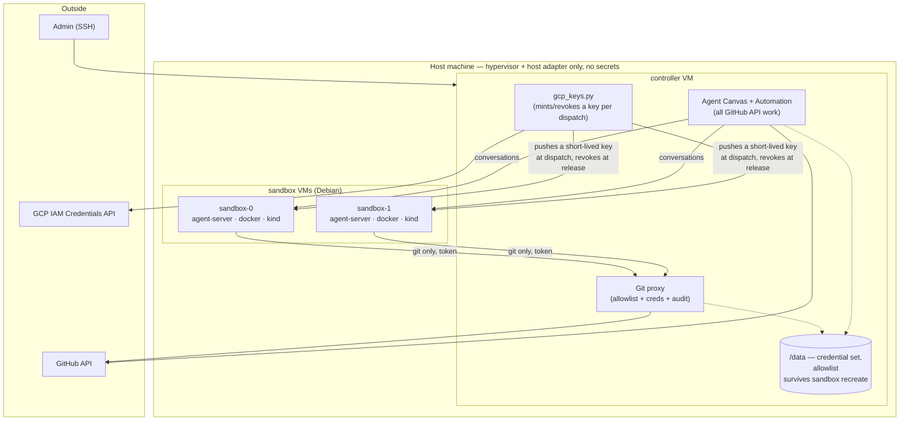

# Grain: a single-node agent cluster

> **Historical.** For how Grain works today, read [`architecture.md`](architecture.md) and `README.md`.
> This describes v1 — a controller VM plus a pool of
> libvirt sandbox VMs, driven by a Python host adapter — whose code this
> repository no longer carries. It is kept because it is still the spec
> several packages implement and cite: the git proxy's credential ladder
> and withheld scopes, the split surface between orchestrator and
> sandbox, and the secrets-on-`/data` layout all originate here. Read it
> for those; read [`architecture.md`](architecture.md) and `README.md` for what actually ships.

## Status

Revision 5. **One host machine runs everything**: a controller VM and a
small pool of agent sandbox VMs. The host itself runs a hypervisor and
nothing else.

The immediate target is a **GCP `n2-highmem-4`** (4 vCPU, 32 GB, Debian,
nested virtualization enabled). **macOS on Intel stays supported** as a
future target, and the design is arranged so that switching costs one
module rather than a rewrite — see
[the host adapter](#the-host-adapter).

Earlier revisions targeted a NixOS host using
[`microvm.nix`](https://github.com/microvm-nix/microvm.nix) (1–3) and then
macOS with the controller running natively on the host (4). Two decisions
from those revisions carry forward, both simplifications: sandboxes are
**long-lived rather than reset per task**, and the guests are **Debian
rather than NixOS**.

Putting the controller in a VM is what makes this revision portable. It
also takes every credential off the host, which restores an isolation
property revision 4 had traded away for RAM.

## Goals

- **One machine runs the whole system.** No clustering, no cloud
  orchestration.
- OpenHands picks up labelled issues from a target GitHub repo and drives
  an agent in a sandbox.
- Agents can read and write allow-listed GitHub repos, but **hold no
  GitHub credentials** — their only route out is a git proxy.
- Agents can obtain short-lived GCP tokens without touching the
  service-account key.
- Each agent gets a **whole VM**, because the workload runs `docker` and
  `kind`, which do not nest into containers.
- Sandboxes are long-lived, with an explicit recreate that clears them.
- **The host-specific surface is one module.** Moving between Linux and
  macOS should mean replacing VM lifecycle and networking, nothing else.

## Non-goals

- Multi-host clustering, autoscaling, HA.
- Defending against malicious *agent output*. Human PR review is that
  control.
- Isolating *sequential* tasks on one sandbox from each other; see
  [what it costs](#what-it-costs).

## Build vs. reuse

Default to existing solutions; write code only where nothing fits. Two of
the three reuse decisions in revision 3 did not survive investigation, so
these are stated with what was actually verified.

| Need | Approach |
|---|---|
| Agent execution | **Claude Code** (`claude -p`) in the sandbox VM — [decided over `openhands-agent-server`/Agent Canvas](#agent-runtime-claude-code-not-openhands) to avoid that stack's version-pin matrix; the OpenHands research is kept, not deleted — [see why](#openhands-integration) |
| Issue intake | **[`grain/automation/`](#issue-intake)** — this repo's own poll/dispatch/rate-limit/sweep loop, cron-invoked |
| GCP credentials | **[Per-dispatch service-account keys](#gcp-credentials)** — minted by the controller, pushed into the sandbox, revoked at session end |
| VM lifecycle | **[Lima](#the-host-adapter)**, which runs on both Linux and macOS — libvirt is the Linux-native fallback |
| Guest OS | **stock Debian**, provisioned by a script in this repo |
| Git access control | **Custom** — small smart-HTTP proxy; [FINOS Git Proxy evaluated and rejected](#the-git-proxy-write-it) |
| GitHub API access | **none from sandboxes** — the controller does API work, so there is nothing to filter |
| Branch and workflow protection | **[GitHub rulesets and withheld scopes](#scopes-to-withhold)** — enforced server-side |

### What is left to write

Two small things: the [git proxy](#the-git-proxy-write-it), and the
[host adapter](#the-host-adapter) — of which only the second is
platform-specific, and it is deliberately kept thin.

## High-level architecture



Properties:

- **The host holds no *system* credentials** — no GitHub token, no GCP key,
  no sandbox token at rest. Every one of those lives in the controller VM. A
  host compromise is still fatal — it owns the hypervisor — but they are not
  sitting in a home directory next to a browser. Narrowed from the earlier,
  simpler "holds no secrets" by `docs/bootstrap.md`'s `grain host bootstrap`:
  the auto-generated admin private key does live on the host (it is what
  grants direct SSH to the controller and every sandbox — see "Admin entry"
  below), and a GitHub token transits the host *process* on its way to the
  controller when passed via `--github-token-file`, though never host disk.
  Neither grants the host a capability it lacked already — it owns the
  hypervisor and writes every VM's cloud-init regardless — but the plain
  "no secrets" phrasing stopped being literally true once bootstrap could
  place one there.
- Sandboxes never hold a GitHub credential, only a narrow, allowlist-checked
  and audit-logged endpoint on the controller. A sandbox *does* hold a real
  GCP credential when a deployment mints one (bwsalmon/agents#126) — but
  only a short-lived, per-task service-account key, never anything capable
  of minting another, and it is revoked the moment the task's slot frees
  (or after 24 hours regardless — see [GCP credentials](#gcp-credentials)).
- Concurrent agents cannot reach each other: separate kernels, separate
  Docker daemons, separate port spaces.

## The host adapter

The point of this revision. Everything above the hypervisor — the
controller image, the sandbox image, the services, the credential model —
is host-agnostic. What is not, and therefore what a port has to replace, is
deliberately confined to one module with a small interface:

```
grain-host-adapter
  create(name, image, cpus, memMb, diskGb)
  start(name) / stop(name) / destroy(name)
  address(name) -> ip
  network_up()        # private network the VMs share
  egress_policy(mode) # open | allowlist
```

Two implementations:

| | Linux (now) | macOS (later) |
|---|---|---|
| Hypervisor | KVM/QEMU | HVF/QEMU |
| Driver | Lima, or libvirt | Lima |
| Private network | bridge + tap per VM | `socket_vmnet` |
| Filtering | `nftables` | `pf` |

**Prefer Lima on both.** It runs on Linux as well as macOS, so the same
templates, the same provisioning scripts, and the same `limactl` calls
serve both — which shrinks the port to *networking alone*. Lima on Linux is
less travelled than on macOS, so this needs confirming; libvirt is the
Linux-native fallback and costs a second driver implementation, not a
redesign.

The discipline that makes this hold: **nothing outside the adapter may
assume a platform.** No `nftables` in the git proxy, no `launchd` in the
controller image, no host paths in service configs. When something needs a
platform-specific fact — an interface name, an address range — it comes
through the adapter.

### What changes between Linux and macOS, concretely

- **VM lifecycle**: identical if Lima works on both; otherwise a libvirt
  driver.
- **Networking**: a Linux bridge with a tap per VM, versus `socket_vmnet`.
  This is the irreducible difference.
- **Sandbox identity**: on Linux, `nftables` can pin a source address per
  tap; macOS cannot. Handled by making tokens the single mechanism and
  treating source pinning as an extra layer where available — see
  [sandbox identity](#sandbox-identity).
- **Admin entry**: SSH to the host, then (with an admin key — see
  `docs/bootstrap.md`, "key roles") directly to the controller or any
  sandbox, via `grain sandbox login <name>`, rather than hopping through the
  controller first. On a laptop the first hop is a local console instead.

Nothing else. The controller and sandbox images, the proxy, the metadata
servers, and every credential decision are the same on both.

### Why not one cloud instance per sandbox

On GCP the obvious alternative is to skip nesting: give each sandbox its
own instance, which needs no nested virtualization, costs less
(`e2-highmem-4` is ~$132/month versus `n2-highmem-4` at ~$191), and gets
source-IP authentication for free because VPC blocks address spoofing.

Rejected for this revision because it is not one machine. It couples the
design to GCP's networking, IAM, and instance lifecycle, and it forecloses
the Mac. **Single-node is the simplifying constraint**, and it is worth
roughly $60/month and one weaker identity mechanism to keep the whole
system portable and runnable on hardware you already own.

Worth revisiting if this ever outgrows one machine — at which point the
adapter is the seam to cut along.

## The controller VM

A Debian VM running everything that holds a credential:

- **Agent Canvas** and the **Automation Service** — all GitHub API work,
  issue intake, and dispatch to sandboxes.
- **The git proxy** — the only path from a sandbox to GitHub.
- **`gcp_keys.py`** — mints a fresh GCP service-account key per dispatch
  and revokes it at release (bwsalmon/agents#126; see
  [GCP credentials](#gcp-credentials)) — superseded the per-sandbox
  `gce_metadata_server` broker [sandbox identity](#sandbox-identity)
  used to describe here.
- **`/data`**, a disk that outlives sandbox recreates and holds the
  credential set, the primary GCP key, and the repo allowlist.

Revision 4 ran these natively on macOS to save a VM's worth of RAM. Moving
them into a VM costs ~3–4 GB and buys three things: the host holds no
secrets, the controller is reproducible from an image rather than
accumulated host state, and the port to macOS no longer has to reimplement
service management under `launchd`.

Admin access is SSH to the host, then — via the admin key — directly to the
controller or any sandbox (`grain sandbox login`), still just one externally
reachable port, which is the property the microvm.nix design had and
revision 4 lost.

### Secrets on `/data`

```
/data/
  secrets/
    github/            # credential set + credentials.json
    gcp-service-account.json   # primary key gemini_keys.py authenticates with (optional)
  config/
    repo-allowlist.json
    gcp-key.json       # agent service account + project id, bwsalmon/agents#126 (optional)
  state/
    git-proxy/audit.log
```

Mode `0600`, owned by the service users. On GCP, `/data` is a separate
persistent disk so it survives rebuilding the controller VM itself;
encryption at rest is the provider's (or FileVault on a Mac).

**The invariant is unchanged: no secret is ever baked into an image or a
provisioning script.** Images encode paths and how services consume them;
values are placed once, by hand, on first setup.

### Where credentials should live

`/data` is the default, but two alternatives are worth having answered.

**GitHub Actions secrets on the config repo: no.** It fails mechanically
before the security argument even starts — Actions secrets are write-only
from outside, so `GET /actions/secrets/{name}` returns metadata and never a
value. Materialising one on the controller would require a **self-hosted
runner there**, executing whatever workflow code the repo contains, on the
machine holding every credential.

The security comparison is lopsided anyway:

| | `/data` | GitHub secrets |
|---|---|---|
| Who holds the GCP key | you | you *and GitHub* |
| Who can read it | root on the controller | anyone who can run a workflow — i.e. anyone with repo write |
| Masking | n/a | best-effort; base64 defeats it |
| New attack surface | none | a runner executing repo code |
| Disaster recovery | disk snapshot | automatic |

The second row is decisive *for this system specifically*. We
[withhold the `workflow` scope](#scopes-to-withhold) because an agent that
can edit `.github/workflows/**` can make CI run code of its choosing with
whatever secrets the workflow holds. Today the blast radius of that control
failing is whatever is in CI, and we put nothing there. Storing the GCP key
in Actions secrets makes the same failure hand over the cloud project — it
converts a hygiene control into a single point of catastrophe. Disaster
recovery, the one real benefit, is available from a disk snapshot instead.

**Better: on GCP, do not have a GCP key file at all.** The instance has an
attached service account, ADC works through the real metadata server, and
`gce_metadata_server` can impersonate from ADC rather than from a key.
A long-lived key never created cannot leak, be exfiltrated, or need
rotating — and it removes the most sensitive item in `/data` outright.

One wrinkle: the controller is a *nested* VM and will not reach
`169.254.169.254` by default, so the host must forward it. That is a small
piece of platform-specific plumbing, and it belongs in
[the adapter](#the-host-adapter) — on a Mac there is no instance identity,
so the key file returns and the adapter reports that. **Verify** that
`gce_metadata_server` accepts ADC as its impersonation source.

That leaves only the GitHub credentials to store. If they should be
centralised rather than on `/data`, push them **straight into the
instance's own metadata**, over the Compute API, rather than through
Secret Manager: no third party holding them, no runner, no coupling to
repo write access, same recovery property as the instance-identity read
above — and one thing better. Secret Manager access has to be granted
either project-wide (to whatever CI identity creates and rotates the
secret) or per-secret (to the host, narrower but still a standing GCP IAM
grant that anyone who inherits or escalates into that identity can use to
read it back out). Instance metadata needs neither: the deploy workflow
already holds `roles/compute.admin` to manage the VM at all, so attaching
the credential costs no new grant, and the host reads its own metadata
over the local, unauthenticated metadata server — there is no IAM
binding for a compromised or over-scoped identity elsewhere in the
project to exploit.

**Superseded** for `deploy/terraform/gcp` (#2376): "unauthenticated"
turned out to be the problem rather than the virtue. Anything that
reaches the metadata server — a container, a sandbox guest — reads every
attribute with no credential, anyone with `compute.instances.get` reads
them through the Compute API, and Terraform's refresh copied them all
into state. That module now keeps them in Secret Manager, granted per
secret to the host's own service account only (`secrets.tf`), and
`files/deploy.sh` reads them with that account's token.

## The sandbox VMs

Two of them, Debian, each running `docker`, `kind`, and
`openhands-agent-server`. They are the disposable part of the system: see
[lifecycle](#sandbox-lifecycle-long-lived-recreated-on-demand).

Revision 4 specified NixOS guests, for consistency with a Nix-managed host.
That was the wrong instinct, and the tell was in the design itself: a whole
section existed to explain NixOS's peculiarities *to the agent* — no `apt`,
use `nix shell`, and a `nix-ld` shim so downloaded binaries would run at
all. When a platform choice needs a README aimed at the thing using it, it
is the wrong choice for that layer.

Debian removes that friction outright:

- **`apt-get install` works.** This was the likeliest thing to waste agent
  turns, and most agent training data assumes Debian.
- **No `nix-ld` shim.** Debian is FHS, so downloaded release tarballs,
  `pip` wheels with native extensions, and `curl | sh` installers just run.
- **Docker and `kind` are the documented path** — official apt repo, stock
  kernel, and every tutorial the agent has read matches what it finds.
- **`openhands-agent-server` installs the way upstream installs it**:
  `uvx --from openhands-agent-server==1.42.1 …`, the same command that
  needs `nix-ld` on NixOS.
- **Nothing needs cross-building.** A NixOS guest image would have to be
  built for `x86_64-linux`; from a Mac that meant a Linux builder VM, 4–6 GB
  of contention, and a build path documented as slow. Debian images are
  provisioned from packages, so the builder disappears — and with it one of
  the two reasons the Mac port was awkward.

The base image is built by a **version-controlled provisioning script**
kept in this repo. That is weaker than a Nix derivation, and honestly so:
rebuilding in six months yields whatever the Debian archive holds then. Pin
the point release, and reach for `snapshot.debian.org` if reproducibility
ever matters more than convenience. For a sandbox an agent immediately
mutates, it mostly does not.

## Networking

One private network shared by the controller and the sandboxes, created by
the [adapter](#the-host-adapter) — a Linux bridge with a tap per VM now, a
`socket_vmnet` network on macOS later.

- **Controller services bind to the private network address only**, never
  `0.0.0.0`. Back it with a host filter rule denying those ports on the
  external interface, so a binding mistake fails closed.
- **Sandbox → controller** is permitted to the git proxy, and nothing
  else — a GCP service-account key (bwsalmon/agents#126) arrives by a
  direct push at dispatch time, not a network path a sandbox reaches on
  its own.
- **Sandbox ↔ sandbox** is dropped. Agents cannot reach each other.
- **Inbound** reaches only the host's SSH port.

Sandbox egress is open by default, with the honest caveat: agents need the
internet for dependencies, and a sandbox with general egress can exfiltrate
anything it can read. No firewall rule short of a domain allowlist changes
that. `egress_policy(allowlist)` is the opt-in tightening.

### Network access, as it is actually implemented

`egress_policy` above is the shape this eventually wants. What exists
today (grain/task-269) is one narrowing of it, settable per task
(`model.Task.NetworkAccess`), per template, and deployment-wide
(`model.Config.NetworkAccess`): `open`, the network a sandbox has always
had, or `none`.

`none` is implemented by **deleting the guest's default route** once its
sandbox is up (`orchestrator.GranuleSandboxes.enforceGuestNetwork`), and
verifying it went. That works because everything a sandbox still has to
reach is on a segment it is directly connected to — the control link
`granule exec` arrives on, and the host-side docker gateway this
deployment's git proxy and model proxies are advertised at
(`GRAIN_GRANULE_GIT_PROXY_HOST`), which under netshim's flat mode is the
guest's own subnet. So it needs no packet filter and nothing installed in
the guest, and the acquire fails rather than handing over a sandbox where
either the route survived or the git proxy did not.

The caveat is the mirror of the one above, and worth stating plainly:
**a sandbox with `none` still reaches its own directly-connected
segment**, which is the host's docker bridge. That is the git proxy —
the point — and also any sibling sandbox container, which is already
true today with the network on ("Sandbox ↔ sandbox is dropped" above is
what should be true, not what this deployment does). So this is
`egress_policy(allowlist)` narrowed to one destination, not a
hypervisor-level cut, and not the sandbox-to-sandbox isolation that
still needs a filter.

(The host-directory backend, `-host-sandboxes`, enforces none of this:
a run there uses the host's own network, and a task asking for `none` is
refused rather than dispatched. It exists for a single-user workstation
that wants its agents beside its own tools, and the daemon refuses it on
a deployment others can reach unless
`-allow-unisolated-host-sandboxes` is passed. Even then only the machine's own tasks run there by default
(docs/local-policy.md, "Host sandboxes"). A run's commands get `HOME`
pinned to the run's own directory and only an allowlist of the daemon's
environment, so the operator's own logins are not theirs by default;
`-host-sandbox-env NAME` (or `NAME=VALUE`), repeatable, opts every
host-sandbox run of the machine's own tasks into one more
variable -- `SSH_AUTH_SOCK`, `HTTPS_PROXY`/`NO_PROXY`,
`CLOUDSDK_CONFIG=$HOME/.config/gcloud` -- and with it into acting as the
operator wherever that variable reaches. `HOME` itself cannot be set, so
each run's git credentials stay its own. The values reach the agent's
`grain mcpserver` through a 0600 file named by `-sandbox-env-file`,
never on its argv, and `run_command` redacts each of them, and
recognizable token shapes (`pkg/redact`), from what it returns; the
stored transcript is redacted the same way. A literal `NAME=VALUE` with
a `user:pass@` in it is refused, since it would sit on the daemon's own
command line: export it and pass `NAME` alone.)

## Sandbox identity

Both controller services need to know which sandbox is calling — for
allowlist decisions, per-caller audit, and rate limiting.

**A per-sandbox bearer token is the mechanism**, generated and injected
when the sandbox is provisioned, replaced when it is
[recreated](#recreating-a-sandbox). One mechanism, both platforms, one code
path in the proxy.

The alternative was source-IP authentication, which the microvm.nix design
used: `nftables` rules pinning a source address per tap, so a forged
address could not leave the VM, and no secret existed to distribute at all.
It is the stronger mechanism and **it works on Linux** — but not on macOS,
where VMs share a `vmnet` bridge with DHCP addresses and there is no
per-VM interface to pin.

Rather than carry two auth mechanisms, use tokens everywhere and apply
source pinning on Linux as **defense in depth**: the adapter's `nftables`
rules restrict which addresses may reach the proxy at all, so a stolen
token is not usable from anywhere else on the network. Linux keeps most of
the benefit; the proxy stays simple; the port stays cheap.

Properties:

- **Not an SSH key.** Both consumers speak HTTP. An SSH endpoint would
  cover only the git side and would mean brokering `git-upload-pack` and
  `git-receive-pack` rather than passing smart-HTTP through.
- **Git consumes it via a credential helper**, so no clone URL or command
  grain writes has to carry it. The helper's backing file
  (`~/.git-credentials`) is still readable by the agent's own shell, so
  the token is not secret from the sandbox it identifies; what bounds a
  copied token is that it authorizes only that sandbox's live run, is
  revoked when the run's sandbox is released, and expires after a TTL
  (`gitproxy.DefaultSandboxTokenTTL`) even if that revocation is missed.
- **Rotation is explicit**, folded into
  [recreate](#recreating-a-sandbox) so it happens on some cadence rather
  than never.

**The GCP path used to be the one exception** — a per-sandbox
`gce_metadata_server` instance, authenticated by network position rather
than a token, so ADC worked with no client configuration at all (Google's
client libraries will not attach a custom header to metadata requests).
bwsalmon/agents#126 replaced it with the same per-dispatch, per-sandbox
credential shape everything else here uses: a real, short-lived GCP
service-account key, minted fresh and pushed into the sandbox at dispatch
time, revoked when the task ends — see [GCP credentials](#gcp-credentials)
for the full mechanism and why the zero-client-config property was judged
not worth the operational cost of keeping a second broker running.

## Sandbox lifecycle: long-lived, recreated on demand

Sandboxes are **created once and serve many agent runs**. They stay
running; there is no per-task reset. Recreating one is an explicit,
occasional operation that takes a reboot.

This is a deliberate simplification, and it buys a lot: no lease service,
no per-task token minting, no copy-on-write overlay juggling, and no reset
step that can fail silently. At a pool of two, most of that was ceremony.

### What it costs

**Isolation between *concurrent* agents is unchanged** — that is what the
VM-per-agent design provides, and it is the one that matters. What is given
up is isolation between *sequential* tasks on the same sandbox: task B
inherits whatever task A left behind.

- A previously cloned private repo is readable by the next task.
- Containers, `kind` clusters and stray processes accumulate.
- Package caches persist, so a poisoned npm or pip entry outlives the task
  that fetched it.
- Disk grows monotonically until something is done about it.

The **correctness** consequence is probably larger than the security one: a
task inheriting a half-finished worktree, a container already bound to the
port it wants, or a `kind` cluster named `kind` fails in ways that look
like agent incompetence.

The security consequence is acceptable *here* because tasks come from the
same repo allowlist and run under the same credential set — they are not
mutually distrusting. That stops holding if the allowlist ever spans repos
of genuinely different sensitivity, which is the trigger to revisit.

### Between-task hygiene

Most accumulation is cheap to clear without recreating anything:

```sh
kind delete clusters --all
docker system prune -af --volumes
rm -rf "$WORKDIR"
```

Be clear about what this is: **hygiene, not isolation.** It stops the disk
filling and stops the common cross-task collisions. It does not make the
previous task's data unrecoverable. Recreate is the boundary.

### Recreating a sandbox

```sh
grain sandbox recreate sandbox-0
```

Stops the VM, destroys it, recreates it from the base image, starts it, and
injects a fresh [token](#sandbox-identity). Downtime is a boot, and at a
pool of two it means running at half capacity for a minute.

Recreate when the base image changed (this is the deploy path for image
updates), when disk crosses a watermark (the failure this design is most
likely to actually hit), when a sandbox is wedged, or on a schedule —
weekly is reasonable and doubles as token rotation.

## Resource budget

On the target `n2-highmem-4`: **4 vCPU, 32 GB**.

| Consumer | Memory |
|---|---|
| Host (Debian, hypervisor only) | ~1–2 GB |
| Controller VM | ~3–4 GB |
| Each sandbox (kind control plane + build + test) | ~8 GB |

`32 − 2 − 4 = 26 GB` → **three sandboxes fit on memory**, two with
comfortable headroom. That is better than revision 4's laptop budget, where
macOS itself took ~8 GB.

**But CPU is likely to bind first here, not memory** — which inverts every
previous revision's conclusion. Four vCPUs across a controller and two
sandboxes each running a `kind` control plane is thin, and `kind` plus
compilation is not a bursty workload. Treat `sandboxCount = 2` as the
starting point, measure CPU saturation before memory, and note that moving
to `n2-standard-8` (8 vCPU, same 32 GB, ~$284/month versus ~$191) is a
stop-change-start away if CPU is the constraint.

Cost, for reference: ~$191/month for the instance, ~$30 for a 300 GB
balanced disk, ~$4 for the IP — about **$225/month running continuously**,
or roughly **$75/month** if it is stopped outside working hours. Nested
virtualization itself is free; it only restricts you to Intel N2, since E2
and N2D cannot do it.

## The sandbox image

Because each sandbox is [recreated from a pristine base](#recreating-a-sandbox),
whatever agents need should be *in the base image* rather than reinstalled
per task. Shaping it is a provisioning script in this repo, applied by
Lima:

```yaml
provision:
  - mode: system
    script: |
      #!/bin/bash
      set -eux
      apt-get update
      apt-get install -y --no-install-recommends \
        git curl jq ripgrep fd-find build-essential python3 python3-venv \
        pipx tmux unzip ca-certificates
      # Docker from the official repo, plus kind
      install -m0755 -d /etc/apt/keyrings
      curl -fsSL https://download.docker.com/linux/debian/gpg \
        -o /etc/apt/keyrings/docker.asc
      ...
```

Keep the package list in one place so "what agents get" is a single
reviewable diff. `tmux` is not optional —
[the agent server hard-requires it](#openhands-integration).

### Docker and kind

Since [agents cannot run in containers](#why-a-vm-per-agent), the sandbox
has to host `docker` and `kind` comfortably. On Debian in a full VM this is
the ordinary, documented path: the official Docker apt repository, the
stock Debian kernel, and no kernel-config question at all — which is what
dominated the Linux design's risk and is now simply gone.

Two things still need doing, and both are easy to miss:

**Raise the inotify limits.** kind's own guidance is explicit that common
defaults (8192 watches, 128 instances) cannot bring up a cluster, and the
failures are opaque — `too many open files`, `failed to create fsnotify
watcher` — and look nothing like their cause:

```
fs.inotify.max_user_watches   = 524288
fs.inotify.max_user_instances = 8192
```

**Pre-load the kind node image** into the base. It is on the order of a
gigabyte, and both [recreate](#recreating-a-sandbox) and the between-task
`docker system prune` discard it — so `docker pull` it during provisioning
and `docker save`/`docker load` it, or accept re-pulling on every cleanup.

Also: passwordless sudo, safe precisely because the VM is disposable and
the boundary is the VM rather than the unix user. On granule guests this is a
standing decision, not an oversight: see
[granule-guest-root.md](granule-guest-root.md).

### Runtime installs

This section used to be long. On Debian it is short: **everything works the
way an agent expects.** `apt-get install`, `pip`, `npm -g`, `cargo`,
downloaded binaries, `curl | sh` installers — all of it behaves as the
agent's training data assumes.

The one thing to keep from the NixOS version is the feedback loop: when
agents repeatedly install the same package by hand, add it to the
provisioning script. Cheap to fix, and it silently taxes every run until
you do.

### Telling the agent

Still worth a short `/etc/agent-tools/README`, referenced from the
OpenHands system prompt — but it is now about *this system*, not about the
operating system:

- git pushes go through a proxy automatically; GitHub API calls are not
  available from here,
- GCP works through ADC with no setup,
- the sandbox is shared across tasks and cleaned between them, so do not
  leave long-running services behind.

The NixOS version of this file also had to explain that `apt` did not
exist and that downloaded binaries needed a shim. Not needing to say that
is the point.

## Why a VM per agent

Worth keeping, because it is the reason the design does not collapse into
something much simpler.

Agent tasks run `docker` and `kind` themselves. Nesting those inside an
agent *container* means Docker-in-Docker and kind-in-a-container:
privileged containers, storage-driver contortions, cgroup fights — and
failures that present as the agent being incompetent rather than the
platform being wrong, which is the worst kind to debug.

Running agents in separate *directories* on one machine trades that for a
shared Docker daemon, colliding `kind` cluster names and host ports, one
set of global tool versions, and shared caches.

### Doesn't NixOS make the dependency problem moot?

Half right, and the half that is right is real: with flakes and devShells,
agents in separate directories get exact non-colliding toolchains. That
dissolves the versioning and packaging problem entirely.

But dependency isolation is not the isolation this workload needs. Nix
scopes what is on `PATH` and what a build links against. It does not
virtualize the Docker daemon (a singleton with one image store — and agents
really do run `docker rm -f $(docker ps -aq)` when tidying up), the host
port space, kind's cluster and network namespace, or the kernel-global
iptables and conntrack state that Docker and kind rewrite.

Each has a workaround, and each is a step toward reimplementing a VM less
well, in a place where the failure mode is one agent silently corrupting
another's run.

## GitHub access

### Split the surface: sandboxes get git, the orchestrator gets the API

The most useful simplification available. Sandboxes do not need the GitHub
API — OpenHands runs on the orchestrator, where it holds a credential
directly and does all the API work: reading issues, commenting, opening
PRs. What an agent inside a sandbox needs is `git clone`, `fetch`, `push`.

- **Sandboxes: git transport only.** No REST, no GraphQL. This removes an
  entire class of API-filtering bypasses rather than defending against
  them.
- **Orchestrator: API operations**, on the machine that already holds every
  other secret.

The cost is that agents cannot run `gh pr create`; PR and comment creation
happens through OpenHands. Worth accepting — the alternative reintroduces
the full REST attack surface into the least trusted component.

**One narrow, deliberate exception (docs/roadmap.md item 12):** an agent
that's genuinely blocked can call an `ask_question` MCP tool to relay a
question to a human. This does not reopen the split: the agent still has
no REST/GraphQL access of its own, here or anywhere else — the tool only
writes a question to a local file on the controller, and the orchestrator
(the only thing holding the GitHub credential, unchanged) is what actually
calls `create_comment`. The boundary the split-surface argument draws is
preserved; what moved is that the orchestrator now has a `create_comment`
operation to call at all, where before it had none.

**The same exception, run backwards:** `request_secret`
(`pkg/mcp/mock_tools.go`, grain/task-230) lets a blocked run ask for a
credential the deployment does not hold. It relays a *request* by the
same route `ask_question` does -- the tool writes nothing itself, and
grain, on the controller, is what turns the call into a comment and a
park. What comes back does not come back to the agent at all: the human
types the value into grain's own UI, it goes straight into the encrypted
secret store on the controller (`pkg/secrets`), and the run learns
nothing but that it was set. So the sandbox gains no credential it was
not already granted, and the one channel that could have carried a
secret to an agent in plain text -- a reply in the task's conversation,
which is also the next run's prompt -- is the thing this exists to stop
anyone reaching for.

**A second exception, on the same terms:** `pull_request_status`
(`pkg/mcp/pullrequest_tools.go`) and `wait_for_checks`
(`pkg/mcp/wait_for_checks_tool.go`) let a run see what CI made of the
commits it pushed -- the first as it stands, the second by blocking
until there is a verdict at all instead of making the run poll -- so it
can repair a red build itself rather than leaving it to a separate fix
task dispatched into a cold sandbox. `base_branch_status`
(`pkg/mcp/base_branch_status_tool.go`) reads the same CI for the one
other branch that means anything to a run: the branch its work merges
into, so it can tell a failure its change caused from one that was
already there. A failing grain CI job is reported with one more thing
along the same lines: whether the same job is failing the same way on
other branches *right now* -- how many, which, and any open pull request
that already touches the file the failure names. What counts as "the
same way" is decided on the controller, over every recent run's output
and against grain's own record of open pull requests
(`pkg/ci/sharedfault.go` for what counts as one fault, `pkg/cifault` for
which open pull request already fixes it, served on `GET
/api/ci/faults` and said again in the verdict comment the orchestrator
posts on a red pull request); the sandbox is told the conclusion, not given the
evidence to judge it from, for the reason everything else here is.
All three are
served by the `grain mcpserver` process, which runs on the *controller*
and reads GitHub with the controller's own credential; the repo and the
two branches it may ask about are fixed at process start from grain's own
view of the task, and no tool argument can move them. So again: the sandbox
gains no REST or GraphQL of its own, and what crosses into it is a
rendered answer rather than a credential or a general-purpose API call.
Unlike `ask_question`, these read rather than write, which is the
smaller half of the exception — nothing an agent can say through them
changes anything on GitHub.

Two tools beside them do write, and only to the run's own pull request:
`reply_to_pull_request_comment` and `resolve_review_thread`
(`pkg/mcp/pullrequest_review_tools.go`). A repository whose ruleset
requires conversation resolution holds a pull request until every inline
review thread on it is resolved, and a review bot opens one per remark,
so without them a run's pull request waited on a person to click
through each thread. `pull_request_status` lists those inline comments
(and `read_issue` does too, for a pull request). The pull request the
writes go to is the one open for the run's own branch, found by the same
lookup `pull_request_status` makes; no argument names a repository, a
branch or a pull request number, and a comment or thread ID that is not
on that pull request is refused before anything is posted. Resolution
goes through GitHub's GraphQL API (`resolveReviewThread`), from the
controller, with the same credential as the reads -- the sandbox still
has no GraphQL of its own.

### The sandbox image has no `gh`, and that is a decision

Ten runs of one deployment reached for `gh` in a sandbox after a CI answer
told them a failing check had no readable log, and found
`gh: command not found` (grain/task-140 counted them; grain/task-281 is
this decision). The image could carry it — it is one package. It
deliberately does not, and the build file somebody would add it to is
the repository's `Granulefile`.

Four reasons, in the order they bind:

- **It is the split above, reversed by a package list.** "Sandboxes: git
  transport only. No REST, no GraphQL" is a claim about what the least
  trusted component can reach, and shipping it the GitHub CLI is how a
  boundary like that stops being true in practice long before anyone
  edits the paragraph asserting it.
- **It would not have helped the runs that reached for it.** The answer
  that sends a reader to a failing check's own page (`failingCheckPages`,
  `pkg/mcp/failing_job_logs.go`) is printed in exactly the case where
  GitHub Actions has no run behind the failure — a Buildkite build, a
  CircleCI job, a review bot. `gh` cannot read any of those either. Where
  the failure *is* Actions, the log already travels with the answer, so
  there is nothing left for a CLI to fetch.
- **It would need a credential that does not exist.** The deployment's
  GitHub credential is the proxy's and never enters a sandbox (see the
  auth model below); the per-sandbox token authenticates a sandbox *to
  the proxy*, not to GitHub. A `gh` that could do anything would mean
  minting a second, narrower GitHub token per run, deciding which repos
  it may read, and attributing every read it makes — a new rung of the
  ladder below, for a convenience the MCP tools already cover.
- **The reads a run actually needs are already served.**
  `pull_request_status`, `wait_for_checks`, `base_branch_status` and
  `open_pull_request` answer from the controller with the controller's
  credential, and `ask_question` / `comment_on_issue` / `propose_task`
  carry what a run has to say back out. What is left over is out of scope
  for a sandbox rather than merely unimplemented.

**The one place a sandbox does hold a GitHub token** is the
`github-sandbox` capability (`pkg/capability/githubsandbox`), which mints
an App installation token scoped to a single throwaway repo created for
that task and places it in the guest. That is a real exception and a
bounded one — GitHub itself enforces the scope, and the repo is deleted
when the sandbox exits — but it is not an argument for `gh`: the token
reaches one scratch repo and nothing the run's own CI knows about. Its
prompt therefore drives that repo with `git` and `curl`, which the image
has.

If this is ever reversed, the reversal is not one line in a package list.
Three things tell agents there is no `gh`: every dispatched run's own
prompt (`orchestrator.sandboxToolingSection`, which says it before a run
has failed a check and gone looking), `failingCheckPages`'s closing
sentence, and the `github-sandbox` prompt. And
`TestTheSandboxImageStillCarriesNoGH` (`pkg/mcp/failing_job_logs_test.go`)
reads those build files and fails until whoever adds the package has said
so in the same commit.

### Auth model: a broad credential behind a narrow proxy

Installing a GitHub App on every needed repo is often impossible — it
generally requires admin on the repo or org. So the working assumption is a
broadly-scoped user credential held by the proxy, with repos and operations
restricted there.

This is a legitimate pattern; the [GCP path](#gcp-credentials) does the same
thing. But it moves the proxy from *second lock* to *only lock*: a proxy bug
now reaches everything the credential reaches, and every agent action is
attributed to the human.

**The highest-value mitigation, and it sidesteps the App problem: use a
dedicated machine account** and invite it as a collaborator to the repos
agents need. A token on that account reaches exactly those repos, restoring
GitHub-side scoping with no App installs — and inviting a collaborator needs
repo admin, not org admin, which clears the bar that usually blocks
installation. It also fixes attribution: agent commits show as
`grain-agent-bot`.

It is not universal, so the proxy holds a **credential set** selected per
target repo:

```
/data/secrets/github/
  credentials.json     # repo/owner pattern -> credential
  bot.token            # machine account, most repos
  personal.token       # last resort, only what nothing else reaches
```

The proxy picks the narrowest credential covering the target and **records
which one served each request**, keeping the powerful token off most
traffic and making its use visible rather than assumed.

Ladder, in order: GitHub App where installable → fine-grained PAT scoped to
selected repos (one per resource owner; note orgs must opt in to
fine-grained PATs at all) → machine-account classic PAT → personal token
for the remainder.

### Named tokens as capabilities

The ladder above answers "which credential does *this repo* fall back to",
which is a deployment-wide decision. Since single-tenant reset stage 1 it
is no longer read at all: each `credentials.json` entry is imported once
as a deployment git connection, and a sandbox's task uses its own grant
or the deployment's git connection for the repository, and nothing past
them
([git-hosts.md](git-hosts.md#deployment-git-connections-single-tenant-reset-stage-1)).
The other half is per task: a token
some particular piece of work needs and the rest must not have — the
`workflow` scope below being the standing example.

Every credential in the directory beyond the one `credentials.json`'s `*`
entry names is therefore also offered as a **capability of its own**
(`github-credential:<name>`, `pkg/capability/githubtoken`). A human ticks
it on one task like any other capability; the proxy, resolving that task's
sandbox, uses that credential in place of the ladder for every request the
run makes. Nothing about the token reaches the sandbox — it is still the
proxy that attaches it — and detaching the capability puts the task back
on its team's own credential.

Adding one is adding a file: drop `release-bot.token` (or
`release-bot.app.json`) beside `bot.token` and restart, the same "replace
a file under `/data/secrets` and restart the one service that reads it"
this whole directory follows. A task holding two named tokens pushes with
one of them, chosen deterministically rather than refused.

Adding a file no longer means shell access to the host, though. Settings
→ GitHub lists these credentials and writes one — the same file, in the
same directory, mode 0600 — so defining a token is as reachable as
ticking it (`GET`/`PUT`/`DELETE /api/github-tokens/{name}`,
`gitproxy.CredentialSet.SetToken`). It stays a file rather than a row in
the SQLite secrets store the rest of the UI writes: a GitHub App
credential is a three-value file shape that would have to be re-invented
as secret rows, the ladder is loaded by more processes than the daemon
(`grain mcp-server` builds one too), and two stores that could each
answer "what is credential X" is a state an operator has to reason about
the moment they disagree. The restart is not papered over either — the
pane reports what is on disk beside what the running process actually
started with, and says which tokens are waiting on a restart to become
grantable.

`credentials.json` is written from the same pane (`PUT`/`DELETE
/api/github-credential-patterns`, `gitproxy.CredentialSet.SetPattern`),
which is what makes standing a deployment up entirely a UI job: a token
with no pattern naming it is material nothing resolves to, so the *first*
credential added becomes the `*` entry on its own rather than leaving a
deployment where every clone fails closed and nothing on screen says why.
Narrower entries are listed and editable beside it, and deleting a
credential a pattern still names is refused rather than allowed to fail
every push it covers.

The same pane names the target repos *nothing* in the ladder covers
(`ui.Settings.TargetReposMissingCredentials`), which is the one gap this
file can produce on its own: a repo added to `targetRepos` in Settings
dispatches fine and then fails every clone with "no credential
configured". That check is a read of `credentials.json` and stays one.
It would be a small step from there to asking GitHub whether the
credential a matched rung names can actually reach the repo — which
would catch a fine-grained token scoped to fewer repos than its entry
claims, or a suspended App installation, before a run fails on it — and
the step is deliberately not taken. It would put a request per target
repo on every Settings load, and with it a cache, a staleness story and a
"could not tell" state for when GitHub is unreachable; 403 comes back as
404 for repos the credential cannot see, so the failure it reports is
ambiguous anyway; and read access is not push access, so the green answer
it bought would still not mean a push works. A check that must be hedged
that heavily is worse than the honest local one, whose limits fit in a
sentence. So the pane states them: it says covered means the file names a
credential, not that GitHub honours it. What a credential may really do
is answered where it is actually exercised — the first clone or push,
whose 404 names the credential the request went out under — and the live
hand run in `docs/test-plans/2026-09-05.md` §4 is what exercises it.

This one file is re-read when it changes — the only thing under
`/data/secrets` that is. The rest of the directory keeps the "replace a
file and restart the one service that reads it" contract above, but a
pattern cannot: three processes hold their own copy of the ladder, the
proxy's was loaded before the UI wrote anything, and the restart that
would fix that is the shell access this pane exists to do without. What a
restart is still for is the *capability set* — which named tokens this
process offers to tick on a task — which is built once at startup and
says so.

An App credential is the one entry in this directory whose material can
stop working while the file stays perfectly valid: the installation token
is minted from it hourly, and GitHub can refuse that exchange because the
installation was suspended, uninstalled, or had its private key
regenerated. The ladder answers a refusal by serving the credential
**anonymously** — deliberately, so a public repo goes on being readable
through a transient failure — which makes it the one failure here with no
natural symptom. A private repo answers 401 to the unauthenticated
request and the sandbox's git says "Authentication failed"; a public one
keeps working right up to the first push, which fails with "No anonymous
write access"; and neither sentence is about the App. So the fallback is
*reported* in the three places that see it: the proxy tells the sandbox
which App credential minted nothing and quotes GitHub's own reason for
refusing the exchange, the audit log records such a request as forwarded
unauthenticated rather than letting the credential name beside it imply
otherwise, and Settings → GitHub mints when it lists an App credential so
the row can say this instead of "present" (`gitproxy.MintFailure`).

### Which of them posts

A third question the same directory answers: not "what may this repo be
pushed with" or "what may this task push with", but **whose name is on
what grain posts** — the account a pull request, a review or a comment
appears as, which is decided by the credential grain's own REST client
authenticates with rather than by anything about a sandbox.

`model.Config.GitHubPostingCredential` names one credential from this
directory for that (Settings → GitHub → Posting account). It is a name
from the ladder rather than a credential of its own, for the reason the
capability above is: a deployment that wants its bot to post has already
had to put that bot's token here. Unset — the default — leaves every call
on the ladder's per-repo answer, exactly as before; set, it applies to
every repo grain talks to, which is the price of one account's name being
on the work. It pairs with `model.Config.AgentGitName`/`AgentGitEmail`,
the identity the *commits* are authored under: one setting for each half
of "whose work is this", and the pane says which account each resolves
to, since the two disagreeing is what makes them worth setting at all.

### Scopes to withhold

`delete_repo` is a separate classic scope — never grant it. No `admin:*`,
no `write:org`, no webhook or deploy-key management.

**Do not grant `workflow`** (or `workflows: write`). This is a
privilege-escalation path that is not obvious: an agent that can modify
`.github/workflows/**` can make CI run code of its choosing with whatever
secrets that workflow holds. Withholding the scope makes GitHub itself
reject such a push — *"refusing to allow a Personal Access Token to create
or update workflow … without `workflow` scope"* — and the same applies to
Apps.

That is the enforce-at-GitHub principle: a server-side control, immune to
bugs in our code. Branch protection on the default branch is the other
half. Both matter more now that they do work the App installation scope
used to.

### Write safety: one branch per run at the proxy, the rest at GitHub

Agents must not push to `main`, force-push, or delete branches. The proxy
enforces the part of that it can enforce without parsing a pack: a run may
update only its own task's branch (`refs/heads/<Task.BranchName>`), in
every repository it may push to — forwarded to GitHub or served locally
by `git http-backend` alike, since the latter has no branch protection
behind it at all. It reads the plain-text ref-update commands at the head
of the `git-receive-pack` body — never the packfile after them — and
refuses any push that names another ref, the default branch, another
task's branch and tags included. A reader that is unsure says no, so
getting it wrong fails *closed* (`pkg/gitproxy/refupdates.go`): a push
whose command list it cannot read in full is refused with a 403. A refused
ref is answered the way `receive-pack` itself answers one (report-status,
`ng <ref> <reason>`), so `git push` prints `[remote rejected]` and the
reason rather than a bare "HTTP 403". Before that check existed a run could
push any branch of its target, default branch included, with whatever
access grain's own credential had — and until #2387 the check was skipped
in every deployment, because the scope-registry wrapper in front of the
model authorizer did not pass it on.

A run that legitimately moves other refs — the nightly release cut
(`.grain/templates/release-candidate.yml`) force-moves `candidate` and
`latest`, back-merges into `main` and pushes release tags — is filed from a
repository template that declares those refs under `push:`
(grain/task-2536, `docs/declarations.md`). The proxy reads that push set
from the declaration as the repository's default branch has it, and lets
the run update the declared refs of that repository, force-moving or
deleting one only where its entry says so; every such update is audited
with the task, template and declaration file. There is no admin grant and
no team policy behind it: the team's own git credential is the only other
bound. For ad-hoc work with no template behind it, a team may grant its
own task `https://grain.dev/capabilities/repo#write` with `{"force": true, "refs": ["refs/heads/*", "refs/tags/*"]}` (`model.GitPushAnyRefGrant`, formerly
`git-push-any-ref`, on the in-process repo server in
`pkg/capability/grainserver`), a team grant that lifts the one-branch rule for that run in the repositories
it may write, and nowhere else.

What is enforced on the run's own branch: nothing further. Creating it,
fast-forwarding it, force-pushing it (an agent amending or rebasing its
work) and deleting it are all the run's own business; the branch reaches
the default branch only through a reviewed pull request and the merge
queue. A grain CI job holding an operator's explicit `repo-write` grant
(`docs/ci-capabilities.md`) has no task branch and may update any ref of
the granted repository. grain's own pushes — the merge queue, release
candidate cuts, the state and secrets repositories — run in the
controller with its own credentials and never pass through this proxy.

Branch protection / repository rulesets on each allow-listed repo remain
the second layer: no direct pushes to the default branch from the agent
credential, no force-push, no deletion, PRs required. Enforced by GitHub,
declarative, and independent of our bugs.

Applying these rules is part of onboarding a repo, and the proxy should
refuse to serve a repo whose protections it cannot verify. Failing closed at
onboarding is cheap and prevents the allowlist and the rulesets from
drifting apart.

### The git proxy: write it

[FINOS Git Proxy](https://github.com/finos/git-proxy) was the obvious
candidate and is a good project — actively maintained, default-deny repo
allowlist covering fetch and push. It was evaluated properly: source read,
software installed and run.

**It is architecturally inverted for this design.** Git Proxy is a
credential **pass-through**, not a credential holder — it requires the
*client* to present the GitHub token:

```ts
// src/proxy/processors/push-action/PullRemoteHTTPS.ts
const credentials = this.decodeBasicAuth(req.headers?.authorization);
if (!credentials) throw new Error('Missing Authorization header for HTTPS clone');
```

`authorization` is deliberately absent from its upstream header blocklist,
so the client's credential is forwarded verbatim. Its manual confirms the
intent. That is the opposite of this design's premise. Adding injection
would mean forking two independent code paths to obtain a capability the
project was designed not to have.

The rest of the fit was poor anyway, recorded so nobody reopens it:
auto-approval works via a pre-receive hook but costs **a second `git push`
for every push**; there is no source-IP or anonymous authentication, so
pushes need per-user accounts for entities that have none; fetches are
never written to the audit database and re-pushes overwrite prior records;
dynamic config reload is **broken at HEAD**, calling a `proxy.stop()` the
module does not export; and it is ~800 MB of `node_modules` with an
undisableable React dashboard.

**So write it.** It is small, because the surface is git-only:

- match the four legal smart-HTTP paths —
  `/{owner}/{repo}.git/{info/refs,git-upload-pack,git-receive-pack}`,
- canonicalize and check `(owner, repo)` against the allowlist,
  default-deny,
- authenticate the caller by [per-sandbox token](#sandbox-identity),
- select the credential for that repo and set `Authorization`,
- stream the body through, and log the tuple.

No pack parsing, no server-side clones, no database, no user accounts. The
allowlist is read from `/data/config/repo-allowlist.json` and watched, so
an admin edits a file with no restart.

Two things worth stealing rather than reinventing: Git Proxy's
`validGitRequest()` (a tight path whitelist cross-checked against a `git/*`
User-Agent and `application/x-git-*` Accept header, ~20 lines), and its
git-protocol-correct rejection encoding — a `PKT-LINE("ERR …")` for
`/info/refs`, a sideband packet plus flush for pack POSTs — without which a
refused client just prints *"the remote end hung up unexpectedly"*.

### Issue intake

**One repo is the queue; each task names the repo it is for.** The
orchestrator polls exactly one repo — the *task repo*, the agent set's task
list — and that is the only repo it ever labels or comments on. The code a
task is about is a *target* repo, named by the task itself with a `/repo
owner/name` line in its body (`grain/automation/directives.py`; `/pr N` and
`/base branch` are the other two directives). A body line rather than a
label: a `repo:owner/name` label would have to be created in the task repo
before it could be applied, once per target, and could carry neither a PR
number nor a base branch.

Three consequences worth stating plainly, because they are where this
design could otherwise go wrong:

- **The target repo is checked against the same allowlist the git proxy
  enforces** (`/data/config/repo-allowlist.json`). An issue body is
  untrusted input — the trigger label gates *whether* an agent runs on it,
  not what it may then reach — so which repos this deployment can write to
  stays an operator's file, checked on the API side at dispatch and on the
  git side at every fetch and push. The task repo is deliberately *not* on
  that list: no sandbox ever clones it.
- **An unusable directive parks the task, it does not fail it.** No
  `/repo` (and no configured `default_target_repo`), a malformed one, or a
  repo the deployment can't reach: the orchestrator comments saying which,
  swaps the trigger label for the awaiting-reply label, and waits — the
  same state, and the same trusted-reply promotion, an unanswered
  `ask_question` already uses. Leaving the trigger label on instead would
  redispatch an identical failure every polling interval.
- **Directives are read from trusted comments too**, at the same
  `author_association` tier that can promote a question (owner, member,
  collaborator). Repairing a parked task is then a reply, not an edit plus
  a reply. A public commenter cannot name the repo an agent writes to, for
  the same reason they cannot redispatch one.

The `/repo` directive is recorded on the assignment at dispatch, not
re-read when the run finishes: an issue body is editable, and an edit
landing mid-run must not be able to redirect where the finished work's PR
is opened. The PR's base branch comes from the target repo's own
`default_branch` (or a `/base` override), read once at the same moment —
one global `base_branch` setting stopped being a defensible guess once one
deployment dispatches into many repos.

**A `/base` that no longer exists is answered differently at each end of a
run**, because what it costs differs. GitHub refuses a pull request whose
base is not a branch, with a 422, every time — so a task pointed at a base
that merged and was deleted (New task prefills `Base` from the repo's last
task, so this happens on its own) could never be finished at all: it
pushed, was refused, was offered again, and pushed more commits onto the
same branch. Before the work exists, `prepareCheckout` refuses to start
such a run and says which branch is missing and where; nothing is pushed
yet, and a human retargeting the task is cheapest there. After it exists,
`EnsurePullRequest` opens the pull request against the default branch
instead — a base almost always vanishes because it merged, in which case
its commits are in the default branch already and the diff is the same
either way — and records the retarget on the task, both as a comment and
on the task's own `Base`, since the other reasons a base goes missing (a
typo, work that was abandoned) leave the pull request aimed at the wrong
branch and only a human can tell which happened.

**A branch with no commits over its base ends the task and says so**, the
other 422 GitHub answers forever. A run that reverted its own work,
committed only what the base already had, or pushed without committing
lands in the same loop the vanished base used to cause — refused, offered
again, refused identically — but with nothing to salvage: no work to open,
no base to retarget, no diff for a reviewer. `EnsurePullRequest` asks the
compare endpoint before it asks for a pull request (and recognises the
refusal when it did not), and the finish path answers with an explanation
in the task's own conversation and a park on it, the same
`PendingQuestionCommentID` `ask_question` uses. Parking rather than
closing, because which of those three things happened decides whether the
task is finished or barely started, and grain cannot tell: any reply
clears the park and queues the task again, with the explanation in the
thread the next run reads. A run that asks for its own pull request
mid-flight (`open_pull_request`) is told to commit something instead —
it still has turns, and nothing is written to the task until the branch is
final.

Polling, not `OpenHands/automation` — see
[Agent runtime: Claude Code, not OpenHands](#agent-runtime-claude-code-not-openhands).
`grain/automation/core.py` is the loop; `grain automation run-once`,
invoked by a systemd timer, is what actually runs it.

**Use cron, not webhooks.** Webhooks would require GitHub to reach the
controller, and the only inbound port on this host is SSH — deliberately.
Polling keeps the system closed to inbound traffic and keeps every GitHub
call flowing outward through our own credential path. It also survives the
instance being stopped overnight, which webhooks would not.

What was always going to be ours regardless of the runtime decision,
because it is about protecting a two-VM pool and the LLM budget rather
than issue semantics — both built, in `ratelimit.py` and `sweeper.py`:

- **Rate limiting** — a cap on runs started per hour, so bulk-labelling
  forty issues cannot consume the pool and a month of spend at once.
- **A stranded-work sweeper** — if the host is stopped, or a run dies
  mid-flight, issues need returning to the queue rather than stalling
  silently.

One caution that mattered before and still does: the old
`openhands-resolver` embedded the GitHub token directly in the clone URL,
landing it in `.git/config` inside the sandbox — exactly what would defeat
the split surface. `dispatch()` never touches the sandbox's `origin`
remote, so this shouldn't recur, but it hasn't been checked against a
sandbox with a real git remote configured — worth confirming before the
first live issue-to-PR run (`docs/roadmap.md`).

## GCP credentials

**Mint a real, narrow, short-lived key per dispatch — mirroring the Gemini
key below rather than the metadata broker this superseded** (bwsalmon/
agents#126). `grain/automation/gcp_keys.py` mints a fresh key for the
narrow "agent" service account on every dispatch, `dispatch.py`'s
`configure_gcp_key` pushes the raw JSON key file into the sandbox over the
same stdin-not-argv channel the git-proxy token and the Gemini key already
use, and `sweeper.py`'s `_release` revokes it the moment the sandbox's slot
frees (success, failure, or stranded) — the identical checkpoint the
Gemini key already uses (see "A Gemini API key doesn't fit this broker"
below, now more precedent than exception).

- **Minted by the controller's own attached identity, never a static
  file.** The controller already runs *as* `google_service_account.host`
  via its own real GCE metadata server (a completely different thing from
  the fake per-sandbox broker this replaced) with `cloud-platform` scope,
  so granting that account `roles/iam.serviceAccountKeyAdmin` on the agent
  account (`terraform/gcp/iam.tf`'s `host_manages_agent_keys`) is all
  minting needs — no key file to place or rotate for this feature at all.
  Deliberately a *different* identity from the account being minted for: a
  sandbox holding a leaked agent key must never be able to mint itself a
  fresh one, which self-impersonation (the old broker's shape) would have
  allowed.
- **Unconditional, like the broker it replaced — not gated on a task
  label.** Every dispatch mints one whenever a deployment has
  `Orchestrator.gcp_key_config` configured at all (`grain controller
  configure --gcp-agent-service-account-email ... --gcp-project-id ...`),
  the same "every sandbox, every dispatch" behaviour docs/design.md's own
  Gemini-key section below explicitly contrasts itself against.
- **24-hour expiry, enforced by grain, not GCP.** User-managed IAM
  service-account keys have no native TTL — unlike an OAuth token, a key
  minted today is valid until explicitly deleted. So the per-release
  revocation above is the *primary* mechanism, and a periodic reap
  (`core.py`'s `_sweep`, calling `gcp_keys.delete_expired_keys` once per
  cycle) is the safety net for whatever it misses — a controller crash
  between mint and the assignment being recorded, most notably.

### What a short lifetime actually buys

A sandbox can be handed a fresh key the moment its old one is revoked, for
as long as its task keeps running. Short lifetimes therefore do **not**
limit what a compromised sandbox can do *during* one task's session. What
they buy:

- **Revocability**: cut a sandbox off and its GCP access dies with that
  task, with no key surviving into the next one.
- **Leak containment**: a key in a log, an LLM context, or a PR diff is
  worthless once the task that minted it ends.

Both real. Neither is "the agent only has an hour of access." To reduce
steady-state privilege you must downscope the key itself: granting the
agent account only the roles a task genuinely needs
(`agent_service_account_roles` in `terraform/gcp/variables.tf`) is the
whole game.

### A Gemini API key doesn't fit the same mechanism (bwsalmon/agents#47)

A task can ask, by carrying the `grain-gemini-key` label
(`AutomationConfig.gemini_key_label`, bwsalmon/agents#49), for a
short-lived [Gemini API key](https://ai.google.dev/gemini-api/docs/api-key)
minted for it, placed in its sandbox, and revoked once the task's slot
frees. A label rather than a body directive, deliberately: the same
"a human decided this, not the issue's own untrusted text" trust tier the
trigger label itself already relies on, checked directly against
`issue.labels` in `core.py`'s `_resolve_target` rather than parsed out of
the issue body or a trusted reply (`directives.py`'s own module docstring
has the fuller reasoning for why the other three -- `/repo`, `/pr`,
`/base` -- still need to be directives instead: they carry a *value*, and
a value can't be a label). This mechanism predates, and deliberately stays
separate from, `gcp_keys.py` above, for two reasons:

- **Unlike a GCP service-account key, a Gemini API key is unconditional
  nowhere** — the Generative Language API is authenticated by a bearer key
  string a caller mints once and holds, and minting one for every dispatch
  regardless of whether a task wants it would be pure waste (and a wider
  blast radius than necessary) for a feature most tasks never touch.
- **A different minting identity, on purpose.** `gemini_keys.py`
  authenticates with the primary GCP service-account key placed at
  `/data/secrets/gcp-service-account.json` (`configure_gcp_service_account`)
  — the agent account's *own* key, minted by CI and rotated on every
  deploy (v1's `push-host-secrets.sh`) — rather than the controller's
  attached host identity `gcp_keys.py` uses. Reasonable either way for this
  one feature (a Gemini key is a bearer secret regardless of who mints it,
  so there is no equivalent "must not self-mint" hazard), and left
  unchanged by bwsalmon/agents#126 rather than risking an unrelated,
  already-working mechanism for a tidiness-only unification.

Minting/revoking calls `apikeys.googleapis.com` via the `gcloud` CLI — the
controller-only runtime dependency (`provision/controller.sh`) `gcp_keys.py`
above also now relies on for `iam.googleapis.com`'s service-account-keys
API, justified the same way originally: the sandbox side of this project
stays stdlib-only Python, but the controller already isn't one.
Hand-rolling the OAuth2 JWT-bearer exchange in stdlib Python was considered
and rejected — no crypto library is available to sign it, and `gcloud`
already does this correctly. See `grain/automation/gemini_keys.py`'s own
docstring for the full tradeoff, including against adding the much heavier
`gcloud` SDK tarball instead of the package-manager install this repo
already uses for everything else on the controller.

The Gemini key's lifetime is bounded by the *task*, not by a fixed TTL:
revocation runs from the same "sandbox slot just freed" checkpoint
[between-task hygiene](#between-task-hygiene) already uses for cleanup and
health, reached uniformly whether the task succeeded, failed, or was found
stranded — so a key never outlives the sandbox session it was minted for,
without needing Google-side expiry to enforce that. (The GCP service-
account key above gets the identical treatment, plus the 24-hour reap as a
second line of defense a Gemini key has never needed, since nothing has
yet stranded one long enough in practice to justify it.)

### Superseded: the `gce_metadata_server` broker (bwsalmon/agents#126)

Revisions before this one ran a per-sandbox
[`gce_metadata_server`](https://github.com/salrashid123/gce_metadata_server)
instance on the controller, emulating GCE's real metadata contract via
service-account impersonation, so ADC resolved with no client-side
plumbing at all — ADC probes the metadata server automatically, and every
Google SDK already knows how to ask it for a token on demand. That
property is genuinely lost by the switch above: a sandbox now has to
explicitly `gcloud auth activate-service-account --key-file=...` or export
`GOOGLE_APPLICATION_CREDENTIALS` to use its key, the same one small step
the Gemini key already asked of an agent. Kept here rather than deleted,
per this document's own policy elsewhere of recording the reasoning
because it's the expensive part (see "OpenHands integration" below for
the same treatment of a different superseded design) — revisiting a
broker-shaped approach later would need this research again:

- The key lived at `/data/secrets/gcp-service-account.json`, `0600`,
  readable only by the metadata service, configured to impersonate a
  second, minimally-privileged service account rather than serve the
  primary key's own tokens.
- One instance per sandbox, each bound to that sandbox's address — see
  [sandbox identity](#sandbox-identity) — with a matching per-sandbox
  `net_linux.py` DNAT rule sending that sandbox's metadata-anycast traffic
  (`169.254.169.254:80`) to its own instance, which is what made
  "authenticated by network position" true per-VM.
  Every mint was audit-logged (`grain/metadata/audit.py`).
- Impersonating a narrow second service account, rather than serving the
  primary key's tokens directly, was the actual privilege-reduction lever
  — a short token lifetime alone does not limit what a compromised sandbox
  can do while compromised (it can just re-mint), the same point the
  section above makes about the key that replaced this.

Why it was replaced rather than kept alongside the new mechanism: it was a
second, non-stdlib runtime dependency and a per-sandbox systemd unit plus
DNAT rule to operate, for a property (zero-config ADC) that the Gemini key
had already shown wasn't load-bearing — that mechanism asked an agent to
read a path and export a variable from day one, with no reported
friction. bwsalmon/agents#126 filed the removal explicitly in those terms:
use a service-account key, mirroring the Gemini key's own shape, rather
than keep running a broker nothing else in this design still needed.

That covers every key this deployment's own dispatch minted and knows
about; it does not cover a key (or a GCE instance, or a disk) an agent
minted or created itself with its own GCP access mid-task and never tore
back down, nor the rare stranded-mint case `gemini_keys.py`'s own docstring
describes. `grain/automation/janitor.py` (bwsalmon/agents#113) is the
backstop for exactly that gap: an optional, TTL-based sweep, run from
`core.py`'s `run_once` alongside the stranded-work sweeper, that deletes
whatever of those it can positively rule out as *not* being grain's own
core infrastructure. See its own module docstring for the exclusion model.

## OpenHands integration

Superseded as the plan of record by
[Claude Code](#agent-runtime-claude-code-not-openhands) — kept here rather
than deleted, per this document's own policy elsewhere of recording the
reasoning because it's the expensive part; revisiting OpenHands later would
need this research again.

The architecture described in revisions 1–2 no longer exists. Verified
against the repositories:

| Component | Status |
|---|---|
| V0 Python monolith — `openhands/runtime/*`, `SANDBOX_*` env vars | Ended at 0.62.0. `openhands/runtime/__init__.py` is **404 on main** |
| V1 Python app (`openhands-ai`) | Froze at 1.11.0, removed from main |
| `OpenHands/OpenHands` main | Now **Agent Canvas**, a TypeScript control centre |
| Sandbox-side component | **`openhands-agent-server`**, from `OpenHands/software-agent-sdk` |
| `openhands-resolver` | **Gone**. Successor is `OpenHands/automation` |

### No provisioning API to build

```python
# software-agent-sdk/openhands-sdk/openhands/sdk/workspace/workspace.py
class Workspace:
    """Factory entrypoint that returns a LocalWorkspace or RemoteWorkspace.
    Usage:
        - Workspace(working_dir=...) -> LocalWorkspace
        - Workspace(working_dir=..., host="http://...") -> RemoteWorkspace
    """
```

`RemoteWorkspace` attaches to an already-running agent server at a fixed
URL — no provisioning, no image, no lifecycle — and Agent Canvas registers
a backend as `{host, apiKey, kind}`. So **N sandbox VMs each running
`openhands-agent-server`, registered as backends, is the supported
deployment.** Nothing to reimplement.

What upstream does *not* give us is per-task reset: Canvas treats backends
as long-lived and one server takes many concurrent conversations
(`max_concurrent_runs`, default 10). Hence the
[deliberate trade](#sandbox-lifecycle-long-lived-recreated-on-demand) —
long-lived backends are exactly what upstream expects, so this is one place
where simplifying moved *toward* the grain rather than against it. Set
`max_concurrent_runs = 1` per sandbox so one task has a VM to itself.

### Version pinning

`config/defaults.json` on Canvas main is upstream's source of truth:

```json
"versions":      { "agentServer": "1.42.1", "agentCanvas": "1.14.0", "automation": "1.8.0" },
"compatibility": { "minimumAgentServer": "1.28.0" },
"constraints":   { "agentClientProtocol": "agent-client-protocol<0.11" }
```

Pin `openhands-agent-server`, `openhands-sdk`, `openhands-tools` and
`openhands-workspace` to one identical version — upstream CI enforces this
and inter-package APIs are not expected to survive a mismatch. Carry the
`agent-client-protocol<0.11` constraint. Nothing enforces the pin at
runtime; `GET /server_info` reports versions for debugging only, so skew
fails late and confusingly.

### Gotchas before the first boot

- **The agent server binds loopback unless authentication is configured.**
  Without `SESSION_API_KEY` / `OH_SESSION_API_KEYS_0` it defaults to
  `127.0.0.1`, so a sandbox comes up looking healthy and is unreachable.
- **Set `OH_SECRET_KEY`**, or secrets are redacted and lost across restart.
- **`tmux` is a hard dependency**, imported at module load.
- Upstream's own full agent-server image ships Docker CE, buildx and
  compose — independent confirmation that running docker inside the sandbox
  is the expected shape.

## Agent runtime: Claude Code, not OpenHands

**Decided.** `grain/automation/` is built against Claude Code running in
the sandbox, not `openhands-agent-server`/Agent Canvas — the OpenHands
integration above is what this design *isn't* doing, kept for the same
reason the rest of that section stays rather than getting deleted. The
deciding factor: given how much churn upstream's own V0 → V1 → Canvas
transition already caused this design, trading Agent Canvas,
`openhands-agent-server`, and the Automation Service's version-pin matrix
for a dispatch loop this repo owns and can actually read outweighed raw
feature parity.

**What it cost:** issue intake, which the Automation Service otherwise
supplies — cron triggers, filter expressions, run history. The
replacement, `grain/automation/` (`github.py`, `ssh.py`, `dispatch.py`,
`state.py`, `ratelimit.py`, `sweeper.py`, `core.py`): poll labelled issues
through the credential the controller already holds, dispatch to a free
sandbox as a `systemd` unit, rate-limit and sweep stranded or finished
work, move labels to match. Genuinely small — the module list fits in one
sentence — but it is code this repo now owns and has to keep working. PR
and comment creation once a run finishes is not yet part of it; see
`docs/roadmap.md`.

**Two things matter specifically because the agent runs in a sandbox that
clones repositories:**

- **`claude -p` executes repository content by default.** Upstream is
  explicit that a `-p` session shows no workspace-trust dialog, so it runs
  the hooks in a cloned repo's `.claude/settings.json` and connects the
  servers in its `.mcp.json` without prompting. In a disposable VM holding
  no credentials the blast radius is bounded, but it should be a decision
  rather than a discovery. `--bare` disables that auto-discovery — at the
  cost of also skipping the repo's `CLAUDE.md` and skills, which have to be
  passed back explicitly with `--append-system-prompt-file`, `--settings`
  and `--mcp-config`.
- **The sandbox must not hold an API key**, which `--bare` would otherwise
  require, since it never reads OAuth credentials. Claude Code honours
  `ANTHROPIC_BASE_URL`, so the controller can run an LLM proxy that injects
  the key — the same shape as [the git proxy](#the-git-proxy-write-it),
  the same trust boundary, and one more narrow port in the ruleset. This is
  what makes the option compatible with the credential model rather than an
  exception to it.

Also note `-p` starts in Manual permission mode on every plan, so an
autonomous run needs an explicit `--permission-mode`; `acceptEdits` fits a
disposable VM, `dontAsk` is the locked-down end.

**Open, found live against a real Claude Code login (docs/roadmap.md item
8):** `acceptEdits` auto-approves file edits and a fixed list of
filesystem-only Bash commands (`mkdir`, `touch`, `mv`, `cp`, `sed`, ...),
never git -- but in practice the sandbox's own `autoAllowBashIfSandboxed`
(default on, independent of `--permission-mode`) covers `git clone`/`add`/
`commit` anyway, so the only command that actually blocks on approval is
`git push origin HEAD:<branch>`, and specifically only its *network* leg:
the sandbox's `network.allowedDomains` is supposed to pre-allow a listed
host with no prompt, but a real run still hit "needs your explicit approval
... network access to `10.100.0.2:8080`" with the git proxy's address
listed. `--dangerously-skip-permissions` looked like the documented fix for
"fully unattended inside a container/VM," but made things worse live --
under it, `sandbox.enabled`'s own auto-allow stopped applying and `git add`/
`commit` started needing approval too, which `acceptEdits` never blocked.
Reverted to `acceptEdits`, the empirically-better-performing mode, with the
network-approval gate still open.

**Superseded, not fixed on its own terms.** A later session tried both
remaining candidates from the list above live and found the real problem
wasn't the network-approval gate at all: `dontAsk` + an explicit
`permissions.allow` denied the native `Edit`/`Write` tools outright and
matched `Bash` rules by literal command prefix (a real agent's own
`git -c user.name=... commit` never matches a `Bash(git commit:*)` rule),
and once the agent *did* reach a real `git push`, a plain `env` from any
unsandboxed Bash call showed `CLAUDE_CODE_OAUTH_TOKEN` sitting in plaintext
in the environment — confirmed live, not theorized. No `sandbox.*` setting
closes that: it's an execution-surface problem, not a permission-mode
tuning problem. `docs/roadmap.md` item 8's second "Update" has the full
account; the resolution is architectural, not a flag change — see "Final
choice: no credential in the sandbox at all" below, which replaces the
"Interim choice" section this paragraph used to point to.

**It would run on metered API billing, not a subscription.** The two
constraints above compound: `--bare` is what stops cloned-repo hooks from
executing, and `--bare` does not read `CLAUDE_CODE_OAUTH_TOKEN` — it
requires `ANTHROPIC_API_KEY` or an `apiKeyHelper`. Subscription credentials
rank below an API key anyway (7th versus 3rd in the precedence order), and
in `-p` a present key is used with no prompt. So agent spend here is
per-token Console billing. That is a cost model to weigh against OpenHands,
not merely a configuration detail — and it is a further argument for the
controller-side LLM proxy, which is the only place that spend can be
metered and capped.

### Abandoned: a login credential in the sandbox, hardened rather than avoided

The original plan here accepted a trade-off directly: Claude Code would run
*in* the sandbox VM with a login credential, breaking the "sandboxes never
hold GitHub or GCP credentials" property for the first time, hardened in
layers rather than relying on one mechanism —
`sandbox.credentials.files: [{path: "~/.claude/.credentials.json", mode:
"deny"}]` (Claude Code's own bubblewrap setting, verified live to turn a
denied-path read into a clean `ENOENT` without breaking an adjacent
readable work file), `kernel.yama.ptrace_scope = 2` (verified live to turn
"read another same-UID process's live memory via `/proc/<pid>/mem`" from a
working attack into a clean `Permission denied`, closing what file-masking
alone doesn't), and a considered-but-unapplied Landlock option, all
verified not to break `docker`/`kind` on the same sandbox.

**Every one of those layers turned out to be defending the wrong surface.**
A full live-debugging session (`docs/roadmap.md` item 8's second "Update")
found the credential leaks into any *unsandboxed* Bash subprocess's
environment trivially — a plain `env`, confirmed live — and the agent
readily discovers `dangerouslyDisableSandbox: true` on its own to get
there. File-path denial and ptrace hardening protect against reading the
credential as a *file* or out of process *memory*; neither one is a file or
memory read, so neither one is even in scope. Landlock specifically was
recorded above as "structurally stronger... an unprivileged process can
call `landlock_restrict_self()` to irrevocably deny itself access to a
specific path" — true, and still beside the point, because Landlock has no
concept of environment variables at all. No amount of sandbox-setting
tuning could ever have closed this gap; the credential simply should not
have been reachable by the agent's own execution surface, and every layer
here left that surface fully intact.

### Final choice: no credential in the sandbox at all

`claude -p` now runs on the **controller**, not the sandbox, as a
dedicated, unprivileged `grain-agent` account (`provision/controller.sh`)
— never root, never the account `grain-automation.service` itself runs as.
Its entire native tool roster is disabled except `Task`
(`--tools Task`, confirmed live to be the only way `--allowedTools` alone
does not achieve — see `grain/automation/dispatch.py`'s module docstring
for the exact mechanics found live) and replaced with four narrow MCP
tools (`grain/automation/mcp_server.py`: `run_command`/`read_file`/
`edit_file`/`write_file`, schemas mirroring Claude's own native `Bash`/
`Read`/`Edit`/`Write` rather than an OpenAI-Codex-style `apply_patch`,
since the agent here was never trained on that format) that reach the
assigned sandbox over SSH for every actual git/file operation. The sandbox
itself goes back to holding nothing worth protecting at all — this whole
credential-isolation problem was never really about the sandbox; it was
about protecting whatever process holds the Claude credential, and moving
that process off the untrusted machine entirely is a stronger answer than
hardening it in place ever could be.

**The credential itself: a dedicated `claude setup-token`, not a login
file, delivered as an environment variable — deliberately, not by
default.** `configure_claude_token` (`grain/automation/configure.py`)
places a bare token (kept separate from any operator's own `claude login`
session, so this deployment's dispatch traffic never rides on a personal
credential) at two mode-600 locations: a root-owned reference copy under
`/data/secrets`, and a live copy owned by `grain-agent`.
`dispatch.py`'s own unit script reads the live copy into
`CLAUDE_CODE_OAUTH_TOKEN` at runtime (`export ...="$(cat ...)"`, never a
`systemd-run --setenv=` argument, which would put the raw token in `ps`
output). Putting a credential back in an environment variable, after the
entire section above documents exactly that failing catastrophically,
needs its own justification: it's safe *here* specifically because
`--tools Task` removes the native `Bash` tool that made the leak
exploitable in the first place — the agent's only execution surface
(`run_command`) runs exclusively on the sandbox over SSH, never in this
process's own environment, and there is no tool call that reads or
forwards this process's env vars (confirmed live: a `Task`-spawned
subagent inherits the identical restricted roster, not a wider one, via an
explicit system denial, not just self-report). That is a structural
guarantee resting on `--tools Task` staying complete, not on the secret
being unreachable regardless of tool restrictions the way a credentials-
file-only design would be — a real, accepted trade-off, made because
keeping the deployment's own token separate from an operator's personal
login mattered more than closing that last gap. A file-based credential
(a real `claude login` session, which does produce the fuller
`{"claudeAiOauth": {"accessToken", "refreshToken", ...}}` shape a
`--claude-token-file` could equally accept) remains available and is the
strictly stronger option if that trade-off ever needs revisiting.

**Verified live, end to end, not just reasoned through**: a real
`grain host bootstrap` with a real Claude credential, a real dispatch, a
real `claude -p` session on the controller with exactly the intended tool
roster (confirmed via the transcript's own advertised `tools` list) and
zero permission denials, a real edit, a real commit, a real push, a real
PR. Two more bugs surfaced only by actually running it, both fixed:
`grain-agent`'s SSH key access, first tried as a group-readable copy of
the controller's own key, which OpenSSH's client refused outright
("private key file... too open") — fixed with two independent, owner-only
copies instead of one shared file; and `TodoWrite`, tried alongside
`Task`, confirmed live to never be admittable in `-p`/headless mode by any
`--tools` syntax, dropped rather than left as a dead reference.

### Dispatch mechanism: what only showed up by actually running it

`grain/automation/ssh.py` and `dispatch.py` reasoned through the
controller→sandbox path carefully before any of it ran against a real VM;
live-testing against one anyway (`tests/test_vm_integration.py`) found five
things that reasoning alone had wrong or missed entirely:

- **`qemu:///system`, not the ambient default.** A bare `virsh` with no
  `-c` connects to `qemu:///session` for a non-root caller — a separate,
  unprivileged libvirtd instance that can't attach to `br-grain` at all.
  `libvirt.py` now pins every `virsh` call to `qemu:///system` explicitly.
- **SSH host keys can't be pinned.** A sandbox gets a *new* host key every
  recreate, at the same fixed address — the default `known_hosts` pins the
  first one it sees, so the very next recreate turns every dispatch into
  "REMOTE HOST IDENTIFICATION HAS CHANGED." `UserKnownHostsFile=/dev/null`:
  host-key TOFU isn't a boundary this design relies on anyway — a sandbox
  is authenticated by its fixed address on a firewalled private bridge and
  the controller's own key, not by a remembered identity.
- **`systemd-run` against the system manager needs `sudo`.** Starting or
  stopping a *system* (not `--user`) transient unit is a privileged D-Bus
  call; a non-interactive SSH session has no polkit agent to satisfy it,
  and fails with "Interactive authentication required" even though
  `--uid=debian` already asks to run the command itself unprivileged.
  Debian's cloud image grants the default user passwordless `sudo`, which
  makes the *manager* call while `--uid=debian` still keeps the dispatched
  command itself unprivileged.
- **A successful unit vanishes on its own.** With no `--collect` in sight,
  a transient unit that exits zero still self-unloads within a couple of
  seconds — `LoadState` goes straight to `not-found`, indistinguishable
  from a unit that never started. A *failed* unit doesn't get this
  treatment; that asymmetry is what earlier reasoning (wrongly)
  generalized to the success case too. `--property=RemainAfterExit=yes`
  keeps a finished unit `active`/`exited` instead, so its outcome can
  actually be read back later, on whatever schedule the sweeper polls.
- **SSH has no real argv array, and an ambient agent can hang the whole
  connection.** The protocol carries one command string; OpenSSH builds it
  by joining trailing arguments with a plain, *unquoted* space, so anything
  containing a space — `bash -c "sleep 5"`, or the real `claude -p ... <
  file` invocation this dispatches — gets word-split apart on the remote
  end. `shlex.join(argv)` before handing it to `ssh` is what makes it
  round-trip correctly. Separately, a stale or unresponsive `SSH_AUTH_SOCK`
  can leave `ssh` hung indefinitely before authentication even starts, a
  phase `ConnectTimeout` doesn't cover; `IdentityAgent=none` is enough,
  since this runner brings its own key and has no use for an agent.

None of these are exotic — every one looks obviously fine on paper and only
shows up by actually booting a guest and running a command on it, which is
the same argument, made again, for why this project keeps holding itself to
a "verify live, not just unit tests" bar.

The host adapter stays agent-agnostic — it manages VMs
and a network, and neither cares what runs inside. Everything above binds
only in `grain/automation/`, which is exactly where the choice now lives.

## Threat model

**Who the daemon trusts.** A grain is single-tenant: it serves one
deployment, and every caller it trusts is that deployment's own actor
(`-as`, or the OS account the daemon runs as). There are no other
people, teams or roles inside it to tell apart, so there is nothing for
one caller to escalate to over another
([single-tenant-reset.md](single-tenant-reset.md)). The UI and API
(`pkg/ui`'s `serveHTTP`, `singleTenantGate`) let a request through as
that actor only when it carries the **access code**
(`<data-dir>/local-api-token`, [access-code.md](access-code.md)):

- the grain CLI on the host, which reads the code from the data dir and
  sends it as a bearer token (the local API token and the access code
  are the same secret);
- a browser that entered the code on the "Enter access code" page and
  holds the session cookie it signed;
- any other client sending the code as a bearer token, from wherever it
  is;
- or a request handed to the server in-process, with no remote address.

Anybody else is refused: a 401, or the access code page, on every route
but the access code's own, logout and the executor bootstrap. Where a
request comes from grants nothing. Loopback and a network address
(`-ui-trusted-cidrs` and the other trust flags are gone, single-tenant
reset 3e-iii-c5) present
the code like anybody else. An IAP assertion, a session from an older
build, or an identity header (`X-Grain-User`, `X-Goog-Authenticated-*`,
`X-Forwarded-User`) names nobody. A proxy in front of the daemon decides
who may reach it, not who they are once they have
(the identity-aware proxy's own docs). Remote executors
connect on their own bootstrap routes with an executor token (`gxt_`),
and sandboxes reach the git proxy, model proxies and MCP server with
their own per-sandbox tokens; none of those is the access code, and none
reaches the owner's API.

**Who asked for a task** is not something the daemon works out from the
caller. A task the owner files is the actor's own; `grain create
-author` only records a requester, from a caller already holding the
code. A task from Silo carries the requester, team, approver and grants
in Silo's signed claims, and `policy.ApplySiloClaims` sets
`Task.Creator` and `Task.Approval` from them once the attestation
verifies, replacing whatever the offer said. The local policy then
judges the task by those claims ([local-policy.md](local-policy.md)).
A task carries no team.

**Defended:**

- A compromised sandbox cannot read GitHub or GCP credentials; they are in
  a different VM.
- It cannot touch repos outside the allowlist (proxy check, plus
  GitHub-side scoping when a machine account or App is used).
- It cannot push to protected branches or modify workflows — enforced by
  GitHub, not by our code.
- It cannot reach a concurrently running agent: separate VMs, kernels,
  Docker daemons.
- Its access is revocable in minutes and fully audit-logged.
- Anybody who can reach the daemon's port but lacks the access code gets
  nothing past the access code page, whether they come from loopback,
  the LAN or a tunnel. Wrong codes are rate-limited
  per source and across all sources, and a right one from loopback is
  never refused.
- **The host holds no *system* credentials** (see the narrowed claim
  earlier in this doc), so *system* credential exposure — GitHub, GCP,
  sandbox tokens — requires compromising the controller VM specifically,
  not just the machine. The admin private key is the one credential that
  now does live on the host by design; it grants SSH, not GitHub/GCP/
  sandbox-token access.

**Not defended:**

- **Sequential tasks on one sandbox.** Sandboxes are long-lived, so a task
  inherits the previous task's filesystem. Accepted because tasks share a
  repo allowlist and credential set; revisit if that changes. See
  [what it costs](#what-it-costs).
- **Abuse of legitimate access while compromised.** A sandbox can do
  anything the agent may do, for as long as it runs. The proxy narrows
  scope and provides audit and a kill switch; it does not distinguish a
  well-behaved agent from a hostile one making the same calls.
- **Exfiltration**, under the default open-egress policy.
- **Malicious code in agent output.** Human PR review is the control, which
  is why the no-push-to-`main` rules are load-bearing.
- **A leaked access code.** The code plus a URL that reaches the daemon
  is full owner access. Nothing tells the owner's own use from somebody
  else's; `grain access-code rotate` replaces it and ends every session
  it signed. So does anything that can read the data dir, which is the
  daemon's account and root.
- **A compromised host.** It owns the hypervisor, so it owns every VM.
  Moving the controller into a VM does not change that — it changes the
  *reach of a lesser compromise*, which is the common case.
- **Prompt injection via issue content.** Anyone who can file an issue can
  put text in front of the agent. Requiring a human to label each issue is
  the mitigation, not a guarantee.

## Operations

- **Two concurrent agents** to start. Derive `sandboxCount` from
  [the resource budget](#resource-budget), and expect CPU rather than
  memory to be the limit on `n2-highmem-4`.
- **Stop the instance when idle.** The design has no inbound dependency —
  cron polling, no webhooks — so a schedule cuts the bill roughly threefold.
  Sandboxes come back on boot; the controller's `/data` disk persists.
- **Recreate sandboxes on a cadence.** This is the routine maintenance
  operation and the one most likely to be forgotten until something breaks.
  Watch disk, and put it on a schedule — weekly also rotates the
  per-sandbox token, which otherwise never rotates. See
  [recreating a sandbox](#recreating-a-sandbox).
- **Backup** is the controller's `/data`. Provider snapshots are enough;
  nothing else in the system is stateful.
- **Rotation**: replace a file under `/data/secrets` and restart the one
  service that reads it.
- **Adding a repo**: edit the allowlist, install the App or invite the bot,
  apply branch protection. Hot-reloaded.
- **Observability**: pool health, proxy denial rate, token mint rate,
  intake outcomes. A wedged sandbox and an issue stuck mid-flight are the
  silent failure modes.

## What earlier revisions traded

Recorded rather than deleted, because the reasoning is the expensive part.

**Carried through every revision unchanged:** the credential model and
ladder, withheld scopes, branch protection, the split surface, the git
proxy design, the GCP metadata-server approach and impersonation, the
OpenHands integration, and the reasoning for a VM per agent.

| Property | microvm.nix (rev 1–3) | Now |
|---|---|---|
| Sandbox identity | source IP, pinned per tap — no secret at all | per-sandbox token; source pinning kept as an extra layer on Linux |
| Reset | ephemeral volume per lease, key discarded | explicit recreate; no per-task reset |
| Boot | ~1s microVM | tens of seconds |
| Guest OS | NixOS, declarative, shared host store | Debian, provisioning script |
| Memory reclaim | virtio-mem free page reporting, KSM | neither |
| Reproducibility | one flake, whole cluster | controller image + a provisioning script |

**Gained:** a host that holds no secrets, a host-specific surface confined
to one module, no cross-building, and an environment agents already know.

The microvm.nix artifacts — `flake.nix`, `hosts/spike/`,
`modules/sandbox-spike.nix`, and the `docs/spike-0.md` that described
them — were retained for a while on the argument that they evaluated
cleanly and were the fastest route back to a microVM deployment. They are
now **deleted**, and `git log` is where they live. Two things retired that
argument: the Linux deployment they were a shortcut to is written and
verified live (`libvirt.py`, `provision/sandbox.sh`), and per-task reset —
the one property microVMs bought that this design misses — was
deliberately traded away for long-lived sandboxes above. They were also
never booted, and "evaluates cleanly" was pinned to `nixos-unstable` and a
microvm.nix commit, which is a claim that expires on its own. Restoring
them to chase per-task reset again would mean re-verifying against current
inputs regardless, which is the work, not the files.

## Open questions

1. ~~Does Lima run well enough on Linux~~ **Answered: no.** Verified against
   Lima 2.2.0 on the target host: `limactl create` rejects the exact
   `networks: - lima: grain` stanza `lima.py` renders, with `field
   networks[0].lima is only supported on macOS right now`. Lima's
   bridged/shared/host network modes all depend on `socket_vmnet`, a macOS
   daemon; there is no Linux path that attaches a guest to an arbitrary host
   bridge with a fixed address. `libvirt.py` is the replacement the design
   already named, and it is now written, unit-tested, and verified live on
   this host: a real KVM guest, attached to `br-grain` via the exact tap
   name (`gr-sb0`) the firewall's anti-spoofing rules expect, comes up with
   the cloud-init-assigned static address (`10.100.0.10`, matching the
   inventory exactly) and answers ping from the host. Two bugs surfaced and
   were fixed in the process — see v1's host-adapter notes for
   both. `lima.py` is kept, unused for now: Lima's bridged mode is real on
   macOS, so it may still serve as that platform's driver.
2. ~~Does 4 vCPU hold two sandboxes plus a controller~~ **Answered: yes, on
   this host, with headroom — but CPU, not memory, is the resource actually
   under pressure**, confirming this inverts earlier revisions. Verified
   live with `tests/loadtest.py` (docs/roadmap.md item 6): on this
   dev/test host (4 vCPU, 32106 MiB — closely matches the n2-highmem-4
   target below, so this is directly informative for it, not a
   differently-shaped stand-in), two fully-provisioned sandboxes plus the
   controller, each sandbox running a real `kind create cluster` and a real
   `./configure && make -j$(nproc)` CPython build concurrently for 255s:
   1-minute host load average ranged 2.16–4.19 (peak briefly over the 4
   physical vCPU — real but mild contention, short of clear overload),
   available memory never dropped below 17922 MiB of 32106 MiB total. Host
   side, per VM: each sandbox averaged ~122% CPU (of its 2-vCPU allocation,
   peaking at ~150%) and ~5.6 GiB RSS; the idle controller averaged 13.7%
   CPU and ~1.05 GiB RSS. Worth noting even though memory never got close
   to binding: the *allocated* total (controller 4096 MiB + 2 × 8192 MiB
   sandbox_mem_mb, `inventory.py`'s `Cluster`) already overcommits vCPU
   5-to-4 on this host before any VM does a single thing — the measured
   headroom is real, but it is headroom under overcommitted allocation, not
   evidence the allocation itself is conservative.
3. ~~Does Agent Canvas distribute conversations across backends~~ **Moot**:
   not using Agent Canvas — see question 6. The "small assigner" this
   worried about is exactly what `grain/automation/core.py`'s
   `free_sandbox` does.
4. ~~Does the Automation Service work in cron-only mode~~ **Moot**: not
   using it — see question 6. The GitHub-token-in-`origin`-remote caution
   carries over regardless of runtime; see [Issue intake](#issue-intake).
5. **How far down the credential ladder can each owner go** — App, machine
   account, or personal token?
6. ~~Which agent runtime~~ **Answered: Claude Code**, not OpenHands — see
   [Agent runtime: Claude Code, not OpenHands](#agent-runtime-claude-code-not-openhands).
   Traded three upstream components and their version matrix for a
   dispatch loop this repo owns, `grain/automation/`, verified live against
   a real sandbox.
8. **Does one Claude credential survive concurrent refresh across several
   sandboxes?** `docs/bootstrap.md` collapses the per-sandbox login into a
   single credential injected everywhere, which is what takes setup to one
   command. If refresh tokens rotate on use, sandboxes sharing one
   credential will invalidate each other — not immediately, but as
   sporadic auth failures once access tokens start expiring. Cheap to
   settle: place the same credential on two sandboxes, drive both past
   expiry, watch both refresh. Answer decides whether the interim login
   stays one-per-pool or goes back to one-per-sandbox until the LLM proxy
   lands.
7. ~~Can `gce_metadata_server` impersonate using ADC~~ **Moot:
   bwsalmon/agents#126 removed the broker entirely** — GCP access is now a
   real, short-lived service-account key minted per dispatch by the
   controller's own attached identity, no impersonation and no forwarded
   metadata endpoint involved. See [GCP credentials](#gcp-credentials).

## Implementation plan

1. **Host baseline** — *done, on the dev/test host*: Debian, nested
   virtualization enabled, KVM confirmed (`/dev/kvm` present), matches the
   `n2-highmem-4` shape (4 vCPU, 32 GB).
2. **Host adapter, first cut** — *done*: interface, Linux networking, and
   now a working VM driver (`libvirt.py`, since Lima answered open question
   1 negatively). A real sandbox VM has been
   created, started, reached at its assigned address, and destroyed
   end-to-end on this host.
3. **Networking** — *done*: ruleset written, tested against a real kernel,
   verified for the negative cases, and now also confirmed against a real
   VM on the bridge — the reachability matrix (host ↔ sandbox at the
   assigned address) matches what the ruleset intends.
4. **Sandbox image** — *done*: `provision/sandbox.sh` written and verified
   live — a real sandbox VM installed Docker and kind, applied the inotify
   sysctls, pre-pulled the kind node image, and `kind create cluster`
   succeeded end to end (single control-plane node, `Ready` and reachable).
   Guest showed `7.8Gi` memory with `6.7Gi` still available after cluster
   creation; the qemu process sat around 29% CPU / ~5 GB RSS at idle
   post-creation on the host side. That was one data point at rest, not a
   sustained-load benchmark — open question 2 (whether 4 vCPU holds two
   sandboxes plus a controller under real `kind` + build load) needed a
   second sandbox and an actual build running concurrently to answer
   properly. Now answered — see open question 2 above and
   `docs/roadmap.md` item 6: under real concurrent `kind create cluster` +
   a real from-source build in both sandboxes, each sandbox's qemu process
   rose to ~122% mean CPU (of its 2-vCPU allocation) and ~5.6 GiB RSS, well
   past the at-rest data point above, as expected under load.
5. **Controller VM** — *done*: `provision/controller.sh` provisions a real
   VM with the `/data/{secrets,config,state}` layout `grain/automation/`,
   `grain/proxy/` and `grain/metadata/` already expect, Python 3.11+,
   `gce_metadata_server`, the `grain-metadata` system user, an idempotently
   self-generated controller SSH keypair, and the (installed-but-disabled)
   `grain-automation`/`grain-git-proxy` systemd units. Verified live —
   `tests/test_controller_integration.py` boots a real controller VM from
   this script and checks the guest. Deploying this repo's own code to
   `/opt/grain` and enabling those units both stay manual, for the same
   reason no credential is ever baked into a provisioning script — see
   `docs/runbook.md`'s first-time setup checklist and `docs/roadmap.md`
   item 3.
6. **Git proxy** — *done*: `grain/proxy/` — path whitelist, canonicalize,
   allowlist, token auth (via HTTP Basic from a git credential helper),
   credential selection, stream through, audit. Verified live against a
   real `git` client and real GitHub, not just unit tests: an allow-listed
   public repo clones end to end; an unlisted-but-real repo fails with
   `fatal: ... returned error: 403`, not a hung connection; a bad sandbox
   token fails with git's own `Authentication failed`; and — with a real
   (dummy) upstream credential configured — `GIT_TRACE_CURL` on the client
   confirms that credential never appears anywhere in the sandbox side's
   own output. Push (`git-receive-pack`) is implemented identically to
   fetch but not yet exercised live, since that needs a real writable
   allow-listed repo to test against, not just a public read.
7. **Metadata servers** — *mostly done*: `grain/metadata/` launches one
   `gce_metadata_server` instance per sandbox, impersonating the narrow
   service account, plus a `grain metadata` CLI group and an audit-log
   tailer — verified against a real binary and, at the routing layer, that
   a sandbox's existing default route is enough for its request to
   `169.254.169.254` to reach the right instance with no sandbox-side
   change needed. The `grain-metadata` system user and the binary itself
   are now provisioned by `provision/controller.sh` (step 5) and confirmed
   live on a real controller VM. Not verified: an actual token mint, which
   needs a real GCP project and key. See `docs/roadmap.md` item 4.
   **Superseded by bwsalmon/agents#126**: this whole broker (`grain/
   metadata/`, the `grain-metadata` system user, the per-sandbox
   `net_linux.py` DNAT rule) was removed in favour of a real, short-lived
   service-account key minted per dispatch — see
   [GCP credentials](#gcp-credentials)'s "Superseded" subsection for the
   full reasoning; kept here unedited as the historical record of what was
   actually built and verified at the time.
8. **Lifecycle scripts**: `grain sandbox recreate`, the between-task
   cleanup hook, a health check, a disk watermark alarm.
9. **Automation loop** — *mostly done*: `grain/automation/` implements
   cron-invoked intake, dispatch, rate limiting and the stranded-work
   sweeper, unit-tested and verified live against a real sandbox VM — see
   [Agent runtime: Claude Code, not OpenHands](#agent-runtime-claude-code-not-openhands).
   Still open: PR/comment creation once a sandbox's run finishes, and a
   first full issue-to-PR run — see `docs/roadmap.md`.
10. **Hardening** — *partially done*: the scope-audit tool
    (`grain github audit`, `grain/automation/credential_audit.py`) and the
    operator runbook (`docs/runbook.md`) are built and unit-tested. Moving
    real repos down the credential ladder, applying branch protection, and
    running the audit against a real credential all need a real target
    repo/org this environment doesn't have — see `docs/roadmap.md` item 7.

Scale to a second sandbox once 1–9 work at one. The macOS adapter is a
later exercise, and the measure of whether this revision succeeded is that
it touches only steps 2 and 3.

## Sources

- [`OpenHands/software-agent-sdk`](https://github.com/OpenHands/software-agent-sdk)
  — `openhands-agent-server`, `Workspace`/`RemoteWorkspace`
- [`OpenHands/automation`](https://github.com/OpenHands/automation)
- [FINOS Git Proxy](https://github.com/finos/git-proxy) — evaluated and
  rejected for this role, but worth reading for `validGitRequest()` and its
  git-protocol error encoding
- [`gce_metadata_server`](https://github.com/salrashid123/gce_metadata_server)
- [Lima](https://lima-vm.io)
- [GCP downscoping with credential access boundaries](https://cloud.google.com/iam/docs/downscoping-short-lived-credentials)
- [microvm.nix](https://github.com/microvm-nix/microvm.nix) — the Linux
  design's foundation, retained in the repo's spike artifacts
