# Merge gates and reviews: the state machine as built, and the target

Status: design doc only (task 6242). Part 1 describes `main` as of
`ff595d7de` (2026-11-15). Parts 3 and 4 are proposals, and nothing in them
is built yet. Code changes are listed as a numbered plan in Part 3 §3.8
and are left to follow-up tasks.

Why it exists: on 2026-11-15 the live deployment had 86 tasks sitting in
`awaiting_submit` on review findings with nothing sending them back, and
several related reports (tasks 5812, 5813, 6014, 6236, 6239). The operator
asked for an exact account of how reviews and gates behave before more
changes land, and set this requirement for what comes next:

> **Reviews stop for a person only when there is a finding the agents
> cannot resolve themselves. Otherwise the agents loop as many times as
> needed.**

How to read Part 1:

- Every statement cites the code it comes from as `file` / `function`. All
  paths are under `pkg/` unless written in full.
- **⚠ unconfirmed** marks anything inferred and not traced line by line,
  or seen on the live deployment but not reproducible from `main`'s code.
  The running daemon can lag `main`, so live behaviour may differ.
- "Cycle" means one pass of the orchestrator's reconcile loop. Every
  `Sync*` function named here is level-triggered: it reads the store each
  cycle and acts on what it finds, so nothing depends on catching an event.

---

## 0. Shared vocabulary: three readouts and one switch

Every gate reports through the same four things. Most of the confusion
on the live deployment comes from them disagreeing, so they come first.

### 0.1 The switch: `Task.AutoMerge`

Each gate turns `AutoMerge` off while it is unsatisfied and asks for it
back when it passes. Nothing else about a task says "merge me".

- **The merge queue only drives tasks with `AutoMerge` on.**
  `orchestrator/sync.go` `isQueueMember` excludes a task with `AutoMerge`
  off, as well as fix tasks, review tasks, paused tasks, blocked entries
  and entries waiting on a GitHub approval.
- **The store guards every write of it.** `model/task_auto_merge.go`
  `guardAutoMerge` / `guardAutoMergeChange`:
  - A write that turns `AutoMerge` on while `HasPendingReviewHold` (a
    security hold, an unfinished gating trigger, or any findings or
    questions), `HumanReviewHeld`, or `AutoMergeDeclined` is true is
    reverted. The reversion is recorded as a `auto-merge-kept-off` task
    event, once per writer.
  - `restoreAfterHolds` turns it back on by itself when a write drops the
    last of the hold links (`autoMergeHolds`: security hold, broken-rules
    hold, path-trigger hold, human-only hold, human-review hold, review
    findings, review questions). It does nothing if the task carries
    `LinkAutoMergeDeclined` or `LinkAutoMergeAwaitsPerson`, has pending
    approvals, has a merge policy of `never`, or has **neither a trust
    boundary clearance nor a recorded human Submit**.
- **Two sticky marks** decide who may turn it back on:
  - `LinkAutoMergeDeclined` (`DeclineAutoMerge`): a person's or the
    filer's explicit "no". Only `AllowAutoMerge` lifts it, and only Submit,
    an approval, or a `PATCH auto_merge: true` calls that.
  - `LinkAutoMergeAwaitsPerson` (`AwaitPersonForAutoMerge`): "a hold ended
    in a person's decision". Any write that turns auto-merge on drops it
    (`guardAutoMerge`). `ClearReviewFindingsForGate` drops it too, but
    only when the reason ends "left findings" and no findings remain.

### 0.2 Readout 1: the task's `state`

The SQL view `task_state` (`model/schema.go`) and `model.StateOf`
(`model/state.go`) compute it the same way:

| condition (first match wins) | state |
|---|---|
| `closed_at` set | `closed` |
| `completed_at` set, `auto_merge = false`, the task has a pull request (or CL) link | **`awaiting_submit`** |
| `completed_at` set, not a review, no pull request | `awaiting_reply` (`AwaitsAck`) |
| `completed_at` set | **`completed`** |
| pending question | `awaiting_reply` |
| live run | `running` |
| failure streak at its cap | `failed` |
| deferred | `deferred` |
| no approval | `proposed` |
| otherwise | `queued` |

**`awaiting_submit` means only "finished, has a PR, auto-merge off".** It
does not say which gate turned auto-merge off. A security finding, a code
review finding, an unfinished trigger review, a `human: required` trigger,
a person's explicit "no", a policy of `never`, and a human-review request
all produce the same state.

### 0.3 Readout 2: the task's `reason`

`orchestrator/livenessreasons.go` `taskReasonOf`:

| state | reason | the control the reason names (`taskReasons`) |
|---|---|---|
| `awaiting_submit` | `awaiting_submit/not_auto_merge`, always | "Submit" |
| `completed` | `completed/merge_failed` if `MergeQueueBlockedAt` is set or the queue state is `merge_failed` | "Retry merge" |
| `completed` | `completed/on_merge_queue` otherwise | none (driven by `syncEntry`) |
| `queued` with an open dependency | `queued/blocked_on_task`, or `queued/blocked_on_person` if a blocker needs a person | none |

The merge lane has its own reasons (`mergeReasonOf`), such as
`waiting_ci/github_checks_pending`, `waiting_review/review_running`,
`repair_needed/awaiting_turn`, `repair_queued/awaiting_worker`,
`repairing/repair_run`, `merging/merge_call` and `merge_failed/given_up`.
They are written only for entries the merge queue is watching
(`queuestatus.go`, `clearStaleQueueState`).

Two consequences:

- Whatever gate holds a task in `awaiting_submit`, its reason names
  **Submit** as the control. Since `63cdbc93`, Submit never clears a
  review gate (§1.6), so for a task held on findings the reason points at
  a button that cannot unblock it.
- A finished review task with no pull request is `completed`, and so reads
  `completed/on_merge_queue` until `closeFinishedReviews` closes it
  (`orchestrator/review.go`).

### 0.4 Readout 3: `mergeGates[]`

`model/merge_gates.go` `ComputeMergeGates` derives the gates from the
task's links, its observation, and the live states of linked review
tasks. It is served on `GET /api/tasks/{id}` (`ui/client.go`), on task
list rows (`ui/tasks.go`), and in the force-merge check
(`orchestrator/mergegates.go` `forceOverridesGates`). Gates appear in this
order, and only when they apply:

| id | label | appears when |
|---|---|---|
| `ci` | CI | always, when the task has a PR |
| `security-review` | Security review | a security hold, a security review task, security findings, or a security-findings human-review reason |
| `review` | Code review | `ReviewTemplateID` set, a `LinkReviewTask`, a non-targeted path-trigger task, code findings, or code-review questions |
| `targeted-review` | Targeted review | a sensitive trigger with no template of its own fired (`LinkTargetedReviewTrigger`) |
| `approval` | Approval | an approval is needed, or one has been given |

Each gate is in one of six states (`MergeGateState`): `passed`, `running`,
`failing`, `findings`, `needed`, `overridden`. Only `passed` and
`overridden` are `Satisfied()`. The `Overridable` flag is set on `ci`
(running or failing), on review gates (running or findings), and never on
`approval`.

`mergeGates[]` is **computed for display and for the force check only**.
No hold reads it. The holds read the links, and a gate's state in the
list can disagree with what is actually holding the task (§2.6).

### 0.5 The links that carry gate state

Gates are stored as links on the reviewed task (`model.Link`). These
names come up throughout:

| link | written by | meaning |
|---|---|---|
| `LinkSecurityHold` | `holdForTrustBoundary` | security review in flight; auto-merge withdrawn |
| `LinkSecurityReviewTask` | `holdForTrustBoundary` | the security review's task id |
| `LinkTrustBoundaryCleared` | `holdForTrustBoundary`, `settleSecurityHold` | `<list version>@<head>` this head was classified clear at |
| `LinkHumanOnlyHold` | `holdForTrustBoundary`, `applyPathTriggerGate` | only a person's Submit releases |
| `LinkHumanReviewHold` (JSON reasons) | `RaiseHumanReviewHold` | held for a person: requested, security findings, or human-only |
| `LinkPathTriggerHold` (target `required`/`on-findings`/`no`) | `applyPathTriggerGate` | gating trigger reviews in flight |
| `LinkPathTriggerTask` (`trigger=taskID`) | `applyPathTriggerGate` | the gating task per trigger |
| `LinkPathTriggersRead` (head) | `applyPathTriggerGate` | the head the triggers last judged |
| `LinkPathTriggerReviewed` (`kind=id@head`) | `filePullRequestReview` | last review filed per kind, and its head |
| `LinkReviewFindings` (JSON `ReviewFindingsRecord`) | `AddReviewFindings` | a review gate blocked: `{gate, reviewTask, summary, headSha, at}` |
| `LinkReviewQuestions` | `noteFindingsOnReviewedTask` | findings put to the owner as questions: `{reviewTask, afterCommentID, restoreAutoMerge}` |
| `LinkHumanSubmitted` / `LinkHumanApproved` | `ui.Client.Submit` (`humanSubmitted`) | a person's approval, pinned to a head |
| `LinkGateOverride` (JSON) | `ForceMergeWithGates` | merge:force override of named gates for one head |
| `LinkAutoMergeDeclined` / `LinkAutoMergeAwaitsPerson` | §0.1 | sticky "no" / "a person decides" |

---

## Part 1: As built, gate by gate

### 1.1 CI gate

What it is: GitHub Actions checks, or grain CI, on the PR head. Grain CI's
verdict is copied onto the task as `Observation.CI` (`model/task.go`
`CIStatus`) by `ui/ci.go` and `orchestrator.reconcileTaskCI`, and only for
tasks holding grain CI. **GitHub Actions results are never written to
`Observation.CI`.** The merge queue reads them each cycle in `syncEntry`
(`healthFrom`, `checkRunsFor`) and records them only as the entry's merge
queue state.

The gate's state is a projection, not a state machine of its own.
`ComputeMergeGates` reads, in order:

| # | condition | `mergeGates[ci]` |
|---|---|---|
| 1 | a `LinkGateOverride` naming `ci` | `overridden` |
| 2 | PR merged | `passed` |
| 3 | `obs.CI` set, not done | `running` / "running" |
| 4 | `obs.CI` success | `passed` |
| 5 | `obs.CI` failure / error / timed_out | `failing` / detail |
| 6 | `obs.CI` any other conclusion (cancelled, …) | `running` / detail or "waiting for checks" |
| 7 | queue state `repairing`, `checks_unfixable`, `merge_failed` | `failing` / queue note |
| 8 | queue state `merging` or `waiting_queue` | `passed` |
| 9 | **anything else**: no `obs.CI` and no queue state, or queue state `waiting_ci`, `repair_needed`, `repair_queued`, `agent_working`, `waiting_review`, `updating_branch`, `waiting_github_approval`, `github_merge_queue`, `unreadable` | `running` / queue note, or "waiting for checks" |

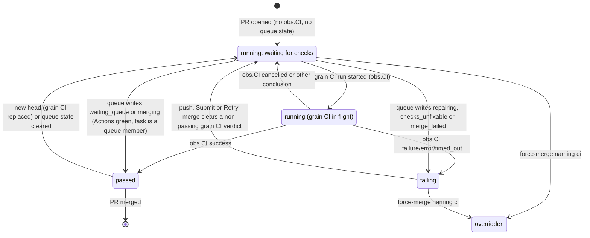

| state | what grain does itself | what the user can do (UI / API) | what the user must do | task `state`/`reason`, `mergeGates[ci]` |
|---|---|---|---|---|
| running (grain CI) | `reconcileTaskCI` starts one run per head, collects it, retries runner faults | `grain ci retrigger` from a run (grain CI only); ⚠ the UI control was not checked | nothing | any state; `ci: running` |
| running ("waiting for checks", GitHub Actions) | if the task is a queue member, `syncEntry` reads the checks and moves the queue state | none for the gate itself; `grain ci wait` in a run | nothing if auto-merge is on. **If auto-merge is off, nothing ever moves this gate** (§2.6) | usually `awaiting_submit/not_auto_merge`; `ci: running / waiting for checks` |
| failing | queue member: `repair_needed` → automatic repair, up to 2 (§1.8). Not a member: nothing | **Retry merge** `POST /api/tasks/{id}/retry-merge` (clears a non-passing grain CI verdict, `ui.Client.RetryMerge`); **Submit** `POST /api/tasks/{id}/submit` (also clears one, `clearUnansweredCI`); **Run now** `POST /api/tasks/{id}/run-now` to send the author back | push a fix or Run now. A red check that isn't the branch's own (`checks_unfixable`) needs the repository setting or a person | `completed/merge_failed` once the queue gives up; `ci: failing` |
| passed | queue member: merges when all else is clean | — | — | `completed/on_merge_queue`; `ci: passed` |
| overridden | merges at the override's head only | **Force merge** dialog / `POST /api/tasks/{id}/force-merge` `{reason, head, overrideGates:["ci"]}`, or `grain pr submit <pr> -override-gates ci -reason <why>` (`POST /api/pull-requests/submit`), with merge:force and repo-admin | — | `ci: overridden` |

### 1.2 Security review gate

Files: `orchestrator/securityhold.go`, `securityhold_inplace.go`,
`securityhold_inherit.go`, `securityhold_submit.go`, `humanreviewhold.go`.
The trust-boundary list is `pkg/trustboundary`; the repository's own
`sensitive: true` triggers and guard add to it (`repoGuard`).

**When a head is classified:**

- At the end of every run that leaves a PR, before the task is marked
  completed: `finish.go` calls `holdForTrustBoundary` and then
  `judgePullRequestTriggers`.
- When a head moves outside a run, `syncEntry` calls `clearedForHead`.
  That reclassifies **only while auto-merge is on**: with auto-merge off
  `clearedForHead` returns true without reading anything. So a held
  change's new head is reclassified when its auto-merge comes back, not
  when it is pushed.
- After a Submit, `pinHumanSubmit` / `reclassifySubmitted`.
- When the security review settles, `settleSecurityHold` (reviewer head,
  or the head that moved).

Stacked fixes and reviews are never classified (`unjudged`).

**A head is carried, not re-reviewed** when nothing on the trust boundary
changed: `carryClearance` / `keepClearance` keep a clearance whose
trust-boundary patches are unchanged, and `securityReviewUnchanged` /
`carrySecurityReview` carry the review (and any findings recorded with
the head it read, `ReviewFindingsRecord.HeadSHA`) across a head that
moved without changing the change. Otherwise a new review is filed,
incremental from the last reviewed head where possible (`reviewSince`),
and it supersedes the previous one (`supersedeSecurityReview`).

**The review fixes in place.** `putSecurityReview` files it to work on the
change's own branch (`LinkPushesReviewedBranch` / `CIOwner`). What it
pushes is recorded as `LinkReviewerHead` (`recordReviewerHead`). A clean
review with fixes clears the change at the reviewer's head, unless those
fixes touch the boundary themselves (`reviewerFixesTouchBoundary`), in
which case the head is held afresh for another review.

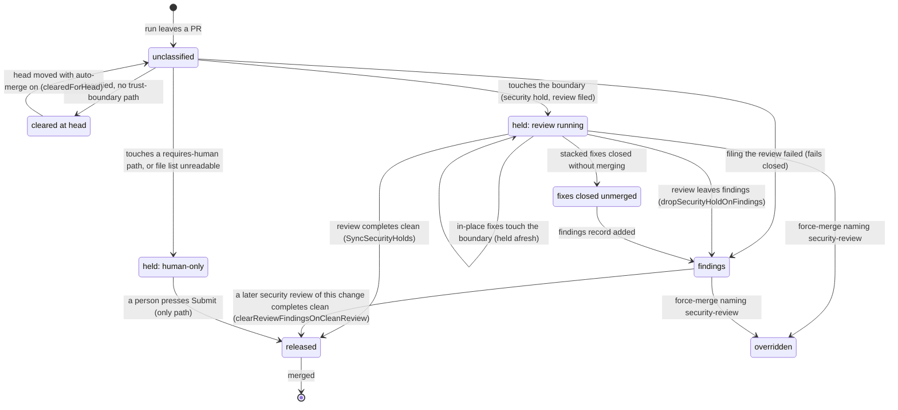

| state | what grain does itself | what the user can do (UI / API) | what the user must do | `state`/`reason`; `mergeGates[security-review]` |
|---|---|---|---|---|
| held: review running | runs the review; it may push fixes to the branch; `SyncSecurityHolds` releases when it is clean; a new head with changed patches files a superseding review | **Submit** records approval only (`AutoMerge = !HasPendingReviewHold`); **Force merge** naming `security-review` | nothing: wait | `awaiting_submit/not_auto_merge`; `running (task #N)` |
| held: human-only | nothing releases it | **Submit** `POST /api/tasks/{id}/submit` (approvers only for owner-approval categories), or **Release** `POST /api/tasks/{id}/human-review/release` | **press Submit** | `awaiting_submit/not_auto_merge`; `security-review` running, and `approval: needed` |
| findings | posts the findings as a (draft) review on the PR and as "Review needs your decision" on the task (§1.4); raises a `security-findings` human-review reason (`raiseFindingsReview`); hold link dropped; `AwaitPersonForAutoMerge("review N left findings")` | **Reply** (only if `LinkReviewQuestions` is present, §1.4); **Run now** to send the author back; **Force merge** with a reason | a clean re-review is the only release, and nothing files one until the head moves (§2.1) | `awaiting_submit/not_auto_merge`; `findings` / summary, overridable |
| fixes closed unmerged | `AwaitPersonForAutoMerge`, findings "security review fixes were closed without merging" | as above | push, then wait for a clean re-review | same |
| released | `AutoMerge = true` if no path-trigger hold, no human hold, no findings, no pending approvals | — | — | `completed/on_merge_queue`; `passed (task #N)` |
| PR merges or closes with the review open | `closeSecurityReviewOnSettle` closes it. Under an override or base-repair bypass, `continueReviewAfterMerge` keeps it running against the merged commit, and its findings become a follow-up fix task (`filePostMergeReviewFollowUp`) | — | — | `closed/closed` |

Base-repair bypass (`base_repair_bypasses_human_gates`, `baserepairbypass.go`):
while the base branch is red, a repair task keeps auto-merge through the
security and trigger gates and records `LinkBaseRepairBypass`.

⚠ Stale doc comment: `securityhold.go`'s overview still says "Submit sets
AutoMerge back … and the change merges once it reads clean, whatever state
its review is in". Since `63cdbc93` that is false (§1.6).

### 1.3 Code review gate: path triggers, `every-pr`, configured reviews

Files: `orchestrator/pathtriggerhold.go`, `pathtriggerreview.go`,
`pathtrigger.go` (`fileCoalesced`), `model/path_trigger.go`,
`repodecl/triggers.go`, and `orchestrator/review.go` for the configured
`Review:` template.

**Declaration** (`repodecl/triggers.go` `parseTrigger`): a trigger is
`.grain/triggers/<name>.yml` with `on`, `paths`, `ignore`, `branches`,
`template`, `per`, `gate`, `human`, `auto-approve`, `sensitive`,
`approvers` and `fixes`. `gate` and `fixes` are only valid with
`on: pull_request`, and `human` is only valid with `gate`. `human`
defaults to `on-findings` (`model.TriggerHumanOnFindings`). The template
must exist, and `sensitive` with no template defaults to grain's security
review. The triggers are read from the **base** branch, never the head.

**`human`** (`model/path_trigger.go`): when several gating triggers match,
the strictest wins (`StricterHuman`: `no` < `on-findings` < `required`).

- `required`: never releases on its own; only a person's Submit does.
  Sensitive triggers allow only their approvers (`approvalLinks`).
- `on-findings`: releases when every gating task finished without
  findings, and any fixes it pushed merged back.
- `no`: releases when every gating task finished, whatever it said.
  Findings from its own tasks are ignored (`dropPathTriggerHoldOnFindings`
  returns early).

**This repository** declares five gating triggers: `every-pr`
(`paths: ["**"]`, `template: pr-review`, `human: on-findings`,
`auto-approve: true`), and four `sensitive: true` triggers: three with
`human: required` and one with the default `on-findings`
(`.grain/triggers/*.yml`).

**Judging a head** (`judgePullRequestTriggers`):

1. When it runs: at a run's finish, and from `syncEntry` →
   `pathTriggersCurrentFor` for any open PR whose head differs from
   `LinkPathTriggersRead`, **whether or not auto-merge is on**. Review,
   fix and trigger-filed tasks are never judged
   (`pullRequestTriggersApply`).
2. File list: an unreadable list, or one at the 3000-file cap, makes every
   gating trigger fire (fail closed).
3. The head moved without changing the change (`carriedPathTriggerGates`,
   `samechange.go`): every gating review's result is carried and nothing
   is filed.
4. Ungated triggers file an ordinary task, coalesced per (PR, trigger,
   group).
5. Gating triggers are grouped by template ("kind"). Each kind files one
   review (`filePullRequestReview`), tagged `reviewKindTag(PR, kind)` plus
   `path-trigger-head:<sha>`. The same head again files nothing.
   - A kind whose template is the security review reuses the
     trust-boundary review when that review already covers every matched
     path.
6. **Re-review on a new head**: incremental from the head the last review
   of the kind read (`incrementalBase`, `reviewDelta`). It becomes a full
   review on a force-push or rebase (not `ahead`), on a base merge that
   brought in a watched file, on more than 20 changed files, or when the
   earlier review failed or was abandoned. Re-reviews are **debounced 3
   minutes** (`reviewDebounce`) and filed `DeferredUntil`.
   - `fileCoalesced`: an undispatched earlier review is **superseded**. A
     dispatched one (running, or `completed` but not yet closed) is
     **depended on** (`LinkDependsOn`).
7. `applyPathTriggerGate` records the gate: `LinkPathTriggersRead`,
   `LinkPathTriggerHold`=strictest `human`, one `LinkPathTriggerTask` per
   (trigger, task), `LinkHumanOnlyHold` for `required` unless this head
   was Submitted, and `AutoMerge = false`.
   - A change that was never going to merge itself
     (`waitsForPersonToMerge`) gets `DeclineAutoMerge`: sticky.
   - Filing errors become `ReviewFindings{gate: trigger:<name>, summary:
     "filing gating review failed: …"}` (fail closed).
   - No gated path touched any more: the hold, its tasks, trigger
     questions and `review` findings are cleared, and auto-merge returns.
   - It posts a "grain path-trigger hold" comment on the task and the PR.

**What a review does with what it finds.** A findings-only review (the
default, `fixes` off) is told "**Post findings; do not fix them.** … Do
not commit, push or open a pull request" (`reviewFindingsBody`), and
carries `LinkReviewCommentsOnly`. A `fixes: true` review pushes a
stacked branch whose PR merges back into the change
(`reviewTaskBody`). The security-review kind fixes in place (§1.2).
**So the `every-pr` review fixes nothing**: every finding it makes, a
one-line typo included, becomes an open question to the owner (§1.4).

**Settling** (`SyncPathTriggerHolds` → `settlePathTriggerHold`), each
cycle, once every gating task has finished (`reviewOutcome`;
`checkIncrementalDependencies` waits on an incremental review's base):

- clean, meaning no pushed-but-unmerged fixes and no abandoned task, or
  `human: no`: trigger findings and trigger questions are cleared;
- otherwise a findings record is added: `gate: review`, summary "gating
  review fixes were closed without merging" or "**gating review closed
  without finishing**";
- releasable is `no`, or clean with the `human` requirement met. If
  releasable and no other hold remains, `AutoMerge = true`. If not,
  `AwaitPersonForAutoMerge("a gating trigger's tasks left it for a
  person")`.

**Findings** (`dropPathTriggerHoldOnFindings`, called from
`relayReviewFeedback` when the review's run finishes):
`AwaitPersonForAutoMerge("review N left findings")`, a findings record
`trigger:<name>` (or `review`), and the hold link is dropped. A findings
record is cleared only by a **later clean review of the same gate**
(`clearReviewFindingsOnCleanReview`, from `closeFinishedReview` and
`sync.go`) or by the change no longer touching gated paths.

**Configured `Review:` template** (`Task.ReviewTemplateID`,
`fileReviewTask`, `reviewStateOf`): a stacked review filed once per task.
It does **not** withdraw auto-merge. It holds the queue head in
`waiting_review` until the review's PR lands. After
`defaultReviewTaskDeadline` (6 h), `escalateUnfinishedReview` →
`blockMergeQueue` (`merge_failed`). This repository uses `every-pr`
instead (`.grain/triggers/every-pr.yml` says not to add a `review.yml`).

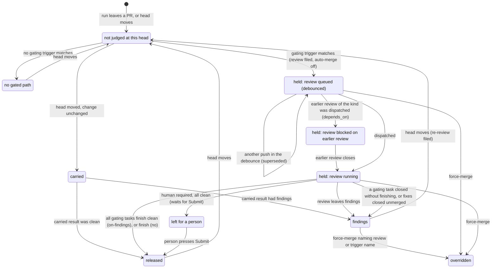

| state | what grain does itself | what the user can do | what the user must do | `state`/`reason`; `mergeGates[review]` |
|---|---|---|---|---|
| held: queued / debounced | supersedes it on each push within 3 min | **Run now** on the review (`POST /api/tasks/{id}/run-now`); **Force merge** naming `review` | nothing | `awaiting_submit/not_auto_merge`; `running (task #N)` |
| held: blocked on earlier review | nothing, unless `releaseStaleReviewDependencies` finds the earlier review stale (failed / awaiting / deferred / stacked PR in `repair_needed`, `merge_failed`, `checks_unfixable` or blocked) | **Run now** on the blocked review (ignores the blocker); close the earlier review | ⚠ often nothing works without a person: §2.4 (task 6236) | reviewed: `awaiting_submit/not_auto_merge`; review: `queued/blocked_on_task`; gate `running` |
| held: running | runs | **Force merge** | nothing | `running (task #N)` |
| findings | posts findings to the PR and the task, "Review needs your decision" (§1.4) | **Reply** (questions only), **Run now** the author, **Force merge** naming `review` / `trigger:<name>` | push fixes (or have an agent push them), which files a re-review; or override | `findings` / summary |
| findings: "gating review closed without finishing" | nothing | **Force merge**; **push** a new head | ⚠ a new head's clean re-review does not clear this record: §2.5 | `findings` |
| left for a person (`required`) | nothing | **Submit** | **press Submit** | `approval: needed`, code review `passed` |
| released | `AutoMerge = true` | — | — | `completed/on_merge_queue`; `passed (task #N)` |

### 1.4 Review questions: "Review needs your decision"

Files: `orchestrator/reviewfeedback.go` (`relayReviewFeedback`,
`noteFindingsOnReviewedTask`), `orchestrator/reviewquestions.go`
(`SyncReviewQuestions`), `model.LinkReviewQuestions`.

When a review's run finishes with `add_review_comment` calls
(`finish.go` → `relayReviewFeedback`):

1. `wantedAutoMerge` is read first (`reviewedWantsAutoMerge`): auto-merge
   on, or a security or path-trigger hold, except a `human: required`
   one.
2. `dropSecurityHoldOnFindings` and `dropPathTriggerHoldOnFindings` (§1.2,
   §1.3) record findings and end their holds.
3. The findings are posted to the PR, as a draft review (PAT) or a COMMENT
   review (App identity).
   - **If posting fails**, the findings go only into the *review task's*
     conversation, and the function returns before
     `noteFindingsOnReviewedTask`. The findings records from step 2 stand
     with **no `LinkReviewQuestions`**.
4. `noteFindingsOnReviewedTask`, unless the reviewed task is closed:
   - posts "**Review needs your decision.** … Reply here … and grain sends
     another run on this task …" on the reviewed task;
   - sets `AutoMerge = false`, calls `ClearAutoMergeAwaitsPerson`, and
     **replaces** any earlier `LinkReviewQuestions` with
     `{reviewTask, afterCommentID: <that comment>, restoreAutoMerge}`;
   - adds a `ReviewFindings` record for the review's gate.

`SyncReviewQuestions` → `settleReviewQuestions`, each cycle, for each open
PR task carrying `LinkReviewQuestions`:

| condition | effect |
|---|---|
| task `closed` | drop the questions |
| state not `awaiting_submit` (deferred on its own `resume_later` counts as awaiting) | wait |
| no comment by a `PrincipalHuman` with id > `afterCommentID`, on the task or on the review | wait |
| a human reply exists | drop `LinkReviewQuestions`; for a configured `Review:` gate, also drop `LinkReviewTask` and clear `review` findings; restore auto-merge if `restoreAutoMerge` and no other hold; **clear `CompletedAt`** (re-queue); post "The owner answered …" |

Notes, all from the code above:

- **Findings records are cleared by the reply only for the configured
  `Review:` gate.** For security and trigger gates the records stay until
  a clean re-review of the next head, so the reply re-queues the author
  but auto-merge stays off.
- The note says "Submit is the other answer, ship as is … the link is
  dropped here on the next cycle". Since `63cdbc93` Submit keeps
  `LinkReviewQuestions`: `humanSubmitted` never clears it, and
  `AutoMerge = !HasPendingReviewHold` keeps auto-merge off. ⚠ Stale doc
  comment.
- Only grain-side comments count. A reply on the GitHub PR is not read.

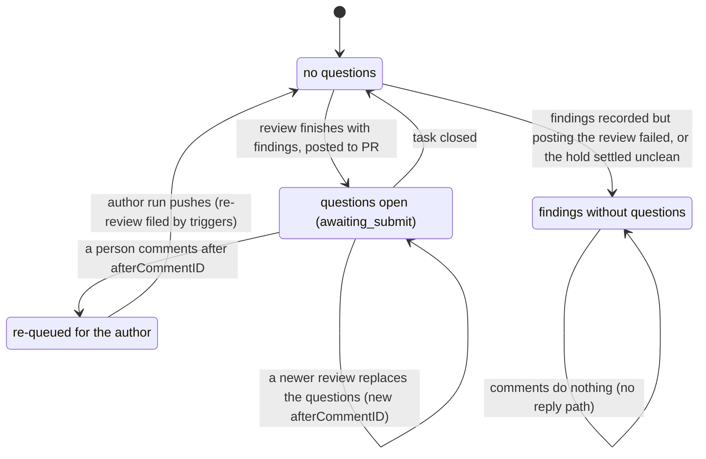

| state | what grain does itself | what the user can do | what the user must do | `state`/`reason`; gates |
|---|---|---|---|---|
| questions open | nothing until a reply | **Reply** in the task's comment box (`POST /api/tasks/{id}/comments` or `/reply`), on the task or on the review; **Run now**; **Force merge** | **reply** | `awaiting_submit/not_auto_merge`; the review gate `findings` / "open review questions (task #N)" |
| findings without questions | nothing | **Run now** (`POST /api/tasks/{id}/run-now`) is the only way to send the author back; **Force merge** | **press Run now** (the UI does not say so) | same state and reason; the gate `findings` |

### 1.5 Human review holds

Files: `model/human_review_hold.go`, `orchestrator/humanreviewhold.go`,
`ui/human_review.go`.

A `LinkHumanReviewHold` reason has three sources:

- `requested`: a review run calls `request_human_review`
  (`POST /api/tasks/{reviewId}/human-review`, `ui.Client.RequestHumanReview`).
  Only review tasks may call it, as themselves, and calls are
  rate-limited per review (`MaxHumanReviewRequestsPerReview`).
- `security-findings`: `raiseFindingsReview`, from
  `dropSecurityHoldOnFindings`.
- `human-only`: `raiseHumanOnlyReview`, from a requires-human path.
  `SyncHumanReviewHolds` backfills both of the last two.

While any reason is present, `guardAutoMerge` keeps auto-merge off.
`DropHumanReviewHold` (called by Submit and by
`POST /api/tasks/{id}/human-review/release`, which requires an unlimited
role and refuses agents) drops every reason **except
`security-findings`**. Releasing a hold that is only security findings
returns `ErrFindingsRequireRereviewOrOverride` (409). Human-only reasons
also go when a later head no longer touches the path
(`normalizeHumanReviewHold`).

`mergeGates[]`: `requested` and `human-only` reasons count toward
`approval: needed`. `security-findings` reasons count toward
`security-review: findings`.

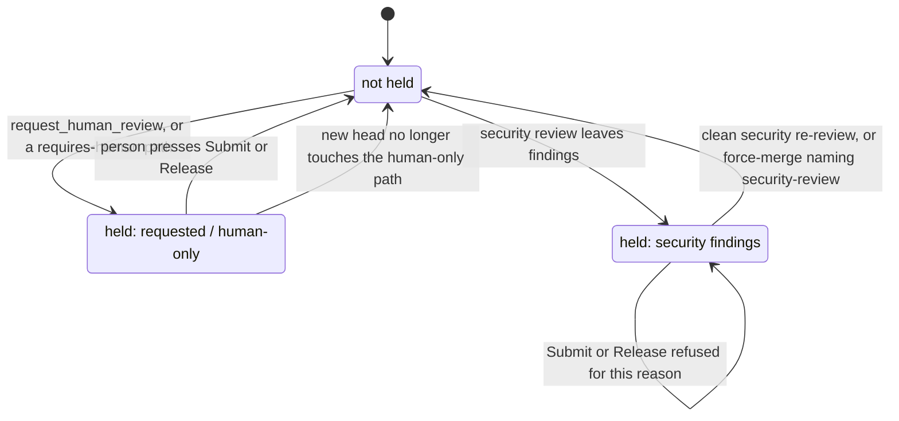

| state | grain itself | user can | user must | readouts |
|---|---|---|---|---|
| held (requested / human-only) | nothing | **Submit**, **Release** (`POST /api/tasks/{id}/human-review/release`) | **Submit** | `awaiting_submit/not_auto_merge`; `approval: needed` |
| held (security findings) | as §1.2 findings | **Force merge** | re-review or override | `security-review: findings` |

### 1.6 Approval / Submit (since `63cdbc93`, 2026-11-10)

Commit `63cdbc93`, "feat(merge): make reviews a separate merge gate from
Submit", made required reviews independent of a person's approval.
`ui.Client.Submit` (`POST /api/tasks/{id}/submit`, the **Submit** button
in the task pane and inbox row; `grain pr submit <pr>` calls `POST /api/pull-requests/submit`, which does the same):

- refuses CLs that are not ready and changes with no live change
  (`change.GateSubmit`);
- with pending approvers, goes through `submitWithApprovals`: only a
  named approver's Submit counts, and an agent's is refused;
- otherwise, if auto-merge was off: drops `LinkPathTriggerHold` when every
  trigger review has finished and there are no findings, and records
  `humanSubmitted` (`LinkHumanSubmitted` pinned to the head shown).
  `humanSubmitted` drops human-only, broken-rules and human-review holds
  (but not security findings);
- `AllowAutoMerge` (lifts `LinkAutoMergeDeclined`);
- `AutoMerge = !HasPendingReviewHold`. **So with any findings, questions,
  security hold or unfinished trigger review, Submit records approval and
  leaves auto-merge off.** The task stays in
  `awaiting_submit/not_auto_merge`, and the Approval gate reads
  `passed / given by <person>`;
- `unblockSubmitted` (clears `MergeQueueBlockedAt`) and
  `clearUnansweredCI`.

The **Approval gate** is `needed` when any of these hold: auto-merge was
declined, a human-only or broken-rules hold, a non-findings human-review
reason, pending approvals, a withdrawn merge policy, `human: required`
with no approval marker, or auto-merge off with **no review hold and no
approval marker**. Otherwise it is `passed`. It is never overridable
(`KnownOverrideGates` omits it).

Gate override (`ForceMergeWithGates`, `POST /api/tasks/{id}/force-merge`,
`grain pr submit <pr> -override-gates … -reason …`): requires merge:force and repo-admin,
a non-empty reason, and explicit gate ids (`ci`, `security-review`,
`review`, `targeted-review`, `trigger:<name>`; `review` covers trigger and
targeted reviews). It is recorded as `LinkGateOverride` for one head, and
`forceOverridesGates` re-checks every gate at merge time. Reviews still in
flight continue after the merge (§1.2).

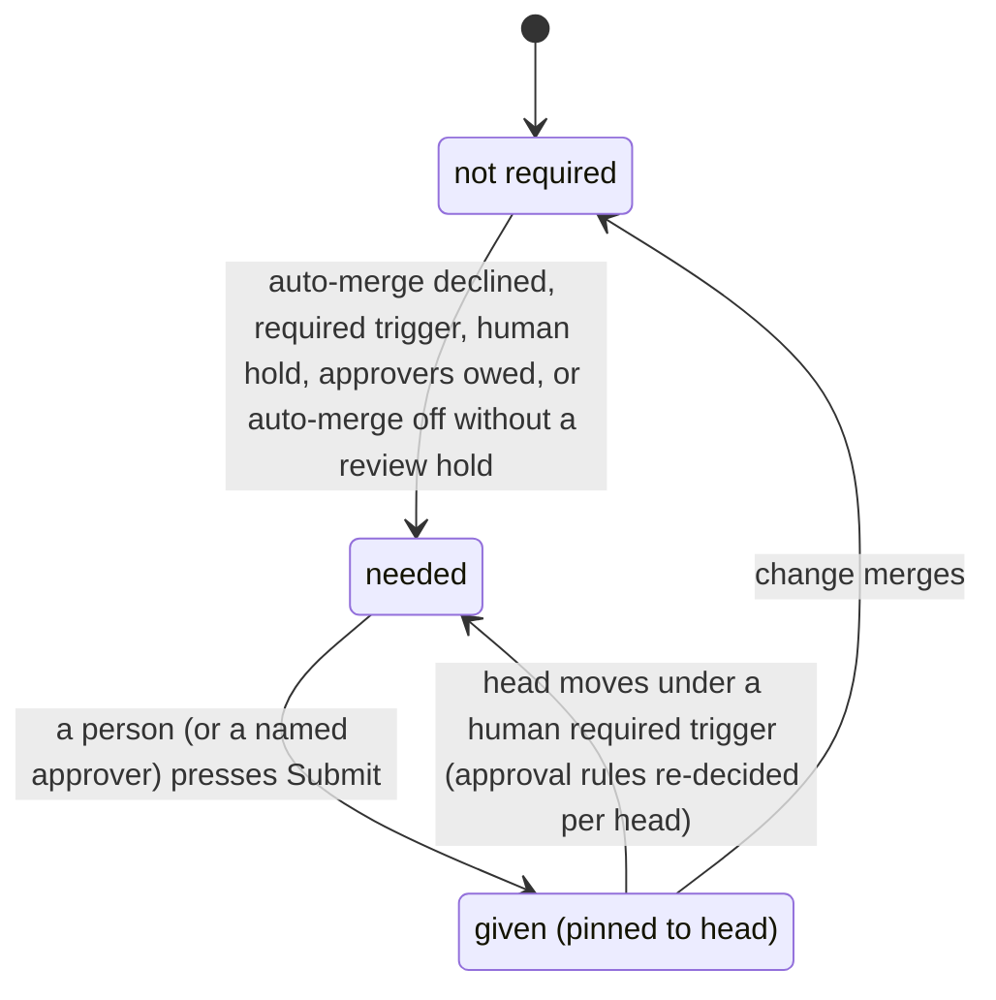

| state | grain itself | user can | user must | readouts |
|---|---|---|---|---|
| needed | nothing | **Submit** | **Submit** | `awaiting_submit/not_auto_merge`; `approval: needed` (detail names approvers) |
| given, review gates pending | review gates run as normal | **Force merge** for review gates | nothing (wait for reviews) or override | still `awaiting_submit/not_auto_merge`; `approval: passed` |

### 1.7 Auto-merge on/off

All the writers found in `pkg/orchestrator` and `pkg/ui` (grep of
`AutoMerge =`, `DeclineAutoMerge`, `AwaitPersonForAutoMerge`,
`ClearAutoMergeAwaitsPerson`, `AllowAutoMerge`). ⚠ This list is from a
grep; some rarely used writers (adopt, takeover, upgrade holds) are named
but their conditions were not traced.

| writer | off / on | sticky mark |
|---|---|---|
| `holdForTrustBoundary` | off (security hold); `DeclineAutoMerge` if `waitsForPersonToMerge` | Declined |
| `holdForTrustBoundary` under base-repair bypass | on | — |
| `dropSecurityHoldOnFindings` | off | AwaitsPerson "review N left findings" |
| `settleSecurityHold` clean | on if no trigger hold, human hold, findings or approvals | — |
| `settleSecurityHold` fixes closed unmerged | off | AwaitsPerson |
| `applyPathTriggerGate` gated | off; `DeclineAutoMerge` if `personMerges` | Declined |
| `applyPathTriggerGate` no gated path | on if no other hold | — |
| `dropPathTriggerHoldOnFindings` | off | AwaitsPerson "review N left findings" |
| `settlePathTriggerHold` releasable | on if no other hold | — |
| `settlePathTriggerHold` not releasable | off | AwaitsPerson "a gating trigger's tasks left it for a person" |
| `noteFindingsOnReviewedTask` | off | **clears** AwaitsPerson (`ClearAutoMergeAwaitsPerson`) |
| `settleReviewQuestions` | on if `restoreAutoMerge` and no hold | — |
| `clearReviewFindingsOnCleanReview` | on if no hold | — |
| `ClearReviewFindingsForGate` | (drops AwaitsPerson ending "left findings" when no findings remain) | — |
| `restoreAfterHolds` (store) | on when the last hold link goes, if a clearance or Submit is present | — |
| `guardAutoMerge` (store) | reverts "on" while a review or human hold stands | — |
| `ui.Client.Submit` | `!HasPendingReviewHold`; `AllowAutoMerge` | lifts Declined |
| `PATCH /api/tasks/{id}` `auto_merge` | false → `DeclineAutoMerge`; true → `AllowAutoMerge` | — |
| `continueReviewAfterMerge`, `closeObsoleteReviews` (the review's own) | off | — |
| `filePostMergeReviewFollowUp` (new task) | on | — |
| `repoguard.go`, `baserepairbypass.go`, `upgradehold.go`, `mergerules` `never` | ⚠ not traced | — |

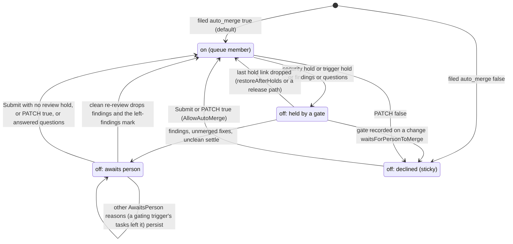

| state | grain itself | user can | user must | readouts |
|---|---|---|---|---|
| on | merge queue drives it | **PATCH** `auto_merge: false` (task pane auto-merge toggle) | — | `completed/on_merge_queue` |
| off: held | the holding gate's own machinery | see that gate | see that gate | `awaiting_submit/not_auto_merge` |
| off: awaits person | nothing, except a clean re-review that clears "left findings" | **Submit** (only works with no review hold), **PATCH true** (reverted while a review hold stands), **Force merge** | depends on the reason; the UI does not show it | same |
| off: declined | nothing | **Submit**, **PATCH true** | **Submit** | same; `approval: needed` |

### 1.8 The merge queue

Files: `orchestrator/sync.go` (`syncEntry`, `isQueueMember`),
`queuestatus.go` (states), `recheck.go` / `mergerules.go` (repairs),
`docs/merge-queue-behind.md`. A task enters the queue when auto-merge is
on and it is not a fix, review, paused, blocked, or waiting on a GitHub
approval.

- **Repairs**: `maxAutomaticRepairs = model.MaxAutomaticRepairs = 2`
  (`model/merge_rules.go`). The second repair is given only when
  `secondRepairReason` finds something changed. `repairs:` in merge rules
  can lower it, and `repairs: 0` escalates at once (`escalateNoRepair`).
- `requeueForRepair` clears `CompletedAt` and sends the same task back to
  an agent on its own branch.

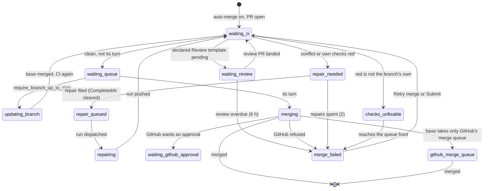

| state | grain itself | user can | user must | readouts |
|---|---|---|---|---|
| `waiting_ci` | reads checks every cycle | `grain ci retrigger`; **Retry merge** | — | `completed/on_merge_queue`; merge `waiting_ci/*`; `ci: running` |
| `waiting_review` | waits for the declared review; blocks after 6 h | **Run now** the review | — | `ci: running`, `review: running` |
| `waiting_queue` | merges on its turn | drag the row (`POST /api/tasks/reorder`) | — | `ci: passed` |
| `merging` / `updating_branch` / `github_merge_queue` | drives GitHub | — | — | `ci: passed` / `running` |
| `repair_needed` → `repair_queued` → `repairing` | files and runs the repair | **Run now** jumps the worker queue | — | `running/live_run` while repairing; `ci: running` (not `failing`) |
| `checks_unfixable` | escalates at the front | fix the setting (`unfixable_checks`) or the check | yes | `ci: failing` |
| `waiting_github_approval` | re-reads reviews every few minutes | approve on GitHub | **approve on GitHub** | — |
| `merge_failed` | nothing (except refusals, asked again each cycle) | **Retry merge** `POST /api/tasks/{id}/retry-merge`; **Submit** | **Retry merge** | `completed/merge_failed`; `ci: failing` |

### 1.9 Combined view: one PR head

What happens on one PR, in order, from a run's finish through every way
its head can change. The steps are those of `finish.go` (classify, judge,
complete) and then each cycle's `SyncSecurityHolds`,
`SyncPathTriggerHolds`, `SyncReviewQuestions`, `SyncReviews` and
`SyncPullRequests`.

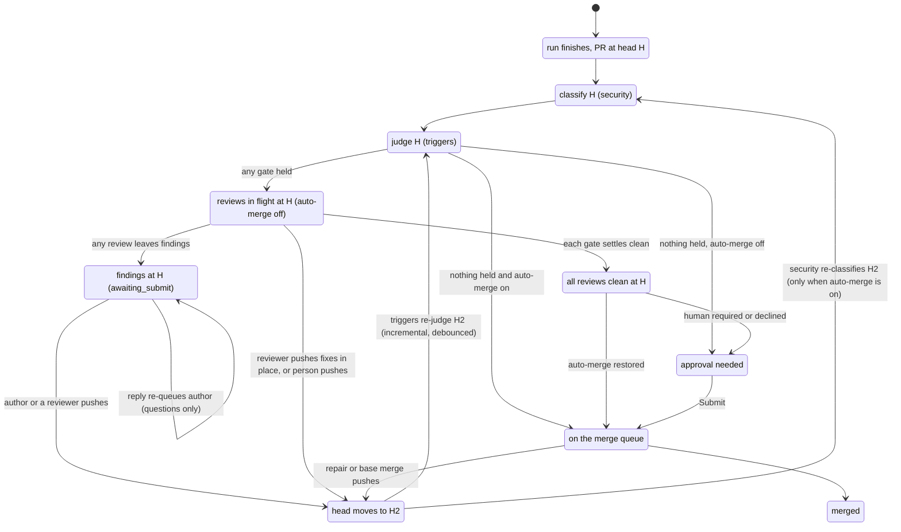

The cases that matter:

- **Head moves, change unchanged** (a base merge, a rebase with the same
  patch). Security: `carryClearance` / `securityReviewUnchanged` carry the
  clearance, the review and its findings. Triggers:
  `carriedPathTriggerGates` carries every kind's result. Nothing new is
  filed, and the findings travel with the change.
- **Head moves, change changed** (a push). Triggers judge H2 on the next
  `syncEntry`: a re-review is filed, debounced and incremental, and
  depends on the earlier review if it was dispatched. Security
  reclassifies H2 only through `clearedForHead`, which only runs with
  auto-merge on. A held change is reclassified once its auto-merge
  returns, and a Submit's pin is checked by `pinHumanSubmit`. Approvals
  for `human: required` triggers are re-decided per head
  (`WithoutApprovalRules`).
- **Force-push or rebase** onto a new base. `reviewDelta` sees
  `cmp.Status != "ahead"` and files a full review instead of an
  incremental one. The security review is likewise full when
  `incrementalBase` cannot use the old head.
- **A review closed early.**
  - Undispatched: it is superseded by the next filing, or, if closed by
    hand, `settlePathTriggerHold` treats it as abandoned. That adds a
    `review` findings record "gating review closed without finishing" and
    an AwaitsPerson mark (§2.5).
  - Running: the same, when it closes without completing.
  - A security review closed by hand: `settleSecurityHold` treats it as
    unclean, and the change waits for a person.
  - A queued **incremental** review whose base review was abandoned is
    rewritten to a full review (`checkIncrementalDependencies` →
    `stripIncrementalReview`).
- **The PR merges or closes with reviews open.**
  `closeSecurityReviewOnSettle` and `closeObsoleteReviews` close them,
  except after an override or bypass, where they continue post-merge and
  file follow-ups.

---

## Part 2: Known problems on the live deployment (2026-11-15)

Each problem is explained against Part 1. Where the live symptom could
not be reproduced from `main`'s code, it is marked ⚠ and the candidate
causes are listed.

### 2.1 86 tasks stuck in `awaiting_submit` on review findings, nothing sending them back

The path: a gating review (usually `every-pr`) leaves findings, so §1.3's
`dropPathTriggerHoldOnFindings` and §1.4's `noteFindingsOnReviewedTask`
run, auto-merge goes off, and the task is completed with a PR. That is
`awaiting_submit/not_auto_merge`. Nothing re-queues it unless one of
these happens:

1. a person replies, and only if `LinkReviewQuestions` is present
   (§1.4);
2. a person presses **Run now**;
3. the head moves some other way (a person pushes), which files a
   re-review.

Grain has no automatic send-back. These design choices make it the
common case rather than the exception:

- **The default review fixes nothing.** `reviewFindingsBody` tells
  findings-only reviews "Post findings; do not fix them". Yet
  `noteFindingsOnReviewedTask` assumes that what reaches it is "the
  remainder … the ones it judged not to be its to make". So every
  mechanical finding becomes a question to a person.
- **Findings records are cleared only by a clean review of a later
  head.** No head moves while the task sits in `awaiting_submit`, so the
  gate can never pass by itself.
- **The readouts ask for the wrong action.** The reason
  (`awaiting_submit/not_auto_merge`) names Submit, and since §1.6 Submit
  does not merge over findings. The inbox therefore offers a control that
  records an approval and changes nothing visible.
- **No clock.** `noteFindingsOnReviewedTask` deliberately "starts no
  clock", so no escalation ever fires.

Task 6240 (backlog sweep) is the one-off cure for the 86. Part 3's loop
is the structural one.

### 2.2 The owner's reply on task 5812 did not re-queue it

`settleReviewQuestions` re-queues only when **all** of these hold: the
task carries `LinkReviewQuestions`; its state is `awaiting_submit` (or
deferred on its own `resume_later`); and a comment by a `PrincipalHuman`
exists with an id greater than `afterCommentID`, on the task or on the
review. Otherwise a comment on an `awaiting_submit` task does nothing:
`addAttributedComment` → `reopenAcknowledgeable` acts only on
`awaiting_reply`, and there is no pending question to lift.

⚠ Which condition failed for 5812 could not be confirmed without reading
its record (this run has no `tasks:read`). The candidates, in order of
likelihood from the code:

1. **No `LinkReviewQuestions`.** The findings were recorded without
   questions: posting the review failed (`relayReviewFeedback` returns
   before `noteFindingsOnReviewedTask`), the hold settled unclean (§2.5),
   or filing the review failed (fail-closed findings).
2. **A newer review replaced the questions** after the reply.
   `noteFindingsOnReviewedTask` writes a new `afterCommentID`, which makes
   the earlier reply "before" the current questions.
3. **The reply was on GitHub**, not in grain's conversation.
4. **The reply's author was not `PrincipalHuman`**, for example a
   service principal or an agent acting through the API.
5. **The state was not `awaiting_submit`**, for example `deferred` by a
   person.

### 2.3 `POST /api/tasks/{id}/retry` refuses `awaiting_submit`

On `main`, `ui.Client.Retry` has no state check of its own for
`awaiting_submit`. It refuses paused tasks, and refuses an agent lifting
an operator's stop. ⚠ The refusal seen live probably came from the
agent-API rails (`agentCrossTaskRail`: an agent may not retry a task
whose grants are wider than its own), or from a daemon build older than
`main`. Not confirmed.

Even when accepted, **Retry cannot unstick `awaiting_submit`**: it stamps
`RetryRequestedAt` and leaves `CompletedAt` set, so `task_state` still
reads `awaiting_submit`. Retry is for `failed`. The control that sends a
completed task back to an agent is **Run now** (`ui.Client.RunNow`), which
clears `CompletedAt`, and the merge queue's own repair does the same
(`requeueForRepair`). So the API offers the right action under an
unexpected name, and the UI does not offer it as the answer to findings.

### 2.4 Re-reviews `depends_on` an earlier review that is `completed` but never closed (task 6236)

Mechanism (§1.3, step 6): `fileCoalesced` makes a new review of the same
(PR, kind) **depend on** the previous one whenever the previous one has
been dispatched. `task_blocked` (`model/schema.go`) blocks on a
dependency until its `closed_at` is set. `completed` is not enough.

What closes a finished review:

- `closeFinishedReviews`, but only for a review in `completed` **with no
  PR of its own** (`hasPullRequest`);
- a stacked review's PR merging or closing (`recordPullRequestEvents`);
- `closeSecurityReviewOnSettle` and `closeObsoleteReviews`, but only once
  the reviewed PR settles;
- `releaseStaleReviewDependencies`, which closes the earlier review as
  superseded only when `staleReview` says so: failed, awaiting reply or
  submit, deferred, or a stacked PR in `repair_needed`, `merge_failed`,
  `checks_unfixable` or blocked. It only looks at reviews carrying a
  `path-trigger-review:` kind tag.

So a review that has a PR and is `completed` in any other queue state
(`waiting_ci`, `waiting_queue`, `agent_working`, an empty state because
it is not a queue member, …) blocks its successor indefinitely. A review
that has no PR is closed within a cycle. ⚠ Which shape 6236's earlier
review had is not confirmed. The fix in Part 3 removes the dependency
altogether: a re-review of a newer head needs nothing from the old run
except the head it read, which is already recorded (`reviewHead` tag,
`LinkPathTriggerReviewed`).

### 2.5 Closing a queued gating review turns the gate into "gating review closed without finishing"

`settlePathTriggerHold` counts a gating task that closed without
completing as abandoned, and adds `ReviewFindingsRecord{gate: "review",
summary: "gating review closed without finishing"}` with **no
`ReviewTask` and no `HeadSHA`**, plus `AwaitPersonForAutoMerge`.

That record is on gate `review`, not `trigger:<name>`. Every later
clearing path is gate-scoped:

- `clearReviewFindingsOnCleanReview` reads only
  `ReviewFindingsForGate(t, "trigger:<name>")` for a trigger review;
- `settlePathTriggerHold`'s clean branch clears `trigger:<name>` only;
- `ClearReviewFindingsForGate("trigger:x")` does not delete a `review`
  record (only the reverse is true).

So once written, the record survives a clean re-review of a later head.
It goes only when the change stops touching gated paths
(`applyPathTriggerGate` with no gates), when an override is applied, or
when a configured `Review:` gate's questions are answered. And
`HasReviewFindings` keeps `restoreAfterHolds` and
`clearReviewFindingsOnCleanReview` from handing auto-merge back.
⚠ This is from reading the code; no test was run to reproduce it.

Separately, the *reason* a queued review was closed (a person tidying
up, a supersede race, a `closeObsoleteReviews` sweep) is not recorded on
the gate, so the UI cannot tell "nobody reviewed this" from "somebody
decided not to".

### 2.6 CI gate always `running / waiting for checks` (task 6239)

From §1.1 row 9: on a `ci_mode: github` repository, `Observation.CI` is
nil, because only grain CI writes it. The gate then reads the merge
queue state, and **the merge queue writes states only for its members**,
which have auto-merge on. Every task held by a review gate has
auto-merge off, so:

- its CI gate is `running / waiting for checks` however green its
  checks are;
- a member in `repair_needed`, `repair_queued`, `waiting_ci`,
  `agent_working`, `updating_branch` or `github_merge_queue` also reads
  `running`;
- a member reads `passed` only in `waiting_queue` or `merging`.

The gate is a projection of the queue's memory, not of the checks. The
fix: compute the CI gate from the head's check runs (the same
`healthFrom` / `forge.Reds` reading `syncEntry` does), cached per
(PR, head) and refreshed for every open PR, member or not.

### 2.7 Auto-merge silently turned off after a review pushes fixes (task 5813)

⚠ Not reproduced. The code has these paths by which a review's push
leaves auto-merge off. Each is listed with whether it says so anywhere a
person looks.

1. **In-place security fixes move the head; the triggers re-judge it.**
   `settleSecurityHold` releases with auto-merge on only if no
   path-trigger hold remains. The reviewer's head is a head the triggers
   have not read, so the next `syncEntry` → `pathTriggersCurrentFor` →
   `applyPathTriggerGate` holds it again and files an incremental
   `every-pr` re-review. A PR comment is posted, but if the re-review
   then `depends_on` an earlier `every-pr` review that never closes
   (§2.4), it never runs, and the change sits with auto-merge off.
2. **A stacked review's fixes merge back** (`fixes: true`): same as 1,
   for the trigger kind.
3. **`restoreAfterHolds` will not restore without a clearance or a
   Submit.** `dropSecurityHoldOnFindings` and
   `settleSecurityHold`-unclean both delete `LinkTrustBoundaryCleared`.
   A later write that drops the last hold link therefore leaves auto-merge
   off, and **records nothing**: `restoreAfterHolds` returns "", and
   `guardAutoMergeChange` records only on-to-off or kept-off.
4. **`DeclineAutoMerge` in `applyPathTriggerGate`** (`personMerges`) on a
   change whose holds had all cleared but whose auto-merge had not been
   restored (3). This makes the "no" sticky, as if a person had said it.
   The note says "It was not merging automatically anyway".
5. **`AwaitPersonForAutoMerge` reasons that nothing clears**: "a gating
   trigger's tasks left it for a person", and "security review N's fixes
   were closed without merging". `ClearReviewFindingsForGate` drops only
   reasons ending "left findings".

Item 3 followed by item 4 is the only fully silent chain the code
contains, and it is the most likely match for "silently".

### 2.8 The UI offers no clear control (task 6014)

From the tables above, a task in `awaiting_submit` can be held by any of
seven conditions, which need six different actions:

| condition | action |
|---|---|
| review running | wait |
| findings with questions | reply |
| findings without questions | Run now |
| `human: required` or approvers owed | Submit |
| declined | Submit |
| merge failed | Retry merge |
| stale record (§2.5) | override |

The task carries one reason (`awaiting_submit/not_auto_merge`), which
names one control (**Submit**). `mergeGates[]` carries a state per gate
but no action, and it is wrong for CI (§2.6). Each gate's real "way
forward" lives only in prose comments on the task and the PR. Part 3
§3.6 gives each gate state exactly one primary action, as data, so the
action area can render it.

---

## Part 3: Target behaviour (proposal)

> Reviews stop for a person only when there is a finding the agents
> cannot resolve themselves. Otherwise the agents loop as many times as
> needed.

### 3.1 Principles

1. **A gate's verdict is about one head.** Every gate records `(gate,
   head) → verdict`. A head that moves without changing the change
   carries the verdict, exactly as `carryClearance` and
   `carriedPathTriggerGates` do today. Any other head starts a new round.
2. **Gates stop writing `AutoMerge`.** `AutoMerge` goes back to meaning
   one thing only: the person's (or filer's) intent, plus the sticky
   `Declined` mark. A change merges when the intent is on **and** every
   blocking gate is `passed` or `overridden`. Holds stop toggling the
   switch, so §2.7's silent paths disappear: there is nothing left to
   fail to restore.
3. **Every gate state that waits on a person names exactly one primary
   action**, as data on the gate, together with why. Nothing else waits on
   a person.
4. **Agents do the work.** Fixable findings go back to an agent
   automatically, whether that is the review itself (in place) or the
   author task (send-back). A fresh review then runs on the new head.
5. **Loops end.** They end by converging (clean), or at a limit. At a
   limit the gate waits on a person, with that one action.
6. **One mechanism for every gate.** CI repair, security review, code
   review and future custom gates are all instances of Part 4's contract.

### 3.2 The common per-gate state model

These states are shared by every gate. They replace today's
`mergeGates[].state` values: compatible names are kept where they exist,
and old clients get a mapping.

| state | meaning | today's nearest |
|---|---|---|
| `not_applicable` | the gate does not apply to this head | gate absent |
| `pending` | applies, producer not started (debounce, queue, waiting on CI) | `running` / "queued" |
| `running` | producer is working on this head | `running` |
| `fixing` | the producer found fixable findings; an agent (the review in place, or the author via send-back) is working on them | none (today: `findings`, stuck) |
| `passed` | clean verdict for this head (or carried to it) | `passed` |
| `needs_person` | stops for a person; carries `ask` ∈ {`answer`, `decide`, `accept_or_extend`, `approve`, `retry_producer`, `retry_merge`, `external`} | `findings` / `needed` |
| `overridden` | a person skipped it for one head with merge:force and a reason | `overridden` |
| `producer_broken` | the producer cannot produce a verdict; resolved by fail-closed / fail-open policy (Part 4 §4.5) | today: findings "filing gating review failed" |

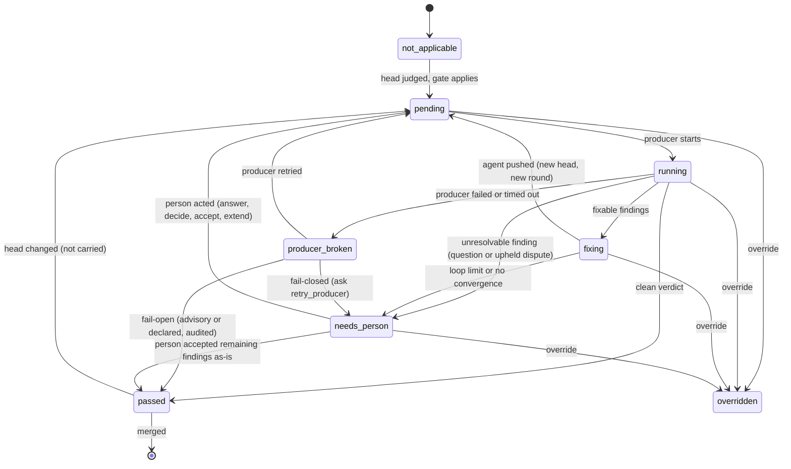

The task-level readouts are derived from the gates:

- `state`:
  - `running` while the author task is fixing;
  - `completed` while gates are `pending`, `running` or `fixing` on
    agents;
  - `awaiting_submit` **only** when some blocking gate is `needs_person`,
    or the intent is declined.
- `reason`: one per waiting gate ask, for example
  `awaiting_submit/gate:review:answer`,
  `awaiting_submit/gate:approval:approve`,
  `completed/gates_running`, `completed/gate_fixing`,
  `completed/on_merge_queue`.
- `mergeGates[]` gains `actions[]`, `round`, `maxRounds`, `findings[]`
  (id, kind, state) and `waitingOn` (`agent` | `person` | `external`).

### 3.3 The loop

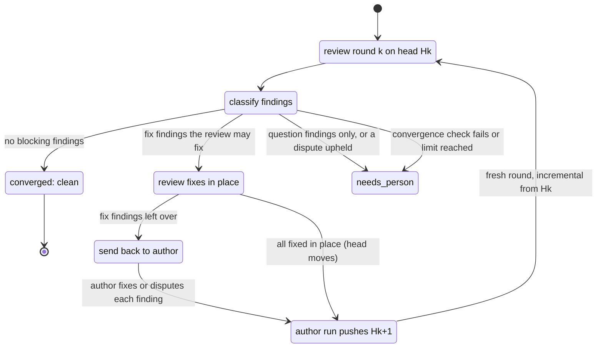

One round, for one gate on head `Hk`:

1. **Review.** The producer reviews `Hk`. Round 1 is a full review.
   Later rounds are incremental from `Hk-1`, plus a re-check of every open
   finding, as `incrementalNote` already asks. The new round **does not
   depend on the old review task**. It reads the recorded head
   (`LinkPathTriggerReviewed`) and supersedes or cancels any older review
   of the same (PR, gate) that is still queued or running. This removes
   §2.4.
2. **Classify.** The review records each finding through
   `add_review_comment` with a structured `kind` (§3.4) and a stable
   `fingerprint`.
3. **Fix in place.** A review whose gate allows it (`fixes: in-place`, the
   new default, generalising `putSecurityReview`) fixes the `fix` findings
   it can by pushing to the change's own branch, and marks them `fixed` by
   commit. There is no second PR and no merge-back step.
4. **Send back.** Any `fix` findings left over, plus every one when the
   review may not push, are handed to the **author task** automatically
   (task 6238). This makes the same writes `RunNow` makes (`CompletedAt`
   cleared, `RetryRequestedAt`), without `RunNowAt` because it takes its
   normal place in the queue. Its prompt carries a structured "Review
   round k findings" section. For each finding, the author must either
   **fix** it (push) or **dispute** it with a reason (a `dispute_finding`
   tool call). A finding left unanswered counts as not fixed.
5. **Push.** The author's push moves the head. Triggers judge `Hk+1`
   (the existing `syncEntry` → `pathTriggersCurrentFor`, unchanged), and
   a fresh round starts at step 1. The re-review debounce stays at 3
   minutes.
6. **Repeat** until the gate is `passed`, or until §3.5 stops it.

`question` findings do not stop the loop for the `fix` findings. They are
collected, and the gate moves to `needs_person(answer)` only when no
`fix` work is left. So a person is asked once, with every open question
together, instead of once per round.

### 3.4 Classifying findings

Each finding the producer records has:

| field | values | notes |
|---|---|---|
| `kind` | `fix`, `question`, `nit` | the reviewer's call; `add_review_comment` gains a required `kind` |
| `severity` | `blocking`, `advisory` | `nit` is always advisory |
| `fingerprint` | hash of (gate, path, normalised title/rule) | stable across rounds, for recurrence (§3.5) |
| `recommendation` | text | for `question`, the reviewer's recommended answer (as today) |
| `state` | `open`, `fixed`, `disputed`, `withdrawn`, `answered`, `accepted` | written by the loop |

- **`fix`**: a defect with a determinable correct change. Agents resolve
  it.
- **`question`**: a design decision, product call, trade-off, or an
  ambiguity in the brief. **Only a person resolves it.** Today's
  `request_human_review` becomes a `question` with a category
  (`security`, `architecture`, `breaking-change`, `other`), so there is
  one mechanism instead of two (§1.5).
- **`nit`**: posted, never blocks, never sent back.
- **Disputes.** When the author disputes a `fix` finding, the next round's
  review sees the dispute and either **withdraws** the finding (resolved)
  or **upholds** it. A finding upheld after a dispute becomes
  `needs_person(decide)`: a person picks reviewer or author. It is never
  sent back a second time.

A person may **accept** any open finding as-is, with a reason (task
4752). It becomes `accepted`: it stops blocking this change, it is
recorded as an audit event, and it is not raised again for the same
fingerprint on this change.

### 3.5 Loop limits and convergence

A round counts against the limit only when it produces a new head.
Rounds paused by usage limits or worker capacity are not counted; the
gate shows `fixing` or `pending` with the pause reason instead.

| check | default | trips when | result |
|---|---|---|---|
| max rounds | 5 per gate per change (`loop.max_rounds`) | round 6 would start | `needs_person(accept_or_extend)` |
| recurrence | 2 (`loop.recurrence_limit`) | the same `fingerprint` is open after 2 send-backs that pushed | that finding becomes `stuck`; the gate is `needs_person(accept_or_extend)` once no other fix work remains |
| no diff progress | — | the author run pushes nothing, or the diff of the finding's files between `Hk` and `Hk+1` is empty | as recurrence, immediately |
| oscillation | — | `Hk+1`'s tree equals an earlier round's tree | `needs_person(accept_or_extend)` |
| cost cap | $20 of run cost per gate per change (`loop.cost_cap_usd`), summed from the review and send-back attempts | the next round would exceed it | `needs_person(accept_or_extend)` |
| deployment budget | per-day review-loop spend (`settings.yml`) | exceeded | new rounds stay `pending` with reason `budget`; one deployment notification |
| producer failures | 3 consecutive (`MaxConsecutiveFailures`) | the review task reaches `failed` | `producer_broken` (Part 4 §4.5) |

At a limit, the gate stops looping and asks once. The ask shows the
remaining findings, how many rounds ran, and the cost spent. The person
does one of:

- **Accept as is** (primary): the remaining findings become `accepted`,
  and the gate is `passed`;
- **Give N more rounds**: resets the round counter and the cost window;
- take over by hand: push, which starts a fresh round;
- override (merge:force), recorded as today.

### 3.6 What waits on a person, and the one action each needs

The complete list: no other state waits on a person.

| gate state | `ask` | the one action | API (proposed) | today's equivalent |
|---|---|---|---|---|
| `needs_person` (open questions) | `answer` | **Answer**: an inline composer per question, prefilled with the recommendation | `POST /api/tasks/{id}/gates/{gate}/answer` `{answers:[{finding, text}]}` | a reply comment (§1.4) |
| `needs_person` (dispute upheld) | `decide` | **Decide**: uphold or withdraw, per finding | `POST …/gates/{gate}/decide` `{finding, outcome}` | none |
| `needs_person` (limit / stuck) | `accept_or_extend` | **Accept as is** (with reason); secondary: more rounds | `POST …/gates/{gate}/accept` `{findings, reason}`, `POST …/gates/{gate}/extend` `{rounds}` | Force merge |
| approval needed (`human: required`, approvers, declined intent) | `approve` | **Submit** (Approve) | `POST /api/tasks/{id}/submit` (unchanged) | Submit |
| `producer_broken` (fail-closed) | `retry_producer` | **Retry gate** | `POST …/gates/{gate}/retry` | none |
| merge queue `merge_failed` | `retry_merge` | **Retry merge** | `POST /api/tasks/{id}/retry-merge` (unchanged) | Retry merge |
| GitHub wants an approval | `external` | **Open on GitHub** (link) | none | none |

Override stays available on every overridable state as a secondary
action, under merge:force with a reason, as today.

### 3.7 Revised per-gate diagrams (instances of §3.2)

Each gate below is the common model with its producer, fixer and
unresolvable set filled in. Part 4 §4.6 shows the declarations behind
them.

**CI** (built-in). The producer is the head's check runs, read for every
open PR (fixes §2.6). The fixer is the merge-queue repair, which becomes
this loop's send-back (cap: today's 2 repairs as `max_rounds`).
Unresolvable: `checks_unfixable`. CI is a gate on its own, not only on the
queue.

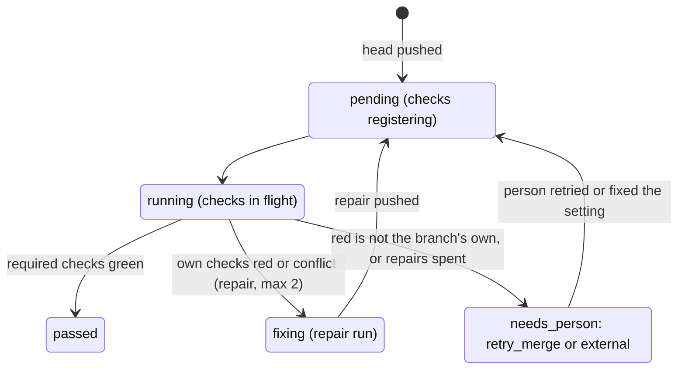

**Security review** (built-in, producer `grain:security-review`, fixes in
place, as today). Unresolvable: `question` findings, and
**requires-human trust-boundary categories**, which are always
`needs_person(approve)`. Reviewer fixes that touch the boundary start
another round, as today (`reviewerFixesTouchBoundary`).

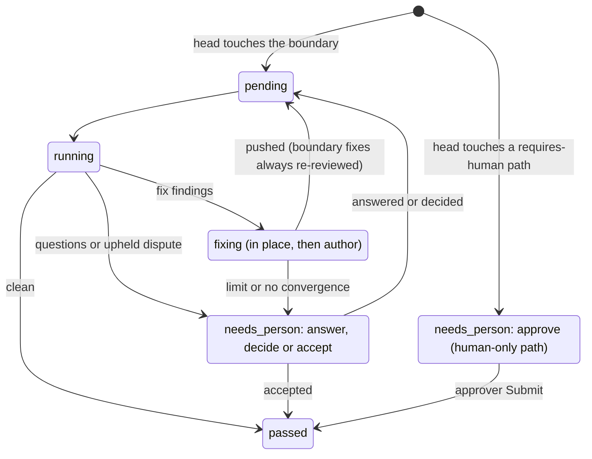

**Code review / path triggers / `every-pr`** (declared). One gate per
trigger, or one per review kind for triggers that share a template, as
today. `human:` maps onto the model: `no` makes the gate `advisory`;
`on-findings` is the default loop; `required` adds an approval gate with
`ask: approve` once the review gate passes. `fixes:` defaults to
`in-place`, replacing today's findings-only default. Re-reviews supersede,
and never depend on, older reviews.

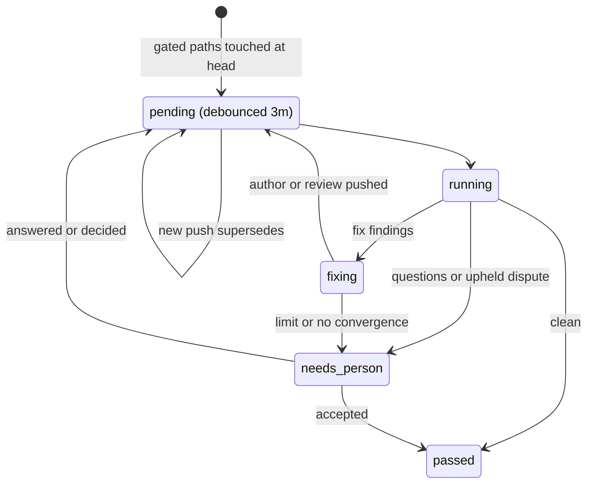

**Review questions / "Review needs your decision"**: no longer a gate of
its own. It is `needs_person(answer)` on whichever gate raised the
question. The reply route becomes `…/gates/{gate}/answer`. A plain
comment still works: a human comment on a task whose gate is in
`needs_person(answer)` is taken as the answer to every open question,
which is today's `SyncReviewQuestions` rule, but read off the gate rather
than off a link that other writers can replace.

**Human review holds**: a review's `request_human_review` becomes a
`question` finding on its gate (one mechanism). Human-only paths become
the security gate's `needs_person(approve)`. Release stays as **Submit**.

**Approval / Submit**: a built-in gate with producer `person`. It is
`not_applicable` unless a declared gate says `human: required`, approvers
are owed, the merge rules say `never`, or the intent is declined. In any
of those it is `needs_person(approve)` until Submit. It is never
overridable. Submit no longer has two meanings (approve, and re-enable
auto-merge).

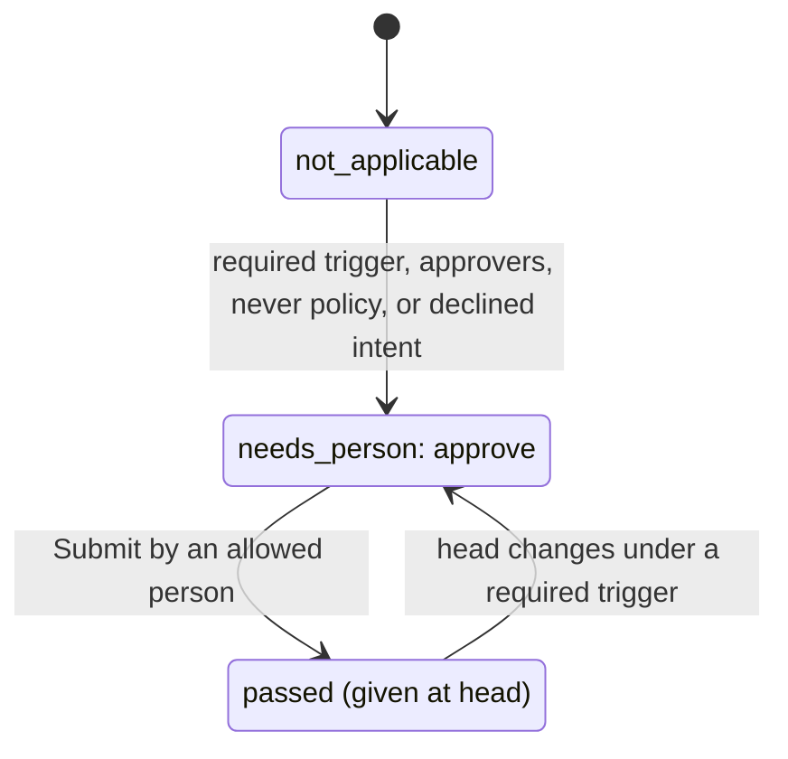

**Auto-merge**: no longer a gate. It is the intent switch. The merge
queue's membership test becomes `intent on AND every blocking gate
satisfied`, computed from the gate table (§3.8 step 2).

**Merge queue**: unchanged as a state machine (§1.8). It is entered only
once every gate is satisfied. Its repairs become the CI gate's loop, and
`merge_failed` becomes `needs_person(retry_merge)`.

### 3.8 Code changes (numbered plan; not made here)

Each step is one PR, in order. Steps 1, 2 and 3 are independent fixes of
Part 2 that can land first.

1. **Re-reviews never `depends_on` an older review** (task 6236).
   - In `fileCoalesced`, for review kinds (`reviewKindTag`): when the
     previous review is dispatched, cancel it if it is running on an older
     head, or close it as superseded if it is `completed`, instead of
     adding `LinkDependsOn`.
   - `incrementalBase` already reads the old head from tags.
   - Also extend `closeFinishedReviews` / `staleReview` to close a
     completed review whose stacked PR is not merging.
2. **CI gate from check runs** (task 6239). Record the head's required
   check verdict for every open PR, whether or not it is a queue member,
   in a new `Observation.PRChecks{head, verdict, at}`. Write it from
   `syncEntry`'s `healthFrom` read, which already happens for every open
   PR link. `ComputeMergeGates` reads it before the queue state.
3. **Stop gate-scoped records from orphaning** (§2.5).
   - `settlePathTriggerHold` records abandoned and unmerged-fix findings
     on `trigger:<name>`, with `ReviewTask` and `HeadSHA`.
   - A closed-without-finishing review **re-files a review for the
     current head** instead of recording findings. The gate stays
     `pending`, not `findings`.
   - Migrate existing `{gate: review, reviewTask: ""}` records whose task
     has trigger tasks.
4. **A gate table**: `merge_gate` (`task_id`, `gate_id`, `head_sha`,
   `state`, `ask`, `round`, `cost`, `producer_ref`, `updated_at`) and
   `merge_gate_finding` (`fingerprint`, `kind`, `severity`, `state`,
   `round`, `review_task`, `path`, `line`, `body`, `recommendation`).
   - Written by the existing release and settle functions in parallel
     with the links, at first.
   - `ComputeMergeGates` reads the table.
   - Schema migration in `pkg/model/migrations.go`, with an import
     threshold in `staterepo/dump.go`.
5. **Structured findings.** `add_review_comment` (MCP and
   `grain pr review-comment`) gains `kind` (`fix` | `question` | `nit`)
   and an optional `fingerprint`. A finding without a kind is treated as
   `fix`.
   - `request_human_review` becomes `kind: question` with a category
     (its route stays as a wrapper).
   - Update the review templates' briefs: `reviewFindingsBody`,
     `reviewTaskBody`, the security review template, and
     `.grain/templates/pr-review.yml`.
   - Regenerate the CLI spec and the route table.
6. **In-place fixes for every review kind.** Generalise
   `putSecurityReview` / `reviewsInPlace` to trigger reviews, using
   `fixes: in-place` as the default. Keep `stacked` and `none`.
7. **Automatic send-back** (task 6238). A new `SyncGateLoops`
   (level-triggered):
   - For a gate whose last round left open `fix` findings and no running
     producer, re-queue the author task (the `RunNow` writes, minus
     `RunNowAt`), with a "Review round k" prompt section built in
     `BuildPrompt` from `merge_gate_finding`.
   - Add a `dispute_finding` tool for the author.
   - Replaces the reply-only path of `settleReviewQuestions` for `fix`
     findings.
8. **Convergence and limits** (§3.5). Round counting per (task, gate)
   on push. Fingerprint recurrence, empty-diff and tree-oscillation
   checks. A cost sum from attempt usage records. The settings
   `loop.max_rounds`, `loop.recurrence_limit` and `loop.cost_cap_usd`,
   per gate and in `settings.yml` defaults.
9. **Gate actions API**: `POST /api/tasks/{id}/gates/{gate}/{answer|decide|accept|extend|retry}`.
   - Each has a scope entry in `route_scopes.go`, the
     `TestRouteAuthorizationMatrix` row, the regenerated
     `ui-ng/src/app/api/generated-routes.ts`, and `agentSteeringRoutes`
     where agents may call it (none of these may be called by an agent on
     its own change's gate).
   - `accept` is task 4752's "accept findings as-is", with a reason and a
     task event.
10. **Gates stop writing `AutoMerge`.** Merge eligibility becomes intent ∧
    all blocking gates satisfied: `isQueueMember`, `clearedForHead`,
    `forceOverridesGates` and `guardAutoMerge` read the gate table.
    - Remove the hold writers' `AutoMerge` toggles (§1.7's table),
      `AwaitPersonForAutoMerge`, and `restoreAfterHolds`. Keep
      `LinkAutoMergeDeclined`.
    - `task_state`'s `awaiting_submit` becomes "completed, has a PR, and
      the intent is declined **or** a blocking gate is `needs_person`".
    - `taskReasonOf` emits a reason per gate ask.
11. **Single action area** (task 6014): `mergeGates[].actions[]` carries
    `{id, label, primary, route, needsReason, confirm}`. ui-ng renders
    the one primary action for the first gate waiting on a person, and
    every gate's progress line, with no gate-specific code. The classic UI
    keeps its Submit and Force merge buttons, reading the same data.
12. **Declared gates** (Part 4): `pkg/repodecl` `loadGates` for
    `.grain/gates/*.yml`, with path triggers that say `gate: true` loaded
    as gate instances, and built-in instances for `ci`,
    `security-review` and `approval`.
13. **Backlog sweep** (task 6240), after steps 1 to 3 and 7:
    - for each `awaiting_submit` task with findings records and no human
      decision pending: classify the old findings as `fix` and send the
      task back once;
    - for each orphaned "closed without finishing" record, re-file the
      review;
    - report the rest as one list.
14. **Docs**: `design/design/merging.design.md`,
    `docs/declarations.md` ("Gating reviews"),
    `docs/merge-queue-behind.md` (gate entry), and fixing the stale doc
    comments named in §1.2, §1.4 and §1.3 (`escalateUnfinishedReview`'s
    comment says it merges anyway, but its note says the change stays
    held).

### 3.9 Reconciling the open tasks

| task | what it asked | where it lands | notes |
|---|---|---|---|
| 6238 | automatic send-back of fixable findings | step 7, after 4 and 5 | it is waiting on this doc; the send-back must carry structured findings, so steps 4 and 5 come first. A stop-gap is possible on today's links (send back when `LinkReviewFindings` is present with no `LinkReviewQuestions`) but would need replacing after step 4 |
| 6236 | re-review blocked on a completed review | step 1 | independent; land first |
| 6239 | CI gate always running | step 2 | independent; land first |
| 6014 | single clear control | steps 9 and 11 | until then, a quick win is to have `taskReasonOf` pick the reason from the first unsatisfied gate (findings → "Run now", questions → "Reply") |
| 4752 | accept findings as-is | step 9 (`accept`) | per finding, with a reason; audited |
| 6022 | review every PR | step 12 | already done for this repository by `.grain/triggers/every-pr.yml`; deployment-wide it becomes a deployment-level gate declaration (§4.4). The cost study (`docs/reviews/2026-11-review-policy-study.md` item 7) asks to skip docs-only PRs, using `applies.ignore` |
| 6240 | sweep the 86 | step 13 | run it only after 1–3 and 7, or the swept tasks fall straight back into the same states |

---

## Part 4: Adding a custom gate (proposal)

Goal: a new gate (design review, docs check, performance budget,
downstream-edition check, external approval) is **declared, not
hand-wired**. Today each gate has its own links, its own release
function, its own arm in `ComputeMergeGates`, its own UI copy and its own
override id (§0.5, §1). Part 4 defines one contract. Grain's existing
gates become built-in instances of it, and the action area renders any
gate from the contract alone.

### 4.1 The gate contract

A gate is one YAML document. Fields marked † are required.

```yaml
# .grain/gates/<id>.yml
version: 1                      # † contract version (§4.4)
id: design-review               # † stable id: [a-z0-9-]+, unique per repository; the override id
label: Design review            # † shown on the gate row
renamed_from: []                # earlier ids whose records this gate inherits (§4.5)

applies:                        # which heads it judges; all present keys must match
  on: pull_request              # pull_request (merge gates); `merge` stays a path trigger
  branches: [main]              # base branches, globs; default: the repository's default branch
  paths: ["docs/design/**"]     # globs, as path triggers; omitted = every PR
  ignore: ["docs/design/sample/**"]
  labels: []                    # PR labels, any-of; omitted = no label condition
  authors: []                   # optional: grain | external | <login>
  repos: []                     # deployment-level declarations only (§4.4)

producer:                       # † what produces the verdict -- exactly one kind
  kind: review                  # review | check | status | webhook | poll | person
  template: design-review       # review: the template filed for each round
  fixes: in-place               # review: in-place | stacked | none (default in-place)
  incremental: true             # review: later rounds read the delta plus open findings
  debounce: 3m                  # review: re-review wait after a push
  # check:   { name: "perf-budget" }                  # a CI check run on the head
  # status:  { context: "downstream/edition" }        # a commit status
  # webhook: { secret: "gates/approvals", timeout: 72h }
  # poll:    { url: "...", every: 10m, timeout: 24h }  # through a capability, never raw network
  # person:  { approvers: ["team:design"] }

blocking: true                  # false = advisory: shown, never holds the merge

loop:                           # Part 3's loop; omitted keys take settings.yml defaults
  send_back: auto               # auto | off  (off: fix findings go straight to needs_person)
  max_rounds: 5
  recurrence_limit: 2
  cost_cap_usd: 20

unresolvable: [question, dispute]   # finding kinds that stop for a person (§4.2)

human: on-findings              # on-findings (default) | required | no
approvers: []                   # who may Submit when human: required; default: team admins

override:
  allowed: true                 # false: only the producer or approvers can pass it
  scope: merge:force            # the scope the person must hold
  reason: required              # always required when allowed

on_producer_failure: fail-closed    # fail-closed (default) | fail-open (advisory, or declared and audited)
on_producer_failure_reason: ""     # required with fail-open on a blocking gate; recorded with every fail-open pass
producer_timeout: 6h                # no verdict by then counts as a producer failure
notify: [owner]                     # owner | approvers | team:<name>; who is told on needs_person and producer_broken
```

What each kind of producer means:

| `producer.kind` | verdict comes from | findings | fixer for the loop |
|---|---|---|---|
| `review` | a review task filed from `template` on each round | `add_review_comment` with `kind` | the review (`fixes`), then the author task |
| `check` | a named check run on the head (GitHub Actions or grain CI) | the check's failure summary, one `fix` finding | author send-back (like a merge-queue repair) |
| `status` | a commit status context on the head | `failure` → one finding from `description` | `send_back` as declared; `off` is usual for external systems |
| `webhook` | `POST /api/gates/{repo}/{id}/verdict` signed with `secret`, carrying `{head, verdict, findings[]}` | as sent | as declared |
| `poll` | a capability call every `every`, until `timeout` | as returned | as declared |
| `person` | a Submit by an allowed approver | none | none: always `needs_person(approve)` |

The contract fixes these rules:

- **Applies-to is judged on the base's declaration**, never the head's,
  as triggers are today (`judgePullRequestTriggers`). A PR cannot switch
  off its own gate.
- **States** are §3.2's. A gate cannot add states; it chooses which
  transitions apply (for example, `person` has only `not_applicable`,
  `needs_person` and `passed`).
- **Blocking vs advisory**: an advisory gate never makes the change
  `awaiting_submit`, never holds the queue, and never has an override.
- **Override**: if `allowed`, a person holding `scope` overrides the gate
  for one head with a non-empty reason, recorded today's way
  (`GateOverrideRecord{gates, reason, by, head}` plus a task event, a PR
  comment and `force_merge` audit row). `person` gates can never be
  overridden: an override is never an approval (`KnownOverrideGates`'
  existing rule).

### 4.2 Its agent loop

The loop is Part 3's, with no new mechanism. The contract only sets its
parameters:

- `loop.send_back: auto` puts open `fix` findings to the author task
  after the producer's own fixes (§3.3 step 4). `off` makes any blocking
  finding `needs_person(accept_or_extend)` immediately. Use it for
  producers whose findings an agent cannot act on, such as an external
  approval.
- `loop.max_rounds`, `recurrence_limit` and `cost_cap_usd` are §3.5's
  checks, scoped to this gate.
- `unresolvable` lists the finding kinds that stop for a person. The
  default is `[question, dispute]`. A gate may add `fix` (every finding
  goes to a person: a "human eyes on every finding" gate), but it cannot
  remove `question`: a design decision is always a person's.
- "Unresolvable", in full: a finding whose kind is in `unresolvable`; a
  finding that is `stuck` (recurrence, no diff progress, oscillation);
  the round, cost or budget limit; or a `producer_broken` that is
  fail-closed. Nothing else.

### 4.3 User actions are derived from the contract

The action area (task 6014) gets each gate's actions from the gate's
state and its contract. No gate-specific UI code is needed.

| gate state | primary action | secondary actions | which contract field enables them |
|---|---|---|---|
| `pending`, `running`, `fixing` | none: show progress (`round k of max`, cost) | **Override…** | `override.allowed`, `blocking` |
| `needs_person(answer)` | **Answer** | Accept as is, Override… | `unresolvable` includes `question` |
| `needs_person(decide)` | **Decide** | Accept as is, Override… | `unresolvable` includes `dispute` |
| `needs_person(accept_or_extend)` | **Accept as is** | Give more rounds, Override… | `loop` limits |
| `needs_person(approve)` | **Submit** | none | `human: required` or `producer.kind: person` |
| `needs_person(retry_producer)` | **Retry gate** | Override… | `on_producer_failure: fail-closed` |
| `needs_person(external)` | **Open** (a link from the producer) | Override… | `producer.kind: status` / `webhook` / `poll` |
| `passed`, `overridden`, `not_applicable` | none | none | — |

The rules for rendering:

- Exactly one primary action is shown for the change: the first blocking
  gate in `needs_person`, in declaration order.
- Every action is one route, `POST /api/tasks/{id}/gates/{gate}/{action}`,
  with the body the action needs.
- "Override…" always opens the existing confirmation dialog (PR number and
  reason).

### 4.4 Where gates are declared, validated and versioned

- **Repository**: `.grain/gates/<id>.yml`, read from the base branch at
  the commit the PR targets. The commit is recorded on every round, as
  `pathTriggerRuleTag(rule.Commit)` is today.
- **Deployment**: `settings/gates/<id>.yml` in `grain/config`, with
  `applies.repos` (globs over owner/name). This is how "review every PR"
  (task 6022) applies everywhere without a file in every repository.
  - A repository file with the same `id` **narrows** a deployment gate
    (more paths ignored, stricter `human`). It can never loosen one:
    `blocking`, `override.allowed: false` and `human: required` cannot be
    turned off from the repository.
- **Validation**: `pkg/repodecl` gains `loadGates` beside `loadTriggers`,
  reusing the trigger checks (globs parse, the template exists, `fixes`
  only for `review`, and the rest). It also checks: a known `version`;
  `id` unique per repository and not a built-in id; exactly one producer;
  `person` gates are blocking and not overridable; `fail-open` only for
  advisory gates unless `on_producer_failure_reason` is given; and
  webhook secrets named, never inline.
  - A gate file that fails validation fails closed, as broken rules do
    today (`LinkBrokenRulesHold`): every PR in the repository is held for
    a person with the parse error as the reason, and nothing is silently
    dropped.
  - The schema goes into `docs/declaration-schema.md`.
- **Versioning**: `version:` is the contract version. Grain accepts the
  versions it knows and refuses others with an error naming the newest it
  supports. The gate's *content* version is its declaration's blob hash,
  folded into the head's rules hash as `clearedTarget` does with
  `RepoRules.Hash`, so a changed declaration re-judges open heads (§4.5).

**Built-in instances.** Existing gates are shipped as gate declarations
compiled into grain, using the same structs:

| built-in id | today | producer | notes |
|---|---|---|---|
| `ci` | §1.1 | `check` (required checks, or grain CI) | `send_back: auto` = merge-queue repair, `max_rounds: 2` (`MaxAutomaticRepairs`, lowered by merge rules' `repairs:`) |
| `security-review` | §1.2 | `review` (`grain:security-review` template), `fixes: in-place` | `applies` = `pkg/trustboundary` plus the repository's `sensitive` triggers; requires-human categories add `needs_person(approve)`; cannot be removed or made advisory |
| `<trigger name>` for each `.grain/triggers/*.yml` with `gate: true` | §1.3 | `review` from `template` | loaded as a gate with `applies.paths`/`ignore`/`branches` from the trigger; `human` and `approvers` carried as is; `fixes: true` → `stacked`, otherwise `in-place` (step 6); triggers sharing a template stay one review per kind |
| `review` (configured `Review:` template) | §1.3 | `review`, `fixes: stacked` | kept for tasks that declare one |
| `approval` | §1.6 | `person` | present when any gate says `human: required`, approvers are owed, or the merge policy is `never` |

The override ids `ci`, `security-review`, `review`, `targeted-review` and
`trigger:<name>` keep working: `trigger:<name>` resolves to gate id
`<name>`.

### 4.5 Lifecycle

- **Adding a gate to a repository with open PRs.** The declaration lands
  on the base. Each open PR's next judgement (every cycle, through
  `syncEntry`) sees a changed rules hash and judges its *current* head
  against the new gate. The gate starts `pending`, or `not_applicable`.
  - A change already on the merge queue leaves it until the gate passes;
    one mid-`merging` is not interrupted.
  - A PR comment says the gate was added, by which commit.
- **Removing a gate.** The next judgement drops it from every open PR.
  - Its rounds in flight are cancelled, and its review tasks are closed
    with a note naming the commit that removed it.
  - Its findings stay on the PR as history, and stop blocking.
  - Removing a built-in is refused by validation.
- **Renaming.** A changed `id` is a removal plus an addition, unless the
  new file lists the old id in `renamed_from`. Then records, rounds,
  overrides and accepted findings carry over to the new id, and the
  override alias keeps working for one release.
- **A broken producer.** The template is missing, a review fails 3 times,
  a check never registers within `producer_timeout`, a webhook stays
  silent, or a poll errors: the gate goes to `producer_broken`.
  - With `fail-closed` (the default, and required for blocking review
    gates), it becomes `needs_person(retry_producer)` for every affected
    PR. Grain sends one notification per (gate, repository) to `notify`
    and to the deployment's health page, not one per PR.
  - With `fail-open` (advisory gates, or declared with a reason), the
    gate reads `passed (producer unavailable)`. An audit event and the
    same notification are recorded, and the merge proceeds.
  - In both cases, the next successful producer run re-judges the
    current head.
  - Today's fall-back of filing grain's security review when a trigger's
    template is missing (`buildPullRequestReview`) becomes an explicit
    `producer_broken`, so a missing template is visible rather than
    replaced.

### 4.6 Worked example: a "design review" gate

**Declaration**, on `main`:

```yaml
# .grain/gates/design-review.yml
version: 1
id: design-review
label: Design review
applies:
  paths: ["docs/design/**"]
  ignore: ["docs/design/sample/**"]
producer:
  kind: review
  template: design-review
  fixes: in-place
blocking: true
loop: { max_rounds: 4 }
unresolvable: [question, dispute]
human: on-findings
override: { allowed: true, scope: merge:force, reason: required }
on_producer_failure: fail-closed
notify: [owner]
```

```yaml
# .grain/templates/design-review.yml (abridged)
id: design-review
title: "Design review of {{pr}}"
body: |
  Review the design docs this change adds or edits for completeness,
  testable requirements, consistency with design/design/*.design.md, and
  unstated trade-offs. Fix what is plainly a defect (broken links, a
  missing requirement ID, contradictions with code you can cite) in place.
  Record anything that needs the owner's decision as kind: question, with
  your recommended answer.
```

**Validation**: `pkg/repodecl` `loadGates` parses it. The template
resolves to `.grain/templates/design-review.yml`, the paths parse,
`fixes: in-place` is valid for `review`, and the gate is blocking with
overrides allowed under merge:force. It is merged on `main` at commit
`abc123`.

**A PR touching `docs/design/foo.md`:**

1. The run finishes with PR #42 at `h1`. The judgement records the gate
   as `pending` and files `Design review of #42` (round 1, full).
   `mergeGates`:
   `{id: "design-review", state: "pending", round: 1, maxRounds: 4, waitingOn: "agent", actions: [{id: "override", primary: false}]}`.
   The task state is `completed/gates_running`.
2. Round 1 finds three things:
   - a broken link (`fix`): the review fixes it in place, pushing `h2`;
   - a requirement with no ID (`fix`): it may not invent the ID, so this
     one is left for send-back;
   - "should the cache be per-tenant?" (`question`).
   The gate is `fixing`.
3. Send-back: task 42's author is re-queued with "Review round 1
   findings: 1 to fix". Its run adds the ID and pushes `h3`. The state is
   `running/live_run`, and the gate still `fixing`.
4. Round 2 (incremental `h1..h3`, plus the open findings): the ID is
   fixed, so the only open finding left is the question. No `fix` work
   remains, so the gate becomes `needs_person(answer)`.
   - The task is `awaiting_submit/gate:design-review:answer`.
   - The action area shows **Answer** with the reviewer's recommendation
     ("per-tenant, because …") prefilled.
   - `notify: [owner]` sends one notification.
5. The owner answers "per-tenant; add a requirement for it"
   (`POST /api/tasks/42/gates/design-review/answer`). The answer is
   delivered to the author task, which is re-queued. Its run writes the
   requirement and pushes `h4`.
6. Round 3 on `h4` is clean: `passed`. The other gates (`ci`,
   `every-pr`) pass too, the intent is on, and the change joins the merge
   queue as `completed/on_merge_queue`, then merges.

Had round 3 raised the same requirement finding again (the same
fingerprint after two pushes), it would have become `stuck`, and the gate
`needs_person(accept_or_extend)` with **Accept as is** primary. Had the
template been deleted, the gate would have gone to `producer_broken` →
`needs_person(retry_producer)`, with one notification to the owner.

The revised diagrams in Part 3 §3.7 are this example with the producer
swapped: `check` for CI, `review` with the security template for the
security review, `review` from each trigger's template for code review,
and `person` for approval.
