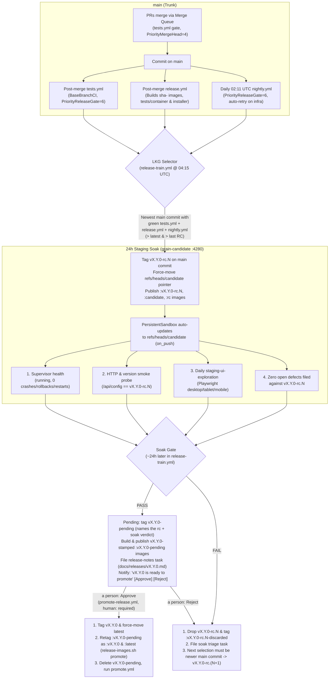

# Design: Release from Trunk

**Status:** Proposed  
**Author:** Grain Agent ([Task #683](/tasks/683), from [Task #652](/tasks/652))  
**Created:** 2026-10-24  
**Supersedes:** Stabilization-branch workflow in `docs/release-candidate-management.md`

---

## Context and Problem Statement

Grain's current release process (documented in `docs/release-candidate-management.md` and implemented by `scripts/release-candidate-cut.sh`, `scripts/candidate-gate.sh`, and `.grain/templates/release-candidate.yml`) is built around a long-lived `candidate` stabilization branch, a daily agent-dispatched cut task, automated `main -> candidate` port tasks, a `candidate -> main` back-merge, an owed-ports ledger (`docs/releases/owed-ports.json`), and a qualification gate judged inside an agent sandbox.

During the week of 2026-10-22 to 2026-10-24, every fragile seam in that model failed at once:

1. **`v2.2.0-rc.1` was never promoted and `v2.2.0` was skipped.** Cut on 2026-10-22 (`aa5879403`), `v2.2.0-rc.1` failed its qualification gate and was held. Because `choose_next_minor_tag` in `scripts/release-candidate-cut.sh` increments the minor number across all existing `v2.*` tags—including unpromoted `-rc.1` tags—the next cut abandoned `2.2` entirely and tagged `v2.3.0-rc.1` (`3cbe2ad03`), leaving `latest` stuck at `v2.1.1` (`8eac6d16e`).
2. **The release cut queued behind ordinary coding tasks for ~14 hours.** The 2026-10-24 `02:00 UTC` scheduled cut ([Task #501](/tasks/501), filed by `.grain/schedules/release-candidate.yml`) is an agent task. It sat in the task dispatch queue for ~14 hours behind regular engineering tasks until an operator manually forced dispatch at `16:49 UTC`.
3. **Branch divergence caused an unverified 8-file manual conflict resolution on `main`.** By the time [Task #501](/tasks/501) ran, `candidate` had accumulated 126 commits (mostly cherry-picked ports and fixups with distinct SHAs) that `main` lacked. Step 1 of `scripts/release-candidate-cut.sh` (`reconcile-candidate-to-main`) conflicted across 8 files (`pkg/daemon/ci.go`, `pkg/orchestrator/basebranchci.go`, `pkg/orchestrator/mergebatch.go`, `pkg/orchestrator/persistent_refresh.go`, `pkg/orchestrator/scheduledworkflow.go`, `pkg/ui/server.go`, etc.). The cutting agent resolved those conflicts by hand and pushed the merge commit (`93a7ceb95`) directly to `main` via `scripts/release-push-main.sh` without a pre-merge CI run.
4. **Infrastructure starvation cancelled the only `nightly` run on `candidate` and held promotion.** Promotion of `v2.2.0-rc.1` was blocked because the single `nightly` run on `candidate` was `cancelled` when its sandbox VM stopped responding while the host stood at ~400 of 413 GiB of committed sandbox memory. Because `nightly` runs at `PriorityNormal` (`0`) in `pkg/ci/gate.go`, ordinary task sandboxes and PR runs starved and OOM-pressured the release-qualifying suite.
5. **Advisory live-provider suites were uniformly red on deployment credentials and quota, not Grain code.** Every live suite on `candidate` failed for environmental reasons:
   - `live-agent`: invalid Gemini API key;
   - `gcp-smoke`: service account activation failure;
   - `live-secrets-repo`: `github-sandbox` capability not granted;
   - `post-reset-e2e`: IAM HTTP 429 rate-limiting while minting `gcp-key`.
   Running duplicate schedules across both `main` and `candidate` (`*-candidate.yml`) doubled credential/quota consumption and triage noise without catching product regressions.

---

## Goals and Non-Goals

### Goals

1. **Release directly from `main` (trunk):** Every code change and bug fix lands on `main` through normal pull requests and the merge queue. A release is an annotated tag (`vX.Y.0`) on a `main` commit.
2. **Retire the stabilization branch and port machinery:** Eliminate `candidate -> main` back-merges, `reconcile-candidate-to-main`, `main -> candidate` port tasks (`port-branches` / `port-types`), owed-port tracking (`docs/releases/owed-ports.json`, `scripts/owed-ports.sh`), and duplicate `*-candidate.yml` schedules.
3. **Deterministic Last-Known-Good (`LKG`) selection:** Select the newest `main` commit whose required deterministic suites (`tests.yml`, `nightly.yml`, and `release.yml`) are green. Treat live-provider suites (`gcp-smoke`, `live-*`, `post-reset-e2e`) as advisory.
4. **Resilience to infrastructure noise:** Automatically re-run required suites that fail with an `infra` verdict (`cancelled`, `errored`, VM silence/OOM, capability/credential/quota errors) and reserve priority sandbox capacity so ordinary task load cannot starve release-gate CI.
5. **24-hour staging soak before promotion:** Tag the selected LKG commit `vX.Y.0-rc.N`, deploy it to the `grain-candidate` persistent staging sandbox (`:4280`) for ~24 hours, evaluate concrete soak signals (process/crash health, HTTP/version smoke check, daily Playwright exploratory UI run, and filed RC defects), and promote to `vX.Y.0` + `latest` only when the soak passes.
6. **Execute the release pipeline as a scheduled Grain CI workflow, not an agent task:** Selection, tagging, moving the staging pointer, soak evaluation, tag promotion, and container image retagging run deterministically in Grain CI without waiting in the agent task queue or consuming model quota. Reserve agents strictly for judgment (triaging red suites/soaks and drafting human-readable release-note highlights via PR after promotion).

### Non-Goals

- **Changing patch release mechanics (`vX.Y.Z`, `Z >= 1`):** Urgent hotfixes to an already-promoted release retain the existing manual `release/vX.Y.Z` branch + `git cherry-pick -x` workflow (as used for `v2.1.1` in [Task #4984](/tasks/4984)).
- **Removing multi-branch release orchestration for external repos (`pkg/orchestrator/releases.go`):** The generic `<name>.latest` / `<name>.rc.N` release manager used by repositories that configure branch-based release tracks remains untouched.
- **Turning `grain demo` on staging into a production VM orchestrator:** Staging (`grain-candidate`) runs `grain demo` on port `4280`. This design defines honest soak signals tailored to what `grain demo` actually exercises and relies on `nightly.yml` and `release.yml` on `main` for VM, database, container, and installer verification.

---

## Architecture Overview



---

## Detailed Design

### 1. Release from Trunk (`main`)

All development and bug fixing happens on `main`:

- **No stabilization branch commits:** No human or agent ever commits or opens a pull request against `candidate`. Fixes for bugs found during a staging soak land on `main` as ordinary PRs (or `fixes_base_branch: true` priority PRs if they also broke `main`).
- **No back-merges or automated ports:** Because `candidate` never diverges from `main`, there are no `candidate -> main` back-merges, no `reconcile-candidate-to-main` branches, no `main -> candidate` cherry-pick port tasks, and no `docs/releases/owed-ports.json` ledger.
- **Release tags live on `main`'s first-parent history:** Every `vX.Y.0-rc.N` and `vX.Y.0` tag points directly to a commit on `main`. `git log v2.1.0..v2.3.0` is a clean, linear traversal of `main` with zero duplicated cherry-pick commits.
- **Patch releases (`vX.Y.Z`, `Z >= 1`) remain manual cherry-picks:** When a critical regression is discovered in an already-promoted `vX.Y.0` and `main` contains unshipped work that should not be fast-tracked, an operator (or targeted task, as in [Task #4984](/tasks/4984) for `v2.1.1`) creates `release/vX.Y.Z` from tag `vX.Y.0`, cherry-picks the fix from `main` with `git cherry-pick -x`, lets `.grain/workflows/release.yml` (which already triggers on `release/v*`) build and verify `sha-<short>` images, tags `vX.Y.Z` (and `latest` if `X.Y` is the active series), and runs `.grain/workflows/promote.yml`.

---

### 2. Choosing a Known-Good Commit (`LKG`) on `main`

The release candidate selector considers commits on `main` in reverse chronological order (`git rev-list --first-parent origin/main`) and picks the newest commit that satisfies the **Required Deterministic Suites**:

| Suite | Workflow | Jobs | Why Required |
|---|---|---|---|
| **Push / PR Suite** | `.grain/workflows/tests.yml` | `go`, `go-e2e`, `go-orchestrator`, `go-model`, `go-unit`, `postgres`, `run-host`, `host-script-container`, `frontend`, `ui-e2e`, `lint`, `terraform`, `installer-e2e`, `package-cache` (14 jobs) | Verifies unit, integration, Chromium UI E2E and fresh-install paths on the commit. WebKit E2E and the Trixie and host-mode installer variants are nightly (grain/task-980). |
| **Release Image Build & Smoke** | `.grain/workflows/release.yml` | `release` (builds `grain`, `google-grain`, `guest`, `k8s-sandbox`; runs `tests/container/run.sh` and `tests/installer/run.sh`; pushes `:sha-<short>`) | Guarantees container and systemd/hostd installer smoke tests pass and `:sha-<short>` images exist in GHCR before staging soak and promotion. |
| **Nightly Stress & Soak** | `.grain/workflows/nightly.yml` | `go-long`, `staterepo-soak`, `loadtest`, `scalability`, `merge-stress`, `long-term-test`, `long-sim`, `postgres-stress`, `ui-e2e-long`, `installer-variants`, among others (the file is the list) | Exercises PostgreSQL contention, merge-queue stress, multi-repo state soak, and long-horizon simulation that `grain demo` on staging does not run. |

#### Exact Commit-Matching Rule for `LKG`

Because `nightly.yml` runs once daily at `02:11 UTC` on the current `HEAD` of `main` (call that commit $C_{\text{nightly}}$), whereas `tests.yml` and `release.yml` run on `main` after merges throughout the day:

1. **Primary rule (exact SHA match):** When `nightly.yml` runs at `02:11 UTC` on $C_{\text{nightly}}$, `BaseBranchCI` (`tests.yml`) and `BaseBranchRelease` (`release.yml`) have either already judged $C_{\text{nightly}}$ or finish judging it within ~25 minutes. When the release workflow runs at `04:15 UTC`, $C_{\text{nightly}}$ has direct verdicts for all three suites (`tests.yml`, `release.yml`, and `nightly.yml`) on the **exact same commit SHA**. If all three are `success`, $C_{\text{nightly}}$ is the `LKG` commit.
2. **Fast-forward allowance (when `main` received a daytime fix after `02:11 UTC`):** If an operator triggers `release-train.yml` manually via `workflow_dispatch` later in the day, or if $C_{\text{nightly}}$ had a deterministic failure that was fixed on `main` at $C_{\text{fix}}$, a commit $C$ qualifies as `LKG` if:
   - $C$ itself has `success` for both `tests.yml` and `release.yml`, **and**
   - Either $C$ itself has a `success` `nightly.yml` run, or the newest `nightly.yml` run on an ancestor $C_{\text{nightly}}$ within the last 24 hours is `success` and no `fixes_base_branch` repair is open on `main`.
   By default on the daily `04:15 UTC` cron, `nightly.yml` has just finished on `main`'s tip, so the selected commit has all three suites green on that exact SHA.

#### Advisory Suites (Non-Blocking)

The live-provider suites depend on external cloud credentials, third-party model APIs, and sandbox quotas:

- `.grain/workflows/gcp-smoke.yml` (`gcp-smoke`)
- `.grain/workflows/live-agent.yml` (`live-agent`)
- `.grain/workflows/live-frameworks.yml` (`live-frameworks`)
- `.grain/workflows/live-secrets-repo.yml` (`live-secrets-repo`)
- `.grain/workflows/post-reset-e2e.yml` (`post-reset-e2e`)

These suites run on `main` schedules only (their `*-candidate.yml` counterparts are deleted). Their verdicts are recorded in the release workflow's log summary for visibility, and failures continue to file/update scheduled-workflow triage tasks via `pkg/orchestrator/scheduledworkflow.go`, but **they never block LKG selection or RC promotion**.

#### Handling `infra` Verdicts and Automatic Re-Runs

A workflow run or job is classified as an **`infra` verdict** (as opposed to a `test` failure) when any of the following holds:

1. Run or job `conclusion` is `cancelled` or `errored` (not `failure` from a non-zero test step exit code);
2. `InterruptedRun` is set (daemon restart or host reboot interrupted execution);
3. Sandbox VM setup, guest agent handshake, or capability broker setup failed before the workflow steps ran (e.g., capability acquisition HTTP 429/5xx, credential activation failure, or VM heartbeats lost under host memory pressure);
4. A step failed specifically with known external rate-limit / quota signatures (`429 Too Many Requests`, registry 5xx on pull/push).

When a required suite (`tests.yml`, `release.yml`, or `nightly.yml`) on `main` terminates with an `infra` verdict:

- **Automatic uncached re-run:** The orchestrator (`pkg/orchestrator/basebranchci.go`, `pkg/orchestrator/basebranchrelease.go`, and `pkg/orchestrator/scheduledworkflow.go`) automatically triggers a selective recheck (`Recheck: true`, equivalent to `retrigger_ci` on only the non-passing jobs so already-passed jobs reuse their cached green verdict) up to `maxInfraRetries = 2` times with a 5-minute cooldown.
- **No false base-branch hold:** An `infra` verdict does not open a code-repair task on first occurrence and never marks a commit as a product regression. Once the automatic re-run passes, the commit's suite verdict is `success` and LKG selection proceeds normally.

#### Reserved / Priority Sandbox Capacity for Release-Gate CI

Today in `pkg/ci/gate.go` and `pkg/daemon/ci.go`:

- `SharedGate` orders callers by `PriorityNormal (0) < PriorityUnderway (1) < PriorityMergeHead (4) < PriorityRepair (8)`.
- Only `Priority >= PriorityRepair` can consume `model.Budget.RepairReserve` (`-repair-reserve-sandboxes`) or reserve a multi-slot hole immediately (`ReserveAfter: 30s`).
- Scheduled workflows (`nightly.yml`) and post-merge base-branch runs (`tests.yml` and `release.yml` on `main` when no repair is open) run at `PriorityNormal (0)`. When 1-vCPU agent tasks and PR runs saturate host memory (~400/413 GiB), `nightly.yml`'s 4-vCPU / 16-GiB jobs (`go-long`, `loadtest`, `scalability`, `ui-e2e-long`) either starve in `SharedGate` or get OOM-cancelled by host memory pressure.

To prevent ordinary task load from starving release qualification:

1. **Add `PriorityReleaseGate = 6` in `pkg/ci/gate.go`:** Ordered above `PriorityMergeHead (4)` and below `PriorityRepair (8)`.
2. **Grant `PriorityReleaseGate` reserve access and immediate hole reservation:**
   - In `pkg/daemon/ci.go`, allow `req.Priority >= ci.PriorityReleaseGate` to draw from `RepairReserve` when normal task/CI slots are full.
   - In `pkg/ci/gate.go`, set `ReserveAfter = 0` (immediate hole reservation) for callers with `Priority >= PriorityReleaseGate`, so a 4-vCPU `nightly` job immediately holds free capacity as jobs drain instead of being leapfrogged by 1-vCPU `PriorityNormal` jobs.
   - In `pkg/daemon/overcommit.go`, exempt sandboxes running at `Priority >= PriorityReleaseGate` from memory-pressure reclamation/eviction.
3. **Assign `PriorityReleaseGate` to trunk qualification runs:**
   - `pkg/orchestrator/basebranchci.go`: post-merge `tests.yml` runs on `main`;
   - `pkg/orchestrator/basebranchrelease.go`: post-merge `release.yml` runs on `main`;
   - `pkg/orchestrator/scheduledworkflow.go`: scheduled runs on `main` of workflows declared as release gates (`nightly.yml` and `release-train.yml`).

---

### 3. Canary = Staging Environment (`grain-candidate` ~24h Soak)

When `release-train.yml` selects a new `LKG` commit $S$ on `main`, it tags $S$ as `vX.Y.0-rc.N` and deploys $S$ to the staging environment for a ~24-hour soak. A soak that passes does not make the release: it stages it as `vX.Y.0-pending` for a person to approve (§4).

#### Staging Configuration (`grain-candidate`)

In `grain/config` `tables/persistent_sandbox.json`, staging is defined as the `grain-candidate` persistent sandbox:

- `repo`: `"bwsalmon/grain"`
- `ref`: `"candidate"`
- `auto_update`: `true`
- `port`: `4280` (`ports.StagingGrain`, running `grain demo`)

#### Evaluation: Pointer Ref (`refs/heads/candidate`) vs. Retargeting Staging to the RC Tag

We evaluated two ways to connect `grain-candidate` to the selected `vX.Y.0-rc.N` commit:

| Criterion | Option A: Keep `refs/heads/candidate` as a force-moved pointer ref (Recommended) | Option B: Retarget `grain-candidate` to an RC tag and delete `refs/heads/candidate` |
|---|---|---|
| **How it works** | `release-train.yml` tags `vX.Y.0-rc.N` on $S$ and runs `git push origin <S>:refs/heads/candidate --force`. Nothing ever commits or opens PRs to `candidate`. | Delete `refs/heads/candidate`. Either update `tables/persistent_sandbox.json` on every RC cut, or force-move a floating tag `refs/tags/candidate-rc` and point `tables/persistent_sandbox.json` `ref` at `"candidate-rc"`. |
| **`grain/config` changes needed** | **None** for `tables/persistent_sandbox.json`. Existing `"ref": "candidate"`, `"auto_update": true` continues to work via `lsRemoteHead` (`pkg/orchestrator/persistent_refresh.go`). | Requires editing `grain/config` `tables/persistent_sandbox.json` (`"ref": "candidate-rc"`, `"refresh": "on_push"`). Note: `ValidatePersistentSandbox` (`pkg/model/persistent_sandbox.go:80`) forbids tag-like refs when `refresh == "after_green"` because `persistentCIVerdict` queries `ci_runs` by branch name. |
| **Crash-loop rollback (`RollbackOnCrash`)** | Works unmodified: `pkg/orchestrator/persistent_refresh.go` tracks `From` and `To` commits across refreshes of `candidate` and rolls back after `PersistentRollbackCrashes = 3` rapid exits within `persistentStableAfter = 2m`. | Works if using a floating tag with `refresh: "on_push"`, fails if `ref` is changed per-version in `tables/persistent_sandbox.json` (which resets sandbox state). |
| **Binary version stamping (`scripts/build-version.sh`)** | Works unmodified: when `grain-candidate` checks out `candidate`, `HEAD` coincides with `vX.Y.0-rc.N` (`n = 0` commits since tag), so `scripts/build-version.sh` outputs `vX.Y.0-rc.N`. | Works if `vX.Y.0-rc.N` is also tagged on the same commit. |
| **Existing links, schedules & tooling** | Zero breakage: `.grain/workflows/release.yml` (`:candidate` Docker tag), `staging-ui-exploration`, and operator bookmarks continue to work. | Requires updating every tool or doc referencing `candidate`. |

**Decision (Recommended): Option A.** Keep `refs/heads/candidate` strictly as a **read-only pointer ref** that `release-train.yml` force-moves to the `vX.Y.0-rc.N` commit on `main`. Enforce pointer-only semantics by:
1. Removing `candidate` from `port-branches` and `port-types` in `.grain/settings.yml`;
2. Adding a branch-protection / merge-rule check refusing PR creation or task creation with `base: candidate` in `bwsalmon/grain`;
3. Ensuring only `release-train.yml` pushes `refs/heads/candidate` (`--force`).

*(If the owner prefers Option B, the exact `grain/config` `tables/persistent_sandbox.json` change is to set `"ref": "staging-rc"` and `"refresh": "on_push"` on the `"grain-candidate"` entry, have `release-train.yml` force-push `refs/tags/staging-rc` alongside `refs/tags/vX.Y.0-rc.N`, and run `git push origin :refs/heads/candidate` to delete the branch.)*

#### Honest Definition of Soak Signals

`grain demo` on port `4280` serves a rich, seeded demo dataset (`pkg/demo`) through the real Grain HTTP server and React UI (`pkg/ui`, `ui/`), supervised inside the `grain-candidate` persistent sandbox (`pkg/orchestrator/persistent_sandboxes.go`). It is **not** a production orchestrator managing live Firecracker VMs or real GitHub webhooks—those paths are covered prior to cut selection by `nightly.yml` and `release.yml`.

Accordingly, the ~24-hour staging soak checks four concrete signals that `grain demo` and its surrounding schedules genuinely exercise:

1. **Supervisor & Crash/Restart Health (`PersistentSandboxStatus`):**
   - `grain-candidate` has refreshed onto the RC's commit SHA (`status.Commit == rc_sha`) and `status.State == "running"`.
   - Zero `refresh-crash` or `rollback` events in `status.Events` since `rc_sha` was deployed (`RollbackOnCrash` triggers if the process exits 3 times within 2 minutes of starting).
   - `status.Restarts == 0` while running `rc_sha` (the long-lived `grain demo` server has not panicked, OOM-exited, or been killed over the 24h soak).
2. **Automated HTTP & Version Smoke Probe against `:4280`:**
   - Executed both immediately after `grain-candidate` refreshes onto `rc_sha` and again at the end of the ~24h soak:
     - `GET http://127.0.0.1:4280/api/config` returns HTTP 200 and reports `version` matching `vX.Y.0-rc.N` (or commit `rc_sha`);
     - `GET http://127.0.0.1:4280/` serves the HTML shell and static asset bundles with HTTP 200;
     - Core API endpoints (`/api/tasks`, `/api/repos`, `/api/system/persistent-sandboxes`, `/api/health`) return HTTP 200 with valid JSON and zero 5xx responses.
3. **Daily Exploratory UI Testing on Staging (`.grain/schedules/staging-ui-exploration.yml`):**
   - Runs daily at `07:15 UTC` via `.grain/templates/staging-ui-exploration.yml` (*"Daily exploratory UI testing and defect discovery on staging"*).
   - Launches headless Playwright across desktop (`1440x900`), tablet (`768x1024`), and mobile (`375x812`) viewports against `http://localhost:4280`, navigating major routes, interacting with controls, and checking for:
     - React error boundaries, blank screens, or failed route transitions;
     - Uncaught `pageerror` exceptions and `console.error` diagnostics;
     - Failed API/network requests (HTTP 4xx/5xx);
     - Layout clipping, horizontal overflow, or broken responsive views.
   - At least one scheduled run of `staging-ui-exploration` must have completed after `grain-candidate` refreshed to `rc_sha` and finished with outcome `done` (`nothing_needed` or `commented`, not `failed`).
4. **New Defects Filed Against the RC:**
   - When `staging-ui-exploration` discovers a bug on staging, it files a task via `propose_task` (which records `Origin: task <exploration-task-id>`).
   - The soak check queries tasks filed in `bwsalmon/grain` since `vX.Y.0-rc.N` was cut that either:
     - Originated from a `staging-ui-exploration` run executed against `rc_sha`, or
     - Carry an explicit RC blocker marker (`rc-blocker` or `vX.Y.0-rc.N` in title/labels).

#### What Turns a Soak RED

The soak gate evaluates **RED** (blocking promotion of `vX.Y.0-rc.N`) if **any** of the following is true at evaluation time:

1. `grain-candidate` is not in `state == "running"` or its active `commit` does not equal `rc_sha` (including if `RollbackOnCrash` rolled staging back to the prior commit);
2. `grain-candidate` recorded any `refresh-crash` or `rollback` event for `rc_sha`, or `restarts > 0` since `rc_sha` started;
3. The HTTP/version smoke check against `:4280` fails;
4. No `staging-ui-exploration` run has completed since `vX.Y.0-rc.N` was deployed (in which case the soak stays **`PENDING`** rather than failing, waiting until the daily `07:15 UTC` exploration task finishes), or the latest `staging-ui-exploration` run on `rc_sha` failed;
5. One or more defect tasks filed by `staging-ui-exploration` during the soak window (or explicitly tagged as blocking `vX.Y.0-rc.N`) remain open (not closed as `invalid` / `duplicate` / `nothing_needed`);
6. `RELEASE_NEVER_PROMOTE` in `scripts/release.conf` contains `vX.Y.0` or `vX.Y.0-rc.N`.

---

### 4. Promotion and Failed-Soak Handling

#### When the Soak Passes (`GREEN`): Pending, Then a Person Approves

The pipeline does everything automatically up to the final tag, and stops there. A person approves the one last step that makes the release official (operator direction, 2026-10-26).

Once `vX.Y.0-rc.N` has soaked for at least `24h - RELEASE_INTERVAL_SLACK_HOURS` (`22h`, so a workflow scheduled at `04:15 UTC` daily never misses the 24h boundary due to minor runtime jitter) and all four soak signals are green, `scripts/release-from-trunk.sh` **stages** the release; it does not push `vX.Y.0` or move `latest`:

1. **Tag `vX.Y.0-pending`** on `rc_sha`: an annotated tag whose message names the rc it came from and the soak verdict (`From vX.Y.0-rc.N, whose 24h staging soak passed: ...`), pushed to `origin`.
2. **Build and publish the release's images under `:vX.Y.0-pending`** (`scripts/release-images.sh pending vX.Y.0`): the guest and k8s-sandbox `:sha-<short>` images retagged, and `grain` / `google-grain` rebuilt from the same commit with `RELEASE=vX.Y.0` stamped in -- exactly `promote`'s build, published under the `-pending` name only. Approving is then a retag and a tag push, with nothing left to build or test.
3. **File the release-notes task** (`.grain/templates/release-notes.yml`, through the release gate's `POST /api/tasks/from-template`) now rather than after promotion, so `docs/releases/vX.Y.0.md` is written and merged before anybody approves.
4. **Raise the operator notification** `release.pending:vX.Y.0` -- "vX.Y.0 is ready to promote" -- through the release gate's narrow `POST /api/notifications/release-pending`. It carries the soak summary, a link to the release-notes task, and **Approve** and **Reject** actions (Inbox, Alerts bell). Every later daily run raises it again while the release is still pending.

**Approve** (a person only; never an agent, never a schedule) runs `.grain/workflows/promote-release.yml`, a `workflow_dispatch`-only workflow:

- It is started only by `POST /api/repos/{owner}/{name}/pending-releases/vX.Y.0/approve` -- the notification's Approve button, `grain release approve vX.Y.0` -- which is routed under `releases:write` (the release-manager scope) but refuses any caller that is not a person, whatever scope it holds. The route starts the run with `ci.Request.RequestedByKind = "human"` and `ReleaseVersion = "vX.Y.0"`, which reach the job as `GRAIN_CI_REQUESTED_BY_KIND` / `GRAIN_CI_RELEASE_VERSION` and which no API caller can set (they are never read from JSON).
- Every job refuses to run without `GRAIN_CI_REQUESTED_BY_KIND=human`, so a dispatch by any other route (`grain ci run`, `POST /api/ci/runs`, an agent's run) fails at its first step and pushes nothing.
- It is declared `human: required` by `.grain/triggers/release-promotion.yml` and by grain's built-in `release-promotion` trust-boundary category (`trust-boundary/v8`), which cover the workflow, `promote.yml`, `scripts/release-from-trunk.sh`, `scripts/release-images.sh` and the approval route.
- `scripts/release-from-trunk.sh approve vX.Y.0` tags `vX.Y.0` on the pending commit (naming who approved it), force-moves `latest`, runs `scripts/release-images.sh promote vX.Y.0` -- which finds the stamped `:vX.Y.0-pending` builds and retags them as `:vX.Y.0` and `:latest` (it reuses a staged build only when its revision label is the release's commit) -- and deletes the `vX.Y.0-pending` tag. The workflow's `promote` job then runs `promote.yml`'s step, publishing whatever the git `latest` tag names, as the orchestrator does after a release-train run.

**Reject** (also a person only: `.../pending-releases/vX.Y.0/reject`, `grain release reject vX.Y.0`) takes the failed-soak path below: the rc the release came from is tagged `vX.Y.0-rc.N-discarded` and its images marked (`discard-rc`), the staged images are marked `:vX.Y.0-rejected` (`discard-pending`), any rc of the next minor that was cut on top of it is dropped the same way (it would be versioned past a release that never shipped), and `vX.Y.0-pending` is deleted. The next run cuts `vX.Y.0-rc.(N+1)`. The `:vX.Y.0-pending` registry tags are left for `cmd/ghcr-prune`: GHCR deletes versions, not tags, and the guest and k8s-sandbox ones share theirs with the commit's `sha-` tags.

**While a release is pending** (decision): the daily train keeps going, but never past it.

- The pending release counts as the newest release when choosing the next target, so Phase 2 may cut and soak `vX.(Y+1).0-rc.1`, strictly after the pending commit, and move `candidate` onto it.
- It never re-promotes or supersedes the pending release: an rc of the next minor whose soak passes waits (Phase 1 logs that it waits behind `vX.Y.0` and exits), and is never staged as a second `-pending`, until a person approves or rejects `vX.Y.0`. The notification says so.
- `vX.Y.0-pending` never advances `scripts/build-version.sh`'s promoted minor (its tag patterns are anchored on `vM.Y.0` and `vM.Y.0-rc.N`), so `main` keeps versioning from the last promoted release; and no upgrade channel offers `-pending` as `latest` (`:latest` moves only on approval). `candidate` / `rc` may point at the pending commit until the next rc is cut.

#### When the Soak Fails (`RED`)

If the soak gate is **RED**:

1. **Drop `vX.Y.0-rc.N` and mark its image discarded:** `vX.Y.0-rc.N` is never promoted. `latest` remains untouched at the previously promoted release. The release workflow invokes `scripts/release-images.sh discard-rc vX.Y.0-rc.N` to push a registry marker tag `:vX.Y.0-rc.N-discarded` (on `grain` and `google-grain`) without moving `:candidate` / `:rc` backwards, so deployments on the RC channel can detect that their running RC was discarded.
2. **File soak triage (if not already covered):** If the failure was caused by a supervisor crash/rollback or HTTP smoke failure rather than an already-filed `staging-ui-exploration` defect task, the workflow exits non-zero with a diagnostic summary so `pkg/orchestrator/scheduledworkflow.go` files a single soak-triage task on `main`.
3. **Require a strictly newer commit for `vX.Y.0-rc.(N+1)`:** The next RC cut must select an `LKG` commit $S'$ on `main` that is a strict descendant of the failed `rc_sha` (`git merge-base --is-ancestor <rc_sha> <S'>` and `<rc_sha> != <S'>`), and tags it **`vX.Y.0-rc.(N+1)`** (preserving the unshipped minor number `X.Y`).

---

### 5. Cadence: At Most Daily

The release workflow runs on a daily cron (`15 4 * * *` UTC, ~2 hours after `02:11 UTC` `nightly.yml` starts on `main`) and supports manual `workflow_dispatch`.

Each execution runs two sequential idempotent phases:

1. **Phase 1 — Evaluate soaking RC (if any):**
   - Look up the highest promoted release tag $T_{\text{rel}} = \text{vX.P.0}$ -- or the pending release `vX.P.0-pending`, if that is higher -- and the newest RC tag for the next minor version $T_{\text{rc}} = \text{vX.(P+1).0-rc.N}$. A pending release is reported (and its notification raised again) on every run, and is never promoted by one.
   - If $T_{\text{rc}}$ exists and is newer than $T_{\text{rel}}$:
     - Check soak age: if age $< 22\text{h}$ (and not a forced override), log `soak in progress (<age>h / 24h)` and exit `0` (leave the RC soaking).
     - If soak age $\ge 22\text{h}$, run the soak gate:
       - If `PENDING` (waiting for `staging-ui-exploration`), exit `0` and wait for the next check.
       - If `PASS` and no release is pending, stage it: tag `vX.(P+1).0-pending`, publish `:vX.(P+1).0-pending` images (`scripts/release-images.sh pending vX.(P+1).0`), file the release-notes task, raise the "ready to promote" notification, and proceed to Phase 2 (whose target is now `vX.(P+2).0`). `vX.(P+1).0` and `latest` are pushed only when a person approves (§4).
       - If `PASS` but an earlier release is still pending, exit `0`: the rc waits behind it and is never staged over it.
       - If `FAIL`, mark `vX.(P+1).0-rc.N` discarded (`scripts/release-images.sh discard-rc vX.(P+1).0-rc.N`) and proceed to Phase 2 to see if a newer `LKG` commit on `main` is already ready for `rc.(N+1)`.
2. **Phase 2 — Select and cut next RC (if no RC is currently soaking):**
   - Let $C_{\text{floor}}$ be the commit of the failed `vX.(P+1).0-rc.N` (if one failed), the pending release's commit (if one is pending), or the commit of $T_{\text{rel}}$ (if no RC has been cut since $T_{\text{rel}}$ was promoted).
   - Query the newest `LKG` commit $S$ on `main`.
   - If no $S$ exists that is strictly newer than $C_{\text{floor}}$:
     - Log `no new LKG commit on main since <C_floor>; nothing to cut` and exit `0`.
     - If `main` stays red for several days, nothing ships and `latest` stands.
   - If $S$ is strictly newer than $C_{\text{floor}}$:
     - Determine next RC tag: `vX.(P+1).0-rc.1` (if no prior RC for `P+1`) or `vX.(P+1).0-rc.(N+1)` (if `rc.N` failed its soak).
     - Tag $S$ as `vX.(P+1).0-rc.K`, push the tag, force-push `S:refs/heads/candidate`, publish the RC container images (`scripts/release-images.sh rc vX.(P+1).0-rc.K`, which stamps `RELEASE=vX.(P+1).0-rc.K` and pushes `:vX.(P+1).0-rc.K`, `:candidate`, and `:rc`), and verify `grain-candidate` refreshes onto $S$.

Because Phase 1 stages yesterday's soaked RC and Phase 2 can immediately cut today's `LKG` commit as the next RC in the same daily run, steady-state throughput is **at most one release per day**, with every promoted release having completed a full 24-hour staging soak and been approved by a person. A person who answers slowly costs releases, never correctness: only one release is ever pending.

---

### 6. Pipeline as a Scheduled Grain CI Workflow (Not an Agent Task)

The release pipeline lives in `.grain/workflows/release-train.yml` and calls `scripts/release-from-trunk.sh` and `scripts/candidate-gate.sh`. It never pushes `vX.Y.0` or moves `latest` itself: that is `.grain/workflows/promote-release.yml`, which only a person starts (§4).

Because `.grain/workflows/release-train.yml` runs in the Grain CI engine (`pkg/ci`):
- It starts on its cron schedule without entering the agent task queue (`pkg/dispatch`);
- It uses `PriorityReleaseGate` (`6`) so sandbox capacity is reserved;
- It requires zero LLM calls or model quota.

#### Where Agents Are Used

Agents are invoked only where human-like judgment or prose synthesis is needed:

1. **Triaging a red required suite or a failed soak:**
   - Red `tests.yml` on `main`: confirmed and filed as a `fixes_base_branch: true` task by `pkg/orchestrator/basebranchci.go`, supervised by `system:release-manager`.
   - Red `release.yml` on `main`: filed as a release-triage task by `pkg/orchestrator/basebranchrelease.go`.
   - Red `nightly.yml` or failed soak in `release-train.yml`: filed as a scheduled-workflow review task by `pkg/orchestrator/scheduledworkflow.go` (`fileScheduledWorkflowReview`).
2. **Writing release-note highlights before approval:**
   - When `release-train.yml` stages `vX.Y.0-pending`, it files a lightweight agent task from `.grain/templates/release-notes.yml` (`base: main`, `auto-merge: true`), so the notes are merged by the time a person is asked to approve.
   - The agent runs `scripts/release-notes.sh vX.Y.0 <prev-tag> vX.Y.0` to generate `docs/releases/vX.Y.0.md`, writes 2–5 human-friendly bullets in `## Highlights` summarizing the user-visible changes, and opens a normal PR to `main`.

#### Capabilities and Grants Required by `.grain/workflows/release-train.yml`

To push tags/refs, read suite/staging verdicts, and publish promoted container images from a scheduled CI workflow, three capability details must be wired cleanly:

1. **`repo-write:bwsalmon/grain` and Git Proxy Ref Rules (`pkg/gitproxy`):**
   - Per `docs/ci-capabilities.md`, `repo-write:bwsalmon/grain` already opts into `TrustedScheduleCapability` (`ci.Request.TrustedSchedule`), so orchestrator-started `schedule` and `workflow_dispatch` runs on `main` receive a scoped git-proxy token.
   - **Required update in `pkg/gitproxy`:** Ensure the CI `repo-write:bwsalmon/grain` scope (or a workflow-level `push:` allowlist in `.grain/workflows/release-train.yml`) explicitly permits:
     - `refs/tags/v*` (create annotated RC and release tags);
     - `refs/tags/latest` with `force: true` (move `latest` on promotion);
     - `refs/heads/candidate` with `force: true` (move the staging pointer ref on RC cut);
     while **denying** force-pushes (or any direct pushes from `release-train.yml`) to `refs/heads/main`.
2. **`package-publish` and `optional-capabilities: [image-signing]` for Image Promotion:**
   - Per `docs/ci-capabilities.md` (line 456), `package-publish` and `image-signing` are currently granted only when `event == "release"` or on base-branch `push` events (`main`, `candidate`, `release/v*`), and have **not** opted into `TrustedScheduleCapability`.
   - **Design:** Keep image promotion in `.grain/workflows/promote.yml` (`on: [release, workflow_dispatch]`, `capabilities: [package-publish]`, `optional-capabilities: [image-signing]`) **and** wire the orchestrator so that when `refs/tags/vX.Y.0` / `refs/tags/latest` is pushed (or at the end of `release-train.yml`'s `promote` step), the orchestrator dispatches `.grain/workflows/promote.yml` with `Event: "release"` and `Ref: "vX.Y.0"`. In addition, opt `package-publish` and `image-signing` into `TrustedScheduleCapability` when restricted to `.grain/workflows/release-train.yml` and `.grain/workflows/promote.yml` on `bwsalmon/grain` so `release-train.yml` can also invoke `scripts/release-images.sh promote vX.Y.0` directly in a `promote-images` job (`needs: [cut-or-promote]`, `if: needs.cut-or-promote.outputs.promoted_version != ''`).
3. **`release-gate-read` (Read-Only Gate Context for CI):**
   - As noted in `scripts/candidate-gate.sh`, a CI container cannot call MCP tools (`list_ci_runs`) directly.
   - **Design:** Add a narrow, read-only CI capability **`release-gate-read`** (opted into `TrustedScheduleCapability` for `bwsalmon/grain`) that injects `GRAIN_RELEASE_GATE_URL` and a short-lived read-only bearer token `GRAIN_RELEASE_GATE_TOKEN` (or pre-populates `/run/grain/release-gate/`) allowing `scripts/release-from-trunk.sh` to fetch:
     - `GET /api/ci/runs?repo=bwsalmon/grain&ref=main&limit=100` (JSON consumed by `scripts/candidate-gate.sh --runs-json`);
     - `GET /api/system/persistent-sandboxes` (JSON status of `grain-candidate`, including `commit`, `state`, `restarts`, `events`, and port `4280`);
     - `GET /api/tasks?repo=bwsalmon/grain&limit=100` (JSON status of `staging-ui-exploration` runs and any tasks filed from them);
     - `POST /api/tasks/from-template` (narrowly scoped to instantiate `.grain/templates/release-notes.yml` when a release is staged);
     - `POST /api/notifications/release-pending` (raises only `release.pending:vX.Y.0` about its own repository, with fixed title, severity and the Approve/Reject actions; the caller supplies the version, the rc and the body).
   - **As built:** `release-gate-read` is not a capability of its own. It is the built-in agent API preset `api:release-gate-read` (`ci:read`, `tasks:read`, `sandboxes:read`, and `tasks:from-template` limited to `release-notes`), and the bare name a workflow declares is an alias for it. Any CI job may declare `api:<scope>` / `api:<preset>` grants. On the trusted events above they are worth one per-job token for grain's CI API listener (`pkg/capability/ciapi`), placed as `GRAIN_API_URL` / `GRAIN_API_TOKEN` in `~/.grain-api/env`. The listener holds each request to the agent API's own route table and to the job's repository. Dangerous scopes, other writes and deployment-wide reads are refused in CI (docs/agent-api.md, "CI jobs").
4. **No capability approves a release.** `.grain/workflows/promote-release.yml` holds `repo-write:bwsalmon/grain` and `package-publish` like the train, but answers only `workflow_dispatch`, and its jobs run only on a dispatch grain started for a person (`GRAIN_CI_REQUESTED_BY_KIND=human`).

---

### 7. Keeping `main` Green

With `main` as the single release line, keeping `main` green is what keeps releases flowing. Grain's existing base-branch protection machinery covers this with four targeted enhancements:

1. **Merge Queue Gate (`pkg/orchestrator/mergebatch.go`, `pkg/orchestrator/mergepredicate.go`):**
   - Every PR targeting `main` is tested in a merge batch against `.grain/workflows/tests.yml` (`GateOnBase: true`) at `PriorityMergeHead = 4` before landing on `main`.
2. **Post-Merge Base-Branch CI & Base Repair (`pkg/orchestrator/basebranchci.go`, `pkg/dispatch/repair.go`):**
   - Every push/merge to `main` triggers `tests.yml` via `BaseBranchCI` (now elevated to `PriorityReleaseGate = 6`).
   - Transient `infra` failures automatically re-run via `baseCIRetryDue`.
   - Deterministic failures run an uncached confirmation (`startBaseCIConfirmation` at `PriorityRepair = 8`). With [Task #436](/tasks/436) (*confirm repeated reds on a moving tip*), confirmation also triggers when the same job fails across consecutive moving commits on a busy `main`.
   - Once confirmed red, `fileBaseBranchRepair` files a single `fixes_base_branch: true` task at the front of the backlog, holds normal merges to `main`, dispatches the repair using `RepairReserve` and preemption (`Preempt`), and wakes `system:release-manager` ([Task #461](/tasks/461)).
3. **Post-Merge Release Image Verification (`pkg/orchestrator/basebranchrelease.go`, `pkg/ui/basebranchrelease.go`):**
   - Runs `.grain/workflows/release.yml` on `main` (at `PriorityReleaseGate = 6`) to build and smoke-test `:sha-<short>` images.
   - **What changes:** `basebranchrelease.go` no longer watches `candidate` as a separate base branch; on `main`, it retries `infra` failures automatically before counting a failure toward `baseBranchPublishFailureRun = 3`, and files its release-triage task with `fixes_base_branch: true` when `release.yml` has a confirmed deterministic failure on `main`.
4. **`nightly.yml` on `main` (`pkg/orchestrator/scheduledworkflow.go`):**
   - **What changes:**
     - Runs at `PriorityReleaseGate = 6` with reserve access so host memory pressure cannot cancel it;
     - Automatically re-runs jobs that fail with an `infra` verdict (`Recheck: true`);
     - When `nightly.yml` fails with a deterministic test failure, `fileScheduledWorkflowReview` wakes `system:release-manager` and authorizes filing a `fixes_base_branch: true` repair task, because a red `nightly` stops `LKG` from advancing.

---

## Version Numbering and the Fate of `v2.3.0-rc.1`

### Version Numbering Rules Under Release-from-Trunk

1. **Major version (`M`):** Read from `RELEASE_MAJOR` in `scripts/release.conf` (currently `2`).
2. **Minor version (`Y` in `vM.Y.0`):**
   - Let $P$ be the highest minor number among **promoted** release tags `vM.<P>.0` (tags matching `^v2\.[0-9]+\.0$` without an `-rc.` suffix). For choosing the *train's* next target, a pending `vM.<P>.0-pending` counts too (the minor is taken); for versioning builds it does not.
   - The next target minor release is always **`vM.(P+1).0`** (skipping any version listed in `RELEASE_NEVER_PROMOTE`).
   - **Crucial change from `scripts/release-candidate-cut.sh`:** Unpromoted `vM.Y.0-rc.N` tags **never** advance the target minor number $Y$.
     - The first RC for target `vM.Y.0` is tagged `vM.Y.0-rc.1`.
     - If `vM.Y.0-rc.1` fails its staging soak and is dropped, the next `LKG` commit selected on `main` is tagged **`vM.Y.0-rc.2`** (and `rc.3`, etc.) until an RC for `vM.Y.0` passes its soak and is promoted to `vM.Y.0`.
     - Therefore, minor version numbers are never skipped when an RC fails its soak (preventing the `v2.2.0` skip).
3. **Version and tag table:**

   | Tag | Made by | Means | Advances `build-version.sh`'s promoted minor? |
   |---|---|---|---|
   | `vM.Y.0-rc.N` | the train, Phase 2 | release candidate, soaking on staging | no |
   | `vM.Y.0-rc.N-discarded` | the train (failed soak) or a person's Reject | that rc will never ship | no |
   | `vM.Y.0-pending` | the train, when the soak passes | staged, waiting for a person; deleted on Approve or Reject | **no** |
   | `vM.Y.0`, `latest` | `promote-release.yml`, on a person's Approve | the release | yes |

4. **Binary version stamping (`scripts/build-version.sh`):**
   - Exact release tag (`vM.Y.0` or `vM.Y.Z`): `vM.Y.0` / `vM.Y.Z`.
   - Exact RC tag (`vM.Y.0-rc.N`, which is what `grain-candidate` checks out at `refs/heads/candidate`): `vM.Y.0-rc.N`.
   - `main` branch commits: `vM.<P+1>.0-dev.<n>+<sha7>`, where `vM.<P>.0` is the latest **promoted** release tag on `main` and `<n>` is `git rev-list --count vM.<P>.0..HEAD`.
   - **Required fix in `scripts/build-version.sh` (lines 71–85):** Today, `build-version.sh` checks `git tag --merged HEAD --list "v${major}.*-rc.*"` to bump `minor + 1` on `main`, assuming `-rc.*` tags only lived on `candidate` until back-merged. Under release-from-trunk, `vM.Y.0-rc.1` is tagged directly on a `main` commit 24h *before* `vM.Y.0` is promoted. `build-version.sh` must derive `main`'s dev minor from the highest **promoted** `v${major}.*.0` tag (`promoted_minor + 1`), not from unpromoted `-rc.*` tags, so tagging `v2.3.0-rc.2` on `main` keeps `main` dev builds at `v2.3.0-dev.<n>+<sha>` until `v2.3.0` is actually promoted (at which point `main` advances to `v2.4.0-dev.<n>+<sha>`).

4. **Minors already consumed, and the `v2.5.0` placeholder.** Version numbers never repeat or go backwards. By the time the train took over, the legacy cut had tagged `v2.3.0-rc.1` and `v2.4.0-rc.1`, `v2.4.0` had been promoted off `candidate`'s history (`7d10c1e92`, not on `main`), and `main` had been building `v2.5.0-dev` before RFT-4 changed the rule. So **v2.3, v2.4 and v2.5 are all consumed.** Instead of raising `RELEASE_FLOOR_MINOR`, the operator tagged an annotated **`v2.5.0` on `main` as a version-number placeholder, not a release**. It is the highest `vM.P.0` in `main`'s history, so `main` builds `v2.6.0-dev.<n>+<sha>`, and the train's target, and its first cut, is **`v2.6.0-rc.1`**. **The first release from trunk is `v2.6.0`.** `RELEASE_NEVER_PROMOTE` in `scripts/release.conf` names `v2.5.0`. That keeps its minor counted but tells the train it was never released, so `v2.6.0`'s release-notes task diffs from **`v2.4.0`**, the newest `vX.Y.0` the list does not name, rather than from the placeholder. Nothing publishes for the placeholder. `release.yml` runs on branch merges and `promote.yml` follows only the `latest` tag, which stays on `v2.4.0`, so no `v2.5.0` image, GitHub release or upgrade target exists. (The upgrade pane lists versions from registry image tags, not git tags.)

### What Happens to `v2.3.0-rc.1` (Currently on `candidate`)

Current repository state as of 2026-10-24:
- `latest` points to `v2.1.1` (`8eac6d16e`).
- `v2.2.0-rc.1` (`aa5879403`) was never promoted; `v2.2.0` was already skipped when `v2.3.0-rc.1` was tagged.
- `v2.3.0-rc.1` (`3cbe2ad03`, pointing to `93a7ceb95`) was cut on 2026-10-24 `17:18 UTC` by [Task #501](/tasks/501). Its commit `93a7ceb95` is the hand-resolved 8-file back-merge commit, and its `release.yml` run failed in `tests/installer` (`"a hostd upgrade cuts over"`, [Task #676](/tasks/676)).
- `docs/releases/v2.3.0.md` is already committed on `main` with hand-written breaking-change notes for `v2.3.0` (removal of host-mode execution and migration to the `42xx` port block).

We evaluated two options for `v2.3.0-rc.1`:

- **Option 1 (Recommended): Treat `v2.3.0-rc.1` as a failed RC, keep `v2.3.0` as the target version, and cut `v2.3.0-rc.2` on a known-good `main` commit as the first RC of the new pipeline.**
  - Do **not** promote `v2.3.0-rc.1` (`93a7ceb95`), because its `release.yml` failed in `tests/installer` ([Task #676](/tasks/676)) and it sits on the divergent `candidate` history.
  - Add `RELEASE_FLOOR_MINOR=3` (or treat `v2.2.0` as skipped since `v2.3.0-rc.1` and `docs/releases/v2.3.0.md` already exist) so the target release version remains `v2.3.0`.
  - Once [Task #676](/tasks/676)'s installer fix (`b77037319`) and the new release workflow land on `main` and `main` produces an `LKG` commit, `release-train.yml` cuts **`v2.3.0-rc.2`** on that `main` commit, force-moves `refs/heads/candidate` to it, soaks it on `grain-candidate` for 24 hours, and promotes it to `v2.3.0` and `latest`.
- **Option 2 (Alternative): One-time manual promotion of `v2.3.0` from `main`, then start the new pipeline at `v2.4.0-rc.1`.**
  - If the owner wants `v2.3.0` promoted before the new workflow implementation completes, manually tag a green `main` commit as `v2.3.0` and `latest` after [Task #676](/tasks/676) merges, run `promote.yml`, and let `release-train.yml` start with `v2.4.0-rc.1`.

**Recommendation:** **Option 1** (`v2.3.0-rc.2` cut from `main` by the new workflow, soaking 24h and promoting to `v2.3.0`). This validates the full trunk-to-staging-to-promote pipeline on `v2.3.0` and matches the existing `docs/releases/v2.3.0.md` release notes on `main`.

**Outcome (2026-10-27).** Neither option shipped as written. The legacy cut went on to tag `v2.4.0-rc.1`, and `v2.4.0` was promoted from it on `candidate`'s history. Neither `v2.3.0-rc.2` nor `v2.3.0` was ever cut. Because `main` had already built `v2.5.0-dev`, v2.3, v2.4 and v2.5 are all consumed, and `v2.5.0` is a placeholder tag on `main` (rule 4 under "Version Numbering Rules" above). The train's first cut is `v2.6.0-rc.1`, and **the first release from trunk is `v2.6.0`**. `docs/releases/v2.3.0.md` now only points to `v2.4.0.md`. `RELEASE_FLOOR_MINOR` stays at `3`, because the placeholder tag, not the floor, is what moves the minor on.

---

## Step-by-Step Migration Plan

### Step 1: Freeze the Legacy Cut and Backport Automation

1. Delete `.grain/schedules/release-candidate.yml` and `.grain/templates/release-candidate.yml` so no further agent-based cuts or `candidate -> main` back-merges are queued.
2. Delete `.grain/workflows/backport-triage.yml` and `scripts/backport-triage.sh`.
3. Delete any remote `refs/heads/reconcile-candidate-to-main` branch if present.

### Step 2: Retire `*-candidate.yml` Schedules and Re-Point `base: candidate` Schedules

1. **Delete the 6 duplicate candidate CI workflow schedules:**
   - `.grain/schedules/nightly-candidate.yml`
   - `.grain/schedules/gcp-smoke-candidate.yml`
   - `.grain/schedules/live-agent-candidate.yml`
   - `.grain/schedules/live-frameworks-candidate.yml`
   - `.grain/schedules/live-secrets-repo-candidate.yml`
   - `.grain/schedules/post-reset-e2e-candidate.yml`
2. **Re-point the 6 remaining schedules that currently declare `base: candidate` to `base: main`:**
   - `.grain/schedules/staging-ui-exploration.yml`: change `base: candidate` to `base: main`. The task still tests the staging environment (`grain-candidate` on port `4280`), and any defect tasks it proposes via `propose_task` now target `base: main` where fixes belong.
   - `.grain/schedules/staging-state-cleanup.yml`: change `base: candidate` to `base: main`.
   - `.grain/schedules/ui-walkthrough.yml`: change `base: candidate` to `base: main`.
   - `.grain/schedules/nightly-features-test-plan.yml` and `.grain/templates/nightly-features-test-plan.yml`: change `base: candidate` to `base: main`, and update the template prompt to inspect `git log latest..origin/main` instead of `origin/candidate`.
   - `.grain/schedules/prune-packages.yml` and `.grain/templates/prune-packages.yml`: change `base: candidate` to `base: main` and `push: refs/heads/candidate` to `push: refs/heads/main`.
   - `.grain/schedules/release-watchdog.yml` and `.grain/templates/release-watchdog.yml`: change `base: candidate` to `base: main`, and update the watchdog checklist to verify `release-train.yml` runs, `LKG` advancement on `main`, and staging soak health instead of `candidate -> main` back-merges.

### Step 3: Retire `main <-> candidate` Port Machinery

1. **In `bwsalmon/grain` `.grain/settings.yml`:**
   - Remove `port-branches: [main, candidate]` and `port-types: { "main->candidate": [fix, revert] }`.
   - Remove the `candidate` entry from `merge-rules` (or replace it with a protection rule preventing PRs from targeting `candidate`).
   - When this change merges to `main`, `reconcileDeclarations` (`pkg/orchestrator/declarations.go`, `pkg/model/repo_declaration_store.go`) automatically clears `declared_port_branches` and `declared_port_types` for `bwsalmon/grain`.
2. **In `grain/config` `tables/repo_config.json`:**
   - Verify the `bwsalmon/grain` record and clear any operator-populated `port_branches`, `port_types`, `declared_port_branches`, and `declared_port_types` fields:
     ```json
     {
       "repo": "bwsalmon/grain",
       "port_branches": "",
       "declared_port_branches": "",
       "port_types": "",
       "declared_port_types": ""
     }
     ```
3. **Delete owed-ports scripts and state:**
   - Delete `scripts/owed-ports.sh`, `docs/releases/owed-ports.json`, `scripts/release-push-main.sh`, and `scripts/release-tag-forward.sh`.

### Step 4: Refactor `scripts/candidate-gate.sh`, `scripts/release-candidate-cut.sh`, and `scripts/build-version.sh`

1. **`scripts/candidate-gate.sh`:**
   - Reuse and extend its deterministic JSON evaluation logic into two subcommands:
     - `scripts/candidate-gate.sh select-lkg --runs-json <file> --floor-sha <sha>`: finds the newest `main` commit after `<floor-sha>` with green `tests.yml`, `release.yml`, and `nightly.yml`, ignoring advisory suites (`gcp-smoke`, `live-*`, `post-reset-e2e`) and reporting any `infra` verdicts that need an automatic re-run.
     - `scripts/candidate-gate.sh check-soak --rc-tag <tag> --rc-sha <sha> --sandbox-json <file> --tasks-json <file> --staging-url http://127.0.0.1:4280`: checks the 4 staging soak signals (supervisor state/crashes/restarts, HTTP/version smoke check, `staging-ui-exploration` completion, and open RC defect tasks) and exits `0` (`PASS`), `1` (`FAIL`), or `2` (`PENDING`).
2. **`scripts/release-candidate-cut.sh` -> `scripts/release-from-trunk.sh`:**
   - Remove all `reconcile-candidate-to-main`, `backmerge_classify_ports`, owed-port gating, and branch-divergence logic.
   - Implement the two-phase daily state machine (Phase 1: evaluate & promote soaking RC; Phase 2: select LKG on `main`, tag `vX.Y.0-rc.N`, force-move `refs/heads/candidate`) and update `choose_next_minor_tag` so unpromoted `-rc.N` tags never increment the minor number.
3. **`scripts/build-version.sh`:**
   - Update `main` dev version computation to derive `next_minor` from the highest **promoted** `vM.<P>.0` tag (`P + 1` with floor `RELEASE_FLOOR_MINOR=3`), rather than incrementing on unpromoted `vM.Y.0-rc.N` tags on `main`.

### Step 5: Land Orchestrator Priority, Auto-Retry, Capabilities, and `.grain/workflows/release-train.yml`

1. Add `PriorityReleaseGate = 6` and immediate hole reservation in `pkg/ci/gate.go` and `pkg/daemon/ci.go`.
2. Add automatic `infra` re-run logic in `pkg/orchestrator/basebranchci.go`, `pkg/orchestrator/basebranchrelease.go`, and `pkg/orchestrator/scheduledworkflow.go`.
3. Add `release-gate-read` CI capability, git proxy ref rules for `release-train.yml`, and `promote.yml` dispatch on promotion.
4. Add `.grain/workflows/release-train.yml` and `.grain/templates/release-notes.yml`.

---

## In-Flight Work: Recommendations

| Task / Review | Summary | Recommendation | Rationale & Action |
|---|---|---|---|
| **[Task #461](/tasks/461)** (and follow-up **[Task #656](/tasks/656)**) | Release-manager standing job (`system:release-manager`, commits `66bb944a0` and `a6d9b8b0a`) | **Keep & Rescope** | `system:release-manager` directly supports Principle 7 (*"`main` must stay green"*): waking on `confirmBaseBranchCI` to file a single base-branch repair, parking tasks failing against a red base, retriggering flakes, and unsticking wedged batches. **Rescope:** Remove Step 6 (*"Owed ports — read `docs/releases/owed-ports.json` and nudge any port task that has stalled"*) from `releaseManagerBody()` in `pkg/model/release_manager_template.go` and `docs/release-manager.md`, and have it watch `main` only (plus `nightly` / `release-train` triage tasks). |
| **[Task #485](/tasks/485)** | Surface owed ports (`docs/releases/owed-ports.json`) in the Releases UI pane | **Close** | Owed ports only existed to track fixes committed to `candidate` that failed to back-merge cleanly into `main`. With fixes landing directly on `main` and `docs/releases/owed-ports.json` retired, this UI feature is obsolete. |
| **[Task #658](/tasks/658)** and review **[Task #678](/tasks/678)** | Port of #4571 ([Task #460](/tasks/460)) to `candidate`: *"don't gate promotion on back-merge / owed ports"* (`97294a29c`, `1ed4e3fc2`, `488d26925`) | **Close** | [Task #460](/tasks/460) (`eb8827a47`) is already on `main`. Porting it to `candidate` is unnecessary because `candidate` will be force-moved to `main`'s LKG commit, and both back-merges and owed-port gating are being retired. Close both [Task #658](/tasks/658) and its review [Task #678](/tasks/678). |
| **[Task #436](/tasks/436)** | Base-repair shadow mode / release manager: confirm repeated CI failures across a moving `main` tip and wake the release manager | **Keep** | Essential for Principle 7 (*"`main` must stay green"*). Previously, `collectBaseBranchCI` (`pkg/orchestrator/basebranchci.go:696`) skipped confirmation whenever `main` moved between runs, letting a real break go unconfirmed on a busy trunk. Confirming repeated job failures across moving `main` commits keeps `LKG` advancing. |
| **[Task #676](/tasks/676)** | Fix `release-images` (`tests/installer`) failure on `candidate` (`b77037319`: `fix(setup): stop a hostd upgrade from missing the current link's move`) | **Rescope (Retarget to `main`)** | The bug fixed in `b77037319`—a `flock` race in `scripts/setup.sh` `install_hostd_version` with `grain-hostd-upgrade.path` that caused `tests/installer` (`"a hostd upgrade cuts over"`) to fail in `release.yml`—is a genuine product and installer bug affecting `main` as well as `candidate`. **Action:** Retarget [Task #676](/tasks/676)'s PR base from `candidate` to `main` (or cherry-pick `b77037319` onto `main`) so `main`'s required `release.yml` suite gets the fix before `v2.3.0-rc.2` is cut. |
| **Open `"Port … to candidate"` tasks** (and any open `"Port … to main"` tasks) | Automated paired-branch port tasks generated by `maybeFilePortTasks` (`pkg/orchestrator/ports.go`) | **Close** | Close all open `"Port … to candidate"` tasks (`nothing_needed` / cancel), since `refs/heads/candidate` will be force-moved to `main` LKG and any commits pushed to `candidate` would be overwritten. For any open `"Port … to main"` task, verify whether the fix is already on `main` (via `93a7ceb95`); if already on `main`, close it; if any fix landed *only* on `candidate` after `93a7ceb95` (such as [Task #676](/tasks/676)), retarget/cherry-pick that fix onto `main` first. |

---

## Relationship to the Releases UI and `pkg/orchestrator/releases.go`

Grain's codebase contains three distinct release-related subsystems. Their relationship to release-from-trunk is as follows:

1. **`pkg/orchestrator/releases.go`, `pkg/ui/releases.go`, and `ui/src/components/RepoReleases.jsx` (`model.Release` / `model.Candidate` tables):**
   - **What it is:** A generic multi-branch release state machine (built for `bwsalmon/agents#571`) that scans repositories for branches matching `<name>.latest`, `<name>.rc.N`, and `<name>` (for example, `2.1.latest`, `2.1.rc.1`, `2.1`) and runs repository qualification plans (`QualificationPlanEditor`).
   - **How it relates:** `bwsalmon/grain` does **not** use `<name>.latest` branches—its releases are git tags (`vX.Y.0-rc.N`, `vX.Y.0`, `latest`). `pkg/orchestrator/releases.go` remains unchanged for external repositories that use branch-based release tracks. As noticed in [Task #485](/tasks/485), we should **not** bolt `bwsalmon/grain`'s retired owed-ports ledger onto `RepoReleases.jsx`. *(Optional future enhancement: `RepoReleases.jsx` can display tag-based trunk RC soak status from `release-train.yml` alongside `BaseBranchPublishing`, but that is not required for this migration.)*
2. **`pkg/orchestrator/basebranchrelease.go` and `pkg/ui/basebranchrelease.go` (`model.BaseBranchRelease` table):**
   - **What it is:** Runs `.grain/workflows/release.yml` after merges to base branches (`main`, and previously `candidate`), tracks consecutive failures (`baseBranchPublishFailureRun = 3` or `24h`), files a release-triage task, and surfaces a banner on the Health and Repo Releases panes (`BaseBranchPublishing` in `RepoReleases.jsx`).
   - **How it relates:** Directly used by release-from-trunk. Under the new model, `BaseBranchRelease` watches `main` only (the stale `candidate` row in `base_branch_release` is retired), and a green `BaseBranchRelease` run for commit $S$ on `main` is one of the three required gates for $S$ to be selected as `LKG`.
3. **`ui/src/components/ReleaseVersions.jsx`, `pkg/ui/releasenotes_versions.go`, and `docs/releases/releases.go`:**
   - **What it is:** Embeds `docs/releases/v*.md` into the Grain binary (`docs/releases/releases.go`) and renders version history and upgrade release notes (`UpgradeReleaseNotes.jsx`) in the UI.
   - **How it relates:** Continues to work unchanged. To ensure the promoted `:vX.Y.0` binary also contains at least the mechanical commit log in `docs/releases/vX.Y.0.md` if an operator inspects embedded notes before the async highlights PR merges, `scripts/release-from-trunk.sh` can optionally generate the mechanical `docs/releases/vX.Y.0.md` when cutting `vX.Y.0-rc.1` (or the highlights PR lands on `main` right after `vX.Y.0-rc.1` is tagged so it is included in future builds).

---

## Upgrade Channels (`latest`, `candidate` / `rc`, `main`) and Discarded RC Behavior

`pkg/upgrade` and `scripts/setup.sh` already organize deployments around three moving channels (`latest`, `candidate`, and `main`) plus immutable version/SHA pins. Under release-from-trunk, those channels map cleanly to trunk commits and release tags, with `rc` supported as an alias for `candidate` and explicit handling when a soaking RC is discarded.

### 1. Channel Semantics and Image Tags Under Release-from-Trunk

| Channel | Alias | Git Ref / Tag | Container Registry Tags Published (`grain`, `google-grain`, `guest`, `k8s-sandbox`) | Who Publishes It |
|---|---|---|---|---|
| **`latest`** | — | `refs/tags/vX.Y.0` & `refs/tags/latest` | `:vX.Y.0`, `:latest` (and updates `:sha-<short>` to the `vX.Y.0`-stamped daemon build) | `scripts/release-images.sh promote vX.Y.0`, run by `promote-release.yml` when a person approves the pending release (a retag of `:vX.Y.0-pending`) |
| *(none: pending)* | — | `refs/tags/vX.Y.0-pending` | `:vX.Y.0-pending` (the `vX.Y.0`-stamped build, waiting for approval) | `scripts/release-images.sh pending vX.Y.0` (when the 24h staging soak passes). **No channel resolves `-pending`**: `latest` never offers it, and `candidate` / `rc` may still point at its commit until the next rc. |
| **`candidate`** | **`rc`** | `refs/tags/vX.Y.0-rc.N` & pointer `refs/heads/candidate` | `:vX.Y.0-rc.N`, `:candidate`, `:rc` (stamped with `RELEASE=vX.Y.0-rc.N`) | `scripts/release-images.sh rc vX.Y.0-rc.N` (when `release-train.yml` cuts a new RC from `main` LKG) |
| **`main`** | — | `refs/heads/main` | `:sha-<short>`, `:main` (stamped with `vX.Y.0-dev.<n>+<short>`) | `.grain/workflows/release.yml` (`scripts/release-images.sh all` on `main` merges) |

#### Publishing RC Images (`scripts/release-images.sh rc vX.Y.0-rc.N`)

Previously, cutting `candidate` triggered a full `.grain/workflows/release.yml` run on `candidate` that rebuilt `granule`, `guest`, and `k8s-sandbox` from scratch, re-ran `tests/container` and `tests/installer`, and pushed `:candidate`—without ever publishing an immutable `:vX.Y.0-rc.N` tag to GHCR (even though `pkg/upgrade/channel.go`'s `candidateTag` regex was written expecting `vX.Y.0-rc.N` image tags).

Under release-from-trunk, the selected `LKG` commit $S$ on `main` **already** has verified, signed `:sha-<short>` images in GHCR from `main`'s `release.yml` run. Therefore, `scripts/release-images.sh` gains an **`rc [vX.Y.0-rc.N]`** phase (symmetric to `promote [vX.Y.0]`):

1. Verify that `:sha-<short>` exists in GHCR for `guest`, `k8s-sandbox`, `grain`, and `google-grain` at commit $S$.
2. Rebuild `grain` and `google-grain` from tag `vX.Y.0-rc.N` (via `rebuild_release_grain`) naming the exact pinned `guest_ref` and `k8s_ref` from `:sha-<short>` and stamping `RELEASE=vX.Y.0-rc.N` into the binary and `org.opencontainers.image.version` label.
3. Sign the stamped daemon images and push **`:vX.Y.0-rc.N`**, **`:candidate`**, and **`:rc`** for all four images (`grain`, `google-grain`, `guest`, `k8s-sandbox`).
4. `.grain/workflows/release.yml` no longer needs to run on `candidate` pushes (saving ~25 minutes of duplicate container/installer builds per cut).

#### The `rc` Channel Alias

`candidate` remains the canonical channel name in `standardChannels` so existing deployments (`GRAIN_IMAGE_TAG=candidate` in `/etc/grain/image.env`), unit tests, and configs continue to work without migration. In addition, **`rc`** is accepted everywhere as an alias for `candidate`:

- `scripts/release-images.sh rc` pushes both `:candidate` and `:rc` to GHCR pointing at the same manifest digest.
- `pkg/upgrade/channel.go` (`ChannelForRef`): maps `:rc`, `:candidate`, and `:vX.Y.0-rc.N` to `"candidate"` (and `DefaultAllowedBranches` in `pkg/upgrade/upgrade.go` includes `"rc"` alongside `"candidate"`).
- `scripts/setup.sh`: accepts `GRAIN_CHANNEL=rc` alongside `GRAIN_CHANNEL=candidate`.

### 2. What a Deployment on the `candidate` / `rc` Channel Sees When Its RC Is Discarded

Suppose a deployment follows the `candidate` (`rc`) channel and is currently running `v2.3.0-rc.1`. If `v2.3.0-rc.1` fails its 24h staging soak and is dropped by `release-train.yml`:

#### Registry Signaling (`:vX.Y.0-rc.N-discarded`)

When `release-train.yml` drops `vX.Y.0-rc.N` on a failed soak, it runs `scripts/release-images.sh discard-rc vX.Y.0-rc.N`, which:
1. Retags `grain:vX.Y.0-rc.N` as **`grain:vX.Y.0-rc.N-discarded`** (and `google-grain:vX.Y.0-rc.N-discarded`) in GHCR;
2. Leaves `:latest` untouched at the last promoted release (`v2.1.1`);
3. **Never moves `:candidate` or `:rc` backwards** to `v2.1.1` (if Phase 2 immediately cuts `v2.3.0-rc.2` in the same run, `:candidate` and `:rc` move forward to `v2.3.0-rc.2`; if `main` has no newer `LKG` commit yet, `:candidate` and `:rc` stay at `v2.3.0-rc.1` until `v2.3.0-rc.2` is cut).

Because `pkg/upgrade/targets.go` (`u.registryTags`) already fetches the repository's tag list via the registry v2 API (`ListRegistryTags`), the daemon can detect whether its running RC (`u.runningRelease()`, e.g. `v2.3.0-rc.1`) has been discarded with **zero additional network calls or GitHub API credentials**:
- `v2.3.0-rc.1` is **discarded** if `slices.Contains(tags, "v2.3.0-rc.1-discarded")`, OR if a higher RC for the same minor version (`v2.3.0-rc.2`) exists in `tags` while `v2.3.0` has not been promoted.

#### Deployment Behavior (Recommended Policy)

1. **Stay put — never auto-downgrade:**
   - Neither the daemon, a scheduled upgrade, nor a `scripts/setup.sh` re-run ever automatically downgrades a deployment from `v2.3.0-rc.1` back to `v2.1.1` (`latest`). Automatic downgrades across schema migrations or flag changes without explicit operator consent risk store incompatibility or service disruption.
   - If an upgrade to `candidate` or `rc` is requested while `v2.3.0-rc.1` is discarded and no replacement `v2.3.0-rc.2` has been published yet, `pkg/upgrade` sees that the registry's `:candidate` digest matches the running image (or names the discarded `v2.3.0-rc.1`) and completes as a no-op (`Unchanged: true`) with detail: `"v2.3.0-rc.1 was discarded and no newer release candidate has been published yet; staying on the current build"`.
   - Once `v2.3.0-rc.2` (or promoted `v2.3.0`) is published, `:candidate` / `:rc` moves forward to `v2.3.0-rc.2` and a normal upgrade on `candidate` / `rc` moves the deployment forward to `v2.3.0-rc.2`.
2. **Warn in the Upgrade pane:**
   - When the running build is a discarded RC, the Upgrade pane displays a `warning` banner (`<Alert severity="warning" className="upgrade-discarded-rc">`) directly below `<RunningNow />`:
     - *When no newer RC has been cut yet:*
       > **Release candidate `v2.3.0-rc.1` was discarded.** It failed qualification during soak testing and will not be promoted, and no replacement candidate has been cut yet. This deployment is staying on `v2.3.0-rc.1` (it will never downgrade on its own). You can wait for `v2.3.0-rc.2`, or move to **latest** (`v2.1.1`).
     - *When a replacement RC (`v2.3.0-rc.2`) has been cut:*
       > **Release candidate `v2.3.0-rc.1` was discarded** and replaced by **`v2.3.0-rc.2`**. Upgrade to **candidate** (`v2.3.0-rc.2`) or move to **latest** (`v2.1.1`).
3. **Offer moving to `latest` (or the replacement RC):**
   - The warning banner includes an action button (**`Switch target to latest (v2.1.1)`**, plus **`Select candidate (v2.3.0-rc.2)`** when a newer RC exists).
   - Clicking **`Switch target to latest (v2.1.1)`** sets the branch picker to `latest`, loads the release-notes and flag-compatibility preview for `latest`, and lets the operator explicitly initiate the move (which rewrites `/etc/grain/image.env` to `:latest` so the deployment follows `latest` from then on).

### 3. Concrete Changes by Component

#### `pkg/upgrade`

1. **`pkg/upgrade/channel.go`:**
   - Update `ChannelForRef(ref string)` so `tag == "rc"` returns `"candidate"` (matching `tag == "candidate"` and `candidateTag.MatchString(tag)`).
   - Ensure `candidateTag` continues to match `vX.Y.0-rc.N` (and edition-qualified variants) while **not** matching `vX.Y.0-rc.N-discarded`.
2. **`pkg/upgrade/upgrade.go`:**
   - Update `DefaultAllowedBranches` from `[]string{"main", "candidate", "latest", "v[0-9]*.[0-9]*.[0-9]*"}` to `[]string{"main", "candidate", "rc", "latest", "v[0-9]*.[0-9]*.[0-9]*"}`.
   - Rewrite the comment block on `DefaultAllowedBranches` (`lines 456–481`) to describe release-from-trunk (`candidate` / `rc` is the `vX.Y.0-rc.N` tag cut from an LKG `main` commit, not a branch with its own merge queue or back-merges).
3. **`pkg/upgrade/targets.go`:**
   - Add a `DiscardedRC` struct to `Targets` (and expose a helper `u.DiscardedRC(ctx)`):
     ```go
     type DiscardedRC struct {
         // Running is the discarded RC this deployment is currently on ("v2.3.0-rc.1").
         Running string `json:"running"`
         // Latest is the newest promoted release tag in the registry ("v2.1.1"), if known.
         Latest string `json:"latest,omitempty"`
         // ReplacementRC is a newer non-discarded RC for the same minor ("v2.3.0-rc.2"), if one exists.
         ReplacementRC string `json:"replacementRc,omitempty"`
     }
     ```
   - Populate `Targets.DiscardedRC` when `candidateTag.MatchString(u.runningRelease())` and the registry tag list shows either `<running>-discarded` or a newer `vX.Y.0-rc.M` ($M > N$, not discarded) while `vX.Y.0` is not yet in `releasedVersions`.
4. **`pkg/upgrade/image.go`, `pkg/upgrade/kube.go`, and `pkg/upgrade/releasenotes.go`:**
   - In `TagForBranch(branch)` (or branch normalization): allow `"rc"` (which pulls `:rc`, or normalizes to `:candidate` since both tags point to the identical digest in GHCR).
   - On `ModeSource` (`stageBinary` and `sourceReleaseNotes`): map `"rc"` to `"candidate"` so `git fetch origin +refs/heads/candidate:...` fetches the pointer ref.

#### `scripts/setup.sh`

1. **`resolve_image_tag()` (`lines 2729–2783`):**
   - Accept `GRAIN_CHANNEL=rc` as an alias for `GRAIN_CHANNEL=candidate`:
     ```bash
     case "$GRAIN_CHANNEL" in
       "" | latest | candidate | rc | main) ;;
       *)
         echo "setup.sh: GRAIN_CHANNEL=$GRAIN_CHANNEL is not a channel: use latest, candidate (or rc), or main" >&2
         return 1
         ;;
     esac
     ```
   - When `GRAIN_CHANNEL=rc`, normalize `GRAIN_IMAGE_TAG=candidate` (or `rc`, since both tags are published identically) and set `GRAIN_CHANNEL=candidate`.
2. **`channel_for_tag()` (`lines 2514–2528`):**
   - Map `rc` to `candidate` alongside `candidate` and `vX.Y.Z-rc.N`:
     ```bash
     case "$1" in
       "" | sha-*) ;;
       rc) printf candidate ;;
       latest | candidate | main) printf '%s' "$1" ;;
       ...
     ```
3. **`report_image_revision()` (`lines 2530–2577`):**
   - Skip the GitHub branch-head comparison for `candidate` and `rc` just as `latest` is skipped on line 2549 (`if [ -z "$tag" ] || [ "$tag" = latest ] || [ "$tag" = candidate ] || [ "$tag" = rc ] || image_tag_is_pin "$tag"; then return 0; fi`), because `candidate` / `rc` is now a release-candidate channel published on RC cuts rather than a live development branch tracking merges.
4. **No auto-downgrade on re-run:**
   - When `sudo ./setup.sh` is re-run with no arguments on a deployment following `candidate` (`rc`), it pulls `:candidate`. Because `discard-rc` never moves `:candidate` backwards to `latest`, `setup.sh` stays on the current RC build if no newer RC has been cut yet, and upgrades forward to `vX.Y.0-rc.(N+1)` (or `vX.Y.0` if promoted) once one is cut.

#### Upgrade Pane (`pkg/ui/upgrade.go` and `ui/src/components/UpgradePanel.jsx`)

1. **`pkg/ui/upgrade.go`:**
   - Add `DiscardedRC *upgrade.DiscardedRC `json:"discardedRc,omitempty"` to `upgradeStatusResponse` (populated from cached registry tags when available, and always populated in `GET /api/upgrade/targets`).
2. **`ui/src/components/UpgradePanel.jsx`:**
   - Update `CHANNEL_NOTES.candidate` (`line 358`) to `"the current release candidate (alias: rc)"` and update `BranchPicker` helper text (`line 411`) to mention `candidate (or rc)`.
   - Add `<DiscardedRCAlert discardedRc={status.discardedRc || targets?.discardedRc} onSelectBranch={(b) => { setBranch(b); setChosen(true); }} />` rendered above the upgrade form whenever `discardedRc` is non-null:
     - Displays a `severity="warning"` `<Alert className="upgrade-discarded-rc">` explaining that `discardedRc.running` was discarded and that the deployment is staying put (never auto-downgrading).
     - Offers a button **`Move to latest (${discardedRc.latest || "latest"})`** that selects `"latest"` in the branch picker (and, if `discardedRc.replacementRc` is non-empty, a primary button **`Upgrade to candidate (${discardedRc.replacementRc})`**).

---

## Updates Needed to `docs/release-candidate-management.md` (Follow-Up)

Per the task scope, `docs/release-candidate-management.md` is not rewritten in this PR. Once this design merges, a follow-up documentation task will update `docs/release-candidate-management.md` (and `docs/releases/README.md`, `docs/release-manager.md`) with the following changes:

1. **Overview & Diagram (`lines 1–28`):** Replace the `main -> candidate -> promote -> latest` stabilization-branch narrative with the trunk-based flow (`main LKG -> tag vX.Y.0-rc.N + move candidate pointer -> 24h staging soak on grain-candidate -> tag vX.Y.0 & latest + promote.yml`).
2. **Step 1 (`lines 30–49`, `reconcile-candidate-to-main` back-merge):** Delete entirely. Explain that fixes land only on `main` and `candidate` is never back-merged.
3. **Step 2 (`lines 51–89`, Qualification Gate):** Replace the candidate-branch suite table with the Trunk `LKG` + 24h Staging Soak two-stage gate:
   - Stage A (LKG Selection on `main`): required deterministic suites (`tests.yml`, `release.yml`, `nightly.yml`), advisory live suites (`gcp-smoke`, `live-*`, `post-reset-e2e`), and automatic `infra` re-runs.
   - Stage B (24h Staging Soak on `grain-candidate` `:4280`): supervisor health (`0` crashes/rollbacks/restarts), HTTP/version smoke check, daily `staging-ui-exploration` Playwright run, and zero open RC defects.
4. **Step 3 (`lines 90–103`, Cut `candidate` from `main`):** Replace with cutting `vX.Y.0-rc.N` on `main`'s LKG commit, force-moving the `refs/heads/candidate` pointer ref, and running `scripts/release-images.sh rc vX.Y.0-rc.N` to publish `:vX.Y.0-rc.N`, `:candidate`, and `:rc`. Document the new version-numbering rule that failed RCs increment `-rc.N` (`vX.Y.0-rc.2`) without burning the minor version `X.Y`, and document the `:vX.Y.0-rc.N-discarded` marker and Upgrade pane behavior when an RC is dropped.
5. **Steps 4–5 (`lines 105–138`, Release Notes & Tag Push):** Replace direct commits to `main` via `scripts/release-push-main.sh` with the post-promotion `.grain/templates/release-notes.yml` auto-merge PR flow.
6. **Landing Fixes During the Qualification Window (`lines 150–170`):** Replace `Port: candidate` / `port-branches` / `backport-triage.yml` instructions with: *"Land fixes on `main`. If a fix is needed to resolve a failed staging soak, once it merges to `main` and passes LKG suites, the next daily run cuts `vX.Y.0-rc.(N+1)`."* Keep the manual `release/vX.Y.Z` cherry-pick documentation for post-promotion patch releases.
7. **Files Reference Table (`lines 172–188`):** Replace `.grain/schedules/release-candidate.yml`, `.grain/templates/release-candidate.yml`, `scripts/owed-ports.sh`, `docs/releases/owed-ports.json`, `scripts/release-push-main.sh`, and `scripts/backport-triage.sh` with `.grain/workflows/release-train.yml`, `scripts/release-from-trunk.sh`, `scripts/candidate-gate.sh`, and `.grain/templates/release-notes.yml`.

---

## Risks and Open Questions

### Risks and Mitigations

| Risk | Impact | Mitigation |
|---|---|---|
| **`nightly.yml` on `main` is persistently red on a flaky or slow test**, preventing `LKG` from advancing for multiple days. | No new RC is cut; `latest` stays at the last promoted version. | 1. Reserve `PriorityReleaseGate` capacity so infra contention stops cancelling `nightly`.<br>2. Auto-retry `infra` verdicts.<br>3. Confirmed `nightly` test failures wake `system:release-manager` and file a `fixes_base_branch: true` repair.<br>4. `.grain/workflows/release-train.yml` supports `workflow_dispatch` with an explicit operator input (`allow_ancestor_nightly: true`) for emergency cuts. |
| **`grain demo` on staging (`:4280`) does not exercise real VM lifecycles or PostgreSQL under load.** | A regression in Firecracker/QEMU or PostgreSQL migrations wouldn't be caught by the 24h staging soak alone. | Those paths are gated **before** cut selection by `nightly.yml` (`postgres-stress`, `merge-stress`, `scalability`, `staterepo-soak`, `long-term-test`) and `release.yml` (`tests/container`, `tests/installer`) on the exact LKG commit. |
| **Async release-notes PR lands after `vX.Y.0` is tagged**, so the `:vX.Y.0` binary embedded `docs/releases/` lacks `vX.Y.0.md` (unless pre-created). | `ReleaseVersions.jsx` in the `:vX.Y.0` container image wouldn't show `vX.Y.0` notes until the next build, though `main` and staging have them as soon as the PR merges. | The release-notes task is filed when the release is staged as `vX.Y.0-pending` (§4), so the notes merge to `main` before a person approves. The `:vX.Y.0` image is still built from the rc's commit, which predates that merge; the notes reach a deployment's embedded `docs/releases/` with the next release. (See Open Question 3.) |
| **Nobody answers the "ready to promote" notification.** | Nothing ships; `latest` stands. | Each daily run raises it again; the train keeps cutting and soaking the next minor so the next approval is ready, but only one release is ever pending and none is promoted without a person. |
| **`staging-ui-exploration` files a minor cosmetic task during the soak window**, turning the soak gate red on a non-regression. | Blocks promotion of an otherwise healthy RC. | Update `.grain/templates/staging-ui-exploration.yml` so the agent distinguishes **RC regressions / broken flows** (tagged `[rc-blocker]` in the proposed task title/body) from pre-existing cosmetic polish, and have `check-soak` block only on high-severity / `[rc-blocker]` defects or crash/HTTP failures. |

### Open Questions for the Owner

1. **Staging ref mechanics:** Confirm **Option A** (keep `refs/heads/candidate` as a force-moved pointer ref to the current `vX.Y.0-rc.N` commit, requiring zero `grain/config` `tables/persistent_sandbox.json` changes) vs. **Option B** (delete `refs/heads/candidate` and retarget `grain-candidate` in `tables/persistent_sandbox.json` to a floating tag `staging-rc` with `refresh: "on_push"`).
2. **`v2.3.0-rc.1` transition:** Confirm **Option 1** (do not promote `v2.3.0-rc.1` on `93a7ceb95`; cut `v2.3.0-rc.2` from a clean `main` LKG commit once [Task #676](/tasks/676) and this pipeline land) vs. **Option 2** (one-time manual promotion of `v2.3.0` from `main`, starting the automated workflow at `v2.4.0-rc.1`).
3. **Timing of the `docs/releases/vX.Y.0.md` highlights PR:** *Settled (2026-10-26):* filed when the release is staged as `vX.Y.0-pending`, so it is written and merged before a person approves.

---

## Implementation Plan

When this design document is merged, the following stages can be filed as implementation tasks in dependency order:

### Stage 1: Retire Legacy Candidate Cut, Duplicate Schedules, and Port Machinery {#RFT-1}

- Delete `.grain/schedules/release-candidate.yml`, `.grain/templates/release-candidate.yml`, `.grain/workflows/backport-triage.yml`, `scripts/backport-triage.sh`, `scripts/owed-ports.sh`, `docs/releases/owed-ports.json`, `scripts/release-push-main.sh`, and `scripts/release-tag-forward.sh`.
- Delete `.grain/schedules/{nightly,gcp-smoke,live-agent,live-frameworks,live-secrets-repo,post-reset-e2e}-candidate.yml`.
- Update `base: candidate` to `base: main` in `.grain/schedules/{staging-ui-exploration,staging-state-cleanup,ui-walkthrough,nightly-features-test-plan,prune-packages,release-watchdog}.yml` and their corresponding templates in `.grain/templates/`.
- Remove `port-branches` and `port-types` from `.grain/settings.yml`, disallow PRs targeting `candidate`, and remove Step 6 (*Owed ports*) from `pkg/model/release_manager_template.go`.

### Stage 2: Priority Sandbox Capacity and Automatic `infra` Re-Runs for Trunk Release Gates {#RFT-2}

- Add `PriorityReleaseGate = 6` in `pkg/ci/gate.go` with immediate hole reservation (`ReserveAfter: 0`) and `RepairReserve` eligibility in `pkg/daemon/ci.go` and `pkg/daemon/overcommit.go`.
- Assign `PriorityReleaseGate` to `main` runs in `pkg/orchestrator/basebranchci.go`, `pkg/orchestrator/basebranchrelease.go`, and release-gate scheduled workflows (`nightly.yml`, `release-train.yml`) in `pkg/orchestrator/scheduledworkflow.go`.
- Extend `pkg/orchestrator/basebranchci.go`, `pkg/orchestrator/basebranchrelease.go`, and `pkg/orchestrator/scheduledworkflow.go` to classify `infra` verdicts (`cancelled`, `errored`, interrupted, capability/credential/quota errors) and automatically trigger up to 2 selective uncached re-runs (`Recheck: true`) before filing a failure review or repair task.
- Retire `candidate` tracking from `pkg/orchestrator/basebranchrelease.go`.

### Stage 3: CI Capabilities for Deterministic Trunk Release (`release-gate-read`, Git Proxy Ref Rules, and Promotion Trigger) {#RFT-3}

- Add the `release-gate-read` CI capability (enabled for `TrustedScheduleCapability` on `bwsalmon/grain`) exposing read-only endpoints for `main` CI runs, `grain-candidate` persistent sandbox status, and staging exploration tasks, plus template instantiation for `.grain/templates/release-notes.yml`. It is now a preset over grain's generic mechanism rather than release-specific code. CI jobs may hold repo-narrowed `api:<scope>` / `api:<preset>` grants (`pkg/capability/ciapi`, docs/agent-api.md "CI jobs"), and `release-gate-read` is the built-in preset `api:release-gate-read` over `ci:read`, `tasks:read`, `sandboxes:read` and `tasks:from-template` (limited to `release-notes`).
- Update `pkg/gitproxy` so `repo-write:bwsalmon/grain` in CI permits pushing `refs/tags/v*`, force-pushing `refs/tags/latest`, and force-pushing `refs/heads/candidate`, while rejecting force-pushes to `refs/heads/main`.
- Allow `.grain/workflows/promote.yml` (`package-publish`, `image-signing`) to be triggered automatically when `release-train.yml` promotes `vX.Y.0` and `latest`.

### Stage 4: Trunk LKG Selector, Staging Soak Evaluator, Image RC Publishing, and Version Stamping (`scripts/release-from-trunk.sh`, `scripts/candidate-gate.sh`, `scripts/release-images.sh`, `scripts/build-version.sh`) {#RFT-4}

- Update `scripts/build-version.sh` so `main` dev versions (`vM.<Y>.0-dev.<n>+<sha>`) compute `<Y>` from the highest **promoted** `vM.<P>.0` tag (with `RELEASE_FLOOR_MINOR=3` in `scripts/release.conf`), ignoring unpromoted `-rc.N` tags on `main`.
- Extend `scripts/release-images.sh` with `rc [vX.Y.0-rc.N]` (rebuilding `grain` and `google-grain` from `:sha-<short>` with `RELEASE=vX.Y.0-rc.N` and publishing `:vX.Y.0-rc.N`, `:candidate`, and `:rc` across all 4 images) and `discard-rc <vX.Y.0-rc.N>` (tagging `:vX.Y.0-rc.N-discarded` without moving `:candidate` or `:rc` backwards).
- Refactor `scripts/candidate-gate.sh` to provide `select-lkg` (checking `tests.yml`, `release.yml`, and `nightly.yml` on `main` while treating `gcp-smoke`, `live-*`, and `post-reset-e2e` as advisory) and `check-soak` (verifying `grain-candidate` supervisor health/restarts/events, `:4280` HTTP/version smoke probe, `staging-ui-exploration` status, and open RC defects), with unit tests in `scripts/candidate-gate_test.sh`.
- Replace `scripts/release-candidate-cut.sh` with `scripts/release-from-trunk.sh` implementing Phase 1 (soak evaluation & promotion of `vX.Y.0` + `latest` or `discard-rc` on failure) and Phase 2 (`LKG` selection, `vX.Y.0-rc.N` tagging without skipping minor numbers on failed RCs, force-moving `refs/heads/candidate`, and publishing RC images), with unit tests in `scripts/release-from-trunk_test.sh`.

### Stage 5: Upgrade Channels (`rc` Alias) and Discarded RC Handling in `pkg/upgrade`, `scripts/setup.sh`, and the Upgrade Pane {#RFT-5}

- Update `pkg/upgrade/channel.go`, `pkg/upgrade/upgrade.go`, `pkg/upgrade/targets.go`, `pkg/upgrade/image.go`, and `pkg/upgrade/kube.go` to accept `rc` as an alias for `candidate`, detect when the running `vX.Y.0-rc.N` release is discarded (`:vX.Y.0-rc.N-discarded` or superseded in `ListRegistryTags`), never auto-downgrade, and report `DiscardedRC` metadata.
- Update `scripts/setup.sh` (`resolve_image_tag`, `channel_for_tag`, `report_image_revision`) to support `GRAIN_CHANNEL=rc`, skip branch-head comparison warnings on `candidate`/`rc`, and never auto-downgrade when re-run on a discarded RC.
- Update `pkg/ui/upgrade.go` and `ui/src/components/UpgradePanel.jsx` (with tests in `pkg/ui/upgrade_test.go` and `ui/src/components/UpgradePanel.test.jsx`) to surface the discarded-RC warning alert in the Upgrade pane and offer a one-click action to switch to `latest` (or a replacement RC).

### Stage 6: Scheduled Release Workflow (`.grain/workflows/release-train.yml`) and Release-Notes Template (`.grain/templates/release-notes.yml`) {#RFT-6}

- Add `.grain/workflows/release-train.yml` (`on: schedule: [{cron: "15 4 * * *"}]` and `workflow_dispatch`, `capabilities: ["repo-write:bwsalmon/grain", "release-gate-read", "package-publish"]`, `optional-capabilities: ["image-signing"]`) running `scripts/release-from-trunk.sh` and publishing RC and pending images. It never pushes `vX.Y.0` or moves `latest` itself -- a person's approval does, through `.grain/workflows/promote-release.yml` (RFT-8).
- Add `.grain/templates/release-notes.yml` (`base: main`, `auto-merge: true`) to run `scripts/release-notes.sh`, draft `## Highlights`, and open a PR for `docs/releases/vX.Y.0.md` when a release is staged as `vX.Y.0-pending`, before a person approves it.
- Validate all declarations with `grain declarations check .`.

### Stage 7: Documentation Rewrite (`docs/release-candidate-management.md`, `docs/release-manager.md`, `docs/releases/README.md`) {#RFT-7}

- Rewrite `docs/release-candidate-management.md` to document the trunk release pipeline, `LKG` selection criteria, 24h staging soak signals on `grain-candidate`, `-rc.N` retry numbering, `candidate`/`rc` upgrade channel behavior on discarded RCs, and manual `release/vX.Y.Z` patch releases.
- Update `docs/release-manager.md` and `docs/releases/README.md` to reflect the retirement of `candidate` back-merges and owed ports.

### Stage 8: Pending Release and Person-Only Approval (task 1236) {#RFT-8}

- `scripts/release-from-trunk.sh`: a passing soak stages `vX.Y.0-pending` (tag, `:vX.Y.0-pending` images via `release-images.sh pending`, release-notes task, `release.pending:vX.Y.0` notification) instead of promoting; `approve` and `reject` modes, refused unless `GRAIN_CI_REQUESTED_BY_KIND=human`; the train never stages or promotes past a pending release.
- `scripts/release-images.sh`: `pending <vX.Y.0>` and `discard-pending <vX.Y.0>`; `promote` reuses a stamped `:vX.Y.0-pending` build of the same commit.
- `.grain/workflows/promote-release.yml` (`workflow_dispatch` only; `approve`, `promote`, `reject` jobs), `.grain/triggers/release-promotion.yml` (`human: required`) and the `release-promotion` trust-boundary category.
- `POST /api/repos/{owner}/{name}/pending-releases/{version}/approve|reject` (`releases:write`, person only), `ci.Request.RequestedByKind` / `ReleaseVersion`, the release gate's `POST /api/notifications/release-pending`, `grain release approve|reject vX.Y.0`, and Approve / Reject on the notification in the Inbox and Alerts bell.
