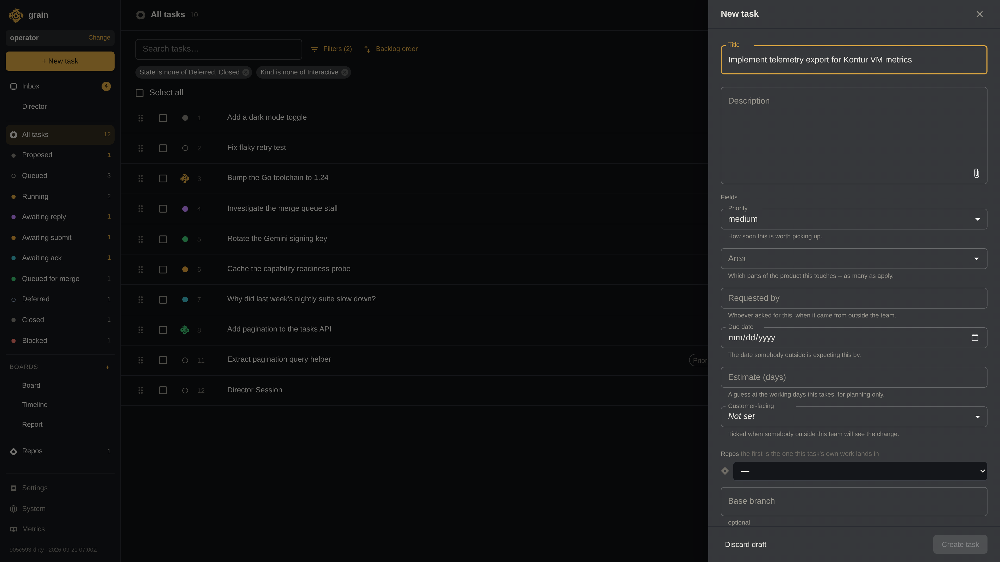
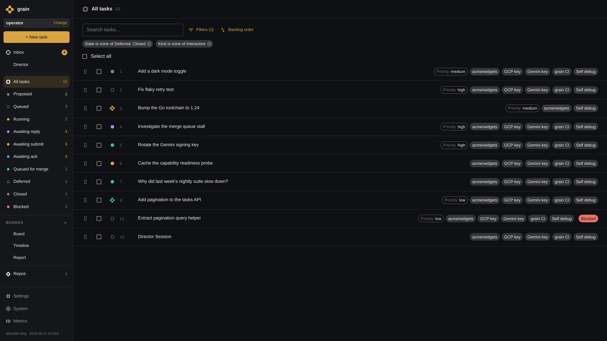
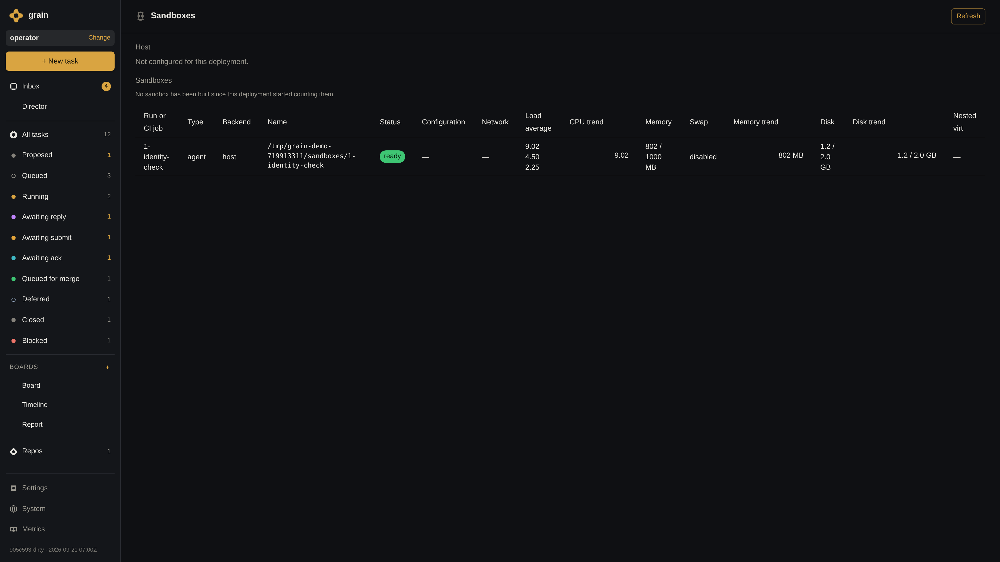
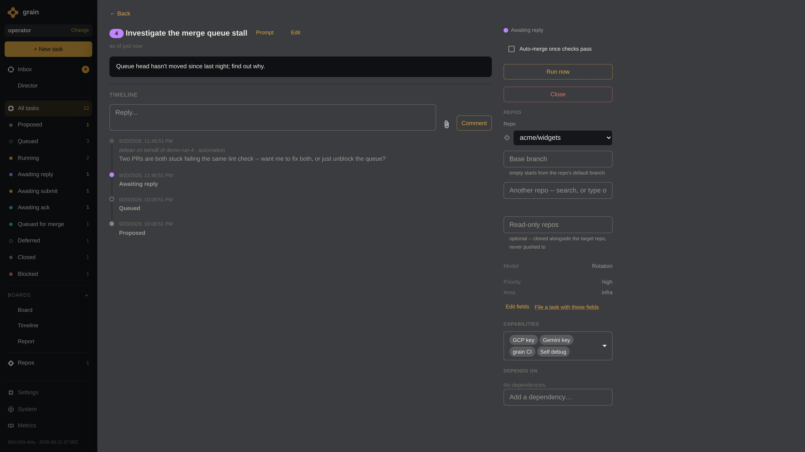
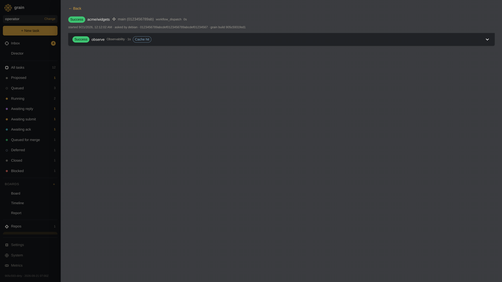
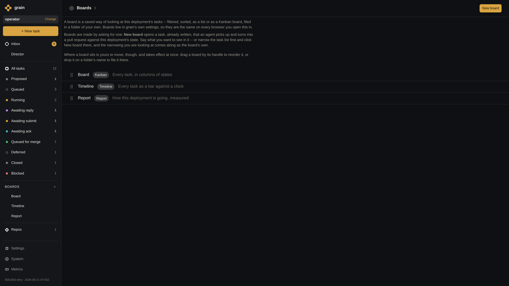
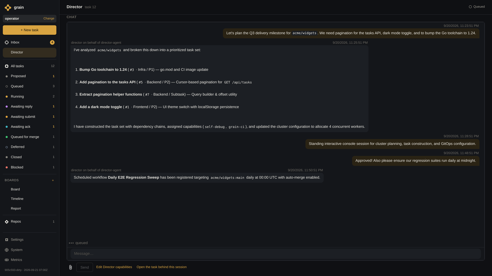
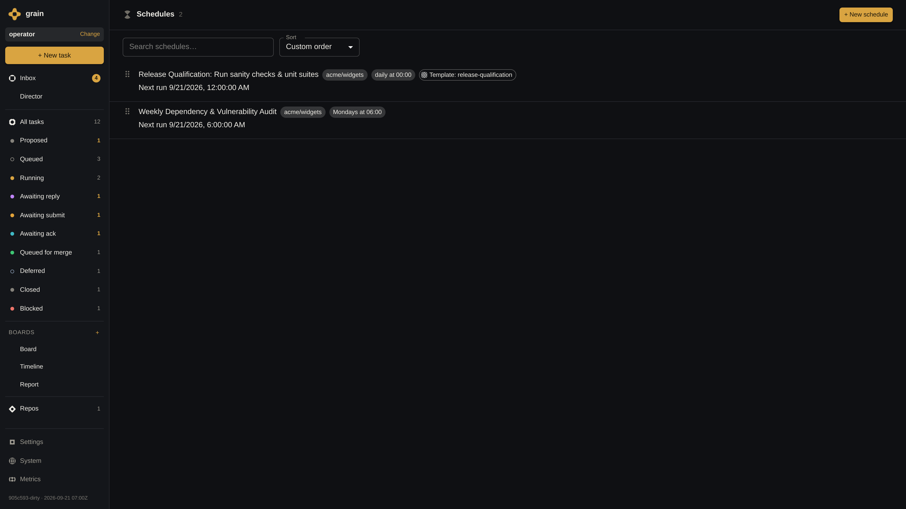
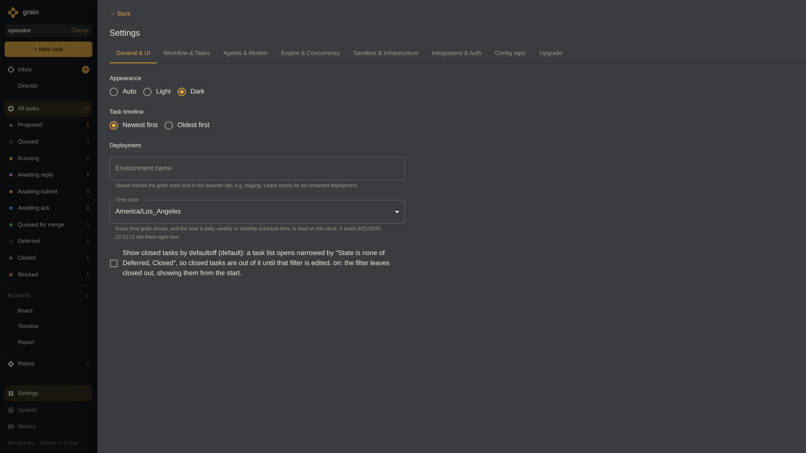

# Grain: The Autonomous Engineering Agent Cluster

This slide deck outlines the core architecture, operational workflows, and features of **Grain** — a single-operator agent cluster designed to autonomously convert a backlog of software engineering tasks into tested, verified pull requests.

A dedicated demo cluster was initialized with configured model backends (Gemini 2.5 Pro), scoped Git credentials, sandboxed microVMs, continuous integration workflows, schedules, suites, and interactive Director sessions to produce high-resolution presentation snapshots.

---

## Slide Deck Overview

| Slide | Title | Key Theme | Screenshot |
| :--- | :--- | :--- | :--- |
| **01** | [Create a Task](#slide-1-create-a-task) | Intake, Metadata & Capability Assignment | `01-create-a-task.png` |
| **02** | [Task Picked Up by Agent](#slide-2-task-picked-up-by-agent-limited-concurrency) | Bounded Concurrency & Dynamic Queue Dispatch | `02-task-picked-up-by-agent.png` |
| **03** | [Sandboxes & Ephemeral Credentials](#slide-3-sandboxes--ephemeral-credentials) | MicroVM Isolation & Hardware Telemetry | `03-agent-sandbox-credentials.png` |
| **04** | [Agent Does the Task](#slide-4-agent-does-the-task-live-execution) | Streaming Transcripts & Human-in-the-Loop | `04-agent-executes-task.png` |
| **05** | [CI / Merge Pipeline & Auto-Repair](#slide-5-ci--merge-pipeline-with-autonomous-repair) | Native CI Engine & PR Conflict Auto-Repair | `05-ci-merge-pipeline.png` |
| **06** | [Agent Sub-Tasks & Follow-Ups](#slide-6-agent-sub-tasks--follow-up-workflows) | Autonomous Decomposition & Dependency DAGs | `06-agent-subtasks-followups.png` |
| **07** | [Director Interactive Planning](#slide-7-director-interactive-planning-session) | Conversational Milestone & Backlog Synthesis | `07-director-planning-session.png` |
| **08** | [Scheduled Agents & Test Suites](#slide-8-scheduled-agents--test-suites) | Recurring Regressions & Qualification Suites | `08-schedules-test-suites.png` |
| **09** | [GitOps Cluster Configuration](#slide-9-gitops-cluster-configuration-via-repo-check-ins) | Declarative State, Models & Self-Upgrades | `09-cluster-configuration-gitops.png` |
| **10** | [Grain Inside Google (Capsules & Cloud Run Proxy)](#slide-10-grain-inside-google-capsules--cloud-run-proxy) | Outbound Capsule Tunnels & Zero-Trust IAP Ingress | `10-grain-google-architecture.png` |

---

## Slide 1: Create a Task

### Title: **Streamlined Task Intake & Capability Assignment**
**Subtitle**: Defining requirements, assigning granular capabilities, and setting auto-merge policies.



### Key Takeaways
- **Structured Task Definition**: Operators define title, detailed instructions, priority tier (`P0`–`P3`), functional area, and delivery metadata.
- **Granular Capabilities**: Granular capability toggles (`self-debug`, `grain-ci`, `gemini-key`, `gcp-key`) grant least-privilege tools to the run.
- **Autonomous Merge Policy**: Enable `Auto-Merge` so passing tasks automatically progress through CI directly into the main branch.
- **Approval Gate**: Flag tasks for automatic queue dispatch or require operator approval prior to execution.

### Speaker Notes
> "Grain transforms how engineering teams leverage coding agents. Instead of sitting in front of a chat window and prompt-engineering each step, Grain acts as an autonomous operating system for software backlogs. You define tasks and requirements; Grain handles scheduling, provisioning isolated sandboxes, running the agents, verifying builds with CI, and managing merge queues."

---

## Slide 2: Task Picked Up by Agent (Limited Concurrency)

### Title: **Autonomous Dispatch & Managed Concurrency**
**Subtitle**: Dynamic queue scheduling respecting cluster worker limits and priority tiers.



### Key Takeaways
- **Bounded Cluster Concurrency**: Configurable worker pool (e.g. 4 concurrent workers) ensures cluster hardware and API rate limits are respected.
- **Intelligent Priority Queueing**: Tasks transition automatically from `Queued` to `Running` based on priority tiers and dependency resolution.
- **Multi-Model Backend Support**: Pluggable agent backends (Gemini 2.5 Pro, Claude Code, Antigravity) assigned per task or cluster default.
- **Real-Time Lifecycle Tracking**: Live status updates across states (`Queued`, `Running`, `Repairing`, `Awaiting Reply`).

### Speaker Notes
> "The orchestrator schedules tasks into a fixed worker pool. When an agent slot frees up, the highest-priority runnable task is dispatched immediately into an isolated sandbox."

---

## Slide 3: Sandboxes & Ephemeral Credentials

### Title: **Isolated Sandboxes & Scoped Ephemeral Credentials**
**Subtitle**: Hermetic VM execution with short-lived tokens and real-time resource telemetry.



### Key Takeaways
- **Hermetic MicroVM Isolation**: Every run executes in a disposable virtual machine or isolated container, preventing cross-contamination.
- **Ephemeral Credential Scoping**: Sandboxes receive temporary, scoped git tokens and minted cloud credentials (`gcp-key`, `gemini-key`); master keys never leave the host controller.
- **Hardware Resource Quotas**: Enforced limits on vCPUs, memory (2048 MiB), disk storage, and execution timeouts.
- **Live Infrastructure Health**: Real-time telemetry monitoring VM status, CPU loads, memory trends, and host health.

### Speaker Notes
> "Running autonomous agents requires rock-solid isolation. Grain isolates every run in an ephemeral virtual machine with strictly scoped access. The host daemon acts as a gatekeeper, and the operator dashboard provides live telemetry into resource consumption and cluster capacity."

---

## Slide 4: Agent Does the Task (Live Execution)

### Title: **Transparent Agent Execution & Human-in-the-Loop**
**Subtitle**: Streaming tool invocations, shell transcripts, and interactive clarifying questions.



### Key Takeaways
- **Real-Time Transcript Streaming**: Operators observe live tool calls (`run_command`, `read_file`, `edit_file`), diffs, and test output.
- **Interactive Question Protocol**: When encountering ambiguity, agents pause and ask targeted questions via `ask_question`.
- **Instant Operator Unblocking**: Operators reply directly in the chat dialogue to unblock the agent immediately with full context.
- **Full Auditability**: Every command, tool interaction, and output is captured immutably in task logs.

### Speaker Notes
> "Grain eliminates black-box unpredictability. If an agent faces an ambiguous requirement or multiple implementation options, it doesn't hallucinate — it pauses and asks the operator. Once the operator replies in the UI, the agent resumes instantly with full context."

---

## Slide 5: CI / Merge Pipeline with Autonomous Repair

### Title: **Native CI Engine & Autonomous Merge Repair**
**Subtitle**: Rigorous quality verification and autonomous conflict resolution on pull request branches.



### Key Takeaways
- **Native Workflow Engine**: Executes `.grain/workflows` in parallel sandboxes with matrix builds and artifact caching.
- **Pre-Merge Quality Gate**: Holding the merge queue until all linters, unit suites, and integration tests pass cleanly.
- **Autonomous Conflict Repair**: If a pull request encounters merge conflicts, Grain automatically re-dispatches the agent to resolve conflicts (`Repairing` state).
- **Shared Outage Correlation**: Automatically distinguishes between branch-specific failures and shared upstream CI outages.

### Speaker Notes
> "A pull request is only as good as its verification. Grain features a native CI engine that runs directly alongside the agent sandboxes. Agents can test their changes in real-time, inspect failures, and guarantee all checks pass before submitting pull requests."

---

## Slide 6: Agent Sub-Tasks & Follow-Up Workflows

### Title: **Agent Decomposed Sub-Tasks & Follow-Ups**
**Subtitle**: Autonomous task breakdown, chained dependencies, and follow-up proposal generation.



### Key Takeaways
- **Hierarchical Task Breakdown**: Agents decompose complex tasks into smaller sub-tasks linked via `LinkChildOf`.
- **Strict Dependency DAGs**: Enforce execution order via `LinkDependsOn`, blocking downstream work until prerequisite changes merge.
- **Follow-Up Proposal Pipeline**: Agents propose new tasks (`propose_task`) for review or automatic queueing.
- **Cross-Task Context Handover**: Knowledge and invariants are passed forward via standing handovers and memory documents.

### Speaker Notes
> "Agents operate as autonomous teammates. When tackling large issues, they decompose work into sub-tasks, establish dependency graphs, and propose follow-up improvements."

---

## Slide 7: Director Interactive Planning Session

### Title: **Director: Interactive Cluster Planning & Task Construction**
**Subtitle**: Conversational console sessions for milestone planning, task set synthesis, and cluster management.



### Key Takeaways
- **Standing Interactive Console**: Dedicated Director agent session for interactive backlog grooming and architectural planning.
- **Automated Task Set Construction**: Director analyzes codebases and converts natural language milestones into structured, linked task trees.
- **Cluster Allocation & Orchestration**: Dynamically adjust worker concurrency, capability profiles, and repository assignments.
- **Interactive Operator Dialogue**: Continuous collaboration between human engineering leads and autonomous cluster management.

### Speaker Notes
> "The Director session serves as the operator's strategic planning partner, converting high-level goals into executable backlogs with full dependency management."

---

## Slide 8: Scheduled Agents & Test Suites

### Title: **Recurring Schedules & Multi-Pass Test Suites**
**Subtitle**: Automated cadences for regression testing, vulnerability scans, and release qualification.



### Key Takeaways
- **Cadence-Based Scheduling**: Configure automated cron/daily/weekly runs (e.g. *Daily E2E Regression Sweep*, *Weekly Vulnerability Audit*).
- **Multi-Pass Test Suites**: Bundle templates into comprehensive suites (*Release Qualification Suite*) with configurable pass counts.
- **Reusable Task Templates**: Define standardized task templates with predefined targets, branches, capabilities, and auto-merge settings.
- **Zero-Touch Qualification**: Validate release candidates autonomously with comprehensive sanity sweeps before promotion.

### Speaker Notes
> "Schedules and Suites enable proactive cluster maintenance. Grain executes daily regressions, weekly dependency scans, and multi-pass qualification runs without operator overhead."

---

## Slide 9: GitOps Cluster Configuration via Repo Check-ins

### Title: **GitOps Cluster Configuration & State Repositories**
**Subtitle**: Declarative cluster configuration, model management, and version-controlled operations.



### Key Takeaways
- **Declarative GitOps State**: Cluster configuration (models, workers, capabilities, repos) synced with version-controlled state repositories.
- **Multi-Model Provider Management**: Configure Gemini, Claude, and OpenAI backends with per-task routing and credential isolation.
- **Self-Upgrading Infrastructure**: Agents can propose, test, and apply configuration changes and software updates via Git PR check-ins.
- **Persistent Cluster Memory**: Shared organizational knowledge and project conventions stored and retrieved across all future dispatches.

### Speaker Notes
> "Grain adheres to GitOps principles. All cluster settings, capabilities, and agent memories are version-controlled, allowing agents to maintain and evolve their own operating environment."

---

## Slide 10: Grain Inside Google (Capsules & Cloud Run Proxy)

### Title: **Grain Inside Google: Cloud Run Proxy & Capsule Architecture**
**Subtitle**: Zero-Trust network topology, outbound Capsule reverse tunneling, and distributed User Capsule remote executors.


### Key Takeaways
- **Outbound Capsule Tunneling**: Grain daemon runs on a dedicated internal Capsule VM and establishes an outbound persistent connection to Google Cloud Run Proxy with no open inbound firewall ports.
- **Zero-Trust Identity-Aware Proxy (IAP)**: Cloud Run Proxy is protected by Google IAP, enforcing corporate identity authentication (OIDC bearer tokens) and IAM policy verification on all connections.
- **Distributed User Capsules**: Remote executors (`grain executor`) run across engineer workstations ("User Capsules"), leveraging ambient corporate credentials and local agent CLIs (`agy`, `claude`, `codex`).
- **Hermetic Tool Execution**: Agent CLI tool calls (`run_command`, `read_file`, `edit_file`) tunnel back through the Cloud Run Proxy to execute safely in disposable Granule microVM sandboxes on the Grain Capsule.

### Speaker Notes
> "Grain inside Google operates over a Zero-Trust topology. Grain on a Capsule dials outbound to a Cloud Run Proxy with IAP. Remote executors on developer User Capsules connect through the proxy, driving local CLIs with ambient auth while tunneling tool executions into Grain's isolated sandboxes."

---

## Reproducing Screenshots & Running the Demo

To start the demo cluster and re-capture all presentation screenshots:

```bash
# Build the grain binary with embedded UI
make build

# Run the automated Playwright screenshot generator
node docs/slides/generate-screenshots.mjs
```

Or view the interactive slide deck directly in your browser:

```bash
open docs/slides/index.html
```
