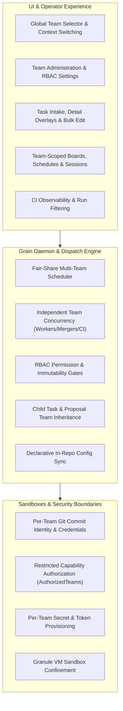
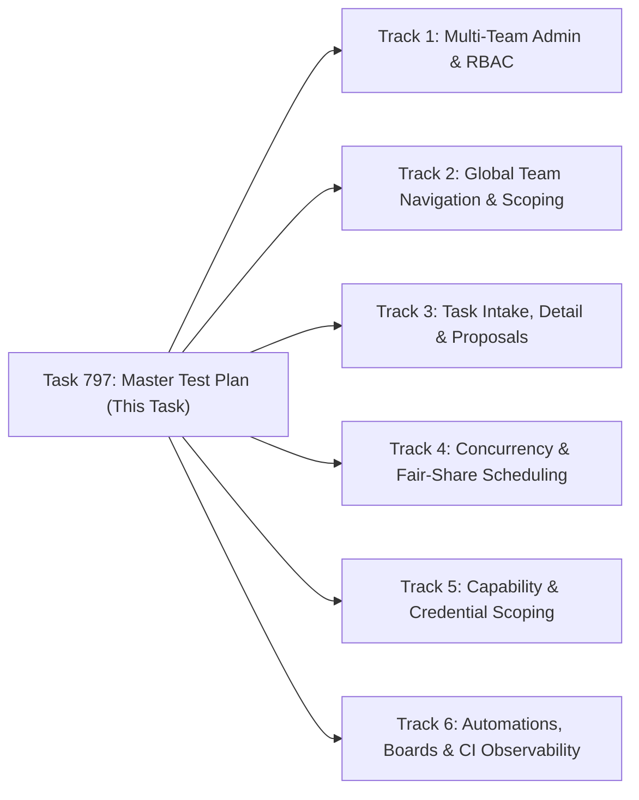

# Comprehensive Multi-Team Test Plan & Agent Walkthrough Suite

**Target Date**: 2026-09-26  
**Target Branch**: `candidate` (`bwsalmon/grain`)  
**Scope**: Multi-Team Governance, RBAC, Fair-Share Scheduling, Sandbox Credential Scoping, UI Context Switching, and Autonomous Declarative Workflows.

---

## 1. Executive Summary & Multi-Team Architecture

Grain provides native enterprise multi-tenancy through its Multi-Team architecture. Teams serve as administrative, execution, and security boundaries that partition work, allocate compute budgets, isolate credentials, and enforce role-based access controls across distributed engineering organizations.

This test plan defines an exhaustive, multi-hour validation suite designed to be executed by autonomous agents and human operators. It exercises all user-facing UI flows, backend dispatch policies, API endpoints, and sandbox security isolation barriers.

### Core Architectural Pillars Tested



1. **Independent Team Governance & Quotas**:
   - Each team defines independent concurrency limits (`maxWorkers`, `maxMergers`, `maxCIJobs`), AI framework preferences (`agentFramework`, `defaultModel`, `claudeModel`, `codexModel`, `geminiModel`), and IANA time zones.
   - Built-in `default` team is protected against deletion or archival.

2. **Role-Based Access Control (RBAC)**:
   - Three distinct roles: **Admin** (full team configuration, membership, and task authority), **Member** (create, edit, cancel, and execute tasks), and **Viewer** (read-only visibility).
   - Invariant enforcement ensuring every team retains at least one active Admin.

3. **Fair-Share Dispatching & Head-of-Line Blocking Prevention**:
   - Workload saturation in one team (e.g. 10 queued tasks hitting `maxWorkers=2`) never starves or delays dispatching in another team with available capacity.
   - Merge queues operate independently per team to prevent single-team PR backlogs from blocking organization-wide throughput.

4. **Credential Isolation & Git Commit Identity**:
   - Fine-grained capability scoping via `AuthorizedTeams` on sensitive capabilities (`gcpkey`, `geminikey`, `packagepublish`, `registrypush`).
   - Per-team Git author/committer identities (`agentGitName`, `agentGitEmail`, `gitCredential`) provisioned directly into execution sandboxes.

5. **Hierarchical Task & Proposal Inheritance**:
   - Subtasks and follow-up proposals created via `propose_task` automatically inherit the parent task's `team` context.
   - Cross-team dependency resolution (`depends_on`) functions correctly across disparate team backlogs.

---

## 2. Shared Walkthrough Contract for Agents

Every agent dispatched to execute a walkthrough task in this test plan must adhere to the following contract:

1. **Real Environment Execution**:
   - Launch a live daemon instance using `grain demo` (or local test server).
   - Execute all walkthrough interactions via real browser automation (Playwright Chromium) against the built React frontend at `http://localhost:8080` (or designated port).
   - Do not rely solely on unit tests; verify actual rendered DOM elements, state transitions, user feedback notifications, and network responses.

2. **Error & Console Monitoring**:
   - Continuously monitor browser console errors, failed network requests (HTTP 4xx/5xx), and WebSocket disconnection events during interactions.
   - Verify that loading skeletons, error toasts, and confirmation dialogs behave properly.

3. **Persistence & Direct URL Routing**:
   - For every state mutation (team creation, setting updates, task reassignment, board creation), navigate away and return, or execute a hard page reload (`page.reload()`) to verify database persistence and state recovery from localStorage / URL query params.

4. **Bug Fixing & Filing Protocol**:
   - If an agent discovers a safe, reproducible bug within its scope, it should fix the code, add regression test coverage (unit/integration/E2E), and commit the fix following Conventional Commits.
   - If a bug requires architectural changes or external infrastructure, document the reproduction steps, logs, and root cause in detail, and file a new task proposal via `propose_task`.

5. **Execution Reporting**:
   - Write a detailed, dated report to `docs/test-runs/2026-09-26-<track-name>.md` detailing tested commits, exact UI flows executed, screenshots/snapshots captured, bugs found, and verification results.

---

## 3. Detailed Walkthrough Tracks & Test Matrix

### Track 1: Multi-Team Administration, RBAC Enforcement & Lifecycle Safeguards

**Focus**: Validates team creation, validation boundaries, member role management, setting mutations, deletion protection, and remote executor bootstrap generation.

#### Existing Coverage
- `pkg/model/team_test.go` and `pkg/model/team_store.go`: Model validation and SQLite/PostgreSQL store persistence.
- `pkg/ui/teams_test.go`: REST endpoint handling for `/api/teams`.
- `ui/src/components/AdminOverlay.test.jsx` and `ui/src/components/TeamSettingsOverlay.test.jsx`: Component unit rendering.

#### Gaps & Unproven Behaviors
- Interactive role promotion/demotion and enforcement of the "at least one admin" constraint in the live UI.
- Behavior when a user with `viewer` role attempts to modify settings or delete teams via UI controls vs direct API requests.
- Proper error toast rendering when attempting to delete a team with attached tasks or active schedules.
- Deletion cascade cleanliness when an empty team is deleted.

#### Walkthrough Procedure
1. Open Admin Overlay (`Sidebar -> Admin -> All Teams`).
2. Verify Default Team card:
   - Check that `Delete Team` button is disabled or absent.
   - Click `Copy Command` for remote executor bootstrap; assert copied string contains `--team=default`.
3. Create New Team `platform-eng`:
   - Attempt invalid IDs (spaces, uppercase, special characters); assert inline validation feedback.
   - Enter valid ID `platform-eng`, name `Platform Engineering`, description `Core infra team`.
   - Set `maxWorkers=4`, `maxMergers=2`, `maxCIJobs=3`, IANA TimeZone `America/New_York`.
   - Set Default Model `claude-sonnet-5`, Agent Git Name `Platform Bot`, Agent Git Email `platform-bot@example.com`.
   - Save and verify the team card appears with matching chips.
4. Manage Members & RBAC:
   - Add member `alice@example.com` with role `admin`.
   - Add member `bob@example.com` with role `member`.
   - Add member `carol@example.com` with role `viewer`.
   - Attempt to remove `alice@example.com` as admin when no other admin exists; verify rejection error alert.
   - Promote `bob@example.com` to admin, then demote `alice@example.com` to member; verify successful update.
5. Deletion Safeguards:
   - Create a task attached to `platform-eng`.
   - Attempt to delete `platform-eng`; verify deletion is rejected with informative modal ("Cannot delete team with active tasks").
   - Move or close/purge the task.
   - Delete `platform-eng`; verify clean removal from list and database.

---

### Track 2: Global Team Navigation, Viewport Scoping & Context Switching

**Focus**: Validates global team selector reactivity, URL routing, persistent filtering, sidebar containers, and responsive mobile behavior.

#### Existing Coverage
- `ui/src/TeamContext.test.jsx`: Context provider state updates.
- `ui/src/paths.test.js`: URL generation helpers.
- `ui/e2e/sidebar-navigation.spec.js`: Basic navigation rail tests.

#### Gaps & Unproven Behaviors
- Dynamic updates of task counts in the sidebar when switching between "All teams" and specific team views.
- Deep-link URL preservation (`/teams/qa-infra/tasks?state=inbox`) on browser refresh.
- Touch target responsiveness and dropdown accessibility on mobile/coarse pointer viewports (375px width).
- Smooth transition of active live log streaming when switching team filters.

#### Walkthrough Procedure
1. Seed multi-team data: 3 tasks in `infra`, 2 tasks in `frontend`, 1 task in `default`.
2. Verify Global Team Selector:
   - In top navigation bar, locate the team selector dropdown.
   - Assert options: `All teams`, `Default Team (default)`, `Infrastructure (infra)`, `Frontend (frontend)`.
3. Context Scoping:
   - Select `Infrastructure (infra)`:
     - Verify URL updates to include team scope (`/teams/infra` or query parameter `?team=infra`).
     - Assert task list filters down to strictly 3 `infra` tasks.
     - Verify sidebar section counts match `infra` task quantities.
   - Select `Frontend (frontend)`:
     - Assert task list instantly switches to 2 `frontend` tasks without layout thrashing.
   - Select `All teams`:
     - Assert all 6 tasks are displayed with corresponding team chips/badges on each row.
4. Deep-link Navigation & Reload:
   - Open direct URL `http://localhost:8080/teams/infra/schedules`.
   - Verify page loads with `infra` pre-selected in the team selector and schedules scoped to `infra`.
   - Perform full page reload (`Ctrl+R`); assert state and team context persist intact.
5. Mobile Responsive Viewport:
   - Resize viewport to 375x812 (iPhone layout).
   - Open mobile drawer / hamburger menu; verify team selector is accessible with minimum 44px touch targets.
   - Switch teams; verify drawer closes and active view renders properly.

---

### Track 3: Task Intake, Detail Overlays, Bulk Operations & Child Task Inheritance

**Focus**: Validates task creation with team assignment, repository restriction validation, detail overlay inspection/reassignment, bulk team reassignment, and `propose_task` inheritance.

#### Existing Coverage
- `pkg/ui/task_team_assignment_test.go`: API task assignment unit tests.
- `pkg/orchestrator/proposal_team_inheritance_test.go`: Orchestrator proposal inheritance tests.
- `ui/src/components/NewTaskOverlay.advanced.test.jsx`: Task creation form tests.

#### Gaps & Unproven Behaviors
- Live UI verification of `targetRepos` restriction: preventing task submission if the chosen repository is not in the team's allowed `targetRepos`.
- Interactive bulk editing: selecting 5 tasks from multiple teams and reassigning them simultaneously to a target team.
- Live child task generation: running an agent task that calls `propose_task` and asserting the newly filed task inherits the parent's `team` tag in the database and UI.
- Task detail overlay inline team reassignment and audit history updates.

#### Walkthrough Procedure
1. Task Intake Validation:
   - Configure team `backend-team` with `targetRepos: ["bwsalmon/grain"]`.
   - Open New Task dialog (`+ New task`).
   - Select `backend-team` as Target Team.
   - Attempt to select an unlisted repository (e.g. `other-org/unauthorized-repo`); assert validation error or dropdown exclusion.
   - Select `bwsalmon/grain`, fill Title `Backend API Refactor`, and submit.
   - Verify created task has `backend-team` badge in the inbox.
2. Detail Overlay & Reassignment:
   - Click the created task to open `DetailOverlay`.
   - Verify team chip displays `Backend Team`.
   - Change team assignment dropdown to `qa-infra`.
   - Save; assert task reloads with `qa-infra` team badge and event history records the team reassignment.
3. Bulk Task Reassignment:
   - Navigate to task list. Check boxes next to 4 different tasks across various teams.
   - Click `Bulk Edit` button in toolbar.
   - In `BulkEditOverlay`, select Target Team `infra-team`.
   - Click `Apply Changes`; assert all 4 tasks now display `infra-team` in the table.
4. Proposal & Subtask Team Inheritance:
   - Dispatch an agent task assigned to `security-team`.
   - The agent invokes `propose_task(title="Security follow-up", body="...")`.
   - Verify the proposed task appears in the Inbox automatically tagged with `team="security-team"`.
   - Test cross-team dependency: create Task A (`team="infra"`) with `depends_on=[Task B]` (`team="security"`). Verify task dispatch remains blocked until Task B reaches closed/completed status.

---

### Track 4: Multi-Team Concurrency, Fair-Share Dispatching & Resource Limits

**Focus**: Validates that independent team concurrency boundaries (`maxWorkers`, `maxMergers`, `maxCIJobs`) prevent cross-team starvation and enforce fair-share workload scheduling.

#### Existing Coverage
- `pkg/dispatch/team_limits_test.go`: Scheduler worker cap unit tests.
- `pkg/dispatch/multi_team_concurrency_boundary_test.go`: Concurrency boundary tests.
- `pkg/dispatch/dispatch_multiteam_stress_test.go`: In-memory dispatch stress tests.

#### Gaps & Unproven Behaviors
- Live daemon dispatch cycle under saturated workload across multiple teams.
- Proving that Team B with `maxWorkers=2` starts running tasks immediately even when Team A has 20 tasks queued and has filled its `maxWorkers=2` quota.
- Auto-merge queue throughput when multiple teams have PRs ready for merging simultaneously.
- Worker slot replenishment when a task finishes or fails in one team.

#### Walkthrough Procedure
1. Setup Team Limits:
   - Team `alpha`: `maxWorkers=2`, `maxMergers=1`.
   - Team `beta`: `maxWorkers=2`, `maxMergers=1`.
2. Queue Saturation Test:
   - Queue 6 resource-intensive tasks in Team `alpha`.
   - Queue 2 tasks in Team `beta`.
   - Trigger dispatch cycle (`grain dispatch` or running daemon).
3. Concurrency Assertion:
   - Inspect active runs in UI (`Sidebar -> Sandboxes` or `/system/sandboxes`).
   - Verify exactly 2 tasks from Team `alpha` are running (`alpha` at capacity).
   - Verify both 2 tasks from Team `beta` are running simultaneously (`beta` active, not blocked behind `alpha`'s backlog).
   - Assert remaining 4 tasks from Team `alpha` remain in `queued` status.
4. Slot Replenishment:
   - Complete 1 active task in Team `alpha`.
   - Assert the next queued task from Team `alpha` transitions immediately to `running`.
   - Verify Team `beta`'s running tasks remain unaffected throughout.
5. Merge Queue Independence:
   - Create 2 PRs ready to merge in Team `alpha` and 1 PR in Team `beta`.
   - Verify merge queue processes merges concurrently according to each team's `maxMergers` limit without global lock contention.

---

### Track 5: Capability Scoping, Credential Isolation & Git Commit Identity

**Focus**: Validates sandbox credential provisioning, restricted capability gating (`AuthorizedTeams`), and Git author/committer identity isolation.

#### Existing Coverage
- `pkg/capability/gcpkey/gcpkey.go`, `geminikey.go`, `packagepublish.go`, `registrypush.go`: `AuthorizedTeams` struct definitions.
- `pkg/model/capability_test.go`: Capability registry tests.
- `pkg/orchestrator/basebranchci_test.go`: Capability mounting tests.

#### Gaps & Unproven Behaviors
- End-to-end rejection when a task belonging to an unauthorized team requests a protected capability (e.g. `package-publish` or `gcp-key`).
- Verification that credentials files (`/home/debian/.gemini-api-key`, `/home/debian/.gcp-service-account.json`) are omitted from sandboxes of unauthorized teams.
- Verification of Git commit author and committer headers in commits created by sandboxes configured with custom team `agentGitName` and `agentGitEmail`.

#### Walkthrough Procedure
1. Configure Capability Access:
   - Configure capability `package-publish` with `AuthorizedTeams: ["release-team"]`.
   - Configure capability `internal-gcp` with `AuthorizedTeams: ["infra-team"]`.
2. Unauthorized Capability Request Rejection:
   - Create Task 1 assigned to `frontend-team` requesting capability `package-publish`.
   - Dispatch task; verify task execution is refused or capability is denied with audit log: `"team 'frontend-team' is not authorized to use capability 'package-publish'"`.
   - Verify no publishing tokens are mounted into the sandbox filesystem.
3. Authorized Capability Provisioning:
   - Create Task 2 assigned to `release-team` requesting capability `package-publish`.
   - Dispatch task; verify capability mounts successfully and credentials are accessible at `/home/debian/.npmrc` / designated path.
4. Per-Team Git Commit Identity:
   - Configure Team `devops`: `agentGitName: "DevOps Automated Bot"`, `agentGitEmail: "devops-bot@corp.internal"`.
   - Dispatch an agent task under `devops` that makes a code edit and commits.
   - Inspect the created Git commit (`git log -1 --format=fuller`); assert:
     - `Author: DevOps Automated Bot <devops-bot@corp.internal>`
     - `Commit: DevOps Automated Bot <devops-bot@corp.internal>`
   - Verify that tasks under `default` team continue using default Git identity.

---

### Track 6: Team-Scoped Automations, Declarations, Boards & CI Observability

**Focus**: Validates declarative repository automation (`.grain/`), team-scoped saved boards, interactive console sessions, and CI run filtering.

#### Existing Coverage
- `pkg/staterepo/team_config_test.go` and `team_fidelity_test.go`: Declarative YAML export/import fidelity.
- `ui/src/components/CIPage.test.jsx`: CI run list component tests.
- `pkg/ui/boards_test.go`: Saved board API tests.

#### Gaps & Unproven Behaviors
- Synthesizing scheduled triage review tasks from `.grain/schedules/*.yml` with explicit `team` field.
- Creating saved boards with `kind="panels"` or `kind="kanban"` scoped to specific teams and verifying visibility in the Boards navigation sidebar.
- Launching an interactive console session under a specific team and verifying default model overrides from team settings.
- Filtering CI Runs by team via UI dropdown (`/ci?team=qa-infra`) and MCP `list_ci_runs(team="qa-infra")`.

#### Walkthrough Procedure
1. Declarative In-Repo Team Automation:
   - In `.grain/schedules/security-scan.yml`, declare schedule with `team: "security-team"`.
   - Trigger schedule fire (`grain schedule fire security-scan`); verify synthesized task is assigned to `security-team`.
2. Team-Scoped Saved Boards:
   - Open Boards drawer (`Sidebar -> Boards -> + New Board`).
   - Create Board `Infra Sprint Board`, select Team `infra-team`, layout `Kanban`.
   - Create Board `Global Triage Board`, select Team `All teams`, layout `Dashboard`.
   - Verify in Sidebar: `Infra Sprint Board` appears under `infra-team` group, while `Global Triage Board` appears in global section.
   - Switch Global Team Selector to `frontend-team`; assert `Infra Sprint Board` is hidden, maintaining clean visual scope.
3. Interactive Console Sessions:
   - Configure Team `ai-research` with `defaultModel: "gemini-3.1-pro"`, `agentFramework: "codex"`.
   - Open Console Sessions (`Sidebar -> Sessions -> + New Session`).
   - Select Team `ai-research`; verify framework and model dropdowns automatically pre-fill with `codex` and `gemini-3.1-pro`.
   - Launch session; verify session row displays `ai-research` tag.
4. CI Observability & Event Streaming:
   - Trigger CI runs across multiple teams (`infra`, `frontend`, `default`).
   - Navigate to CI Runs Page (`/ci`).
   - Use team filter dropdown to select `qa-infra`; verify list displays only runs belonging to `qa-infra`.
   - Call MCP tool `list_ci_runs(team="qa-infra")`; verify matching filtered results.
   - Verify real-time WebSocket updates (`team_events.go`) properly push new run statuses without cross-team message bleeding.

---

## 4. Edge Cases & Chaos Resilience Matrix

| Scenario / Stress Case | Invariant / Expected Behavior | Failure Mode to Guard Against |
|---|---|---|
| **Rapid Global Team Toggling** | UI maintains state consistency; active WebSocket subscriptions update cleanly without memory leaks. | Race conditions causing stale task rows from Team A to render under Team B. |
| **Deleting Team with Active Runs** | Deletion is rejected with HTTP 409 Conflict and a clear modal warning. | Orphaned running sandboxes or dangling database foreign key errors. |
| **Viewer Direct API Mutation** | Requests to `/api/teams/:id/tasks` or `/api/teams/:id` with `viewer` credentials return HTTP 403 Forbidden. | UI hiding buttons but backend failing to validate role on mutation endpoints. |
| **Cross-Team Circular Dependencies** | Scheduler detects circular task dependencies across teams and flags them cleanly without deadlocking the dispatch worker loop. | Permanent stall of the orchestrator dispatch thread. |
| **Zero-Limit Edge Cases** | Setting `maxWorkers=0` or `maxMergers=0` pauses execution for that team while allowing other teams to proceed normally. | Panic or division-by-zero in fair-share scheduler calculations. |
| **Special Characters in Team Names** | Team names with unicode, punctuation, and long descriptions render cleanly without breaking layout or CSS. | UI layout overflow or XSS vulnerabilities in team badges and tooltips. |

---

## 5. Execution Roadmap & Proposed Tasks

To run this test plan over the next few hours, the following six independent follow-up tasks are filed for agent execution. Each task targets a specific track, runs through the real UI flows, verifies behavior, and commits fixes or files bugs.



| Proposal ID | Title | Scope Summary |
|---|---|---|
| `task-team-admin-rbac` | Multi-Team Admin, RBAC Enforcement & Lifecycle Safeguards Walkthrough | Exercise team creation, character validation, member role promotion/demotion, admin invariants, and safe deletion in real UI. |
| `task-team-nav-scoping` | Global Team Navigation, Viewport Scoping & Context Switching Walkthrough | Exercise global team selector, route synchronizations, deep links, sidebar counters, and mobile viewports. |
| `task-team-intake-inheritance` | Task Intake, Detail Overlays, Bulk Operations & Child Task Inheritance Walkthrough | Exercise task intake targetRepo validation, detail overlays, bulk edits, and `propose_task` team inheritance. |
| `task-team-concurrency-dispatch` | Multi-Team Concurrency, Fair-Share Dispatching & Resource Limits Walkthrough | Exercise independent team worker/merger limits, saturation testing, and queue starvation prevention. |
| `task-team-capabilities-git` | Capability Scoping, Credential Isolation & Git Commit Identity Walkthrough | Exercise `AuthorizedTeams` on protected capabilities, credential omission, and per-team Git commit author/committer headers. |
| `task-team-declarations-ci` | Team-Scoped Automations, Declarations, Boards & CI Observability Walkthrough | Exercise `.grain/` YAML declarations, team-scoped boards, console sessions, and team-filtered CI logs. |

---

## 6. Bug Filing & Reporting Format

Every agent completing a walkthrough task must write an execution report to `docs/test-runs/2026-09-26-<track>.md` formatted as follows:

```markdown
# Test Run Report: [Track Title]

**Date**: 2026-09-26  
**Commit Tested**: [Commit SHA]  
**Agent / Operator**: [Agent Framework / Name]  
**Result**: [PASS / PASS WITH WARNINGS / FAIL]

## Summary of Executed Flows
- Step 1: ...
- Step 2: ...

## Discovered Gaps & Bugs
1. **[Bug Title]**: [Description, severity, reproduction steps]
   - *Resolution*: [Fixed in commit <sha> / Filed task <id>]

## UI & State Verification
- Rendered UI screenshots / snapshots
- Network / Console error audit: [Clean / X errors noted]
```
