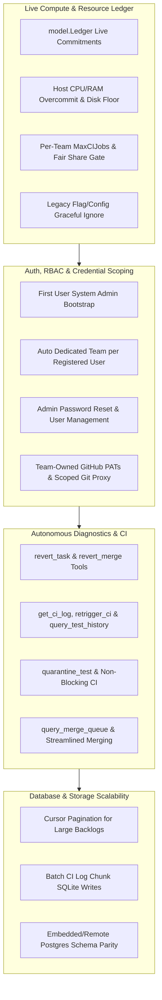

# Grain 48-Hour Changes Comprehensive Test Plan & Walkthrough Suite

**Target Date**: 2026-09-28  
**Target Branch**: `candidate` (`bwsalmon/grain`)  
**Scope**: Live Sandbox Resource Budgeting (`model.Ledger`), Team-Owned GitHub Credentials, Authentication & Dedicated User Teams, MCP Diagnostic & Quarantine Tools, Merge Queue Pipeline Streamlining, Database Scalability (Cursor Pagination & Batch Log Chunks), and UI/UX Modernization.

---

## 1. Executive Summary & Architectural Overview

Over the past 48 hours (2026-09-26 00:35 UTC to 2026-09-28 00:35 UTC), Grain underwent substantial architectural advancements across infrastructure, multi-tenancy governance, security credential scoping, agent diagnostic tooling, and database scalability.

This comprehensive test plan specifies the validation matrix, test gaps, automated test suites, and step-by-step walkthrough tracks for autonomous agents and human verification engineers.

### Core Architectural Changes Tested

---

## 2. Shared Walkthrough Contract for Agents

Every agent assigned to execute or verify tracks in this test plan must strictly adhere to the following contract:

1. **Live Environment Execution**:
   - Launch real daemon instances with SQLite and PostgreSQL backends (`grain demo` or isolated test instances).
   - Test UI interactions via Playwright Chromium automation against the built React frontend at `http://localhost:8080` (or designated test port).
   - Verify real DOM state transitions, network requests, and WebSocket real-time updates.

2. **Persistence & Direct URL Integrity**:
   - For all mutations (team credential configuration, password resets, budget changes, task triage), verify persistence by reloading pages directly (`page.reload()`) and navigating across deep link URLs.

3. **No Flake & Diagnostic Verification**:
   - Inspect browser console logs and backend stderr output for uncaught exceptions, race conditions, or unhandled promise rejections.
   - Use `mcp_grain-sandbox_get_ci_log` and `mcp_grain-sandbox_query_test_history` for CI diagnostics.

4. **Bug Fixing & Task Proposal Protocol**:
   - Fix reproducible bugs in code, verify with unit/integration tests, and push commits following Conventional Commits format (`fix:`, `feat:`, `test:`, `docs:`).
   - For larger architectural follow-ups, propose tasks with clear replication steps and rationale using `mcp_grain-sandbox_propose_task`.

---

## 3. Detailed Walkthrough Tracks & Verification Matrix

### Track 1: Live Sandbox Resource Budgeting & Per-Team Capacity (`model.Ledger`)

**Focus**: Validates that all sandbox allocations (agent workers, merge repairs, Director sessions, and Grain CI jobs) are admitted against live machine commitments in `model.Ledger` rather than deprecated global reservations (`max_workers`, `max_mergers`, `max_ci_jobs`).

#### Test Matrix & Scenarios
1. **Dynamic Shape Admission**:
   - Dispatched tasks and CI jobs dynamically charge their specific vCPU, memory (MiB), and disk (GB) footprint to the active `model.Ledger`.
   - Verify that when the host memory or CPU overcommit threshold is reached, additional sandboxes wait in queue and are admitted immediately as prior jobs complete.
2. **Director Singleton Bypass**:
   - Verify Director turns can execute even under high resource load while accurately charging the ledger for the duration of the turn.
3. **Per-Team CI Limiting (`MaxCIJobs`)**:
   - Verify that individual teams adhere to their configured `MaxCIJobs` ceiling while utilizing available cluster-wide budget.
4. **Legacy Unit File & Column Compatibility**:
   - Verify that daemon startup with legacy `-max-workers`, `-max-mergers`, and `-max-ci-jobs` flags does not fail or crash, and logs appropriate informative notices without modifying stored settings.

---

### Track 2: Team-Owned GitHub Credentials & Scoped Git Proxy

**Focus**: Validates per-team GitHub Personal Access Token (PAT) management, token inheritance, write-only secret security, and scoped git proxy authorization.

#### Test Matrix & Scenarios
1. **Per-Team PAT Creation & Storage**:
   - Team admins configure distinct GitHub PATs for their team in the Team Settings overlay.
   - Verify that tokens are stored write-only in the encrypted secret store and never exposed in API responses or frontend state.
2. **Cross-Team Credential Cloning**:
   - When a user is an Admin of both Team A and Team B, verify they can copy credentials from Team A to Team B via the UI.
   - Verify that non-admin users or users without admin access to both teams are denied credential copying.
3. **Git Proxy Scoping & Isolation**:
   - Verify that sandboxes spawned for Team A can only access repositories authorized for Team A, and tokens minted by `gitproxy` are strictly limited to the targeted repository.

---

### Track 3: User Authentication, Dedicated Team Bootstrap & RBAC Recovery

**Focus**: Validates password-based authentication, first-user bootstrap as system administrator, dedicated user team creation, and administrator recovery mechanisms.

#### Test Matrix & Scenarios
1. **First User Bootstrap**:
   - On a fresh database, verify the first registered user is automatically granted `system_admin` status and made an Admin of the `default` team.
2. **Dedicated User Team Auto-Creation**:
   - When subsequent users register or are created, verify a dedicated personal team (e.g. `team-<username>`) is automatically created for them with the user as team Admin.
3. **User Self-Service Settings**:
   - Verify authenticated users can change their password via User Settings modal in the sidebar.
   - Verify validation errors for mismatched confirmation passwords or blank entries.
4. **System Admin User Management & Password Recovery**:
   - System admins can view all registered users in the Admin panel and trigger password resets for account recovery.

---

### Track 4: Autonomous Diagnostic MCP Tools & Non-Blocking Quarantine

**Focus**: Validates newly added MCP tools for autonomous agents (`revert_task`, `revert_merge`, `query_merge_queue`, `get_ci_log`, `retrigger_ci`, `query_test_history`, `quarantine_test`).

#### Test Matrix & Scenarios
1. **Git Revert Tooling**:
   - Verify `revert_task` and `revert_merge` create clean git revert commits with proper task attribution and commit messages on the target branch.
2. **Merge Queue Diagnostics**:
   - Verify `query_merge_queue` accurately reports in-flight merge batches, queued PRs, held gates, and conflict states across teams and repositories.
3. **CI Telemetry & Historical Trends**:
   - Verify `query_test_history` returns pass/fail/flake statistics over recent runs for a given test suite.
   - Verify `get_ci_log` supports offset, limit, and tailing for live running CI steps.
4. **Test Quarantine & CI Execution**:
   - Quarantining a flaky test via `quarantine_test` ensures failures in that specific test suite do not block pull request merging or overall CI conclusion.

---

### Track 5: Database Scalability, SQLite/Postgres Convergence & Log Streaming

**Focus**: Validates database performance optimizations under high task volume and concurrency.

#### Test Matrix & Scenarios
1. **Cursor-Based Task Pagination**:
   - Verify `ListTasks` and task observation queries efficiently paginate across 10,000+ tasks using cursor tokens without memory exhaustion or query timeouts.
2. **Batch CI Log Chunking**:
   - High-throughput step output writes are batched to eliminate SQLite writer lock contention during concurrent CI workflows.
3. **Postgres Migration & Index Verification**:
   - Verify database migrations from SQLite to embedded or remote PostgreSQL preserve all data, relations, and case-insensitive expression indices on `access_accounts` and `team_user`.

---

### Track 6: UI/UX Modernization & Navigation Polish

**Focus**: Validates frontend component redesigns, responsive sidebars, theme tokens, and live transcript streaming.

#### Test Matrix & Scenarios
1. **Sidebar Footer & User Profile**:
   - Verify current user profile tile, User Settings modal launcher, and logout button render cleanly at the bottom of the sidebar.
2. **Compact Intake Controls**:
   - Verify the new task creation dropdown is compact, accessible, and correctly scopes created tasks to the active team context.
3. **Live CI Streaming**:
   - Running CI jobs display live streaming logs directly inside the task detail overlay without requiring manual page refresh.

---

## 4. Test Matrix & Verification Tasks

| Task ID | Area | Target Component | Priority | Verification Type |
|---|---|---|---|---|
| TEST-919-01 | Compute Budget | `pkg/model/ledger.go`, `cmd/grain/ci.go` | P0 | Automated Integration / Stress |
| TEST-919-02 | Credentials | `pkg/ui/teams.go`, `pkg/gitproxy` | P0 | Automated Integration / E2E |
| TEST-919-03 | Authentication | `pkg/access`, `ui/src/components/UsersPanel.jsx` | P0 | E2E Browser Walkthrough |
| TEST-919-04 | MCP Tools | `pkg/mcp`, `pkg/ci` | P1 | Automated Unit & Tool Execution |
| TEST-919-05 | Database | `pkg/model/postgres`, `pkg/model/sqlite` | P1 | Benchmark & Migration Test |
| TEST-919-06 | UI Polish | `ui/src/components/SettingsOverlay.jsx` | P2 | Visual & Accessibility E2E |
