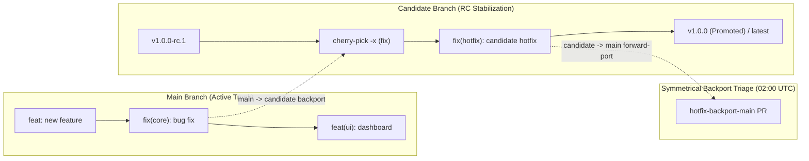

# Test Run: Two-Branch Release Cadence & Symmetrical Backport Triage

**Date**: 2026-09-28  
**Test Plan Reference**: `docs/test-plans/2026-09-28.md` §6 / `docs/release-candidate-management.md`  
**Target Branch**: `grain/task-956`  
**Environment**: Debian GNU/Linux 12 (bookworm), Linux x86_64 sandbox, Go 1.26.x, Git 2.39.5  

---

## 1. Executive Summary

This test run validates the Two-Branch Release Cadence and Symmetrical Backport Triage architecture for `bwsalmon/grain`. The verification confirms:

1. **Two-Branch Release Lifecycle & Semantic Tagging (`scripts/release-candidate-cut.sh`)**:
   - The repository operates on two primary branches: `main` (active trunk development) and `candidate` (release candidate stabilization), eliminating fragmented `rc/v*` branches.
   - Release candidate cuts (`v1.{X}.0-rc.{N}`) fast-forward `candidate` directly from `origin/main` and tag the base commit.
   - Cadence intervals (`RELEASE_INTERVAL_DAYS`, defaulting to 2 days) are strictly enforced; cuts prior to window expiration skip cleanly unless overridden with `FORCE=true`.
   - Previous candidate stabilization is promoted to production release tag `v1.{X-1}.0` with the `latest` pointer tag updated and draft GitHub Release notes synthesized.

2. **Scheduled Declarations Targeting `candidate` (`.grain/schedules/`)**:
   - All long-running, scheduled qualification runs, integration tests, and UI walkthroughs (`gcp-smoke.yml`, `nightly-features-test-plan.yml`, `nightly-granule-pull.yml`, `nightly.yml`, `prune-packages.yml`, `release-watchdog.yml`, `staging-state-cleanup.yml`, `staging-ui-exploration.yml`, `ui-walkthrough.yml`) declare `base: candidate` to continuously harden the active release candidate.
   - Trunk candidate cut schedule (`release-candidate.yml`) targets `base: main`.

3. **Symmetrical Backport & Forward-Port Triage (`scripts/backport-triage.sh`)**:
   - **Main to Candidate Backports**: Compares `origin/candidate..origin/main`, filters for Conventional Commit `fix:` commits, and cherry-picks onto `candidate` with `-x` provenance tracking.
   - **Candidate to Main Forward-Ports**: Compares `origin/main..origin/candidate`, identifies candidate hotfixes, and generates automated forward-port pull requests into `main`.
   - **Bidirectional Conflict Isolation**: When cherry-picks encounter merge conflicts in either direction, conflicting files are extracted, the index is cleaned via `git cherry-pick --abort`, a diagnostic branch (`backport-conflict-<sha>` or `hotfix-conflict-main-<sha>`) is created, and structured draft PR context is generated without corrupting repository state.
   - **Provenance Tracking & Loop Prevention**: Inspects `(cherry picked from commit <sha>)` and `Backported-from: <sha>` trailers to prevent re-triage loops or false hotfix detections.

4. **Deep RC Qualification Templates (`.grain/templates/`)**:
   - Verified qualification templates (`qualification-base-triage.yml`, `qualification-mergequeue.yml`, `qualification-ci-diagnostics.yml`, `qualification-system-smoke.yml`) declaring `base: candidate` and `auto-merge: true` for automated release hardening.

---

## 2. Architecture & Workflow Walkthrough

### A. Two-Branch Release Cadence Diagram

### B. Execution Walkthrough Scenarios

#### Scenario 1: Initial Release Candidate Cut & Cadence Verification
- Initial repository with base commit on `main`.
- Executed `scripts/release-candidate-cut.sh` with `FORCE=true`.
- Output: Fast-forwarded `candidate` from `main`, created tag `v1.0.0-rc.1`, verified no legacy `rc/v1.0` branch was created.
- Tested cadence guard: When running again without `FORCE=true`, detected candidate cut < `RELEASE_INTERVAL_DAYS` (2 days) and cleanly skipped.

#### Scenario 2: Promotion of Previous Candidate & New Candidate Cut
- Added new commits to `main`.
- Executed `scripts/release-candidate-cut.sh` with `FORCE=true`.
- Promoted previous candidate commit to `v1.0.0` and updated `latest` tag.
- Fast-forwarded `candidate` from `main` and tagged `v1.1.0-rc.1`.

#### Scenario 3: Symmetrical Backport Triage (`main -> candidate`)
- Merged `fix(dispatch): correct queue ordering for front tasks` and `feat(ui): implement dark mode navigation` on `main`.
- Ran `scripts/backport-triage.sh`.
- Result: Only `fix(dispatch)` was cherry-picked onto `candidate` with `-x` trailer; `feat(ui)` was ignored.

#### Scenario 4: Conflicting Backport Isolation (`main -> candidate`)
- Introduced divergence on `shared.txt` between `main` and `candidate`.
- Committed `fix(core): conflicting patch on shared file` on `main`.
- Ran `scripts/backport-triage.sh`.
- Result: Detected cherry-pick conflict, captured `shared.txt` as conflicting file, aborted cherry-pick cleanly, created diagnostic branch `backport-conflict-b236a591`, generated draft PR payload with author attribution, and left working tree clean.

#### Scenario 5: Clean Hotfix Forward-Port (`candidate -> main`)
- Committed `fix(hotfix): candidate critical patch` on `candidate`.
- Ran `scripts/backport-triage.sh`.
- Result: Identified candidate hotfix, created `hotfix-backport-main-<sha>` branch, cleanly cherry-picked with `-x`, and pushed forward-port branch.

#### Scenario 6: Conflicting Hotfix Forward-Port (`candidate -> main`)
- Introduced conflicting modifications to `shared_hotfix.txt` on both `main` and `candidate`.
- Committed `fix(shared): conflicting hotfix on candidate` on `candidate`.
- Ran `scripts/backport-triage.sh`.
- Result: Detected conflict on `main`, collected conflicting files, aborted cherry-pick, created `hotfix-conflict-main-<sha>`, emitted diagnostic markdown body, and preserved clean git state.

---

## 3. Flaws Identified & Resolutions

| Component | Defect / Gap | Resolution |
| :--- | :--- | :--- |
| `scripts/backport-triage.sh` | Section 2 (candidate hotfix triage) lacked symmetrical conflict isolation; on conflict, it aborted without creating diagnostic branches or draft PR payloads. | Added symmetrical conflict branch creation (`hotfix-conflict-main-<sha>`), conflicted files extraction, draft PR creation, and clean index restoration matching Section 1. |
| `tests/deploy/release_workflows_test.go` | Missing regression test coverage for symmetrical hotfix forward-porting, hotfix conflict isolation, schedule base target assertions, and qualification template checks. | Implemented `TestBackportTriageScript_SymmetricalHotfixForwardPortAndConflict`, `TestScheduledDeclarationsTargetCandidateBranch`, and `TestDeepRCQualificationTemplates`. |

---

## 4. Verification & Test Suite Matrix

| Test Function | Target Area | Status |
| :--- | :--- | :--- |
| `TestReleaseCandidateCutScript` | Two-branch RC cut, cadence interval, minor increment, promotion (`v1.0.0`, `latest`) | **PASS** |
| `TestBackportTriageScript` | Selective `fix:` triage vs `feat:` filtering, `-x` provenance tracking | **PASS** |
| `TestBackportTriageScript_ConflictHandling` | `main -> candidate` conflict detection, diagnostic PR context, clean tree | **PASS** |
| `TestBackportTriageScript_AutoDiscoveryOfCandidateBranch` | Automatic discovery of remote `candidate` ref without explicit config | **PASS** |
| `TestBackportTriageScript_SymmetricalHotfixForwardPortAndConflict` | Symmetrical `candidate -> main` hotfix PRs and conflicting forward-port isolation | **PASS** |
| `TestScheduledDeclarationsTargetCandidateBranch` | Verifies scheduled maintenance/qualification in `.grain/schedules/` target `candidate` | **PASS** |
| `TestDeepRCQualificationTemplates` | Verifies qualification templates declare `base: candidate` and `auto-merge: true` | **PASS** |
| `TestAgentCommitStandardsDocumented` | Conventional Commits standards documented across repo prompt & settings | **PASS** |

All tests pass deterministically (0.92s).
