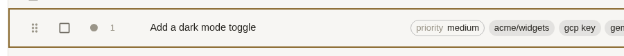
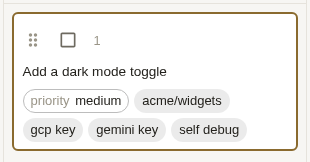
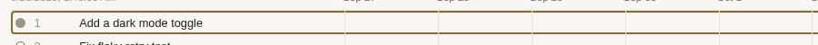
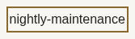
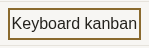
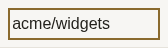

# 2026-10-02 §8 on `candidate`: keyboard row opening and the 2026-10-01 walkthrough fixes

Plan: `docs/test-plans/2026-10-02.md` §8. Task: grain/task-1580 (filed by task 1528).
Run: 2026-10-03, 01:30–02:00 UTC.

## Environment

- Tree under test: `origin/candidate` at `0621729b2`, which contains `cf9d6156c`.
  `git branch -r --contains c1d899b68` lists `origin/candidate`, `origin/main` and both merge-queue branches, so every commit named in §8 is in the build.
- Server: `grain demo -addr 127.0.0.1:0 -open=false` on its embedded SQLite store.
  The e2e fixture builds and starts one per Playwright worker (`ui/e2e/fixtures.js`). A standalone demo was used for the API probes.
- UI: the production bundle, built with `cd ui && npm ci && npm run build` into `pkg/ui/static`.
- Browsers: Playwright with `PLAYWRIGHT_BROWSERS_PATH=/var/cache/playwright`, using Chromium 1234 and WebKit 2336.
- Sandbox: 4 vCPU. Playwright's default is 2 workers.

### Stubs

| Boundary | Stub | Where |
| --- | --- | --- |
| GitHub | `grain demo`'s built-in githubsim and seeded rows. Its branch list for `acme/widgets` is empty (`GET /api/repos/acme/widgets/branches` → `[]`). | everything |
| Live model sessions | None needed. Demo never dispatches, so "actually used" was checked with the dispatch-level Go tests (see step 5). | step 5 |
| Executor listener | Demo has none (`/_grain/executor` → 503 "remote execution is not enabled"). For the CLI check, a throwaway harness (not committed) ran the real `modelexec.Server` over a real SQLite store. The real `grain executor` binary was pointed at it. | step 6 |

Grain's own APIs and React were not mocked anywhere.

## Commands

```sh
cd ui && npm ci && npm run build
export PLAYWRIGHT_BROWSERS_PATH=/var/cache/playwright
# step 7: every walkthrough spec as one batch, then all on one shared store
npx playwright test --project=chromium $(ls e2e/*walkthrough*.spec.js)
npx playwright test --project=chromium --workers=1 $(ls e2e/*walkthrough*.spec.js)
# steps 2-5: this run's spec, in both engines
npx playwright test --project=chromium e2e/candidate-keyboard-walkthrough.spec.js
npx playwright test --project=webkit   e2e/candidate-keyboard-walkthrough.spec.js e2e/keyboard-open-rows.spec.js
# step 5 dispatch side, step 6 regression
go test ./cmd/grain/ -run 'AgentFramework|TeamDefault' -count=1
go test ./pkg/modelexec/ -count=1
```

## Outcomes

### 2. Keyboard-only pass

For each list, focus started on `<body>`. The test pressed Tab until the row's way in had focus, checked it for `:focus-visible` with a drawn outline, opened it with a key, then pressed Back.

| List | Way in (role and name) | Key | Opens | Focus after browser Back | Focus after the page's own Back |
| --- | --- | --- | --- | --- | --- |
| Tasks (list) | `.task-row`, tab stop | Space and Enter | `/tasks/:id` pane | on the row ✅ | n/a (pane) |
| Kanban | `link` "1 Add a dark mode toggle …" | Enter | `/tasks/:id` | on the card ✅ | n/a |
| Timeline | `listitem` | Space and Enter | `/tasks/:id` | on the row ✅ | n/a |
| Boards | `link` board name | Enter | `/boards/:id` page | **`<body>` ❌ → on the link after fix** | **`<body>` ❌ → on the link after fix** |
| Templates | `link` template name | Enter | `/templates/:id` pane | on the link ✅ | (pane closes, MUI restores) ✅ |
| Suites | `link` suite name | Enter | `/suites/:id` pane | on the link ✅ | ✅ |
| Suite runs | `link` suite name | Enter | `/suites/runs/:id` pane | on the link ✅ | ✅ |
| Schedules | `link` schedule title | Enter | `/schedules/:id` pane | on the link ✅ | ✅ |
| Repos | `link` "acme/widgets" | Enter | `/repos/acme/widgets` page | **`<body>` ❌ → on the link after fix** | **`<body>` ❌ → on the link after fix** |

- The focus ring is a 2px solid outline, `rgb(138, 106, 46)`, everywhere.
- Task rows, kanban cards and timeline rows draw it inset (`outline-offset: -2px`), as `c1d899b68` intended.
- Tab counts from `<body>` to the first row were between 29 and 40, because the sidebar comes first.
- The rows that are links open on Enter only, which is the native behaviour of a link. Space on a link scrolls the page.
- The rows that were tab stops (task row, kanban card, timeline row) opened on both keys at `0621729b2`.
- Update, 2026-10-03: while this branch waited in the merge queue, `75b851b18` (task 1582) landed on `candidate`. It replaced those row tab stops with a title link on each row, the same `RowLink` the other lists use. The spec now reaches all three by their title link, opens them with Enter and checks focus after Back, and passes in Chromium and WebKit on the merged tree. The task-row, kanban-card and timeline-row screenshots below show the earlier row-level ring.

Screenshots of focus states (Chromium, 1280×900, cropped to the element):

| | |
| --- | --- |
| Task row  | Kanban card  |
| Timeline row  | Template link after Back  |
| Board link after Back (fixed)  | Repo link after "← Repos" (fixed)  |

### 3. Base branch `no-such-branch` on task, schedule and template

| Writer | `no-such-branch` | `no such branch ..lock` |
| --- | --- | --- |
| Task (New task form and `POST /api/tasks`) | **201, filed** | 400 |
| Schedule (New schedule form and `POST /api/schedules`) | **201, created** | 400 |
| Template (New template form and `POST /api/templates`) | **201, created** | 400 |

- Each 400 says `base "no such branch ..lock" is not a usable branch name: use letters, digits, '.', '_', '-' and '/' only, starting with a letter or digit, with no '..', '//' or trailing '/'`.
- All three forms show the 400 the same way. It appears as the app's error snackbar (`role="alert"`, outside the modal). It is not shown as an inline error on the Base branch field, and the field is not marked `aria-invalid`.
- Each form stays open with the typed value kept.
- `f7b4a43ed` validates the *shape* of the name (`model.ValidBranchName`), which is what it set out to do. A well-formed branch that does not exist on the repo is still accepted by all three writers.
- On a real deployment, that `no-such-branch` task fails only at dispatch, and a schedule with it files a doomed task on every firing. That is finding F2.

### 4. A board linking a deleted schedule

- A board cannot link a schedule. `model.Board` has a query, Kanban columns, panels and report sections, and none of them names a schedule. The task filters have only an origin of "Scheduled", not which schedule. Tasks carry no link back to the schedule that filed them.
- So the plan's case was exercised as the nearest real thing: a schedule's deep link that someone keeps (in a board description, a bookmark or a chat), followed after deletion.
- Steps: create a board and a schedule, delete the schedule, open the board, then navigate in-app to `/schedules/<deleted id>`.
- Result ✅: the app shows `no schedule "sched-N"`, the URL is corrected to `/schedules` in place (`replaceState`, from `5c08a7ad4`), and one Back returns to the board.

### 5. Team model default

- Setup: team `kw-models-…` with `defaultModel: gemini-2.5-flash`. The demo's only backend is `gemini-pro` (Gemini 2.5 Pro).

| Task | Pane's Model row |
| --- | --- |
| Named nothing | `gemini-2.5-flash (team default)` ✅ |
| Named a model (`agentBackendId: gemini-pro`) | `Gemini 2.5 Pro`, with no "team default" ✅ |
| Filed from a template, naming a model at filing | `Gemini 2.5 Pro`, with no "team default" ✅ |

- Templates have no model or framework field (`model.Template`, `ui.CreateTemplateRequest`), so "a template naming a model" can't be set up. The third row is the closest real case.
- "Actually used":
  - The pane's rule matches dispatch's in `cmd/grain/daemon.go`. The team's framework, backend and model are taken whole, and only when the task named none.
  - A task's own `AgentChoice.Model` is never filled from the task (`pkg/orchestrator/cycle.go`), so "a task naming a model" means `agentBackendId` on both sides.
  - `TestAgentFrameworksTeamDefaultModelAndBackend`, `TestAgentFrameworksAppliesTheTeamsDefaults` and `TestAgentFrameworksBuildsTheModelATaskNamed` pass on this tree.

### 6. Archived team's executor token

- API ✅:
  - `POST /api/executors/tokens {"team":"wt-arch"}` after archiving returns 400 `team "wt-arch" is archived`.
  - `{"team":"no-such-team"}` returns 400 `team "no-such-team" does not exist`.
- CLI ❌ before the fix:
  1. Mint a token while `wt-arch` is live, then archive the team.
  2. Run `grain executor -server <listener> -token <it> -team wt-arch -binary agy=/bin/sh` and get:

     ```
     modelexec: connected to 127.0.0.1:37383 as wt-host (team wt-arch)
     ```

  3. The server logs `wt-host … team wt-arch connected, offering agy`, and the executor then sits idle. No work can ever reach an archived team. This is the silent failure `9d1ca7304` set out to remove, but that commit only refuses at minting. That is finding F1.
- After the fix:

  ```
  modelexec: connection error: handshake rejected: authentication failure: team "wt-arch" is archived; reconnecting in 1s
  ```

  The server logs `authentication failure from … (team "wt-arch" is archived)`. The CLI keeps retrying with backoff, as it already does for a revoked token.

### 7. 2026-10-01 walkthrough specs together

All 23 `ui/e2e/*walkthrough*.spec.js` files were run as one batch on the candidate bundle, before this run's fixes. None failed together, and nothing needed running alone.

| Run | Result |
| --- | --- |
| 2 workers (a demo server each) | 80 passed, 3.1 min |
| `--workers=1` (all 23 files on one shared store) | 80 passed, 4.0 min |

## Findings

- **F1 (bug, fixed):** an executor token minted for a team that is later archived still authenticates. `grain executor` connects and is never handed work. Reproduced deterministically with the real CLI (step 6).
- **F2 (gap, not fixed, follow-up):** a base branch that is well formed but not on the repo (`no-such-branch`) is accepted by the task, schedule and template writers. `f7b4a43ed` checks the shape only. Checking existence at write time needs a GitHub ref lookup per write, plus a decision on what to do when GitHub is unreachable or the branch is created later (release branches are). That is a design call, not a scoped fix.
- **F3 (bug, fixed):** Boards and Repos open a page in place of the list. Back, either the browser's or the page's own "← Boards" / "← Repos", left focus on `<body>`, so a keyboard user started again from the top. Reproduced on every attempt by the new spec against the candidate bundle.
- **F4 (UX, not fixed):** base-branch refusals appear as a snackbar alert rather than inline on the Base branch field. The message is announced (`role="alert"`) but not tied to the field.
- **F5 (a11y, not fixed):** on /suites, a suite's row link and each of its runs' row links have the same accessible name (the suite's name). A screen reader's links list cannot tell the suite from its runs.
- **F6 (a11y, minor, not fixed):** opening a board or repo page leaves focus on `<body>`, rather than on the page heading or its "← Back" button. The next Tab starts at the sidebar.
- **F7 (plan):**
  - Step 4's "board links a schedule" is not something a board can hold.
  - Step 5's "template naming a model" is not something a template can hold.
  - Both were exercised by their nearest real case, as described above.

## Fixes

- `fix(executors): refuse an executor whose token's team was archived after minting` (F1).
  - `pkg/modelexec/server.go`: the store-backed handshake looks up the token's team and refuses it if the team is archived. A team the store has no row for is not refused: several existing suites (`pkg/modelexec`, `tests/e2e`) and stores without team rows mint tokens for teams they never create, and the first push of this fix that refused those broke them. Minting already refuses unknown teams. A store error is not treated as a refusal either.
  - Regression test: `TestStoreBackedTokenForArchivedTeamIsRefused`, using the real `Daemon` client and the real SQLite store. It fails on candidate.
  - The existing revocation test now creates the teams its tokens name.
  - `pkg/modelexec` is on the executor trust boundary, so a security-review hold is expected.
- `fix(ui): return focus to a board or repo row after coming Back` (F3).
  - `RowLink` (`ui/src/components/ListPrimitives.jsx`) remembers the href it opened. When it mounts again with nothing focused, it takes focus back, once.
  - Unit test in `BoardsPage.test.jsx`.
- `test(ui): walk §8 …`:
  - `ui/e2e/candidate-keyboard-walkthrough.spec.js` covers steps 2–5.
  - It runs in Chromium and WebKit; it was added to the WebKit project's `testMatch`.
  - On the candidate bundle it fails at "/boards Enter" (focus not on the link after Back). With the fix it passes in both engines.

## Follow-ups

- F2: decide whether writers should check a base branch against GitHub refs, warn instead of refusing, or leave it. Proposed as a task.
- F4–F6: small a11y polish, noted here rather than filed.
- No grain/config change is needed.

## Merge-queue follow-up (2026-10-03)

The first merge-queue run on `candidate` at `11606c9` failed for two reasons, both caused by `candidate` moving after this branch was pushed:

- `go vet`: `Daemon.runOnce` had gained a `binaries map[string]string` parameter, so the new modelexec test's trailing `""` became `nil`.
- `ui e2e`: the task-row case could no longer reach the row by Tab, because of task 1582 above.

Both are fixed on the branch after merging `candidate`. The branch's own CI on the merged tree then showed that refusing tokens for *missing* teams broke three existing tests that mint tokens for teams they never create (`TestMCPGrantsDoNotPassToAnotherConnectionClaimingTheSameID`, `TestExecutorTokenCannotEvictAnotherTokensInstance`, `TestRemoteExecutorsRelayPoolAndConcurrencyWalkthrough`). The refusal was narrowed to archived teams.

## Known flakes

None hit during this run.
