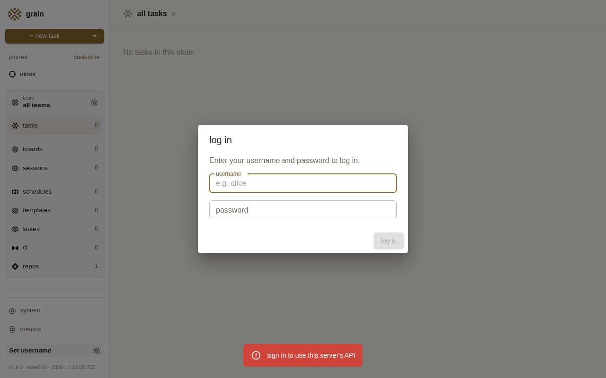
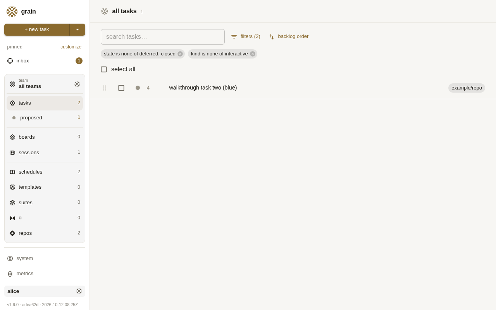
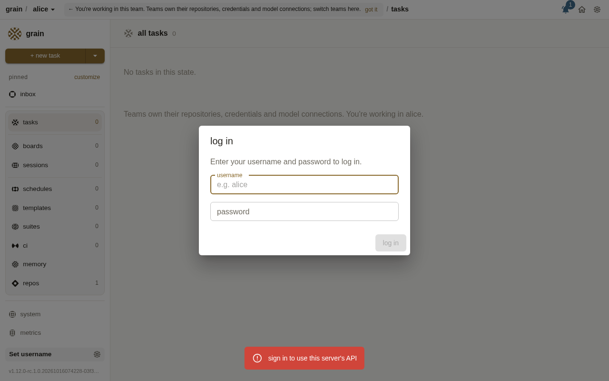
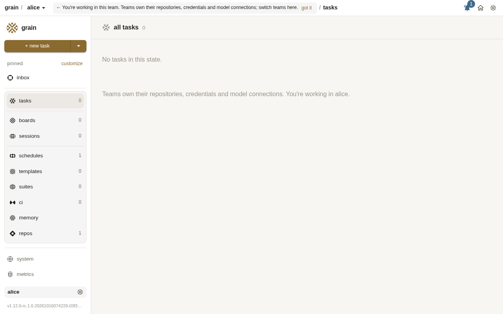
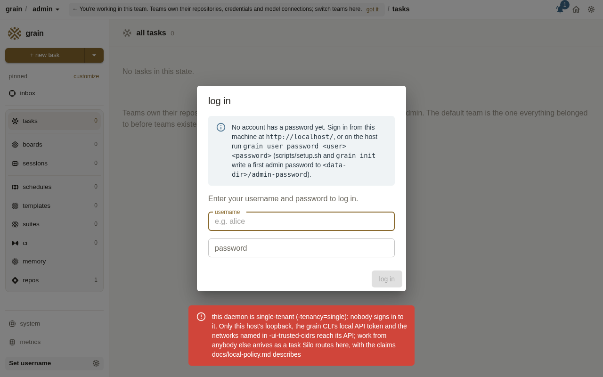

# 2026-10-16: shared-host install, re-run, upgrade, rollback and uninstall walkthrough

Task 4345. An operator's walk through `scripts/setup.sh` (container and host
mode), `grain init`, channel switches, a rollback and an uninstall, on
throwaway Debian 12 VMs in `bsalmon-fun-sandbox`.

## Setup

| | |
|---|---|
| VMs | `grain-wt-4345` (container mode, flows 1-5, 8, 9), `grain-wt-4345-host` (flow 6), `grain-wt-4345-init` (flow 7). All three `e2-standard-2`, `debian-12`, 30 GB disk, labelled `purpose=grain-walkthrough`, all **deleted** at the end along with the firewall rule |
| Network | a firewall rule opening tcp:4242 to the sandbox's own egress IP only, so the "another machine" is the sandbox, reaching the VM by its external IP and its external name `54.213.154.104.bc.googleusercontent.com` |
| Installer | `scripts/setup.sh` from main at 03f3da597, copied over with `git archive` (what an operator gets from `git clone`, as the README says) |
| `latest` | `ghcr.io/bwsalmon/grain/grain:latest` = **v1.9.0** (adea62d, 2026-10-12) |
| `main` | `ghcr.io/bwsalmon/grain/grain:main` = 03f3da5 (2026-10-16 07:42Z), which carries `-tenancy` (4e944ea7d), tenancy auto (4175) and identity-header trust (4338) |
| Credentials | none: no GitHub token, no agent key. Tasks were filed (with a dummy team token so filing is allowed) but nothing was dispatched |
| Screenshots | Playwright 1.62 (Chromium headless) from the sandbox, through the VM's external address. The browser download needed `NODE_EXTRA_CA_CERTS=/usr/local/share/ca-certificates/grain-ca.crt` |

`-tenancy` and `grain user bootstrap-admin` are **only on main**, not on
`candidate` (v1.12.0-rc.1) or `latest`. That drift explains most of flow 1.

## Results

| # | Flow | Result |
|---|---|---|
| 0 | `sudo ./scripts/setup.sh` as the README says | **FAIL**, fixed in this PR: `scripts/setup.sh` has been mode 100644 since a4a39e1a7 (2026-09-14), so `sudo ./scripts/setup.sh` is `command not found`. `bash ./scripts/setup.sh` was used from then on |
| 1 | Fresh install, container mode, `GRAIN_CHANNEL=latest` | **FAIL**: daemon up, but `-tenancy` ignored and **no admin account** (`unknown user subcommand "bootstrap-admin"`). The fix the readiness report prints fails the same way. Sign-in page OK. Second user and team added by hand |
| 2 | Re-run unchanged | **PASS**: same channel, address, hosts, users, teams, tasks and admins (state diff identical). The stale "no sign-in account was set up for debian" line is repeated |
| 3 | Upgrade by `GRAIN_CHANNEL=main` | **PASS** (data). Users, teams, admins, tasks and settings survive. `tenancy: multi (set by -tenancy)`. With `GRAIN_TENANCY=auto`: `tenancy: multi (this installation already has sign-in accounts)`. Running-task drain **not tested** (no agent credential), and docs/non-disruptive-upgrade.md is marked "Proposal ... most of this has not been built", so it promises nothing for a setup.sh re-run |
| 3b | Re-run without `GRAIN_TENANCY` after `auto` | **FAIL**: unit silently rewritten to `-tenancy multi` |
| 4 | Old-style unit (no `-tenancy`) on main | **PASS**: `tenancy: multi (this installation already has sign-in accounts)`, everyone can still sign in |
| 5 | Roll back to `latest` | **PASS** at equal schema (17 to 17): all data kept, and a clear unit/image drift warning. **FAIL** across a schema change: users and tasks gone, teams kept, nothing in the readiness report |
| 6 | Host mode: fresh, re-run, upgrade | **FAIL**: fresh install has the same admin gap as flow 1. A bare re-run **switches the deployment to container mode** silently, after which the admin is lost (`"operator" does not have administrator privileges`). With `GRAIN_INSTALL_MODE=host` passed again, the upgrade to main is fine and creates the admin |
| 7 | `grain init` fresh install | **FAIL**: comes up **single**-tenant, then fails its own admin-password steps (exit 10) with a fix command that cannot work. Defaults differ from setup.sh (table below) |
| 8 | Access by external name, 421, follow its advice | **PASS with a confusing message**: the 421 names a daemon flag; re-running setup.sh with `GRAIN_UI_ALLOWED_HOSTS` fixed it |
| 9 | Uninstall as documented | **FAIL**: no uninstall is documented anywhere. A manual one leaves about 5.7 GB of images, data, the user, masked sleep targets and more |

## Flow 1: fresh install from `latest` (container mode)

```
$ sudo ./scripts/setup.sh
sudo: ./scripts/setup.sh: command not found          # mode 100644, see flow 0
$ sudo GRAIN_CHANNEL=latest bash ./scripts/setup.sh
==> UI/API address: 0.0.0.0:4242 (the default for a fresh install)
==> UI/API allowed hosts: grain-wt-4345.us-central1-a.c.bsalmon-fun-sandbox.internal,grain-wt-4345 -- this machine's own names
==> installing docker (... no Debian cloud image carries it)
==> WARNING: this unit passes -tenancy, which ghcr.io/bwsalmon/grain/grain:latest does not define.
==>   could not set up debian as a system admin: ... grain: unknown user subcommand "bootstrap-admin"
    channel:           latest (GRAIN_CHANNEL=latest, as given)
    !! no sign-in account was set up for debian -- run on this host:
       sudo -u grain grain user bootstrap-admin -password-file /var/lib/grain/admin-password debian
exit=0
$ sudo -u grain grain user list
No users configured.
```

The suggested `bootstrap-admin` command does not exist in v1.9.0. The way in
was the loopback-trusted API: `grain user add debian --password ...`,
`grain user add alice --password ...`, then `PUT /api/settings
{"adminAccounts":["operator","debian"]}` and `POST /api/teams {"name":"blue"}`
with alice as a member. A first `PUT` with `["debian"]` alone dropped
`operator`, and the trusted loopback lost admin with it. v1.9.0 gives each
user a personal team.

Sign-in page from another machine (external IP), and alice signed in:




## Flows 2-4: re-run, upgrade to main, tenancy

The state snapshot after each step (users, team membership, admins,
walkthrough tasks, unit flags, schema, password sign-in for both users):

```
users: alice debian
teams: [('alice', ['alice']), ('blue', ['alice', 'operator']), ('debian', ['debian']), ('default', ['operator'])]
admins: ['operator', 'debian']
3      proposed        example/repo             walkthrough task one
4      proposed        example/repo             walkthrough task two (blue)
unit flags: -ui-addr 0.0.0.0:4242 -ui-allowed-hosts grain-wt-4345...internal,grain-wt-4345 -tenancy multi
schema: 17
debian pw sign-in: {"authenticated":true,"user":"debian"}
alice pw sign-in: {"authenticated":true,"user":"alice"}
```

- Re-run (flow 2): `UI/API address: keeping 0.0.0.0:4242 from the installed ...`,
  `channel: latest (kept: /etc/grain/image.env already runs ...:latest ...)`, and the snapshot diff was
  **identical**.
- `GRAIN_CHANNEL=main` (flow 3): the only diff was `image.env`. `debian
  already has a password, left as it is` / `debian was already a system
  admin`. Daemon log: `tenancy: multi (set by -tenancy)`. The readiness
  report says the first password "is in /var/lib/grain/admin-password", which
  was never written.
- `GRAIN_TENANCY=auto`: `tenancy: multi (this installation already has sign-in accounts)`.
- Flow 4: `-tenancy` removed from the unit by hand (the shape a pre-`-tenancy`
  installer wrote), then `systemctl restart`: `tenancy: multi (this
  installation already has sign-in accounts)`, and both users still sign in.
  A bare `setup.sh` re-run then writes `-tenancy multi`. That's right here, but the
  same code also turns an installed `auto` or `single` into `multi` with no
  log line (flow 3b).

Signed in by the external name on main (after flow 8's fix):




## Flow 5: rollback

`GRAIN_CHANNEL=latest` back from main: v1.9.0 again, and the snapshot is
unchanged apart from `image.env` and a new `team-state-repos/` directory. The
daemon warns clearly:
`this host's grain-daemon.service and this image disagree -- an upgrade or a
rollback moved one without the other ...`. Both builds are at schema 17, so
nothing written by main was lost.

A rollback (or upgrade) **across a schema change** was simulated by writing `16`
into `/var/lib/grain/.schema_version` and re-running:

```
==> Schema changed (16 -> 17) -- moving /var/lib/grain/store aside to /var/lib/grain/store.schema16-20261016075657 so grain starts a fresh store
==> Schema changed -- moving the state repository aside as well; grain re-seeds it on its next start
exit=0
users:
teams: [('alice', ['alice']), ('blue', ['alice', 'operator']), ('debian', ['debian']), ('default', ['operator'])]
tasks: 0 walkthrough tasks
debian pw sign-in: {"error":"invalid username or password"}
```

Users and tasks were gone, while teams (rebuilt from `team-state-repos`) still listed
the vanished users. The readiness report says nothing. Restoring by hand
worked (stop, move `store.schema16-*` and `state-repo.schema16-*` back, write
`17`, start). docs/non-disruptive-upgrade.md only says "a rollback meets a
store it can still read", about run hosts, and nothing documents setup.sh's
store reset or how to undo it.

## Flow 6: host mode

`sudo GRAIN_INSTALL_MODE=host GRAIN_CHANNEL=latest bash ./scripts/setup.sh`
gave `deployment: host process -- grain-daemon.service runs
/usr/local/bin/grain as grain`, with the same `-tenancy` and `bootstrap-admin` gap
as flow 1. In addition, v1.9.0's CLI ignores `/etc/grain/cli.env`:
`grain user add` goes to `http://127.0.0.1:8420` (connection refused).

A bare re-run (`sudo bash ./scripts/setup.sh`, as the update path says) printed
`deployment: container -- grain-daemon.service is a docker run of the image
below`: the deployment had been **converted to container mode** without a
word. The upgrade to main on top of that:

```
==>   could not set up debian as a system admin: grain: listing users: user "operator" does not have administrator privileges
$ curl localhost:4242/api/settings | ...adminAccounts
['grain']
```

(Host mode seeds the OS user `grain` as admin, and the container CLI is `operator`.)
Re-running with `GRAIN_INSTALL_MODE=host` restored host mode, and on main the
admin step worked: `debian: created, with the password in
/var/lib/grain/admin-password`, `debian is now a system admin`, `tenancy:
multi (set by -tenancy)`.

## Flow 7: `grain init` (main binary, `-platform=linux-container`)

The main `grain` binary was copied out of `ghcr.io/bwsalmon/grain/grain:main` into
`bin/grain` of a checkout. `grain init -dry-run` still demanded `make` and node/npm
(`make build` runs regardless of a prebuilt binary), so they were installed
with apt (node 18) and the build ran.

```
[done]    choose the UI/API address   -ui-addr 0.0.0.0:4242 ...; -ui-allowed-hosts grain-wt-4345-init, this machine's own names ... only loopback is trusted without signing in, so every account needs a password
[done]    start the daemon
[manual]  provision the admin account's password   POST .../api/auth/register: Not Found: {"error":"this daemon is single-tenant (-tenancy=single): it keeps no sign-in accounts, ..."}
[manual]  make -admin-user a system admin           (same)
Run these, then re-run this command:
  curl -s -X POST http://127.0.0.1:4242/api/auth/register ...       # cannot work in single mode
exit=10
daemon log: tenancy: single (a new installation, with no accounts or teams)
```

`/var/lib/grain/admin-password` and `admin-password.debian` are left behind
anyway. From another machine, the API says `this daemon is single-tenant
(-tenancy=single): nobody signs in to it ...`, but the browser shows an empty app
with no explanation:



| default on a fresh install | `scripts/setup.sh` | `grain init` |
|---|---|---|
| tenancy | `multi` | no flag, so `auto`, so **single** |
| address | `0.0.0.0:4242` | `0.0.0.0:4242` |
| allowed hosts | FQDN and short name | **short name only** |
| loopback trust | true | true |
| admin | `$SUDO_USER` via `bootstrap-admin` | `-admin-account` and `-admin-user`, both fail in single mode |
| docker | Debian `docker.io` | Docker's `docker-ce` repo |
| channel | `latest` image | whatever the checkout builds |

## Flow 8: another machine, the Host check and the 421

From the sandbox (outside GCP):

```
http://104.154.213.54:4242/api/tasks                           401 {"error":"sign in to use this server's API"}   (IP literals are always allowed)
http://54.213.154.104.bc.googleusercontent.com:4242/api/tasks  421 {"error":"host 54.213.154.104.bc.googleusercontent.com:4242 is not one this grain daemon answers to; if it should be, start the daemon with -ui-allowed-hosts naming it"}
```

A setup.sh operator doesn't start the daemon. The installer form of that advice is
`GRAIN_UI_ALLOWED_HOSTS`:

```
$ sudo GRAIN_CHANNEL=main GRAIN_UI_ALLOWED_HOSTS=54.213.154.104.bc.googleusercontent.com bash ./scripts/setup.sh
==> UI/API allowed hosts: 54.213.154.104.bc.googleusercontent.com (as given)
                       Host names allowed: 54.213.154.104.bc.googleusercontent.com
external name -> 401 sign in;  IP -> 401;  Host: grain-wt-4345 -> 401 (machine names stay allowed, though the report no longer lists them)
```

## Flow 9: uninstall

No uninstall is documented (README, docs/grain-init*.md, `setup.sh --help`,
`grain` CLI). Disabling and stopping every `grain*` unit and deleting the unit files
left:

```
/etc/grain  /usr/local/bin/grain  /usr/local/bin/granule  /usr/local/lib/grain
/var/lib/grain (6.7M: store, secrets, secrets.key)  /var/lib/grain-sandbox
user/group grain (999/994)
images: grain:main 1.72GB, grain:latest 1.72GB, k8s-sandbox x2 1.11GB each
masked: hibernate.target hybrid-sleep.target sleep.target suspend.target
/etc/systemd/logind.conf.d/10-grain-no-suspend.conf
the docker.io package
```

The metadata-blocking iptables rule went away with `grain-block-metadata.service`.

## Bugs filed

Filed from this run in priority order, with the data-loss and upgrade-breaking ones at the front of the queue:

1. setup.sh re-run silently switches a host-mode install to container mode (and rewrites `-tenancy`), breaking the admin account (flows 3b and 6).
2. setup.sh: a schema-version change empties the live store (users and tasks gone, teams kept) with no warning in the readiness report (flow 5).
3. setup.sh from main + the default `latest` image (v1.9.0): fresh install leaves no admin account, and its own fix command doesn't exist (flows 1, 2 and 6).
4. grain init: a fresh install comes up single-tenant, then fails its own admin-password steps (exit 10); defaults disagree with setup.sh (flow 7).
5. Document (or script) uninstalling a setup.sh deployment (flow 9).
6. The 421 advice names a daemon flag rather than the installer setting; README still calls Grain single-operator; a stale admin-password hint (flows 1, 3 and 8).

Fixed in this PR: `scripts/setup.sh` is executable again (flow 0).

## Not covered

- Running tasks across an upgrade: no agent credential was available, so nothing was
  dispatched. See `2026-10-15-upgrade-adopts-live-claude-run.md` for the
  Upgrade-button path.
- A real schema bump: `latest` and `main` are both at schema 17, so it was simulated
  with the marker file.
- The UI's Upgrade button, Tailscale, IAP and `-ui-trust-identity-headers`.
