# One page header rail (task 4915), before and after

Run on 2026-10-20 against the real `grain demo` server built by the e2e
global setup (`ui/e2e/global-setup.js`), with Playwright's Chromium at
1280x640 (and 760x640 for the narrow window), in both colour schemes
(`emulateMedia({ colorScheme })`). "Before" is `origin/main` at 1a69637;
"after" is this branch. Nothing was stubbed.

| Page | Before | After |
| --- | --- | --- |
| Tasks, light | 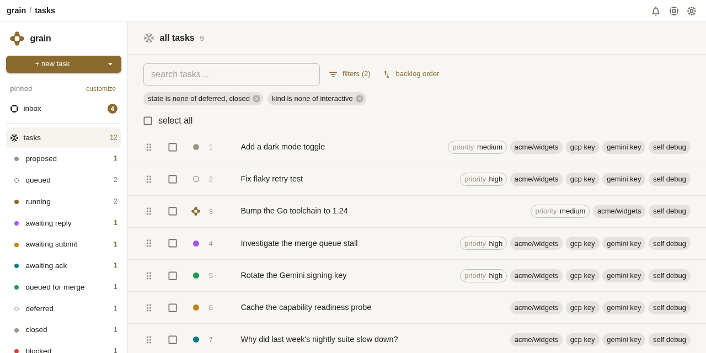 | 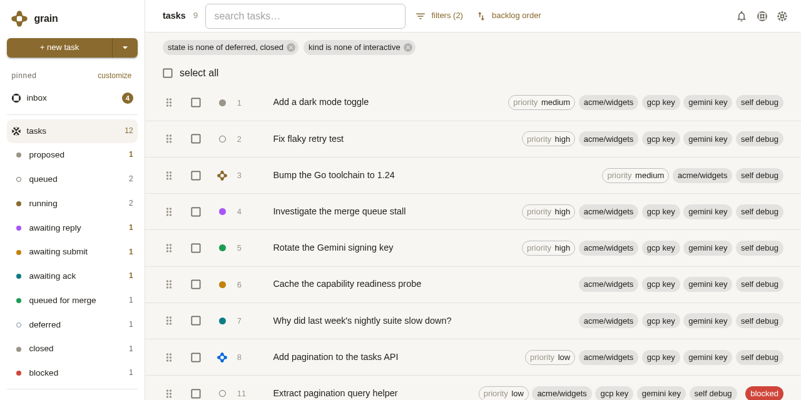 |
| Tasks, dark | 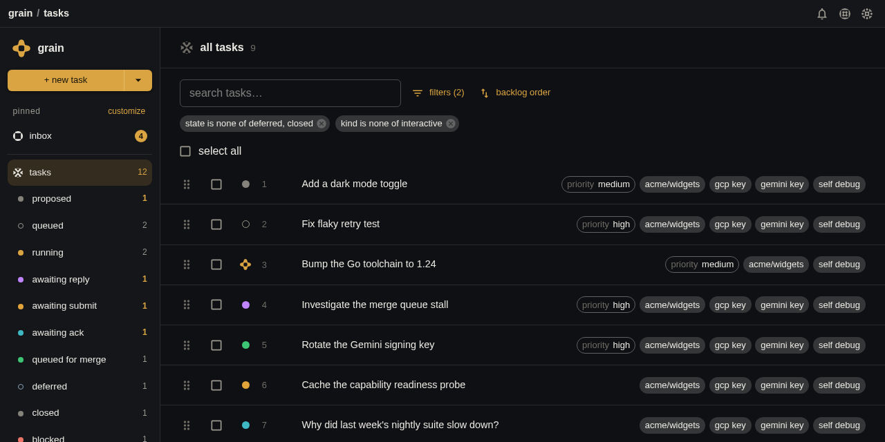 | 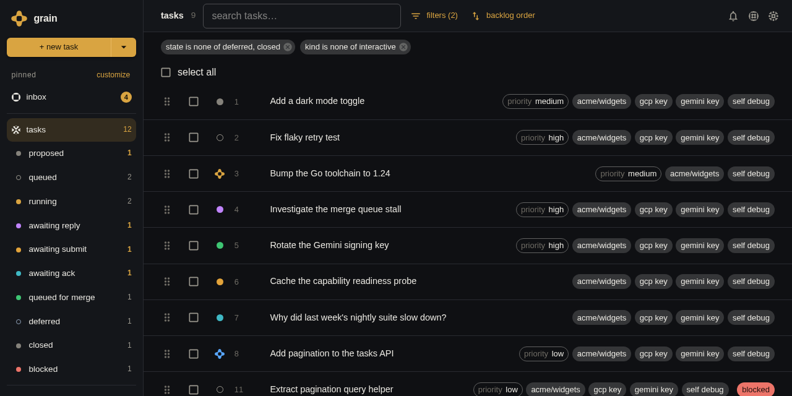 |
| A repo, light | 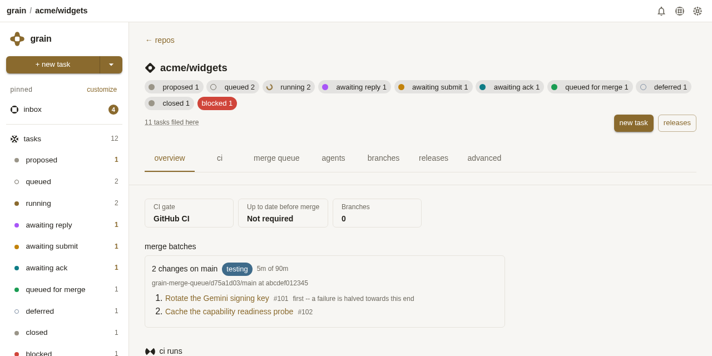 | 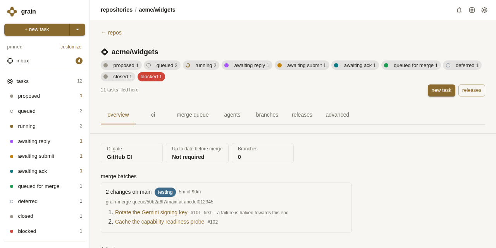 |
| Director session, light | 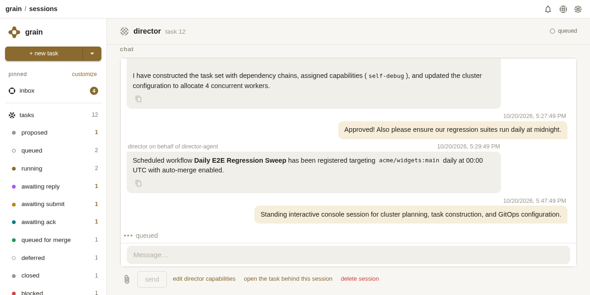 | 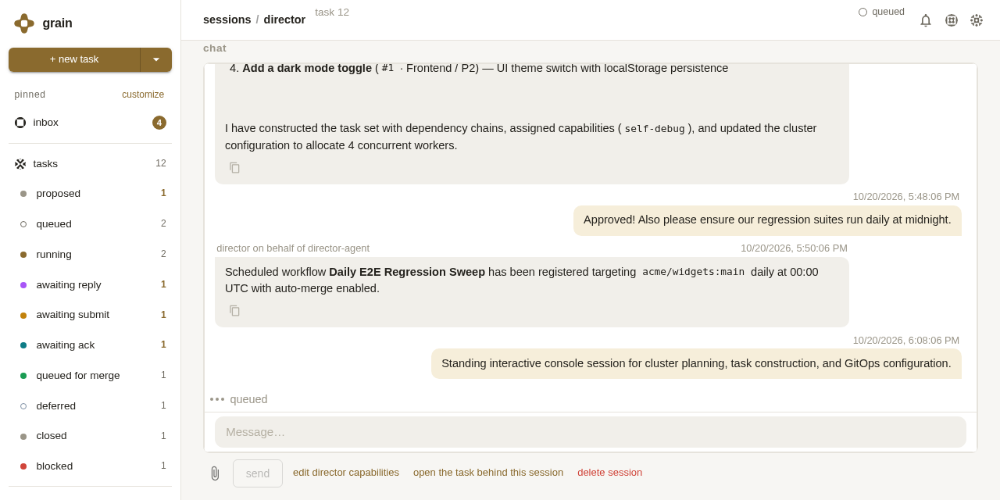 |
| Director session, dark | 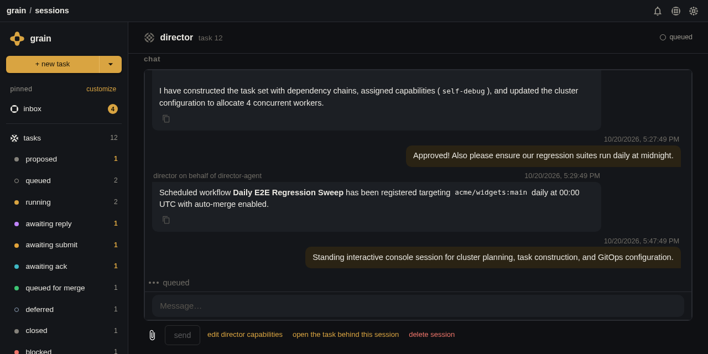 | 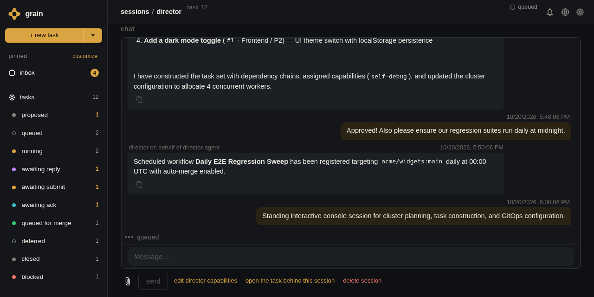 |
| Settings, light | 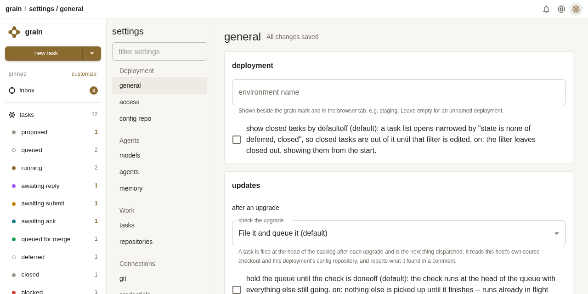 | 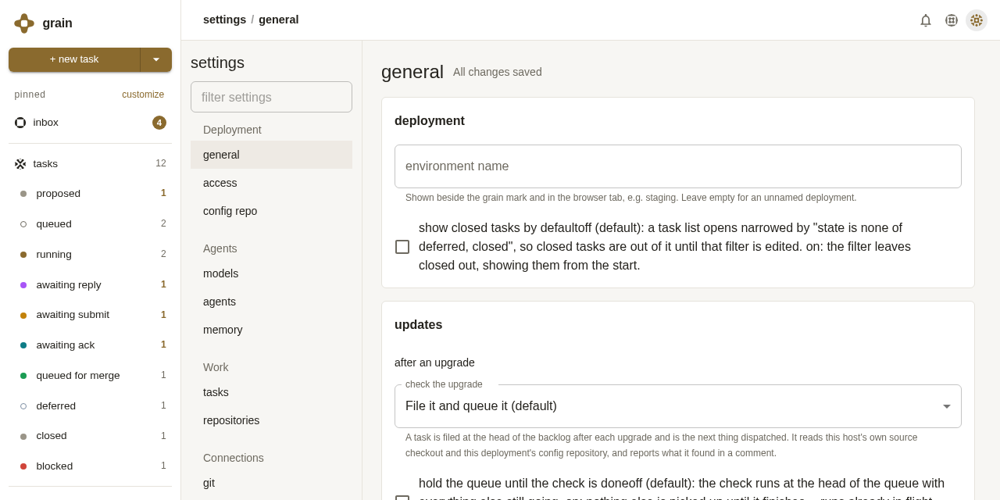 |
| Settings, dark | 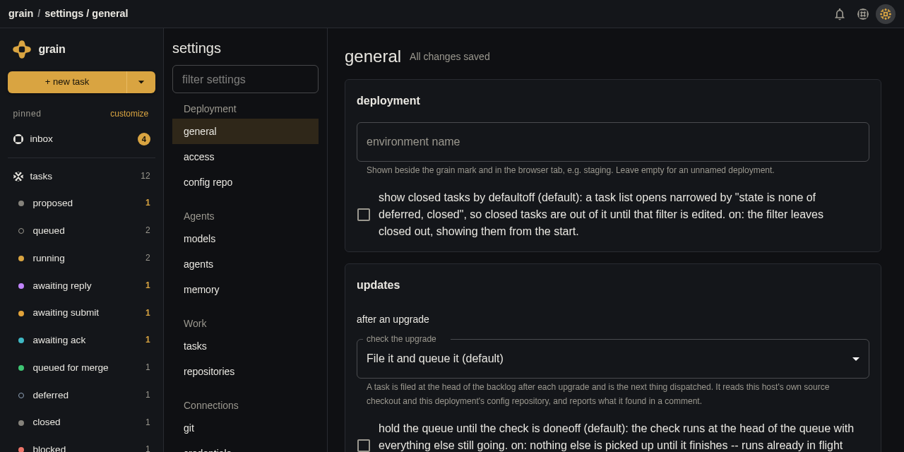 | 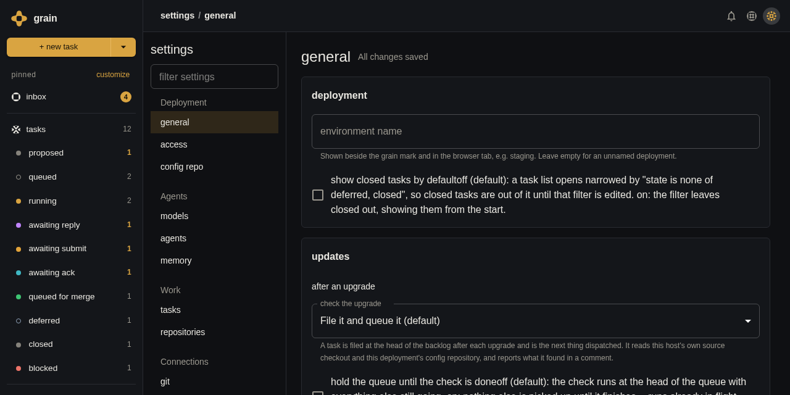 |
| Processes, 760px | 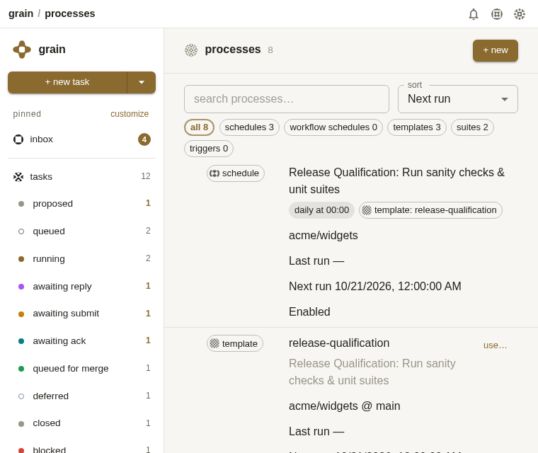 | 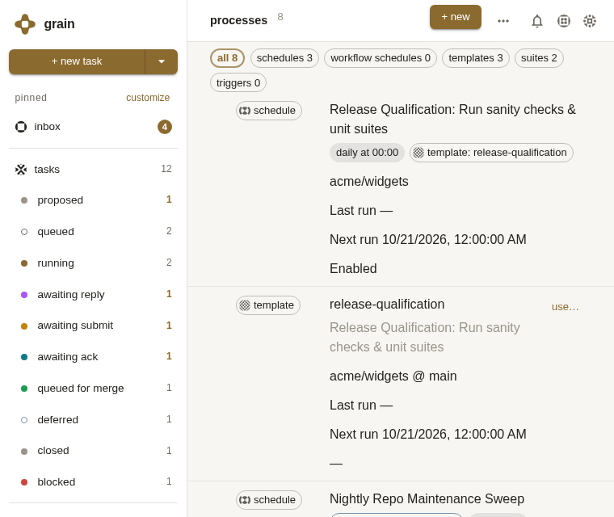 |
| Processes, 760px, "more" open | -- | 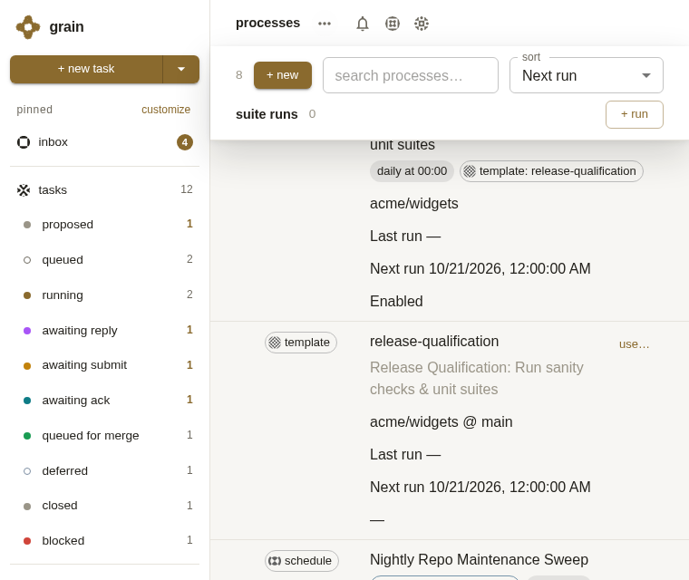 |

What changed on screen:

- The global top bar row ("grain / <page>", bell, System, Settings) is
  gone. The sidebar runs the full height of the window.
- Each page is headed by one 52px rail beside the sidebar: the title as
  crumbs, the page's own count, buttons, search, filters and sort, then
  the bell, System and Settings.
- The repo page's summary block (state chips, gate warnings) and the
  Settings page's section list are not header rows, so they stay in the
  page under the rail.
- In a narrow window the rail stays one row. What does not fit is behind
  "more", which opens the rest as a menu under the rail.

Automated coverage for the same ground: `ui/e2e/page-header-rail-walkthrough.spec.js`
and `ui/src/App.pageheader.test.jsx`.
