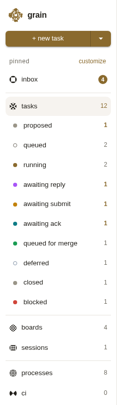
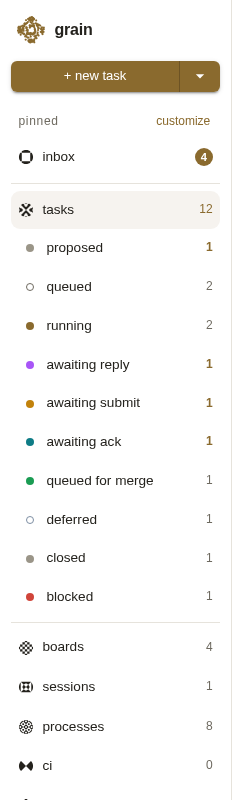
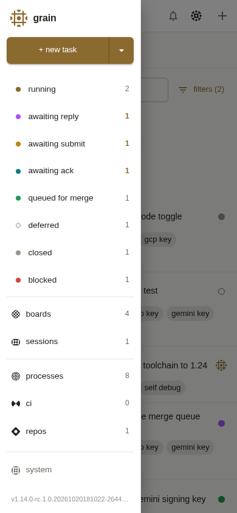

# Sidebar: no divider between Sessions and Processes (task 4916), before and after

Run on 2026-10-20 against the real `grain demo` server (`grain demo
-addr 127.0.0.1:0 -open=false`, its own seeded data), with Playwright's
Chromium: the desktop sidebar at 1280x800 and the phone drawer at 390x844,
scrolled so Boards to Repos are on screen. "Before" is `origin/main` at
2644eb9; "after" is this branch. Nothing was stubbed.

| View | Before | After |
| --- | --- | --- |
| Desktop sidebar |  |  |
| Phone drawer |  |  |

What changed on screen:

- The line between Sessions and Processes is gone, so Boards, Sessions,
  Processes, CI and Repos read as one group. The lines below the pinned
  section, below the Tasks block, and above the System footer stay.
- The rows in that group are now evenly spaced. The rows' top edges at
  1280x800, measured with `boundingBox()`, are:
  - before: Boards 628.6, Sessions 668.2, Processes 718.4, CI 758.0
    (a 50.2px step across the divider, 39.6px elsewhere);
  - after: Boards 628.6, Sessions 668.2, Processes 707.8, CI 747.4
    (39.6px throughout).
- The phone drawer renders the same `Sidebar` element (App.jsx hands it
  to `PhoneNav` as children), so the drawer lost the same line. `
`
  count per page: desktop 3 to 2, phone 4 to 3. The desktop count is one
  lower than the phone's because the desktop sidebar does not pin the
  System footer.
