# Header rail: counts level with their labels, page actions at the end (task 4980), before and after

Run on 2026-10-22 against the real `grain demo` server (each Playwright
worker's own, from `ui/e2e/fixtures.js`, with its seeded data), in
Chromium at 1440x900, 1024x900 and 390x844, with `prefers-color-scheme`
light and dark. "Before" is `origin/main` at 747f82455; "after" is this
branch. Nothing was stubbed.

The pages surveyed were Tasks, Inbox, Repos, a repo and its Releases and
Advanced tabs, Boards and a board, Sessions and the director session,
Processes and its workflow and template kinds, Settings (general,
models, git), System (health, sandboxes, pipeline), Logs, Top, and a
task. At 390px there is no rail (`PhoneNav`'s bar stands in for it,
§4.1), so phone screenshots are not repeated here. The repo page, Settings,
System and Top put nothing with a count in the rail. Top's actions only
show when the daemon reports `top` as available, which the demo does not.

All the 1440px pairs on one page: [contact sheet](2026-10-22-header-rail-layout/contact-sheet.png).

## Every count in or under the rail

Each count's vertical centre against the rail title's (38.5px from the
top of the window at 1440x900), measured with `getBoundingClientRect`:

| Page | Before | After |
| --- | --- | --- |
| Tasks | 38.2 (level) | 37.5 |
| Inbox | 30.2 (8px high) | 37.5 |
| Repos | 60.2 (22px low; the two-row Add repo form made the line 84px) | 37.5 |
| Boards | 33.2 (5px high) | 37.5 |
| Sessions | 38.2 | 37.5 |
| Processes, and "Suite runs" | 38.2, 38.2 | 37.5, 37.5 |
| A session's state badge | 27.5 (11px high) | 38.5 |

Font: 13.6px in the rail and 12.8px in board columns and inbox groups
before, with dashboard panels' counts unstyled; 12px with tabular
numerals everywhere after, the sidebar's own count size.

## Where each page's own actions are, 1440px (left edge, slot ends at 1308-1310)

| Page | Before | After |
| --- | --- | --- |
| Repos, Add repo | 410 (straight after the count, the filter box to its right) | 929-1308 |
| Sessions, + New session | 876 (search to its right) | 1205-1308 |
| Processes, + New | 457 | 1029, then the Suite runs group to 1308 |
| A board, Edit board / New board | 634 | 1151-1308 |
| Logs, Refresh | 1246 (already last) | 1244-1308 |
| Boards, New board | 1230 | 1227-1308 |

## Screenshots, 1440px

| Page | Scheme | Before | After |
| --- | --- | --- | --- |
| Tasks | light |  |  |
| Tasks | dark | 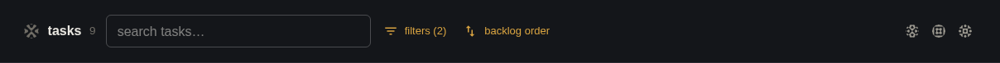 | 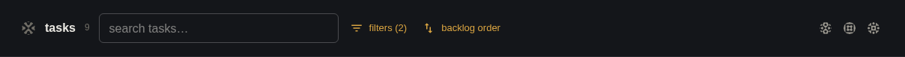 |
| Inbox | light |  |  |
| Inbox | dark | 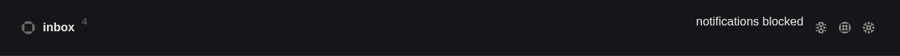 | 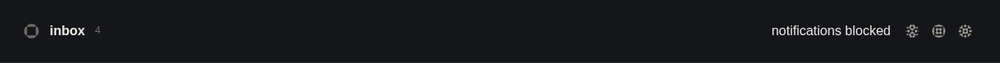 |
| Repos | light |  | 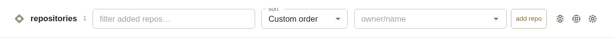 |
| Repos | dark | 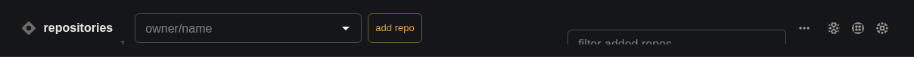 | 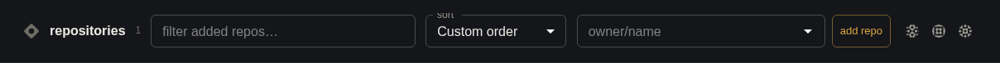 |
| Boards | light |  |  |
| Boards | dark | 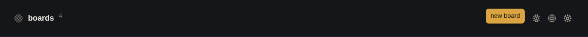 | 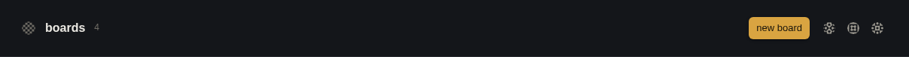 |
| A board | light |  |  |
| A board | dark | 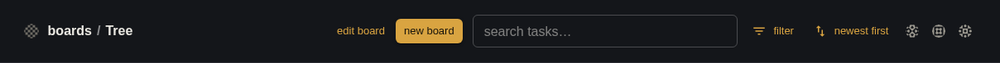 | 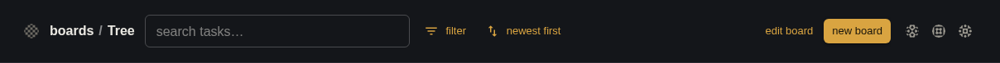 |
| Sessions | light | 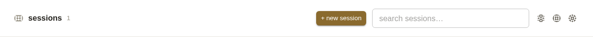 | 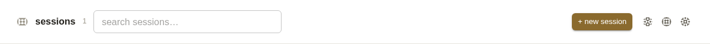 |
| Sessions | dark | 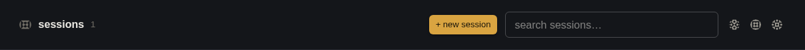 | 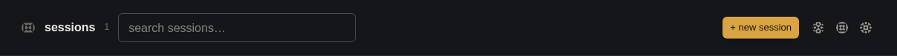 |
| A session | light | 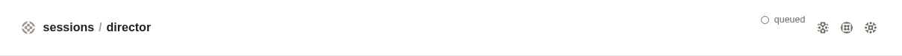 |  |
| A session | dark | 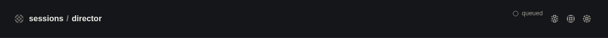 | 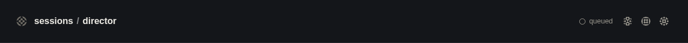 |
| Processes | light |  |  |
| Processes | dark | 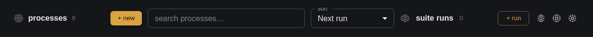 | 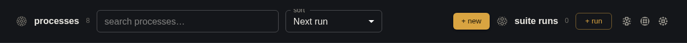 |
| Logs | light | 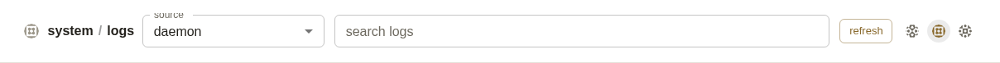 | 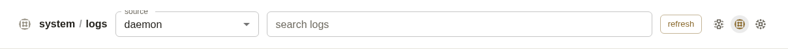 |
| Logs | dark | 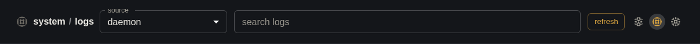 | 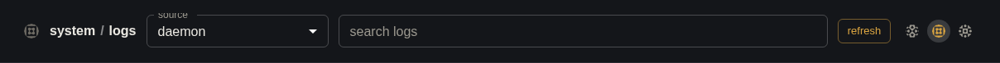 |

## 1024px

At 1024px the slot is about 470px wide. Repos' Add repo form and a
board's actions still don't fit on the line next to the page's search
and filters, so they are behind "more", as Repos' form already was
before. Processes' "+ New" fits, because the search box in the rail now
gives up width first (basis 9rem).

| Page | Before | After |
| --- | --- | --- |
| Repos |  | 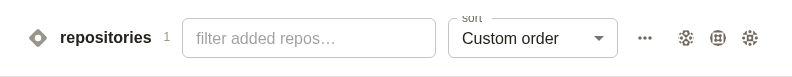 |
| Processes |  |  |
| A board |  |  |
