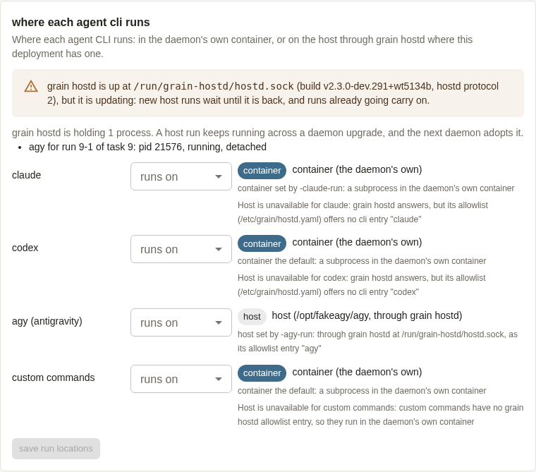
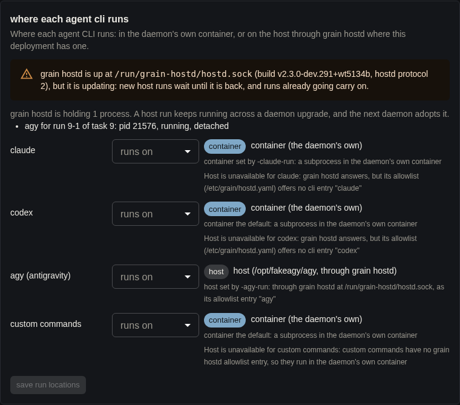
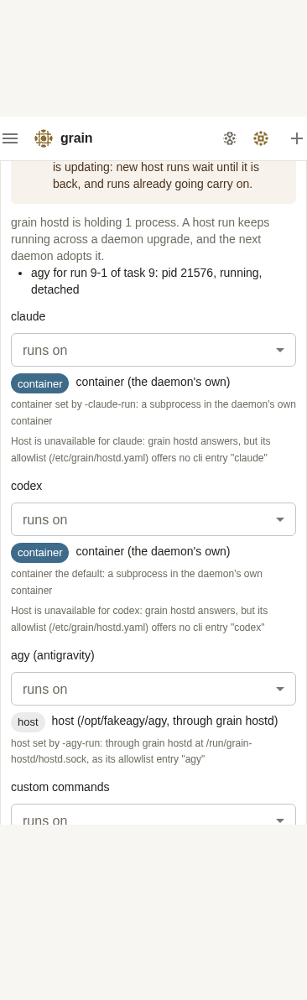
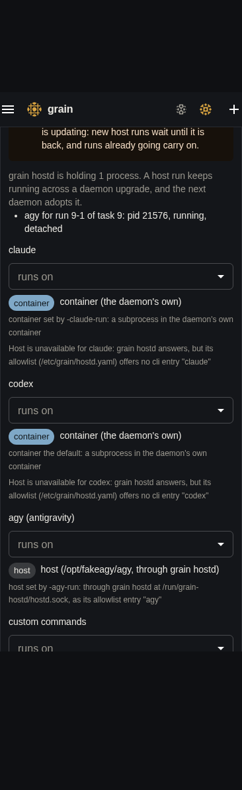

# grain hostd walkthrough step 7, re-run after #4485, 2026-10-23 (task 5134)

Step 7 of `2026-10-23-hostd-walkthrough.md` ("upgrades with a host run in
flight") failed on 10-23 because the daemon's half of hostd protocol 2 was
not wired yet (bug C there). This re-runs it on a main that has both
halves: bd2d2fe1a and d4cc808be (the daemon runs host CLIs detached and
adopts them), and #4485 (task 5129: hostd's versioned extract, the drain on
upgrade, and hostd's build and processes in Settings and `grain hostd
-status`). The setup is the earlier report's: a locally built "newer" image
served from a `registry:2` on the VM, so `POST /api/upgrade` has a digest
to pin.

**Result: 4 of 6 checks pass. The daemon side passes in full, but two
things in the hostd upgrade path fail, and three tasks were filed.**

| # | Check | Result |
|---|-------|--------|
| 1 | Daemon upgrade with a host agy in flight | **PASS.** Same pid, one attempt, `succeeded`, ticks 000–299 each once |
| 2 | The UI Upgrade reaches hostd | **FAIL (bug E).** `current` moves, but `grain-hostd-upgrade.path` never fires, so hostd stays on the old build. Started by hand, the rest of the chain passes: drain, run carries on, new run re-queued, exit, `Restart=always` onto the new build. With the path unit watching the directory instead, the whole chain passed on its own |
| 3 | A `run: host` capability server does not hold the drain, and comes back | **PARTIAL (bug F).** It does not hold the drain, and is ended with "ending capability server" once the run is done. The registry does **not** start it again: it reads `attached` while every call fails with EOF, for up to an hour |
| 4 | A setup.sh re-run while hostd holds a run drains it | **PASS.** "holds 1 host run(s): draining it rather than restarting". The run survives, and the readiness block has the build and a "holding …" line |
| 5 | Settings → Models names hostd's build and protocol, and its processes | **PASS** (screenshots below) |
| 6 | Rollback (`GRAIN_IMAGE_TAG=base`) puts hostd back on the old build | **PASS** |

## What was tested

- **Code:** `origin/main` at `223688a00` (the merge of #4501). It contains:
  - #4485 (merge `64f065977`, task 5129);
  - bd2d2fe1a and d4cc808be (checked with `git merge-base --is-ancestor`).
- **Images.** The published `ghcr.io/bwsalmon/grain/google-grain:main` was
  at `cbef86d` (`v2.3.0-dev.183+cbef86d`), which predates #4485, so it
  could not be the base. I built two daemon binaries from `223688a00`
  (`make frontend`, then `make grain` with the published image's own
  sandbox and image refs, `guest:sha-cbef86d` / `google-grain:sha-cbef86d`)
  and stamped each with its own `RELEASE`:
  - **base**: `v2.3.0-dev.290+wt5134a`, registry digest
    `sha256:01632057be5d…`;
  - **newer**: `v2.3.0-dev.291+wt5134b`, registry digest
    `sha256:10b89ab02feb…`.

  Each was layered over the published image (`FROM google-grain:main`,
  `COPY grain /usr/local/bin/grain`, plus the version and revision labels).
  `setcap cap_net_bind_service` was not re-applied, which the UI on
  port 4242 doesn't need. Both were served from `registry:2` at
  `127.0.0.1:5000`. The deployment was installed from `:main` = base, and
  `:base` was the same build. `:main` was then moved to the newer build for
  the UI's upgrade.
- **The VM.** This task's sandbox has no GCP key, so this ran in the
  sandbox VM itself rather than in a GCE instance. It is a real VM, not a
  container: Debian 12 with systemd 252 as pid 1, kernel
  `7.0.0-1014-gcp`, 4 vCPUs, 7.8 GiB, and `/dev/kvm`. Sandboxes were
  Granule VMs, as on the earlier report's `grain-wt-5047`. The 7.8 GiB only
  fits one default (8 GiB) sandbox. So that a new host run could be
  dispatched *during* a drain, I set `sandboxMemoryMb: 1536` in Settings
  after check 1. The VM is destroyed with the sandbox when the task ends,
  and nothing was created in any cloud project.
- **Fakes.** These are the same as the earlier report's, except that the
  ticking fake is now the committed one:
  - **fake GitHub:** `startInstallerGitHub`'s fake (`githubsim` plus
    `git http-backend`), as a small `main` on `0.0.0.0:8099` with
    `acme/widgets`. It was not committed;
  - **fake agy:** `tests/installer/fakeagy` at `/opt/fakeagy/agy`. Its
    committed `mode=steady ticks=N` prints one numbered tick every 0.5 s
    and writes its pid to `<report>.pid`;
  - **capability server:** the same binary as `fakecap` (`capability-server
    <report>`), added to `/etc/grain/hostd.yaml` by hand and saved with
    `PUT /api/capability-servers
    {"id":"https://example.com/grain-walkthrough/hostcap","config":{"command":"fakecap","run":"host"}}`;
  - **fake claude:** a shell script that answers claude's stream-json;
  - **model backends:** the installer e2e's two ambient ones, `hostd-agy`
    and `container-claude`.
- **Install command:** the earlier report's, with
  `GRAIN_IMAGE=127.0.0.1:5000/grain/google-grain` (Google track,
  `GRAIN_INSTALL_MODE=container`, `GRAIN_AGY_PATH=/opt/fakeagy/agy
  GRAIN_AGY_RUN=host`, `GRAIN_ENABLE_UI_UPGRADE=1`). `scripts/setup.sh`
  came from `git archive origin/main`. Tasks were filed with `POST
  /api/tasks` and then `POST /api/tasks/{id}/approve`, using the access
  code from a 0600 file.

The first install's readiness block already said `hostd: … answering on
/run/grain-hostd/hostd.sock (v2.3.0-dev.290+wt5134a, protocol 2)`. The
versions directory was `/usr/local/lib/grain/hostd/01632057be5d/`, with
`current -> 01632057be5d`. A baseline agy task (2) succeeded through hostd
with both MCP tool calls.

## 1. Daemon upgrade with a host agy in flight: PASS

Task 3 was `mode=steady ticks=300`. hostd (pid 8176) started it as pid
11019: `started cli "agy" detached as pid 11019 (id p-4b4949c717494b17,
run 3-1, …)`. At 16:53:05 I moved the registry's `:main` to the newer
build and sent `POST /api/upgrade {"branch":"main"}`, the Upgrade button's
request. The answer was `inFlightRuns: 1`. The old daemon logged:

```
upgrade: main: succeeded in 4s: pulled 127.0.0.1:5000/grain/google-grain:main@sha256:10b89ab02feb… ; restarting
hostd: the daemon went away from cli "agy" (pid 11019, id p-4b4949c717494b17); it keeps running until it ends or reaches its deadline
runhost: upgrade flushing; leaving run 3-1's CLI running in grain hostd at cursor 3855
grain daemon: upgrade: flushed the cursors of 1 host CLI run(s) in grain hostd before the restart: [3-1]
orchestrator: run 3-1: left running in its run host for the next daemon to adopt
```

The new daemon (container on digest `10b89ab02feb…`) logged, one second
later:

```
orchestrator: adopted grain hostd process hostd:p-4b4949c717494b17 for run 3-1 at cursor 3855 after a 1s gap
grain daemon: grain hostd adoption: 1 adopted, 0 lost, 0 unclaimed process(es) released
orchestrator: resuming adopted run 3-1 (task 3) from cursor 3855; 1s of restart credited
```

- **Same pid.** `ps` showed pid 11019 (parent 8176, hostd) before and
  after. hostd logged `cli "agy" (pid 11019) ended: code 0` at 16:55:29.
- **First run ends it.** Task 3 has one attempt, `succeeded`. There was
  nothing `interrupted` and no second attempt.
- **Every tick once.** `GET /api/tasks/3/attempts/1/transcript` holds
  `steady tick 000` … `steady tick 299`, each exactly once (300 distinct,
  none repeated), and "fake agy finished on the host" once.

The same check passed twice more later on: task 11 (240 ticks, below) and
task 9 (360 ticks, check 4), each with one attempt and every tick once.

## 2. The UI Upgrade reaches hostd: FAIL (bug E), and the rest of the chain passes

- **ExecStartPre moves `current`: PASS.** After the restart,
  `/usr/local/lib/grain/hostd/` held `01632057be5d/`, `10b89ab02feb/` and
  `current -> 10b89ab02feb`, which is the new image's directory.
- **`grain-hostd-upgrade.path` fires: FAIL.** It didn't. Its journal has
  nothing after `Started grain-hostd-upgrade.path` at 16:51:09. A minute
  after the upgrade, `grain hostd -status` still said `v2.3.0-dev.290`,
  with no "draining", beside a `…291` daemon. Nothing would ever have
  moved it short of a reboot or a setup.sh re-run. The rollback's move of
  `current` at 17:08 didn't fire it either.
  - **Why:** `PathChanged=/usr/local/lib/grain/hostd/current` puts an
    inotify watch through the symlink onto the old version's directory.
    The extractor replaces the link by `mv -fT current.new current`, which
    that watch never sees. A five-line reproducer outside grain (a `.path`
    unit on `/tmp/pt/current`) shows the same thing: the rename doesn't
    fire, while a later write inside the new target does. Pointed at the
    directory (`PathChanged=/tmp/pt`), the rename fires.
  - `tests/deploy/hostd_upgrade_test.go` checks the unit's text and the
    drain script, but nothing checks that systemd starts the unit.
- **The rest of the chain**, with the drain started by hand (`systemctl
  start grain-hostd-upgrade.service` at 16:56:52, while task 6, `ticks=240`,
  ran as pid 15549):
  - **Drain: PASS.** `hostd-upgrade.sh: grain hostd (pid 8176) runs
    /usr/local/lib/grain/hostd/01632057be5d/grain; draining it onto
    /usr/local/lib/grain/hostd/10b89ab02feb/grain`. `-status` went to
    `…, draining for an upgrade, …`.
  - **The in-flight agy carries on: PASS.** Task 6 has one attempt,
    `succeeded`, and pid 15549 ended `code 0` at 16:58:48.
  - **A new host run is re-queued, not failed: PASS.** Task 7 was filed
    during the drain. Attempts 1–3 each ended `interrupted`: `grain hostd
    is updating (draining for its own upgrade); the run goes back to the
    queue: hostd refused: grain hostd is draining for its own upgrade`.
    Attempt 4 ran on the new hostd (pid 19830) and `succeeded`. Each
    refused attempt built a whole sandbox first, though (about 24 s, one
    every 30 s), and Settings says "new host runs wait until it is back"
    (filed as G, low).
  - **hostd exits once the run ends, and comes back on the new build:
    PASS.**

    ```
    16:58:48 hostd: drained: ending capability server "fakecap" (pid 11890); the daemon starts it again on the new build
    16:58:48 hostd: drained; exiting so the new build takes over
    16:58:50 grain-hostd.service: Scheduled restart job, restart counter is at 1.
    16:58:50 hostd: listening on /run/grain-hostd/hostd.sock (hostd protocol 2, build v2.3.0-dev.291+wt5134b)
    ```

    `grain hostd -status` and Settings then said `v2.3.0-dev.291+wt5134b,
    protocol 2`.
- **The fix, verified by hand.** I edited the installed unit to
  `PathChanged=/usr/local/lib/grain/hostd` (the directory), went back to
  the base build (check 6), and repeated the UI upgrade with task 11
  (`ticks=240`, pid 28285) in flight:
  - `POST /api/upgrade` at 17:11:19;
  - `grain-hostd-upgrade.service` started **on its own** at 17:11:23
    ("draining it onto …/10b89ab02feb/grain");
  - the run was adopted after a 1 s gap and finished in its first attempt,
    with all 240 ticks once;
  - hostd logged `drained; exiting so the new build takes over` at
    17:13:19, and came back on `v2.3.0-dev.291+wt5134b` at 17:13:20.

  So the rest of the design works once the trigger does.

## 3. A `run: host` capability server: PARTIAL (bug F)

- **It doesn't hold the drain: PASS.** In both drains above, hostd waited
  only for the agy run. It counted 2 processes at the start (the agy and
  fakecap), and exited the moment the agy ended.
- **It is ended with "ending capability server" once the runs are done:
  PASS.** `hostd: drained: ending capability server "fakecap" (pid 11890);
  the daemon starts it again on the new build`.
- **The registry starts it again on the new hostd: FAIL.** After the
  16:58 drain (the daemon was not restarted, which is the normal case once
  the path unit fires), the new hostd held no fakecap process.
  - `GET /api/capability-servers` kept saying `state: attached` with
    `attachedAt` 16:53:10, the old one.
  - Task 8, granted `…/hostcap#host-probe`, failed capability admission
    three times with `mint_host-probe: mcp: writing to capability server:
    EOF`, and parked at `awaiting_reply` with that refusal as its comment.
  - Re-saving the same config in Settings changed nothing. Only a daemon
    restart (`POST /api/host/restart`) brought it back.
  - A plain `systemctl restart grain-hostd` leaves it in the same state.
  - **Why:** `pkg/capability/servers` notices a dead server only on its
    refresh, which runs every `DefaultRefreshInterval` (1 hour). The
    1-minute retry covers only entries already `Failed`.
- **Where it does come back.** When the *daemon* restarts during the
  drain, as in the setup.sh re-run (check 4) and the upgrade with the
  fixed path unit:
  1. the new daemon's attach is refused ("hostd refused: … draining");
  2. the entry is `Failed`;
  3. the retry re-attaches it about a minute after hostd is back
     (`capability server …/hostcap: attached, 1 method(s)` at 17:07:21 and
     17:13:33, as a new pid under the new hostd).

## 4. A setup.sh re-run while hostd holds a run: PASS

Task 9 was `ticks=360`, pid 21576. At 17:04:05 I re-ran the same install
command, unchanged (`:main`, the newer build). setup.sh exited 0 and
logged:

```
==>   grain-hostd.service holds 1 host run(s): draining it rather than restarting, so they carry on;
==>     it restarts on this build once they end (the allowlist's drain_cap bounds the wait)
```

Its readiness summary:

```
    hostd:             installed -- grain-hostd.service as debian; allowlist /etc/grain/hostd.yaml
                       (clis: agy; capabilities: fakecap)
                       status: unit active; answering on /run/grain-hostd/hostd.sock (v2.3.0-dev.291+wt5134b, protocol 2), draining for an upgrade, offering capability fakecap (/opt/fakeagy/agy), cli agy (/opt/fakeagy/agy)
                       holding p-ed7423c2fa882f81: cli "agy", pid 21576, run 9-1 of task 9, running for 15s, detached, a daemon attached
```

- The build is named in the `status:` line as `(v2.3.0-dev.291+wt5134b,
  protocol 2)`, and there is one `holding …` line per process.
  - There is no separate line that literally reads "running build …". The
    merge in 08025ff63 ("one grain hostd -status, with main's summary line
    and this branch's process lines") kept main's summary line. The
    content is there.
  - The capability server isn't listed because the re-run's daemon restart
    had already ended it; see check 3.
- **The run survives.** Pid 21576 was unchanged (parent 19625, hostd)
  across the re-run and its daemon restart. Task 9 has one attempt,
  `succeeded`, ticks 000–359 each once.
- **hostd restarts afterwards.** `17:07:02 hostd: cli "agy" (pid 21576)
  ended: code 0`, then `drained; exiting so the new build takes over`. It
  came back as pid 24100 on the same build (`restart counter is at 2`).

## 5. Settings → Models: PASS

These were taken during check 4's drain, with task 9 held. The "Where each
agent CLI runs" card, at 1440 px and 390 px wide, in both themes:

| light | dark |
|---|---|
|  |  |
|  |  |

The card's text:

> grain hostd is up at /run/grain-hostd/hostd.sock (build
> v2.3.0-dev.291+wt5134b, hostd protocol 2), but it is updating: new host
> runs wait until it is back, and runs already going carry on.
>
> grain hostd is holding 1 process. A host run keeps running across a
> daemon upgrade, and the next daemon adopts it.
>
> agy for run 9-1 of task 9: pid 21576, running, detached

- With hostd idle, the notice reads "… (build v2.3.0-dev.290+wt5134a,
  hostd protocol 2), offering capability fakecap, cli agy. Host runs go
  through it." It lists the capability server as a held process too
  ("capability fakecap: pid 25476, running").
- `GET /api/settings/cli-run`'s `hostExecutor.hostd` carries the same
  data: `build`, `protocol: 2`, `updating: true`, and `processes[]` with
  `run`, `task`, `pid` and `detached`.
- **How the screenshots were checked.** This sandbox's Gemini key was
  refused ("API key not valid"), so no model looked at them.
  - A Playwright pass over every element in the card found no horizontal
    overflow and nothing off-screen, at either width or in either theme.
  - Tesseract reads the dark desktop shot's notice back legibly, apart
    from its own spacing slips ("itis").

## 6. Rollback: PASS

`GRAIN_IMAGE_TAG=base` re-run at 17:08:

- The daemon is on `127.0.0.1:5000/grain/google-grain:base`, and `grain
  version` gives `v2.3.0-dev.290+wt5134a`.
- `current -> 01632057be5d`.
- hostd was restarted by setup.sh (no runs were held) and logged
  `listening … (hostd protocol 2, build v2.3.0-dev.290+wt5134a)`.
- The readiness block and `grain hostd -status` agree.

## Bugs

| | Bug | Severity | Filed |
|---|---|---|---|
| E | `grain-hostd-upgrade.path` watches the `current` symlink (`PathChanged=…/current`). The extractor replaces the link by rename, which the watch never sees, so the UI Upgrade never drains hostd onto the new build. Watching the directory fixes it (verified on the VM). The extractor starting the drain service itself would close the remaining race | High: the "UI Upgrade reaches hostd" half of #4485 doesn't happen | proposed from task 5134 |
| F | After hostd drains or restarts under a daemon that stays up, a `run: host` capability server stays `attached` with no process for up to an hour. Grants fail with `mcp: writing to capability server: EOF` and park the task | Medium: the design doc's "the registry re-attaches them" holds only across a daemon restart | proposed from task 5134 |
| G | While hostd drains, each queued host run builds a sandbox, is refused and ends `interrupted` every ~30 s, although Settings says new host runs wait | Low | proposed from task 5134 |

## Not covered

- Real agy, real Jetski and the corp environment. As in the earlier
  report, every run here used the repo's fakes.
- A GCE VM. This ran in the task's own sandbox VM, which has systemd and
  `/dev/kvm` but no GCP credentials. Nothing here depends on GCE.
- Timing races between the daemon's restart and the path unit's drain,
  beyond the one ordering seen with the fixed unit (drain at +4 s, the new
  daemon's capability attach refused).
