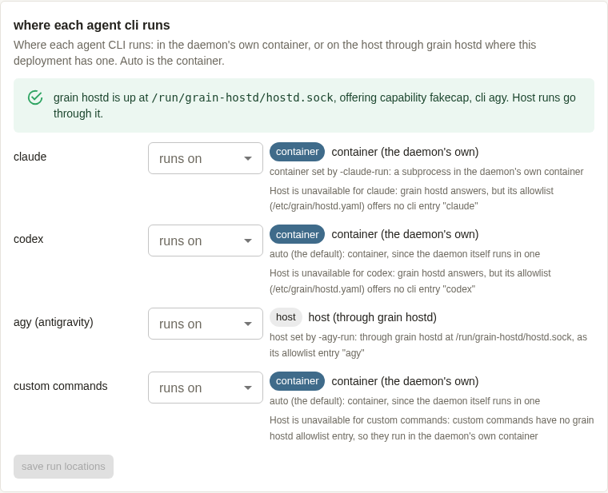
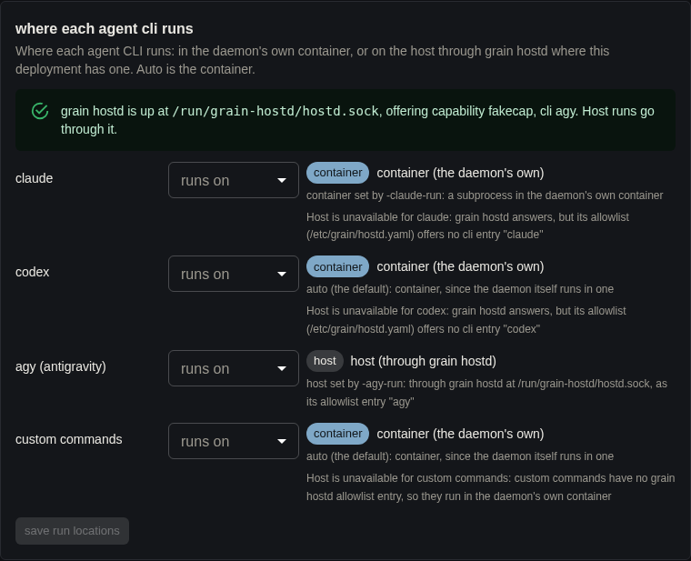
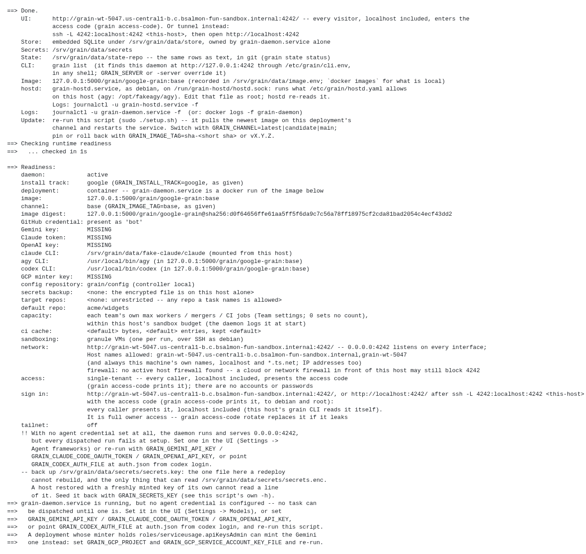
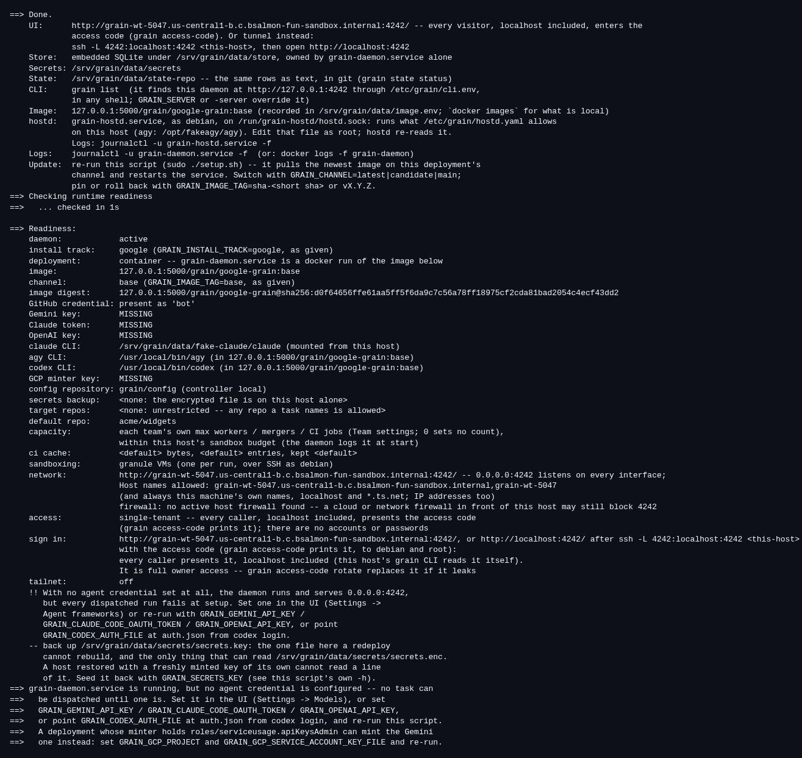

# grain hostd walkthrough by hand, 2026-10-23 (task 5047)

The owner asked whether the new hostd code had been checked by hand as well as
by tests. This is that check, done once on real VMs. The flows are container
mode with grain hostd, `GRAIN_HOSTD=0`, moving a host-mode install to
container mode and back, the CLIs running in the container and through hostd,
and upgrades while a host run is going.

**Result: 6 of 8 steps pass, 2 partly pass, and 4 bugs were found.**

| # | Step | Result |
|---|------|--------|
| 1 | Fresh default install (Google track, container mode, hostd) | **PARTIAL**: daemon, unit, socket and allowlist all correct; the readiness summary gives the wrong agy location (bug B) |
| 2 | Runs: claude in the container, agy through hostd, cancel, cancel when stdin is never read | **PASS** |
| 3 | Refusals by hand | **PASS** |
| 4 | `run: host` stdio capability server, granted to a task | **PASS** |
| 5 | `GRAIN_HOSTD=0` | **PARTIAL**: no unit, nothing mounted, Settings refuses host and says why; but a Google-track install with it crash-loops the daemon (bug A) |
| 6 | Migration: v2.1.1 host mode → current (container + hostd) → rollback | **PASS** (the documented rollback). Rolling back with v2.1.1's own setup.sh leaves hostd behind (bug D, low) |
| 7 | Upgrades with a host run in flight | **FAIL** as specified: the daemon side of #5046 is not wired yet (the design doc says so), so the run is interrupted and re-dispatched (bug C). Rollback of hostd works |
| 8 | Upgrade and Restart buttons on the container install | **PASS** |
| + | Container sandboxes with the docker socket (`GRAIN_GRANULE_ENABLE=0 GRAIN_CONTAINER_SANDBOXES=1`), agy through hostd | **PASS** |

## What was tested

- **Code:** `origin/main` at `dbaba3afa`, the merge of #4468 (task 5046). It
  includes:
  - #4454 (task 5029, installer e2e);
  - #4452 (task 5039, tightened checks and stdin back-pressure);
  - #4449 (task 5031).
- **Image:** `ghcr.io/bwsalmon/grain/google-grain:main`, index digest
  `sha256:c0afee4fe735b294318f6072499d1a5cef228557b44f8af4f2f0ad6f79fc855d`,
  revision label `dbaba3afa0028781e7f0b8bbdbfd7a1e6d14b753`, version
  `v2.3.0-dev.167+dbaba3a`. The published `main` image was **not** behind
  `origin/main`. `ghcr.io/bwsalmon/grain/grain:main` is the same commit.
- **Migration source:** `ghcr.io/bwsalmon/grain/google-grain:v2.1.1` with
  `scripts/setup.sh` from tag `v2.1.1` (`3373f53`).
- **The "newer main" for step 7:** there was no newer published image, so I
  made one.
  - I built `./google/cmd/grain` from the same tree, stamped with
    `RELEASE=v2.3.0-dev.168+wt5047` and the published image's own sandbox and
    image refs.
  - I layered it over the published image (`FROM google-grain:main`, then
    `COPY grain /usr/local/bin/grain`).
  - I served it from a local `registry:2` at `127.0.0.1:5000` on the VM.
  - The deployment was first re-installed from that registry's copy of the
    published image (`:main`, later also tagged `:base`). Then `:main` was
    moved to the new build, so the UI's upgrade found a genuinely different
    build with a registry digest to pin.
- **VMs** (`example-sandbox`, `us-central1-b`):
  - Both were `n2-standard-4` with `--enable-nested-virtualization`, Debian 12,
    40 GB, labelled `purpose=grain-walkthrough,grain-task=5047`.
    - `grain-wt-5047` had `/dev/kvm` and used Granule sandboxes.
    - `grain-wt-5047-mig` was used for migration, and for the container-sandbox
      path with Granule turned off.
  - Firewall rule `grain-wt-5047-4242` opened tcp:4242 to this sandbox's egress
    IP only.
  - **Both VMs and the rule were deleted at the end.** Nothing labelled
    `purpose=grain-walkthrough` is left in the project.
  - A first create attempt in `us-central1-a` hit a stockout, but left one
    instance, which was deleted at once.

### Fakes (no agent credentials on these VMs)

- **Fake GitHub.** The installer e2e's own fake GitHub
  (`startInstallerGitHub` in `tests/installer/installer_test.go`, which uses
  `pkg/github/githubsim` and `git http-backend`). It was copied into a small
  `main` and served on the VM at `127.0.0.1:8099` with repo `acme/widgets`.
  It was not committed.
- **Fake agy.** `tests/installer/fakeagy`, at the allowlisted host path
  `/opt/fakeagy/agy` (a root-owned wrapper script that execs
  `/opt/fakeagy/fakeagy`). The walkthrough's copy added two things, neither
  committed:
  - `mode=tick ticks=N`, which prints one numbered `step_update` a second, so
    a transcript read across an upgrade would show a gap or a repeat;
  - a `nostdin` switch in the wrapper (`/opt/fakeagy/mode`), which `exec`s
    `sleep 3600` without ever reading stdin.
- **Fake claude.** The installer e2e's shell fake claude, at
  `/srv/grain/data/fake-claude/claude` (`GRAIN_CLAUDE_PATH`). It appends
  `uid pid ppid in_container` to a report.
- **Model backends.** The same two "ambient" backends the e2e configures
  (`PUT /api/settings` `agentBackends`): `hostd-agy` (antigravity) and
  `container-claude` (claude).
- **hostd probe.** A small client over `pkg/hostd.Client`, used to send the
  refusal requests by hand. It was not committed.

### Install command

This is what a Cloudtop's installer hands `setup.sh`, plus the fakes. The
Google track's default image is the corp Artifact Registry, which a VM
cannot pull, so `GRAIN_IMAGE` names the public `google-grain` image:

```bash
sudo env GRAIN_CHANNEL=main GRAIN_IMAGE=ghcr.io/bwsalmon/grain/google-grain \
  GRAIN_USER=debian GRAIN_DATA_DIR=/srv/grain/data GRAIN_SANDBOX_DIR=/srv/grain/scratch \
  GRAIN_INSTALL_MODE=container GRAIN_INSTALL_TRACK=google \
  GRAIN_AGY_PATH=/opt/fakeagy/agy GRAIN_AGY_RUN=host \
  GRAIN_CLAUDE_RUN=container GRAIN_CLAUDE_PATH=/srv/grain/data/fake-claude/claude \
  GRAIN_UI_ADDR=0.0.0.0:4242 GRAIN_ENABLE_UI_UPGRADE=1 \
  GRAIN_GITHUB_HOST=127.0.0.1:8099 GRAIN_GITHUB_INSECURE_HTTP=1 \
  GRAIN_GITHUB_TOKEN=ghp_fake_token_for_the_walkthrough GRAIN_TARGET_REPO=acme/widgets \
  NO_PROXY=127.0.0.1,localhost no_proxy=127.0.0.1,localhost \
  ./scripts/setup.sh
```

`scripts/setup.sh` came from `git archive origin/main`. Later steps re-ran
the same command with extra `NAME=value` pairs, given below. Tasks were filed
over the API with the access code (`grain access-code`, kept in a 0600 file
and never printed):

- `POST /api/tasks {title, description, repo: "acme/widgets", agentFramework}`;
- then `POST /api/tasks/{id}/approve`.

The fake reads `key=value` fields such as `report=` and `mode=` from the
description.

## 1. Fresh default install: PARTIAL

`setup.sh` exited 0 and logged:

```
==> grain hostd: installing it (container mode on the Google track; GRAIN_HOSTD=0 turns it off)
==>   agy runs on this host through hostd: /opt/fakeagy/agy (not mounted into the daemon's container)
```

| Check | Result |
|---|---|
| Daemon in a container | **PASS.** `docker ps`: `grain-daemon ghcr.io/bwsalmon/grain/google-grain:main`. The unit runs `docker run --name grain-daemon … --user 1000:1003 … --volume /run/grain-hostd:/run/grain-hostd …` |
| hostd's unit runs as the installing user | **PASS.** `systemctl show grain-hostd`: `User=debian`, active. `ps`: `debian 4455 /usr/local/bin/grain hostd -socket /run/grain-hostd/hostd.sock -allowlist /etc/grain/hostd.yaml -state-dir /var/lib/grain-hostd` |
| Socket 0600 and mounted | **PASS.** Host: `drwx------ debian debian /run/grain-hostd`, `srw------- debian debian hostd.sock`. Mount: `/run/grain-hostd -> /run/grain-hostd true`. The container sees the same socket, as its uid 1000 |
| Allowlist owned outside the container, and it has agy | **PASS.** `-rw-r--r-- root root /etc/grain/hostd.yaml`. `docker exec grain-daemon ls /etc/grain` gives "No such file or directory", so it isn't mounted. The file has `clis.agy.path: /opt/fakeagy/agy`, `paths_under` and `cwd_under` of `[/srv/grain/data, /srv/grain/scratch]`, the proxy variables as `pass_env`, and an empty `capabilities:` |
| Settings → Models shows each CLI's location and hostd's status | **PASS**, with gaps. See the screenshots. claude: container ("set by -claude-run: a subprocess in the daemon's own container"). codex: container (auto). agy: host ("through grain hostd at /run/grain-hostd/hostd.sock, as its allowlist entry \"agy\""). custom: container. Banner: "grain hostd is up at /run/grain-hostd/hostd.sock, offering capability fakecap, cli agy". Gaps: the agy row shows no host path (`/opt/fakeagy/agy`), and nothing shows hostd's build (see step 7) |
| Readiness summary shows each CLI's location and hostd | **FAIL (bug B).** The `Done.` block has a correct `hostd:` paragraph. But the `Readiness:` block says `agy CLI: /usr/local/bin/agy (in ghcr.io/bwsalmon/grain/google-grain:main)`, which is the image's own copy, not the host binary hostd runs. It has no run location for any CLI and no hostd status line. `docs/design/cli-run-location.md` says the readiness summary shows the same resolution as Settings (`agy: host (/opt/corp/bin/…)`) |

Screenshots of the "Where each agent CLI runs" card (final install, hostd on):

| light | dark |
|---|---|
|  |  |

The readiness summary, as setup.sh prints it (the `secrets key` public-key
line is left out):

| light | dark |
|---|---|
|  |  |

Nothing overlaps or is clipped in either theme. The disabled "save run
locations" button has low contrast in both themes, which is normal for a
disabled button.

## 2. Runs: PASS

- **claude in the container.** Task 4's fake claude wrote
  `uid=1000 pid=8471 ppid=4583 in_container=true`. 4583 is the daemon's
  `grain daemon` process inside the container, so the CLI was a subprocess
  there. The attempt ended `failed: the agent made no tool calls at all`,
  which is expected from a fake that makes none. The first fake-claude
  report went nowhere, because `/srv/grain/data/fake-claude` is mounted `:ro`.
  The report moved to the scratch dir.
- **agy on the host through hostd.**
  - Task 3, attempt 3, `succeeded`: "the run made 2 tool call(s)
    [run_command x1, write_file x1]". Attempts 1 and 2 failed before any
    model backend existed.
  - The fake's report: `uid 1000`, `inContainer false`, cwd
    `/srv/grain/data/state/agent-sessions/antigravity/3/grain-run/workspace`,
    and both MCP calls answered from the sandbox
    (`write_file: Wrote work/HOSTD_AGY.md`).
  - `GET /api/tasks/3/attempts/3/transcript` holds both tool calls and
    "fake agy finished on the host".
  - hostd's journal: `starting cli "agy" as /opt/fakeagy/agy`, then
    `cli "agy" (pid 7256) ended: code 0`.
- **`ps` of a host agy** (task 5, `mode=hang`):

  ```
  debian 1000  9478  4455 /opt/fakeagy/fakeagy --input-format stream-json --output-format stream-json --dangerously-skip-permissions …
  debian 1000  4455     1 /usr/local/bin/grain hostd -socket /run/grain-hostd/hostd.sock …
  ```

  So the owner is uid 1000 and the parent is hostd's main pid.
- **Cancel mid-run** (`POST /api/tasks/{id}/stop`, the Stop button's call).
  The hanging agy was gone **23 ms** after the stop. Its child `sleep 3600`
  went with it, so the whole group was killed. hostd logged `ended: code -1
  signal "KILL"`, and the attempt ended `cancelled: turn stopped by user`.
- **Cancel a fake agy that never reads stdin** (task 6, the wrapper `exec`s
  `sleep 3600`). It was still alive after 20 s, and gone **20 ms** after the
  stop. The attempt ended `cancelled`. Both kills are well inside hostd's
  `WaitDelay` (5 s).

## 3. Refusals by hand: PASS

Every one is refused, and every one is in hostd's journal. These are the
probe's lines (`pkg/hostd.Client`, run as `debian` unless it says otherwise):

```
unknown cli entry      start bash -c id               -> hostd refused: cli "bash" is not on this host's allowlist
argv ../               agy --config ../../../etc/passwd -> refused: argument 1: "../../../etc/passwd" climbs out with ..
argv -o/etc/passwd     agy -o/etc/passwd              -> refused: argument 0: "/etc/passwd" is not under /srv/grain/data, /srv/grain/scratch
argv out=/etc/passwd   agy out=/etc/passwd            -> refused: argument 0: "/etc/passwd" is not under /srv/grain/data, /srv/grain/scratch
cwd outside cwd_under  agy (dir /etc) --version       -> refused: working directory: "/etc" is not under /srv/grain/data, /srv/grain/scratch
allowed (control)      agy --version                  -> exit 0
as root                hello                          -> connection dropped; journal: refused a connection from uid 0 (err <nil>); only uid 1000 may connect
as uid 1004 ("other")  hello                          -> connect: permission denied (the 0700 dir / 0600 socket)
as uid 1004, socket chmod 0666 by hand -> connection dropped; journal: refused a connection from uid 1004; only uid 1000 may connect
allowlist chmod 0664   agy --version                  -> refused: hostd allowlist /etc/grain/hostd.yaml is writable by group or others (mode -rw-rw-r--); make it 0644 or tighter
```

- **Writing the allowlist from inside the daemon container.**
  `docker exec grain-daemon sh -c 'mkdir -p /etc/grain && echo … > /etc/grain/hostd.yaml'`
  failed with `mkdir: cannot create directory '/etc/grain': Permission denied`.
  The container has no `/etc/grain`; the host's file is root-owned and isn't
  mounted.
- **Writing into the socket directory.** The container *can* create files in
  `/run/grain-hostd` (it is mounted read-write and owned by the same uid).
  hostd never reads anything there but the socket, so this is not a way in.
  The stray file was removed.
- **Minor:** a refused peer (root, or another uid) sees `write: broken pipe`
  rather than a refusal message. The reason is only in hostd's journal. That
  is fine for a security refusal, and noted here rather than filed.

## 4. A `run: host` stdio capability server: PASS

- **Allowlist entry** (added as root):

  ```yaml
  capabilities:
    fakecap:
      command: /opt/fakeagy/fakeagy
      args: [capability-server, /srv/grain/scratch/wt/capability.report]
  ```

- **Server added** with `PUT /api/capability-servers`
  `{"id":"https://example.com/grain-walkthrough/hostcap","config":{"command":"fakecap","run":"host"}}`.
  A non-URL id is refused with `capability id "wt-hostcap": must be an https:// URL`.
- **Status:** `attached`, `transport stdio`, `run host`, methods
  `[host-probe]`.
- **Report:** `started uid=1000 pid=12451 in_container=false`. `ps` showed
  `debian 12451 4455 /opt/fakeagy/fakeagy capability-server …`, so its parent
  is hostd.
- **Granted to a task.** Task 8 was an agy task with
  `capabilities: ["https://example.com/grain-walkthrough/hostcap#host-probe"]`.
  The attempt `succeeded`, and its prompt (`GET /api/tasks/8/prompt`) carries
  the server's section, "host-probe ran as uid 1000".

## 5. `GRAIN_HOSTD=0`: PARTIAL (bug A)

`GRAIN_HOSTD` comes from #4454 (task 5029). I re-ran the install command
with `GRAIN_HOSTD=0` (and the local-registry `GRAIN_IMAGE`):

- setup.sh logged `removing grain-hostd.service: container-mode daemon
  without grain hostd (kept /etc/grain/hostd.yaml)`. The unit file is gone,
  no `hostd` process is left, and `/run/grain-hostd` is no longer mounted. An
  empty `/run/grain-hostd` directory stays on the host.
- **Bug A.** With the Google track's `GRAIN_AGY_RUN=host` (cloudtop-install's
  default, line 377), the unit still passes `-agy-run host`. The daemon then
  **refuses to start and crash-loops** (`status=2/INVALIDARGUMENT`):

  ```
  grain daemon: -agy-run=host (the installer writes it from GRAIN_AGY_RUN): this deployment has no host executor: the daemon runs in a container (GRAIN_IN_CONTAINER=1, …) with no grain hostd (no -hostd-socket, and nothing mounted at /run/grain-hostd), so every agent CLI runs in the daemon's own container. Drop it, or set it to container or auto
  ```

  setup.sh still **exited 0**, with `daemon: activating` and a stray
  `unknown` line in its readiness block. Following the daemon's advice does
  not help: `GRAIN_AGY_RUN=auto` is refused by setup.sh itself (`setup.sh:
  GRAIN_AGY_RUN=auto: agy has no container launcher yet; it runs on the
  host`, exit 2). Only an empty `GRAIN_AGY_RUN=` installs a working daemon.
  The daemon's own `auto` then resolves agy to `container`, with the
  `GRAIN_AGY_PATH` binary mounted read-only, so the two disagree about where
  agy can run.
- **With `GRAIN_AGY_RUN=`:**
  - `GET /api/settings/cli-run` gives `hostExecutor.kind: none`, with the
    reason above and `hostAvailable: false`. agy's `locations` are
    `[container, auto]`, so Settings no longer offers host and says why.
  - Setting agy to host (`PUT /api/settings/cli-run
    {"settings":{"antigravity":{"location":"host"}}}`) is **refused clearly**:
    `run location for agy: host is not available -- this deployment has no
    host executor: … Choose container, auto or default`.
  - An agy task then ran in the daemon's container (`inContainer true`,
    succeeded). That is the #4449 fallback (task 5031).

## 6. Migration: PASS (bug D, low)

On `grain-wt-5047-mig`:

1. **v2.1.1, host mode.** v2.1.1's own `scripts/setup.sh` with
   `GRAIN_IMAGE_TAG=v2.1.1 GRAIN_INSTALL_MODE=host GRAIN_INSTALL_TRACK=google
   GRAIN_AGY_PATH=/opt/fakeagy/agy`. `grain version`: `v2.1.1 · google ·
   3373f53`. Task 2 (fake agy) succeeded on the host as the daemon's child.
2. **Re-ran the current installer** (`GRAIN_INSTALL_MODE=container`, as
   cloudtop-install.sh passes it):
   - It logged `Install mode: changing from host (the installed
     /etc/systemd/system/grain-daemon.service) to container, as given`.
   - **Same data:** `secrets.key` md5 and the access code's md5 are unchanged,
     and `/srv/grain/data` was kept.
   - **Same unit name:** `grain-daemon.service`, now a `docker run` of
     `google-grain:main`, with `grain-hostd.service` active as `debian`.
   - `hostExecutor.kind: hostd`.
   - **Old history intact:** tasks 1 and 2 are listed, task 2's attempt is
     still `succeeded`, and its transcript ends "fake agy finished on the
     host".
   - A new agy task (3) succeeded through hostd (`inContainer false`).
   - Minor: the `grain hostd: installing it` line is logged twice on this
     path.
3. **Documented rollback** (`google/docs/cloudtop-install.md`, the current
   installer with `GRAIN_INSTALL_MODE=host GRAIN_IMAGE_TAG=v2.1.1`):
   - It exported the rows at schema 31, and the daemon rebuilt the store at
     schema 27. The schema-31 store was kept as `store.schema31-<time>`.
   - `grain version` is v2.1.1, the daemon is active, and there is no
     container.
   - `removing grain-hostd.service: host-mode daemon without grain hostd
     (kept /etc/grain/hostd.yaml)`. The unit is gone and the allowlist is
     kept.
   - Tasks 1–3 are all there.
   - `GRAIN_HOST_MODE_OPT_IN=1` was not written, because this was plain
     setup.sh; cloudtop-install.sh is what sets it.
4. **Bug D (low): rolling back with *v2.1.1's own* setup.sh** (the other way
   an operator might roll back) restores v2.1.1 in host mode with the data
   intact. But it leaves `grain-hostd.service` enabled. The unit kept running
   the replaced binary (`/proc/<pid>/exe -> /usr/local/bin/grain (deleted)`).
   After `systemctl restart grain-hostd` it crash-loops on `grain: unknown
   command "hostd"`. The old binary has no hostd, so it can't start anything,
   but the unit is left running a deleted binary and then failing on every
   restart.

## 7. Upgrades with a host run in flight: FAIL as specified (bug C)

The daemon's half of #4468 (task 5046) is not wired yet.
`docs/design/cli-run-location.md` says so under "Not yet wired":

- `HostdHost` starting detached;
- the adoption pass reading `processes`;
- draining treated as wait;
- the versioned hostd extract with a `.path` unit that drains;
- the Settings and readiness view of all of it.

It ends: "Until then the daemon starts nothing detached, so a daemon upgrade
still interrupts a host CLI run". What I saw matches that statement exactly.
Against this task's expectations it fails.

- **Daemon upgrade from the UI's endpoint.**
  - Task 9 was `mode=tick ticks=240`, as pid 17616 under hostd. I moved the
    registry's `:main` to the `wt5047` build and sent `POST /api/upgrade
    {"branch":"main"}`, which is the Upgrade button's request.
  - The pull, pin and restart worked: the daemon came back at
    `v2.3.0-dev.168+wt5047` within 10 s.
  - But at shutdown the daemon logged `waiting up to 4m30s for 1 run(s) …
    [9-1]`. hostd then logged `cli "agy" (pid 17616) ended: code -1 signal
    "KILL"` at tick 6, and `capability "fakecap" (pid 16551) ended … KILL`.
  - Attempt 1 ended `interrupted: interrupted by daemon shutdown or upgrade;
    re-queued for next dispatch` (not counted against the task). Attempt 2 was
    a **re-dispatch**: a new agy (pid 20794, started with `--conversation
    fake-conversation`) ran ticks 1–240 and succeeded.
  - So the pid did not survive and nothing was adopted. Settings has no
    adoption view. The run completed only through a re-dispatch.
  - Attempt 2's transcript starts again at tick 1; that is the fake's doing,
    since it doesn't resume, and is not grain's. No output was duplicated
    within an attempt.
- **hostd upgrade.**
  - The UI upgrade **does not touch hostd**. Afterwards hostd's `hello` still
    reported `Build: v2.3.0-dev.167+dbaba3a` beside a `…168+wt5047` daemon.
  - Only a setup.sh re-run moves it. With task 11 ticking (pid 23009), a
    re-run (`GRAIN_IMAGE=127.0.0.1:5000/grain/google-grain GRAIN_CHANNEL=main`)
    reinstalled `/usr/local/bin/grain` and restarted `grain-hostd.service`
    with no drain. hostd logged `cli "agy" (pid 23009) ended: code -1 signal
    "KILL"` (and the same for `fakecap`), and attempt 1 was `interrupted`.
  - hostd came up as pid 24210 on `Build: v2.3.0-dev.168+wt5047`, and
    attempt 2's agy ran on it and succeeded.
  - Settings shows hostd's reachability and offers but **not its build**.
- **Rollback.** Re-running with `GRAIN_IMAGE_TAG=base` (the original
  `dbaba3a` image) put hostd's `hello` back to `v2.3.0-dev.167+dbaba3a`, and
  the daemon back to the same. **PASS.**

## 8. Upgrade and Restart buttons: PASS

- **Upgrade.** `POST /api/upgrade` went pull → pin → restart onto the new
  image, all inside the container install (step 7).
- **Restart.** `POST /api/host/restart` (the Restart button's call) answered
  `{"ok":true}`. `grain-daemon` restarted (container `StartedAt` changed) and
  the API answered 200 within 3 s.

## Extra: container sandboxes with the docker socket: PASS

There was no time for a third VM without `/dev/kvm`. Instead I re-installed
`grain-wt-5047-mig` with `GRAIN_GRANULE_ENABLE=0 GRAIN_CONTAINER_SANDBOXES=1`.
The readiness block said `sandboxing: Docker containers (one per run)`. An
agy task through hostd (task 4) succeeded, with `uid 1003`, `inContainer
false`, and both MCP tool calls answered from the Docker sandbox.

## Bugs

| | Bug | Severity | Filed |
|---|---|---|---|
| A | `GRAIN_HOSTD=0` on the Google track writes `-agy-run host` into a container unit without hostd, so the daemon crash-loops. setup.sh exits 0 regardless, and its suggested `auto` is refused by setup.sh itself | High: one documented knob leaves the deployment down | proposed from task 5047 |
| B | setup.sh's readiness summary gives `agy CLI` as the image's `/usr/local/bin/agy` when agy runs on the host through hostd, and shows neither each CLI's run location nor hostd's status. Settings' agy row shows no host path | Medium | proposed from task 5047 |
| C | The daemon side of #4468 (task 5046) is not wired. A daemon upgrade kills and re-dispatches host runs, the UI upgrade never updates hostd, a setup.sh re-run restarts hostd with no drain, and Settings shows neither hostd's build nor adoption | Known: in the design doc's "Not yet wired" list | proposed from task 5047, which may duplicate an existing follow-up |
| D | A rollback with v2.1.1's own setup.sh leaves `grain-hostd.service` enabled. It runs a deleted binary, then crash-loops on `unknown command "hostd"` | Low: the documented rollback is fine | proposed from task 5047 |

## Not covered: needs the owner's real Cloudtop

- The corp exec policy: whether hostd's agy exec, and claude/codex in their
  per-run container, actually get past it.
- Real Jetski (`/opt/corp/bin/releases/agy-devs/tools/cli`) under the
  owner's corp identity, with corp credentials and the corp proxy through
  `pass_env`.
- A real claude (OAuth) and real model output. Every run here used the
  repo's fakes.
- The Google track's default image from the corp Artifact Registry. These
  VMs can't pull it, so they used the public `google-grain` image.
- `cloudtop-install.sh` itself. It is Cloudtop-only, so I ran `setup.sh`
  with the settings it hands over.
