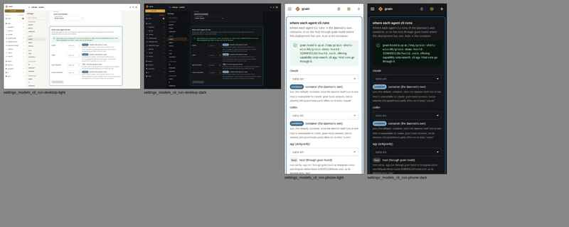

# Readiness summary and Settings name hostd's agy (task 5128)

The fix for bug B in `2026-10-23-hostd-walkthrough.md`: setup.sh's
Readiness block named the image's `/usr/local/bin/agy` when agy runs on
the host through grain hostd, and Settings -> Models' agy row never named
the host path.

## Readiness summary

setup.sh's `report_agent_cli`, `cli_run_location` and `hostd_cli_path`,
run on their own for the walkthrough's install (Google track,
`GRAIN_AGY_RUN=host`, hostd on, an allowlist whose agy entry is
`/opt/fakeagy/agy`). `tests/deploy`'s
`TestTheReadinessReportNamesWhereEachCLIRunsAndHostdsAgy` runs the same
functions over the same cases.

```
    claude CLI:        container: /usr/local/bin/claude (in ghcr.io/bwsalmon/grain/google-grain:main)
    agy CLI:           host, through grain hostd: /opt/fakeagy/agy (its allowlist entry "agy")
    codex CLI:         container: /usr/local/bin/codex (in ghcr.io/bwsalmon/grain/google-grain:main)
                       (where each runs as this install set it; Settings -> Models can change it)
```

The `hostd:` entry gains a third line,
`status: unit active; answering on /run/grain-hostd/hostd.sock (v…, protocol N), offering cli agy (/opt/fakeagy/agy)`,
from `systemctl is-active` and the new `grain hostd -status`. A full
`setup.sh` run was not possible in the sandbox, so this line was checked
only by `pkg/cli`'s `TestHostdStatusLineNamesWhatAnsweringHostdOffers`,
against a real hostd.

## Settings -> Models, "Where each agent CLI runs"

`grain demo -host-executor=hostd`, whose real hostd offers agy at
`/google/bin/releases/jetski-devs/tools/cli`. No stubs. Contact sheets
cover desktop (1440) and phone (390), light and dark, scrolled to
`#cli-run`.

Before: the agy row reads `host (through grain hostd)`.



After: it reads `host (/google/bin/releases/jetski-devs/tools/cli, through grain hostd)`.
The chip sits level with the first line of the path at both widths. The
first version of this change let the longer line wrap below the chip,
and that is fixed. `e2e/cli-run-locations-hostd.spec.js` checks the
alignment with bounding boxes.


