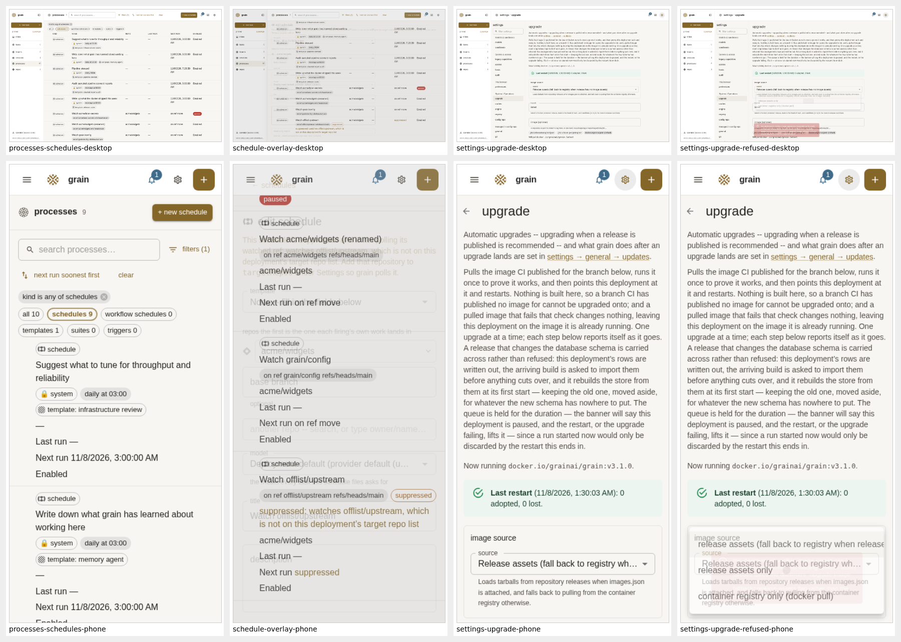

# Test run — 2026-11-07 §9: Releases, Docker Hub publishing, release-asset upgrades & GitHub CI fidelity

**Plan:** [`docs/test-plans/2026-11-07.md` §9](../test-plans/2026-11-07.md)
**Branch:** `grain/098073e4/task-3493-walkthrough-docker-hub` (task 3493), based on `origin/main` `ecb94b6a`
**Harnesses & transcripts:** [`2026-11-07-releases-upgrades-ci/`](2026-11-07-releases-upgrades-ci/)
**Outcome:** I walked all four "What is NOT proved" items against live daemons, local OCI, Releases and `githubsim`-style servers, and real `dockerd`. **I found six bugs (F1–F6) and fixed them in this branch, each with a regression test.** Every other check passed.

> [!IMPORTANT]
> This branch changes `scripts/release-images.sh` (Bug F4). That file is covered by
> [`.grain/triggers/release-machinery.yml`](../../.grain/triggers/release-machinery.yml)
> (`gate: true`, `sensitive: true`), so the pull request needs that gate's review before it merges.
> Nothing covered by `release-promotion.yml` (the person-only promotion path) changed.

## Environment

| | |
|---|---|
| Host | grain sandbox, Debian, 7 vCPU / 30 GiB |
| Toolchain | Go 1.26.10, Node 20.19.0, Docker 29.9.3 (`dockerd` + buildx), shellcheck 0.9.0, jq 1.6 |
| Browsers | Playwright chromium 151 (`npx playwright install --with-deps chromium`, with `NODE_EXTRA_CA_CERTS` pointing at the sandbox's package-cache CA) |
| grain | `go build ./cmd/grain` from this branch, after `cd ui && npm ci && npm run build` |
| Local servers | `releases_forge.go` (GitHub Releases REST + assets, `127.0.0.1:4280`); `ociregistry.go` (OCI v2 registry, `:4281`/`:4282`/`:4286`); `item3_ci_probe.go`'s in-process `githubsim`-style forge (`:4284`) and blob host (`:4285`); live `grain daemon`s on `:4283` (item 1), `:4290`/`:4291` (item 4) |
| Release scripts | I ran every `scripts/release-*.sh` invocation in a scratch clone under `/tmp`, never in `/home/debian/work`. Each run checks afterwards that `/home/debian/work/.git/config` is unchanged |

How to reproduce, from the repository root:

```bash
docs/test-runs/2026-11-07-releases-upgrades-ci/prep-item1.sh      # tiny runnable grain images + releases_forge into /tmp/item1-build
bash docs/test-runs/2026-11-07-releases-upgrades-ci/run-item1.sh  # §9.1
bash docs/test-runs/2026-11-07-releases-upgrades-ci/run-item2.sh  # §9.2
bash docs/test-runs/2026-11-07-releases-upgrades-ci/run-item3.sh  # §9.3
bash docs/test-runs/2026-11-07-releases-upgrades-ci/run-item4.sh  # §9.4 (+ Playwright screens.cjs, pkgcache probe)
```

## Findings

| # | Area (PR) | Bug | Fix | Regression |
|---|---|---|---|---|
| F1 | Release-asset upgrades (#661) | A daemon started with `-github-host H -github-insecure-http` still read releases over `https://H/api/v3`, so every listing failed with `http: server gave HTTP response to HTTPS client`. `/api/upgrade/targets` showed no versions, and a release-assets upgrade could never resolve. ([before](2026-11-07-releases-upgrades-ci/transcripts/bug-f1-before.txt)) | [`pkg/daemon/release_client.go`](../../pkg/daemon/release_client.go): `releaseHostAPIBase` computes the API root, using plain HTTP for the `-github-host` under `-github-insecure-http` or for a non-TLS connection, and passes it as `ReleaseHostClient.APIBase`. A github.com release repo still uses `https://api.github.com`. | `TestDaemonReleaseHostClientHonoursInsecureGitHubHost` |
| F2 | Configurable release asset (#661) | With `-upgrade-release-asset grain-image.tar.gz` and no `images.json`, a release-assets-only deployment still required `images.json` to count a release as published. It listed no versions and refused every upgrade. ([before](2026-11-07-releases-upgrades-ci/transcripts/bug-f2-before.txt)) | [`pkg/upgrade/release_assets.go`](../../pkg/upgrade/release_assets.go): `requiredReleaseAsset` (the configured asset if set, otherwise the manifest) decides "published" in `resolveRelease`, `newestPublishedRelease` and `listReleaseTags`. The mid-swap `images.json.next` wait applies to manifest mode only. | `TestSingleReleaseAssetCountsAsPublished` |
| F3 | `grain state check` (#744) | `grain state -data-dir D check DIR` dropped `-data-dir`, so the check could not apply deployment-specific rules (external config repo, secrets backup repo). I folded this into F5. | [`pkg/cli/state.go`](../../pkg/cli/state.go) → `statecheck.Options.DataDir` | covered by F5's test |
| F4 | Docker Hub promotion (#753, #780) | `retag_image` called `docker buildx imagetools create` with buildx's default `--prefer-index=true`. That wraps a single-platform manifest (the stamped release `docker push` writes) in a new index under a different digest, so the script's own check failed: `the copy is not the image that was tested`. ([before](2026-11-07-releases-upgrades-ci/transcripts/bug-f4-retag-index-before.txt)) | [`scripts/release-images.sh`](../../scripts/release-images.sh): `--prefer-index=false` makes an exact copy (no effect on images that are already indexes) | `tests/deploy/promote_images_test.go` `TestPromoteRebuildsTheGrainImageWithTheReleaseStamped` now requires `--prefer-index=false` |
| F5 | Forbidden `git_ref` (#744) | REST refused forbidden `git_ref` watches, but `grain state check` answered `ok: grain can load this` for (1) a malformed `git_ref.repo`, (2) an enabled watch on a retired `grain/config-<team>` alias, and (3) with `-data-dir`, the encrypted secrets backup repo. `.grain/schedules/*.yml` also accepted the retired alias. ([before](2026-11-07-releases-upgrades-ci/transcripts/bug-f5-gitref-before.txt)) | [`pkg/staterepo/decl.go`](../../pkg/staterepo/decl.go) validates decoded triggers. [`statecheck.GitRefSchedules`](../../pkg/staterepo/statecheck/statecheck.go) refuses enabled forbidden watches (paused ones are allowed). [`pkg/repodecl/parse.go`](../../pkg/repodecl/parse.go) refuses retired aliases. [`model.IsRetiredConfigRepo`](../../pkg/model/repo_scope.go) | `TestStateCheckRefusesForbiddenGitRefSchedules`, `TestAScheduleFiresATemplateWhenAnotherRepositorysRefMoves` (retired-alias case) |
| F6 | Forbidden `git_ref` (#744) | **The third route in.** A merged `grain/config` change (an operator commit to the running daemon's state repository) re-pointed an enabled schedule at `grain/config-alpha`, and the daemon **imported it**, even though REST refuses that repo with HTTP 400. The same happened for the secrets backup repo. ([before](2026-11-07-releases-upgrades-ci/transcripts/bug-f6-import-before.txt)) | [`pkg/staterepo/gitref_forbidden.go`](../../pkg/staterepo/gitref_forbidden.go): `applySettingsFromDirs` refuses (`ErrNotApplied`, database unchanged) any enabled `git_ref` watch that the arriving change adds, re-points or re-enables onto a repo `ForbiddenGitRefWatch` forbids. A grandfathered row nobody changed is left alone so it cannot block later imports. `statecheck` uses the same check. | `TestAMergedSettingsChangeMayNotWatchAForbiddenRepository`, `TestAMergedSettingsChangeKeepsAGrandfatheredWatchWorking`, `TestForbiddenGitRefImport`, `TestRemoteMatchesRepo`; live in `run-item4.sh` 4A.5 |

Observations (not bugs, left as they are):

- `PATCH /api/schedules/{id}` validates `recurrence.gitRef` only when the request includes `recurrence`. `{"enabled": true}` alone therefore re-enables a paused schedule whose watch has since become forbidden. The poller's forbidden-repo set still refuses to read that repo, so nothing leaks. If REST should refuse it outright, that is a small follow-up.
- On a live daemon, the target-repo allowlist is written through `PUT /api/deployment` (`targetRepos`). `processes-git-ref-suppression.spec.js` writes it through `/api/settings` on the demo, and that spec passes here.
- Upload-session `Location`s on hosts that `pkgcache` does not intercept at all come back **405**, not 404. Both are refusals, and no request reaches any upstream.

## §9.1 Release-asset upgrade end-to-end — PASS (after F1, F2)

Harness: [`prep-item1.sh`](2026-11-07-releases-upgrades-ci/prep-item1.sh), [`releases_forge.go`](2026-11-07-releases-upgrades-ci/releases_forge.go), [`run-item1.sh`](2026-11-07-releases-upgrades-ci/run-item1.sh), [`forge_download_probe.go`](2026-11-07-releases-upgrades-ci/forge_download_probe.go). Transcripts: [`item1-live-rerun.txt`](2026-11-07-releases-upgrades-ci/transcripts/item1-live-rerun.txt) (re-run on the final code), [`item1-live.txt`](2026-11-07-releases-upgrades-ci/transcripts/item1-live.txt), [`item1-forge-download.txt`](2026-11-07-releases-upgrades-ci/transcripts/item1-forge-download.txt).

- **1A** (#749): `v3.2.0` is published with a runnable OCI tarball, a test-verifier signature and a v2 `images.json`. `v3.2.1` is tagged but has no assets. `GET /api/upgrade/targets` lists `v3.2.0` and leaves out `v3.2.1`, with `versionsError: null`. Requesting `v3.2.1` fails closed: `release v3.2.1 … is not published; the newest published release is v3.2.0`, with no restart. `latest` follows the v2 `channel-latest` pointer to `v3.2.0`, then loads, verifies, health-checks and checks flags and schema, and records `image.env`.
- **1B** (#772/#799): `release/v3.2.0` resolves to `channel-release-v3.2.0` (`/` → `-`) and loads `v3.2.0`'s assets. Dedicated edition repos accept bare `vX.Y.Z` tags, and shared repos keep edition-suffix filtering.
- **1C** (#661): with only `images.json.next` present (mid-publish), the upgrade waits (`moving release is mid-update … try again later`). It does not fall back to the registry or pull a partial asset.
- **1D** (#661 `a2681b21`): a tarball swapped against `images.json`'s `imageId` is refused (`integrity check failed`). When both tarball and manifest are swapped, the signature step rejects it because the verifier signs only the original image ID. No restart happens in either case.
- **1E** (F2): single-asset mode lists `v3.2.0`, leaves out `v3.2.1`, and upgrades.
- **1F** (#661): on a verifying deployment (`-upgrade-verify-cmd`), `PUT /api/upgrade/source` refuses `release-assets` as both source and fallback, and refuses a release repo outside the allowed list. All three return HTTP 400 with the reason.
- **`forge_download` confinement** (`553689d1`): the call is refused for a name outside `grain-release-asset-*`, a missing placeholder, a symlinked placeholder or parent directory, a non-empty placeholder, or a placeholder with multiple hard links. A daemon-minted placeholder streams 69 bytes, with the sha256 checked.
- **Settings → Upgrade in Playwright** at 1440×900 and 390×844 ([`screens.cjs`](2026-11-07-releases-upgrades-ci/screens.cjs), run from `run-item4.sh` 4A.6). On a verifying daemon, choosing **Release assets only** sends `PUT /api/upgrade/source` → 400 "this deployment verifies image signatures …". The UI shows the error, the image source stays `registry`, and there is no horizontal overflow at either width. Shots are in the [contact sheet](2026-11-07-releases-upgrades-ci/contact-sheet.png).

## §9.2 Docker Hub alias transition & mock OCI promotion — PASS (after F4)

Harness: [`run-item2.sh`](2026-11-07-releases-upgrades-ci/run-item2.sh), [`item2_alias_probe.go`](2026-11-07-releases-upgrades-ci/item2_alias_probe.go), [`ociregistry.go`](2026-11-07-releases-upgrades-ci/ociregistry.go). Transcript: [`item2-oci.txt`](2026-11-07-releases-upgrades-ci/transcripts/item2-oci.txt).

- **2A**: every legacy `ghcr.io/{bwsalmon,ai-on-gke}/grain/*` name maps to `docker.io/grainai/{grain,sandbox,sandbox-base,sandbox-k8s,sandbox-k8s-base}`. Custom registries (`us-docker.pkg.dev/…`, `127.0.0.1:4281/…`, `ghcr.io/example-org/private-grain`) and digest-pinned refs are left untouched. A live daemon's `/api/upgrade` moves `ghcr.io/ai-on-gke/grain/grain` to `docker.io/grainai/grain` and keeps an explicit custom registry. `scripts/release-image-repos.sh` mapping and `cmd/ghcr-prune` (Docker Hub v2 API) pass.
- **2B** (#747/#780): `docker login docker.io` stays in a throwaway `DOCKER_CONFIG`, and `$HOME/.docker/config.json` is untouched. Promoting `grain` + `grain-registry` against the local OCI v2 registry fails closed on a missing `registry:sha-…`, before any release tag moves. The happy path rebuilds both with `RELEASE=v1.5.0`, signs them, and copies them exactly to `:latest` and `:sha-…` (after F4).
- **2C** (#753): pre-Docker-Hub GHCR digest promotion fails closed on a missing source, an unsigned source under `REQUIRE_IMAGE_SIGNING=true`, an unusable signing key, and a digest mismatch, with zero release tags moved. The happy path verifies all 5 signed GHCR images, copies them by digest, and re-signs them on the target Hub without rebuilding the stamped `grain:v3.1.0`.
- `/home/debian/work/.git/config` was unchanged after every run.

## §9.3 Suite `qualification:`, superseded `release.yml`, streak reset & empty logs — PASS

Harness: [`run-item3.sh`](2026-11-07-releases-upgrades-ci/run-item3.sh), [`item3_ci_probe.go`](2026-11-07-releases-upgrades-ci/item3_ci_probe.go). Transcript: [`item3-ci.txt`](2026-11-07-releases-upgrades-ci/transcripts/item3-ci.txt).

- **3A** (#831/#825/#680/#621): `ai-on-gke/grain`'s declarations reconcile: four qualification items with scratch push + `ci:read`, and a 20-minute release train. Invalid `qualification:` stanzas are refused by `repodecl.Load`. RC-tag qualification is gated on Stage 1, runs the held smoke item last, and posts `grain/release-qualification=success`. A custom stanza (`synced-release`, `stage1.workflow=ci.yml`) picks the `go.mod` release pin and posts `grain/edition-qualification=success`. Scratch-branch child proposals queue and auto-merge on `qualification/<parent-id>`, and are held on `main` or foreign branches.
- **3B** (#775/#699): a cancelled `release.yml` at C0, superseded by a newer merge's run, is recorded as superseded, with `Failures=0` and base CI not broken. An on-demand single-commit build is ignored. A `github_workflow_run` review schedule files a task with the Actions-specific prompt.
- **3C** (#819/#745): an older ancestor commit going green late keeps the newer C1 triage task open and preserves the streak. The branch-scoped completed-run poll finds run 5001 behind 70 PR runs, resets `Failures` 3→0, supersedes the C1 triage task, and keeps triage tasks that are not ancestors or belong to other repos open.
- **3D** (#828): the error for an empty Actions job log names both the API host and the blob host plus response headers, without leaking the SAS token. `/api/ci/runs/{id}/log` returns that 502 without caching it, then serves and caches the populated log.
- **3E** (#642): `CHECK_QUALIFICATION_APP` unset → exit 64. Numeric `42` ignores a spoofed `{id:999, slug:"42"}` and trusts `{id:42}`. The slug `grain-bot` trusts the slug and ignores `evil-bot`.
- **3F** (#775): `release-images.sh` on-demand, in a `/tmp` scratch clone, dispatches `release.yml` for a superseded commit and populates `sha-` images without moving release tags.

## §9.4 Forbidden `git_ref` schedules & `pkgcache` `/artifacts-uploads/` — PASS (after F5, F6)

Harness: [`run-item4.sh`](2026-11-07-releases-upgrades-ci/run-item4.sh), [`screens.cjs`](2026-11-07-releases-upgrades-ci/screens.cjs), [`item4_pkgcache_probe.go`](2026-11-07-releases-upgrades-ci/testdata/item4_pkgcache_probe.go). Transcript: [`item4-live.txt`](2026-11-07-releases-upgrades-ci/transcripts/item4-live.txt).

- **4A.1 REST** (#744): the live daemon backs secrets up to `acme/host-secrets` and has `targetRepos [acme/widgets]`. `POST /api/schedules` returns 400 for `grain/config-alpha` (`not found: only grain/config exists`), for `acme/host-secrets` and `ACME/Host-Secrets` (forbidden set: encrypted secrets backup repo), and for `not a repo`. It returns 201 for `grain/config`, `acme/widgets` and `offlist/upstream`, and the last reports `suppressed: watchedRepoOffTarget`. `PATCH` onto `grain/config-beta` → 400.
- **4A.2 grandfathered pause**: after the secrets remote is moved onto a schedule's watched repo and the daemon restarts, re-saving the watch returns 400, while `{"enabled": false, …}` returns 200 and pauses the schedule.
- **4A.3 CLI** `grain declarations check`: `upstream/core` → rc 0. `grain/config-alpha` → rc 1 (F5). `grain/config` → rc 1.
- **4A.4 CLI** `grain state check`, run on copies of the live state repo: ok → 0, malformed → 1, retired → 1, secrets without `-data-dir` → 0, secrets with `-data-dir` → 1 (F3/F5).
- **4A.5 state-repo import** (F6): an operator commit re-pointing `sched-2` at `grain/config-alpha` is refused (`staterepo: refusing to apply … schedule sched-2: git_ref repo grain/config-alpha cannot be watched …`), and the database still says `acme/widgets`. After a revert, a follow-up rename applies, and the grandfathered paused row does not block the import.
- **4A.6 Processes → Schedules in Playwright** at 1440 and 390: the off-target row shows a **Suppressed** chip, the hint "suppressed: watches offlist/upstream, which is not on this deployment's target repo list", and the overlay explanation, with no horizontal overflow. The existing specs `processes-git-ref-suppression.spec.js`, `upgrade-image-chooser.spec.js` and `settings-upgrade.spec.js` pass, 8/8 ([log](2026-11-07-releases-upgrades-ci/transcripts/playwright-specs.txt)).
- **4B `pkgcache`** (#811), with a real `pkgcache.Server` over its own TLS CA:
  - A 1 MiB+ blob pushes as POST → 4×256 KiB `PATCH /artifacts-uploads/…` → `PUT ?digest`, and the upstream reassembles it byte for byte with a matching digest.
  - No `Grit-Job-Token`, `Grit-Cache-Trust`, Connection-named hop header or daemon GitHub package credential reaches the `*.pkg.dev` upstream.
  - Session URLs on `ghcr.io`, `registry-1.docker.io`, bare `pkg.dev`, `evilpkg.dev`, `…pkg.dev.evil.example` and `attacker.example` are refused, with zero upstream requests.
  - `..`, `%2e%2e` and `%252e%252e` traversal attempts never reach the upstream.
  - A restricted (no-network) sandbox gets 403/404 on POST, PATCH, PUT and GET, with zero upstream requests.

## UI evidence

[`contact-sheet.png`](2026-11-07-releases-upgrades-ci/contact-sheet.png) shows Processes → Schedules (list + overlay) and Settings → Upgrade (before and after the refused source change), at desktop and phone widths. This branch makes no UI change, so there are no before/after pairs.



## Verification

- `go test ./pkg/staterepo/... ./pkg/upgrade/ ./pkg/repodecl/ ./pkg/pkgcache/ ./tests/hygiene/...`: ok.
- `go test ./pkg/daemon/ ./pkg/cli/ -run 'State|Release|Upgrade|Schedule'`: ok.
- `go test ./tests/deploy/ -run TestPromote`: ok.
- `shellcheck docs/test-runs/2026-11-07-releases-upgrades-ci/*.sh`: clean.
- Without its fix, each new regression fails: F1's `APIBase` is empty, F2 gives `release tags = []`, F6 gives `Apply = <nil>`.
- GitHub Actions on the pull request: see the PR checks.
