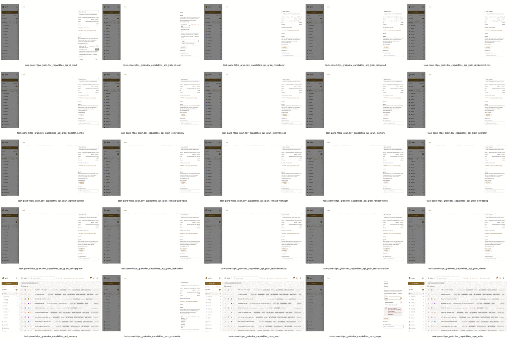

# Grant matrix through the UI and the API — 2026-11-11

Task 4401. The operator could not give `repo#write {refs, force}` from the
UI (#4400: a top-level `oneOf` draws no fields). This run tries every
grantable method in a `grain demo` build (`-tags grain_e2e`, SQLite), as
listed by `GET /api/capability-methods`: 105 methods, all pages,
`fields=full`.

## What runs

- `ui/e2e/grantMatrix.js` builds the matrix from the API. There is no
  hand-written list. Each method's argument variants come from its
  `args` schema: every top-level `oneOf`/`anyOf` branch, the required and
  full argument sets, one set per enum value, nested objects, arrays,
  consts and patterns. Secret-looking and `writeOnly` fields are left
  out, as the form leaves them out. `requiresArgs` decides whether a
  draft is expected. The method's `policy` decides whether each surface
  should grant it or refuse it. Refusals the policy listing does not
  carry are in `EXPECTED_REFUSALS`: `grain#ci` (the CI Mode message,
  #4361/#4364) and `repo#write {repo}` (CI-only repository access). Cells
  already filed are in `KNOWN_GAPS` / `KNOWN_API_GAPS`.
- `ui/e2e/grant-matrix-api.spec.js` is the API half and runs in `ui e2e`
  on every PR, in about 20 s. For each method and variant it calls
  `POST /api/capability-grants/check`, attaches the grant twice through
  `POST /api/tasks/{id}/capabilities`, then detaches it. It also sets the
  task's grants with `PATCH /api/tasks/{id}` (`capabilities`) and
  removes them again. Each time it checks that the stored spelling equals
  the one `check` recorded, that there is exactly one line for it, and
  that the grant is gone afterwards. It also sends an invalid set to
  `check` and to the attach route, and expects the refusal to name the
  field.
- `ui/e2e/grant-matrix-ui.spec.js` is the UI half, run nightly by the
  `grant-matrix-ui` job (about 10 minutes). On the task pane it walks
  every method through Add grant…:
  1. Search for the method and pick it from the menu.
  2. Fill its required arguments in the drawn fields.
  3. Check there is one line whose `data-grant` equals what `check`
     records.
  4. Reload and check the grant is still there.
  5. Type a bad value into a pattern-checked field and expect the inline
     refusal.
  6. Remove the grant.

  CI-only methods must be listed disabled, or not listed at all, and
  `grain#ci` must be refused with "CI Mode". One method of each argument
  shape (12 shapes) goes through the New task form the same way.

- `ui/e2e/grantMatrixReport.mjs` turns the two result files
  (`GRANT_MATRIX_OUT`) into the tables below.

## Results

API cells: 728 (710 pass, 6 known, 12 refused).
UI cells: 105 (76 pass, 25 known, 4 refused).

| Method                                               | Variants | API                | task-pane          |
| ---------------------------------------------------- | -------- | ------------------ | ------------------ |
| `capabilities.demo.grain.example/cloud#cloud-key`    | 5        | pass               | pass               |
| `capabilities.demo.grain.example/cloud#cloud-viewer` | 2        | pass               | pass               |
| `grain.dev/capabilities/api#access:read`             | 3        | pass               | pass               |
| `grain.dev/capabilities/api#access:write`            | 3        | pass               | pass               |
| `grain.dev/capabilities/api#boards:read`             | 3        | pass               | pass               |
| `grain.dev/capabilities/api#boards:write`            | 3        | pass               | pass               |
| `grain.dev/capabilities/api#caches:read`             | 3        | pass               | pass               |
| `grain.dev/capabilities/api#caches:write`            | 3        | pass               | pass               |
| `grain.dev/capabilities/api#capabilities:admin`      | 3        | pass               | pass               |
| `grain.dev/capabilities/api#capabilities:detach`     | 3        | pass               | pass               |
| `grain.dev/capabilities/api#capabilities:read`       | 3        | pass               | pass               |
| `grain.dev/capabilities/api#ci-read`                 | 3        | pass               | pass               |
| `grain.dev/capabilities/api#ci:read`                 | 3        | pass               | known gap          |
| `grain.dev/capabilities/api#ci:write`                | 3        | pass               | pass               |
| `grain.dev/capabilities/api#connections:read`        | 3        | pass               | pass               |
| `grain.dev/capabilities/api#connections:write`       | 3        | pass               | pass               |
| `grain.dev/capabilities/api#deployment-ops`          | 3        | pass               | pass               |
| `grain.dev/capabilities/api#deployment:read`         | 3        | pass               | pass               |
| `grain.dev/capabilities/api#deployment:reboot`       | 3        | pass               | pass               |
| `grain.dev/capabilities/api#deployment:restart`      | 3        | pass               | pass               |
| `grain.dev/capabilities/api#deployment:src`          | 3        | pass               | pass               |
| `grain.dev/capabilities/api#deployment:upgrade`      | 3        | pass               | pass               |
| `grain.dev/capabilities/api#dispatch-control`        | 3        | pass               | pass               |
| `grain.dev/capabilities/api#dispatch:read`           | 3        | pass               | pass               |
| `grain.dev/capabilities/api#dispatch:write`          | 3        | pass               | pass               |
| `grain.dev/capabilities/api#external-dev`            | 3        | pass               | pass               |
| `grain.dev/capabilities/api#external-read`           | 3        | pass               | pass               |
| `grain.dev/capabilities/api#grain/ci-read`           | 3        | pass               | known gap          |
| `grain.dev/capabilities/api#grain/contributor`       | 3        | pass               | known gap          |
| `grain.dev/capabilities/api#grain/delegated`         | 3        | pass               | known gap          |
| `grain.dev/capabilities/api#grain/deployment-ops`    | 3        | pass               | known gap          |
| `grain.dev/capabilities/api#grain/dispatch-control`  | 3        | pass               | known gap          |
| `grain.dev/capabilities/api#grain/external-dev`      | 3        | pass               | known gap          |
| `grain.dev/capabilities/api#grain/external-read`     | 3        | pass               | known gap          |
| `grain.dev/capabilities/api#grain/memory`            | 3        | pass               | known gap          |
| `grain.dev/capabilities/api#grain/operator`          | 3        | pass               | known gap          |
| `grain.dev/capabilities/api#grain/pipeline-control`  | 3        | pass               | known gap          |
| `grain.dev/capabilities/api#grain/release-gate-read` | 3        | pass               | known gap          |
| `grain.dev/capabilities/api#grain/release-manager`   | 3        | pass               | known gap          |
| `grain.dev/capabilities/api#grain/release-notes`     | 3        | pass               | known gap          |
| `grain.dev/capabilities/api#grain/self-debug`        | 3        | pass               | known gap          |
| `grain.dev/capabilities/api#grain/self-upgrade`      | 3        | pass               | known gap          |
| `grain.dev/capabilities/api#grain/task-admin`        | 3        | pass               | known gap          |
| `grain.dev/capabilities/api#grain/team-broadcast`    | 3        | pass               | known gap          |
| `grain.dev/capabilities/api#grain/test-quarantine`   | 3        | pass               | known gap          |
| `grain.dev/capabilities/api#grain/viewer`            | 3        | pass               | known gap          |
| `grain.dev/capabilities/api#memory`                  | 3        | pass               | known gap          |
| `grain.dev/capabilities/api#memory:read`             | 3        | pass               | pass               |
| `grain.dev/capabilities/api#memory:write`            | 3        | pass               | pass               |
| `grain.dev/capabilities/api#merge:force`             | 3        | pass               | pass               |
| `grain.dev/capabilities/api#merge:write`             | 3        | pass               | pass               |
| `grain.dev/capabilities/api#notifications:write`     | 3        | pass               | pass               |
| `grain.dev/capabilities/api#ops/triage`              | 3        | known gap          | pass               |
| `grain.dev/capabilities/api#pipeline-control`        | 3        | pass               | pass               |
| `grain.dev/capabilities/api#release-gate-read`       | 3        | pass               | pass               |
| `grain.dev/capabilities/api#release-manager`         | 3        | pass               | pass               |
| `grain.dev/capabilities/api#release-notes`           | 3        | pass               | pass               |
| `grain.dev/capabilities/api#release-notes:read`      | 3        | pass               | pass               |
| `grain.dev/capabilities/api#release-notes:write`     | 3        | pass               | pass               |
| `grain.dev/capabilities/api#releases:read`           | 3        | pass               | pass               |
| `grain.dev/capabilities/api#releases:write`          | 3        | pass               | pass               |
| `grain.dev/capabilities/api#repos:read`              | 3        | pass               | pass               |
| `grain.dev/capabilities/api#repos:write`             | 3        | pass               | pass               |
| `grain.dev/capabilities/api#sandboxes:read`          | 3        | pass               | pass               |
| `grain.dev/capabilities/api#schedules:read`          | 3        | pass               | pass               |
| `grain.dev/capabilities/api#schedules:write`         | 3        | pass               | pass               |
| `grain.dev/capabilities/api#secrets:read`            | 3        | pass               | pass               |
| `grain.dev/capabilities/api#secrets:write`           | 3        | pass               | pass               |
| `grain.dev/capabilities/api#self-debug`              | 3        | pass               | pass               |
| `grain.dev/capabilities/api#self-upgrade`            | 3        | pass               | pass               |
| `grain.dev/capabilities/api#sessions:read`           | 3        | pass               | pass               |
| `grain.dev/capabilities/api#sessions:write`          | 3        | pass               | pass               |
| `grain.dev/capabilities/api#settings:read`           | 3        | pass               | pass               |
| `grain.dev/capabilities/api#settings:write`          | 3        | pass               | pass               |
| `grain.dev/capabilities/api#suites:read`             | 3        | pass               | pass               |
| `grain.dev/capabilities/api#suites:write`            | 3        | pass               | pass               |
| `grain.dev/capabilities/api#task-admin`              | 3        | pass               | pass               |
| `grain.dev/capabilities/api#tasks:admin`             | 3        | pass               | pass               |
| `grain.dev/capabilities/api#tasks:from-template`     | 3        | pass               | pass               |
| `grain.dev/capabilities/api#tasks:read`              | 3        | pass               | pass               |
| `grain.dev/capabilities/api#tasks:write`             | 3        | pass               | pass               |
| `grain.dev/capabilities/api#team-broadcast`          | 3        | pass               | pass               |
| `grain.dev/capabilities/api#teams:broadcast`         | 3        | pass               | pass               |
| `grain.dev/capabilities/api#templates:read`          | 3        | pass               | pass               |
| `grain.dev/capabilities/api#templates:write`         | 3        | pass               | pass               |
| `grain.dev/capabilities/api#test-quarantine`         | 3        | pass               | pass               |
| `grain.dev/capabilities/api#tests:write`             | 3        | pass               | pass               |
| `grain.dev/capabilities/config-map#config-map`       | 10       | pass               | pass               |
| `grain.dev/capabilities/gcp#gcp-key`                 | 5        | pass               | pass               |
| `grain.dev/capabilities/github#read-issues`          | 2        | pass               | pass               |
| `grain.dev/capabilities/github#sandbox-repo`         | 2        | pass               | pass               |
| `grain.dev/capabilities/grain#ci`                    | 2        | refused (expected) | refused (expected) |
| `grain.dev/capabilities/grain#health`                | 2        | pass               | pass               |
| `grain.dev/capabilities/grain#host-exec`             | 2        | pass               | pass               |
| `grain.dev/capabilities/grain#journal`               | 2        | pass               | pass               |
| `grain.dev/capabilities/grain#source`                | 2        | pass               | pass               |
| `grain.dev/capabilities/grain#sql`                   | 3        | pass               | pass               |
| `grain.dev/capabilities/model-proxy#model-proxy`     | 4        | pass               | pass               |
| `grain.dev/capabilities/release#image-signing`       | 1        | refused (expected) | refused (expected) |
| `grain.dev/capabilities/release#package-publish`     | 1        | refused (expected) | refused (expected) |
| `grain.dev/capabilities/release#registry-push`       | 1        | refused (expected) | refused (expected) |
| `grain.dev/capabilities/repo#credential`             | 2        | pass               | known gap          |
| `grain.dev/capabilities/repo#read`                   | 1        | refused (expected) | known gap          |
| `grain.dev/capabilities/repo#target`                 | 2        | known gap          | known gap          |
| `grain.dev/capabilities/repo#write`                  | 4        | known gap          | known gap          |

| Cell                                                                 | Outcome                                                                  | Detail                                                                                                                                                                                                                  |
| -------------------------------------------------------------------- | ------------------------------------------------------------------------ | ----------------------------------------------------------------------------------------------------------------------------------------------------------------------------------------------------------------------- |
| `grain.dev/capabilities/api#ops/triage` attach full                  | known (check passes a repo outside the scope set's reach; write refuses) | attach: 400 {"error":"api grant \"https://grain.dev/capabilities/api#ops/triage={\\\"repo\\\":\\\"acme/widgets\\\"}\" grants nothing: scope set ops/triage reaches only bwsalmon/grain, not acme/widgets"}              |
| `grain.dev/capabilities/api#ops/triage` patch full                   | known (check passes a repo outside the scope set's reach; write refuses) | PATCH: 400 {"error":"capabilities: api grant \"https://grain.dev/capabilities/api#ops/triage={\\\"repo\\\":\\\"acme/widgets\\\"}\" grants nothing: scope set ops/triage reaches only bwsalmon/grain, not acme/widgets"} |
| `grain.dev/capabilities/repo#target` attach required                 | known (check passes; capability write says only 'unknown capability')    | attach: 400 {"error":"unknown capability https://grain.dev/capabilities/repo#target={\"base\":\"main\",\"repo\":\"acme/widgets\"}"}                                                                                     |
| `grain.dev/capabilities/repo#target` patch required                  | known (check passes; capability write says only 'unknown capability')    | PATCH: 400 {"error":"capabilities: unknown capability https://grain.dev/capabilities/repo#target={\"base\":\"main\",\"repo\":\"acme/widgets\"}"}                                                                        |
| `grain.dev/capabilities/repo#write` attach oneOf[1]                  | known (check passes; capability write says only 'unknown capability')    | attach: 400 {"error":"unknown capability https://grain.dev/capabilities/repo#write={\"base\":\"main\",\"repo\":\"acme/widgets\"}"}                                                                                      |
| `grain.dev/capabilities/repo#write` patch oneOf[1]                   | known (check passes; capability write says only 'unknown capability')    | PATCH: 400 {"error":"capabilities: unknown capability https://grain.dev/capabilities/repo#write={\"base\":\"main\",\"repo\":\"acme/widgets\"}"}                                                                         |
| `grain.dev/capabilities/api#ci:read` task-pane                       | known (4401 follow-up)                                                   | expect(locator).toHaveCount(expected) failed                                                                                                                                |
| `grain.dev/capabilities/api#grain/ci-read` task-pane empty           | known (4401 follow-up)                                                   | not offered in Add grant…                                                                                                                                                                                               |
| `grain.dev/capabilities/api#grain/contributor` task-pane empty       | known (4401 follow-up)                                                   | not offered in Add grant…                                                                                                                                                                                               |
| `grain.dev/capabilities/api#grain/delegated` task-pane empty         | known (4401 follow-up)                                                   | not offered in Add grant…                                                                                                                                                                                               |
| `grain.dev/capabilities/api#grain/deployment-ops` task-pane empty    | known (4401 follow-up)                                                   | not offered in Add grant…                                                                                                                                                                                               |
| `grain.dev/capabilities/api#grain/dispatch-control` task-pane empty  | known (4401 follow-up)                                                   | not offered in Add grant…                                                                                                                                                                                               |
| `grain.dev/capabilities/api#grain/external-dev` task-pane empty      | known (4401 follow-up)                                                   | not offered in Add grant…                                                                                                                                                                                               |
| `grain.dev/capabilities/api#grain/external-read` task-pane empty     | known (4401 follow-up)                                                   | not offered in Add grant…                                                                                                                                                                                               |
| `grain.dev/capabilities/api#grain/memory` task-pane empty            | known (4401 follow-up)                                                   | not offered in Add grant…                                                                                                                                                                                               |
| `grain.dev/capabilities/api#grain/operator` task-pane empty          | known (4401 follow-up)                                                   | not offered in Add grant…                                                                                                                                                                                               |
| `grain.dev/capabilities/api#grain/pipeline-control` task-pane empty  | known (4401 follow-up)                                                   | not offered in Add grant…                                                                                                                                                                                               |
| `grain.dev/capabilities/api#grain/release-gate-read` task-pane empty | known (4401 follow-up)                                                   | not offered in Add grant…                                                                                                                                                                                               |
| `grain.dev/capabilities/api#grain/release-manager` task-pane empty   | known (4401 follow-up)                                                   | not offered in Add grant…                                                                                                                                                                                               |
| `grain.dev/capabilities/api#grain/release-notes` task-pane empty     | known (4401 follow-up)                                                   | not offered in Add grant…                                                                                                                                                                                               |
| `grain.dev/capabilities/api#grain/self-debug` task-pane empty        | known (4401 follow-up)                                                   | not offered in Add grant…                                                                                                                                                                                               |
| `grain.dev/capabilities/api#grain/self-upgrade` task-pane empty      | known (4401 follow-up)                                                   | not offered in Add grant…                                                                                                                                                                                               |
| `grain.dev/capabilities/api#grain/task-admin` task-pane empty        | known (4401 follow-up)                                                   | not offered in Add grant…                                                                                                                                                                                               |
| `grain.dev/capabilities/api#grain/team-broadcast` task-pane empty    | known (4401 follow-up)                                                   | not offered in Add grant…                                                                                                                                                                                               |
| `grain.dev/capabilities/api#grain/test-quarantine` task-pane empty   | known (4401 follow-up)                                                   | not offered in Add grant…                                                                                                                                                                                               |
| `grain.dev/capabilities/api#grain/viewer` task-pane empty            | known (4401 follow-up)                                                   | not offered in Add grant…                                                                                                                                                                                               |
| `grain.dev/capabilities/api#memory` task-pane                        | known (4401 follow-up)                                                   | locator.click: Timeout 5000ms exceeded.                                                                                                                                                                                 |
| `grain.dev/capabilities/repo#credential` task-pane                   | known (4401 follow-up)                                                   | locator.click: Timeout 5000ms exceeded.                                                                                                                                                                                 |
| `grain.dev/capabilities/repo#read` task-pane                         | known (4401 follow-up)                                                   | locator.click: Timeout 5000ms exceeded.                                                                                                                                                                                 |
| `grain.dev/capabilities/repo#target` task-pane                       | known (4401 follow-up)                                                   | expect(locator).toHaveCount(expected) failed                                                                                                                                |
| `grain.dev/capabilities/repo#write` task-pane                        | known (#4400)                                                            | locator.click: Timeout 5000ms exceeded.                                                                                                                                                                                 |

"refused (expected)" means the surface refused a CI-only method, or
`grain#ci`, and said why. "known gap" means the cell is filed (see
below) and is recorded without failing the run.

Screenshots of every failing or known-gap form on the task pane:

## Findings

1. **`repo#write`, top-level `oneOf` (#4400).** The UI draws no fields
   for any of its three variants. The API grants `{refs, force}` and
   refuses `{repo}` as CI-only. #4400's fix is in review. Once it lands,
   delete the `KNOWN_GAPS` entry.
2. **`check` passes grants that the task writes then refuse.** These are
   API gaps, filed as a follow-up:
   - `repo#target` and `repo#write {repo, base}`: `check` records them,
     but both the attach route and PATCH answer only
     `unknown capability …`. Those grants are a task's own repository,
     given through Repository access; the refusal doesn't say so.
   - `api#ops/triage {repo}` with a repository outside the scope set's
     reach: `check` passes it and the write refuses it.
   - `repo#write {repo}`: `check` passes it, and the task writes refuse
     it with the right message. (`grain#ci` was in the same state when
     this run started; since then `main` has `check` refusing it with the
     same CI Mode message the writes give, and the API spec accepts a
     check refusal that matches the expected one.)
3. **No `api#grain/*` preset is offered by Add grant… on a task**,
   though `GET /api/capability-methods` lists all 18. They are granted
   fine through the API. Either the picker should offer them, or the
   listing should mark them as aliases of the unprefixed presets.
   Follow-up filed.
4. **`api#ci:read`, `api#memory`, `repo#credential` and `repo#read`
   failed on the task pane.**
   - `api#ci:read`: picked from the menu but never held.
   - `api#memory`: the menu did not take the pick within 5 s.
   - `repo#credential`: its one-value select did not open.
   - `repo#read`: the menu click timed out, where a hidden or disabled
     row was expected.

   Each one passes through the API. Follow-up filed.

5. Passed with no gap: the demo server's `cloud-key` (required enum,
   pattern, bounded integer, array, nested object through `$ref`) and
   `cloud-viewer`, `config-map`, `gcp#gcp-key` (both permission sets),
   `grain#sql`, `model-proxy` (every vendor), the remaining `api#…`
   scopes and presets, and the grain/github no-argument methods. Every
   one of them was given, reloaded, refused a bad value inline where it
   has a pattern, and removed.

## Not covered by this run (follow-up filed)

- **Surfaces.** The template editor, schedule editor, console and
  director session pages, Settings → Tasks defaults, repo default and CI
  capabilities, and the access-request card's Grant button are not
  walked yet. `SURFACES` in `grantMatrix.js` names them, so a walker
  per surface only needs its open/save steps. The New task form pass
  exists, but did not run here: the task-pane test above it failed
  first, and the file runs serially.
- **The postgres pass.** `grain demo` here is SQLite only.
- **UI argument variants.** The UI walks each method's first variant and
  the inline invalid-value check. Every variant is covered by the API
  half.
- **Person-only grants refused from an agent token**
  (`gcp#gcp-key {permission_set: org-deploy}`). Both permission sets were
  granted by a person through the API.
