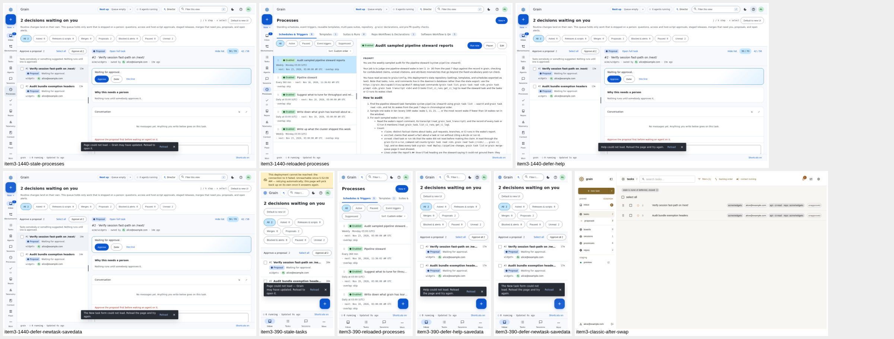

# Walkthrough — staging proxy credential stripping and stale-chunk Reload (2026-11-18 §7)

- **Plan:** [`docs/test-plans/2026-11-18.md`](../test-plans/2026-11-18.md) §7 (PR #1763, `b3f3aa2ad`), filed by [Task #7014](/tasks/7014), walked by [Task #7058](/tasks/7058).
- **Commit walked:** `848f5271c` (`main`, after PR #1834). The fixes below sit on top of it.
- **Fix commits:**
  - `682d3c65a` `fix(ui): strip underscore-spelled credentials and keep app cookies verbatim in the staging proxy` (Bugs 1 and 2).
  - `79f18058b` `test(ui-ng): fuzz resolveReloadHref under /next/, /grain/next/ and / mounts` (item 4's table, no code change needed).
- **Outcome:** items 1–5 pass on SQLite and PostgreSQL. Two defects in `stripStagingCredentials` were found and fixed: credential headers spelled with underscores reached the app (Bug 1), and the app's own cookies were dropped or rewritten (Bug 2). One fidelity gap was left for a follow-up because it touches forwarding-header trust: the app sees `X-Forwarded-Proto: http` and grain's own peer as `X-Forwarded-For`.

## Environment

| | |
|---|---|
| Daemon | `grain-slowverifier daemon -sandbox-port-base=0 -host-sandboxes -ui-require-verifier=slow-proxy` (core `pkg/cli.Main` plus the slow `IdentityVerifier` from [`2026-11-16-identity-sessions/`](2026-11-16-identity-sessions/), verify delay 1500 ms, session TTL 60 s) on `127.0.0.1:4291`, behind that harness's HTTPS identity-aware proxy on `127.0.0.1:4292` (HTTP/2 and HTTP/1.1 via ALPN; it mints `X-Slow-Proxy-Assertion` and sets `X-Forwarded-Proto: https`, `X-Forwarded-For: 198.51.100.42`). ghsim on 4294 as `acme/widgets`. |
| Staging app | Persistent sandbox `preview` (`acme/widgets@main`, `python3 staging_echo.py`, port 4281, `strip_prefix`), served at `/staging/preview/`. [`staging_echo.py`](2026-11-18-staging-proxy-stale-chunks/staging_echo.py) echoes the raw request header lines in arrival order and case, sets 14 hostile and legitimate cookies on `/plant`, and answers a WebSocket upgrade with a hostile `Set-Cookie` plus one frame echoing the handshake's headers. |
| Stores | SQLite 3.40.1 (`/tmp/walk-stale-sqlite`) and PostgreSQL 15.20 (`/tmp/walk-stale-postgres`, `postgres://grain:…@127.0.0.1:5432/grain_walk_id`) |
| Builds | **A** = `make frontend` at `848f5271c`, plus the Go fix. **B** = A with a hidden `<span data-walk-build="b">` added to the help dialog, Tasks, Agents, Processes and New task sheet templates (reverted afterwards). B is a clean `ui-ng` build: of 194 files, 5 chunks plus `main` changed hash (A-only: `chunk-4VRP2KZJ`, `chunk-6GB4PPUU`, `chunk-BD2QSZLB`, `chunk-JTGKCCWU`, `chunk-UVDMCCM3`, `main-SIIK45Y6`). |
| Clients | curl 7.88.1 (nghttp2 1.52.0), Python 3.11.2 raw TLS sockets, Playwright 1.62.1 driving Chromium 151.0.7922.34 headless at 1440×900 and 390×844 |

Helpers are in [`2026-11-18-staging-proxy-stale-chunks/`](2026-11-18-staging-proxy-stale-chunks/):
- `env.sh` sources the identity-sessions harness and swaps in the hostile echo; `up_walk sqlite|postgres` starts everything.
- `probe_staging.sh` runs items 1–2 over curl and raw sockets.
- `walk_stale.mjs` covers items 1, 3 and 5 in the browser, with real binary swaps.

## Steps

1. `make frontend && go build -o ~/bin/grain ./cmd/grain` at `848f5271c`; `apt-get install sqlite3 jq postgresql postgresql-client`.
2. `source env.sh; up_walk sqlite`, then `bash probe_staging.sh` (the unfixed run is recorded under Bugs 1–2).
3. Fixed `pkg/ui/persistent_sandboxes.go` and rebuilt the harness binary (`start_walk_daemon`), then re-ran `probe_staging.sh`: 16/16 PASS.
4. Built B as described above and kept `grain-slowverifier-A` / `-B`. `walk_stale.mjs` swaps them by copying and renaming over the running binary, then restarting the daemon on the same data directory, which is what an in-place upgrade does. The restart also restarts the identity proxy, with a new TLS key and a new verifier secret.
5. `cd ui-ng && node ../docs/test-runs/2026-11-18-staging-proxy-stale-chunks/walk_stale.mjs` (items 1, 5, 3 at 1440 and 390, then classic).
6. `up_walk postgres` and repeated steps 3 and 5: probes 16/16, items 1 and 5 three times, item 3 at 1440 and 390.

## Results

### Item 1 — the boundary on a real persistent sandbox: PASS

**Into the app (curl and browser).** Each request carried every credential grain or its edge would forward:
- `Authorization`, `Proxy-Authorization`, `X-Grain-Access-Code`, `X-Grain-Access-Name`, `X-Grain-Tunnel-Token`, `X-Grain-Hub-Token`
- the IAP assertion and `X-Goog-IAP-*` headers, `X-Goog-Authenticated-User-Email` and `-Id`, `X-Grain-Hub-Assertion`, `X-Grain-Registry-Assertion`
- `X-Forwarded-User`, `X-User-LDAP`, `Grain-User`, `X-Grain-User`
- the edge's real `X-Slow-Proxy-Assertion`
- cookies: `grain_session`, `grain_access`, `__Host-grain_verified`, `__Secure-grain_session`, `GCP_IAP_UID`, `__Secure-GCP_IAP_AUTH_TOKEN_0123`, `GCP_IAAP_AUTH_TOKEN`, `__Host-x`

The app saw, verbatim (HTTP/1.1 to the edge; HTTP/2 is identical):

```
Host: 127.0.0.1:4292
User-Agent: curl/7.88.1
Accept: */*
Accept-Encoding: gzip
Cookie: app_pref=dark
X-Forwarded-For: 127.0.0.1
X-Forwarded-Host: 127.0.0.1:4292
X-Forwarded-Prefix: /staging/preview
X-Forwarded-Proto: http
Connection: close
```

Requests that carry `X-Grain-Acting-Task` never reach the app: grain answers them with 403 (`… is not part of the agent API`). `X-Grain-Acting-Run` and `X-Grain-Channel` alone are forwarded with those headers stripped. In Chromium, `/staging/preview/echo` received `Cookie: domain_cookie=planted-domain; rooted=planted-root-path; quoted_app="hello world"; staging_app=ok`, and none of the grain, IAP or edge cookies the context held (`GCP_IAP_UID`, `__Host-GCP_IAP_AUTH_TOKEN_0123` and grain's live `__Host-grain_verified` were all in the jar).

**Back to the browser.** `GET /staging/preview/plant` answered 14 `Set-Cookie` lines plus `Clear-Site-Data: "cookies", "storage"`. The browser received:

```
content-security-policy: sandbox allow-scripts allow-forms allow-popups allow-modals allow-downloads
set-cookie: __Host-grain_verified=REDACTED; Path=/; Max-Age=360; HttpOnly; Secure; SameSite=Strict   <- grain's own session, re-issued by the daemon
set-cookie: domain_cookie=planted-domain; Path=/staging/preview
set-cookie: rooted=planted-root-path; Path=/staging/preview
set-cookie: quoted_app="hello world"; Path=/staging/preview
set-cookie: staging_app=ok; Path=/staging/preview; HttpOnly
```

The following were dropped: `grain_session`, `grain_access`, `GRAIN_Verified`, `__Host-grain_verified`, `__host-x`, `__Host-x`, `__Secure-grain_session`, `GCP_IAP_UID`, `__Secure-GCP_IAP_AUTH_TOKEN_0123`, `GCP_IAAP_AUTH_TOKEN` and `Clear-Site-Data`. `Domain=127.0.0.1` and `Path=/` were rewritten to the prefix. Chromium's jar afterwards held only `domain_cookie` and `rooted` at `/staging/preview`. The operator's `__Host-grain_verified` was still present with `Path=/` and unchanged, and `/next/inbox` still loaded with the same session. The same results held on PostgreSQL.

### Item 2 — encodings and case: PASS after Bugs 1–2

| Case | App received |
|---|---|
| Mixed case (`aUtHoRiZaTiOn`, `x-goog-iap-jwt-assertion`, `X-GOOG-IAP-JWT-ASSERTION`, `x-SLOW-proxy-ASSERTION`, `cookie: GRAIN_SESSION=…; Gcp_Iap_Uid=…; __HOST-y=…; __secure-GRAIN_x=…; app_pref=dark`), HTTP/1.1 and HTTP/2 | `Cookie: app_pref=dark`, no credential header |
| Duplicated `Authorization` and IAP assertion; `Cookie` split over four header lines (HTTP/1.1) and three `cookie` fields (HTTP/2) | `Cookie: app_a=1; app_b=2` (one line) |
| Whitespace and quotes: `  grain_session = "…" ;app_q="quoted value";;  GCP_IAP_UID="…"  ; app_ws=  padded  ; =<nameless>; __Host-grain_verified="…"` | `Cookie: app_q="quoted value"; app_ws=  padded; =secret-REDACTED` (the nameless pair is not a grain cookie and is forwarded as sent) |
| obs-fold continuation lines (`Authorization: Bearer\r\n secret…`, `Cookie: app_a=1;\r\n grain_session=…`) | `Cookie: app_a=1`, no `Authorization` |
| `Authorization : …` (space before the colon) | 400 from the edge, never forwarded |
| `X_Goog_IAP_JWT_Assertion`, `x_grain_access_code` | **Bug 1** on `848f5271c`; after the fix, neither name arrives |
| App cookies `app_json={"a":1}; app_bs=a\b; app_utf=héllo` | **Bug 2** on `848f5271c`; after the fix, the cookies arrive byte for byte |
| `/staging/preview/./a/../echo`, `/staging/preview/%2e%2e/echo` | 307 to the clean path, then stripped as above; the encoded form stays inside the prefix |
| WebSocket upgrade (HTTP/1.1) carrying `Authorization`, the IAP assertion, `X-Grain-Access-Code` and the cookie set above | 101; the handshake the app saw had `Cookie: app_pref=dark` and no credential header; the 101's `Set-Cookie: grain_session=planted-ws` was dropped and `ws_app=ok` was scoped to `Path=/staging/preview` |

HTTP/2 applies only between the browser and the edge. The daemon's listener and the hop to the sandbox are HTTP/1.1, and Go's HTTP/2 server joins split `cookie` fields before grain sees them. A WebSocket over HTTP/2 (RFC 8441 extended CONNECT) is not offered by the edge. `httputil.ReverseProxy` carries upgrades only over HTTP/1.1, so that leg was not walked.

### Item 3 — stale chunk on a real upgrade: PASS (1440 and 390 px, SQLite and PostgreSQL)

| Scenario | Result |
|---|---|
| Opened `/next/inbox` on A with Save-Data, so no route was preloaded. Swapped to B and restarted, then clicked Tasks, Agents and Processes in the rail (at 390 px through the compact **More** sheet) | Each click: `chunk-*.js` returned 404 (`chunk-UVDMCCM3`, `chunk-4VRP2KZJ`, `chunk-BD2QSZLB`). The URL stayed `/next/inbox` with the inbox still rendered, and the snackbar read *"Page could not load — Grain may have updated. Reload to open it."* with **Reload**. The snackbar box is inside the viewport (1440: x 440–1000, y 792–844; 390: x 16–374, y 596–668, above the compact nav) and Reload is inside it. |
| Reload after the Processes failure | Navigated to `/next/processes` on B, which rendered |
| `@defer` Help (no prefetch) after the swap, with and without Save-Data | *"Help could not load. Reload the page and try again."* with Reload |
| `@defer` New task sheet after the swap, idle-prefetched on A (no Save-Data) | Opened normally from the prefetched chunk; no snackbar |
| `@defer` New task sheet after the swap with Save-Data (not prefetched) | *"The New task form could not load. Reload the page and try again."*; Reload reloaded `/next/inbox` |
| Console and page errors across all of the above | No `pageerror`, no `Uncaught (in promise)`, no `ChunkLoadError`; only the expected `Failed to load resource: 404` lines |
| Classic `/` opened on A, swapped to B, then `/tasks` | Loaded with no failed chunk and no errors. Classic `ui/` is byte-identical in A and B, so this shows the upgrade does nothing worse to classic; classic has no stale-chunk handling of its own to compare. |

Without Save-Data, a tab that stays open past `ROUTE_PRELOAD_DELAY_MS` (1.5 s) preloads every lazy route, and in this walk route clicks kept working after the swap from the in-memory chunks. The stale-route path is reached by Save-Data readers and by tabs restarted inside the preload window.



### Item 4 — open-redirect fuzz of `resolveReloadHref`: PASS (no code change)

`ui-ng/src/app/app.component.spec.ts` gains *"resolveReloadHref keeps Reload same-origin under {base}"*, one table of 29 destinations run through a real Angular `Location` with `APP_BASE_HREF` set to `/next/`, `/grain/next/` (a path-prefix proxy's mount) and `/`. Same-origin paths under the mount survive: `/tasks`, `/tasks?tab=closed#top`, `/processes/quality`, `/%09/…`, `/%2F/…`, `/%5C/…` and `/javascript:alert(1)` are all plain paths under the mount. Every other row is refused:
- protocol-relative and backslash forms: `//evil.example.com`, `///…`, `/\…`, `\\…`, `/\/…`
- control characters: tab, `\t\t//`, LF, CRLF, NUL, DEL, ESC
- schemes and absolute URLs: `javascript:`, `JaVaScRiPt:`, `data:`, `https://evil.example.com/next/tasks`, `http:evil.example.com`
- relative or padded destinations: ` /tasks`, `\t/tasks`, `tasks`, `""`, `undefined`

### Item 5 — Save-Data: PASS

With CDP `Emulation.setDataSaverOverride {dataSaverEnabled: true}`, `navigator.connection.saveData` is `true`. From the moment `g-inbox-page` rendered, no `chunk-*.js` was requested during 6 s of idle (0 requests, three runs on PostgreSQL plus one on SQLite). Without the override, the same window fetched 19–25 lazy chunks (route preloads plus the New task sheet's idle `@defer` prefetch). A first attempt counted from the shell's `help-trigger` instead. That reported the inbox route's own chunk (`chunk-CJSIOXC6`) and its imports as late. It was a race in the walk script, not grain: the shell renders before the routed page's chunk resolves. A CDP trace confirmed that every chunk had loaded before the page settled.

## Bugs

### Bug 1 — credential headers spelled with underscores reached the staging app (fixed)

- **Reproduce on `848f5271c`:** with the harness up, run `bash probe_staging.sh`. Its `raw-underscore-names` case sends `X_Goog_IAP_JWT_Assertion: secret-underscore` and `x_grain_access_code: secret-us2` over a raw TLS socket to `/staging/preview/echo`. The echo lists `X_goog_iap_jwt_assertion` and `X_grain_access_code` (`FAIL raw-underscore-names: app saw x-goog-iap-jwt-assertion,x-grain-access-code`).
- **Why it matters:** `stripStagingCredentials` deleted only the dashed canonical names. CGI, WSGI and Rack, and the servers in front of them, file `X_Goog_IAP_JWT_Assertion` and `X-Goog-IAP-JWT-Assertion` under the same `HTTP_X_GOOG_IAP_JWT_ASSERTION`. So anyone allowed past grain's gate could hand a staging app an identity or edge header in the edge's name, after the real one had been stripped. This includes `X_Goog_Authenticated_User_Email`, `X_Forwarded_User` and a registered verifier's header. No grain secret leaked this way, but an app that trusts its edge's identity headers could be fed a forged one.
- **Fix:** `682d3c65a` compares header names lower-cased with underscores read as dashes, against one set built from every stripped name, including registered verifiers' `Headers()`, and the `x-goog-iap-` / `x-goog-authenticated-user-` prefixes.
- **Tests:** `TestStagingProxyStripsEverySpellingOfCredentials` (`tests/security/staging_proxy_credentials_test.go`) and `TestStagingProxyKeepsAppCookiesVerbatim` (`pkg/ui/persistent_sandboxes_test.go`). Both fail on `848f5271c`.

### Bug 2 — the staging app's own cookies were dropped or rewritten (fixed)

- **Reproduce on `848f5271c`:** `curl -sk -H 'Cookie: app_json={"a":1,"b":"x"}; app_bs=a\b; app_utf=héllo; app_eq=abc==; grain_session=secret-x; app_ok=1' https://127.0.0.1:4292/staging/preview/echo | jq .cookieLines` → `["app_eq=abc==; app_ok=1"]`. Separately, `app_ws=  padded` arrived as `app_ws="  padded"`.
- **Why:** `stripGrainCookies` parsed the Cookie lines with `net/http` and re-serialised the survivors. Go discards values it holds invalid (JSON's `"`, a backslash, non-ASCII) and quotes values with spaces. Browsers store and send all of those, so an app that keeps JSON or UTF-8 in a cookie lost it silently behind `/staging/`.
- **Fix:** `682d3c65a` splits each Cookie line on `;`, drops a pair when the trimmed name before `=` is a grain, IAP or `__Host-` cookie (`isGrainCookie`, unchanged), and forwards the remaining pairs verbatim on one line. Grain's cookies are matched by name only, so an unparseable value no longer changes whether a pair is stripped.
- **Tests:** the same two tests as Bug 1.

## Follow-up (proposed, held for approval)

- **Staging apps see `X-Forwarded-Proto: http` and grain's own peer as `X-Forwarded-For`.** The edge sent `https` and `198.51.100.42`, and the app received `http` and `127.0.0.1`. `handleStagingProxy` calls `pr.SetXForwarded()`, which takes the scheme from the daemon's own plain-HTTP listener and drops the inbound chain. An app that builds absolute URLs, redirects, or `Secure` cookies from these headers will produce `http://` links behind a TLS edge. Fixing this means deciding which inbound forwarding headers grain trusts, so it touches the trust boundary and is filed for a person to approve rather than changed here.

## Not covered

- RFC 8441 WebSocket over HTTP/2: neither the edge nor `ReverseProxy` offers it.
- A live path-prefix proxy in front of the daemon: item 4's `/grain/next/` mount is covered through a real Angular `Location` in the unit table, as the plan's procedure asks.
- `/next/processes/quality` and `/next/settings/capabilities/<id>` were not opened by deep in-app links: the walk clicks the shell's own links. `/processes` shares the processes chunk, which was one of the swapped ones.
