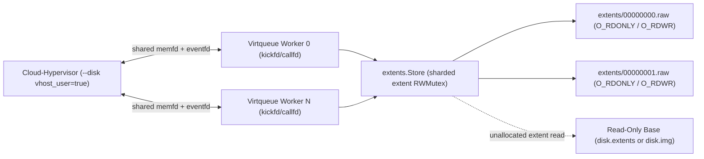

# N-MiB Extent Storage Backend Design (`pkg/extents` & `pkg/extent`)

## 1. Background & Problem Statement

Granule MicroVM guest images must balance two competing requirements:

1. **OCI Image Layering & Registry Deduplication**:
   - In `granule guest build` and multi-stage `Granulefile` builds (`RUN` instructions inside a booted VM), each build step runs inside a container backed by Docker's `overlayfs` and commits the resulting filesystem delta via `docker commit`.
   - When the guest root filesystem is stored in a single monolithic flat file (`/var/lib/granule/guest/disk.img`), opening `/var/lib/granule/guest/disk.img` with `O_RDWR` in `persistent` mode triggers Linux `overlayfs` `ovl_copy_up` of the entire multi-GiB image on the very first write. Every subsequent `RUN` layer duplicates the full disk image in the OCI registry.
   - Furthermore, sparse holes created by `truncate` in `disk.img` are materialized as streams of zero bytes when Docker/OCI tar layers are extracted on hosts that pull the image.

2. **Runtime Block Performance, Security, & Layer Depth**:
   - Cloud-Hypervisor enforces a hard 10-layer QCOW2 backing-chain ceiling (`MaxNestingDepthExceeded` on the 11th layer, leaving only 9 layers for published images once the per-VM runtime overlay is attached).
   - Attaching QCOW2 backing chains in Cloud-Hypervisor requires setting `backing_files=on`, disabling Cloud-Hypervisor's CVE-2026-27211 mitigation and requiring strict header validation against arbitrary host path resolution.
   - Even with the maximum 2 MiB QCOW2 cluster size (`pkg/qcow2`), QCOW2 incurs L1/L2 metadata lookups, cluster-allocation serialization, and backing-chain traversal on unallocated reads.
   - Cloud-Hypervisor's VMDK parser only supports monolithic flat descriptors and rejects multi-extent VMDK descriptors at runtime.

The **Optional N-MiB Extent Storage Backend** resolves both tensions while keeping the standard backend (`qcow2` overlay / flat `disk.img`) as the default.

---

## 2. On-Disk Format & Layout (`pkg/extents`)

An extent store (`pkg/extents`) represents a virtual block device of `virtualSizeBytes` as a directory containing a JSON manifest and fixed-size raw extent files:

- **Guest base image path**: `/var/lib/granule/guest/disk.extents/`
- **Per-VM runtime overlay path**: `/var/lib/granule/overlay/disk.extents/`

```text
/var/lib/granule/guest/disk.extents/
├── manifest.json
└── extents/
    ├── 00000000.raw
    ├── 00000001.raw
    └── 00000004.raw
```

### 2.1 `manifest.json`

```json
{
  "version": 1,
  "virtualSizeBytes": 10737418240,
  "extentSizeBytes": 67108864
}
```

- `version` (`int`): Format version, always `1`.
- `virtualSizeBytes` (`uint64`): Logical disk capacity presented to the guest VM in bytes.
- `extentSizeBytes` (`uint64`): Byte size of each extent slice (default `64 MiB` = `67,108,864` bytes; configurable via `CHV_EXTENT_SIZE_MB` / `-extent-size-mb`). All extents except possibly the final extent have size `extentSizeBytes`; the final extent has size `virtualSizeBytes - (numExtents-1)*extentSizeBytes`.

### 2.2 Sparse / All-Zero Extent Omission

- **Omission during packing (`SplitFromFlat` / `pack-guest`)**: Extents whose byte range in the source filesystem is entirely zero are omitted on disk (no `%08d.raw` file is created).
- **$O(1)$ zero reads**: Reading from an absent extent when no backing store is present zeros the destination buffer in memory (`clear(dst)`) without opening or stating any file once marked absent.
- **Unlink on full-extent `DISCARD` / `WRITE_ZEROES`**:
  - When a store has no non-zero backing data at extent `i`, a `VIRTIO_BLK_T_DISCARD` or `VIRTIO_BLK_T_WRITE_ZEROES` covering all of extent `i` closes any open descriptor and unlinks `extents/%08d.raw`.
  - When operating in `overlay` mode over a base image that has non-zero data at extent `i`, zeroing all of extent `i` replaces `extents/%08d.raw` in the overlay directory with a 100% sparse zeroed file of length `extentLen`, masking the lower base data so subsequent reads return zeros rather than falling through to stale base blocks.
  - Partial-extent `DISCARD` / `WRITE_ZEROES` punches a sparse hole in the extent file via `fallocate(FALLOC_FL_PUNCH_HOLE | FALLOC_FL_KEEP_SIZE)` (with explicit zero-write fallback if the underlying filesystem does not support hole punching).

### 2.3 Security Containment by Construction

Given a byte offset `off` ($0 \le \text{off} < \text{virtualSizeBytes}$):

$$\text{index} = \left\lfloor \frac{\text{off}}{\text{extentSizeBytes}} \right\rfloor, \quad \text{extentOffset} = \text{off} \bmod \text{extentSizeBytes}$$

The file path is computed strictly as:

```go
filepath.Join(dir, "extents", fmt.Sprintf("%08d.raw", index))
```

No file path or backing reference from `manifest.json` or any disk header is ever parsed or resolved. This eliminates the entire class of `backing_files=on` (CVE-2026-27211) and VMDK descriptor path-traversal vulnerabilities by construction.

---

## 3. OCI Layering & Copy-on-Write Semantics

### 3.1 The Linux `overlayfs` `O_RDONLY` Invariant (`persistent` Mode)

In Linux `overlayfs` (used by Docker during `granule guest build` and `Granulefile` `RUN` stages), opening a file that resides in a lower image layer with `O_RDWR` or `O_WRONLY` immediately triggers `ovl_copy_up` inside the kernel `open(2)` path—before a single byte is written.

To guarantee that `docker commit` only captures extents actually written during a build stage:

1. **Read Path (`Store.ReadAt`)**: Existing extent files in `extents/%08d.raw` are opened **strictly with `O_RDONLY`**. Reading the guest root filesystem during VM boot and command execution never triggers `ovl_copy_up` on any extent.
2. **Write Promotion Path (`Store.WriteAt` / `WriteZeroes` / `Discard`)**: Only when a write targets extent `index` does `Store` acquire that extent's write lock (`h.mu.Lock()`), open `extents/%08d.raw` with `O_RDWR|O_CREATE`, close the prior `O_RDONLY` descriptor, and perform the positional `pwrite`.
3. **Unlimited Layer Depth**: Because Docker's `overlayfs` merges the `extents/` directory across container layers at the filesystem level, each `Granulefile` stage only records the $N\text{ MiB}$ extent files modified in that stage. Unmodified extents remain shared in lower OCI layers with no 10-layer backing chain limit.

### 3.2 Per-VM `overlay` Mode (`CHV_DISK_MODE=overlay`)

At runtime, `CHV_DISK_MODE=overlay` (the default disk mode) creates a lightweight per-VM overlay directory at `/var/lib/granule/overlay/disk.extents`:

- **Base Compatibility**: `extents.Store` supports two read-only base formats seamlessly:
  1. An extent directory (`/var/lib/granule/guest/disk.extents`).
  2. A standard flat image (`/var/lib/granule/guest/disk.img`), reading the slice `[index*extentSize, (index+1)*extentSize)` directly from `disk.img`. This allows `CHV_STORAGE_BACKEND=extents` to be used in `overlay` mode even on existing flat-disk guest images without repacking them first.
- **Lazy Extent Materialization**:
  - Reads to unmodified extents are served directly from the read-only base (`O_RDONLY`).
  - On the first partial write to extent `i`, the overlay extent `/var/lib/granule/overlay/disk.extents/extents/%08d.raw` is materialized lazily using `FICLONE` / `FICLONERANGE` (`unix.IoctlFileClone` / `unix.IoctlFileCloneRange`) when the host filesystem supports reflinks (XFS, Btrfs, bcachefs), or a `SEEK_DATA`/`SEEK_HOLE` sparse copy fallback, before applying the write.
  - If a write overwrites the entire extent (`[0, extentLen)`), the overlay extent is created directly without copying from the base.

### 3.3 Offline Split & Boot-Time Flat Assembly (`pkg/extent`)

In addition to the live `vhost-user-blk` extent backend (`pkg/extents`), `pkg/extent` provides `granule guest split` and `granule guest assemble` for content-addressed (`sha256`) offline extent directories where extents live directly at `<dir>/%08d.raw` and are assembled into a single flat raw file at `OverlayPath` via `FICLONERANGE` during `config.PrepareOverlay` when `CHV_STORAGE_BACKEND` is `standard`.

---

## 4. Runtime Block Presentation (`vhost-user-blk`)

When `CHV_STORAGE_BACKEND=extents` (or `/var/lib/granule/guest/disk.extents/extents` is present), Cloud-Hypervisor attaches the extent store at runtime over a Unix domain socket via `vhost-user-blk`:

```text
--disk vhost_user=true,socket=/run/granule/vhost-blk.sock,num_queues=<N>,queue_size=256
```

### 4.1 Zero-Copy Shared Guest Memory (`VHOST_USER_SET_MEM_TABLE`)

`hypervisor.BuildArgs` already configures guest memory with `--memory size=<M>M,shared=on` by default, causing Cloud-Hypervisor to allocate guest RAM as a shared `memfd`. During device initialization (and on `virtio-mem` hotplug via `VHOST_USER_ADD_MEM_REG`), Cloud-Hypervisor passes the guest memory `memfd` descriptors over `/run/granule/vhost-blk.sock` via `SCM_RIGHTS`.

`extents.Server` `mmap`s these regions (`PROT_READ|PROT_WRITE`, `MAP_SHARED`) and translates guest physical addresses (`gpa`) in virtqueue descriptors directly to host `[]byte` slices, performing positional `pread`/`pwrite` (`os.File.ReadAt`/`WriteAt`) directly between guest RAM and the per-extent file descriptors.

### 4.2 Concurrency, Multi-Queue Workers, & Dirty-Extent Flush



- **Multi-queue workers**: Each enabled virtqueue runs a dedicated worker goroutine polling its `kickfd` (`unix.Poll` on `kickfd` + shutdown `eventfd`), draining available descriptor chains (`VRING_DESC_F_NEXT`, `VRING_DESC_F_WRITE`, `VRING_DESC_F_INDIRECT`, `VIRTIO_RING_F_EVENT_IDX`), and signaling completions via `callfd`.
- **Sharded per-extent locking**: Each extent index has an independent `sync.RWMutex`. Steady-state reads and writes to an already-open extent acquire only `RLock()`, allowing concurrent positional `pread`/`pwrite` across and within extents. `Lock()` is acquired only once per extent during initial `O_RDONLY` open or first-write `O_RDWR` promotion.
- **Dirty-extent tracking**: Each extent tracks an `atomic.Bool` dirty flag set on `WriteAt`, `WriteZeroes`, and `Discard`. When the guest issues `VIRTIO_BLK_T_FLUSH`, `Store.Flush()` only invokes `fdatasync(2)` on extents whose dirty flag was set since the previous flush.

---

## 5. Configuration Surface

The standard backend (`standard`) remains the default everywhere. Users can opt into `extents` at any layer:

| Surface | Option / Variable | Values |
| --- | --- | --- |
| Runtime environment | `CHV_STORAGE_BACKEND` | `standard` (default), `extents` (auto-detected if `/var/lib/granule/guest/disk.extents/extents` is present) |
| Runtime environment | `CHV_EXTENT_SIZE_MB` | Positive integer MiB (default `64`) |
| `pack-guest` environment | `GRANULE_STORAGE_BACKEND` | `standard` (default), `extents` |
| `pack-guest` environment | `GRANULE_EXTENT_SIZE_MB` | Positive integer MiB (default `64`) |
| CLI (`guest pack`, `guest build`) | `-storage-backend`, `-extent-size-mb` | `standard` / `extents`, `<N>` |
| CLI (`vm create`, `vm update`) | `-storage-backend`, `-extent-size-mb` | `standard` / `extents`, `<N>` |
| `Granulefile` | `VM SET storage-backend=extents` | `standard`, `extents` |
| `Granulefile` | `VM SET extent-size-mb=<N>` | Positive integer MiB |

---

## 6. Benchmark Comparison

The end-to-end comparison is in [`benchmarks/storage/README.md`](../benchmarks/storage/README.md). It runs fio, cold start and OCI layer size against flat `disk.img`, QCOW2 and the native host, on a dedicated GCE VM. The table below covers the Go microbenchmarks.

Measured via `go test -bench=. -benchmem ./pkg/extents/...` on Linux `amd64` (Intel Xeon 6985P-C @ 2.30 GHz):

| Benchmark | `extents` Backend (`pkg/extents`) | Baseline (`pkg/qcow2` 2 MiB / Flat File) | Comparison |
| --- | --- | --- | --- |
| **Overlay Initialization (10 GiB virtual disk)** | **26.4 µs/op** (`4,347 B/op`) | **23.95 ms/op** (`6,292,308 B/op`, QCOW2 2 MiB) | **905x faster**, 99.9% less memory |
| **Random 4 KiB Read** | **285.0 ns/op** (`14,369.7 MB/s`, `0 B/op`) | **261.8 ns/op** (`15,643.5 MB/s`, Flat `disk.img`) | Within **8%** of raw flat file, 0 allocs |
| **Random 4 KiB Write** | **1,027.0 ns/op** (`3,989.7 MB/s`, `0 B/op`) | **967.5 ns/op** (`4,233.4 MB/s`, Flat `disk.img`) | Within **6%** of raw flat file, 0 allocs |
| **Sequential 1 MiB Read** | **143.6 µs/op** (`7,301.2 MB/s`, `0 B/op`) | Raw positional `pread` | **7.3 GB/s**, 0 allocs |
| **Sequential 1 MiB Write** | **222.5 µs/op** (`4,711.8 MB/s`, `0 B/op`) | Raw positional `pwrite` | **4.7 GB/s**, 0 allocs |
